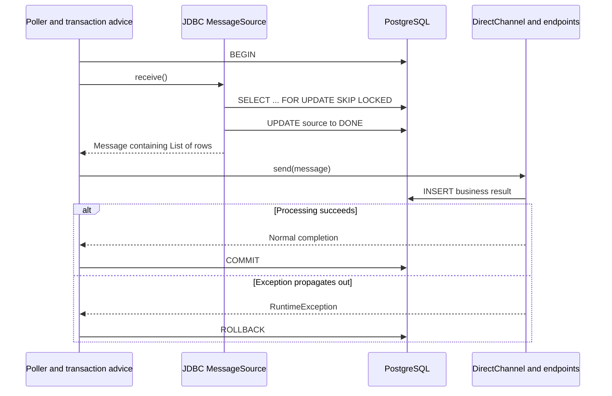
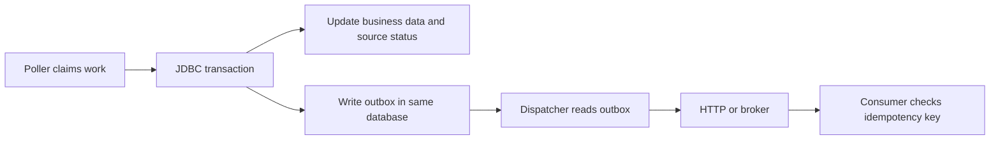

# Poller transactions with a database

## 1. Goals and scope

In the `SPRING_INTEGRATION_CORE` module, this lesson in the **Poller transaction** chapter explains how to design a database-polling flow so that claiming work, updating status, and writing business results succeed together or roll back together.

After this lesson, you will be able to:

- Place the transaction boundary around the poller's `receive()` operation rather than only around a downstream service.
- Combine a JDBC inbound adapter, `Message`, `DirectChannel`, splitter, transformer, and service activator using Java DSL.
- Select a transaction manager matching the `DataSource` and identify components that split transaction scope.
- Design work-claiming queries when multiple instances run concurrently; distinguish rollback, retry, and idempotency.
- Build test scenarios verifying commit, rollback, contention, and asynchronous hand-off.

The examples use **Java 17+, Spring Integration 6.5.x, Spring Framework 6.2.x, and PostgreSQL 17**. This is the example version baseline; when using Spring Boot, let the compatible Boot version's BOM manage Spring libraries. The `LIMIT` and `FOR UPDATE SKIP LOCKED` syntax below targets PostgreSQL.

## 2. The problem: claiming work succeeded, then processing failed

Suppose an application receives order-creation requests via an `integration_job` table. A poller periodically pulls `NEW` rows, transitions them to `DONE`, and writes records into a `processed_order` table.

A flow lacking the proper transaction boundary can play out as follows:

```text
SELECT NEW jobs
UPDATE jobs to DONE and commit
Call order-creation service
Service throws exception
Next poll no longer sees the jobs because status is already DONE
```

If you only add `@Transactional` to the order-creation service, the service transaction begins after the source has already read and updated data. That annotation cannot pull earlier completed operations into the same transaction.

The goal of a poller transaction is to wrap the unit of work:

```text
BEGIN
  Read and lock rows to process
  Update source status
  Send message and run synchronous endpoints
  Write business data through the same JDBC resource
COMMIT if all steps succeed; ROLLBACK if an error matches rollback rules
```

Spring Integration brings the `receive()` operation inside the transaction scope via the poller's transaction advice. This mechanism uses Spring Framework's transaction infrastructure. See [Poller Transaction Support](https://docs.spring.io/spring-integration/reference/6.5/transactions.html#poller-transaction-support).

## 3. Participating components

| Component | Role in this lesson | What to control |
| --- | --- | --- |
| `JdbcPollingChannelAdapter` | Executes the work-claiming query and optional source update statement | Same `DataSource` as the transaction manager |
| `SourcePollingChannelAdapter` poller | Determines when to call the source and applies transaction advice | Transaction must start before `receive()` |
| `Message` | Carries the list of fetched rows and headers | Headers do not carry a JDBC transaction across threads |
| `DirectChannel` | Delivers messages to consumers on the sending thread | Downstream handlers must keep processing synchronously |
| Splitter | Splits the list into child messages | Does not automatically split transactions per row |
| Transformer | Maps a JDBC row to a business object | Conversion errors must follow policy |
| Service activator | Writes business results | Uses JDBC participating in the current transaction |
| `DataSourceTransactionManager` | Manages local transactions for one JDBC `DataSource` | Does not automatically manage other databases or brokers |

`DataSourceTransactionManager` binds a JDBC connection to the current thread. `JdbcTemplate` acquires connections through Spring's mechanism so it can participate in that transaction when using the same `DataSource`. Even two pools with the same JDBC URL should not be treated as the same transactional resource. See [DataSourceTransactionManager](https://docs.spring.io/spring-framework/docs/6.2.x/javadoc-api/org/springframework/jdbc/datasource/DataSourceTransactionManager.html).



The diagram illustrates this lesson's synchronous imperative flow. The same-thread condition must be accompanied by the same transactional resource and compatible propagation; being on the same thread alone is not enough for all operations to roll back.

## 4. Preparing the database

Create the following tables in a PostgreSQL database dedicated to practice:

```sql
CREATE TABLE integration_job (
    id          BIGINT PRIMARY KEY,
    order_ref   VARCHAR(80) NOT NULL,
    amount      NUMERIC(18, 2) NOT NULL,
    status      VARCHAR(16) NOT NULL DEFAULT 'NEW',
    created_at  TIMESTAMPTZ NOT NULL DEFAULT CURRENT_TIMESTAMP,
    CONSTRAINT integration_job_status
        CHECK (status IN ('NEW', 'DONE', 'FAILED'))
);

CREATE INDEX integration_job_pending_idx
    ON integration_job (id)
    WHERE status = 'NEW';

CREATE TABLE processed_order (
    job_id      BIGINT PRIMARY KEY REFERENCES integration_job(id),
    order_ref   VARCHAR(80) NOT NULL UNIQUE,
    amount      NUMERIC(18, 2) NOT NULL,
    created_at  TIMESTAMPTZ NOT NULL DEFAULT CURRENT_TIMESTAMP
);

INSERT INTO integration_job (id, order_ref, amount)
VALUES
    (101, 'ORDER-101', 120000.00),
    (102, 'ORDER-102', 250000.00);
```

`integration_job.id` is the stable identifier of a job. `processed_order.job_id` prevents writing multiple results for the same job, while `order_ref` represents the business constraint in the example.

The partial index keeps the query focused on pending rows. In production systems, monitor execution plans as data distribution and retention policies evolve; a table accumulating many `DONE` rows also needs an archiving or cleanup strategy.

The source table intentionally omits `amount > 0` so invalid data can be fed into the rollback lab exercise. The service validates this condition.

## 5. Java DSL configuration

### 5.1. Requirements to run the example

The application requires `spring-integration-core`, `spring-integration-jdbc`, `spring-jdbc`, and the PostgreSQL JDBC driver. Use compatible Spring library versions; Java DSL is included in `spring-integration-core`, so do not add the legacy Java DSL library.

The configuration below is loaded into a Spring application context that already provides a `DataSource` bean connecting to the database from Section 4. The example assumes the context has one `DataSource`; if multiple sources exist, use `@Qualifier` consistently for the source, transaction manager, and `JdbcTemplate`.

```java
package example.integration;

import java.math.BigDecimal;
import java.util.Map;

import javax.sql.DataSource;

import org.springframework.beans.factory.annotation.Qualifier;
import org.springframework.context.annotation.Bean;
import org.springframework.context.annotation.Configuration;
import org.springframework.integration.channel.DirectChannel;
import org.springframework.integration.config.EnableIntegration;
import org.springframework.integration.dsl.IntegrationFlow;
import org.springframework.integration.dsl.Pollers;
import org.springframework.integration.jdbc.JdbcPollingChannelAdapter;
import org.springframework.jdbc.core.JdbcTemplate;
import org.springframework.jdbc.datasource.DataSourceTransactionManager;
import org.springframework.transaction.PlatformTransactionManager;

@Configuration
@EnableIntegration
public class JobPollingConfiguration {

    @Bean
    public PlatformTransactionManager jdbcTxManager(DataSource dataSource) {
        return new DataSourceTransactionManager(dataSource);
    }

    @Bean
    public JdbcTemplate jobJdbcTemplate(DataSource dataSource) {
        return new JdbcTemplate(dataSource);
    }

    @Bean
    public JdbcPollingChannelAdapter pendingJobs(DataSource dataSource) {
        var source = new JdbcPollingChannelAdapter(dataSource, """
                SELECT id, order_ref, amount
                FROM integration_job
                WHERE status = 'NEW'
                ORDER BY id
                LIMIT 10
                FOR UPDATE SKIP LOCKED
                """);

        source.setUpdateSql("""
                UPDATE integration_job
                SET status = 'DONE'
                WHERE id IN (:id) AND status = 'NEW'
                """);

        return source;
    }

    @Bean
    public DirectChannel jobWorkChannel() {
        return new DirectChannel();
    }

    @Bean
    public OrderWriter orderWriter(
            @Qualifier("jobJdbcTemplate") JdbcTemplate jdbc) {
        return new OrderWriter(jdbc);
    }

    @Bean
    public IntegrationFlow databaseJobFlow(
            JdbcPollingChannelAdapter pendingJobs,
            DirectChannel jobWorkChannel,
            OrderWriter orderWriter,
            @Qualifier("jdbcTxManager") PlatformTransactionManager tm) {

        return IntegrationFlow
                .from(pendingJobs, endpoint -> endpoint
                        .id("databaseJobPoller")
                        .poller(Pollers.fixedDelay(1000)
                                .maxMessagesPerPoll(1)
                                .transactional(tm)))
                .channel(jobWorkChannel)
                .split()
                .transform(Map.class, JobPollingConfiguration::toOrderTask)
                .handle(orderWriter, "write")
                .get();
    }

    private static OrderTask toOrderTask(Map<?, ?> row) {
        return new OrderTask(
                ((Number) row.get("id")).longValue(),
                (String) row.get("order_ref"),
                (BigDecimal) row.get("amount"));
    }

    public record OrderTask(long id, String orderRef, BigDecimal amount) {
    }

    public static class OrderWriter {

        private final JdbcTemplate jdbc;

        public OrderWriter(JdbcTemplate jdbc) {
            this.jdbc = jdbc;
        }

        public void write(OrderTask task) {
            if (task.amount().signum() <= 0) {
                throw new IllegalArgumentException(
                        "Amount must be positive; jobId=" + task.id());
            }

            jdbc.update("""
                    INSERT INTO processed_order (job_id, order_ref, amount)
                    VALUES (?, ?, ?)
                    """, task.id(), task.orderRef(), task.amount());
        }
    }
}
```

`OrderWriter.write()` returns `void` because it is the terminal endpoint of a one-way flow. The flow does not need a `replyChannel` to return results to a caller.

Transaction advice is attached directly to the poller via `.transactional(tm)`. The example does not rely on `@Transactional` on a service to open the source transaction, and does not need `@EnableTransactionManagement` just for this poller transaction advice to work. If adding services that use annotations, configure annotation-driven transaction management accordingly.

### 5.2. Payload and update statement

With the default mapper, a non-empty receive produces a message whose payload is `List<Map<String, Object>>`. The example keeps this type until the splitter, and only then converts each map into an `OrderTask`.

`:id` in the update statement is resolved by convention from the `id` column of the result list. If you change the mapper or property names, re-verify parameter mapping. [JDBC Inbound Channel Adapter](https://docs.spring.io/spring-integration/reference/6.5/jdbc/inbound-channel-adapter.html) describes this list payload and parameter convention.

Important ordering point: `JdbcPollingChannelAdapter` runs `SELECT`, then runs `UPDATE` if configured, and only then returns the payload to the poller. It does not wait for the business service to finish before executing the update statement. You can verify this directly in [doReceive() in version 6.5.4](https://github.com/spring-projects/spring-integration/blob/v6.5.4/spring-integration-jdbc/src/main/java/org/springframework/integration/jdbc/JdbcPollingChannelAdapter.java).

In the example, `DONE` is written inside an uncommitted transaction. The meaning "completed" is trustworthy only in committed data after downstream processing succeeds. The payload still contains the rows from the `SELECT`; the adapter does not re-read the table to reflect newly updated values.

### 5.3. Why do the statements share one transaction?

- The poller opens the transaction before invoking the source.
- The source and `jobJdbcTemplate` use the same `DataSource` bean.
- `DirectChannel` and the endpoints in the example execute directly on the poller thread.
- There is no executor, queue, or independent transaction-opening operation between the source and writer.
- Downstream errors propagate outward to the transaction advice.

These conditions create the example's atomicity. Having two components both labeled "transactional" does not automatically prove they share one transaction.

## 6. Observing commit and rollback

### 6.1. Success case

Once the application has processed the sample data, check from a separate SQL connection:

```sql
SELECT id, status
FROM integration_job
ORDER BY id;

SELECT job_id, order_ref, amount
FROM processed_order
ORDER BY job_id;
```

The expected result is `101` and `102` in `DONE` status in the source, and exactly two matching orders in the destination table.

Observing from another connection evaluates committed state. Querying inside the handler while the transaction is running would expose uncommitted changes from that very transaction.

### 6.2. One failing row rolls back the entire batch

Stop the application before resetting data in the practice database:

```sql
DELETE FROM processed_order WHERE job_id IN (101, 102);

UPDATE integration_job
SET status = 'NEW'
WHERE id IN (101, 102);

UPDATE integration_job
SET amount = -1
WHERE id = 102;
```

After restarting the application:

1. The source reads both rows and tentatively updates both to `DONE`.
2. The splitter sends row `101`; the writer inserts one order in the active transaction.
3. The splitter sends row `102`; the writer throws `IllegalArgumentException`.
4. The exception unwinds to the poller; the transaction rolls back.
5. Both source rows revert to `NEW`, and the just-inserted order `101` is absent from committed data.

Because row `102` is still invalid, the poller will hit the error again on subsequent ticks. To finish the practice scenario, stop the application, fix `amount` on `102` to a positive value, and run again.

Rollback does not mean the framework fixed the data or automatically decided an appropriate retry schedule.

### 6.3. Difference when removing the poller transaction

If you remove `.transactional(tm)`, the JDBC statements in this example are no longer grouped into the source transaction. Under typical connection settings, the source update may already commit before downstream fails. A `DONE` row could end up with no matching order.

This is also why you must not use a unit test calling `OrderWriter.write()` alone to conclude that poller transactions work properly.

## 7. Batching, maxRows, and maxMessagesPerPoll

These three limits operate at different layers:

| Configuration | Unit affected | In this example |
| --- | --- | --- |
| SQL `LIMIT 10` | Maximum rows in one query result | Up to 10 jobs per `receive()` |
| `source.setMaxRows(n)` | Limits rows returned by JDBC to the adapter | Not used; limited directly in SQL |
| `maxMessagesPerPoll(1)` | Maximum source receives per poller trigger tick | One source call, which can hold multiple rows |

For the JDBC inbound adapter, increasing `maxMessagesPerPoll` can execute the query multiple times back-to-back within the same trigger tick. It is not the SQL row count. The source returns `null` when there is no data to build a message. See [max-rows vs. max-messages-per-poll](https://docs.spring.io/spring-integration/reference/6.5/jdbc/inbound-channel-adapter.html#jdbc-max-rows-versus-max-messages-per-poll).

In the standard imperative poller mechanism, transaction advice wraps each receive-and-forward execution via the polling task. Allowing multiple receives in one trigger tick does not mean a single transaction wraps the entire tick. With `REQUIRED` and no outer transaction, each receive gets its own transaction. You can verify this in [AbstractPollingEndpoint.createPollingTask() and the poller loop](https://github.com/spring-projects/spring-integration/blob/v6.5.4/spring-integration-core/src/main/java/org/springframework/integration/endpoint/AbstractPollingEndpoint.java).

In this example:

```text
maxMessagesPerPoll = 1
LIMIT = 10
1 receive → 1 message containing up to 10 rows
splitter → up to 10 child messages, still inside the active transaction
```

If row 7 fails, earlier JDBC changes in the same batch roll back as well. `setUpdatePerRow(true)` only changes the adapter to execute updates row by row; it does not create a separate transaction per row.

If the business requirement is an independent transaction per job, an easy-to-observe starting point is `LIMIT 1`. Then scale workers carefully or design a separate durable claim step. Simply inserting a splitter into a batch does not meet that requirement.

## 8. Multiple instances polling concurrently: transactions alone are not enough

Two pollers running a plain `SELECT ... WHERE status = 'NEW'` can still read the same job. Wrapping each poller in a transaction does not turn that `SELECT` into an exclusive work-claiming operation.

The example's query adds:

```sql
SELECT id, order_ref, amount
FROM integration_job
WHERE status = 'NEW'
ORDER BY id
LIMIT 10
FOR UPDATE SKIP LOCKED;
```

In PostgreSQL, `FOR UPDATE` locks the selected rows, and `SKIP LOCKED` skips rows whose locks cannot be acquired immediately. This suits a queue table with multiple consumers, though it does not yield a complete snapshot of all pending rows. Refer to [PostgreSQL SELECT — Locking Clause](https://www.postgresql.org/docs/17/sql-select.html#SQL-FOR-UPDATE-SHARE).

In this design, exclusive processing of a row is held by its lock until commit or rollback. If a worker rolls back, the row becomes eligible again. Thus, preventing two workers from processing simultaneously and preventing any repeated execution across the entire lifecycle are two distinct requirements.

Reasoning example with two workers:

| Moment | Worker A | Worker B |
| --- | --- | --- |
| T1 | Locks batch containing `101`, `102` | Has not claimed work yet |
| T2 | Writing business data | Skips the two locked rows, claims other rows if any |
| T3 | Commits and releases locks | Continues its own batch |
| T4 | If A rolled back, `101` and `102` remain `NEW` | Can pick them up in a later poll |

Do not infer global processing order from `ORDER BY id`: another worker can skip locked rows and finish a higher ID first. Systems requiring strict per-customer or per-order ordering need a suitable partitioning or coordination strategy.

A conditional `UPDATE ... WHERE status = 'NEW'` is also insufficient if the code ignores the updated row count and still processes all fetched rows. The adapter in the example is protected by the locking query; do not drop the locking clause and assume the update condition alone replaces claiming mechanics.

## 9. Transaction attributes and propagation

### 9.1. Starting with a simple configuration

`.transactional(tm)` uses default transaction attributes. Since the source updates and downstream inserts, this flow requires a writable transaction.

When you need custom timeout, isolation, or rollback rules, create a `TransactionInterceptor` and pass it to the `.transactional(txAdvice)` overload. Additional bean example inside the configuration class:

```java
@Bean
public org.springframework.transaction.interceptor.TransactionInterceptor
        pollerTxAdvice(
                @Qualifier("jdbcTxManager") PlatformTransactionManager tm) {

    var attributes =
            new org.springframework.transaction.interceptor.RuleBasedTransactionAttribute();
    attributes.setPropagationBehavior(
            org.springframework.transaction.TransactionDefinition.PROPAGATION_REQUIRED);
    attributes.setIsolationLevel(
            org.springframework.transaction.TransactionDefinition.ISOLATION_READ_COMMITTED);
    attributes.setTimeout(10); // seconds, not milliseconds
    attributes.setReadOnly(false);
    attributes.setRollbackRules(java.util.List.of(
            new org.springframework.transaction.interceptor.RollbackRuleAttribute(
                    Exception.class)));

    var attributeSource =
            new org.springframework.transaction.interceptor.NameMatchTransactionAttributeSource();
    attributeSource.addTransactionalMethod("*", attributes);

    var advice =
            new org.springframework.transaction.interceptor.TransactionInterceptor();
    advice.setTransactionManager(tm);
    advice.setTransactionAttributeSource(attributeSource);
    return advice;
}
```

To use it, inject the advice bean into the flow factory method and replace `.transactional(tm)` with `.transactional(pollerTxAdvice)`. Use only one of the two approaches on the same poller to avoid adding duplicate transaction advice. Passing a `TransactionInterceptor` is shown in [PollerSpec in Spring Integration 6.5.4](https://github.com/spring-projects/spring-integration/blob/v6.5.4/spring-integration-core/src/main/java/org/springframework/integration/dsl/PollerSpec.java).

`timeout = 10` bounds the transaction via transaction/JDBC mechanisms; it is not an arbitrary kill switch that aborts any HTTP request or Java computation after exactly 10 seconds. Blocking operations still need their own timeouts.

### 9.2. Which exceptions trigger rollback?

Spring's transaction default rolls back on `RuntimeException` or `Error`; checked exceptions need explicit rules if they reach the interceptor as checked exceptions. Spring Integration can wrap handler errors in `MessagingException`, so examine the actual exception reaching the transaction boundary. The main example throws `IllegalArgumentException` to make rollback behavior clear. See [Rolling Back a Declarative Transaction](https://docs.spring.io/spring-framework/reference/6.2/data-access/transaction/declarative/rolling-back.html).

If a handler catches the error and returns normally, transaction advice may see success and commit. If an inner transactional call has already marked rollback-only, catching the exception outside still does not guarantee commit; you may get `UnexpectedRollbackException`.

### 9.3. Propagation in downstream services

| Propagation on proxied service | Consequence when poller already holds a transaction |
| --- | --- |
| `REQUIRED` | Joins current transaction when resource matches; usually fits atomic flows |
| `MANDATORY` | Requires an existing transaction; useful for exposing wrong calling contexts |
| `REQUIRES_NEW` | Creates an independent transaction; committed results here survive even if poller rolls back |
| `NOT_SUPPORTED` | Suspends current transaction for the call; operations inside lack the original atomicity |

`REQUIRES_NEW` can require an extra connection while the outer transaction still holds its connection and locks. Use it only when an independent write is intentionally desired, such as separate audit logging. This behavior is described in [Transaction Propagation](https://docs.spring.io/spring-framework/reference/6.2/data-access/transaction/declarative/tx-propagation.html).

Raising isolation to `SERIALIZABLE` does not replace work-claiming design; it can introduce serialization failures that require retries. This lesson uses row locking and explicit transaction scopes to define processing ownership.

## 10. Error handling, retry, and repeatedly failing jobs

### 10.1. errorChannel does not decide on behalf of the transaction

In a synchronous flow, errors must propagate out of the handler to the transaction advice. At the poller task level, the framework can wrap errors into an `ErrorMessage` for error-handling flows.

Distinguish a task-level error handler outside the transaction from a handler or recovery callback inside the business flow. A recovery callback running inside and swallowing exceptions can cause the transaction to commit; logging errors outside does not automatically undo an already-completed commit. See [Error Handling](https://docs.spring.io/spring-integration/reference/6.5/error-handling.html).

If you add `.errorChannel("jobPollingErrors")`, declare that channel and a matching consumer. When an error occurs directly during `SELECT` or at commit time, a full business message may not exist; the error consumer must handle a missing `failedMessage`.

Useful diagnostic details include job ID if present, an application-assigned batch ID, endpoint name, exception type, SQLState, and attempt count. Avoid using `MessageHeaders.ID` as a durable deduplication key for a job: a reread can generate a new message with a new ID.

### 10.2. Retries need clear scope

Rereading a `NEW` row on the next poll tick is a form of retry driven by database state. It differs from retrying a handler inside the same polling task.

After an SQL error puts a PostgreSQL transaction into an aborted state, re-running statements inside that same transaction usually will not succeed. For transient errors such as deadlocks or serialization failures, end the failed transaction and retry the entire unit of work in a new transaction.

When using retry advice, define the wrapping order so each attempt opens a fresh transaction, conceptually:

```text
Retry outside
  Attempt 1: fresh transaction → receive and process → rollback
  Backoff
  Attempt 2: fresh transaction → receive and process → commit
```

Retrying the entire polling task may select a different batch when multiple workers compete. If you need per-job attempt tracking, use the job ID and a matching claim/status model.

### 10.3. A permanently invalid row can keep an entire batch pending

A row with `amount = -1` will not become valid through retries. When it repeatedly appears in the first batch, valid rows in the same batch may be rolled back repeatedly.

Design options include:

- Reducing batch size to narrow the rollback blast radius.
- Classifying invalid data as a rejected business outcome, recording the reason, and transitioning status in a successful transaction.
- Separating claim and processing steps, adding attempt count, next-attempt timestamp, and `FAILED` status.
- Moving jobs to a quarantine area after a bounded policy for investigation and replay.

A retry counter incremented and rolled back with the failed transaction loses its progress. If writing failure info in an independent transaction, watch out for locks: an outer transaction still locking the source row can block a new transaction trying to update that same row. Usually, write after the failed transaction ends or write to a dedicated audit resource.

## 11. Asynchronous hand-off and non-database side effects

### 11.1. Replacing DirectChannel with ExecutorChannel or QueueChannel

Suppose the flow is changed to:

```text
Poller transaction → UPDATE source → ExecutorChannel → writer on another thread
```

Once the message is handed off successfully, the poller's transaction does not wait for business work on the receiving thread. A later writer failure cannot roll back the already-committed source transaction.

For local JDBC transactions in this example, context is thread-bound; attaching a `transactionId` header to a message does not carry the connection or transaction along with the message. This scope is explained in [Transaction Boundaries](https://docs.spring.io/spring-integration/reference/6.5/transactions.html#transaction-boundaries).

An in-memory `QueueChannel` also introduces a durability gap: the source may have committed while queued messages are lost upon an abrupt process shutdown.

When durable asynchrony is required, design hand-offs via a JDBC message store sharing the same transactional resource or via a transactional outbox. The downstream consumer still needs its own transaction and error policy. Switching channel types alone does not complete that design.

### 11.2. HTTP, email, and brokers do not automatically roll back with JDBC

Another example:

```text
BEGIN JDBC
  Mark work item
  Call HTTP to create shipment successfully
  INSERT result encounters error
ROLLBACK JDBC
```

The database reverts to its prior state, yet the external shipment may already be created. The next poll may repeat the HTTP call. A local JDBC transaction manager does not provide atomicity across both systems.

The outbox pattern fits when outbound requests can be persisted as durable data:



This is a design recommendation derived from the limits of local transactions in this lesson. The dispatcher can still send duplicates if it stops after sending but before marking sent. Therefore, provide a stable idempotency key—such as job ID or event ID—along with defined duplicate handling on the receiver.

An `afterCommit` callback suits certain post-commit actions, but it does not replace a durable outbox record: the application can crash between commit and callback, or the callback can fail after commit already succeeded.

### 11.3. When processing takes a long time

Do not hold source locks across a task lasting several minutes. An alternative model is:

```text
Transaction A: claim NEW → PROCESSING, record owner and lease_until, commit
Process task
Transaction B: confirm result → DONE or schedule retry
```

This model differs from the lesson's synchronous batch and requires additional schema. Leases require renewal, reclamation, ownership verification upon completion, and handling stale workers still running after lease expiration. A `PROCESSING` status alone does not handle worker crashes or repeated external side effects.

## 12. Testing transaction boundaries

Tests should inspect committed database state and run through the real poller endpoint when evaluating poller configuration. Mocking `JdbcTemplate` only tests local interactions; it does not prove rollback, locking, or how connections join transactions.

For this lesson's PostgreSQL SQL, use a real PostgreSQL instance or an isolated PostgreSQL test environment, such as via Testcontainers. Another in-memory database is insufficient to validate all `SKIP LOCKED` characteristics.

| Scenario | Setup | Result to verify |
| --- | --- | --- |
| Commit | Two valid jobs | Source `DONE`, two committed results |
| Downstream rollback | Second job has negative amount | Entire batch stays `NEW`, no insert from first job |
| Source failure | Failing query or connection | No business changes, error observed |
| Empty poll | No `NEW` jobs | No empty business message triggers writer |
| Rerun after success | Keep source rows as `DONE` | No extra orders created for those jobs |
| Two workers | Two contexts/instances on same DB, hold A's batch with a latch | B skips rows locked by A |
| Recovery after rollback | A fails while holding lock, then fix cause | Released jobs can be claimed again by a worker |
| Async boundary | Swap channel and make consumer fail after hand-off | Demonstrates source can commit before consumer error |
| Independent transaction | Have service write with `REQUIRES_NEW`, then fail outside | Inner transaction result can survive despite source rollback |

For reliable tests:

1. Start the context with the poller initially stopped; configure `.autoStartup(false)` on the endpoint in test config.
2. Prepare and commit seed data before starting the poller.
3. Obtain the `databaseJobPoller` endpoint to start/stop per scenario; use latches or condition waits with timeouts for processing milestones.
4. Wait for the final outcome, then read via a separate connection. A handler merely finishing does not prove commit completed.
5. Stop the poller and wait for in-flight transactions to end before cleaning up data.

Do not wrap all seed setup in an uncommitted test transaction and expect the poller thread to see it. Likewise, rolling back a test-thread transaction does not clean up commits that occurred on the poller thread.

For a quick context check inside the writer, you can observe:

```java
boolean active = org.springframework.transaction.support
        .TransactionSynchronizationManager.isActualTransactionActive();
String threadName = Thread.currentThread().getName();
```

`active = true` is a diagnostic signal; it does not prove the writer and source share the same connection or transaction manager. The key behavioral proof remains that changes from both disappear together in a rollback scenario.

## 13. Operations and diagnostics

### 13.1. Batch size and lock hold times

If average processing time per job is `t`, a batch has `B` jobs, and the writer runs sequentially, you can roughly estimate:

```text
transaction time ≈ query and update time + B × t + commit time
```

For example, if `B = 10`, `t = 40 ms`, and receive plus commit total roughly `30 ms`, each transaction takes approximately `430 ms`. With a `1000 ms` fixed delay and synchronous executor as configured in this lesson, the gap between two starts may be roughly `1430 ms`, excluding system variance. This is an example estimate, not a framework-guaranteed throughput rate.

Increasing batch size can reduce commits per job, but holds locks longer, widens the rollback scope, and increases the number of child messages re-executed upon failure.

If adding an executor to the poller, re-evaluate concurrent task counts, executor queue capacity, connection pool sizing, and how trigger schedules interact with the executor. A poller's executor and an `ExecutorChannel` mid-flow are two distinct configuration points; do not infer their transactional behavior merely from the word "executor".

### 13.2. Signals to monitor

- Count of `NEW` jobs, age of the oldest pending job, and count of `FAILED` jobs.
- Counts of non-empty polls, empty polls, rolled-back batches, and SQL errors.
- Transaction duration, per-job processing time, and connection wait time.
- Lock waits, deadlocks, serialization failures, and workers holding transactions too long.
- Completed jobs per time interval, rather than counting poll cycles alone.

`SKIP LOCKED` can make a receive return empty even when work remains locked by another worker. Thus, an empty poll does not prove the system has drained the entire backlog.

### 13.3. Troubleshooting table

| Symptom | Where to check |
| --- | --- |
| Source `DONE`, destination missing data | Missing poller transaction, swallowed exception, async channel, or writer using another resource |
| Valid rows redone alongside failing row | Batch shares one transaction; splitter does not split transactions |
| Attempt count does not increment | Counter rolled back alongside failing attempt |
| Duplicate orders or external calls | Missing claim/lock on read, non-JDBC side effects, missing idempotency on replay |
| Fast error loop without progress | Permanently bad data or retrying inside an aborted transaction |
| Hung transactions, exhausted pool | Batch too long, blocking I/O, or `REQUIRES_NEW` waiting on connections/locks |
| Transaction active yet rollback incomplete | Verify exact `DataSource`, transaction manager, propagation, and actual connection |

## 14. Extended practice exercises

Execute these steps sequentially on the practice database:

1. Run the example with two valid jobs and verify both source and destination committed.
2. Change the second job's amount to a negative number per Section 6 and observe the entire batch roll back.
3. Change `LIMIT 10` to `LIMIT 1` and compare how the earlier valid job can commit independently.
4. Increase `maxMessagesPerPoll` and track query counts; confirm it controls receive count rather than rows per message.
5. Run two instances and add a controlled wait point in the writer to observe locks and `SKIP LOCKED`.
6. Replace `DirectChannel` with a channel dispatching onto another thread in a test copy, then trigger a consumer failure after hand-off.
7. Sketch an outbox for an outbound HTTP request, choose an idempotency key, and define replay handling if the dispatcher crashes after sending.

When presenting results, redraw the actual transaction boundaries and indicate which data committed at each failure point. That serves as the basis for deciding whether to keep synchronous processing in one transaction or split it into durable stages.
