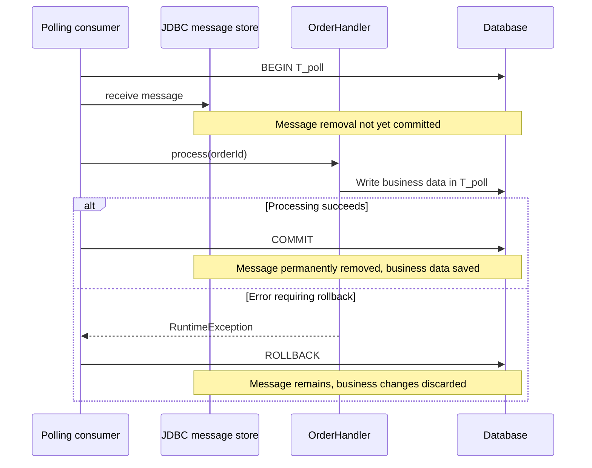

# Poller transactions with a message store

## 1. The problem: message received, yet processing has not succeeded

In Spring Integration Core, `QueueChannel` decouples when a message is sent from when an endpoint processes it. If a consumer pulls a request from the queue and then hits an error while updating data, that request must remain eligible to be processed again. That is why a transaction-capable message store must be combined with a poller transaction.

The running example in this lesson is an order-confirmation flow:

- The producer puts an order ID into a durable queue.
- The polling consumer pulls the order ID and records the business work in PostgreSQL.
- On success, message removal and business updates commit together.
- On failure, both operations roll back together; the message stays in the queue to be picked up again.

After this lesson, you should be able to determine where the transaction begins, which resources actually participate, and why some configurations still lose work despite having a database message store.

## 2. Distinguishing durability from rollback capability

**Durability** answers the question: does a successfully written message survive a process restart? **Transaction participation** answers the question: are adding or removing a message committed/rolled back together with other work?

These two properties must be evaluated separately:

| Configuration | Survives restart | Handler fails after `receive()` |
| --- | --- | --- |
| Default in-memory `QueueChannel` | No | JDBC transaction does not automatically return the message to the queue |
| Queue using JDBC store, poller without transaction | Yes, for messages still in the store | Message removal may have committed before the handler failed |
| Queue using JDBC store, poller with matching transaction | Yes, for committed messages | Message removal can roll back together with JDBC business work |
| Queue using another store | Depends on implementation | Must check its transaction manager and store semantics |

With a queue backed by a transactional persistent store, a message is permanently removed only when the transaction receiving it commits. Rollback restores the database state prior to the receive operation; the application does not need to call `send()` manually to compensate for the message. [Message channel configuration documentation](https://docs.spring.io/spring-integration/reference/channel/configuration.html).

Manually resending the message inside a `catch` block can create duplicates: one sent by application code, and one restored by the database upon rollback.

## 3. Components and transaction boundaries

### 3.1. Choosing the right store type

`JdbcChannelMessageStore` is designed specifically for message channels using a database as queue storage. `JdbcMessageStore` serves broader needs such as storing message groups for an aggregator or claim check. This lesson uses the former for queues; do not use it as a full replacement for aggregator store capabilities. [JDBC message store documentation](https://docs.spring.io/spring-integration/reference/jdbc/message-store.html).

`MessageGroupQueue` provides queue structure backed by the store. Each queue needs a stable `groupId` to locate the same data again after a restart. The store's `region` separates data across applications or environments sharing the same tables. [MessageGroupQueue API](https://docs.spring.io/spring-integration/api/org/springframework/integration/store/MessageGroupQueue.html).

Example naming convention:

```text
DataSource: orders application database
region: orders-service
queue bean: orderQueue
groupId: orders.pending.v1
```

Do not generate a random `groupId` on every startup. The database still keeps messages from the old group, but the new queue will not read that group, making the system appear to have lost data. If multiple instances must compete to process the same queue, they must intentionally share the same region and group.

### 3.2. The transaction must cover the receive operation

Desired boundary:

```text
BEGIN T_poll
  QueueChannel.receive()
    -> fetch and remove message from JDBC store within transaction
  handler.process(orderId)
    -> record processed marker
    -> update order
COMMIT T_poll
```

If the handler raises an error eligible for rollback, `T_poll` rolls back both message retrieval and business changes. Configuring transactions on the poller places `receive()` inside this boundary. [Poller transaction documentation](https://docs.spring.io/spring-integration/reference/transactions.html#poller-transaction-support).



### 3.3. Conditions in this example

The example uses a single local JDBC transaction under these conditions:

1. The store, business `JdbcTemplate`, and transaction manager all use the configured `DataSource`.
2. Business JDBC code uses Spring's transaction-aware connection acquisition; `JdbcTemplate` satisfies this.
3. The handler runs synchronously within the call chain initiated by the poller.
4. The handler does not open a `REQUIRES_NEW` transaction to commit business work separately.
5. Errors requiring rollback escape the work wrapped by the transaction interceptor; rollback rules must match.

`DataSourceTransactionManager` manages transactions for a single JDBC `DataSource` and binds connections to the current thread. Two independent connections merely pointing at the same database are not enough to guarantee they belong to the same transaction. [DataSourceTransactionManager API](https://docs.spring.io/spring-framework/docs/current/javadoc-api/org/springframework/jdbc/datasource/DataSourceTransactionManager.html).

## 4. Java and Java DSL configuration

### 4.1. Environment preparation

The snippets use Java 17 or higher, the Java DSL API available in Spring Integration 6.x, PostgreSQL, and JDBC business data access. If using Spring Boot, let Boot's BOM manage compatible library versions; do not mix Spring versions arbitrarily.

Required dependencies in a Boot application:

```xml
<dependency>
    <groupId>org.springframework.boot</groupId>
    <artifactId>spring-boot-starter-integration</artifactId>
</dependency>
<dependency>
    <groupId>org.springframework.integration</groupId>
    <artifactId>spring-integration-jdbc</artifactId>
</dependency>
<dependency>
    <groupId>org.springframework.boot</groupId>
    <artifactId>spring-boot-starter-jdbc</artifactId>
</dependency>
<dependency>
    <groupId>org.postgresql</groupId>
    <artifactId>postgresql</artifactId>
    <scope>runtime</scope>
</dependency>
```

The application must provide a `DataSource`. Before starting the consumer, create Spring Integration's schema using the PostgreSQL script bundled with your exact `spring-integration-jdbc` version, typically at `org/springframework/integration/jdbc/schema-postgresql.sql`. Manage schema via migrations; do not re-run create/drop scripts on every restart. The store requires the exact tables, sequences, and indexes expected by the query provider. [JdbcChannelMessageStore API and script location](https://docs.spring.io/spring-integration/api/org/springframework/integration/jdbc/store/JdbcChannelMessageStore.html).

Also create two business tables in the same database, accessed through the same `DataSource`:

```sql
create table orders (
    order_id varchar(64) primary key,
    status varchar(20) not null
);

create table processed_order (
    order_id varchar(64) primary key,
    processed_at timestamp with time zone not null default current_timestamp
);
```

In this problem, one order ID represents one confirmation task. If an order has multiple event types or versions, the deduplication key should include the corresponding event type or version.

### 4.2. Store, queue, and consumer

```java
import javax.sql.DataSource;

import org.springframework.beans.factory.annotation.Qualifier;
import org.springframework.beans.factory.annotation.Value;
import org.springframework.context.annotation.Bean;
import org.springframework.context.annotation.Configuration;
import org.springframework.integration.channel.QueueChannel;
import org.springframework.integration.config.EnableIntegration;
import org.springframework.integration.dsl.IntegrationFlow;
import org.springframework.integration.dsl.Pollers;
import org.springframework.integration.jdbc.store.JdbcChannelMessageStore;
import org.springframework.integration.jdbc.store.channel.PostgresChannelMessageStoreQueryProvider;
import org.springframework.integration.store.MessageGroupQueue;
import org.springframework.jdbc.core.JdbcTemplate;
import org.springframework.jdbc.datasource.DataSourceTransactionManager;
import org.springframework.transaction.PlatformTransactionManager;

@Configuration
@EnableIntegration
public class PollerMessageStoreConfig {

    public static final String ORDER_GROUP = "orders.pending.v1";

    @Bean
    public PlatformTransactionManager integrationTransactionManager(
            DataSource dataSource) {
        return new DataSourceTransactionManager(dataSource);
    }

    @Bean
    public JdbcTemplate orderJdbcTemplate(DataSource dataSource) {
        return new JdbcTemplate(dataSource);
    }

    @Bean
    public JdbcChannelMessageStore orderMessageStore(DataSource dataSource) {
        JdbcChannelMessageStore store = new JdbcChannelMessageStore(dataSource);
        store.setChannelMessageStoreQueryProvider(
                new PostgresChannelMessageStoreQueryProvider());
        store.setRegion("orders-service");
        return store;
    }

    @Bean
    public QueueChannel orderQueue(
            @Qualifier("orderMessageStore") JdbcChannelMessageStore store) {
        return new QueueChannel(new MessageGroupQueue(store, ORDER_GROUP));
    }

    @Bean
    public OrderHandler orderHandler(
            @Qualifier("orderJdbcTemplate") JdbcTemplate jdbc) {
        return new OrderHandler(jdbc);
    }

    @Bean
    public IntegrationFlow orderProcessingFlow(
            @Qualifier("orderQueue") QueueChannel queue,
            OrderHandler handler,
            @Qualifier("integrationTransactionManager")
                    PlatformTransactionManager transactionManager,
            @Value("${lesson.order-consumer.auto-startup:true}")
                    boolean autoStartup) {
        return IntegrationFlow.from(queue)
                .handle(handler, "process", endpoint -> endpoint
                        .id("orderConsumer")
                        .autoStartup(autoStartup)
                        .poller(Pollers.fixedDelay(500)
                                .receiveTimeout(0)
                                .maxMessagesPerPoll(1)
                                .transactional(transactionManager)))
                .get();
    }
}
```

`OrderHandler` sits in the same package as the configuration class:

```java
import org.springframework.jdbc.core.JdbcTemplate;

public class OrderHandler {

    private final JdbcTemplate jdbc;

    public OrderHandler(JdbcTemplate jdbc) {
        this.jdbc = jdbc;
    }

    public void process(String orderId) {
        if (orderId == null || orderId.isBlank()) {
            throw new IllegalArgumentException("Missing orderId");
        }

        int inserted = jdbc.update("""
                insert into processed_order(order_id)
                values (?)
                on conflict (order_id) do nothing
                """, orderId);

        if (inserted == 0) {
            return;
        }

        int updated = jdbc.update("""
                update orders set status = 'CONFIRMED'
                where order_id = ?
                """, orderId);

        if (updated != 1) {
            throw new IllegalStateException("Order not found: " + orderId);
        }
    }
}
```

This is a one-way service activator: the `void` method produces no reply. The payload is simply a `String` containing `orderId`, helping the example avoid depending on a serialized DTO class. When using complex payloads and headers, verify serialization mechanics, deserialization settings of your store version, and backward compatibility when reading older messages after deploying a new version.

`ON CONFLICT ... DO NOTHING` handles the case where the business key already exists without deliberately raising a unique constraint error. In the example, zero inserted rows means this job was already processed previously. This is PostgreSQL syntax; replace it with an equivalent mechanism if switching databases. [PostgreSQL INSERT documentation](https://www.postgresql.org/docs/current/sql-insert.html).

The `processed_order` record and `orders` update both sit inside the poller transaction. If the update fails, the processed marker rolls back too. If another message carrying the same completed order ID arrives later, the handler can finish safely and the duplicate message is consumed upon transaction commit.

### 4.3. Reading the poller configuration accurately

| Component | Meaning in the example |
| --- | --- |
| `fixedDelay(500)` | Polling schedule with a 500 ms delay between ticks under current config |
| `receiveTimeout(0)` | Do not wait for a message when the queue is empty |
| `maxMessagesPerPoll(1)` | Receive at most one message per scheduled tick |
| `transactional(transactionManager)` | Attaches transaction advice to receiving and processing the message |
| `autoStartup` | Allows disabling the consumer in test fixtures |

`PollerSpec` configures transactions and receive timeouts separately; do not infer them merely from polling frequency. [PollerSpec API](https://docs.spring.io/spring-integration/api/org/springframework/integration/dsl/PollerSpec.html).

Do not mark the message-receiving transaction as read-only: the store must perform data modifications. Similarly, `receiveTimeout` is not the transaction timeout.

Increasing `maxMessagesPerPoll` does not mean creating one atomic transaction for the whole batch. In Spring Integration 6.3's standard imperative poller mechanism, advice wraps each execution of the polling task inside the scheduled loop. Thus, an earlier message may already commit when a later message fails. [AbstractPollingEndpoint 6.3.11 source code](https://raw.githubusercontent.com/spring-projects/spring-integration/v6.3.11/spring-integration-core/src/main/java/org/springframework/integration/endpoint/AbstractPollingEndpoint.java).

## 5. Producers also have their own transaction boundaries

To simply send a work item, a producer can call:

```java
boolean sent = orderQueue.send(
        MessageBuilder.withPayload("ORD-1001").build());
if (!sent) {
    throw new IllegalStateException("Unable to write work item to queue");
}
```

The snippet uses `org.springframework.integration.support.MessageBuilder`; `orderQueue` is an injected bean. `send()` succeeding here indicates putting the message into the queue; it does not confirm that the handler has finished the order.

If creating the order and enqueuing the work item must be atomic, place both inside a producer transaction on the same resource:

```java
TransactionTemplate producerTx =
        new TransactionTemplate(integrationTransactionManager);

producerTx.executeWithoutResult(status -> {
    orderJdbcTemplate.update("""
            insert into orders(order_id, status) values (?, 'NEW')
            """, "ORD-1001");

    boolean sent = orderQueue.send(
            MessageBuilder.withPayload("ORD-1001").build());
    if (!sent) {
        throw new IllegalStateException("Unable to write work item to queue");
    }
});
```

`TransactionTemplate` belongs to `org.springframework.transaction.support`; the remaining variables are configured beans. The callback allows placing explicit transaction boundaries in imperative flows. [Programmatic transaction documentation](https://docs.spring.io/spring-framework/reference/data-access/transaction/programmatic.html).

The producer transaction `T_send` and consumer transaction `T_poll` are two separate transactions. The consumer independently processes work committed by the producer. If the producer rolls back, neither the new order nor the new message is saved by that transaction.

Calling through a messaging gateway does not automatically merge these two transactions. With a one-way gateway sending to a queue, completing the call is still just handing off the work; to learn the business outcome, design a reply mechanism or separate status query.

## 6. Configurations that alter guarantees

### 6.1. Adding `@Transactional` only to the service

Suppose the poller has no transaction:

```text
receive() from JDBC queue -> retrieval operation has already completed
                            -> service starts T_service
                            -> service fails, rolls back T_service
```

Even when the annotation is properly applied via a proxy, the service transaction still begins after the receive operation. Business rollback does not cover that earlier operation. To keep the work item in the queue when the handler fails, the transaction must begin at the poller.

Once the poller has created a transaction, the service can join it using a matching propagation such as `REQUIRED` with the same transaction manager. The example uses `JdbcTemplate` directly, so no annotation is needed on the handler to join the active transaction.

### 6.2. Handing off processing to another thread

```text
T_poll: receive from store -> ExecutorChannel -> call path ends, commit
                                      |
                                      +-> another thread processes and fails
```

The poller thread's JDBC transaction does not automatically propagate to the worker thread. After an asynchronous hand-off succeeds, the poller can commit before business work finishes.

Distinguish this from the poller's own `taskExecutor`: that executor may run the entire polling task, inside which the transaction still starts before `receive()` and the handler. What to check is where the transaction opens relative to where threads switch. [Poller documentation](https://docs.spring.io/spring-integration/reference/polling-consumer.html).

To split a flow into multiple independent stages, hand off to another durable queue. When both queues use the same compatible transactional resource, removing from the first stage and writing to the next queue can commit together; business work in the subsequent consumer belongs to a different transaction.

### 6.3. Multiple databases or side effects outside JDBC

A local JDBC transaction manager cannot automatically roll back an HTTP request, a sent email, or operations in another database. Consider this scenario:

```text
receive message in T_poll
-> call payment API successfully
-> database update fails
-> rollback T_poll
-> message reappears
-> next time may call payment again
```

In this design, you need an idempotency key accepted by the payment system, or you write an outbound send intent into an outbox table in the same database transaction and let another stage execute it. The outbox still needs a deduplication strategy when retrying sends.

A message store and poller transaction provide a foundation for reprocessing upon failure. Do not infer an exactly-once guarantee for all external side effects merely from having configured `.transactional(...)`.

## 7. Error handling, retry, and unprocessable messages

### 7.1. Errors must be observed by the transaction interceptor

A pattern prone to unintended commits:

```java
try {
    performBusinessWork();
}
catch (RuntimeException ex) {
    logger.warn("Processing failed", ex);
    // Returns normally even though work did not complete.
}
```

If the transaction has not been marked rollback-only by another component, a normally returning call path can cause message removal to commit. Logging is not a rollback request.

Under Spring's default rollback rules, `RuntimeException` and `Error` trigger rollback; checked exceptions need suitable rollback rules. In Spring Integration, handler errors may be wrapped in a messaging exception. Inspect the actual exception passing through the transaction advice rather than looking only at business method signatures. [Spring rollback documentation](https://docs.spring.io/spring-framework/reference/data-access/transaction/declarative/rolling-back.html).

### 7.2. `errorChannel` serves the error flow

Under standard poller configuration, when an exception crosses the transaction advice and triggers rollback, the polling task's error-handling mechanism can emit an `ErrorMessage` for logging or alerting. Seeing logs on `errorChannel` does not prove the message moved to a durable error queue. [Error Handling documentation](https://docs.spring.io/spring-integration/reference/error-handling.html).

Distinguish two paths:

- Exception escapes the transactional work, leading to rollback and then error reporting by the poller mechanism.
- Handler or recovery advice handles the exception inside the transaction boundary and returns normally, which can allow the transaction to commit if no rollback-only state exists.

If recovery turns an error into a successful return, explicitly decide whether the message received fallback handling, moved to another store, or must remain in the queue.

### 7.3. Rollback is not a complete retry policy

Rollback makes the message eligible to be pulled again; the poller schedule dictates when the consumer tries again. A message with permanently invalid data can keep coming back, consuming resources and slowing down other work.

Classify errors by recoverability:

| Error category | Handling approach |
| --- | --- |
| Deadlock, transient connection loss | Rollback, retry with appropriate backoff |
| Payload missing required data | Move to durable quarantine per policy |
| Work already completed | Finish idempotently and commit |
| Prolonged system outage | Slow down or pause consumer, raise alert |

Incrementing an attempt counter inside the same transaction that rolls back can discard that increment too. Headers mutated only in memory also do not update the original message restored by the database. Therefore, bounded retries across multiple polls require deliberately persisting and updating attempt counts.

One strategy for data errors detected before business writes is routing the message to a quarantine queue backed by the same database store, then committing both the receive and the quarantine write in the same transaction. Once quarantined successfully, do not rethrow the error just to force a rollback, because doing so would undo the quarantine write as well.

With a transaction already broken by an SQL error, do not assume you can continue writing to a quarantine queue inside that transaction. Roll back and design a subsequent processing transaction; moving/quarantining the message must be atomic to avoid both losing and duplicating work.

## 8. Behavioral testing to ensure guarantees

These are testing guidelines for the learning application; the snippets in this lesson do not mean they have already been executed in a specific project environment.

### 8.1. Testing queue and business rollback

You can test commit/rollback decisions without depending on the scheduler timing. The fixture needs a dedicated PostgreSQL instance for the test, initialized schema, an empty queue, the beans above, and the property:

```properties
lesson.order-consumer.auto-startup=false
```

This property is read by the example configuration itself to keep the `orderConsumer` endpoint disabled; it is not a default Spring Integration property. Do not annotate the entire test with `@Transactional`: the test needs to observe outcomes after the test transaction has finished.

The JUnit 5 method body below uses AssertJ, `Message`, `MessageBuilder`, and `TransactionTemplate`. `orderQueue`, `orderJdbcTemplate`, `orderHandler`, and `integrationTransactionManager` are beans injected into the test:

```java
@Test
void rollbackKeepsMessageAndUndoesBusinessChanges() {
    String orderId = "ORD-TX-ROLLBACK";
    orderJdbcTemplate.update("""
            insert into orders(order_id, status) values (?, 'NEW')
            """, orderId);
    assertThat(orderQueue.send(
            MessageBuilder.withPayload(orderId).build())).isTrue();

    TransactionTemplate tx =
            new TransactionTemplate(integrationTransactionManager);

    assertThatThrownBy(() -> tx.executeWithoutResult(status -> {
        Message<?> received = orderQueue.receive(0);
        assertThat(received).isNotNull();
        assertThat(received.getPayload()).isEqualTo(orderId);

        orderHandler.process((String) received.getPayload());
        throw new IllegalStateException("Simulated failure after writing business data");
    })).isInstanceOf(IllegalStateException.class);

    assertThat(orderQueue.getQueueSize()).isEqualTo(1);
    assertThat(orderJdbcTemplate.queryForObject(
            "select status from orders where order_id = ?",
            String.class, orderId)).isEqualTo("NEW");
    assertThat(orderJdbcTemplate.queryForObject(
            "select count(*) from processed_order where order_id = ?",
            Long.class, orderId)).isEqualTo(0L);

    tx.executeWithoutResult(status -> {
        Message<?> receivedAgain = orderQueue.receive(0);
        assertThat(receivedAgain).isNotNull();
        assertThat(receivedAgain.getPayload()).isEqualTo(orderId);
        orderHandler.process((String) receivedAgain.getPayload());
    });

    assertThat(orderQueue.getQueueSize()).isEqualTo(0);
    assertThat(orderJdbcTemplate.queryForObject(
            "select status from orders where order_id = ?",
            String.class, orderId)).isEqualTo("CONFIRMED");
    assertThat(orderJdbcTemplate.queryForObject(
            "select count(*) from processed_order where order_id = ?",
            Long.class, orderId)).isEqualTo(1L);
}
```

Three observations after the failure must hold simultaneously: the queue still holds the message, the order remains `NEW`, and no `processed_order` marker exists. Checking only one of the three is insufficient to conclude that message retrieval and business work are atomic.

This test explicitly calls `receive()` inside `TransactionTemplate`, thus testing shared transaction participation between the store and business JDBC. It does not yet test that the poller itself has the transaction advice wired correctly.

### 8.2. Testing the poller configuration separately

To test the real endpoint, enable the consumer in another fixture using a test handler. The handler writes business data and throws; the endpoint ID `orderConsumer` lets you control its lifecycle. Wait using latches or timeout-bounded conditions, not a single fixed sleep call.

For rollback cases, keep the handler always failing, await at least one invocation, then stop the endpoint and wait for the in-flight execution to finish before inspecting queue state. Letting the handler succeed automatically on the second attempt can cause the message to be re-received and committed before your assertion runs, skewing observed results.

Valuable additional test cases:

| Test case | Result to observe |
| --- | --- |
| Poller succeeds | Empty queue, order `CONFIRMED`, one processed marker |
| Handler fails after writing data | Message remains, business state unchanged |
| Send two messages with same `orderId` | Both consumed, only one business marker |
| Restart after enqueue commits | New consumer using same group reads the work |
| Producer rolls back after enqueue | Neither new order nor new message from that transaction exists |
| Two competing consumers | No lost work; verify business outcomes and locking on real database |

The restart test must use a database that persists after the application context closes. An in-memory database recreated on the next startup cannot prove store recovery.

## 9. Operations and diagnostics

Do not scale up worker counts based solely on queue depth. With a database queue, throughput also depends on connection pools, row locking, indexes, and transaction hold duration. Choose the query provider matching your database and test contention on the actual database engine in use; the JDBC store has dedicated guidance for concurrent polling and MVCC. [Concurrent polling guide](https://docs.spring.io/spring-integration/reference/jdbc/message-store.html#jdbc-message-store-concurrent-polling).

Useful signals include queue depth per region/group, age of oldest work item, commit/rollback ratio, redelivery counts per business key, transaction duration, and connection wait time. Logging `orderId`, message ID, endpoint, and instance helps correlate attempts without dumping entire payloads.

| Symptom | First thing to check |
| --- | --- |
| Message disappears despite handler rollback | Does the poller have a transaction; is there a thread switch or swallowed exception? |
| Queue has data yet cannot be read after restart | Do `DataSource`, table prefix, `region`, and `groupId` match? |
| Business data written yet message keeps returning | Did business logic use a different transaction manager or `REQUIRES_NEW`? |
| Same error logged forever | Permanent-error message lacks quarantine/retry policy |
| Runs cleanly only with a single consumer | Query provider, contention, isolation, indexes, and connection pool |

Avoid calling slow network services while holding message-retrieval locks unless clearly justified by business requirements. Long transactions degrade availability for both the queue and business tables in the same database.

## 10. Applying to other integration patterns

Synchronous transformers, filters, and routers can sit inside the poller transaction's call path. However, a filter dropping a message without raising an error is normally a regular completion: the transaction may commit and the message leaves the queue. If dropped data requires investigation, design an explicit discard/quarantine path.

Aggregators hold state across multiple messages and follow their own release rules. Having a poller transaction protect one message retrieval does not automatically make the entire lifecycle of a message group one transaction. Examine the aggregator's store, release timing, and any asynchronous boundaries in the flow.

When designing a new stage, write down four elements: the work-retrieval operation, the state-storage resource, the hand-off point, and the transaction completion condition. For this lesson's example, the guarantee to uphold is: **a message is permanently consumed only when the order confirmation status and deduplication marker commit together; failures before commit preserve both retryability and consistent business state**.
