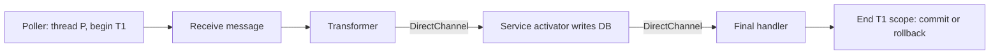
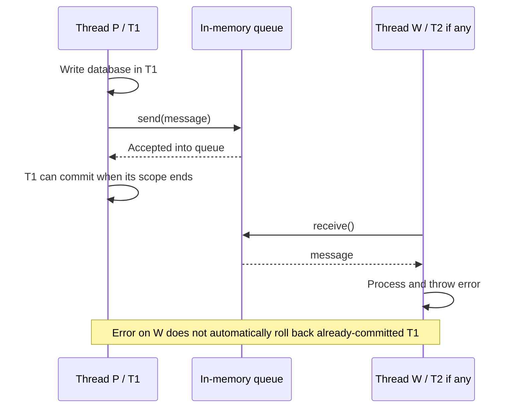

# Limits of transactions in in-memory flows

In the **Poller transaction** chapter of the **SPRING_INTEGRATION_CORE** module, this lesson focuses on what transactions can and cannot protect when designing flows with Message, MessageChannel, endpoints, gateways, and Java DSL.

Ongoing scenario: an application receives order-processing requests, places messages into an in-memory queue, and uses a poller to pull messages and write to a database. If the handler fails, the database can roll back, yet that alone is not enough to conclude the message remains in the queue or all effects of the flow were undone.

After this lesson, you will be able to:

- Identify which resources actually participate in a transaction.
- Draw transaction boundaries as a flow traverses synchronous and asynchronous channels.
- Explain why a transactional poller does not automatically turn an in-memory queue into a transactional queue.
- Choose suitable recovery strategies when retries, durability, or coordination between a database and external systems are needed.

## 1. Transactions are scoped by resource

### 1.1. Running inside a transaction does not equal being rolled back

In a standard imperative flow, Spring manages transactions via a transaction manager and corresponding resources. For JDBC, `DataSourceTransactionManager` manages transactions for a `DataSource`; `JdbcTemplate` uses Spring's connection lookup to join the active transaction. Opening a connection independently can place operations outside the intended transaction. See [Controlling Database Connections](https://docs.spring.io/spring-framework/reference/data-access/jdbc/connections.html).

Distinguish two questions:

1. Is the code executing inside a transaction context?
2. Does the resource mutated by the code have a commit/rollback mechanism and actually participate in that transaction?

An illustrative deduction from this distinction: inside the same handler, an `INSERT` through `JdbcTemplate` can roll back, while `list.add(...)` only mutates a Java object. The database transaction manager does not keep a snapshot of `List` to revert it automatically.

| Operation inside handler | Expectation to set |
|---|---|
| JDBC write via transaction-participating connection | Can roll back per transaction outcome and rollback rules |
| Mutating a `Map`, `List`, or Java object field | Not automatically undone by a database transaction |
| Receiving a message from a standard in-memory `QueueChannel` | Message is not automatically returned to queue when database rolls back |
| Sending an HTTP request or email already accepted externally | Not automatically recalled by database rollback |
| Writing through a different transaction manager | Must analyze separate transaction and resource coordination |

The table above illustrates how to analyze examples, not a guarantee that every JDBC or messaging configuration shares identical behavior.

### 1.2. Three properties to evaluate separately

- **Resource atomicity:** which changes commit together or roll back together?
- **Message durability:** after an abrupt process shutdown, which data survives to continue processing?
- **Reprocessing capability:** which component still holds the message and can redeliver it after a failure?

A thread-safe queue only protects its data structure against concurrent access. It does not inherently provide these three properties.

"In-memory" also does not mean every resource lacks transaction support. For example, an in-memory H2 database still supports transactions for its own data. That does not give a standalone heap-based `QueueChannel` the same rollback capability.

## 2. Thread boundaries and transaction boundaries

### 2.1. Synchronous flows can preserve transaction context

`DirectChannel` invokes handlers on the message-sending thread. If that thread already holds a transaction, compatible downstream operations can join the active transaction. `ExecutorChannel` typically dispatches work to another thread; `PublishSubscribeChannel` can also process asynchronously when given an executor. See [Message Channel Implementations](https://docs.spring.io/spring-integration/reference/channel/implementations.html).

`@Transactional` with `PlatformTransactionManager` typically binds a transaction to the executing thread; it does not automatically propagate that transaction to a new thread. This lesson covers imperative flows; do not mechanically apply this thread-local model to reactive transactions. See [Transactional Javadoc](https://docs.spring.io/spring-framework/docs/current/javadoc-api/org/springframework/transaction/annotation/Transactional.html).



The diagram assumes all steps are synchronous, no propagation creates an independent transaction, and database operations use the right managed resource.

### 2.2. Asynchronous hand-off does not extend the sender's transaction



Passing through a queue does not force the sender's transaction to commit immediately at the `send()` statement. The sender's transaction still ends according to its configured scope. What changes is that downstream work on another thread no longer belongs to that transaction by default.

If W has `@Transactional` or a transactional poller, W can open T2. T2 is a different transaction, not an automatic continuation of T1.

A request-reply gateway may wait for a downstream response, yet waiting does not automatically propagate a transaction onto worker threads. Distinguish waiting for a result from which resources are actually coordinated in one transaction.

## 3. What does a transactional poller protect?

A poller can place receiving a message and subsequent synchronous processing inside a transaction scope. Whether the receive operation can roll back depends on whether the source or store supports transactions. That is why you must analyze `receive()` as well, not just the handler. See [Transaction Support](https://docs.spring.io/spring-integration/reference/transactions.html).

Model for reading the configuration:

```text
begin transaction
    receive from source
    synchronous downstream processing
commit if completed per transaction rules
rollback if rollback condition is met
```

If the "source" is a standard in-memory queue, putting `receive()` inside the block above still provides no undo mechanism for the queue.

### 3.1. Java DSL example: database rolls back, queue still loses the item

Components needed in the application:

- `spring-integration-core`.
- `spring-jdbc` and a matching JDBC driver.
- A `DataSource` bean, with the `processed_order` table created before the poller runs.
- Compatible library versions managed by the project's dependency management.

DDL for the example:

```sql
create table processed_order (
    order_id bigint primary key
);
```

The configuration below intentionally always throws an error after writing to the database to illustrate the limitation. The handler is the terminal step and returns no reply.

```java
import java.time.Duration;
import javax.sql.DataSource;

import org.springframework.context.annotation.Bean;
import org.springframework.context.annotation.Configuration;
import org.springframework.integration.channel.QueueChannel;
import org.springframework.integration.config.EnableIntegration;
import org.springframework.integration.dsl.IntegrationFlow;
import org.springframework.integration.dsl.Pollers;
import org.springframework.jdbc.core.JdbcTemplate;
import org.springframework.jdbc.datasource.DataSourceTransactionManager;
import org.springframework.transaction.PlatformTransactionManager;

@Configuration
@EnableIntegration
public class InMemoryPollerConfig {

    @Bean
    QueueChannel ordersIn() {
        return new QueueChannel(100);
    }

    @Bean
    PlatformTransactionManager transactionManager(DataSource dataSource) {
        return new DataSourceTransactionManager(dataSource);
    }

    @Bean
    JdbcTemplate jdbcTemplate(DataSource dataSource) {
        return new JdbcTemplate(dataSource);
    }

    @Bean
    IntegrationFlow failingOrderFlow(
            QueueChannel ordersIn,
            JdbcTemplate jdbcTemplate,
            PlatformTransactionManager transactionManager) {

        return IntegrationFlow.from(ordersIn)
                .handle(message -> {
                    Long orderId = (Long) message.getPayload();

                    jdbcTemplate.update(
                            "insert into processed_order(order_id) values (?)",
                            orderId);

                    throw new IllegalStateException(
                            "Simulated failure after database write");
                }, endpoint -> endpoint.poller(
                        Pollers.fixedDelay(Duration.ofMillis(500))
                                .receiveTimeout(0)
                                .maxMessagesPerPoll(1)
                                .transactional(transactionManager)))
                .get();
    }
}
```

`PollerSpec.transactional(transactionManager)` adds transaction advice using the specified manager; `receiveTimeout(0)` prevents the poll from waiting when the queue is empty. Refer to [PollerSpec Javadoc](https://docs.spring.io/spring-integration/api/org/springframework/integration/dsl/PollerSpec.html).

Sending a message from the producer, where `ordersIn` is the bean retrieved from the application context:

```java
ordersIn.send(
        org.springframework.messaging.support.MessageBuilder
                .withPayload(1001L)
                .build(),
        0);
```

Assuming the queue is initially empty, send succeeds, and there is one consumer and one message:

| Moment | In-memory queue | Order `1001` data |
|---|---|---|
| Producer send succeeds | 1 message | Absent |
| Poller receives message | 0 messages | Absent |
| Handler executes `INSERT` | 0 messages | Uncommitted change inside transaction |
| Handler throws exception and transaction rolls back | 0 messages | Newly inserted row gone |

This is the deduced outcome for the illustrative setup: the database is rolled back; the queue has no mechanism to automatically put the pulled item back. The next poll can run normally, yet this message is no longer there to receive.

`maxMessagesPerPoll(1)` is chosen to easily observe a single receive–process cycle. Increasing that parameter does not turn an in-memory queue into a transactional queue and is not enough to claim whole-batch atomicity. Poller mechanics are described in [Poller](https://docs.spring.io/spring-integration/reference/polling-consumer.html).

### 3.2. A gateway before the queue confirms acceptance per its own contract

If a gateway sends a one-way request into `ordersIn`, the gateway call completing normally typically reflects only that sending to the channel succeeded. It does not prove the poller-executed handler succeeded.

In this example, the producer and poller are two separate stages. Wrapping only the producer with `@Transactional` does not merge subsequent processing into the producer's transaction.

## 4. Verifying the limit without depending on the scheduler

You can isolate the problem into a deterministic test: open a transaction, receive a message from an in-memory queue, write JDBC, and throw an error. `TransactionTemplate` lets you demarcate transaction scope explicitly via a callback. See [Programmatic Transaction Management](https://docs.spring.io/spring-framework/reference/data-access/transaction/programmatic.html).

The test below requires JUnit Jupiter, H2, Spring JDBC, and Spring Integration Core. It tests interaction between an in-memory queue and a JDBC transaction; it does not start a poller and does not replace testing endpoint configuration.

```java
import org.junit.jupiter.api.Test;
import org.springframework.integration.channel.QueueChannel;
import org.springframework.jdbc.core.JdbcTemplate;
import org.springframework.jdbc.datasource.DataSourceTransactionManager;
import org.springframework.jdbc.datasource.embedded.EmbeddedDatabase;
import org.springframework.jdbc.datasource.embedded.EmbeddedDatabaseBuilder;
import org.springframework.jdbc.datasource.embedded.EmbeddedDatabaseType;
import org.springframework.messaging.Message;
import org.springframework.messaging.support.MessageBuilder;
import org.springframework.transaction.support.TransactionTemplate;

import static org.junit.jupiter.api.Assertions.*;

class InMemoryQueueTransactionTest {

    @Test
    void jdbcRollbackDoesNotRestoreMessageInHeapQueue() {
        EmbeddedDatabase database = new EmbeddedDatabaseBuilder()
                .generateUniqueName(true)
                .setType(EmbeddedDatabaseType.H2)
                .build();

        try {
            JdbcTemplate jdbc = new JdbcTemplate(database);
            jdbc.execute("""
                    create table processed_order (
                        order_id bigint primary key
                    )
                    """);

            QueueChannel queue = new QueueChannel(10);
            Message<Long> message = MessageBuilder
                    .withPayload(1001L)
                    .build();

            assertTrue(queue.send(message, 0));

            TransactionTemplate tx = new TransactionTemplate(
                    new DataSourceTransactionManager(database));

            assertThrows(IllegalStateException.class, () ->
                    tx.executeWithoutResult(status -> {
                        Message<?> received = queue.receive(0);
                        assertNotNull(received);

                        jdbc.update(
                                "insert into processed_order(order_id) values (?)",
                                received.getPayload());

                        throw new IllegalStateException("Simulated failure");
                    }));

            Integer count = jdbc.queryForObject(
                    "select count(*) from processed_order",
                    Integer.class);

            assertEquals(Integer.valueOf(0), count);
            assertEquals(0, queue.getQueueSize());
            assertNull(queue.receive(0));
        } finally {
            database.shutdown();
        }
    }
}
```

The example uses a text block, so it requires Java supporting that syntax; Java 17 or higher satisfies this requirement.

Two important assertions prove two distinct states:

- `count == 0`: the database write inside the transaction rolled back.
- `queue.receive(0) == null`: the queue did not automatically restore the received message.

If you only assert that an exception occurred, the test proves nothing about message recoverability. If you only assert the database is empty, the test still misses the lost message.

In tests with a real scheduler, await a transaction-completion signal or timeout-bounded condition, then inspect state from outside the poller's transaction. Seeing that the handler started or wrote logs does not prove rollback has finished.

## 5. In-memory state and side effects do not revert automatically

### 5.1. Mutable payloads may already have changed

Consider this illustrative snippet, where `order` is the same object referenced across components:

```java
order.setStatus("PROCESSING");
recentOrders.put(order.getId(), order);

jdbcTemplate.update(
        "insert into processed_order(order_id) values (?)",
        order.getId());

throw new IllegalStateException("Cannot continue processing");
```

If the database rolls back, the setter and `put` remain Java operations that already ran. The `order` reference inside the cache can continue holding status `PROCESSING`.

This is a deduction about Java objects in the example, not an undo feature provided by Spring Integration. When retrying the same mutable object, a later attempt may see state mutated by the earlier attempt.

An easier-to-control design uses immutable payloads, produces new values via transformers, and updates caches through a process reproducible from a trusted source of truth. These choices reduce mutation impact; they do not give an in-memory queue rollback capability.

### 5.2. External system calls create an additional failure window

Suppose a handler calls a payment service before completing the database transaction:

```text
1. Send payment request with business key ORDER-1001
2. Payment service accepts
3. Next database operation fails
4. Database transaction rolls back
5. Producer or recovery mechanism resends ORDER-1001
```

From this sequence, database rollback clearly does not undo step 2. If resending lacks an idempotency key enforced by the payment side, duplicate charges can happen.

Define responsibilities clearly: use a stable business key, record results requiring reconciliation, or implement compensating business workflows. An HTTP timeout can also leave an indeterminate state on the callee side; do not assume a timeout means the receiver did not execute the request.

## 6. Where do exceptions, errorChannel, and retry take effect?

### 6.1. Exceptions must cross the right transaction boundary

Under typical defaults, unchecked exceptions and `Error` trigger rollback; checked exceptions require inspecting rollback rules or configured policy. Examine the actual exception observed by the transaction interceptor, as endpoints may wrap errors. See [Rolling Back a Declarative Transaction](https://docs.spring.io/spring-framework/reference/data-access/transaction/declarative/rolling-back.html).

An example that easily breaks expectations:

```java
try {
    processOrder(message);
} catch (RuntimeException ex) {
    logger.error("Processing failed", ex);
    // Do not rethrow, do not mark rollback-only.
}
```

If no layer has already marked rollback-only, the outer interceptor may see the call finish normally. Conversely, if the transaction was already marked rollback-only, catching the exception does not clear that mark; ending the transaction can still fail.

### 6.2. errorChannel is an error-reporting path, not an undo operation

In synchronous processing, exceptions can unwind back up the sender's call stack. Once handed off to an asynchronous task, the framework can turn errors into an `ErrorMessage` and send it to the error channel configured for the task. See [Error Handling](https://docs.spring.io/spring-integration/reference/error-handling.html).

For the poller in our example, distinguish:

- Transaction advice observes failure and resolves the transaction outcome.
- Error-reporting infrastructure forwards failure info to monitoring/handling destinations.

Receiving an `ErrorMessage` does not prove the original message was requeued. If an error flow decides to resend the message, that is an application recovery action with its own risks, not a queue rollback.

### 6.3. Retry does not equal redelivery

`RequestHandlerRetryAdvice` can re-invoke the handler call. Handler-level retry has a different scope from the source redelivering a message from the beginning; advice placement and ordering also decide whether retry sits inside or outside the transaction. See [Provided Advice Classes](https://docs.spring.io/spring-integration/reference/handler-advice/classes.html).

Illustrative deduction:

```text
receive message once
    call handler attempt 1 -> error
    call handler attempt 2 -> error
    call handler attempt 3 -> error
exit current processing cycle
```

After the final attempt, an in-memory queue still does not regain the message automatically. To achieve a subsequent delivery, a source must retain the data or explicit recovery must exist.

Do not assume retrying within the same transaction is always useful: a database error may already have rendered the transaction uncommittable. Decide clearly whether each attempt needs a fresh transaction.

### 6.4. Rejecting filters and REQUIRES_NEW also alter outcomes

A filter can drop a message by design without throwing an exception. When rejection must be treated as an error, configure it appropriately, such as `throwExceptionOnRejection`; you cannot treat every dropped message as a rollback. See [Filter](https://docs.spring.io/spring-integration/reference/filter.html).

`REQUIRES_NEW` creates an independent physical transaction. If an inner step commits its own transaction, rolling back the outer transaction does not undo that committed work. Being on the same thread is therefore still not enough to conclude every step shares a single physical transaction. See [Transaction Propagation](https://docs.spring.io/spring-framework/reference/data-access/transaction/declarative/tx-propagation.html).

## 7. Durability and transactions solve different problems

### 7.1. In-memory queues have message-loss windows both before and after receive

Deducing from the example flow:

| Point of abrupt process shutdown | Consequence to consider |
|---|---|
| After message was only placed in in-memory queue | Queue cannot preserve messages across restarts |
| After `receive()`, before processing completes | Queue no longer holds the item; no durable log to self-recover |
| After database commit, before reporting result | External source may resend even though database already processed it |
| After external side effect, before database commit | Needs reconciliation or compensation when sides diverge in state |

A bounded queue limits queued message counts; it does not create durability. Graceful shutdown can help finish in-flight work where permitted, but does not replace recovery mechanisms when a process crashes abruptly.

### 7.2. Queues backed by a transactional store can roll back receive

With a `QueueChannel` backed by a transactional persistent store such as `JdbcChannelMessageStore` and a suitably transaction-configured poller, removing a message from the store can become permanently confirmed only when the transaction commits. See [Configuring Message Channels — Persistent QueueChannel Configuration](https://docs.spring.io/spring-integration/reference/channel/configuration.html).

Expected model when dequeue and business write share a single database transaction:

```text
begin T
    fetch/remove message in JDBC channel store
    write processed_order with JDBC
commit T
```

If T rolls back, both the store operation and business write should roll back per resource contracts. Design conditions to check include: suitable store, same managed database resource, transaction wrapping receive, and downstream not switching to an independent scope.

`JdbcChannelMessageStore` is optimized for message channels; `JdbcMessageStore` also serves needs such as aggregators. The store needs the schema matching your database. See [JDBC Message Store](https://docs.spring.io/spring-integration/reference/jdbc/message-store.html).

Any arbitrary persistent store does not automatically guarantee it joins the right transaction. For example, two databases with two local transaction managers still require analyzing failure windows when committing separately.

### 7.3. Aggregators add state that needs protection

An aggregator may hold messages while waiting for a complete group. If group state lives only in RAM, a database transaction on another service does not make that group survive a restart. Spring Integration provides message store abstractions for buffering components, yet choosing the store and analyzing recoverability remain flow-design responsibilities. See [Message Store](https://docs.spring.io/spring-integration/reference/message-store.html).

Therefore, when diagramming a flow containing transformers, routers, filters, and aggregators, mark both where threads switch and where state is held. Counting endpoints or seeing `@Transactional` on one service is not enough.

## 8. Post-transaction callbacks and pseudo transactions have their own limits

### 8.1. afterCommit provides ordering, not a durable queue

`afterCommit` runs after the transaction has committed. If a callback fails to send a message, the already-committed database does not automatically revert. Writing new database records inside the callback also requires its own proper transaction boundary; do not assume the finished transaction will commit extra data. See [TransactionSynchronization Javadoc](https://docs.spring.io/spring-framework/docs/current/javadoc-api/org/springframework/transaction/support/TransactionSynchronization.html).

Failure-window deduction:

```text
database commit succeeds
    -> process stops before callback completes
    -> notification was not sent
```

Sending after commit avoids premature notifications for uncommitted data. It still needs durable persistence of the send intent if crash recovery is required.

`@TransactionalEventListener` attaches a listener to a transaction phase, defaulting to after commit. Binding a listener to a phase does not automatically persist the event durably. See [Transaction-bound Events](https://docs.spring.io/spring-framework/reference/data-access/transaction/event.html).

### 8.2. PseudoTransactionManager does not turn RAM into a transactional resource

`PseudoTransactionManager` supports transaction-like callback semantics for inherently non-transactional sources, often paired with `TransactionSynchronizationFactory`. It does not make that source truly capable of commit/rollback. See [PseudoTransactionManager Javadoc](https://docs.spring.io/spring-integration/api/org/springframework/integration/transaction/PseudoTransactionManager.html).

If a failure callback manually puts a message back into an in-memory queue, that is application-implemented recovery. You still must solve full queues, failed resends, error loops, mutation order, and process crashes between steps. Having a callback named "rollback" is not equivalent to atomic resource rollback.

## 9. Choosing a strategy based on flow requirements

| Requirement | Design direction | What still needs analysis |
|---|---|---|
| Synchronous processing, updating one database | Keep synchronous chain over `DirectChannel` and use matching transaction | Propagation, rollback rules, transaction-participating connections |
| Temporary buffer, restart loss acceptable | In-memory queue with sensible capacity | Backpressure and how producer learns outcome |
| Receiving message and business write roll back together | Transactional channel store and poller wrapping receive | Scope of genuinely shared resources |
| Recover across restarts | Persistent store or broker with matching contract | Concrete durability, acknowledgment, and redelivery |
| Write business data then reliably emit events | Persist send intent in outbox inside business transaction | Relay retries, duplicate events, and idempotency |
| Call external service with side effects | Business key, idempotency, and reconciliation/compensation process | Indeterminate outcomes from timeouts or crashes |

With a transactional outbox, business data and event-emission intent records are written in the same database transaction; another process reads the outbox to publish. This preserves pending sends across restarts, though the relay still has a window where publishing succeeds before marking sent, so consumers must handle duplicate events. Refer to [Spring Blog — Outbox Pattern Strategies](https://spring.io/blog/2023/10/24/a-use-case-for-transactions-adapting-to-transactional-outbox-pattern/).

This design direction is for comparison against the in-memory queue example, not a mandate that every flow must use a broker, outbox, or distributed transaction.

## 10. How to read and test a specific flow

For every step in your diagram, record four pieces of information:

1. **Thread:** which thread runs the step, and is there a hand-off?
2. **Transaction:** which manager governs it, and where does the transaction begin and end?
3. **Resource:** in-memory queue, database, message store, cache, or external system?
4. **Recovery:** after an error or restart, who still holds data to continue processing?

You can add diagnostic logging at endpoints you want to observe:

```java
logger.info("thread={}, txActive={}",
        Thread.currentThread().getName(),
        org.springframework.transaction.support.TransactionSynchronizationManager
                .isActualTransactionActive());
```

`txActive=true` only reflects that a transaction is active on the current thread. It does not prove that an in-memory queue, cache, or HTTP call has become a transactional resource.

When testing a real application, pick scenarios that expose boundaries:

| Scenario | State to observe |
|---|---|
| Handler fails after `INSERT` | Database data and message redelivery capability |
| Add `ExecutorChannel` before final handler | Producer/poller transaction vs. worker transaction |
| Catch exception and return normally | Actual commit/rollback decision |
| Retry with already-mutated payload | Payload contents across attempts |
| Stop process while message waits in RAM | Ability to find request after restart |
| Event published successfully before result recorded | Duplicate handling by business key |

These scenarios are practice guidance. The `TransactionTemplate` test in Section 4 verifies only one specific limit; test the real endpoint when drawing conclusions about the scheduler, advice order, or error flow of your configuration.

## 11. Key takeaways

- Transaction context and a resource's rollback capability are two separate concepts.
- Keeping processing synchronous preserves context; manager, propagation, and resources still determine what is protected.
- A transactional poller does not automatically restore messages pulled from a standard in-memory queue.
- Error logging, errorChannel, retries, and callbacks must each be placed in their proper scope during analysis.
- Surviving crashes requires durable data and an explicit redelivery or reconciliation process.
- When a flow has multiple side effects, inspect every resource after failure rather than checking only whether an exception occurred.