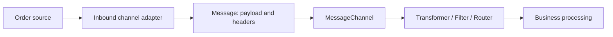
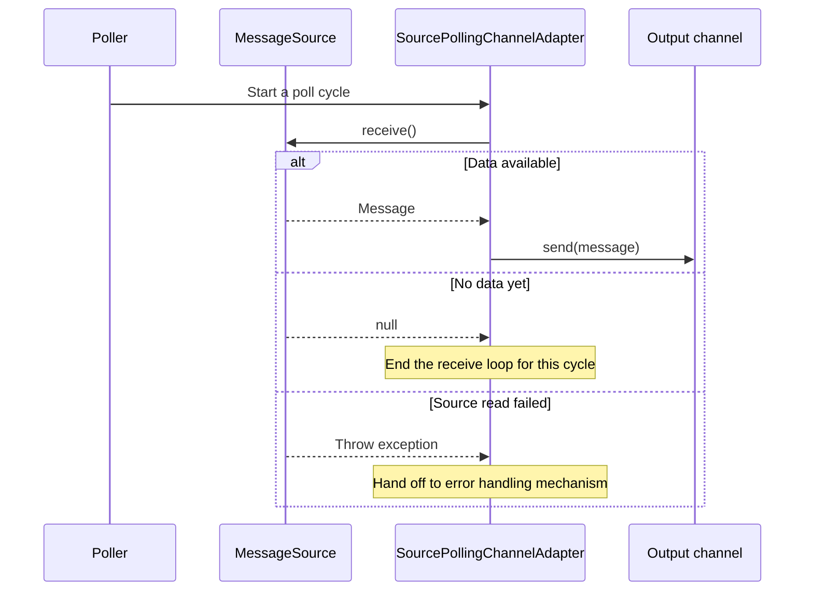

# Inbound channel adapter

## 1. Objectives and use case

In the **Channel adapter** chapter of the **SPRING_INTEGRATION_CORE** module, an inbound channel adapter is the entry point that brings data from a source into the Spring Integration messaging system. The source can be a Java method, a directory, a database table, or a system with an event-publishing mechanism.

Suppose a legacy sales system stores new orders, while the integration application must bring each order into a flow for normalization, validation, and distribution. Downstream processing should work with `Message<OrderEvent>`, rather than knowing how to query or receive data from the legacy system. The adapter creates this boundary.

After this lesson, learners can:

- Identify the inbound direction from the integration application's perspective.
- Explain the relationship between the source, endpoint, poller, `Message`, and `MessageChannel`.
- Create an inbound adapter using Java DSL or `@InboundChannelAdapter`.
- Configure the polling schedule, message limit per poll, and endpoint lifecycle.
- Distinguish between having no data and a source read failure; test both scenarios.
- Recognize the decisions needed when moving from an in-memory example to a real data source.

The main example uses Java 17 or higher and the Spring Integration 6.5.x API. It requires `org.springframework.integration:spring-integration-core`; the testing section uses JUnit Jupiter. Manage versions using your project's compatible BOM or declare the corresponding versions if using plain Spring. The example does not require Spring Boot, a broker, or a database.

## 2. What does inbound mean?

**Inbound is determined by the direction entering the Spring Integration flow**, not by the direction of a network request. An adapter that actively sends an HTTP request to fetch data still plays an inbound role if the result is brought into the flow.

An inbound channel adapter has a unidirectional messaging role: receiving or generating data from a source and sending it into a channel. It does not establish a contract to wait for a business result from the flow to return to the source like a request–reply gateway. The source may still have an acknowledgment or a protocol-level technical response. The unidirectional concept refers to the messaging contract. [Channel Adapter Documentation](https://docs.spring.io/spring-integration/reference/channel-adapter.html).



Adjacent components can be identified by the questions they answer:

| Component | Main question | Example |
| --- | --- | --- |
| Inbound channel adapter | How do we bring data from a source into the flow? | Periodically reading new orders |
| Outbound channel adapter | How do we send a message from the flow to a target? | Writing notifications to an external system |
| Gateway | How do we interact with messaging through a calling contract? | Invoking processing and receiving a result |
| Service activator | Which handler is invoked once a message is in the channel? | Calculating fees from a received order |
| Message channel | How is a message transferred between components? | Direct invocation or storing in a queue |

A gateway can support request–reply, and it can also have `void` methods for one-way sending. Therefore, merely seeing "returns no result" is not enough to classify it; you must look at who initiates the interaction and what the integration contract is. [Messaging Gateways Documentation](https://docs.spring.io/spring-integration/reference/gateway.html).

In an order synchronization problem, putting the entire source query, value validation, warehouse selection, and invoice writing inside a single source method defeats the benefits of a flow. The adapter should handle ingestion and data mapping; transformer, filter, router, or aggregator steps take on subsequent work when the problem requires them.

## 3. Two mechanisms for bringing messages into a flow

### 3.1. Polling: the application actively polls the source

For sources that can be queried periodically, `SourcePollingChannelAdapter` combines a polling schedule, a `MessageSource<?>`, and an output channel.



Two easily confused classes have different responsibilities:

| Class | Object being read | Position in flow |
| --- | --- | --- |
| `SourcePollingChannelAdapter` | `MessageSource` | Starts a flow from a source |
| `PollingConsumer` | `PollableChannel` | Takes a message already in a channel to pass to a handler |

A source poller is not a consumer of the output channel. Having the adapter send to a `QueueChannel` does not make it read back from that queue itself. [Poller Documentation](https://docs.spring.io/spring-integration/reference/polling-consumer.html).

### 3.2. Message-driven: receiving via listener or callback

Some adapters receive data via a listener or callback, rather than declaring a poller to call `MessageSource.receive()`. For example, Spring Integration has both a polling JMS adapter and a message-driven JMS adapter based on a listener container. [JMS Support Documentation](https://docs.spring.io/spring-integration/reference/jms.html).

Three independent properties must be distinguished:

- **Inbound/outbound**: direction of data relative to the flow.
- **Polling/message-driven**: how the endpoint receives data from the source.
- **Synchronous/asynchronous downstream**: how the channel delivers messages and how the handler is executed.

A polling source can still pass messages through a `DirectChannel` for downstream processing on the poller thread itself. A message-driven source can also send to a queue so that processing continues at a later time.

`@InboundChannelAdapter` is a mechanism for invoking a method via polling. Do not use the name of this annotation to infer that every inbound adapter of every protocol must have a poller.

## 4. Source contract: message, payload, and null

### 4.1. MessageSource returns Message

The core contract of `org.springframework.integration.core.MessageSource<T>` is:

```java
Message<T> receive();
```

The source returns a `Message<T>` when data is available, or `null` when no message is ready. This method does not accept an input message. [MessageSource API](https://docs.spring.io/spring-integration/api/org/springframework/integration/core/MessageSource.html).

For example, the source finds an order:

```text
Message
├── payload: OrderEvent("ORD-101", "CUS-9", 250000)
└── headers
    ├── sourceSystem: legacy-orders
    └── eventKey: ORDER_CREATED:ORD-101
```

The payload carries the data to be processed. Headers carry context such as the originating system and an event identification key. Do not modify the headers map directly; use `MessageBuilder` to construct an appropriate message. The payload is a Java object and can still be mutable if the application's data type allows it. [Message Documentation](https://docs.spring.io/spring-integration/reference/message.html).

In the order scenario, using a record keeps event representation simple and prevents handlers from accidentally modifying fields. The `eventKey` should be based on a stable business identifier. The UUID in the `id` header of a newly created message cannot replace an event identification key re-read from the source.

### 4.2. Supplier or source method can return payload

Java DSL provides `IntegrationFlow.fromSupplier(...)` for sources that return a payload. A non-`null` value is wrapped into a message if it is not already a `Message`. For a `MessageSource` that already builds a complete message, use `IntegrationFlow.from(messageSource, ...)`. [Inbound Channel Adapters with Java DSL Documentation](https://docs.spring.io/spring-integration/reference/dsl/java-inbound-adapters.html).

Choose a clear contract:

| Need | Suitable declaration |
| --- | --- |
| Fetch order object without needing custom headers yet | `fromSupplier(buffer::poll, ...)` |
| Create message with `eventKey` and `sourceSystem` right at the boundary | `MessageSource<OrderEvent>` |
| Reuse a method on a Spring bean | `@InboundChannelAdapter` |
| Connect to a protocol that already has a dedicated adapter | Use the adapter from the corresponding protocol module |

### 4.3. No data and an error are two different outcomes

In the order source example:

- Empty queue: return `null`.
- Valid order read: return a message.
- Unable to connect to the source or data cannot be mapped: throw an exception so the system can observe the error.

If you catch every exception and return `null`, the dashboard only sees "no data yet", even when the connection has been broken for hours. Conversely, throwing an exception every time the source is empty creates constant alerts for a normal state.

If a method returns a list of ten orders, that list is usually the **payload of a single message**. To process each order as an individual message, choose a source that returns one order at a time or add a splitter. The number of elements in a collection and the number of messages processed by the poller are two different quantities.

## 5. Polling schedule and limit per poll

### 5.1. A single poll cycle can read the source multiple times

`maxMessagesPerPoll` limits the number of messages a source poller attempts to emit in a single cycle; if the source returns `null`, the receive loop ends early. For `SourcePollingChannelAdapter`, the default value is `1`. A negative value such as `-1` allows continuing to receive until the source is exhausted; a source that always returns data can cause a poll cycle to run indefinitely. Since Spring Integration 5.5, a value of `0` skips invoking the source. [Configuring Inbound Adapters](https://docs.spring.io/spring-integration/reference/channel-adapter.html).

Example where the source has five orders, and each `receive()` call returns one order:

```text
maxMessagesPerPoll = 2

Cycle 1: ORD-101, ORD-102
Cycle 2: ORD-103, ORD-104
Cycle 3: ORD-105, null -> stop receive loop
Cycle 4: null -> wait for next scheduled trigger
```

If `maxMessagesPerPoll = 10` but the source only has two orders, that cycle may call `receive()` a third time and receive `null`; it does not mean ten messages will always be produced.

This limit is not the thread count, queue capacity, SQL query row limit, or number of items produced by a splitter. To control those quantities, you must configure them at the respective components.

### 5.2. fixedDelay, fixedRate, and cron

| Option | Meaning | Illustrative scenario |
| --- | --- | --- |
| `fixedDelay` | Wait interval measured from when the previous task finishes | Wait 1 second after finishing reading before polling again |
| `fixedRate` | Cadence based on scheduled start times | Check the source on a periodic cadence |
| `cron` | Runs according to a schedule expression | Poll during defined time windows |

The `Pollers.fixedDelay(long)` and `fixedRate(long)` overloads accept values in milliseconds; you can use the `Duration` overloads to express units more clearly. Configuring `fixedRate` by itself does not configure parallel processing. [Pollers API](https://docs.spring.io/spring-integration/api/org/springframework/integration/dsl/Pollers.html).

Example assuming a poll task takes 300 ms and has no dedicated executor:

```text
fixedDelay = 1000 ms

0 ms          300 ms                  1300 ms
| poll work   |------ wait 1000 ms -----| next poll
```

If an executor is added to the poller, the relationship between scheduling and actual work completion must be reconsidered. When increasing concurrency, you must verify source thread safety, message ordering, and mechanisms to prevent multiple workers from claiming the same record.

For cheap, near-real-time sources, you can start with a short delay and a small per-poll limit, then measure again. For rate-limited APIs or expensive queries, the interval and reads per poll must reflect the source's limits.

## 6. Complete example using Java DSL

### 6.1. Configuring the source, adapter, and output channel

Create the `OrderInboundConfig.java` class when practicing. Place the example classes in the same project package or add the corresponding package/imports.

```java
import java.math.BigDecimal;
import java.util.Objects;
import java.util.Queue;
import java.util.concurrent.ConcurrentLinkedQueue;

import org.springframework.beans.factory.annotation.Qualifier;
import org.springframework.context.annotation.Bean;
import org.springframework.context.annotation.Configuration;
import org.springframework.integration.channel.QueueChannel;
import org.springframework.integration.config.EnableIntegration;
import org.springframework.integration.core.MessageSource;
import org.springframework.integration.dsl.IntegrationFlow;
import org.springframework.integration.dsl.Pollers;
import org.springframework.integration.support.MessageBuilder;

@Configuration
@EnableIntegration
public class OrderInboundConfig {

    public record OrderEvent(
            String orderId,
            String customerId,
            BigDecimal total) {
    }

    public static final class PendingOrderBuffer {

        private final Queue<OrderEvent> queue =
                new ConcurrentLinkedQueue<>();

        public void add(OrderEvent event) {
            queue.add(Objects.requireNonNull(event));
        }

        public OrderEvent poll() {
            return queue.poll();
        }
    }

    @Bean
    public PendingOrderBuffer pendingOrderBuffer() {
        return new PendingOrderBuffer();
    }

    @Bean
    public QueueChannel acceptedOrders() {
        return new QueueChannel(20);
    }

    @Bean
    public QueueChannel orderInboundErrors() {
        return new QueueChannel(20);
    }

    @Bean
    public MessageSource<OrderEvent> pendingOrderSource(
            PendingOrderBuffer buffer) {

        return () -> {
            OrderEvent event = buffer.poll();

            if (event == null) {
                return null;
            }

            if (event.orderId() == null || event.orderId().isBlank()) {
                throw new IllegalArgumentException("orderId is required");
            }

            return MessageBuilder.withPayload(event)
                    .setHeader("sourceSystem", "legacy-orders")
                    .setHeader("eventKey",
                            "ORDER_CREATED:" + event.orderId())
                    .build();
        };
    }

    @Bean
    public IntegrationFlow orderInboundFlow(
            MessageSource<OrderEvent> pendingOrderSource,
            @Qualifier("acceptedOrders") QueueChannel output) {

        return IntegrationFlow
                .from(pendingOrderSource, endpoint -> endpoint
                        .id("orderInboundAdapter")
                        .autoStartup(false)
                        .sendTimeout(1000)
                        .poller(Pollers.fixedDelay(250)
                                .maxMessagesPerPoll(2)
                                .errorChannel("orderInboundErrors")))
                .channel(output)
                .get();
    }
}
```

Each name in the example has a specific role:

| Name | Role |
| --- | --- |
| `pendingOrderBuffer` | Simulated source storing pending events to be read |
| `pendingOrderSource` | Converts an event into a `Message<OrderEvent>` |
| `orderInboundAdapter` | Endpoint owning the poller and sending messages |
| `acceptedOrders` | Output channel for observing ingested messages |
| `orderInboundErrors` | Channel receiving poller errors |
| `orderInboundFlow` | Flow definition using Java DSL |

`autoStartup(false)` allows loading data before starting the adapter. The `id` attribute names the endpoint for lifecycle control. `sendTimeout(1000)` limits the wait time when sending to a potentially blocking channel; it does not set a timeout for querying the source. [SourcePollingChannelAdapterSpec API](https://docs.spring.io/spring-integration/api/org/springframework/integration/dsl/SourcePollingChannelAdapterSpec.html).

Both the input queue and `acceptedOrders` reside in memory. The `buffer.poll()` operation removes the item before sending succeeds. That choice makes the mechanism clear for this lesson; the item will not automatically return if a subsequent step fails. When using a real source, you must design claiming, acknowledgment, or replay capability.

### 6.2. Running and observing

The `InboundAdapterDemo.java` class starts the endpoint after adding two orders:

```java
import java.math.BigDecimal;

import org.springframework.context.annotation.AnnotationConfigApplicationContext;
import org.springframework.integration.channel.QueueChannel;
import org.springframework.integration.endpoint.SourcePollingChannelAdapter;
import org.springframework.messaging.Message;

public class InboundAdapterDemo {

    public static void main(String[] args) {
        try (var context = new AnnotationConfigApplicationContext(
                OrderInboundConfig.class)) {

            var buffer = context.getBean(
                    OrderInboundConfig.PendingOrderBuffer.class);
            var output = context.getBean(
                    "acceptedOrders", QueueChannel.class);
            var adapter = context.getBean(
                    "orderInboundAdapter",
                    SourcePollingChannelAdapter.class);

            buffer.add(new OrderInboundConfig.OrderEvent(
                    "ORD-101", "CUS-9", new BigDecimal("250000")));
            buffer.add(new OrderInboundConfig.OrderEvent(
                    "ORD-102", "CUS-8", new BigDecimal("120000")));

            adapter.start();
            try {
                for (int i = 0; i < 2; i++) {
                    Message<?> message = output.receive(2000);
                    if (message == null) {
                        throw new IllegalStateException(
                                "No order received within 2 seconds");
                    }
                    System.out.println(message.getPayload());
                    System.out.println(
                            message.getHeaders().get("eventKey"));
                }
            }
            finally {
                adapter.stop();
            }
        }
    }
}
```

In this single-threaded configuration, the expected output is sequentially order `ORD-101` with key `ORDER_CREATED:ORD-101`, then `ORD-102` with its corresponding key. Fields like message ID and timestamp vary across runs.

The two-second timeout is the example's wait limit, not a system latency guarantee. Choose test timeouts based on the actual environment, avoiding equating it with the 250 ms polling interval.

When the source is empty, the adapter keeps running and continues polling on subsequent schedules. When `stop()` is called, the adapter stops scheduling new polls; draining the queue or waiting for work already handed off to other components requires a separate strategy.

## 7. Two alternative ways to declare a source

### 7.1. fromSupplier when only the payload is needed

You can replace the `orderInboundFlow` method in the example with the version below if you do not need custom headers and `orderId` validation at the source:

```java
@Bean
public IntegrationFlow orderInboundFlow(
        PendingOrderBuffer buffer,
        @Qualifier("acceptedOrders") QueueChannel output) {

    return IntegrationFlow
            .fromSupplier(buffer::poll, endpoint -> endpoint
                    .id("orderInboundAdapter")
                    .autoStartup(false)
                    .sendTimeout(1000)
                    .poller(Pollers.fixedDelay(250)
                            .maxMessagesPerPoll(2)
                            .errorChannel("orderInboundErrors")))
            .channel(output)
            .get();
}
```

This is an alternative approach. Do not keep two bean methods with the same name simultaneously. When choosing this approach, assertions for `sourceSystem`, `eventKey`, and the missing `orderId` error from the main example must also be adjusted.

### 7.2. Annotation on a Spring bean method

If you already have a class that supplies data, you can declare the endpoint on a zero-argument method:

```java
import org.springframework.integration.annotation.InboundChannelAdapter;
import org.springframework.integration.annotation.Poller;

public class AnnotatedOrderSource {

    private final OrderInboundConfig.PendingOrderBuffer buffer;

    public AnnotatedOrderSource(
            OrderInboundConfig.PendingOrderBuffer buffer) {
        this.buffer = buffer;
    }

    @InboundChannelAdapter(
            channel = "acceptedOrders",
            autoStartup = "false",
            poller = @Poller(
                    fixedDelay = "250",
                    maxMessagesPerPoll = "2",
                    errorChannel = "orderInboundErrors"))
    public OrderInboundConfig.OrderEvent nextOrder() {
        return buffer.poll();
    }
}
```

Register this class with `@Bean` in a configuration class annotated with `@EnableIntegration`, along with the corresponding channels and buffer. In the annotation approach, remove the DSL flow polling the same buffer so there is only one receiving endpoint.

The periodically invoked source method takes no parameters and does not return `void`. Return a payload when only data is needed; return `Message<?>` when headers are needed. `@InboundChannelAdapter` creates an endpoint that invokes the method via `MethodInvokingMessageSource`. If no local poller is specified, a valid default poller must exist in the context. [Annotation Support Documentation](https://docs.spring.io/spring-integration/reference/configuration/annotations.html).

Do not confuse a `@Bean` factory method that accepts dependencies with the polled source method: the factory creates the bean when building the context; a method like `nextOrder()` is the one invoked on schedule to fetch data.

## 8. What does the output channel determine?

| Output channel | Primary behavior | Considerations for the order source |
| --- | --- | --- |
| `DirectChannel` | Invokes the handler on the sending thread | A slow handler slows down source polling cycles |
| `QueueChannel` | Stores messages for later retrieval | Requires a downstream consumer and backlog limits |
| `ExecutorChannel` | Dispatches via an executor | Requires controlling the executor and downstream task errors |
| `PublishSubscribeChannel` | Distributes to subscribers | Used when multiple consumers need the same event |

`DirectChannel` passes a message to a single handler on the sending thread. `QueueChannel` stores messages in memory by default and can block the sender when full; successfully placing a message into a queue does not prove a consumer has completed business processing. [Message Channel Implementations Documentation](https://docs.spring.io/spring-integration/reference/channel/implementations.html).

In the example, the program and tests actively call `acceptedOrders.receive(...)`, so no other consumer endpoint needs to be declared. In a real application, if a service activator reads from a `QueueChannel`, that consumer needs its own poller or an appropriate default poller. The inbound adapter's poller only reads the source.

Once an order is received, downstream steps can be expanded as needed:

| Component | Illustrative follow-up task |
| --- | --- |
| Transformer | Converts legacy system structure to the application's canonical order model |
| Filter | Accepts only supported event types; makes an explicit decision on discarded data |
| Router | Routes orders by region or sales channel |
| Aggregator | Combines multiple events belonging to the same order once a correlation key exists |

If source reading accelerates while processing speed stays constant, the queue will gradually fill up. An operational plan needs to address memory limits, send timeouts, pausing new ingestion, and data recovery when the application restarts.

## 9. Error handling and replayability

### 9.1. Distinguishing errors before and after a Message exists

In the main example, there are three notable failure points:

| Failure point | Does a message exist yet? | Observation approach |
| --- | --- | --- |
| Reading source or validating `orderId` fails | Possibly not yet | Source exception, poll timestamp, source identifier |
| Sending to output channel fails | Usually yes | Message or send context and root cause |
| Consumer processing after reading queue fails | Exists at the consumer | That consumer's error mechanism |

A scheduled poller can convert exceptions into an `ErrorMessage`. In the main configuration, the poller specifies `orderInboundErrors`; without dedicated routing, the default mechanism uses `errorChannel`, and a message can carry a header specifying an error channel. Synchronous handler errors over `DirectChannel` propagate back up the sending thread; in a flow started by a scheduled poller, that exception can continue to the poller task's error handling mechanism. [Error Handling Documentation](https://docs.spring.io/spring-integration/reference/error-handling.html).

If an error occurs during the source read step before a message is created, you cannot assume the order payload exists in the failed message. Log sufficient source context right at retrieval time and distinguish it from the context of an already emitted message.

Using a `QueueChannel` to receive errors in the example helps tests read and inspect them. In a continuously running application, the error channel must be consumed; merely accumulating errors in a bounded queue can cause the error handling path itself to stall.

### 9.2. Error channel does not provide retry automatically

Receiving an `ErrorMessage` only indicates that the error has been represented and routed. It does not automatically put the order back into the source, re-invoke the task, or roll back side effects.

A practical policy should depend on the error type:

- Transient connection errors: consider bounded retries with backoff.
- Malformed data: move to a quarantine area with enough information to fix or replay.
- Duplicate events: use a business key to prevent repeated side effects.
- Overloaded target system: throttle ingestion and control backlog.

These are design decisions for the order scenario. The example does not implement retry or a quarantine store; do not infer those capabilities merely from the presence of an error channel.

### 9.3. Preventing lost orders between source reading and processing

Consider this naive algorithm:

```text
1. Fetch ORD-101 from the source.
2. Mark as read or delete from the source.
3. Send message into the flow.
4. Process payment.
```

If the application stops between step 2 and step 3, the order may have nowhere left to be processed. If the application stops after the side effect but before confirmation, re-reading the order can cause duplicate side effects.

One approach for a table-based source is to claim rows atomically, store processing state, and provide a way to reclaim expired claims. An approach with a broker is to choose appropriate acknowledgment/redelivery semantics. For business-critical side effects, a stable idempotency key and durable state storage are needed for recovery.

If each order has exactly one creation event, `ORDER_CREATED:<orderId>` can serve as the key in this scenario. If an order has multiple valid events of the same type or multiple versions, you must use an event ID or include a version; using only the order ID would wrongly drop events.

A poller can participate in a transaction when configured with a transaction manager and supporting resources. A transaction bound to an execution thread does not automatically propagate across a boundary that hands work off to another thread. [Transaction Support Documentation](https://docs.spring.io/spring-integration/reference/transactions.html).

Do not assume adding a transaction manager guarantees exactly-once semantics across a database, an in-memory queue, and an external service simultaneously. You must analyze the specific participating resources, commit timing, replayability, and where side effects occur.

## 10. Testing the adapter via observable behavior

The following test suite uses the Java DSL configuration from section 6. Each test has its own context, adds data before or after starting the endpoint, and awaits messages with a finite timeout.

```java
import java.math.BigDecimal;

import org.junit.jupiter.api.Test;
import org.springframework.context.annotation.AnnotationConfigApplicationContext;
import org.springframework.integration.channel.QueueChannel;
import org.springframework.integration.endpoint.SourcePollingChannelAdapter;
import org.springframework.messaging.Message;
import org.springframework.messaging.support.ErrorMessage;

import static org.junit.jupiter.api.Assertions.*;

class OrderInboundAdapterTest {

    @Test
    void publishesPayloadAndSourceHeaders() {
        try (var context = new AnnotationConfigApplicationContext(
                OrderInboundConfig.class)) {

            var buffer = context.getBean(
                    OrderInboundConfig.PendingOrderBuffer.class);
            var output = context.getBean(
                    "acceptedOrders", QueueChannel.class);
            var adapter = context.getBean(
                    "orderInboundAdapter",
                    SourcePollingChannelAdapter.class);

            buffer.add(new OrderInboundConfig.OrderEvent(
                    "ORD-101", "CUS-9", new BigDecimal("250000")));
            adapter.start();

            Message<?> message = output.receive(2000);
            assertNotNull(message);

            var event = assertInstanceOf(
                    OrderInboundConfig.OrderEvent.class,
                    message.getPayload());
            assertEquals("ORD-101", event.orderId());
            assertEquals("legacy-orders",
                    message.getHeaders().get("sourceSystem"));
            assertEquals("ORDER_CREATED:ORD-101",
                    message.getHeaders().get("eventKey"));
        }
    }

    @Test
    void resumesPollingAfterSourceWasEmpty() {
        try (var context = new AnnotationConfigApplicationContext(
                OrderInboundConfig.class)) {

            var buffer = context.getBean(
                    OrderInboundConfig.PendingOrderBuffer.class);
            var output = context.getBean(
                    "acceptedOrders", QueueChannel.class);
            var adapter = context.getBean(
                    "orderInboundAdapter",
                    SourcePollingChannelAdapter.class);

            adapter.start();
            assertNull(output.receive(400));

            buffer.add(new OrderInboundConfig.OrderEvent(
                    "ORD-102", "CUS-8", new BigDecimal("120000")));

            Message<?> message = output.receive(2000);
            assertNotNull(message);
            var event = assertInstanceOf(
                    OrderInboundConfig.OrderEvent.class,
                    message.getPayload());
            assertEquals("ORD-102", event.orderId());
        }
    }

    @Test
    void publishesSourceFailureToConfiguredErrorChannel() {
        try (var context = new AnnotationConfigApplicationContext(
                OrderInboundConfig.class)) {

            var buffer = context.getBean(
                    OrderInboundConfig.PendingOrderBuffer.class);
            var errors = context.getBean(
                    "orderInboundErrors", QueueChannel.class);
            var output = context.getBean(
                    "acceptedOrders", QueueChannel.class);
            var adapter = context.getBean(
                    "orderInboundAdapter",
                    SourcePollingChannelAdapter.class);

            buffer.add(new OrderInboundConfig.OrderEvent(
                    "", "CUS-9", new BigDecimal("250000")));
            adapter.start();

            Message<?> error = errors.receive(2000);
            assertNotNull(error);

            ErrorMessage errorMessage =
                    assertInstanceOf(ErrorMessage.class, error);
            Throwable cause = errorMessage.getPayload();
            while (cause.getCause() != null) {
                cause = cause.getCause();
            }

            assertInstanceOf(IllegalArgumentException.class, cause);
            assertEquals("orderId is required", cause.getMessage());
            assertNull(output.receive(0));
        }
    }
}
```

The three tests verify three distinct outcomes: receiving the right payload and headers, continuing to operate after an empty source period, and routing source failures to the right channel. Closing the context at the end of each test cleans up the endpoint and scheduler lifecycles.

Do not use a fixed `Thread.sleep(...)` and assume processing has finished. `receive(timeout)` waits for an observable condition while bounding test duration. The empty-source test here confirms the output has no message yet; if you need to assert the exact number of source invocations, add a fake source with a counter.

Scenarios to add when connecting to a real source:

| Scenario | Outcome to verify |
| --- | --- |
| Connection lost while reading source | Error signal is emitted; retry policy respects bounds |
| Same event ID is re-read | Business side effects are not duplicated unintentionally |
| Queue full or slow target | Waiting, timeout, and recovery behavior are appropriate |
| Two instances running concurrently | No duplicate claims or duplicates are handled safely |
| Application stops mid-order | Can explain where the order remains and how to replay it |

To control sources or endpoints in larger test suites, Spring Integration provides `spring-integration-test`, mock utilities, and triggers for testing. Add them only when the test suite needs those capabilities; the three tests above use standard channel and context APIs. [Testing Support Documentation](https://docs.spring.io/spring-integration/reference/testing.html).

## 11. Troubleshooting common configuration errors

| Symptom | Cause to check | Action |
| --- | --- | --- |
| No messages even though buffer has data | Endpoint not started; e.g., `autoStartup(false)` set | Look up the exact endpoint ID and call `start()` |
| Context reports missing poller | Neither a local poller nor a default poller exists | Configure an explicit poller |
| Each message contains a list | Source returns the entire collection | Return one element at a time or add a splitter |
| CPU spikes, a single cycle runs forever | Source always returns data and has no per-poll limit | Choose a positive limit and check source logic |
| Sent but no business processing occurs | Output queue has no consumer | Add a consumer and check the consumer's poller |
| Sending to `DirectChannel` fails | No subscriber or handler throws an error | Check the downstream endpoint and stack trace |
| No error seen even though source is broken | Exception swallowed and turned into `null` | Preserve the distinction between empty source and source error |
| Orders appear multiple times | Missing claim, checkpoint, or idempotency | Use event identifiers and persist state appropriately |
| Source reading slows down | Slow downstream or full queue | Measure read time, send time, and backlog |
| Added poller on output but source still runs at wrong cadence | Confused consumer poller with source poller | Check configuration on the inbound endpoint |

For an order source, useful metrics include poll count, empty poll count, source read duration, messages sent, error count, backlog size, and age of the oldest unprocessed event. An adapter in the running state only reflects lifecycle; it does not by itself prove the source connection is healthy or that orders are being processed on time.

When logging, correlate errors with the source name and `eventKey` if available. You do not need to log the entire payload of every order to know whether the adapter is working: proper identifiers and metrics usually enable clearer diagnosis.

## 12. Consolidation exercises

Work through these sequentially on the main example:

1. Add five valid orders, keep `maxMessagesPerPoll(2)`, and observe all five messages. To verify the boundaries of each poll cycle, use a controlled trigger or a counter on the source instead of only comparing output timestamps.
2. Let the source become empty and then add a new order; verify the endpoint still receives it without restarting.
3. Add an order missing `orderId`; verify the error appears in `orderInboundErrors` and the order does not enter `acceptedOrders`.
4. Add a transformer after the source to convert the order total into the application's canonical model. Keep source retrieval inside the adapter and conversion inside the transformer.
5. Propose how to replace the buffer with a database table: define claim timing, success acknowledgment, expired claim handling, and the event identification key.
6. Change the output to a `DirectChannel` with a slow handler, then explain why a poll cycle's duration changes. Afterward, switch back to a queue and explain where the backlog shifts.

The exercise results should demonstrate an order's path from source to message, where the polling schedule applies, where errors are observed, and how data is traced when a step fails. These decisions form the foundation for combining adapters with transformers, routers, filters, or aggregators in larger integration flows.
