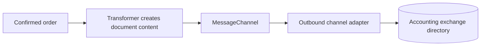
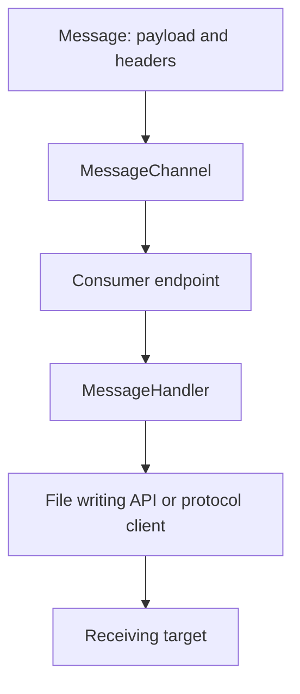
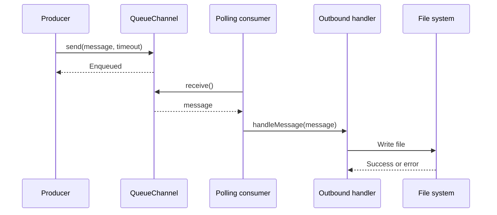
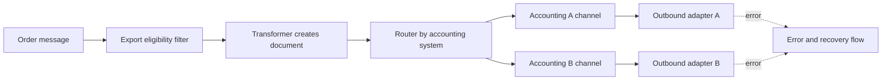

# Outbound channel adapter

## 1. Objectives and position in the integration flow

In the **Channel adapter** chapter of the `SPRING_INTEGRATION_CORE` module, an outbound channel adapter is the connection point from a `MessageChannel` to a data destination: a file, a broker, an external service, or a Java method that performs a side effect. This lesson focuses on how to design this outbound point using the core components of Spring Integration.

After this lesson, you can:

- Determine when an outbound adapter is needed versus when an outbound gateway is needed.
- Connect `Message`, channel, consumer endpoint, and `MessageHandler` using Java DSL or annotations.
- Choose synchronous execution, execution via an executor, or execution via a queue with a poller.
- Design error paths, retries, and duplicate message handling for outbound sending operations.
- Test actual side effects rather than only checking the `send()` call.

Ongoing scenario: an order system exports document content to files for an accounting system to read. The flow does not need to immediately receive a calculation result back from accounting; the immediate requirement is to deliver the document to the agreed destination.



The examples use Java 17 and the Spring Integration 6.5.x API. If using Spring Boot, let the compatible Boot version's BOM manage dependencies; do not arbitrarily mix Spring Framework and Spring Integration versions. The main example only requires `spring-integration-core`; the test code uses JUnit Jupiter. Extension snippets are clearly marked as alternatives or additions, not all registered into the same application context.

## 2. What is the contract of an outbound adapter?

### 2.1. Receive message, perform side effect, end branch

An outbound channel adapter receives a message from a channel and invokes a consuming target. For a one-way adapter, successful processing does not produce a reply message to continue the current branch. In Java configuration, a POJO method returning `void` or a `MessageHandler` is a natural way to express this contract. Spring Integration supports this connection via service activators and Java DSL. See [Channel Adapter](https://docs.spring.io/spring-integration/reference/6.5/channel-adapter.html).

Examples of side effects:

| Requirement | Effect at destination | Is a business reply needed in the same branch? |
| --- | --- | --- |
| Export document | Create file for accounting | No |
| Publish order event | Send message to broker | No, if the contract only requires publishing the event |
| Send notification email | Hand off email to mail server | No |
| Query inventory to decide sale | Receive stock count and continue processing | Yes; suited for a gateway |

Unidirectionality is a property of the **messaging contract**. It does not mean the network operation does not wait for a technical response. For instance, the sender may have to wait for the server to accept the request or wait for file writing to complete before the handler returns.

### 2.2. Three concepts to separate

1. **Flow reply:** a result message forwarded to the next step or `replyChannel`.
2. **Technical acknowledgment:** the protocol or library indicating that the send/write operation has reached a certain milestone.
3. **Business completion:** the target system has processed the document according to business rules.

In the accounting scenario, successfully creating the file only confirms the file was written according to the writer's implementation. It does not prove accounting has imported the document. If you need to track import results, design a separate status-receiving flow, correlation ID, and business state.

### 2.3. Outbound does not mean asynchronous

With `DirectChannel`, the handler is invoked directly on the thread sending the message. With `QueueChannel`, the sender can complete the enqueue operation before the consumer retrieves the message. `ExecutorChannel` hands off handler execution to an executor; executor configuration and task rejection policy still affect actual behavior. This characteristic belongs to the channel and execution mechanism, not to the name "outbound". See [Message Channel Implementations](https://docs.spring.io/spring-integration/reference/6.5/channel/implementations.html).

## 3. Distinguishing from adjacent endpoints

| Component | Direction from integration application | Typical role |
| --- | --- | --- |
| Inbound channel adapter | External source → message into channel | Brings data into the flow |
| Outbound channel adapter | Message from channel → consuming target | Performs a one-way side effect |
| Outbound gateway | Request message → target system → response message | Uses result from target system for further processing |
| Service activator | Channel → method/handler | Service invocation mechanism; can end with `void` or produce a result |
| Transformer | Input message → message with new representation | Converts data structure or format |

Service activator and outbound adapter are not mutually exclusive mechanisms. A service activator calling a `void` method to write data externally can play the role of an outbound adapter. Conversely, do not call every `.handle()` an outbound adapter: a handler that returns a result for further processing has a different contract. Java DSL supports calling a `MessageHandler`, POJO method, and lambda handler via `.handle()`. See [Service Activators and the .handle() method](https://docs.spring.io/spring-integration/reference/6.2/dsl/java-handle.html).

Selection rules for documents:

- Only need to hand off the document to the exchange directory: outbound adapter.
- Need to call the accounting system to immediately receive a document code and continue the flow: outbound gateway.
- Only need to convert an order object into a document string: transformer placed before the outbound point.

Do not place a request-reply gateway ahead of a branch ending in a one-way adapter and expect the adapter to generate a response on its own. The contract of the entire path must agree on whether a reply exists.

## 4. How do message, channel, endpoint, and handler work together?



- **Message:** carries the data and metadata needed for the export operation.
- **Channel:** determines how messages are delivered to consumers.
- **Consumer endpoint:** manages connection to the channel, lifecycle, and execution configuration such as poller and advice.
- **Handler:** reads the message, validates the input contract, and performs the operation at the target.
- **Client/external resource:** performs the actual writing or sending.

A standalone `MessageHandler` bean does not automatically receive messages. It must be wired to a channel via a flow, annotation, or equivalent endpoint configuration.

Illustrative contract for this lesson:

| Message part | Value | Meaning |
| --- | --- | --- |
| Payload | UTF-8 `String` | Prepared document content |
| Header `exportId` | `evt-1001` | Export ID, used to name the file and reconcile |
| Header `orderId` | `ORD-1001` | Order ID for traceability |
| Header `errorChannel` | Error handling channel if routed through a supporting mechanism | Destination for asynchronous error handling |

`exportId` and `orderId` are application-defined headers. Placing a value in a header does not automatically transmit it to the target system. The handler or each protocol's header mapper must perform the necessary mapping.

## 5. Complete example: exporting content to a file with Java DSL

### 5.1. Desired behavior

The example uses a custom handler to clearly show the core mechanism:

1. The producer creates a message with a string payload and an `exportId` header.
2. `DirectChannel` delivers the message to the endpoint.
3. The handler creates the file `<exportId>.txt` in UTF-8.
4. If the filename is invalid, the payload has the wrong type, or the write operation fails, the handler throws an exception.
5. The handler produces no reply message.

The code below can be placed in `ExportDemo.java` in a project declaring a compatible `org.springframework.integration:spring-integration-core` 6.5.x dependency. Spring Boot is not required to understand and practice this example.

```java
import java.io.IOException;
import java.nio.charset.StandardCharsets;
import java.nio.file.Files;
import java.nio.file.Path;
import java.nio.file.StandardOpenOption;
import java.util.UUID;

import org.springframework.beans.factory.annotation.Qualifier;
import org.springframework.context.annotation.AnnotationConfigApplicationContext;
import org.springframework.context.annotation.Bean;
import org.springframework.context.annotation.Configuration;
import org.springframework.integration.channel.DirectChannel;
import org.springframework.integration.config.EnableIntegration;
import org.springframework.integration.dsl.IntegrationFlow;
import org.springframework.messaging.Message;
import org.springframework.messaging.MessageChannel;
import org.springframework.messaging.MessageHandler;
import org.springframework.messaging.MessageHandlingException;
import org.springframework.messaging.support.MessageBuilder;

public class ExportDemo {

    public static void main(String[] args) {
        try (var context = new AnnotationConfigApplicationContext(Config.class)) {
            MessageChannel input =
                    context.getBean("exportRequests", MessageChannel.class);

            String exportId = "evt-" + UUID.randomUUID();
            Message<String> message = MessageBuilder
                    .withPayload("orderId=ORD-1001\ntotal=1250000\n")
                    .setHeader("exportId", exportId)
                    .setHeader("orderId", "ORD-1001")
                    .build();

            boolean accepted = input.send(message);
            if (!accepted) {
                throw new IllegalStateException("Channel did not accept message");
            }

            System.out.println("Wrote build/export/" + exportId + ".txt");
        }
    }

    @Configuration
    @EnableIntegration
    public static class Config {

        @Bean
        public DirectChannel exportRequests() {
            return new DirectChannel();
        }

        @Bean
        public TextFileOutboundHandler exportFileHandler() {
            return new TextFileOutboundHandler(Path.of("build", "export"));
        }

        @Bean
        public IntegrationFlow exportFlow(
                @Qualifier("exportRequests") MessageChannel input,
                TextFileOutboundHandler handler) {

            return IntegrationFlow.from(input)
                    .handle(handler, endpoint -> endpoint.id("exportFileEndpoint"))
                    .get();
        }
    }

    public static final class TextFileOutboundHandler implements MessageHandler {

        private final Path directory;

        public TextFileOutboundHandler(Path directory) {
            this.directory = directory.toAbsolutePath().normalize();
        }

        @Override
        public void handleMessage(Message<?> message) {
            if (!(message.getPayload() instanceof String text)) {
                throw new MessageHandlingException(
                        message, "Payload must be a String");
            }

            Object rawExportId = message.getHeaders().get("exportId");
            if (!(rawExportId instanceof String exportId)
                    || !exportId.matches("[A-Za-z0-9_-]{1,80}")) {
                throw new MessageHandlingException(
                        message, "exportId must be 1..80 alphanumeric, _, or - characters");
            }

            Path target = directory.resolve(exportId + ".txt");

            try {
                Files.createDirectories(directory);
                Files.writeString(
                        target,
                        text,
                        StandardCharsets.UTF_8,
                        StandardOpenOption.CREATE_NEW,
                        StandardOpenOption.WRITE);
            }
            catch (IOException exception) {
                throw new MessageHandlingException(
                        message, "Failed to write export file: " + exportId, exception);
            }
        }
    }
}
```

### 5.2. Explaining the result

The file is created under the `build/export` directory relative to the working directory when running the application. The filename contains the ID generated in `main`; the content includes the order ID and total amount. This is an illustrative text format, not yet a document schema for a specific accounting system.

In this configuration, `DirectChannel` has only one consumer, and the handler writes the file directly on the thread calling `send()`. When `send()` returns successfully, the handler's file write call has finished. This conclusion depends on the specific configuration; it does not apply unchanged when switching to a queue or executor.

`MessageHandler.handleMessage()` returns `void`, so the branch terminates at the handler. Even if the `replyChannel` header is present on the message, it does not cause this handler to automatically produce a reply.

`CREATE_NEW` was chosen to detect existing filenames instead of silently overwriting. This is a **duplicate-name rejection policy**, not yet a complete idempotency mechanism. Re-sending the same `exportId` will raise an error, even if the previous file has identical content.

Restricting `exportId` avoids directly using a name with path separators. In a production deployment, the target directory should be managed by trusted configuration; add permission checks and path controls according to the operating environment.

This custom writer writes directly to the target filename, so another reader could observe the file before writing completes. For atomic handoff, establish a temporary-file-then-rename convention or use the file adapter with appropriate configuration. Do not treat this example as a production atomic file handoff solution.

## 6. Configuring with annotations and POJO methods

### 6.1. Registering MessageHandler with @ServiceActivator

If you prefer annotations, replace the handler and flow registration in the previous example with the following bean; keep `@Configuration`, `@EnableIntegration`, and the `exportRequests` channel bean:

```java
import java.nio.file.Path;

import org.springframework.context.annotation.Bean;
import org.springframework.integration.annotation.ServiceActivator;
import org.springframework.messaging.MessageHandler;

@Bean
@ServiceActivator(inputChannel = "exportRequests")
public MessageHandler annotatedExportFileHandler() {
    return new ExportDemo.TextFileOutboundHandler(Path.of("build", "export"));
}
```

The annotation connects the handler to the named channel. Do not simultaneously register this annotation endpoint and `exportFlow` on the same `DirectChannel` if you only want a single export point. Multiple subscribers on a `DirectChannel` have point-to-point semantics; that is not how to request every message be exported to all destinations.

### 6.2. Using a POJO returning void

In an application with an existing document-writing service, you can use `.handle(exportService, "write")`, where `exportService` is a bean and `write` is a `void` method accepting the appropriate input type. This keeps writing logic inside the service and lets the flow describe the wiring.

If the method changes to return data, the endpoint's contract must be reviewed. A service activator can forward the return value to an output/reply channel; do not assume a return value is harmless just because the method was previously used as a terminal point.

## 7. QueueChannel and poller on the outbound side

### 7.1. Consumer retrieving messages from a queue

When you want to decouple document generation rate from write speed, you can use a bounded queue. Replace the synchronous channel and flow with the following configuration in a `@EnableIntegration` configuration class; keep the `TextFileOutboundHandler` bean:

```java
import org.springframework.beans.factory.annotation.Qualifier;
import org.springframework.context.annotation.Bean;
import org.springframework.integration.channel.QueueChannel;
import org.springframework.integration.dsl.IntegrationFlow;
import org.springframework.integration.dsl.Pollers;

@Bean
public QueueChannel exportQueue() {
    return new QueueChannel(100);
}

@Bean
public IntegrationFlow queuedExportFlow(
        @Qualifier("exportQueue") QueueChannel queue,
        ExportDemo.TextFileOutboundHandler handler) {

    return IntegrationFlow.from(queue)
            .handle(handler, endpoint -> endpoint
                    .id("queuedExportEndpoint")
                    .poller(Pollers.fixedDelay(500)
                            .maxMessagesPerPoll(10)))
            .get();
}
```

The poller here pulls messages from `exportQueue` to invoke the outbound handler. It does not scan directories and does not generate source messages. When the input channel is a `PollableChannel`, the consumer needs its own poller or a valid default poller. See [configuring an outbound adapter with a pollable channel](https://docs.spring.io/spring-integration/reference/6.5/channel-adapter.html#channel-adapter-outbound).

In the configuration above, each poll cycle processes at most 10 messages; the cadence uses a fixed delay of 500 ms. This is not a guarantee of processing exactly 20 messages per second: write duration, message receive wait time, and scheduler resources all affect throughput.

### 7.2. When the sender is released



The producer should use a finite timeout when sending to a bounded queue:

```java
boolean enqueued = exportQueue.send(message, 1_000);
if (!enqueued) {
    throw new IllegalStateException("Queue full after timeout");
}
```

`true` here only indicates the message entered the queue. It does not prove the file has been created. If `send(message)` without a timeout is used when the queue is full, the producer may block waiting for space; the caller's latency requirements must be clearly defined.

The queue in the example is in-process memory. A restart can lose pending messages. Once a message has been removed from the queue, a handler error also does not automatically put it back into the queue. To achieve recoverability, design a message store/broker, transactions, and a redelivery policy suited to the real resources.

## 8. Error handling at the outbound point

### 8.1. Errors on the synchronous path

In the `DirectChannel` example, exceptions from the writer propagate back to the `send()` call:

```java
import org.springframework.messaging.MessagingException;

try {
    input.send(message);
}
catch (MessagingException exception) {
    // Record the failure and decide how to handle it in the caller layer.
    // Do not treat the document as successfully exported.
    throw exception;
}
```

Setting the `errorChannel` header does not automatically turn a direct synchronous call into an asynchronous error-publishing mechanism. A gateway, advice, or other endpoint may add policies to catch and route errors; inspect the exact execution path in use.

### 8.2. Errors in a consumer running on another thread

After the producer has placed a message into a queue, a late exception cannot be thrown back onto the already-finished `send()` call stack. With Spring Integration's error-publishing mechanism, the error is wrapped into an `ErrorMessage`; routing prioritizes the `errorChannel` header on the message, then falls back to the global `errorChannel` bean. See [Error Handling](https://docs.spring.io/spring-integration/reference/6.5/error-handling.html).

To observe this in the lab with the default poller, add a dedicated error queue:

```java
@Bean
public QueueChannel exportErrors() {
    return new QueueChannel(100);
}
```

The producer or test code sends a message with the specific error channel:

```java
import org.springframework.messaging.MessageHeaders;
import org.springframework.messaging.support.ErrorMessage;

var badMessage = MessageBuilder.withPayload("test document")
        .setHeader("exportId", "../invalid")
        .setHeader(MessageHeaders.ERROR_CHANNEL, exportErrors)
        .build();

boolean queued = exportQueue.send(badMessage, 1_000);
if (!queued) {
    throw new IllegalStateException("Failed to enqueue test message");
}

Message<?> error = exportErrors.receive(3_000);
if (!(error instanceof ErrorMessage errorMessage)) {
    throw new AssertionError("Did not receive ErrorMessage within timeout");
}

Throwable failure = errorMessage.getPayload();
System.out.println(failure.getClass().getSimpleName());
```

The `exportQueue` and `exportErrors` variables in the snippet above are beans retrieved from the application context. The 3-second limit is only the lab's observation timeout, not a scheduler execution guarantee.

This error queue should be drained during the exercise. In a long-running application, there must be a consumer handling errors and a plan for durable storage/replay if needed; an in-memory error queue is not a durable dead-letter store. If you customize the poller's error handler or advice, verify the error routing path because the example relies on the default mechanism.

Do not catch every exception only to log it and return normally in an outbound handler. That makes the endpoint see the call as completed, losing the opportunity to retry or route the error according to the designed policy.

## 9. Retries must go hand in hand with error classification and idempotency

### 9.1. Only retry recoverable errors

Example classification for design purposes:

| Scenario | Typically sensible handling |
| --- | --- |
| Malformed `exportId` | Reject and route to the data-error flow |
| Payload schema mismatch | Fix data or transformation rules |
| Target temporarily unreachable | Bounded retries with backoff |
| File already exists for a processed ID | Apply deduplication/reconciliation policy |
| Directory lost write permissions | Operational alert; continuous retries usually do not resolve the cause |

Spring Integration 6.5 supports `RequestHandlerRetryAdvice` based on Spring Retry. The advice can configure retries, backoff, and recovery for a handler. See [Retry Advice](https://docs.spring.io/spring-integration/reference/6.5/handler-advice/classes.html#retry-advice).

The snippet below illustrates the 6.5 API and requires a compatible `org.springframework.retry:spring-retry` dependency. It retries every exception considered by this policy, so use it only for lab purposes; production requires a policy selecting recoverable errors based on actual exception types, including wrapped exceptions and root causes.

```java
import org.springframework.context.annotation.Bean;
import org.springframework.integration.handler.advice.RequestHandlerRetryAdvice;
import org.springframework.retry.backoff.FixedBackOffPolicy;
import org.springframework.retry.policy.SimpleRetryPolicy;
import org.springframework.retry.support.RetryTemplate;

@Bean
public RequestHandlerRetryAdvice exportRetryAdvice() {
    var retryTemplate = new RetryTemplate();
    retryTemplate.setRetryPolicy(new SimpleRetryPolicy(3));

    var backOff = new FixedBackOffPolicy();
    backOff.setBackOffPeriod(200);
    retryTemplate.setBackOffPolicy(backOff);

    var advice = new RequestHandlerRetryAdvice();
    advice.setRetryTemplate(retryTemplate);
    return advice;
}
```

Attach the advice to the **existing endpoint**, replacing the earlier `.handle(...)` configuration:

```java
.handle(handler, endpoint -> endpoint
        .id("exportFileEndpoint")
        .advice(exportRetryAdvice))
```

Here `exportRetryAdvice` is the advice bean injected into the flow builder method. `SimpleRetryPolicy(3)` limits attempts to three total executions, including the initial attempt. No recovery is configured in this example: when attempts are exhausted, the error still follows the synchronous or asynchronous path of the call.

This style of retry holds the thread while retrying and waiting during backoff. Choose the attempt count and interval based on acceptable latency; hanging client calls still need separate timeouts. In particular, retrying will not fix an already-existing-filename error from `CREATE_NEW` in the illustrative writer.

### 9.2. The "sent but outcome unknown" window

Suppose the target server has received the document, but the connection drops before the client receives an acknowledgment. The sender only sees an error and retries. If the target does not detect duplicates, one business request can create two documents.

Therefore, when retrying, answer these design questions:

- Which identifier stays stable across all resends of the same request?
- Does the target persist that identifier and prevent executing the side effect a second time?
- If the same ID arrives with different content, does the system reject it or overwrite by version?
- Does the deduplication retention window cover the replay window?

For the file export example, one approach is to keep `exportId` stable, store a content fingerprint, and treat an existing file as success only after verifying it was delivered intact with matching content. Simply "check existence then write" can still suffer from race conditions; account for multiple workers processing the same ID.

Deduplication at the target and updating processing status need appropriate atomicity. Marking "processed" only before sending can lose work if the process crashes; marking after sending creates a window where duplicates can be sent. An outbound adapter does not eliminate these two failure windows on its own.

## 10. Transactions and handoff durability

A thread-bound transaction can flow across a `DirectChannel` when operations share compatible resources and a transaction manager. Crossing an executor or queue usually creates a thread boundary; the producer's transaction is not implicitly preserved. A poller supports transactions, but only resources that genuinely participate gain corresponding rollback semantics. See [Transaction Support](https://docs.spring.io/spring-integration/reference/6.5/transactions.html).

Failure scenario for the order application:

```text
1. Write order to database.
2. Send document to external target.
3. Commit database transaction.
```

If step 2 succeeds but step 3 fails, the external target may have received a document for an uncommitted database change. Reversing the order—commit first, send later—introduces a window where the process crashes after commit but before sending.

One design direction is the transactional outbox: update the order and write the export request in the same database transaction; a worker reads unsent requests, invokes the outbound handler, and then updates the status. This is an application architecture choice, not an automatic feature merely from using an adapter. The worker must still handle crashing after sending but before updating status, usually via stable IDs and idempotency at the target.

With the file system, a database rollback does not automatically delete a written file. Similarly, an HTTP call or email send does not automatically participate in a local database transaction. Define clear completion milestones and recovery actions for each target.

## 11. Testing the true side effect of an outbound adapter

### 11.1. Testing layers

| Layer | What must be proven | Approach |
| --- | --- | --- |
| Handler | Valid payload/headers produce the right side effect | Temporary resources or fake client |
| Flow | Channel actually connects to handler; one-way contract holds | Initialize context and send message |
| Error path | Errors are thrown or routed to the error channel properly | Actively supply invalid input |
| Protocol integration | Serialization, permissions, timeouts, acknowledgments work | Corresponding test target |
| Recovery | Resending does not cause incorrect side effects | Simulate failure after target received data |

Spring Integration provides additional endpoint mocking tools and flow testing support; those options are useful when isolating complex segments. The example below uses JUnit and a real context to directly observe the output file. See [Testing support](https://docs.spring.io/spring-integration/reference/testing.html).

### 11.2. Testing a synchronous flow that produces no reply

Place `ExportFlowTest.java` in the same package as `ExportDemo` and add JUnit Jupiter to test dependencies. The test configuration uses the main example's writer while redirecting the output directory to `@TempDir`:

```java
import java.nio.charset.StandardCharsets;
import java.nio.file.Files;
import java.nio.file.Path;

import org.junit.jupiter.api.Test;
import org.junit.jupiter.api.io.TempDir;
import org.springframework.context.annotation.AnnotationConfigApplicationContext;
import org.springframework.context.annotation.Bean;
import org.springframework.context.annotation.Configuration;
import org.springframework.integration.channel.DirectChannel;
import org.springframework.integration.channel.QueueChannel;
import org.springframework.integration.config.EnableIntegration;
import org.springframework.integration.dsl.IntegrationFlow;
import org.springframework.messaging.MessageChannel;
import org.springframework.messaging.MessagingException;
import org.springframework.messaging.support.MessageBuilder;

import static org.junit.jupiter.api.Assertions.*;

class ExportFlowTest {

    @TempDir
    Path output;

    @Test
    void writesUtf8FileWithoutProducingReply() throws Exception {
        try (var context = context()) {
            var replies = new QueueChannel(1);
            var message = MessageBuilder.withPayload("Order ORD-1001\n")
                    .setHeader("exportId", "evt-1001")
                    .setReplyChannel(replies)
                    .build();

            MessageChannel input =
                    context.getBean("exportRequests", MessageChannel.class);

            assertTrue(input.send(message));
            assertEquals(
                    "Order ORD-1001\n",
                    Files.readString(
                            output.resolve("evt-1001.txt"),
                            StandardCharsets.UTF_8));
            assertNull(replies.receive(0));
        }
    }

    @Test
    void propagatesInvalidExportIdToSynchronousCaller() {
        try (var context = context()) {
            var message = MessageBuilder.withPayload("content")
                    .setHeader("exportId", "../invalid")
                    .build();

            MessageChannel input =
                    context.getBean("exportRequests", MessageChannel.class);

            assertThrows(MessagingException.class, () -> input.send(message));
        }
    }

    @Test
    void rejectsDuplicateFilenameWithoutReplacingOriginal() throws Exception {
        try (var context = context()) {
            MessageChannel input =
                    context.getBean("exportRequests", MessageChannel.class);

            var first = MessageBuilder.withPayload("first version")
                    .setHeader("exportId", "evt-duplicate")
                    .build();
            var duplicate = MessageBuilder.withPayload("second version")
                    .setHeader("exportId", "evt-duplicate")
                    .build();

            assertTrue(input.send(first));
            assertThrows(MessagingException.class, () -> input.send(duplicate));
            assertEquals(
                    "first version",
                    Files.readString(
                            output.resolve("evt-duplicate.txt"),
                            StandardCharsets.UTF_8));
        }
    }

    private AnnotationConfigApplicationContext context() {
        var context = new AnnotationConfigApplicationContext();
        context.registerBean(
                ExportDemo.TextFileOutboundHandler.class,
                () -> new ExportDemo.TextFileOutboundHandler(output));
        context.register(TestConfig.class);
        context.refresh();
        return context;
    }

    @Configuration
    @EnableIntegration
    static class TestConfig {

        @Bean
        DirectChannel exportRequests() {
            return new DirectChannel();
        }

        @Bean
        IntegrationFlow testExportFlow(
                DirectChannel exportRequests,
                ExportDemo.TextFileOutboundHandler handler) {

            return IntegrationFlow.from(exportRequests)
                    .handle(handler)
                    .get();
        }
    }
}
```

No `sleep` is needed in these tests: with `DirectChannel`, once the call returns, the synchronous handler has finished executing. The duplicate-filename test proves the `CREATE_NEW` policy; it does not prove the system achieves exactly-once semantics.

For the polling variant, test enqueuing separately, then wait for an **observable outcome** within a finite timeout: receiving an `ErrorMessage`, a fake handler's latch, or file existence/content assertions. Do not just call `assertTrue(send(...))` and conclude the export succeeded. To test asynchronous success, disable or replace the external target with an observable test resource rather than depending on a production path.

## 12. Moving from a custom handler to a built-in adapter

Custom handlers help you learn core mechanics; real applications should evaluate built-in protocol adapters before manually managing connections, serialization, and resources.

| Target | Commonly used module | Configuration to define |
| --- | --- | --- |
| Local file | `spring-integration-file` | Directory, filename, charset, temporary file, file-exists mode |
| JMS | `spring-integration-jms` | Connection factory, destination, converter, transaction |
| AMQP | `spring-integration-amqp` | Exchange/routing key, template, and acknowledgment mechanism |
| SFTP | `spring-integration-sftp` | Session factory, remote directory, filename, and handoff rules |
| HTTP | `spring-integration-http` | URI, method, body conversion, timeout, and whether a reply is needed |

The file module provides `FileWritingMessageHandler` and corresponding adapter/gateway configurations. Write mode, filename, and temporary-file suffix mechanisms affect how the target observes data. When using append mode, inspect the specific rules for temporary files and flushing; do not extrapolate from standard file-creation mode. See [Writing files](https://docs.spring.io/spring-integration/reference/file/writing.html).

With HTTP, the protocol itself has a request/response, yet whether to turn the response into a message for further processing belongs to the integration endpoint contract. If you need to read business results or status for downstream routing, choose and configure an appropriate gateway. See [HTTP Outbound Components](https://docs.spring.io/spring-integration/reference/http/outbound.html).

Each adapter differs in acknowledgments, callbacks, and errors occurring after the local send call returns. Therefore, do not apply all conclusions about success timing from the custom file handler to JMS, AMQP, or HTTP without defining the contract of the client and broker/server.

## 13. Combining outbound points with other integration patterns

Within the scope of `SPRING_INTEGRATION_CORE`, keep component responsibilities clear:



- **Filter:** discards messages that do not meet export criteria; explicitly defines how discarded messages are handled.
- **Transformer:** converts order data into the target format before writing/sending.
- **Router:** selects the accounting system based on validated attributes, rather than letting unvalidated external data decide arbitrary destinations.
- **Aggregator:** if the target requires a periodic batched document, complete the group before passing it to the adapter; define the correlation key, completion condition, and group timeout.
- **Error flow:** retains sufficient identifying information to fix and resend the exact request.

If an event must be sent to two independent targets, choose an appropriate fan-out mechanism such as publish-subscribe or multi-branch configuration. Two consumers subscribed to the same `DirectChannel` do not mean both receive every message. With fan-out, the success/failure state of each target must be tracked independently; branch A succeeding does not guarantee branch B also succeeded.

The adapter should focus on the communication contract with the target. Complex business transformations, routing decisions, and aggregation are usually easier to read and test when expressed as separate components ahead of the outbound point.

## 14. Design smell symptoms and diagnosis

| Symptom | Cause to inspect | Remediation |
| --- | --- | --- |
| Gateway waits and times out | Branch ends with a handler that produces no reply | Align on a one-way contract or add an explicit reply-producing branch |
| Enqueue succeeds but no output appears | Consumer not started, missing poller, or processing slowly | Inspect endpoint lifecycle, poller, and error path |
| File write error does not reach caller | A thread boundary was crossed | Monitor the error channel or processing state |
| Message "succeeds" despite broken target | Handler catches errors and returns normally | Throw errors or implement explicit stateful recovery |
| Resending creates duplicate documents | Missing deduplication key at target | Use stable IDs, reconciliation, and idempotency policies |
| One of two targets does not receive | Two handlers share a point-to-point channel | Design an appropriate fan-out |
| Queue grows continuously | Input rate exceeds processing rate | Bound the queue, measure target latency, scale processing capacity |
| File write succeeds but accounting has not imported | Confusing handoff milestone with business completion | Add import confirmation and separate reconciliation mechanisms |

Useful metrics include incoming message count, successful writes/sends, error count, retry count, processing duration, queue depth, and age of the oldest unfinished request. Logs should include `exportId`, `orderId`, endpoint, and error type; avoid using the entire document payload as default diagnostic information.

On shutdown, define how to stop accepting new work, wait for in-flight work, and recover the remainder after restart. An in-memory queue and a one-way handler do not provide that entire lifecycle by themselves.

## 15. Practice with completion criteria

### Exercise 1: Observe completion timing

Run the `DirectChannel` version, then replace it with `QueueChannel` and a poller. Record the execution thread at the producer and handler. For the queue version, intentionally slow down the handler using a fake client in a test environment.

**Done when:** you can explain why `send()` can return before the file exists in the queue version and why the outbound adapter remains one-way in both versions.

### Exercise 2: Observe the error path

Send a message with an invalid `exportId` through both versions. For the polling version, set the `errorChannel` header to the lab's error queue and read the `ErrorMessage` with a finite timeout.

**Done when:** you can identify whether the error appears on the synchronous call stack or on the error channel, while proving no valid export file exists for the failed request.

### Exercise 3: Redesign the duplicate-send policy

Starting from the `CREATE_NEW` policy, propose a contract for two cases: same ID with same content, and same ID with different content. Describe the state to store, how to verify a complete file, and behavior when two workers process concurrently.

**Done when:** your design does not treat every existing file as a success and does not rely on "check then write" as an atomic guarantee.

### Exercise 4: Extend the order flow

Place a filter and transformer before the outbound point, route documents by accounting system, and design a separate state for accounting import confirmation.

**Done when:** you can distinguish the three milestones—"ingested into flow", "handed off externally", and "business-completed"—along with how to reconcile when only a subset of milestones has been reached.

## 16. Key takeaways

- An outbound adapter connects a message to a consuming target and typically ends a branch with a side effect, without a business reply.
- The channel and execution mechanism determine the thread, when `send()` completes, and the error propagation path.
- With a queue, a poller is required for the consumer; an in-memory queue provides no recovery across restarts.
- Retries are only appropriate after evaluating recoverability and the risk of repeating side effects.
- Transactions only protect resources that genuinely participate; external handoffs require separate completion and recovery contracts.
- Tests must observe outputs, error paths, and duplicate-send behavior; the return value of `send()` does not replace that evidence.
