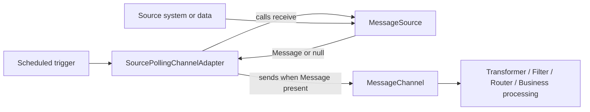

# Message source

## 1. Role of a message source in an integration flow

In the **Channel adapter** chapter of the **SPRING_INTEGRATION_CORE** module, a message source is the right starting point when the application needs to actively fetch data: checking for new files, querying pending orders, or calling a service on a schedule. This source supplies messages so subsequent components can transform, filter, route, aggregate, or perform business processing without needing to know how data was retrieved from the originating system.

Consider a legacy system storing order events not yet transferred to the new system. We want to fetch events in batches, put them into a `MessageChannel`, and then normalize and distribute them. The message source handles fetching data and creating messages; the endpoint and poller handle triggering the source.

After this lesson, you can:

- Properly implement the `MessageSource<T>` contract and explain the meaning of a `null` result.
- Distinguish between the message source, `SourcePollingChannelAdapter`, poller, and output channel.
- Declare a source using Java DSL or `@InboundChannelAdapter`.
- Choose appropriate polling limits, timeouts, and error handling boundaries.
- Test the source in isolation and test wiring the source into an integration flow.

## 2. The `MessageSource<T>` contract

### 2.1. Import the right interface

The interface used in this lesson is:

```java
import org.springframework.integration.core.MessageSource;
```

This is a functional interface with the primary operation `receive()`, returning `Message<T>` or `null` when no message is available. The type parameter `T` represents the **payload** type. Thus, `MessageSource<OrderEvent>` supplies `Message<OrderEvent>`, not `OrderEvent` directly. [Spring Integration MessageSource API](https://docs.spring.io/spring-integration/api/org/springframework/integration/core/MessageSource.html).

Simplified signature to remember, omitting annotations and default methods:

```java
Message<T> receive();
```

Spring Framework also has `org.springframework.context.MessageSource` for looking up text by code and locale. That internationalization interface serves a different purpose. Importing the wrong one via IDE auto-import will prevent the message source example from compiling. [Internationalization MessageSource API](https://docs.spring.io/spring-framework/docs/current/javadoc-api/org/springframework/context/MessageSource.html).

### 2.2. Three outcomes to distinguish

| Result of `receive()` | Interpretation in source design | Example |
| --- | --- | --- |
| A `Message<T>` | There is a message to emit into the flow | Found the next order event |
| `null` | Currently no message to emit | Source queue is empty |
| Throws exception | Data retrieval failed | Timed out connecting to the source system |

An empty source is a normal state. A source that is empty on this check may still have data on the next check. Do not use a message with an empty string, dummy object, or `"NO_DATA"` payload to represent an empty state: those values still enter the flow like real data.

Conversely, do not catch every exception and return `null`. If database queries fail continuously while the source always reports empty, operators will struggle to distinguish a connection failure from an idle system.

### 2.3. The source does not dictate the execution schedule

A bean implementing `MessageSource` does not create its own schedule and does not send messages to a channel on its own. You can call `receive()` directly in a unit test. When integrating into Spring Integration, attach it to an endpoint with a poller.

This interface does not have `receive(timeout)`. If your source implementation calls HTTP, JDBC, or reads from the network, configure timeouts on the respective client or driver. A timeout configured for receiving from a channel does not automatically become a timeout for every I/O operation inside the source.

## 3. How do the source, endpoint, poller, and channel work together?



The diagram depicts a **polling inbound adapter**. Inbound adapters that receive callbacks, listen via listeners, or accept incoming requests do not necessarily use `MessageSource` and a poller.

| Component | Primary responsibility | Question it answers |
| --- | --- | --- |
| `MessageSource<T>` | Fetches data and provides the next message | What is there to put into the flow? |
| `SourcePollingChannelAdapter` | Connects the source to the output channel | Where do fetched messages get sent? |
| Poller | Configures trigger, messages per batch, and polling policies | When and at most how many times? |
| `MessageChannel` | Delivers or buffers messages by channel type | How do endpoints exchange messages? |

When using `IntegrationFlow.from(messageSource, ...)`, Java DSL creates the adapter configuration to poll the source and feed results into the flow. The endpoint configuration callback lets you declare the poller and lifecycle. [Inbound Channel Adapters in Java DSL](https://docs.spring.io/spring-integration/reference/6.5/dsl/java-inbound-adapters.html).

### Two easily confused types of polling

`SourcePollingChannelAdapter` calls `MessageSource.receive()` to bring data **into** the messaging system. `PollingConsumer` pulls messages from a `PollableChannel`, such as a `QueueChannel`, to pass to a handler. Both components use a poller, but they poll different targets. [Poller Overview](https://docs.spring.io/spring-integration/reference/polling-consumer.html).

In the example below, the source writes to a `QueueChannel`. The `queue.receive(2000)` call in the output-reading program is a channel operation, not a source method. `PollableChannel` provides a receive variant with a timeout; the timeout value is in milliseconds. [PollableChannel API](https://docs.spring.io/spring-framework/docs/current/javadoc-api/org/springframework/messaging/PollableChannel.html).

## 4. Complete example: order event source

### 4.1. Example scope

The example uses Java 17 or higher and the Spring Integration 6.5.x Java DSL. The main library is `org.springframework.integration:spring-integration-core`; the test section uses JUnit Jupiter. Choose dependency versions compatible with your Spring Framework or application BOM.

To focus on the source contract, we simulate the legacy system using an in-memory queue. Each `receive()` call fetches at most one event. The source can accept additional events after becoming empty.

Save the class below in `OrderSourceConfiguration.java` when practicing. All data types and configuration needed for the example are placed in the same class for readability.

```java
import java.time.Duration;
import java.util.Collection;
import java.util.List;
import java.util.Objects;
import java.util.Queue;
import java.util.concurrent.ConcurrentLinkedQueue;

import org.springframework.beans.factory.annotation.Qualifier;
import org.springframework.context.annotation.Bean;
import org.springframework.context.annotation.Configuration;
import org.springframework.integration.channel.QueueChannel;
import org.springframework.integration.config.EnableIntegration;
import org.springframework.integration.core.MessageSource;
import org.springframework.integration.dsl.IntegrationFlow;
import org.springframework.integration.dsl.Pollers;
import org.springframework.messaging.Message;
import org.springframework.messaging.support.MessageBuilder;

@Configuration
@EnableIntegration
public class OrderSourceConfiguration {

    public record OrderEvent(String eventId, String orderId) {
    }

    public static final class PendingOrderSource
            implements MessageSource<OrderEvent> {

        private final Queue<OrderEvent> pending =
                new ConcurrentLinkedQueue<>();

        public PendingOrderSource(Collection<OrderEvent> initialEvents) {
            pending.addAll(initialEvents);
        }

        public void enqueue(OrderEvent event) {
            pending.add(Objects.requireNonNull(event));
        }

        @Override
        public Message<OrderEvent> receive() {
            OrderEvent event = pending.poll();
            if (event == null) {
                return null;
            }

            return MessageBuilder.withPayload(event)
                    .setHeader("sourceSystem", "legacy-orders")
                    .setHeader("businessEventId", event.eventId())
                    .build();
        }
    }

    @Bean
    public PendingOrderSource pendingOrderSource() {
        return new PendingOrderSource(List.of(
                new OrderEvent("evt-1001", "order-101"),
                new OrderEvent("evt-1002", "order-102"),
                new OrderEvent("evt-1003", "order-103")
        ));
    }

    @Bean
    public QueueChannel collectedOrders() {
        return new QueueChannel(10);
    }

    @Bean
    public QueueChannel sourceErrors() {
        return new QueueChannel(10);
    }

    @Bean
    public IntegrationFlow ingestOrders(
            PendingOrderSource pendingOrderSource,
            @Qualifier("collectedOrders") QueueChannel output,
            @Qualifier("sourceErrors") QueueChannel errors) {

        return IntegrationFlow.from(pendingOrderSource, endpoint -> endpoint
                        .id("ordersInbound")
                        .autoStartup(false)
                        .sendTimeout(1000)
                        .poller(Pollers.fixedDelay(Duration.ofMillis(500))
                                .maxMessagesPerPoll(2)
                                .errorChannel(errors)))
                .channel(output)
                .get();
    }
}
```

`PendingOrderSource` only knows about the queue and how to build a message. It does not know about `collectedOrders`, holds no reference to the adapter, and does not run a scheduler itself. This separation makes it easy to test source logic without starting Spring.

Two headers in the example support traceability: `sourceSystem` indicates the originating system, and `businessEventId` is the business identifier of the event. When designing duplicate protection, choose a stable key from the source system and define its uniqueness scope. Do not assume the ID of a newly created `Message` object is a durable identifier of the original event.

`ConcurrentLinkedQueue` keeps add/poll operations thread-safe in the example's producer-and-poller model. That does not turn the source into durable storage or automatically solve business ordering when multiple processing threads exist.

### 4.2. Starting and observing output

The adapter is set with `autoStartup(false)` so the practice program or test controls when data fetching begins. The snippet below runs after the configuration is loaded; it can be placed in the `main` method of another class.

```java
import org.springframework.context.annotation.AnnotationConfigApplicationContext;
import org.springframework.integration.channel.QueueChannel;
import org.springframework.integration.endpoint.SourcePollingChannelAdapter;
import org.springframework.messaging.Message;

public class OrderSourceDemo {

    public static void main(String[] args) {
        try (var context = new AnnotationConfigApplicationContext(
                OrderSourceConfiguration.class)) {

            var adapter = context.getBean(
                    "ordersInbound", SourcePollingChannelAdapter.class);
            var output = context.getBean(
                    "collectedOrders", QueueChannel.class);

            adapter.start();
            try {
                for (int i = 0; i < 3; i++) {
                    Message<?> message = output.receive(2000);
                    if (message == null) {
                        throw new IllegalStateException(
                                "Did not receive enough events within timeout");
                    }
                    System.out.println(message.getPayload());
                }
            }
            finally {
                adapter.stop();
            }
        }
    }
}
```

Expected payload output:

```text
OrderEvent[eventId=evt-1001, orderId=order-101]
OrderEvent[eventId=evt-1002, orderId=order-102]
OrderEvent[eventId=evt-1003, orderId=order-103]
```

On the first poll batch, the source can supply two messages. The next batch fetches the remaining event and then encounters `null` on the subsequent call. When there are no new events, later batches can still check the source; the adapter does not terminate itself just because the queue was empty.

`collectedOrders` is an observation point, so the program reads from the channel itself. If replaced with a `DirectChannel`, a subscriber is needed to process messages. If a handler is attached after `QueueChannel`, that handler needs a poller to pull messages out.

## 5. Designing bounded polling

### 5.1. Cadence and messages per batch are two separate decisions

`fixedDelay` specifies the rest interval after one polling task completes before the next task is scheduled. `fixedRate` sets the cadence based on periodic intervals. With synchronous polling as in the example, the time to fetch and send messages also affects the actual interval between batches. If a `taskExecutor` is added, dispatch scheduling and task execution time must be considered separately. [Configuring Channel Adapters](https://docs.spring.io/spring-integration/reference/channel-adapter.html), [PollerSpec API](https://docs.spring.io/spring-integration/api/org/springframework/integration/dsl/PollerSpec.html).

`maxMessagesPerPoll` limits message retrieval within a single batch, not the total size of all data to synchronize:

| Value | Meaning for source polling adapter |
| --- | --- |
| `1` | At most one message per batch; this is the default for this adapter |
| Positive number, e.g. `2` | Fetches at most that many messages, stopping early if the source returns `null` |
| Negative number, e.g. `-1` | Continues fetching until the source returns `null` |
| `0` | Skips invoking the source during the poll batch |

A source that always generates data can cause a batch to never terminate if a negative limit is set. A finite limit leaves room for the schedule and lifecycle management. [AbstractPollingEndpoint API](https://www.springframework.org/spring-integration/docs/current/api/org/springframework/integration/endpoint/AbstractPollingEndpoint.html), [SourcePollingChannelAdapter Defaults](https://docs.spring.io/spring-integration/reference/channel-adapter.html).

### 5.2. One message can contain multiple records

A custom source may return `Message<List<OrderEvent>>`. With a JDBC inbound adapter, the payload is often a list of query results; if you want one message per row, you can place a splitter downstream. Thus, `maxMessagesPerPoll(2)` does not mean fetching only two SQL rows. [JDBC Inbound Channel Adapter](https://docs.spring.io/spring-integration/reference/6.5/jdbc/inbound-channel-adapter.html).

Reasoning example: if each source read returns a message containing up to 100 records, a batch limited to two messages can introduce up to 200 records into the flow when both reads are full. With a single-event payload as in the main example, two messages correspond to two events. Fetch limits or page sizes on the source system must be designed separately.

### 5.3. Putting timeouts in the right place

| Wait point | Configuration to examine | Effect |
| --- | --- | --- |
| Connecting and reading raw data | Timeout of HTTP client, JDBC driver, or source library | Caps I/O duration inside `receive()` |
| Adapter sending to a potentially blocking channel | `sendTimeout` on the source adapter | Limits wait time when the channel cannot accept immediately |
| Program or consumer reading queue | `QueueChannel.receive(timeout)` or consumer configuration | Limits wait time for a message in the channel |

In the example, `.sendTimeout(1000)` sets the wait time for sending to the queue, in milliseconds. It does not abort an HTTP call inside another source. This property belongs to `SourcePollingChannelAdapterSpec`. [SourcePollingChannelAdapterSpec API](https://docs.spring.io/spring-integration/api/org/springframework/integration/dsl/SourcePollingChannelAdapterSpec.html).

With a bounded-capacity queue, failing to read the output can fill the queue. Monitor both ingestion rate and consumption rate, rather than simply increasing polling frequency. In the main example there are three events and the queue holds ten messages, so the program has enough space to demonstrate.

## 6. Two alternative ways to declare a source

### 6.1. Using `Supplier` when only returning a payload

If you do not need to construct headers manually, you can let the DSL wrap the result of a `Supplier` into a message. Assuming you already have a `Queue<OrderSourceConfiguration.OrderEvent>` bean holding data and a channel bean named `collectedOrders`:

```java
@Bean
public IntegrationFlow supplierOrders(
        Queue<OrderSourceConfiguration.OrderEvent> pendingEvents) {

    return IntegrationFlow.fromSupplier(
                    () -> pendingEvents.poll(),
                    endpoint -> endpoint.poller(
                            Pollers.fixedDelay(Duration.ofSeconds(1))
                                    .maxMessagesPerPoll(1)))
            .channel("collectedOrders")
            .get();
}
```

This is an alternative to the main source flow. When metadata from the originating system is needed, implementing `MessageSource<T>` explicitly usually makes message construction clearer. With `fromSupplier`, the DSL automatically wraps any non-`null` value if the result is not already a `Message`. [Inbound Sources with Supplier](https://docs.spring.io/spring-integration/reference/6.5/dsl/java-inbound-adapters.html).

### 6.2. Using `@InboundChannelAdapter`

Another alternative is placing the annotation on a `@Bean` method that supplies the source. In a configuration already annotated with `@EnableIntegration`, the following bean replaces the source bean and `ingestOrders` flow of the main example:

```java
import org.springframework.integration.annotation.InboundChannelAdapter;
import org.springframework.integration.annotation.Poller;

@Bean
@InboundChannelAdapter(
        channel = "collectedOrders",
        poller = @Poller(fixedDelay = "500", maxMessagesPerPoll = "2"))
public MessageSource<OrderEvent> annotatedOrderSource() {
    return new PendingOrderSource(List.of(
            new OrderEvent("evt-2001", "order-201")
    ));
}
```

This snippet resides inside `OrderSourceConfiguration`, so it can access the nested types `OrderEvent` and `PendingOrderSource`. Keep the `collectedOrders` bean. The annotation approach's adapter uses default auto-startup settings; this is an alternative configuration and does not share the `ordersInbound` startup code above.

Do not register both adapters simultaneously just to show two equivalent styles. If both pull from the same source, they may contend for data; if each adapter holds a copy of the data, you may emit duplicate events. [Spring Integration Annotation Support](https://docs.spring.io/spring-integration/reference/configuration/annotations.html).

## 7. Source errors and data recovery

### 7.1. Distinguishing where errors originate

In the main flow, `.errorChannel(errors)` configures the channel receiving polling errors. Errors within a poller-managed task can be published as an `ErrorMessage`; its payload contains the exception. If `receive()` fails before constructing a message, do not assume a complete original message always exists for recovery. [Poller Error Channel Configuration API](https://docs.spring.io/spring-integration/api/org/springframework/integration/dsl/PollerSpec.html), [Error Handling](https://docs.spring.io/spring-integration/reference/error-handling.html).

`sourceErrors` is a queue used for observation during practice. A production application needs a consumer reading and handling the error queue. Do not let the error queue fill up and assume the system has a complete recovery mechanism.

For synchronous processing over a `DirectChannel`, downstream exceptions can propagate back to the adapter's send call and be handled within the polling task. Once handed off to another thread, subsequent errors require that consumer's error mechanism. The source adapter successfully sending to a `QueueChannel` does not mean the handler running later succeeded. [Thread Boundaries in Error Handling](https://docs.spring.io/spring-integration/reference/error-handling.html).

### 7.2. Calling the source again may not replay the same event

Consider the source design in the example:

1. `pending.poll()` retrieves and removes the event from the source queue.
2. `receive()` returns a message containing that event.
3. The adapter attempts to send the message to the channel.
4. If sending fails, the source queue has already lost the item just taken.

Consequently, simply calling `receive()` one more time may fetch **the next event**, rather than recovering the previous one. Thread safety of the concurrent container does not solve this gap.

This is an intentional limitation of the in-memory example. When replacing it with a real source, clearly define when items are marked read, when processing is acknowledged, and how to recover if the process stops between those two points.

| Design strategy | What must be clarified |
| --- | --- |
| Read and mark within a transaction | Which resources truly participate in the same transaction? |
| Claim record then process | Does the claim expire and can it be reclaimed after a crash? |
| Persist to durable store before source ack | When ack fails after durable save succeeds, how are replays handled? |
| Checkpoint or cursor | When does the cursor advance, and can late-arriving events be missed? |
| Deduplication at consumer | What is the business key and processed-marker retention window? |

These are design questions when extending the example, not built-in guarantees of every `MessageSource`. A database transaction does not automatically cover an HTTP request or an entire asynchronous pipeline.

Some specialized message sources support acknowledgment. Use that adapter's contract when acknowledgment or replay is needed; the basic `MessageSource` interface does not provide a universal acknowledge method for all sources. [Deferred Acknowledgment Pollable Message Source](https://docs.spring.io/spring-integration/reference/polling-consumer.html#deferred-acknowledgment-pollable-message-source).

## 8. Two-layer testing

The following test snippets target the Java DSL configuration in section 4. The two alternative configurations in section 6 are not loaded alongside that configuration. Place the example classes in the same package, or in the default package for quick practice.

### 8.1. Testing the source contract without a Spring context

```java
import java.util.List;

import org.junit.jupiter.api.Test;
import org.springframework.messaging.Message;

import static org.junit.jupiter.api.Assertions.*;

class PendingOrderSourceTest {

    @Test
    void returnsOneMessageThenNullAndCanReceiveNewEvents() {
        var firstEvent = new OrderSourceConfiguration.OrderEvent(
                "evt-test-1", "order-test-1");
        var source = new OrderSourceConfiguration.PendingOrderSource(
                List.of(firstEvent));

        Message<OrderSourceConfiguration.OrderEvent> first = source.receive();

        assertNotNull(first);
        assertEquals(firstEvent, first.getPayload());
        assertEquals("legacy-orders",
                first.getHeaders().get("sourceSystem"));
        assertEquals("evt-test-1",
                first.getHeaders().get("businessEventId"));
        assertNull(source.receive());

        var secondEvent = new OrderSourceConfiguration.OrderEvent(
                "evt-test-2", "order-test-2");
        source.enqueue(secondEvent);

        var second = source.receive();
        assertNotNull(second);
        assertEquals(secondEvent, second.getPayload());
        assertNull(source.receive());
    }
}
```

The test verifies that one element is converted into one message, business headers are preserved accurately, an empty source returns `null`, and the source can continue operating when new data arrives. It does not need to wait on a scheduler.

### 8.2. Testing the source wired into a flow

```java
import java.util.List;

import org.junit.jupiter.api.Test;
import org.springframework.context.annotation.AnnotationConfigApplicationContext;
import org.springframework.integration.channel.QueueChannel;
import org.springframework.integration.endpoint.SourcePollingChannelAdapter;
import org.springframework.messaging.Message;

import static org.junit.jupiter.api.Assertions.*;

class OrderSourceFlowTest {

    @Test
    void pollsSourceAndSendsAllThreeEventsToOutputChannel() {
        try (var context = new AnnotationConfigApplicationContext(
                OrderSourceConfiguration.class)) {

            var adapter = context.getBean(
                    "ordersInbound", SourcePollingChannelAdapter.class);
            var output = context.getBean(
                    "collectedOrders", QueueChannel.class);
            var errors = context.getBean(
                    "sourceErrors", QueueChannel.class);

            assertFalse(adapter.isRunning());
            assertNull(output.receive(0));

            adapter.start();
            try {
                for (String expectedId : List.of(
                        "evt-1001", "evt-1002", "evt-1003")) {
                    Message<?> message = output.receive(2000);
                    assertNotNull(message,
                            "Did not receive event " + expectedId);
                    var event = assertInstanceOf(
                            OrderSourceConfiguration.OrderEvent.class,
                            message.getPayload());
                    assertEquals(expectedId, event.eventId());
                    assertEquals(expectedId,
                            message.getHeaders().get("businessEventId"));
                }
            }
            finally {
                adapter.stop();
            }

            assertNull(output.receive(0));
            assertNull(errors.receive(0));
        }
    }
}
```

Receiving from the queue with a timeout waits for a concrete outcome instead of calling `Thread.sleep()` and guessing the flow has finished. Do not assert that a message must appear at an exact millisecond mark because the scheduler also depends on the runtime environment.

The test above verifies wiring, startup lifecycle, and the contents of the three messages. It does not prove the exact number of source invocations per batch. If you need to verify that limit, use a source with a counter and a controlled polling trigger, separate from standard integration progress tests.

When a real source accesses external systems, add tests for connection failures, invalid data, recovery after restart, and replay. For the polling error flow, use a fake source that throws an exception to verify `sourceErrors` receives an `ErrorMessage` and preserves the cause; do not test only the happy path.

## 9. Troubleshooting common errors

| Symptom | What to check |
| --- | --- |
| Source has data but no output messages | Is the source wired to an adapter? Is the adapter running? Is a poller configured? |
| Section 4 example emits nothing after creating context | `autoStartup(false)` requires calling `start()` on `ordersInbound` |
| High CPU or a batch runs forever | Is a negative limit used with a source that always returns messages? |
| No error seen even though source system disconnected | Is an exception caught and turned into `null`? Is the error channel being consumed? |
| Flow emits more messages than expected records | Does the source mark, claim, or checkpoint? Are multiple adapters reading the same data? |
| Output queue is full | Is the consumer running and keeping up with the source rate? |
| Missing old event when retrying after error | Did the read operation delete or advance a cursor before handoff succeeded? |
| Row count exceeds `maxMessagesPerPoll` | Is a single message containing an entire list of records? |
| Poller timeout does not interrupt slow query | Are timeouts set on the client or driver used inside the source? |
| Imported `MessageSource` but `receive()` is missing | Check the package to avoid confusing it with Spring Context's i18n interface |

When monitoring operations, separate empty poll count, retrieved message count, source access time, error count, and data lag. A source being polled continuously without errors can still fall behind if backlog grows or consumers cannot keep up.

## 10. Practice exercises

1. Change the initial source to an empty list. Start the adapter, add an event using `enqueue()`, and receive the message from `collectedOrders`. Explain why the prior `null` results did not terminate the adapter.
2. Create seven events and change `maxMessagesPerPoll` from `1` to `3`. Note the difference between events per batch and total events processed.
3. Write a fake source that returns one message and throws an exception on the next call. Observe the data channel and error channel separately; determine what was delivered before the error occurred.
4. Replace a single-event payload with a list of three events. Determine where a splitter is needed if downstream requires each message to contain only one order.
5. Design a version using a real orders table: describe how rows are claimed, the deduplication key, and recovery when the application stops after reading but before sending. State clearly which resources belong to the same transaction.

Key principle to carry into real-world problems: the source determines how data is retrieved; the adapter and poller determine how data enters the flow; acknowledgment, durable persistence, and deduplication policies determine recoverability.
