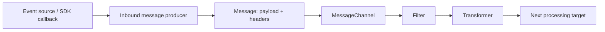
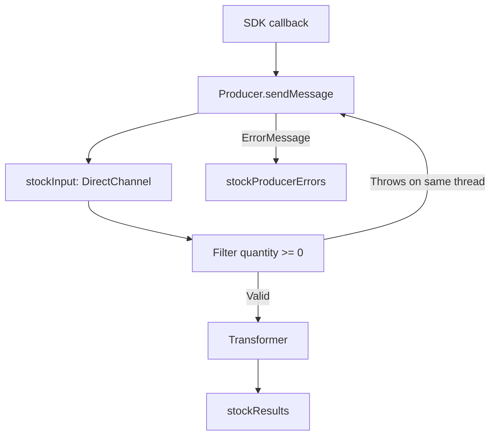

# Message producer

## 1. Objectives and scope

In the **Channel adapter** chapter of the **SPRING_INTEGRATION_CORE** module, a message producer is the connection point that brings data or events into a message flow. Understanding this connection point helps you design the right path from an event source to `Message`, `MessageChannel`, and downstream processing endpoints.

After this lesson, you can:

- Distinguish the producer's role from `MessageSource`, consumers, and messaging gateways.
- Build an event-driven producer using `MessageProducerSupport`.
- Manage callback registration following the Spring lifecycle.
- Wire the producer into Java DSL, filters, and transformers.
- Define error handling scope, timeouts, and event acknowledgment responsibilities.
- Write tests for publishing messages, stopping the source, and routing errors to an error channel.

The ongoing example is an inventory-change event source. The simulated source runs in memory to clarify core mechanics; Kafka, JMS, or MQTT are not required. The Java snippets use Java 17 or higher syntax and require the `spring-integration-core` library; the test snippets use JUnit Jupiter. Library versions must match the dependency set managed by your application.

## 2. Where does a message producer sit?

### 2.1. Role in the architecture

A producer receives data from a source, constructs or accepts a `Message<?>`, and sends it to an output channel. Downstream consumers receive the message to perform the flow's work.



In the inventory scenario:

1. The SDK notifies of a quantity change event.
2. The producer packages the event into a message.
3. Headers record the event ID and originating source.
4. A filter checks whether the data is accepted.
5. A transformer converts the data into the format expected by the next step.

The producer does not need to know which business bean is receiving the message. It needs to know the data contract and the output channel. This boundary is helpful when replacing the SDK source with another source while keeping the processing flow intact.

### 2.2. Distinguishing roles and APIs

`MessageProducer` in the `org.springframework.integration.core` package is the interface for components capable of sending messages to an output channel. This contract is not exclusive to inbound adapters; some handlers that generate output messages also implement it. Therefore, seeing `implements MessageProducer` does not automatically mean the component is always an event source. See [MessageProducer API](https://docs.spring.io/spring-integration/api/org/springframework/integration/core/MessageProducer.html).

Within this lesson's scope, we focus on a **producer at the head of a flow**, specifically an event-driven inbound adapter extending `MessageProducerSupport`.

| Component | Primary responsibility | What triggers fetching or sending data? |
|---|---|---|
| Event-driven producer | Pushes received events into an output channel | Callback, listener, or source receiving mechanism |
| `MessageSource<T>` | Supplies messages via `receive()` | Adapter's poller invokes the source |
| `SourcePollingChannelAdapter` | Coordinates polling and sends results to a channel | Polling schedule |
| `MessageHandler` | Receives messages already in the flow | Dispatch mechanism or consumer endpoint |
| Messaging gateway | Provides Java methods as an entry point into messaging | Application code calling gateway methods |

An adapter that receives data is **inbound** from the integration application's perspective. The fact that it "produces" messages does not make it an outbound adapter. Inbound/outbound describes the application boundary; producer/consumer describes the role toward messages.

## 3. Push vs. pull: choosing a mechanism by source contract

### 3.1. Sources supporting polling

If a source provides a "fetch next item" operation, `MessageSource` combined with `SourcePollingChannelAdapter` is usually the appropriate model:

```text
Poller → MessageSource.receive() → Message or null → output channel
```

A short example, independent of the inventory example:

```java
@Bean
IntegrationFlow heartbeatFlow() {
    return IntegrationFlow
            .fromSupplier(
                    () -> "heartbeat",
                    endpoint -> endpoint.poller(
                            poller -> poller.fixedDelay(1_000)))
            .channel("heartbeatInput")
            .get();
}
```

In this example, the poller invokes the supplier on schedule. A flow or subscriber is needed to receive from `heartbeatInput`. `fromSupplier` wraps any non-null result into a message if the result is not already a message. For a polling source, null means there is no message for that poll. See [Inbound Channel Adapters with Java DSL](https://docs.spring.io/spring-integration/reference/dsl/java-inbound-adapters.html).

### 3.2. Sources pushing via callback

If an SDK has a contract like `subscribe(listener)`, the source actively calls the listener when an event occurs:

```text
Incoming event → callback → producer.sendMessage(message) → output channel
```

There is no need to attach a poller just to trigger this producer. Configuring an input poller is only appropriate when there is genuinely a polling read operation. A flow may still need a poller at a later step if that step consumes from a `QueueChannel`.

You should also not place `@InboundChannelAdapter` on a method and expect the annotation to automatically register a callback with an SDK. That annotation's method-invoking adapter belongs to the polling mechanism; listener registration is the dedicated responsibility of an event-driven adapter. See [Channel Adapter](https://docs.spring.io/spring-integration/reference/channel-adapter.html).

## 4. A Message is the contract the producer introduces into the flow

For inventory events, we choose:

- **Payload:** a `StockChanged` record.
- **Header `eventId`:** business event identifier, kept stable when the same event is replayed.
- **Header `sourceSystem`:** source supplying the event.
- **Header `eventOccurredAt`:** timestamp when the event occurred at the source.

```java
package example.integration.stock;

import java.time.Instant;
import java.util.Objects;

public record StockChanged(
        String eventId,
        String sku,
        int quantity,
        Instant occurredAt) {

    public StockChanged {
        Objects.requireNonNull(eventId, "eventId is required");
        Objects.requireNonNull(sku, "sku is required");
        Objects.requireNonNull(occurredAt, "occurredAt is required");
    }
}
```

Negative quantities are allowed here to illustrate a filter rejecting data. In a real application, clarify whether the business domain permits negative inventory, then place validation rules in the appropriate location.

`MessageBuilder` helps construct a message along with its headers. For complex payloads, avoid mutating the object after publishing because multiple components may hold references to it. The record here holds immutable types, making it easier to reason about.

Do not use `MessageHeaders.ID` as a business deduplication key. When an event is repackaged into a new message, the message ID may differ. Deduplication decisions should rely on an identifier from the source, such as `eventId`, along with the necessary business scope.

Also do not manually set `correlationId`, `sequenceNumber`, or `sequenceSize` without grouping rules. When a flow expands to include routers or aggregators, those control headers must accurately reflect branching and grouping; a producer cannot infer them solely from receiving a single callback.

## 5. Creating a simulated event source

The classes below belong in separate Java files under the `example.integration.stock` package. The simulated source only models the SDK contract; it is not a message broker and provides neither durable storage nor distributed acknowledgment.

### 5.1. Source contract

```java
package example.integration.stock;

import java.util.function.Consumer;

public interface StockEventSource {

    Subscription subscribe(Consumer<StockChanged> listener);

    @FunctionalInterface
    interface Subscription {
        void cancel();
    }
}
```

The subscription object allows the producer to cancel the exact listener it registered. A real source contract must also clarify whether callbacks can run concurrently and whether cancellation waits for an in-flight callback to finish.

### 5.2. In-memory implementation

```java
package example.integration.stock;

import java.util.Objects;
import java.util.concurrent.CopyOnWriteArrayList;
import java.util.function.Consumer;

public final class InMemoryStockEventSource implements StockEventSource {

    private final CopyOnWriteArrayList<Consumer<StockChanged>> listeners =
            new CopyOnWriteArrayList<>();

    @Override
    public Subscription subscribe(Consumer<StockChanged> listener) {
        Objects.requireNonNull(listener, "listener is required");
        this.listeners.add(listener);

        return () -> {
            this.listeners.remove(listener);
        };
    }

    public void emit(StockChanged event) {
        Objects.requireNonNull(event, "event is required");

        for (Consumer<StockChanged> listener : this.listeners) {
            listener.accept(event);
        }
    }
}
```

`emit` invokes callbacks synchronously on the thread calling it. This allows tests to assert results immediately after emitting an event.

`CopyOnWriteArrayList` supports concurrent listener list operations across threads, but it does not serialize business callbacks globally. An iteration that already took a snapshot before `cancel` occurred can still invoke the listener. This characteristic becomes important when designing shutdown for a real SDK.

## 6. Building a producer with MessageProducerSupport

`MessageProducerSupport` provides the foundation for a message-emitting endpoint: output channel configuration, protected sending operations, lifecycle management, and error channel support. Rather than manually managing the entire sending mechanism, subclasses focus on the contract with the source. See [MessageProducerSupport API](https://docs.spring.io/spring-integration/api/org/springframework/integration/endpoint/MessageProducerSupport.html).

```java
package example.integration.stock;

import java.util.Objects;

import org.springframework.integration.endpoint.MessageProducerSupport;
import org.springframework.messaging.Message;
import org.springframework.messaging.support.MessageBuilder;

public final class StockEventMessageProducer extends MessageProducerSupport {

    private final StockEventSource source;

    private StockEventSource.Subscription subscription;

    public StockEventMessageProducer(StockEventSource source) {
        this.source = Objects.requireNonNull(source, "source is required");
    }

    @Override
    protected void doStart() {
        super.doStart();
        this.subscription = this.source.subscribe(this::onEvent);
    }

    @Override
    protected void doStop() {
        StockEventSource.Subscription current = this.subscription;
        this.subscription = null;

        try {
            if (current != null) {
                current.cancel();
            }
        }
        finally {
            super.doStop();
        }
    }

    private void onEvent(StockChanged event) {
        Message<StockChanged> message = MessageBuilder
                .withPayload(event)
                .setHeader("eventId", event.eventId())
                .setHeader("sourceSystem", "inventory-sdk")
                .setHeader("eventOccurredAt", event.occurredAt())
                .build();

        sendMessage(message);
    }
}
```

Key points to read accurately in the code:

1. **The constructor only stores dependencies.** Do not register the listener when the object is first constructed, because the output channel and other beans may not be ready yet.
2. **`doStart` opens the event-receiving path.** Each time the endpoint is started again, it creates a new subscription.
3. **`doStop` releases the subscription.** Keeping a dedicated handle ensures cancelling the exact registration owned by the producer.
4. **`onEvent` builds the message and calls `sendMessage`.** This method is `protected` and returns `void`; it is not a public API for business code to call arbitrarily.
5. **The producer holds no target handler.** Choosing consumers is the responsibility of the channel and flow.

Spring manages the endpoint's `start()` and `stop()`. Do not call `doStart()` or `doStop()` directly from a controller or service because those are internal lifecycle hooks.

A source might invoke the callback immediately inside `subscribe`. Therefore, do not mechanically add `if (!isRunning()) return;` inside the callback: lifecycle state and when the SDK invokes the listener must be evaluated together. In this example, subscribing and cancelling the listener is the mechanism that enables/disables the source.

With a real SDK, if registration allocates resources and then fails, the adapter must clean up partially allocated resources. If shutdown must wait for in-flight callbacks to finish, design a waiting mechanism aligned with the SDK contract; merely clearing the handle field does not satisfy that requirement.

## 7. Wiring the producer into Java DSL

### 7.1. Complete configuration for the example

```java
package example.integration.stock;

import org.springframework.beans.factory.annotation.Qualifier;
import org.springframework.context.annotation.Bean;
import org.springframework.context.annotation.Configuration;
import org.springframework.integration.channel.DirectChannel;
import org.springframework.integration.channel.QueueChannel;
import org.springframework.integration.config.EnableIntegration;
import org.springframework.integration.dsl.IntegrationFlow;
import org.springframework.messaging.MessageChannel;

@Configuration
@EnableIntegration
public class StockIntegrationConfig {

    @Bean
    public InMemoryStockEventSource stockEventSource() {
        return new InMemoryStockEventSource();
    }

    @Bean
    public DirectChannel stockInput() {
        return new DirectChannel();
    }

    @Bean
    public QueueChannel stockResults() {
        return new QueueChannel(100);
    }

    @Bean
    public QueueChannel stockProducerErrors() {
        return new QueueChannel(20);
    }

    @Bean
    public StockEventMessageProducer stockProducer(
            InMemoryStockEventSource source,
            @Qualifier("stockProducerErrors") MessageChannel errors) {

        StockEventMessageProducer producer =
                new StockEventMessageProducer(source);

        producer.setErrorChannel(errors);
        producer.setSendTimeout(200);

        return producer;
    }

    @Bean
    public IntegrationFlow stockFlow(
            StockEventMessageProducer stockProducer) {

        return IntegrationFlow
                .from(stockProducer)
                .channel("stockInput")
                .<StockChanged>filter(
                        event -> event.quantity() >= 0,
                        spec -> spec.throwExceptionOnRejection(true))
                .<StockChanged, String>transform(
                        event -> event.sku() + "=" + event.quantity())
                .channel("stockResults")
                .get();
    }
}
```

`IntegrationFlow.from(stockProducer)` takes a `MessageProducerSupport` as the head of a flow. The `.channel("stockInput")` step wires the producer's output to that channel. With this configuration style, there is no need to manually set the output channel again. See [IntegrationFlow API](https://docs.spring.io/spring-integration/api/org/springframework/integration/dsl/IntegrationFlow.html).

The filter is configured to throw an exception on negative quantities. This decision distinguishes "rejected data requiring handling" from "intentionally filtered-out data". The transformer turns valid payloads into strings such as `SKU-42=7`.

The two `QueueChannel` beans at the end of the example collect results and errors for observation or testing. They do not yet have automatic consumers. A continuously running application must have appropriate consumption steps rather than letting queues fill to capacity.

### 7.2. Configuring the channel directly as an alternative

If another flow already starts from `stockInput`, the producer can be configured as:

```java
producer.setOutputChannel(stockInput);
```

Or using the bean name when the producer is managed by Spring:

```java
producer.setOutputChannelName("stockInput");
```

Choose one consistent wiring style. If you set the output manually while also using the producer as the start of another flow, make sure the actual output is unambiguous; do not create two competing configurations for the same endpoint.

### 7.3. Starting at the right time

In the example, the context manages both the producer and downstream endpoints. With an SDK source that has its own lifecycle, control ordering so consumers are ready before the source begins emitting, and stop the source from receiving before tearing down consumers.

If manual control is needed, configure `setAutoStartup(false)` on the producer and call `start()` after operational prerequisites are met. This is a lifecycle coordination choice, not a fix for a missing output channel.

## 8. Threads and channel capacity

Choosing a channel directly affects the thread invoking the callback, latency, and how the system responds when the flow cannot keep up with the source.

| Channel | What does the producer see? | Additional design needed |
|---|---|---|
| `DirectChannel` | Handler usually runs directly on the sending thread | Callback duration may include downstream processing |
| `ExecutorChannel` | Hands work to an executor as configured | Executor capacity, rejection policy, and async errors |
| `QueueChannel` | Message is placed in the queue if space remains | Capacity, timeout, consumer, and durability requirements |
| `PublishSubscribeChannel` | Broadcasts to subscribers | Execution thread depends on whether an executor is set |

Dispatch and buffering characteristics of each type are described in [Message Channel Implementations](https://docs.spring.io/spring-integration/reference/channel/implementations.html).

In the main example, `stockInput` is a `DirectChannel`. The callback passes through the filter and transformer before placing the result into `stockResults`. No new thread is created merely because an `IntegrationFlow` is declared.

`setSendTimeout(200)` on the producer limits waiting to send at the output when the channel type supports timeouts. It does **not** impose a 200 ms deadline on the entire business processing pipeline. If a synchronous handler runs long or a deeper step waits on a full queue, the producer's send timeout does not automatically abort that processing.

In this example, both results and errors must be drained. In particular, `stockResults` can fill up when there is no consumer; blocking at the transformer's output is not solved merely by the producer's timeout on `stockInput`.

If the source emits faster than the processing rate, decide clearly:

- How long can the callback thread be blocked?
- Does the source support pausing or rate limiting?
- What is the queue capacity and how is it consumed?
- When capacity is exhausted, are events retried, persisted, or rejected?
- Must messages already accepted into memory survive process restarts?

An in-memory queue or executor does not automatically provide guaranteed delivery across process crashes. Durability decisions must be designed into the architecture, such as via an appropriate broker or message store.

## 9. Handling errors at the right boundaries

### 9.1. Errors while the producer is sending

When `sendMessage(message)` encounters a runtime error during sending, `MessageProducerSupport`'s mechanism can wrap the error into an `ErrorMessage` sent to the configured error channel. If no error channel is configured on the producer, the exception can propagate back to the source invoking the callback. This is behavior of the support class, distinct from calling `MessageChannel.send` directly. See [MessageProducerSupport source code](https://github.com/spring-projects/spring-integration/blob/main/spring-integration-core/src/main/java/org/springframework/integration/endpoint/MessageProducerSupport.java).

With the lesson's configuration:



`stockProducerErrors` is an error channel attached specifically to the producer. Having a global bean named `errorChannel` in the application does not mean a custom producer always uses that bean automatically if you have not configured it.

In the example, successfully sending to the error queue can cause `emit` to finish normally even though the data was rejected by the filter. This consequence must be accounted for when integrating with a source's acknowledgment mechanism.

### 9.2. Errors before calling sendMessage

If reading metadata, transforming SDK data, or building the payload throws an error before calling `sendMessage`, that error falls outside the base class's send operation.

When extending the producer to handle this kind of error, you can catch transformation errors specifically and use `sendErrorMessageIfNecessary`. If that method returns false, the adapter should explicitly apply a propagation or fallback policy. When no message exists yet, error context must be taken from the source data the adapter still holds.

Do not wrap the entire callback in a generic `catch` block just to send the error again. When an error has already been handled by the send path or sending to the error channel itself fails, such wrapping can duplicate error logic and obscure the original root cause.

### 9.3. Errors after an asynchronous boundary

If the output is an `ExecutorChannel` or a message has been picked up from a queue by another consumer, errors can occur after the producer has returned. The producer cannot catch errors on another thread using a `try/catch` around the earlier send call.

At that point, the error path must be configured on the task or asynchronous consumer endpoint. Depending on the error handler mechanism, the `errorChannel` header on the message and the global channel may participate in routing errors. Do not assume the producer's `setErrorChannel` setter automatically covers every error across the entire flow. See [Error Handling](https://docs.spring.io/spring-integration/reference/error-handling.html).

### 9.4. An error channel does not mean retry

Putting an `ErrorMessage` into a queue does not automatically schedule a re-execution. You need an error consumer, error classification, and a recovery policy:

| Scenario type | Possible handling approach |
|---|---|
| Permanent data error | Persist the rejected record with reason; route to a data remediation workflow |
| Target temporarily unavailable | Bounded retries, backoff, and deduplication mechanism |
| Source emitting too fast | Throttle ingestion, pause source, or buffer under backpressure |
| Error channel also fails to accept | Preserve error context so the source or monitoring layer detects the failure |

Do not loop the error flow back into the producer infinitely. Information such as `eventId`, originating source, and failure reason must be preserved well enough for investigation or replay.

## 10. Acknowledgment, deduplication, and event ordering

For sources with ack/nack or offsets, choose the milestone considered "received":

1. Producer has constructed the message.
2. Output channel has accepted the message.
3. Business processing has completed.
4. Business outcome has been durably persisted.

These four milestones can happen at different times. If the output is a queue, completing the send does not prove a consumer processed it. If a synchronous error was successfully routed to an error channel, the callback may return normally while the main business operation still failed.

Therefore, do not call `ack()` right after `sendMessage()` merely because the method did not throw an exception without examining the source contract and flow architecture. Where stronger guarantees are required, the ack point must be tied to processing completion or a reliable persistence mechanism.

During retries, the same `eventId` may appear multiple times. For instance, if an event carries absolute state "SKU-42 now has 7 items", repeated processing may be easier to control than an operation to "subtract 3 more items". Even so, both still require versioning and timestamp rules to prevent stale events from overwriting newer state.

A single producer also does not guarantee global ordering. Concurrent callbacks, multiple sources, or multiple consumers can alter completion order. When per-SKU ordering is a business requirement, design keyed processing lanes and mechanisms to detect late-arriving events.

## 11. Testing the example's behavior

The following tests use the classes above and initialize a real Spring context. They illustrate what to verify; showing the code does not imply the tests have been executed in the repository.

No `Thread.sleep` is required because the simulated source invokes callbacks synchronously. Short timeouts on queue receives give tests clear termination bounds.

```java
package example.integration.stock;

import java.time.Instant;

import org.junit.jupiter.api.Test;
import org.springframework.context.annotation.AnnotationConfigApplicationContext;
import org.springframework.integration.channel.QueueChannel;
import org.springframework.messaging.Message;
import org.springframework.messaging.MessagingException;
import org.springframework.messaging.support.ErrorMessage;

import static org.junit.jupiter.api.Assertions.*;

class StockEventMessageProducerTest {

    @Test
    void publishesEventAndPreservesBusinessHeaders() {
        try (var context = new AnnotationConfigApplicationContext(
                StockIntegrationConfig.class)) {

            var source = context.getBean(InMemoryStockEventSource.class);
            var results = context.getBean("stockResults", QueueChannel.class);

            source.emit(event("evt-1", 7));

            Message<?> message = results.receive(1_000);

            assertNotNull(message);
            assertEquals("SKU-42=7", message.getPayload());
            assertEquals("evt-1", message.getHeaders().get("eventId"));
            assertEquals(
                    "inventory-sdk",
                    message.getHeaders().get("sourceSystem"));
            assertNull(results.receive(0));
        }
    }

    @Test
    void stopsAndRestartsWithoutDuplicateSubscription() {
        try (var context = new AnnotationConfigApplicationContext(
                StockIntegrationConfig.class)) {

            var source = context.getBean(InMemoryStockEventSource.class);
            var producer = context.getBean(StockEventMessageProducer.class);
            var results = context.getBean("stockResults", QueueChannel.class);

            producer.stop();
            source.emit(event("evt-stopped", 5));

            assertNull(results.receive(0));

            producer.start();
            producer.start();
            source.emit(event("evt-restarted", 8));

            Message<?> message = results.receive(1_000);

            assertNotNull(message);
            assertEquals(
                    "evt-restarted",
                    message.getHeaders().get("eventId"));
            assertNull(results.receive(0));
        }
    }

    @Test
    void routesSynchronousRejectionToProducerErrors() {
        try (var context = new AnnotationConfigApplicationContext(
                StockIntegrationConfig.class)) {

            var source = context.getBean(InMemoryStockEventSource.class);
            var results = context.getBean("stockResults", QueueChannel.class);
            var errors = context.getBean(
                    "stockProducerErrors", QueueChannel.class);

            source.emit(event("evt-invalid", -1));

            ErrorMessage error = assertInstanceOf(
                    ErrorMessage.class, errors.receive(1_000));

            MessagingException failure = assertInstanceOf(
                    MessagingException.class, error.getPayload());

            Message<?> failedMessage = failure.getFailedMessage();

            assertNotNull(failedMessage);
            assertEquals(
                    "evt-invalid",
                    failedMessage.getHeaders().get("eventId"));
            assertNull(results.receive(0));
            assertNull(errors.receive(0));
        }
    }

    private static StockChanged event(String eventId, int quantity) {
        return new StockChanged(
                eventId,
                "SKU-42",
                quantity,
                Instant.parse("2026-01-01T00:00:00Z"));
    }
}
```

The three tests verify three distinct behaviors:

- A valid event passes through the producer and transformer while preserving business headers.
- After stopping, the simulated source no longer emits to the producer; restarting does not create duplicate subscriptions even when `start` is called on an already-running endpoint.
- Rejected data on the synchronous path produces an error in the producer's error queue and produces no valid output.

This stop/start test exercises the simulated source sequentially. It does not yet prove the adapter waits for in-flight callbacks, handles connection failures, or guarantees zero data loss with a real SDK.

When replacing with a real SDK, add tests matching the source contract: listener registration failures, connection drops, concurrent callbacks, shutdown during processing, queue full conditions, and acknowledgment behavior. Each test should tie to a specific operational requirement.

## 12. Common design mistakes

| Practice | Consequence | Adjustment |
|---|---|---|
| Registering callbacks in constructor | Source may emit before configuration finishes | Register in the start hook |
| Not storing the subscription | Cannot cancel the exact listener | Keep the handle and release it on stop |
| Instantiating producer via `new` outside context | Loses expected configuration and lifecycle coordination | Register the endpoint in Spring configuration |
| Attaching a poller to a callback-only source | Mixes two triggering mechanisms | Use an event-driven producer |
| Blocking long on the callback thread | Source loses throughput or times out per SDK contract | Choose an appropriate dispatch model and backpressure capacity |
| Using a queue without a consumer | Queue fills up or buffers unprocessed data | Configure a consumption path and capacity bounds |
| Assuming error channel retries automatically | Failed messages sit idle without reprocessing | Design an error consumer and recovery policy |
| Using message ID for source deduplication | Replayed events may carry new message IDs | Use a stable business identifier |
| Acking after enqueue when business durability is needed | Source may treat event as done too early | Choose ack milestone based on delivery guarantees |

## 13. Relationship with other core components

The producer establishes the ingestion boundary. Subsequent decisions belong to the flow:

- **Transformer** converts payload representations or enriches data under a clear contract.
- **Filter** decides whether a message proceeds, is intentionally dropped, or is rejected as an error.
- **Router** selects processing paths based on content or metadata.
- **Aggregator** requires correlation and group-completion rules; it cannot rely solely on multiple messages arriving from the same producer.
- **Gateway** is useful when application code wants to call a Java method to enter messaging, especially when a request/reply contract is needed.

If the application only needs to call a method to send a command from a service into a channel, a messaging gateway usually expresses that entry point more clearly. Build a custom producer only when you need to bridge a data-emitting mechanism with its own contract, such as an SDK listener lacking a suitable adapter.

Keeping business logic in downstream endpoints allows the producer to focus on data ingestion, metadata packaging, and source management. As a result, you can swap the ingest source while still testing transformers, routers, or filters independently.

## 14. Practice exercises

1. Make `sourceSystem` a configurable parameter of the producer. Verify each instance attaches the right source name to the header.
2. Replace the exception-throwing filter with a filter that silently drops negative quantities. Observe changes in the results, error queue, and how callback completion is interpreted.
3. Wire the producer's output directly to a `QueueChannel` of capacity 1, configure a finite send timeout, and emit two events with no consumer. Verify the first event is retained and the second send fails according to the chosen error policy.
4. Add an asynchronous consumer that throws an exception after the producer has finished sending. Identify which endpoint is responsible for publishing the error and why the original callback cannot catch it.
5. Design a deduplication rule by `eventId` for an operation with side effects. Define when the processed marker is recorded and what happens if the process crashes midway.

In the full-queue exercise, place the queue directly at the producer's output to test the producer's `sendTimeout` specifically. If the queue sits behind another handler, the timeout may belong to that handler's send operation.

## 15. Takeaways

A message producer at the head of a flow turns source events into messages for the integration system. `MessageProducerSupport` provides the sending mechanism and lifecycle, while custom adapters must manage the callback contract, source resources, and policies when messages cannot be accepted.

A sufficiently clear design must answer three things: **who triggers emission**, **what a channel accepting a message means**, and **where failures are detected**. Only then can you combine the producer with filters, transformers, routers, or aggregators while preserving the application's delivery guarantees.
