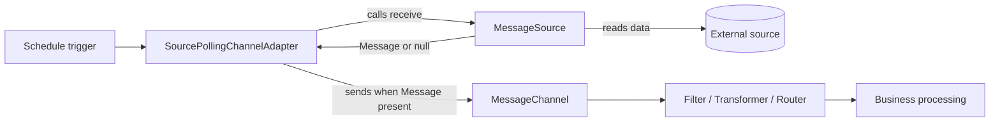

# Polling inbound adapter

## 1. Problem: actively fetching data to start a message flow

A legacy sales system only exposes a list of pending orders. It does not emit events when new orders arrive. The integration application must periodically query that system, convert the retrieved data into messages, and feed them into a processing flow.

In the **Channel adapter** chapter of the **SPRING_INTEGRATION_CORE** module, a polling inbound adapter is the bridge between an actively polled source and Spring Integration's messaging system. The adapter starts the flow by pulling data from the source; downstream transformers, filters, routers, or service activators continue processing the data according to business logic.

After this lesson, you can:

- Distinguish polling a data source from polling an internal channel.
- Build a `MessageSource<T>` and declare an inbound adapter using Java DSL.
- Choose a polling schedule, message limit, and understand how the channel affects execution threads.
- Design error paths, replayability, and deduplication.
- Test the source and the adapter's output without relying on a fixed `Thread.sleep()`.

The examples use Java 17 or higher and APIs available in Spring Integration 6.5. Projects should manage Spring versions consistently via Spring Boot or a compatible BOM; this lesson does not require a specific latest patch version.

## 2. Components and message flow direction



| Component | Responsibility |
| --- | --- |
| `MessageSource<T>` | Returns the next message or `null` when no data is currently available. |
| `SourcePollingChannelAdapter` | Coordinates fetching messages from the source and sending them to the output channel. |
| Poller | Carries trigger configuration, message limit, executor, transaction, or advice if present. |
| `TaskScheduler` | Schedules execution of the polling task. |
| `MessageChannel` | Forwards or buffers messages depending on channel type. |
| Downstream endpoint | Performs steps such as filtering, transformation, routing, and service invocation. |

The class names reflect two separate roles: `MessageSource` knows what to fetch and how to fetch it; the adapter knows when to call the source and where to send the result. The adapter connects the source to a `MessageChannel`, while the source can be tested independently of any schedule. See [SourcePollingChannelAdapter API](https://docs.spring.io/spring-integration/docs/6.5.0/api/org/springframework/integration/endpoint/SourcePollingChannelAdapter.html).

### 2.1. Polling inbound adapter vs. polling consumer

Both configurations below have a poller, yet they read from two different places:

```text
Data source → SourcePollingChannelAdapter → DirectChannel → Handler

Producer → QueueChannel → PollingConsumer → Handler
```

In the first flow, the adapter calls `MessageSource.receive()`. In the second flow, the consumer calls `receive()` on a `PollableChannel`. A handler receiving data from a `DirectChannel` usually operates via subscription rather than needing its own poller. This distinction is described in [Spring Integration Pollers](https://docs.spring.io/spring-integration/reference/polling-consumer.html).

Having a poller on an inbound adapter does not require its output channel to be a `QueueChannel`. It can send to a `DirectChannel`; in that case, fetching data and synchronous downstream processing can execute on the same thread.

### 2.2. Adapter and gateway answer two different needs

A polling inbound adapter generates messages on a schedule and does not wait for a business reply to return to an external caller. A gateway fits interactions with a request–reply contract. A source that calls an HTTP API to read data can still live inside a polling inbound adapter; the protocol used to read the source does not by itself dictate that the endpoint must be a gateway.

## 3. Contract of MessageSource

The core interface can be visualized as follows:

```java
public interface MessageSource<T> {
    Message<T> receive();
}
```

This is a sketch of the method to implement, not a full copy of the framework interface. `receive()` may return `null`; `T` is the payload type of `Message<T>`. This contract is specified in the [MessageSource API](https://docs.spring.io/spring-integration/api/org/springframework/integration/core/MessageSource.html).

| Result of one source call | Meaning for the adapter |
| --- | --- |
| A `Message<T>` | Data is available to send into the flow. |
| `null` | Currently no message; the poll cycle ends. |
| Throws exception | Operation failed; hand off to the task's error handling mechanism. |

`null` is a normal result when the source is empty. It does not indicate an error and does not mean the adapter stops permanently: the trigger can still fire the next cycle.

Conversely, connection timeouts, authentication errors, or invalid source responses must be represented as appropriate errors. If you catch every exception and return `null`, monitoring systems will struggle to distinguish "source has no data" from "source is broken".

One `receive()` call returns at most one **message**, though the payload may be an object or a list. If the source returns `Message<List<Order>>`, a single message can contain hundreds of orders. To process each order individually, place a splitter downstream.

## 4. How does a single poll cycle work?

Suppose `maxMessagesPerPoll = 3` is configured. A simple model of a successful cycle is:

```text
Fired by trigger
    ↓
receive() → Message A → send
receive() → Message B → send
receive() → null      → end cycle
    ↓
Wait for next trigger firing
```

If all three receives yield a message, the cycle ends after the third message. If one read or send raises an unhandled exception, do not assume the remaining iterations in that cycle continue as in the success case.

Values to remember for `SourcePollingChannelAdapter`:

| `maxMessagesPerPoll` | Behavior |
| --- | --- |
| Positive `N` | Fetches at most `N` messages in one cycle; can stop early when the source returns `null`. |
| `1` | Default value of a polling inbound adapter. |
| Negative, typically `-1` | Continues fetching until the source returns `null`, absent errors or other stop conditions. |
| `0` | Skips receiving; this semantics has been supported since Spring Integration 5.5. |

Notably, the default for `PollingConsumer` is `-1`, differing from the inbound adapter. A source that always generates data and never returns `null` can cause a cycle to run indefinitely if `-1` is set. Therefore, declare a finite limit when building custom sources. See [Configuring Inbound Channel Adapters](https://docs.spring.io/spring-integration/reference/channel-adapter.html).

This limit counts the number of messages the adapter pulls from the source, not the number of records inside a payload or the number of final outputs. For example, if the adapter fetches two messages and a filter discards one, only one result reaches the output; that cycle still fetched two messages.

## 5. Choosing a polling schedule

### 5.1. Fixed delay

```java
Pollers.fixedDelay(Duration.ofSeconds(1))
       .maxMessagesPerPoll(10)
```

With standard synchronous execution, the next cycle is scheduled after the previous task finishes plus the delay interval. If a cycle takes 800 ms and the delay is 1 second, two consecutive start times are roughly 1.8 seconds apart.

Fixed delay fits when you need breathing room between reads, especially with sources whose response times vary.

### 5.2. Fixed rate

```java
Pollers.fixedRate(Duration.ofSeconds(1))
       .maxMessagesPerPoll(10)
```

Fixed rate establishes a cadence based on scheduled start times. It does not guarantee data finishes processing every second, nor does it automatically add processing capacity when tasks are slow. Overloads and schedule semantics are described in [Pollers 6.5 API](https://docs.spring.io/spring-integration/docs/6.5.0/api/org/springframework/integration/dsl/Pollers.html).

### 5.3. Cron and initial delay

```java
Pollers.cron(
        "0 */5 * * * *",
        TimeZone.getTimeZone("Asia/Ho_Chi_Minh"))
       .maxMessagesPerPoll(50)
```

This example triggers at second `0` of every 5-minute mark. Spring's cron expression here has six fields, including seconds. Setting an explicit time zone keeps the business schedule independent of the host machine's default time zone.

When you want to wait before the first read, use the overload:

```java
Pollers.fixedDelay(Duration.ofSeconds(1), Duration.ofSeconds(5))
```

In the snippets above, import `java.time.Duration`, `java.util.TimeZone` when using cron, and `org.springframework.integration.dsl.Pollers`.

### 5.4. Commonly misunderstood settings

| Setting | Accurate understanding |
| --- | --- |
| `maxMessagesPerPoll(10)` | Does not mean each source call will fetch exactly 10 records. |
| Poller `receiveTimeout` | Used by a polling consumer reading a channel; does not set timeouts for HTTP/JDBC inside `MessageSource`. |
| `taskExecutor` | Hands polling work off to an executor; you must evaluate concurrent task counts and source load capacity. |
| Shared default poller | Must be configured appropriately if an endpoint relies on it; the example in this lesson declares an explicit poller so cadence and limits are clear. |

For an inbound adapter, whether a single receive call blocks depends on the source implementation. HTTP, socket, or query timeouts must be set on the respective client. The scope of `receiveTimeout` is documented in [@Poller API](https://docs.spring.io/spring-integration/api/org/springframework/integration/annotation/Poller.html).

If an asynchronous executor is added to the poller, when the scheduled task completes may only reflect handing work off to the executor. In that case, fixed delay cannot be used to infer that all business processing from the previous cycle has finished.

## 6. Java DSL example: reading, filtering, and transforming orders

The following example uses an in-memory source so you can observe the full mechanism without an external server. The main dependency is `org.springframework.integration:spring-integration-core`; Java DSL is included in core.

Place the class in package `example.integration`:

```java
package example.integration;

import java.math.BigDecimal;
import java.time.Duration;
import java.util.Queue;
import java.util.concurrent.ConcurrentLinkedQueue;

import org.springframework.context.annotation.Bean;
import org.springframework.context.annotation.Configuration;
import org.springframework.integration.channel.QueueChannel;
import org.springframework.integration.config.EnableIntegration;
import org.springframework.integration.core.MessageSource;
import org.springframework.integration.dsl.IntegrationFlow;
import org.springframework.integration.dsl.Pollers;
import org.springframework.messaging.Message;
import org.springframework.messaging.support.MessageBuilder;

@Configuration
@EnableIntegration
public class PollingInboundConfig {

    public record OrderEvent(
            String eventId,
            String orderId,
            BigDecimal amount) {
    }

    public record OrderAccepted(
            String orderId,
            BigDecimal amount) {
    }

    public static class OrderSource implements MessageSource<OrderEvent> {

        private final Queue<OrderEvent> pending =
                new ConcurrentLinkedQueue<>();

        public void offer(OrderEvent event) {
            pending.add(event);
        }

        @Override
        public Message<OrderEvent> receive() {
            OrderEvent event = pending.poll();
            if (event == null) {
                return null;
            }

            return MessageBuilder.withPayload(event)
                    .setHeader("eventId", event.eventId())
                    .setHeader("sourceSystem", "demo-orders")
                    .build();
        }
    }

    @Bean
    public OrderSource orderSource() {
        OrderSource source = new OrderSource();
        source.offer(new OrderEvent(
                "evt-001", "ord-101", new BigDecimal("150000")));
        source.offer(new OrderEvent(
                "evt-002", "ord-102", new BigDecimal("-5000")));
        source.offer(new OrderEvent(
                "evt-003", "ord-103", new BigDecimal("240000")));
        return source;
    }

    @Bean
    public QueueChannel orderResults() {
        return new QueueChannel(10);
    }

    @Bean
    public QueueChannel rejectedOrders() {
        return new QueueChannel(10);
    }

    @Bean
    public QueueChannel pollingErrors() {
        return new QueueChannel(10);
    }

    @Bean
    public IntegrationFlow orderPollingFlow(OrderSource orderSource) {
        return IntegrationFlow
                .from(orderSource, endpoint -> endpoint
                        .id("orderPollingAdapter")
                        .poller(Pollers.fixedDelay(Duration.ofSeconds(1))
                                .maxMessagesPerPoll(2)
                                .errorChannel("pollingErrors")))
                .filter(OrderEvent.class,
                        event -> event.amount().signum() > 0,
                        filter -> filter.discardChannel("rejectedOrders"))
                .transform(OrderEvent.class,
                        event -> new OrderAccepted(
                                event.orderId(), event.amount()))
                .channel("orderResults")
                .get();
    }
}
```

### 6.1. Interpreting the execution flow

When the application context starts, the `orderPollingAdapter` endpoint automatically runs on its declared schedule. The connections created by the DSL between the source, filter, and transformer in this configuration run synchronously; the declared `QueueChannel` beans act as collection points for readers or tests to receive from.

| Cycle | Messages read from source | Outcome |
| --- | --- | --- |
| First cycle | `evt-001`, `evt-002` | `ord-101` goes to `orderResults`; `evt-002` goes to `rejectedOrders`. |
| Next cycle | `evt-003`, then source returns `null` | `ord-103` goes to `orderResults`; cycle stops early. |
| Once source is empty | `null` | No output message produced; schedule continues. |

A filter rejecting non-positive amounts is an intentional business decision. It is not a technical error and does not automatically generate an `ErrorMessage`. A dedicated discard path lets you observe rejected data without mixing it into connection or processing errors.

After the transformer, the payload changes from `OrderEvent` to `OrderAccepted`; the business header `eventId` still serves for message correlation. When extending the flow with routers or aggregators, choose the business keys to preserve right when creating the message.

### 6.2. Limitations of an in-memory source

`pending.poll()` retrieves and removes the item from the queue right inside `receive()`. If a downstream filter, transformer, or send operation fails, the retrieved item does not automatically return to this queue.

The illustrative source allows testing polling mechanics, but does not yet provide durable persistence or acknowledgment. When replacing it with a real source, clearly define:

- When a record is marked read or processed.
- How data is recovered after an error or application restart.
- The event identification key for safe deduplication.
- How multiple instances divide work without claiming the same record.

## 7. Annotation variant

If the system already has a bean providing a zero-argument read method, you can use `@InboundChannelAdapter` instead of initializing the source with DSL:

```java
@InboundChannelAdapter(
        channel = "rawOrders",
        poller = @Poller(
                fixedDelay = "1000",
                maxMessagesPerPoll = "2",
                errorChannel = "pollingErrors"))
public Message<OrderEvent> readNextOrder() {
    return orderSource.receive();
}
```

This is a method on a Spring-managed bean, with `orderSource` injected. Import `org.springframework.integration.annotation.InboundChannelAdapter` and `org.springframework.integration.annotation.Poller`; `Message` and `OrderEvent` are the same as in the previous example. You must also have the `rawOrders` and `pollingErrors` channels and appropriate output handling configured.

The annotated method takes no parameters. If it returns a POJO other than `Message`, the framework creates a message with that object as payload; if it returns `null`, no new message is produced. Details are in [@InboundChannelAdapter API](https://docs.spring.io/spring-integration/api/org/springframework/integration/annotation/InboundChannelAdapter.html).

Choose either this annotation or the DSL to declare the polling point for the same source. If both are registered inadvertently, two adapters may read the same source concurrently, altering ordering or splitting data unexpectedly.

## 8. Channels define processing boundaries

### 8.1. DirectChannel: processing on the same thread

```text
Poller thread
  → source.receive()
  → DirectChannel.send()
  → transformer
  → handler
  → synchronous operation completes
```

A slow handler prolongs the polling task. In return, handler exceptions can propagate back to the ongoing send call, and thread-bound transactions can cover appropriate participating resources.

### 8.2. QueueChannel: buffering in a queue for later processing

```text
Poller thread → source.receive() → QueueChannel
                                      ↓
                         Consumer receives in another step
                                      ↓
                              Business processing
```

Successfully sending to a queue indicates the message was accepted into the queue; it does not prove final business processing completed. A default `QueueChannel` stores messages in memory; configure an appropriate message store if data must survive restarts.

A bounded-capacity queue helps limit pending data. When the queue is full, send operations may block depending on timeout, which also slows down source reading. If you add a handler to read from `orderResults`, that handler needs a poller because its input is a `PollableChannel`. See [MessageChannel Implementations](https://docs.spring.io/spring-integration/reference/6.5/channel/implementations.html).

### 8.3. TaskScheduler vs. TaskExecutor

The scheduler determines when a task fires; the executor can execute assigned work. Increasing thread count does not solve a source lacking record claiming or locking.

Before allowing concurrent polling tasks, check whether the source is thread-safe, whether the client has enough connections, whether business ordering is allowed to change, and whether downstream can keep up. Two application instances are two independent schedulers; a fixed-delay configuration does not create a distributed lock between them.

## 9. Error handling and properly scoped retries

In the example, `.errorChannel("pollingErrors")` configures the polling error destination. The DSL supports configuring error channel, advice, executor, and transaction via [PollerSpec API](https://docs.spring.io/spring-integration/api/org/springframework/integration/dsl/PollerSpec.html).

### 9.1. Distinguishing where errors arise

| Error location | Data usually available for investigation | Handling approach |
| --- | --- | --- |
| Inside `source.receive()` before a message exists | Exception and source query context; failed message may not exist yet | Monitor source, retry reads with bounds, inspect connectivity. |
| Inside synchronous transformer/handler after source | Failed message may be present in `MessagingException` | Correlate `eventId`, determine if reprocessable. |
| Inside consumer after `QueueChannel` | Error belongs to processing after queue retrieval | Configure error handling and recovery for that consumer. |

Do not assume the inbound poller's error channel will catch every error occurring later in a flow after a thread boundary has been crossed.

`ErrorMessage` carries a `Throwable` as its payload. When the throwable is a `MessagingException`, you can inspect `getFailedMessage()`, while still handling the case where it is `null`. Same-thread exception rules and publishing errors as messages are explained in [Error Handling](https://docs.spring.io/spring-integration/reference/error-handling.html).

### 9.2. Retry does not automatically mean safe re-reading

A request-handler retry advice wrapping a downstream handler does not automatically retry errors that occurred earlier in `MessageSource.receive()`. To retry the read operation, place retry logic at the source or use advice wrapping the specific polling point needing protection.

Also distinguish two situations:

- **Repeating a source read:** may return the same record, a different record, or no data depending on the source contract.
- **Repeating processing of an existing message:** retains the event key but may repeat side effects such as sending emails or charging payments.

With the example's source, the trigger firing again does not restore an item already removed by `poll()`. Logging an exception or receiving an `ErrorMessage` also does not restore that item.

In operations, the error path needs a consumer, bounded capacity, and appropriate persistence. `pollingErrors` in this lesson is a queue for testing; when scaling the application, you can wire it to an error classification flow, persist events needing reprocessing, and alert per source.

## 10. Transactions, acknowledgment, and deduplication

### 10.1. Wrapping the receive operation in a transaction

For sources that can participate in a transaction, the poller can open a transaction before reading. Example configuration when a compatible transaction manager exists:

```java
// Configuration fragment: transactionManager is the bean managing the source resource.
endpoint.poller(Pollers.fixedDelay(Duration.ofSeconds(1))
        .maxMessagesPerPoll(1)
        .transactional(transactionManager));
```

Setting a limit of `1` keeps the example focused on one message per cycle. Rollback effectiveness depends on the resource, transaction manager, and the synchronous execution scope participating in the transaction. The poller provides the transaction boundary for receiving data; see [Poller Transaction Support](https://docs.spring.io/spring-integration/reference/6.5/transactions.html).

A `ConcurrentLinkedQueue` does not become transactional merely by adding `.transactional(...)`. Similarly, a database rollback does not automatically undo a succeeded HTTP request, and a thread-bound transaction does not automatically cross a queue to cover processing on another thread.

### 10.2. Defining success before updating source status

Suppose a source table has states `NEW`, `PROCESSING`, `DONE`. A design might claim a row before processing and then mark it `DONE` upon completion. However, you need an expired-claim reclamation rule so rows do not stay stuck if an instance crashes midway.

| Status update strategy | Risk to address |
| --- | --- |
| Mark `DONE` before sending message | Work can be lost if subsequent sending or processing fails. |
| Mark `DONE` only after business completion | Duplicate processing can occur if the app crashes after side effects but before updating status. |
| Mark `DONE` immediately after sending to queue | Must verify whether the queue is durable and who handles consumer failures. |

These are design choices based on the guarantees of the source and destination, not a property that a polling schedule can provide on its own.

### 10.3. Choosing an idempotency key per business event

The example's `eventId` header comes from the source and is stable for an event. It is better suited for detecting replays than `MessageHeaders.ID`, which can be newly generated when constructing another message.

If an order has multiple valid updates, using only `orderId` can drop subsequent updates. You can choose `eventId` or a `(orderId, version)` pair depending on the business contract.

The idempotency check store must be durable and support atomic operations when multiple instances process concurrently. Coordination between recording the key and executing side effects must also be designed to avoid gaps that lose or duplicate work.

## 11. Tuning load and observing operation

Suppose the source always has enough data, processing is sequential, there are no retries, and the average time of one read plus synchronous processing is `t`. With fixed delay `d` and limit `n` messages:

```text
Single cycle duration ≈ n × t + d
Average throughput ≈ n / (n × t + d)
```

For example, `n = 10`, `t = 80 ms`, `d = 1,000 ms` gives a throughput of about `10 / 1.8 = 5.56` messages/second. This is an estimate under those assumptions, ignoring scheduling overhead and the trailing empty read; it is not a framework performance guarantee.

Increasing `n` can amortize idle time per message, yet it also holds threads and resources longer. Decreasing the delay can increase empty queries when source data is sparse. If each `receive()` call performs an HTTP request, a limit of `10` can issue up to ten requests in one cycle rather than turning them into a single batch request.

Signals worth monitoring:

- Timestamp of the most recent successful poll and duration per cycle.
- Retrieved message count, empty-source poll count, error count, and retry count.
- Pending records at the source, age of the oldest record, and output queue depth.
- Messages dropped by filters and events detected as duplicates.

Tracking "successful reads" separately from "reads with data" helps avoid mistaking a quiet source for a broken source. Conversely, an empty queue does not prove the source is healthy if every read is failing.

## 12. Testing the source and integration flow

The test snippets below use JUnit Jupiter. They demonstrate how to verify the behavior of the configuration in section 6; add the corresponding JUnit 5 dependency in your practice project.

### 12.1. Testing the source contract

```java
package example.integration;

import java.math.BigDecimal;

import org.junit.jupiter.api.Test;
import org.springframework.messaging.Message;

import static org.junit.jupiter.api.Assertions.*;

class OrderSourceTest {

    @Test
    void returnsNullWhenNoOrderIsAvailable() {
        var source = new PollingInboundConfig.OrderSource();

        assertNull(source.receive());
    }

    @Test
    void returnsAnOrderWithItsBusinessEventId() {
        var source = new PollingInboundConfig.OrderSource();
        var event = new PollingInboundConfig.OrderEvent(
                "evt-test", "ord-test", new BigDecimal("100000"));
        source.offer(event);

        Message<PollingInboundConfig.OrderEvent> message = source.receive();

        assertNotNull(message);
        assertEquals(event, message.getPayload());
        assertEquals("evt-test", message.getHeaders().get("eventId"));
        assertEquals("demo-orders", message.getHeaders().get("sourceSystem"));
        assertNull(source.receive());
    }
}
```

This test needs no scheduler or application context. It clearly confirms that an empty source returns `null`, business headers are attached properly, and the retrieved item is no longer in the illustrative source.

### 12.2. Testing the adapter's real output

```java
package example.integration;

import org.junit.jupiter.api.Test;
import org.springframework.context.annotation.AnnotationConfigApplicationContext;
import org.springframework.integration.channel.QueueChannel;
import org.springframework.messaging.Message;

import static org.junit.jupiter.api.Assertions.*;

class PollingInboundFlowTest {

    @Test
    void pollsFiltersAndTransformsOrders() {
        try (var context = new AnnotationConfigApplicationContext(
                PollingInboundConfig.class)) {

            QueueChannel results = context.getBean(
                    "orderResults", QueueChannel.class);
            QueueChannel rejected = context.getBean(
                    "rejectedOrders", QueueChannel.class);
            QueueChannel errors = context.getBean(
                    "pollingErrors", QueueChannel.class);

            Message<?> first = results.receive(5000);
            Message<?> second = results.receive(5000);
            Message<?> invalid = rejected.receive(5000);

            assertNotNull(first);
            assertNotNull(second);
            assertNotNull(invalid);

            var firstOrder = assertInstanceOf(
                    PollingInboundConfig.OrderAccepted.class,
                    first.getPayload());
            var secondOrder = assertInstanceOf(
                    PollingInboundConfig.OrderAccepted.class,
                    second.getPayload());
            var invalidOrder = assertInstanceOf(
                    PollingInboundConfig.OrderEvent.class,
                    invalid.getPayload());

            assertEquals("ord-101", firstOrder.orderId());
            assertEquals("ord-103", secondOrder.orderId());
            assertEquals("ord-102", invalidOrder.orderId());
            assertEquals("evt-001", first.getHeaders().get("eventId"));
            assertEquals("evt-003", second.getHeaders().get("eventId"));
            assertNull(results.receive(0));
            assertNull(errors.receive(0));
        }
    }
}
```

`receive(5000)` waits up to 5 seconds for a message and returns immediately once available. This verifies observable output rather than assuming the scheduler must finish after a fixed sleep. The context is closed after the test to stop endpoints and related resources.

The test above verifies the adapter fetches data, the filter routes invalid orders to the discard channel, and the transformer produces the new payload. It does not prove exactly two receives occur per cycle; to test that limit, control the trigger/execution schedule and count source calls within a separate cycle.

### 12.3. Error scenarios to add when replacing with a real source

| Scenario | What to verify |
| --- | --- |
| Source has no data | No business message or false error is emitted. |
| Source throws exception | An observable error arrives on the configured error path. |
| Synchronous handler fails | Identify the failed message and the real source's re-read/rollback behavior. |
| Downstream queue consumer fails | Error is handled at the consumer; data is not abandoned in an intermediate state. |
| Same `eventId` received again | Business side effects are not duplicated unintentionally. |
| Restart mid-processing | Read progress and claimed records recover as designed. |
| Two instances polling concurrently | Record partitioning or claiming operates atomically. |

## 13. Practice exercises

1. Keep the sample data and change `maxMessagesPerPoll` from `2` to `1`. Record message IDs when the source receives them to observe how many cycles are needed; do not infer the limit solely from the count of valid output messages.
2. Add a valid event to `OrderSource` after the initial three events have all been drained. Verify the adapter keeps receiving it without restarting the context.
3. Create a test source that throws an exception on the first read and returns a message on the next. Observe the error channel and verify the polling schedule can still execute subsequent cycles.
4. Replace the in-memory source with a fake repository having claim states. Simulate the process stopping after claiming and before completing, then design how to reclaim the record.
5. Make the source emit the same `eventId` twice. Add an idempotency mechanism and verify the actual execution count of the side effect.

Upon completing the exercises, you should be able to explain three independent milestones in your flow: **data fetched**, **message sent**, and **business processing completed**. Identifying each milestone clearly helps you choose the right channels, transactions, and recovery strategies when using a polling inbound adapter in a real integration system.
