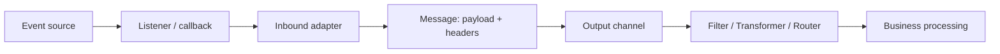
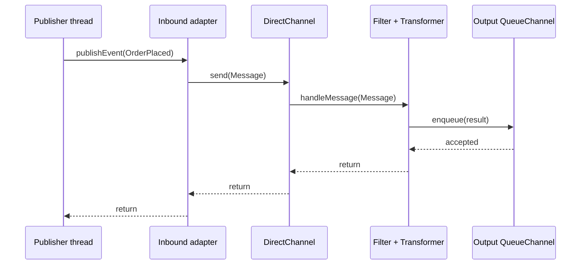

# Event-driven inbound adapter

## 1. Objectives and context

In the **Channel adapter** chapter of the **SPRING_INTEGRATION_CORE** module, this lesson explains how to bring an event into a Spring Integration flow as soon as a source calls a listener or callback. This is the starting point for connecting external data with `Message`, `MessageChannel`, transformers, filters, routers, and business-processing endpoints.

After this lesson, you can:

- Distinguish an event-driven inbound adapter from a polling inbound adapter and a messaging gateway.
- Identify where messages are constructed, execution threads, and error handling boundaries.
- Configure an adapter receiving Spring `ApplicationEvent`s, wire it into Java DSL, and test the output.
- Evaluate the impact of queues, concurrency, lifecycle, retries, and event replayability.

Prerequisites: payload/header structure of `Message<?>`, Spring beans, Java lambdas, and basic semantics of `DirectChannel` and `QueueChannel`.

## 2. What is an event-driven inbound adapter?

An **event-driven inbound adapter** is an endpoint that receives notifications from an event source, converts them into Spring Integration messages, and sends them to an output channel. The term *inbound* is viewed from the integration flow's perspective: data enters **into** the messaging system.

The source can be a Spring application event, an SDK callback, a messaging library listener, or data arriving over a connection. In this model, the application subscribes to receive events; it does not need a Spring Integration poller to periodically invoke a data-fetching method.



The adapter is responsible for bridging two models: the source's event API and Spring Integration's messaging API. Downstream business logic only needs to understand messages rather than depending on a specific SDK's callback object.

An adapter belonging to the message-driven category does not mean every underlying layer uses an OS-level or broker push mechanism. A client might run its own receive loop internally. What matters here is the **contract at the Spring Integration boundary**: whether the source invokes a listener, or Spring Integration's poller calls `MessageSource.receive()`.

A real-world example of this adapter family is the MQTT inbound message-driven adapter. Connection handling, payload conversion, and receipt acknowledgment must follow the corresponding adapter's documentation. [MQTT Support](https://docs.spring.io/spring-integration/reference/mqtt.html).

## 3. Distinguishing ways of bringing data into a flow

| Criterion | Event-driven inbound adapter | Polling inbound adapter | Messaging gateway |
| --- | --- | --- | --- |
| Triggering actor | Source invokes listener or callback | Poller triggers reading the source | Application code invokes a method or external caller sends a request |
| Common bridge | `MessageProducerSupport` or specialized adapter | `SourcePollingChannelAdapter` and `MessageSource<?>` | Proxy interface or protocol gateway |
| Poller at source ingestion | Not needed for callback mechanism | Needs explicit configuration or an appropriate default poller | Not a defining characteristic of a gateway |
| Exchange semantics | Brings notifications into flow one-way | Brings read results into flow one-way | Wraps a call; can support request-reply or one-way methods |
| Example | Receiving a Spring application event | Periodically fetching records to process | Calling an interface to send a request and receive a result |

A channel adapter is a bridge between a sender/receiver and a message channel. For method-invoking inbound adapters, Spring Integration uses a poller to read results and create messages. [Channel Adapter](https://docs.spring.io/spring-integration/reference/channel-adapter.html).

### 3.1. `@InboundChannelAdapter` is not a callback registration annotation

In core Spring Integration, this annotation creates a `SourcePollingChannelAdapter` backed by the annotated method. The source method takes no parameters and must return a non-`void` value.

The following example is **polling**, even though the method is named `nextEvent`:

```java
@InboundChannelAdapter(
    channel = "incomingEvents",
    poller = @Poller(fixedDelay = "1000")
)
public String nextEvent() {
    return eventBuffer.poll();
}
```

Each time the poller runs, the method is invoked to fetch data. When no data is available, the source may return `null`, meaning no new message for that read cycle. Omitting `@Poller` does not turn the method into a listener; the configuration must still have an appropriate default poller. [Annotation Support](https://docs.spring.io/spring-integration/reference/configuration/annotations.html).

### 3.2. A one-way adapter can still have acknowledgments

Protocol acknowledgments, such as confirming receipt of a frame, do not equate to a business reply. A flow receiving an event may return no business result to the source while still adhering to transport acknowledgment rules.

Similarly, a publisher finishing a `void` method call is not enough to conclude data has been durably persisted or business logic has completed. You must examine the entire execution boundary and the source's conventions.

## 4. Roles of Message, channel, and endpoint

Consider an order placement notification:

```text
OrderPlaced(
    eventId = "evt-1001",
    orderId = "order-501",
    totalText = "125000.00"
)
```

Three layers of responsibility should stay clear:

1. **Adapter:** receives the right notification type, converts it into a `Message`, and sends it to a channel.
2. **Transformation/routing endpoints:** validate data, normalize monetary types, enrich metadata, and choose processing branches.
3. **Business logic:** saves the order, updates inventory, calls services, or aggregates results per application requirements.

For custom adapters, the core can extend `MessageProducerSupport`. This support class provides output channel, error channel, and `sendMessage(...)`; callback registration and resource management are still handled by the concrete adapter. [MessageProducerSupport API](https://docs.spring.io/spring-integration/api/org/springframework/integration/endpoint/MessageProducerSupport.html).

Essential metadata usually includes the event ID from the source, business entity ID, originating system, and correlation information. `MessageHeaders.ID` identifies a single message within Spring Messaging; it should not replace a stable `eventId` from the source when detecting duplicates or replays.

When transforming payloads, preserve necessary business headers. Do not stuff entire stateful session, connection, or callback objects into business payloads just for later convenience.

## 5. Complete example: receiving a Spring ApplicationEvent with Java DSL

### 5.1. Problem and dependencies

The checkout application publishes `OrderPlaced`. The integration flow will:

- Accept only events of the right type.
- Add `eventId` and `sourceSystem` headers.
- Route events missing identifiers to a discard branch.
- Convert `totalText` to `BigDecimal` and create an `OrderCommand`.
- Route conversion errors to a dedicated error channel.

The example uses Java 17 or higher because it uses `record`. Spring dependencies must be managed according to your project's compatible BOM, such as Spring Boot's dependency management. The Maven snippet below assumes version management is already present; it is not a complete `pom.xml`:

```xml
<dependencies>
    <dependency>
        <groupId>org.springframework.integration</groupId>
        <artifactId>spring-integration-core</artifactId>
    </dependency>
    <dependency>
        <groupId>org.springframework.integration</groupId>
        <artifactId>spring-integration-event</artifactId>
    </dependency>
    <dependency>
        <groupId>org.junit.jupiter</groupId>
        <artifactId>junit-jupiter</artifactId>
        <scope>test</scope>
    </dependency>
</dependencies>
```

The test code below requires a test runner supporting JUnit Jupiter. The example does not require an external broker or `spring-integration-test`, since it uses a real application context and reads directly from output queues.

`ApplicationEventListeningMessageProducer` belongs to the `spring-integration-event` module. It can filter by event type; for POJO events wrapped by Spring as `PayloadApplicationEvent`, the payload placed in the message is that POJO instance. [Spring ApplicationEvent Support](https://docs.spring.io/spring-integration/reference/event.html).

### 5.2. Configuring the beans

Save the following code in `EventInboundConfig.java`, under the illustrative package `example.integration`:

```java
package example.integration;

import java.math.BigDecimal;

import org.springframework.beans.factory.annotation.Qualifier;
import org.springframework.context.annotation.Bean;
import org.springframework.context.annotation.Configuration;
import org.springframework.integration.channel.DirectChannel;
import org.springframework.integration.channel.QueueChannel;
import org.springframework.integration.config.EnableIntegration;
import org.springframework.integration.dsl.IntegrationFlow;
import org.springframework.integration.event.inbound.ApplicationEventListeningMessageProducer;
import org.springframework.messaging.MessageChannel;

@Configuration(proxyBeanMethods = false)
@EnableIntegration
public class EventInboundConfig {

    public record OrderPlaced(
            String eventId,
            String orderId,
            String totalText) {
    }

    public record OrderCommand(
            String eventId,
            String orderId,
            BigDecimal total) {
    }

    @Bean
    public DirectChannel orderEvents() {
        return new DirectChannel();
    }

    @Bean
    public QueueChannel orderCommands() {
        return new QueueChannel(10);
    }

    @Bean
    public QueueChannel rejectedOrderEvents() {
        return new QueueChannel(10);
    }

    @Bean
    public QueueChannel orderEventErrors() {
        return new QueueChannel(10);
    }

    @Bean
    public ApplicationEventListeningMessageProducer orderEventInbound(
            @Qualifier("orderEvents") MessageChannel output,
            @Qualifier("orderEventErrors") MessageChannel errors) {

        var producer = new ApplicationEventListeningMessageProducer();
        producer.setEventTypes(OrderPlaced.class);
        producer.setOutputChannel(output);
        producer.setErrorChannel(errors);
        producer.setSendTimeout(1000);
        return producer;
    }

    @Bean
    public IntegrationFlow orderEventFlow(
            @Qualifier("orderEvents") MessageChannel input,
            @Qualifier("orderCommands") MessageChannel commands,
            @Qualifier("rejectedOrderEvents") MessageChannel rejected) {

        return IntegrationFlow.from(input)
                .enrichHeaders(headers -> headers
                        .headerFunction("eventId", message ->
                                ((OrderPlaced) message.getPayload()).eventId())
                        .header("sourceSystem", "checkout"))
                .filter(OrderPlaced.class,
                        event -> hasText(event.eventId())
                                && hasText(event.orderId()),
                        endpoint -> endpoint.discardChannel(rejected))
                .<OrderPlaced, OrderCommand>transform(event ->
                        new OrderCommand(
                                event.eventId(),
                                event.orderId(),
                                new BigDecimal(event.totalText())))
                .channel(commands)
                .get();
    }

    private static boolean hasText(String value) {
        return value != null && !value.isBlank();
    }
}
```

`@EnableIntegration` registers the integration infrastructure when using plain Java configuration. The `@Qualifier` annotations disambiguate the injected channels because multiple beans of type `MessageChannel` exist in the context.

### 5.3. How an event flows through the configuration

Assuming the context has started, the application publishes:

```java
publisher.publishEvent(
        new EventInboundConfig.OrderPlaced(
                "evt-1001", "order-501", "125000.00"));
```

Here `publisher` is an `ApplicationEventPublisher` injected by Spring. The expected result is a message in `orderCommands`:

```text
payload:
  OrderCommand("evt-1001", "order-501", BigDecimal("125000.00"))

business headers:
  eventId = "evt-1001"
  sourceSystem = "checkout"
```

`orderEventInbound` receives callbacks from the application event system, while `orderEventFlow` starts from `orderEvents`. There is no source poller in this configuration.

The output queues are observation points for the practice exercise and do not yet have business consumers. They have finite capacity so data buildup is not hidden. In a long-running application, components must read and process each branch.

`setSendTimeout(1000)` applies to the send operation executed by the producer when the channel supports timeout waits. It is not a one-second deadline for the entire flow. In particular, a producer sending to a `DirectChannel` cannot use this property to interrupt a transformer or a queue send deeper in the call stack.

### 5.4. Three outputs with distinct meanings

| Input | Output | Meaning |
| --- | --- | --- |
| Valid event ID, order ID, and parseable total | `orderCommands` receives `OrderCommand` | Normalized successfully |
| `eventId` or `orderId` missing/blank | `rejectedOrderEvents` receives `OrderPlaced` | Intentionally rejected by filter |
| Valid identifiers but `totalText = "invalid"` | `orderEventErrors` receives `ErrorMessage` | Transformer raised an exception |
| Event of another type | Does not enter this flow | Adapter is not registered for that type |

The discard channel receives messages rejected by the filter; this is not automatically an execution error. The example only checks identifier presence and monetary parsing, not full business rules such as minimum order amount. [Filter](https://docs.spring.io/spring-integration/reference/filter.html).

## 6. Event-driven does not mean asynchronous

An event-triggered source and how a channel dispatches messages are two separate decisions.

In Spring application events' default configuration, listeners are invoked synchronously on the thread publishing the event. `DirectChannel` continues executing handlers on the sending thread. Consequently, in the example above, validation and transformation occur before the `publishEvent(...)` call returns. [ApplicationContext events](https://docs.spring.io/spring-framework/reference/core/beans/context-introduction.html), [Error Handling](https://docs.spring.io/spring-integration/reference/error-handling.html).



The queue at the end of the flow buffers results for another reader. It does not move steps **already executed before the queue** onto a new thread.

Common options:

- **`DirectChannel`:** suitable when seamless same-thread execution is desired and the source can wait.
- **`ExecutorChannel`:** typically hands handler invocation off to an executor; requires configuring pool size, queue capacity, and rejection handling.
- **`QueueChannel`:** introduces a buffer; a downstream consumer is needed to pull messages. An endpoint reading from a pollable channel needs a poller, even though the source adapter remains event-driven.
- **`PublishSubscribeChannel`:** suitable when multiple subscribers all need to receive an event; whether execution is synchronous or via an executor depends on configuration.

`DirectChannel` is point-to-point; adding multiple subscribers does not turn it into broadcast. `ExecutorChannel` can also execute on the sending thread when the executor's policy allows caller-runs execution, so do not infer thread boundaries solely from channel names. [Message Channel Implementations](https://docs.spring.io/spring-integration/reference/channel/implementations.html).

## 7. Handling errors at the right boundaries

### 7.1. Synchronous errors in the example

If `new BigDecimal("invalid")` throws an exception, the error unwinds up the call stack through `DirectChannel` to the producer. Because the producer has an error channel configured, it can emit an `ErrorMessage` to `orderEventErrors`.

The error message's payload is the exception. When it is a `MessagingException`, `getFailedMessage()` lets you inspect the failing message. Do not assume every `Throwable` exposes this method; check the type before reading.

When the error message is sent successfully, the publisher may return normally even though the business branch failed. If `setErrorChannel(...)` is omitted, synchronous errors can propagate back to the caller. An error channel receiving errors is not a retry mechanism and does not replay events on its own. [Spring ApplicationEvent Support](https://docs.spring.io/spring-integration/reference/event.html).

### 7.2. Across an asynchronous boundary

When downstream runs on a different worker thread, exceptions cannot unwind back to the publisher's already-finished call stack. Error handling must be configured where the asynchronous work actually runs.

Do not assume `producer.setErrorChannel(errors)` automatically adds an `errorChannel` header to every message. In the example, it is the producer's error configuration for the send operation it observes. If you add an executor or polling consumer downstream, inspect that component's error handler; depending on configuration, it resolves channels from the `MessageHeaders.ERROR_CHANNEL` header or the global error channel. [Error Handling](https://docs.spring.io/spring-integration/reference/error-handling.html), [MessageProducerSupport source](https://github.com/spring-projects/spring-integration/blob/main/spring-integration-core/src/main/java/org/springframework/integration/endpoint/MessageProducerSupport.java).

### 7.3. Errors before a Message exists and errors on the error branch

A custom adapter can fail while decoding a callback before calling `sendMessage(...)`. Error handling inside the send operation does not cover that decoding step; the adapter must explicitly report errors according to the source's contract.

Conversely, the error channel itself can fill up, lack a suitable subscriber, or have a handler that throws another exception. Routing errors to a channel only succeeds if the error-sending path works. Do not treat configuring an error channel as a guarantee that every exception is absorbed.

## 8. Lifecycle and custom adapters

An SDK-backed adapter typically needs three phases: subscribing on start, forwarding data on callback, and unsubscribing on stop.

```text
Bean initialization:
    validate configuration and dependencies

Start:
    register listener / open subscription

Callback:
    read event -> transform -> build Message -> sendMessage

Stop:
    stop accepting new events -> cancel listener / close subscription
    handle in-flight callbacks per chosen policy
```

For subclasses of `MessageProducerSupport`, lifecycle hooks like `doStart()` and `doStop()` are where resources are managed. Keep the subscription reference so you can cancel the exact registration and avoid duplicate listeners when started multiple times. [MessageProducerSupport API](https://docs.spring.io/spring-integration/api/org/springframework/integration/endpoint/MessageProducerSupport.html).

Do not register a source that can emit immediately inside the constructor while channels and consumers are not ready. With an SDK invoking callbacks concurrently, shared variables, converters, and business handlers must also match the chosen concurrency level.

Stopping an adapter does not automatically cancel or roll back in-flight business work. If the source does not buffer events when no listener is attached, the interval while the adapter is stopped can cause data loss. Drain policies, completing in-flight callbacks, and replay belong to the combined design of the adapter, source, and application.

In the Spring application event example, listener registration is managed by the application context; there is no need to manually register a second listener. The producer's source code checks its running state before sending business events to the channel. [ApplicationEventListeningMessageProducer source](https://github.com/spring-projects/spring-integration/blob/main/spring-integration-event/src/main/java/org/springframework/integration/event/inbound/ApplicationEventListeningMessageProducer.java).

## 9. Load, ordering, and recoverability

### 9.1. Source emits faster than consumer processes

Suppose the source emits 500 events/second while business logic processes 200 events/second. Without backpressure or load shedding, queued events grow by roughly 300 per second. An empty 3,000-slot buffer fills in about 10 seconds under this steady-state assumption.

Switching to an executor or queue does not increase processing capacity on its own. The design must explicitly decide: block the source, cap concurrency, reject, persist durably for later processing, or drop data if permitted by business rules. Send timeouts only matter if the caller handles the timeout outcome or exception.

A plain callback also lacks Reactive Streams backpressure automatically. For backpressure signals to propagate all the way to the source, both the source API and the processing pipeline must cooperate.

### 9.2. Ordering and duplicate events

When multiple threads process in parallel, completion order can differ from arrival order. If an order has multiple dependent events, you may need partitioning by `orderId` and checking sequence numbers or state versions before updating.

Events resent after connection drops or retries may share the same `eventId`. Consumers causing side effects should apply an idempotency strategy based on a stable event/business identifier. Recording processed status and updating data must avoid gaps that drop events or duplicate side effects.

### 9.3. Durability and transactions

Spring application events are an in-context notification mechanism, not a durable queue. `QueueChannel` stores messages in memory by default; a persistent message store or durable transport is required if recovery across process crashes is needed. [Message Channel Implementations](https://docs.spring.io/spring-integration/reference/channel/implementations.html).

Accordingly, the lesson's example fits learning endpoint wiring and testing flows. For requirements prohibiting lost order events on sudden crashes, add durable persistence and replay, such as a transactional outbox when events must be tied to a database update.

Executing on the same thread allows components to participate in an active transaction, but does not automatically combine unrelated resources into a single transaction. Crossing an executor or queue also does not carry the publisher's transaction to the worker. If the adapter uses broker acknowledgments, align ack timing with durable persistence and business completion; there is no universal exactly-once guarantee merely from using an inbound adapter.

## 10. Testing the example with JUnit Jupiter

Place the test class in the same package as the configuration. Each test creates its own context so queues and lifecycle state are not shared across tests.

```java
package example.integration;

import java.math.BigDecimal;

import org.junit.jupiter.api.AfterEach;
import org.junit.jupiter.api.BeforeEach;
import org.junit.jupiter.api.Test;
import org.springframework.context.annotation.AnnotationConfigApplicationContext;
import org.springframework.integration.channel.QueueChannel;
import org.springframework.integration.event.inbound.ApplicationEventListeningMessageProducer;
import org.springframework.messaging.MessagingException;
import org.springframework.messaging.support.ErrorMessage;

import static org.junit.jupiter.api.Assertions.*;

class EventInboundConfigTest {

    private AnnotationConfigApplicationContext context;
    private QueueChannel commands;
    private QueueChannel rejected;
    private QueueChannel errors;

    @BeforeEach
    void startContext() {
        context = new AnnotationConfigApplicationContext(
                EventInboundConfig.class);
        commands = context.getBean("orderCommands", QueueChannel.class);
        rejected = context.getBean("rejectedOrderEvents", QueueChannel.class);
        errors = context.getBean("orderEventErrors", QueueChannel.class);
    }

    @AfterEach
    void closeContext() {
        context.close();
    }

    @Test
    void receivesAndTransformsOrderEvent() {
        context.publishEvent(new EventInboundConfig.OrderPlaced(
                "evt-1001", "order-501", "125000.00"));

        var message = commands.receive(1000);
        assertNotNull(message);
        assertEquals(new EventInboundConfig.OrderCommand(
                "evt-1001", "order-501", new BigDecimal("125000.00")),
                message.getPayload());
        assertEquals("evt-1001", message.getHeaders().get("eventId"));
        assertEquals("checkout", message.getHeaders().get("sourceSystem"));
        assertNull(rejected.receive(0));
        assertNull(errors.receive(0));
    }

    @Test
    void ignoresOtherEventTypes() {
        context.publishEvent("an unrelated event");

        assertNull(commands.receive(0));
        assertNull(rejected.receive(0));
        assertNull(errors.receive(0));
    }

    @Test
    void sendsRejectedEventToDiscardChannel() {
        var event = new EventInboundConfig.OrderPlaced(
                "evt-1002", " ", "125000.00");
        context.publishEvent(event);

        var message = rejected.receive(1000);
        assertNotNull(message);
        assertEquals(event, message.getPayload());
        assertNull(commands.receive(0));
        assertNull(errors.receive(0));
    }

    @Test
    void publishesConversionFailureAsErrorMessage() {
        var event = new EventInboundConfig.OrderPlaced(
                "evt-1003", "order-503", "invalid");

        assertDoesNotThrow(() -> context.publishEvent(event));

        var message = errors.receive(1000);
        assertNotNull(message);
        assertTrue(message instanceof ErrorMessage);
        assertTrue(message.getPayload() instanceof MessagingException);
        var failure = (MessagingException) message.getPayload();
        assertNotNull(failure.getFailedMessage());
        assertEquals(event, failure.getFailedMessage().getPayload());
        assertNull(commands.receive(0));
        assertNull(rejected.receive(0));
    }

    @Test
    void stopsAndRestartsReceivingBusinessEvents() {
        var adapter = context.getBean("orderEventInbound",
                ApplicationEventListeningMessageProducer.class);
        var event = new EventInboundConfig.OrderPlaced(
                "evt-1004", "order-504", "1000.00");

        adapter.stop();
        context.publishEvent(event);
        assertNull(commands.receive(0));

        adapter.start();
        context.publishEvent(event);
        assertNotNull(commands.receive(1000));
        assertNull(commands.receive(0));
        assertNull(errors.receive(0));
    }
}
```

The `receive(0)` calls inspect queue state immediately. They fit this example because everything before the queues runs synchronously under the default configuration. If you switch to an executor or asynchronous multicaster, await a bounded condition rather than assuming work finished right after `publishEvent(...)`.

These tests go through the application context's real event publisher. Sending directly to `orderEvents` only tests downstream logic and does not prove the adapter filtered event types or participated properly in lifecycle management.

For adapters connecting external systems, add tests at the transport boundary: subscription registration, connection loss, reconnection, acknowledgments, and replay according to source capabilities. Spring Integration provides tools for mocking or testing partial flows when endpoints need isolation. [Testing Support](https://docs.spring.io/spring-integration/reference/testing.html).

## 11. Combining with enterprise integration patterns

The event ingestion point is usually just the start of a processing chain:

| Downstream pattern | Role in an event-driven flow |
| --- | --- |
| Transformer | Converts the source payload to a stable internal model |
| Filter | Excludes out-of-scope data while keeping audit trails via discard channel when needed |
| Router | Selects processing branches based on event type, source, or business state |
| Service activator | Invokes business logic causing side effects or computing results |
| Aggregator | Collects events sharing a correlation key and emits results when ready |

For example, payment and shipping notifications might enter through different adapters, get normalized, and then be aggregated by `orderId`. An aggregator requires its own correlation, release, and timeout rules; event-driven ingestion alone does not guarantee all group members will arrive.

A gateway is useful when caller code needs a method interface or needs to wait for a response. If the source simply notifies that an event happened, an inbound adapter usually expresses the ingestion role better. A gateway can still have one-way methods; base your choice on the interaction contract rather than solely on return type. [IntegrationFlow as a Gateway](https://docs.spring.io/spring-integration/reference/dsl/integration-flow-as-gateway.html).

## 12. Common pitfalls and root-cause checks

| Symptom | What to inspect |
| --- | --- |
| Events not received | Is the adapter a bean, is the context ready, is it running, and is it subscribed to the right event type? |
| Publisher slowed down | Is downstream running on the same thread via `DirectChannel` or waiting for queue space? |
| Error occurred but caller saw no exception | Did the producer route the error to an error channel successfully, or did the flow cross an async boundary? |
| Producer's error channel misses worker errors | Error occurred after a thread boundary; inspect the worker's error handler and message headers |
| Discard branch has no ErrorMessage | Filter discard is a rejection decision; inspect discard branch config and exception-throwing settings |
| Data lost after restart | Are the source and queue durable, with offsets/checkpoints or replay mechanisms? |
| Business logic executes twice | Check for duplicate listeners, redelivery, retries, and idempotency keyed by `eventId` |
| Out-of-order processing | Check concurrency, completion order, and per-key sequencing requirements |

During operations, distinguish events emitted by the source, messages entering the flow, messages discarded by filters, errors, and completed business actions. Differences between these counts help pinpoint which boundary stalled data. For individual events, use `eventId` and business keys to correlate traces across the adapter and endpoints.

## 13. Extended practice

1. Add `receivedAt` to headers and verify the transformer preserves this metadata.
2. Add a router after the transformer to split orders by monetary threshold while keeping a single event source.
3. Replace the input channel with an executor-backed channel, then re-identify where errors are observed and how to test asynchronously.
4. Insert a queue in the middle of the flow; specify which poller reads the queue and explain why the source adapter remains event-driven.
5. Publish two events with the same `eventId` and design a way to prevent a business side effect from executing twice.

For each change, be able to describe the trigger source, execution thread, what counts as success, and where data resides if the application stops. Those four facts let you accurately evaluate an event-driven inbound adapter across the entire message flow.
