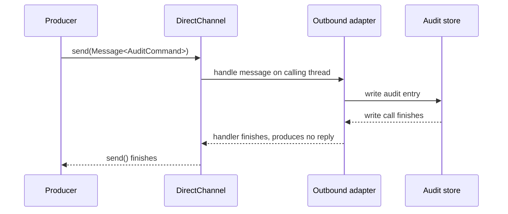

# Outbound adapter without reply

In the **Channel adapter** chapter of the **SPRING_INTEGRATION_CORE** module, this lesson focuses on the terminal point of a message flow: receiving a `Message`, performing an operation on a target system, and terminating without producing a reply message for the calling flow.

After this lesson, you can design an outbound adapter under a one-way contract, implement it using Java DSL or annotations, choose error handling appropriate to the channel type, and test side effects without waiting for a nonexistent reply.

## 1. What does "without reply" mean?

An outbound channel adapter connects an in-application channel to a receiver outside the flow, such as an audit store, mail server, or event-receiving system. Under the one-way contract considered here, the input is a message requesting work; the output is a **side effect**, not a result `Message` returned to the caller. Spring Integration allows using a POJO method as this receiving point. See [Channel Adapter](https://docs.spring.io/spring-integration/reference/channel-adapter.html).

For example, a sales system wants to record an order confirmation event:

```text
AuditCommand(eventId="evt-007", orderId="ORD-1042", action="CONFIRMED")
    → auditOutbound
    → outbound adapter
    → audit store
```

After the adapter writes the audit entry, the processing branch ends. It does not generate an `AuditResult`, does not return the input message, and does not emit an empty message to signal completion.

If the actual requirement is "write audit entry then return the record ID to continue processing", you must design an endpoint with output or an outbound gateway suited to the protocol and library in use.

### 1.1. Distinguishing outcome types

| Observable signal | Meaning to identify | Is it a business reply from the adapter? |
| --- | --- | --- |
| Target method returns `void` | No Java value to convert into a reply | No |
| `MessageChannel.send(...)` returns `true` | Message was sent per the channel's contract | No |
| Network client receives ACK or status code | Acknowledgment occurred at a specific communication layer | Does not automatically become a flow reply |
| Exception occurs | A send or processing step failed | No; this is the error path |
| `ErrorMessage` appears | Error was represented and routed via messaging | Not a success result |
| Target system later emits a completion event | A separate business message exists | Requires designing a separate inbound flow |

`send(...)` can return `false` or throw an exception depending on the situation. The boolean value carries no business result. The API contract is described at [MessageChannel](https://docs.spring.io/spring-framework/docs/current/javadoc-api/org/springframework/messaging/MessageChannel.html).

### 1.2. One-way and asynchronous are two separate choices

"Does not wait for a reply" does not mean "the caller is immediately released". An adapter writing data via a blocking client still must wait for that client to finish its call.

For instance, assume the audit write takes two seconds:

- If the handler runs on the calling thread, the caller can be held for two seconds despite receiving no reply.
- If processing is handed off to a worker, the caller can return sooner; errors occurring later need a different observation mechanism.

Therefore, answer two questions separately: **is a result needed for further processing**, and **which thread performs the work**.

## 2. Message lifecycle at an outbound adapter



The return arrows in the diagram represent returning control from method calls. They do not represent reply `Message`s.

In this example, the adapter reads the payload to obtain the data to write. Headers can carry `eventId`, tracing info, or control metadata. If a `replyChannel` header exists, its presence does not create a result by itself: a component must still actually produce and send a reply.

Design-wise, this branch can be viewed as:

```text
input message → processing → side effect → branch ends
```

Do not draw an implicit connection from the adapter to a subsequent step if the adapter's contract has no output.

## 3. Complete Java DSL example: writing audit entries

The example uses `spring-integration-core`, Java configuration, and Java DSL. Java syntax includes `record`; the runtime JDK must meet the requirements of the Spring version managed by your project. The test section below uses JUnit Jupiter. No broker or database is needed to observe the one-way mechanism in this example.

`InMemoryAuditSink` simulates the audit receiver so learning and testing can run in a small application context. In real integration, replace the sink's write logic with the target resource's client or adapter.

```java
package example.integration;

import java.util.concurrent.ConcurrentHashMap;
import java.util.concurrent.ConcurrentMap;

import org.springframework.context.annotation.Bean;
import org.springframework.context.annotation.Configuration;
import org.springframework.integration.channel.DirectChannel;
import org.springframework.integration.config.EnableIntegration;
import org.springframework.integration.dsl.IntegrationFlow;

@Configuration
@EnableIntegration
public class AuditOutboundConfiguration {

    public record AuditCommand(
            String eventId,
            String orderId,
            String action) {
    }

    public static class InMemoryAuditSink {

        private final ConcurrentMap<String, AuditCommand> entries =
                new ConcurrentHashMap<>();

        public void write(AuditCommand command) {
            if (command.eventId() == null || command.eventId().isBlank()) {
                throw new IllegalArgumentException("eventId is required");
            }

            AuditCommand previous =
                    entries.putIfAbsent(command.eventId(), command);

            if (previous != null && !previous.equals(command)) {
                throw new IllegalStateException(
                        "eventId already exists with different content");
            }
        }

        public AuditCommand find(String eventId) {
            return entries.get(eventId);
        }

        public int size() {
            return entries.size();
        }
    }

    @Bean
    public DirectChannel auditOutbound() {
        return new DirectChannel();
    }

    @Bean
    public InMemoryAuditSink auditSink() {
        return new InMemoryAuditSink();
    }

    @Bean
    public IntegrationFlow auditOutboundFlow(
            DirectChannel auditOutbound,
            InMemoryAuditSink auditSink) {

        return IntegrationFlow.from(auditOutbound)
                .handle(auditSink, "write")
                .get();
    }
}
```

In this configuration:

1. `auditOutbound` is the channel receiving audit write commands.
2. `.handle(auditSink, "write")` invokes the target method with the message payload.
3. `write(...)` returns `void`, so the branch has no result to forward.
4. `.get()` completes the flow declaration; it does not create a success message.

Sending the same `eventId` with identical content twice creates only one entry in the sink. Reusing an `eventId` with different content is an error. This rule allows the example to demonstrate the happy path, duplicate delivery, and data conflict.

This is an in-memory deduplication mechanism for illustration. Data is lost when the process exits; it does not replace durable storage and concurrency control at the target system.

### 3.1. Return-value behavior of service activators

A service activator can terminate when a method returns `void` or `null`, provided a reply is not required. Conversely, a non-`null` value can be sent to an output channel or `replyChannel`. `requiresReply=true` turns the absence of a result into an error; it does not synthesize a result on behalf of the target method. See [Service Activator](https://docs.spring.io/spring-integration/reference/service-activator.html).

Therefore, do not change the signature of `write(...)` from `void` to a result object merely for logging convenience. That change can alter the endpoint's contract. If return data is needed, design and test the output path explicitly.

## 4. Equivalent representations

### 4.1. Using an annotation on a `void` method

You can replace the flow registration in the example with a bean containing the following method:

```java
import org.springframework.integration.annotation.ServiceActivator;

public class AuditEndpoint {

    private final AuditOutboundConfiguration.InMemoryAuditSink sink;

    public AuditEndpoint(
            AuditOutboundConfiguration.InMemoryAuditSink sink) {
        this.sink = sink;
    }

    @ServiceActivator(inputChannel = "auditOutbound")
    public void accept(
            AuditOutboundConfiguration.AuditCommand command) {
        sink.write(command);
    }
}
```

Register `AuditEndpoint` as a Spring bean in a context with `@EnableIntegration`. This is an alternative to `auditOutboundFlow`; do not register both consumers on the same `DirectChannel` expecting every message to pass through both.

### 4.2. Using `MessageHandler` when the full message is needed

If direct access to both payload and headers is needed, declare a handler adhering to the `MessageHandler` contract:

```java
MessageHandler auditHandler = message -> {
    var command = (AuditOutboundConfiguration.AuditCommand)
            message.getPayload();
    auditSink.write(command);
};

return IntegrationFlow.from(auditOutbound)
        .handle(auditHandler)
        .get();
```

This snippet replaces the body of the flow-building bean method and requires importing `org.springframework.messaging.MessageHandler`. The interface's `handleMessage(...)` method returns `void`. However, a custom handler can still actively send another message; whether no reply is produced still depends on the implementation. See [MessageHandler](https://docs.spring.io/spring-framework/docs/current/javadoc-api/org/springframework/messaging/MessageHandler.html).

### 4.3. Using a lambda accepting payload and headers

```java
return IntegrationFlow.from(auditOutbound)
        .handle(AuditOutboundConfiguration.AuditCommand.class,
                (command, headers) -> {
                    auditSink.write(command);
                    return null;
                })
        .get();
```

This overload uses `GenericHandler`, which has a return value. Returning `null` indicates the branch provides no result. It differs from the `MessageHandler` lambda accepting a `Message<?>` above. Overload selection and providing the payload type are explained in [Service Activators and the .handle() method](https://docs.spring.io/spring-integration/reference/dsl/java-handle.html).

## 5. Choosing a channel: impact on threads and observing completion

| Option | Milestone observed by producer | Impact on the audit example |
| --- | --- | --- |
| `DirectChannel` | Handler is invoked directly during sending | Can inspect the sink right after `send()` completes successfully |
| `ExecutorChannel` with async executor | Work is handed off to the executor | Must wait for a separate signal or processing state |
| `QueueChannel` and polling consumer | Message is placed in the queue | There is a delay between sending and the sink being called |

`DirectChannel` invokes the handler on the sending thread. `ExecutorChannel` delegates work to an executor, though exact threading behavior still depends on the executor and rejection policy. `QueueChannel` requires a consumer reading the queue; queue data resides in memory by default. See [Message Channel Implementations](https://docs.spring.io/spring-integration/reference/channel/implementations.html).

### 5.1. Variant using a queue and poller

If audit write commands need buffering, replace the channel bean and flow with the following configuration. This is a separate variant; remove the old `auditOutbound` and `auditOutboundFlow` beans when applying it:

```java
import org.springframework.integration.channel.QueueChannel;
import org.springframework.integration.dsl.Pollers;

@Bean
public QueueChannel auditQueue() {
    return new QueueChannel(100);
}

@Bean
public IntegrationFlow queuedAuditFlow(
        QueueChannel auditQueue,
        InMemoryAuditSink auditSink) {

    return IntegrationFlow.from(auditQueue)
            .handle(auditSink, "write", endpoint -> endpoint
                    .poller(Pollers.fixedDelay(200)
                            .maxMessagesPerPoll(10)))
            .get();
}
```

These methods are placed inside `AuditOutboundConfiguration`, so they can reference the nested class `InMemoryAuditSink`. Producers in this variant send to `auditQueue`.

With the illustrative configuration:

- The queue holds 100 messages; decide how the producer reacts when the queue is full.
- The poller has a 200 ms fixed delay and a limit of 10 messages per cycle.
- `send()` succeeding is not enough to conclude the audit entry has been written.
- If the process stops before the poller processes items, the in-memory buffer provides no data recovery.

The timeout passed to `send(...)` controls sending according to the channel's capabilities. It does not automatically set timeouts for HTTP clients, JDBC drivers, or I/O operations inside the sink. Those timeouts must be configured on the corresponding client or resource.

## 6. Calling the flow via a one-way messaging gateway

An application can hide the `MessageChannel` API behind an interface:

```java
import org.springframework.integration.annotation.MessagingGateway;

@MessagingGateway(defaultRequestChannel = "auditOutbound")
public interface AuditGateway {

    void record(AuditOutboundConfiguration.AuditCommand command);
}
```

When using this approach, enable gateway scanning on the package containing the interface, for example with `@IntegrationComponentScan(basePackageClasses = AuditGateway.class)` in configuration. This annotation belongs to package `org.springframework.integration.annotation`.

The `record(...)` method returns `void`, indicating the caller needs no business result. The messaging gateway is the entry point for Java code; the outbound adapter remains the audit-writing point at the end of the flow. The two components have distinct roles even though both participate in the same call. See [Messaging Gateways](https://docs.spring.io/spring-integration/reference/gateway.html).

If the gateway declares `AuditReceipt record(...)` while the end of the flow is `write(...)` returning `void`, the contracts at the two ends do not match. Depending on configuration, the caller may wait until timeout and still receive no result.

Lowering the reply timeout does not fix that design. Choose one of two paths:

1. Keep the one-way contract and use a `void` gateway method.
2. Design a step that produces `AuditReceipt` and an actual return path.

A `void` gateway connected to a `DirectChannel` can still block while the sink writes data. Return type does not choose the executor.

## 7. Error handling when there is no reply

Having no reply does not mean ignoring errors. Success and error paths must be designed separately.

With a handler running synchronously over `DirectChannel`, exceptions can propagate back to the `send()` caller. With Spring Integration tasks running asynchronously or via a poller, the error handling mechanism can send an `ErrorMessage` to the channel in the `errorChannel` header, or to the global `errorChannel`. Merely adding an `errorChannel` header on a synchronous `send()` call does not automatically route exceptions to that channel. See [Error Handling](https://docs.spring.io/spring-integration/reference/7.0/error-handling.html).

Applied to the audit example:

| Scenario | How the application should respond |
| --- | --- |
| Missing `eventId` in synchronous flow | Caller receives the error, fixes input data; do not retry indefinitely |
| Connection lost to audit store | Retry under a bounded policy if the error is classified as transient |
| Conflict on same key with different content | Preserve details for investigation; do not treat as a valid duplicate send |
| Poller fails to write audit | Monitor the error flow, persist failed messages if reprocessing is needed |
| Enqueue succeeds then worker fails | Do not report to the producer that auditing completed based solely on `send()` |

When building an error flow, preserve the event key, failure cause, and information needed to correlate back to the original message. Merely logging and discarding the message can make failures hard to recover from. Conversely, an error handler that rethrows or retries infinitely can overload the system.

### 7.1. Retry is a policy of the operation, not a reply

Spring Integration provides `RequestHandlerRetryAdvice` to apply retry policies to a handler. It can be paired with recovery once retry attempts are exhausted. Detailed configuration and the related retry library must match your project's Spring version. See [Provided Advice Classes](https://docs.spring.io/spring-integration/reference/handler-advice/classes.html).

In this audit design, clearly define:

- Which errors are retried: connection loss differs from invalid data.
- Attempt limits, wait intervals, and maximum processing time.
- Where the message goes when retries are exhausted.
- Whether repeated writes create extra records or unintended side effects.

Recovery sending an `ErrorMessage` does not mean the audit write request succeeded. The system must distinguish "received", "written", and "needs reprocessing" whenever those states carry business meaning.

## 8. Reliability: designing around side effects

The following recommendations are design inferences drawn from the audit example and the boundary between sending a message and executing an action.

### 8.1. Prepare for uncertain outcomes

Suppose the client sent a write command, the target system saved it, and the connection dropped before the client could observe completion. Receiving an error at the caller is not enough to conclude no side effect occurred.

If you retry with a new key, two records could be created. For auditing, a sound solution is keeping the same business key for the same event across attempts while having the store enforce deduplication rules.

The example's key is `eventId`. `MessageHeaders.ID` serves as the framework's message identifier; do not assume it always stays identical across message reconstructions, restarts, or source replays.

### 8.2. Deduplication must be tied to the write operation

In a real system, you can use a unique constraint on `eventId`, or the target API's idempotency capability. Checking "does it exist yet" and then writing in two unprotected steps can suffer from race conditions.

In particular, do not mark "processed" before the side effect succeeds and ignore all subsequent resends. If the task fails between those two steps, the event could be marked done without ever being audited.

Concrete choices depend on the resource: database transactions, atomic writes, or idempotent protocols. An in-memory set of keys does not resolve all of these boundaries.

### 8.3. Do not assume cross-system transactions by default

If updating an order and writing an audit entry to another service, determine what happens when only one operation succeeds. Running on the same thread does not automatically create a distributed transaction spanning both systems.

When events generated from a database update must never be lost, consider a transactional outbox: store the pending outbound event in the same source database transaction, then have a process deliver it and manage delivery status. This is an additional design pattern, not a built-in feature of every outbound adapter.

If users need to track completion after a request is accepted, store status by `eventId` or design a correlated completion event. The system then has an explicit supplementary business protocol rather than assuming a one-way adapter will reply on its own.

## 9. Testing the one-way contract properly

With the `AuditOutboundConfiguration` setup in section 3, verify two independent things:

1. The expected side effect occurred.
2. The endpoint produced no reply even though the message provided a reply address.

The following test example uses the same package as the configuration class:

```java
package example.integration;

import org.junit.jupiter.api.Test;
import org.springframework.context.annotation.AnnotationConfigApplicationContext;
import org.springframework.integration.channel.DirectChannel;
import org.springframework.integration.channel.QueueChannel;
import org.springframework.messaging.Message;
import org.springframework.messaging.MessagingException;
import org.springframework.messaging.support.MessageBuilder;

import example.integration.AuditOutboundConfiguration.AuditCommand;
import example.integration.AuditOutboundConfiguration.InMemoryAuditSink;

import static org.junit.jupiter.api.Assertions.*;

class AuditOutboundConfigurationTest {

    @Test
    void writesOnceAndDoesNotProduceReply() {
        try (var context = new AnnotationConfigApplicationContext(
                AuditOutboundConfiguration.class)) {

            var input = context.getBean("auditOutbound", DirectChannel.class);
            var sink = context.getBean(InMemoryAuditSink.class);
            var replies = new QueueChannel(10);
            var command = new AuditCommand(
                    "evt-007", "ORD-1042", "CONFIRMED");

            Message<AuditCommand> message = MessageBuilder
                    .withPayload(command)
                    .setReplyChannel(replies)
                    .build();

            assertTrue(input.send(message, 1000));
            assertTrue(input.send(message, 1000));

            assertEquals(command, sink.find("evt-007"));
            assertEquals(1, sink.size());
            assertNull(replies.receive(0));
        }
    }

    @Test
    void propagatesFailureToSynchronousSender() {
        try (var context = new AnnotationConfigApplicationContext(
                AuditOutboundConfiguration.class)) {

            var input = context.getBean("auditOutbound", DirectChannel.class);
            var sink = context.getBean(InMemoryAuditSink.class);
            var invalid = new AuditCommand(
                    "", "ORD-1042", "CONFIRMED");

            MessagingException failure = assertThrows(
                    MessagingException.class,
                    () -> input.send(MessageBuilder
                            .withPayload(invalid)
                            .build(), 1000));

            assertInstanceOf(IllegalArgumentException.class,
                    failure.getCause());
            assertEquals(0, sink.size());
        }
    }
}
```

Checking `replies.receive(0)` is valid here because `DirectChannel` and the synchronous sink finish processing before `send()` returns. It does not rely on a wait interval to guess that a worker completed.

When switching to a queue or executor, await a deterministic signal such as a test double's latch, updated state, or a bounded wait mechanism before asserting outcomes. Do not use arbitrary `Thread.sleep(...)` calls and treat the absence of a reply as proof that work ran.

The two tests above only verify the mechanism with an in-memory sink. When replacing it with a real resource, also verify the client contract, behavior when the target wrote data but the connection failed, and recoverability across process stops or restarts.

## 10. Common design mistakes

| Symptom | What to check | Adjustment |
| --- | --- | --- |
| Gateway waits then times out | Gateway signature expects a result while sink returns `void` | Align contracts at both ends |
| Step after adapter never runs | Adapter produces no output to trigger the next step | Put preparation before the sink; use an output-producing endpoint if continuation is needed |
| Cannot find output or reply channel | Target method accidentally returns a value | Keep `void` if one-way; design output explicitly if a result is needed |
| `ReplyRequiredException` occurs | Configuration requires a reply on a branch producing no result | Remove reply requirement or change endpoint design |
| `errorChannel` header present but caller still receives exception | Flow is invoked directly and synchronously | Catch exceptions at caller or configure explicit error routing |
| No error received after producer sends to queue | Error occurred during worker processing stage | Observe and handle the task's error flow |
| Audit written twice on retry | Target lacks idempotency rules | Keep event keys stable and deduplicate at write time |
| Audit lost after application stops | Unprocessed data lived only in memory | Choose durable storage matching recovery requirements |
| Two consumers do not both receive one message | Using a point-to-point channel expecting broadcast | Choose a distribution model matching the branches |

An auxiliary audit step can live on a separate branch while the main branch continues processing. When designing this way, decide explicitly whether audit failure fails the main branch and what durability each branch requires. Splitting branches alone does not determine error isolation or asynchronicity.

## 11. Practice on the audit write flow

Work through the variants sequentially; do not register mutually exclusive configurations simultaneously:

1. Use the synchronous configuration in section 3; send a valid command and inspect the sink.
2. Provide a `replyChannel` when sending; confirm no reply arrives after the handler completes.
3. Resend the same event; verify the deduplication rule.
4. Send the same key with different content; verify the conflict error is not swallowed.
5. Switch to the queue variant in section 5; add a deterministic completion-awaiting mechanism in the test.
6. Replace the sink with a test double that can fail; verify the error path matches the execution model.

The desired outcome is a flow with a clear contract: the producer sends requests, the adapter performs side effects, and completion tracking and error recovery are designed around the application's requirements.
