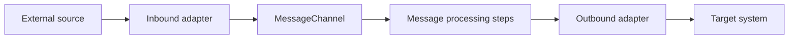
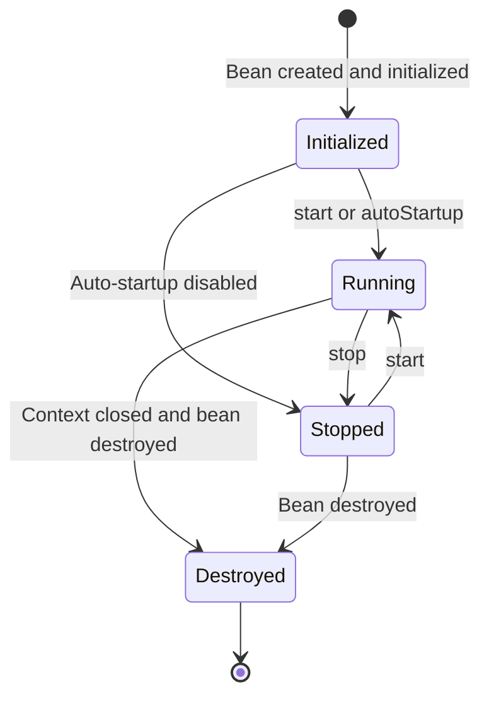
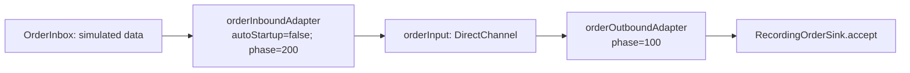
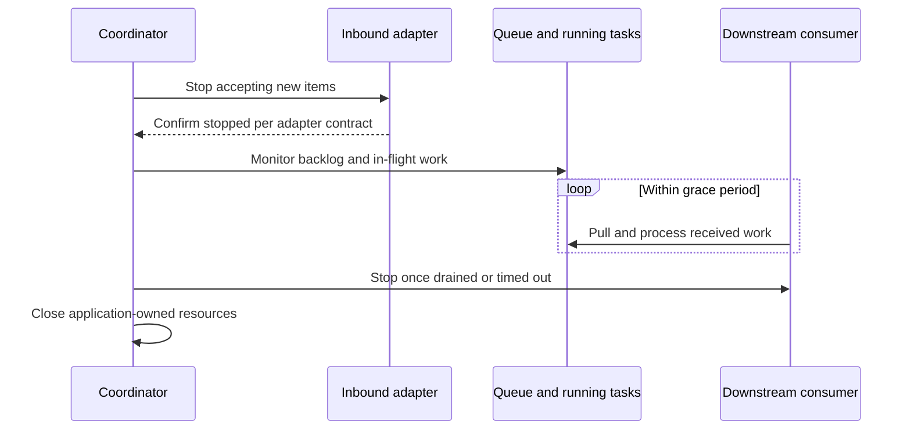

# Adapters and lifecycle

## 1. Why do adapters need lifecycle management?

In Spring Integration Core, a message flow can be described very briefly: a data source creates a `Message`, sends it into a `MessageChannel`, and endpoints perform transformation, routing, or delivery to a target system. In operations, you must also answer: when does the source begin reading, can order ingestion be paused, and what happens to in-flight messages when the application stops?

Lifecycle—operational life stages—lets you control those moments. For channel adapters, distinguish between **the bean having been created** and **the endpoint actively participating in the message flow**.

For example, an order ingestion system has two requirements:

- The application starts up to validate configuration, yet does not read orders from the source until operators enable it.
- During maintenance, stop ingesting new orders first while allowing in-flight orders to finish within an allotted time window.

After this lesson, you can identify the right object to `start()` or `stop()`, configure `autoStartup` and `phase`, control endpoints with Java DSL, and test both lifecycle state and its effect on message delivery.

The Java examples use Java 17 and the Spring Integration 6.5 API. They demonstrate lifecycle at the core layer without requiring a broker, database, or network connection. When using protocol adapters, also read the listener-stopping, connection-closing, and message-acknowledgment conventions of the respective adapter.

## 2. Adapter, endpoint, and business object are distinct components

A channel adapter connects a source or target to a channel. An inbound adapter brings data into the flow; an outbound adapter receives messages from the flow to perform work at a target. The adapter model does not define a request/reply exchange like a gateway. An outbound operation may still have protocol-level acknowledgments; that acknowledgment does not automatically turn the adapter into a messaging gateway. [Channel Adapter Reference](https://docs.spring.io/spring-integration/reference/7.0/channel-adapter.html).



Not all adapters share the same execution structure:

| Case | Main component | Meaning when active |
| --- | --- | --- |
| Polling inbound | `SourcePollingChannelAdapter` and a `MessageSource` | Scheduler triggers the poller to call the source and emit messages |
| Event-driven inbound | A message producer, usually managing a listener or subscription | External events are converted into messages |
| Outbound reading `DirectChannel` | `EventDrivenConsumer` wrapping a `MessageHandler` | Consumer subscribes to receive messages from the channel |
| Outbound reading `QueueChannel` | `PollingConsumer` wrapping a `MessageHandler` | Poller pulls messages from the queue and invokes the handler |

Specifically, `EventDrivenConsumer` is the endpoint connecting a `MessageHandler` to a `SubscribableChannel`. Thus, in an outbound configuration, the order-writing business object and the endpoint subscribing to receive messages are two different objects. [EventDrivenConsumer API](https://docs.spring.io/spring-integration/docs/6.5.0/api/org/springframework/integration/endpoint/EventDrivenConsumer.html).

Suppose you have an `orderSink` bean with an `accept(String orderId)` method. Calling `orderSink.accept(...)` directly is an ordinary Java call. Stopping the endpoint wrapping this bean does not disable direct Java calls to the bean. Lifecycle controls the endpoint's participation in the integration flow.

Similarly, stopping an inbound adapter does not mean all downstream transformers, routers, filters, or outbound endpoints have stopped. Those endpoints may still serve other message sources.

## 3. Distinguishing initialization, running, stopping, and destruction

### 3.1. A state model for reasoning



This is an explanatory model, not a universal state enum shared by every adapter. When a context closes normally, Spring coordinates stopping lifecycle components before destroying beans. A concrete adapter may also have its own connection, recovery, or stopping states.

| Stage | What to understand |
| --- | --- |
| Bean creation and initialization | Dependencies are injected; configuration is validated; init callbacks may run |
| `start()` | Endpoint activates its operational mechanism, such as scheduling polling or registering a consumer |
| `isRunning()` | Reports the lifecycle state tracked by the component |
| `stop()` | Requests the endpoint to cease activity according to its implementation |
| Bean/context destruction | Ends the bean's lifetime and releases resources owned by the bean |

`stop()` typically supports pausing and restarting the same instance. Once a bean has been destroyed, do not call `start()` on a stale reference to recreate resources; recreate the component through the container or an appropriate flow registration mechanism.

### 3.2. `Lifecycle` and `SmartLifecycle`

`Lifecycle` provides three basic operations:

```java
void start();
void stop();
boolean isRunning();
```

`SmartLifecycle` adds auto-startup, phase ordering, and `stop(Runnable callback)`. For asynchronous shutdown, the implementation must invoke the callback when stopping has actually finished so the lifecycle processor can proceed. Failing to invoke the callback can cause context shutdown to block until timeout. [SmartLifecycle API](https://docs.spring.io/spring-framework/docs/current/javadoc-api/org/springframework/context/SmartLifecycle.html).

Many Spring Integration endpoints extend `AbstractEndpoint`, which provides lifecycle mechanics and enables auto-startup by default. When an endpoint is managed by Spring, auto-starting is coordinated within the application context lifecycle rather than executing business logic inside the constructor. [AbstractEndpoint API](https://docs.spring.io/spring-integration/docs/6.5.0/api/org/springframework/integration/endpoint/AbstractEndpoint.html).

### 3.3. `running` differs from business readiness

An inbound endpoint reporting `isRunning() == true` may still be waiting for data, hitting authentication errors on the next read, or recovering a connection. A running outbound endpoint can also fail sends because the target system is down.

For example, an order-ingestion operations dashboard should display separately:

- Lifecycle state: is the endpoint allowed to run?
- Connection state or timestamp of last source access.
- Timestamp of the most recently processed order.
- Pending order count, in-flight order count, and consecutive error count.

These metrics answer different questions. Do not rely solely on the `running` flag to assert that the entire order ingestion pipeline is healthy.

## 4. `autoStartup`: deciding whether to run automatically on context startup

Set `autoStartup(false)` when you want to open a flow intentionally after preparation steps, run an adapter only on selected nodes, or prevent a real source from running in a test environment.

```java
// Endpoint configuration fragment for a polling inbound adapter.
e -> e.id("orderInboundAdapter")
      .autoStartup(false)
      .poller(Pollers.fixedDelay(Duration.ofSeconds(1)))
```

`autoStartup(false)` does not mean the bean does not exist, was not initialized, or allocated no resources. It controls whether lifecycle activity starts automatically. Constructors, initialization callbacks, and other context resources can still be created.

This attribute is also not a permanent lock on the endpoint. When ready to run, management code can still call `start()`. After a `stop()`, the auto-startup flag is not a timer to re-enable the endpoint automatically; an explicit control action is required.

In Java DSL, `id(...)` inside the endpoint configuration sets the endpoint bean's name. This is the name used to look up and control lifecycle; it differs from the bean name of the overall `IntegrationFlow` and the business handler bean name. [DSL and Endpoint Configuration](https://docs.spring.io/spring-integration/reference/7.1-SNAPSHOT/dsl/java-endpoints.html).

## 5. `phase`: coordinating startup and shutdown order

When the application context coordinates lifecycle, lower phases start first and higher phases start later; on shutdown, the reverse order applies. Declared bean dependencies can constrain this order, since a dependency must exist before its dependent and stop after it. Beans sharing the same phase should not be assumed to have a deterministic business ordering. [DefaultLifecycleProcessor](https://docs.spring.io/spring-framework/docs/current/javadoc-api/org/springframework/context/support/DefaultLifecycleProcessor.html).

One design option for the order ingestion flow is:

| Component | Illustrative phase | Startup | Shutdown |
| --- | --- | --- | --- |
| Consumer delivering orders to target | `100` | Ready before source | Stops after source |
| Inbound adapter ingesting orders | `200` | Starts after consumer | Stops ingesting before consumer |

The numbers `100` and `200` are choices for this example, not mandatory framework defaults. Set phases explicitly when you need to express operational ordering; do not infer default phase numbers for every component type solely from the `SmartLifecycle` interface.

Keep three limitations in mind when applying the table above:

1. **Calling an endpoint directly does not coordinate the whole system.** `source.start()` only starts the source. The caller must ensure downstream is ready.
2. **Phase does not signal connection recovery completion.** A `start()` call can return before remote resources are ready to serve business requests.
3. **Phase does not drain queues automatically.** Stopping the source before the consumer gives in-flight items a chance to finish, yet you still need a policy to wait for remaining backlog.

Do not use `Thread.sleep(...)` in constructors or `@PostConstruct` to simulate this ordering. Fixed waits do not express dependencies and easily break when startup speed changes.

## 6. Java DSL example: explicitly opening and closing order ingestion

### 6.1. Example design

The example simulates an external order source with `OrderInbox`, uses a polling inbound adapter to pull order IDs one by one, sends through a `DirectChannel`, and invokes a recording target `RecordingOrderSink`.



`RecordingOrderSink` simulates a one-way outbound action. In production, you can replace it with a file-writing handler, notification sender, or API client; each protocol needs its own timeouts and error handling.

### 6.2. Complete configuration

Place the following class in package `example.integration.lifecycle`. The example requires `org.springframework.integration:spring-integration-core` and corresponding Spring dependencies. In a Spring Boot project, inherit synchronized versions from the project's dependency management.

```java
package example.integration.lifecycle;

import java.time.Duration;
import java.util.Queue;
import java.util.concurrent.BlockingQueue;
import java.util.concurrent.ConcurrentLinkedQueue;
import java.util.concurrent.LinkedBlockingQueue;
import java.util.concurrent.TimeUnit;

import org.springframework.context.annotation.Bean;
import org.springframework.context.annotation.Configuration;
import org.springframework.integration.channel.DirectChannel;
import org.springframework.integration.config.EnableIntegration;
import org.springframework.integration.dsl.IntegrationFlow;
import org.springframework.integration.dsl.Pollers;

@Configuration
@EnableIntegration
public class AdapterLifecycleConfiguration {

    @Bean
    public OrderInbox orderInbox() {
        return new OrderInbox();
    }

    @Bean
    public RecordingOrderSink orderSink() {
        return new RecordingOrderSink();
    }

    @Bean
    public DirectChannel orderInput() {
        return new DirectChannel();
    }

    @Bean
    public IntegrationFlow orderFlow(
            OrderInbox inbox,
            DirectChannel orderInput,
            RecordingOrderSink sink) {

        return IntegrationFlow
                .fromSupplier(inbox::poll, e -> e
                        .id("orderInboundAdapter")
                        .autoStartup(false)
                        .phase(200)
                        .poller(Pollers
                                .fixedDelay(Duration.ofMillis(100))
                                .maxMessagesPerPoll(1)))
                .channel(orderInput)
                .handle(sink, "accept", e -> e
                        .id("orderOutboundAdapter")
                        .phase(100))
                .get();
    }

    public static class OrderInbox {

        private final Queue<String> pending = new ConcurrentLinkedQueue<>();

        public void offer(String orderId) {
            pending.add(orderId);
        }

        public String poll() {
            return pending.poll();
        }
    }

    public static class RecordingOrderSink {

        private final BlockingQueue<String> received = new LinkedBlockingQueue<>();

        public void accept(String orderId) {
            received.add(orderId);
        }

        public String awaitReceived(long timeoutMillis) throws InterruptedException {
            return received.poll(timeoutMillis, TimeUnit.MILLISECONDS);
        }
    }
}
```

`IntegrationFlow.fromSupplier(...)` creates a polling-triggered input. The supplier returns a payload when data exists; when no data exists, the example returns `null` so no message is emitted for that poll. This API lets you configure `SourcePollingChannelAdapter` via the second lambda. [IntegrationFlow API](https://docs.spring.io/spring-integration/docs/6.5.0/api/org/springframework/integration/dsl/IntegrationFlow.html).

Here, `DirectChannel` executes downstream synchronously on the sending thread. There is no intermediate queue between inbound and outbound. The `accept` method returns `void`, matching the example's one-way target.

The two Java queues in the simulated beans exist only for observing the example. They are not durable stores, transaction logs, or crash-recovery mechanisms. Specifically, `OrderInbox.poll()` removes the item before downstream finishes; if downstream fails, the example does not return the order to the source.

### 6.3. Controlling the right endpoint bean

The snippet below is a standalone demo program in the same package as the configuration class:

```java
package example.integration.lifecycle;

import org.springframework.context.annotation.AnnotationConfigApplicationContext;
import org.springframework.integration.endpoint.SourcePollingChannelAdapter;

import example.integration.lifecycle.AdapterLifecycleConfiguration.OrderInbox;
import example.integration.lifecycle.AdapterLifecycleConfiguration.RecordingOrderSink;

public class AdapterLifecycleDemo {

    public static void main(String[] args) throws InterruptedException {
        try (var context = new AnnotationConfigApplicationContext(
                AdapterLifecycleConfiguration.class)) {

            var inbound = context.getBean(
                    "orderInboundAdapter", SourcePollingChannelAdapter.class);
            var inbox = context.getBean(OrderInbox.class);
            var sink = context.getBean(RecordingOrderSink.class);

            inbox.offer("ORDER-001");
            System.out.println("Before start: " + inbound.isRunning());

            inbound.start();
            System.out.println("Received order: " + sink.awaitReceived(2000));

            inbound.stop();
            System.out.println("After stop: " + inbound.isRunning());
        }
    }
}
```

Under normal execution, the three lines print `false`, `ORDER-001`, and `false` respectively. If the timeout elapses before an order arrives, `awaitReceived` returns `null`; the demo program does not treat a timeout as a success confirmation.

The bean name `orderInboundAdapter` comes from `id(...)` in the DSL. `orderFlow` names the flow-definition bean; `orderInbox` names the source object. Looking up the exact endpoint bean prevents administrative control from relying on framework-generated names.

Do not close the entire context merely to pause a single source. The context in the program above is closed at the end of the demo because the demo owns it.

## 7. How does `stop()` affect messages?

### 7.1. Stopping a polling inbound adapter

When stopping a polling inbound adapter, the goal is to prevent future reads. However, a poll cycle or I/O call already underway may still be in progress during shutdown. Do not interpret `stop()` as rolling back every source operation already performed.

In the order ingestion example, consider this sequence:

1. Poller takes `ORDER-010` from `OrderInbox`.
2. Handler starts recording the order.
3. An admin thread calls `inbound.stop()`.
4. The handler may still finish the work already received, depending on the stop mechanism and execution state.

Therefore, the business requirement should be "stop accepting new items and wait for in-flight work to finish", along with a clear definition of what "stopped accepting" means. If an absolute boundary is needed, coordinate with locks, claims, transactions, or the source's pause/acknowledgment capabilities.

### 7.2. Stopping an outbound consumer

For a standard consumer on a `DirectChannel`, stopping the endpoint unsubscribes the handler from the channel. If no other subscriber remains, sending a new message can fail with `MessageDeliveryException`. The channel does not turn into a buffer when its consumer stops.

If the input is a `QueueChannel`, the consumer uses polling. Stopping the consumer halts pulling messages per the poller's lifecycle; messages already in the queue stay in the queue. The queue can fill up if producers keep sending.

```text
DirectChannel, single consumer:
    stop consumer -> no receiver left -> new send fails

QueueChannel:
    stop consumer -> queued messages accumulate -> must handle capacity and timeout
```

With `ExecutorChannel` or asynchronous listeners, also account for tasks already submitted to the executor. Unsubscribing from new deliveries does not mean all queued or running executor tasks have been cancelled.

### 7.3. `null`, pause, and stop are different decisions

| Situation | Meaning |
| --- | --- |
| Source returns `null` | Current call has no message; endpoint may still be running |
| `maxMessagesPerPoll(1)` | Limits each polling cycle to one message in the example |
| `maxMessagesPerPoll(0)` | On polling inbound adapters supporting this setting, skips calling the source without stopping the endpoint |
| `stop()` | Transitions the endpoint to stopped state per the lifecycle contract |
| Bean destruction | Ends usage of the instance within the current container scope |

Setting a negative value for `maxMessagesPerPoll` can allow one cycle to fetch multiple messages until the source returns `null`. If a source always returns data and calls cannot be interrupted, reacting to a stop request becomes harder. In this lesson, the limit is `1` so each cycle has a small, easily observable scope. [Poller and Channel Adapter](https://docs.spring.io/spring-integration/reference/7.0/channel-adapter.html).

## 8. Designing controlled shutdown

### 8.1. Separating stopping ingestion from stopping processing

For a flow with an intermediate queue, you can design a maintenance workflow like this:



This is an application-level coordination design, not a guarantee that a single `stop()` call executes every step automatically.

Suppose the system has 40 pending orders, two workers, and each order takes around 100 ms. A rough estimate to drain all work is `40 × 100 / 2 = 2000 ms`, excluding slow I/O, retries, and currently running orders. The shutdown grace period should include headroom and be measured under realistic load.

Checking `queueSize == 0` alone is insufficient: a worker may have already pulled an order from the queue without finishing writing it. Track in-flight task counts or completion confirmations as well. With aggregators, also consider incomplete message groups not yet released; with retries, consider tasks awaiting backoff.

### 8.2. Spring Integration's orderly shutdown support

Spring Integration provides an orderly shutdown mechanism via `IntegrationMBeanExporter.stopActiveComponents(...)`. This mechanism coordinates components implementing `OrderlyShutdownCapable`, stops receiving sources, and gives in-flight messages time to finish. The documentation describes keeping downstream pollers active to drain messages remaining in queues. [Orderly Shutdown](https://docs.spring.io/spring-integration/reference/shutdown.html).

When choosing this mechanism, configure the corresponding management component and verify which steps your adapters support. Do not assume closing a plain application context automatically executes the MBean exporter's specialized workflow.

### 8.3. Timeouts and resource ownership

A shutdown plan has realistic bounds only when active operations also have bounds:

- Calls to target systems need appropriate connect/read timeouts.
- Sends to bounded queues need explicit wait or rejection policies.
- Retries need bounds or a way to abort within the maintenance window.
- Shutdown needs a policy for unfinished work when the deadline expires.

If an inbound adapter sends to a potentially blocking channel, Java DSL provides `sendTimeout(...)` on `SourcePollingChannelAdapterSpec` with values in milliseconds. This property bounds waiting to send on timeout-capable channels; it does not replace network timeouts on handlers and does not interrupt synchronous downstream code. [SourcePollingChannelAdapterSpec API](https://docs.spring.io/spring-integration/docs/6.5.0/api/org/springframework/integration/dsl/SourcePollingChannelAdapterSpec.html).

Do not arbitrarily shut down shared schedulers, executors, or connection factories just to stop one adapter. Shared resources must be stopped by their owner after all remaining users have finished.

### 8.4. Lifecycle does not guarantee exactly-once processing

In a real source, an order might be read but not yet acknowledged; the target system might have written successfully while the response was lost. After a restart, the order may reappear.

For example, with order `ORDER-025`, the adapter successfully sends an invoice creation request, yet the application crashes before saving the completion marker. The next run may resend the request. Properly ordered endpoint start/stop still does not eliminate this scenario.

If the business requires avoiding duplicate invoices, use the order ID as an idempotency key at the target and design appropriate transactions or state stores. Lifecycle addresses operational timing; message durability and delivery semantics must be designed separately.

## 9. Processing errors do not automatically mean an endpoint has stopped

In the lesson's polling flow, errors from the source or downstream occur inside the scheduler-triggered task. The poller's error handler can route errors to an error flow. A failed message does not mean the endpoint transitions to stopped on its own.

Conversely, if an application thread sends directly to a `DirectChannel` and a handler throws an exception, the error can return immediately on the sending thread. Do not assume every error across every sending mechanism automatically arrives at `errorChannel`.

Operations may enforce an explicit policy: after a streak of consecutive authentication errors, a coordinator stops the inbound adapter, raises an alert, and only re-enables it after configuration is fixed. That policy must be implemented and tested; it is not an automatic effect of `isRunning()`.

When designing an error flow, keep it active long enough to record errors from still-running tasks. Stopping the error-handling pipeline before primary work finishes can lose diagnostic information needed for investigation.

## 10. Controlling individual endpoints, groups, and entire flows

Choose operational scope based on the goal:

| Goal | Suitable scope |
| --- | --- |
| Pause a single order source | That source's inbound endpoint |
| Turn off one target under maintenance | Outbound endpoint, while handling impact on the sending side |
| Coordinate multiple endpoints sharing a role | Lifecycle role group and `SmartLifecycleRoleController` |
| Stop a dynamically registered flow | Flow registration via `IntegrationFlowContext` |
| Shut down the entire application | Application context lifecycle and shutdown process |

Roles help group endpoints for administration, yet bundling inbound and downstream together and stopping them simultaneously cannot express a multi-step drain workflow. Separate ingestion groups and processing groups if business operations require it.

With Java DSL, `StandardIntegrationFlow` is the container holding a flow's components and can control their lifecycle. For statically declared flows, initial auto-startup is applied to component beans by the lifecycle processor. For dynamically registered flows, `IntegrationFlowContext` and the registration coordinate startup; do not assume bean declarations and runtime registrations follow the exact same lifecycle path. [StandardIntegrationFlow API](https://docs.spring.io/spring-integration/docs/current/api/org/springframework/integration/dsl/StandardIntegrationFlow.html).

If a handler or resource is shared across multiple flows, verify ownership before stopping or destroying a group. Flow names do not automatically create isolated resource boundaries.

## 11. Testing lifecycle through state and observable effects

### 11.1. Testing a source that does not auto-start and can restart

The following test class reuses the configuration from section 6 and JUnit Jupiter, requiring the `org.junit.jupiter:junit-jupiter` dependency. Each test creates its own context and closes it afterward so no leftover poller or subscriber affects other tests.

```java
package example.integration.lifecycle;

import org.junit.jupiter.api.Test;
import org.springframework.context.annotation.AnnotationConfigApplicationContext;
import org.springframework.integration.channel.DirectChannel;
import org.springframework.integration.endpoint.EventDrivenConsumer;
import org.springframework.integration.endpoint.SourcePollingChannelAdapter;
import org.springframework.messaging.MessageDeliveryException;
import org.springframework.messaging.support.MessageBuilder;

import example.integration.lifecycle.AdapterLifecycleConfiguration.OrderInbox;
import example.integration.lifecycle.AdapterLifecycleConfiguration.RecordingOrderSink;

import static org.junit.jupiter.api.Assertions.assertEquals;
import static org.junit.jupiter.api.Assertions.assertFalse;
import static org.junit.jupiter.api.Assertions.assertThrows;
import static org.junit.jupiter.api.Assertions.assertTrue;

class AdapterLifecycleTest {

    @Test
    void sourceStartsOnlyWhenRequestedAndCanRestart() throws Exception {
        try (var context = new AnnotationConfigApplicationContext(
                AdapterLifecycleConfiguration.class)) {

            var inbound = context.getBean(
                    "orderInboundAdapter", SourcePollingChannelAdapter.class);
            var inbox = context.getBean(OrderInbox.class);
            var sink = context.getBean(RecordingOrderSink.class);

            assertFalse(inbound.isRunning());
            inbox.offer("ORDER-001");

            inbound.start();
            assertTrue(inbound.isRunning());
            assertEquals("ORDER-001", sink.awaitReceived(2000));

            inbound.stop();
            assertFalse(inbound.isRunning());

            inbound.start();
            inbox.offer("ORDER-002");
            assertEquals("ORDER-002", sink.awaitReceived(2000));
        }
    }

    @Test
    void stoppedDirectChannelConsumerDoesNotReceiveNewMessages() throws Exception {
        try (var context = new AnnotationConfigApplicationContext(
                AdapterLifecycleConfiguration.class)) {

            var outbound = context.getBean(
                    "orderOutboundAdapter", EventDrivenConsumer.class);
            var input = context.getBean("orderInput", DirectChannel.class);
            var sink = context.getBean(RecordingOrderSink.class);
            var message = MessageBuilder.withPayload("ORDER-003").build();

            // Source is not running yet; test sends directly to avoid racing with the poller.
            outbound.stop();
            assertFalse(outbound.isRunning());
            assertThrows(MessageDeliveryException.class, () -> input.send(message));

            outbound.start();
            assertTrue(outbound.isRunning());
            assertTrue(input.send(message));
            assertEquals("ORDER-003", sink.awaitReceived(1000));
        }
    }
}
```

The first test verifies non-auto-start configuration, message emission, and restarting after stop. It does not prove every adapter finishes all I/O the instant `stop()` returns. The second test verifies lifecycle impact specifically on the sole consumer of a `DirectChannel`.

Waiting with a timed `BlockingQueue.poll` lets the test finish as soon as the result arrives. It is far better than a fixed sleep followed by guessing the system finished processing.

### 11.2. When testing adapters connected to real systems

If using Spring Integration Test, you can apply `@SpringIntegrationTest(noAutoStartup = "orderInboundAdapter")` on a test class with an appropriate Spring Test context to prevent automatic endpoint startup. `MockIntegrationContext` helps swap message sources or handlers with test doubles. Names passed to replacement calls are the corresponding endpoint names. [Testing Support](https://docs.spring.io/spring-integration/reference/7.0/testing.html).

For adapters with listeners or transactions, add targeted tests: stopping while handling a message, restarting after connection errors, acknowledging or re-reading data, and behavior when stop timeouts expire. Use latches or synchronization signals to deterministically place tasks into an in-flight state; avoid relying on lucky thread timing.

## 12. Common design mistakes

| Symptom | Possible cause | Remediation |
| --- | --- | --- |
| App is up but ingests no orders | Inbound has `autoStartup(false)` and nothing calls start | Check endpoint by ID and source activation workflow |
| Stopped adapter yet an order still completes | Order was received before stopping | Track in-flight work and clearly define the acceptance boundary |
| Sending to `DirectChannel` fails after maintenance | Sole consumer is stopped | Start consumers before sources or design an appropriate buffer |
| Queue fills up when stopping target | Upstream keeps sending while consumer does not pull | Coordinate stopping sources, capacity bounds, and timeouts |
| Prolonged shutdown | I/O lacks timeouts, retries run long, or stop callback never finishes | Measure where it blocks and verify component stop contracts |
| `running` flag is true but no data moves | Source error, downstream error, or no available data | Monitor connections, errors, and last successful timestamp |
| Stopping one flow breaks another flow | Shared resource or component was closed | Clarify ownership and operational scope |
| Restart causes duplicate business effects | Data was sent before completion marker was saved | Design idempotency and delivery semantics |

## 13. Applied exercises

1. Using the configuration in section 6, keep inbound stopped, call `orderInput.send(...)` directly, and explain why outbound still processes it.
2. Replace the connection between the two adapters with a bounded `QueueChannel`, add a poller for the outbound consumer, and configure a send timeout on inbound. Observe what happens when stopping outbound while the source keeps running.
3. Build a fake handler waiting on a `CountDownLatch`. Only once the handler signals it has started, request stopping inbound. Identify what condition suffices to confirm in-flight work has finished.
4. Design a maintenance procedure for a flow with a transformer, router, and two outbound endpoints. Specify which source to stop, which branches must stay active, and which metrics confirm draining completed.
5. Describe recovery when the application crashes after the target received an order but before the source was acknowledged. Choose where to store the idempotency key and explain why start/stop cannot solve this.

Your practice results should expose endpoint state, message path, and remaining backlog. A clear lifecycle design lets you start sources once downstream is ready, halt ingestion when needed, and drain in-flight work under a verifiable policy.
