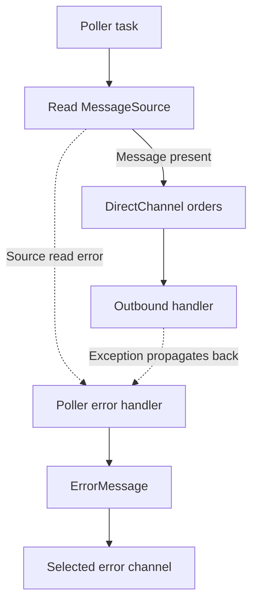

# Adapter error channel

## 1. Objectives and scope

In the **Channel adapter** chapter of the **SPRING_INTEGRATION_CORE** module, this lesson explains how to design an error branch for endpoints connecting external systems to a message flow. The ongoing scenario is reading orders from a source and sending them to a receiving system: reading the source can fail before a `Message` exists, while the receiving system can reject a message that has already been created.

After this lesson, you can:

- Choose where to configure the error channel for poller-backed adapters and for individual messages.
- Determine whether an exception propagates back to the sender or is wrapped into an `ErrorMessage`.
- Extract the failed message, failure cause, and business key for follow-up handling.
- Write Java DSL and test error routing using observable channels.
- Distinguish receiving errors from retry, rollback, redelivery, and durable error persistence.

The examples target **Java 17 and Spring Integration 6.5.x** as the API baseline. `spring-integration-core` is required; the test section uses JUnit Jupiter. Let your project's BOM manage compatible versions across Spring Framework and Spring Integration. The Java snippets below are learning code; this lesson does not assume the current project already declares these dependencies.

## 2. An error channel is a channel serving the error-receiving role

A channel adapter is an endpoint connecting a source or target to a `MessageChannel`. Inbound adapters bring data into the flow; outbound adapters consume messages to perform work on a target. For polling inbound adapters, `SourcePollingChannelAdapter` invokes `MessageSource` on schedule and sends non-`null` results into a channel. For outbound adapters reading from a `PollableChannel`, the endpoint needs a poller to retrieve messages. [Channel Adapter Documentation](https://docs.spring.io/spring-integration/reference/channel-adapter.html).

An **error channel** is the role of a `MessageChannel` when it receives messages describing errors. There is no mandatory rule that every error channel must use the same channel implementation class.

Four similar-looking names must be kept distinct:

| Component | Example | Meaning |
|---|---|---|
| Shared error channel bean | `errorChannel` | Shared destination of the default error-reporting mechanism |
| Dedicated error channel bean | `adapterErrors` | Application-named destination for a group of errors |
| Message header | `MessageHeaders.ERROR_CHANNEL` | Per-message directive specifying where errors for that message go |
| Poller configuration in DSL | `.errorChannel("adapterErrors")` | Selects the default error channel for the corresponding polling task |

Merely creating a bean named `adapterErrors` does not make every exception automatically arrive there. There must be an exception-catching and error-publishing mechanism, such as a poller's error handler or an adapter's own mechanism.

An error channel receiving an error also does not mean the business operation has recovered. For example, receiving an order-send error only shows the error-reporting path worked; the order still needs a decision to retry, quarantine, or handle manually.

## 3. Execution boundaries determine where exceptions are caught

### 3.1. Sending directly from caller code

When application code calls `DirectChannel.send(...)`, the handler runs on the calling thread. If the handler throws an exception, the exception propagates back to the `send` call. The `errorChannel` header by itself does not wrap the call in a `try/catch` and does not emit an `ErrorMessage`. For asynchronous processing or poller tasks, inspect the error-catching mechanism of the executing task. [Spring Integration Error Handling](https://docs.spring.io/spring-integration/reference/error-handling.html).

```text
Application calling thread
  -> DirectChannel.send(message)
     -> outbound handler
        -> throws exception
  <- exception returns to send call
```

Therefore, adding `errorChannel` to headers cannot replace exception handling at the caller in a purely synchronous flow.

### 3.2. DirectChannel inside a poller task

Consider a different structure:



Here the handler still runs synchronously with the `DirectChannel` sender, yet the sender executes inside the poller task. The exception can unwind to the task wrapper and then be published as an error message. Consequently, concluding "with `DirectChannel`, errors never reach an error channel" is missing a condition.

You can think of the poller as the caller and manager of the entire synchronous chain in that poll cycle. That scope ends when the chain hands work off to another execution mechanism. [AbstractPollingEndpoint 6.5.4 Source](https://raw.githubusercontent.com/spring-projects/spring-integration/v6.5.4/spring-integration-core/src/main/java/org/springframework/integration/endpoint/AbstractPollingEndpoint.java).

### 3.3. When the flow crosses QueueChannel or ExecutorChannel

| Flow segment | What does the sender know when send completes? | Where to inspect error-handling configuration |
|---|---|---|
| Application → `DirectChannel` → handler | Handler has run or thrown an error | `send` caller, gateway, or enclosing caller |
| Inbound poller → `DirectChannel` → handler | Synchronous work belonging to that poll cycle | Inbound poller's error handler |
| Inbound poller → `QueueChannel` | Message was placed in queue when send succeeded | Consumer poller pulling messages from queue |
| Producer → `ExecutorChannel` → handler | Task was handed off for processing, per executor | Executor/channel task error-reporting mechanism |

For instance, an inbound adapter that has successfully sent to a `QueueChannel` cannot catch errors occurring later in the consumer's poller. Configure a dedicated error channel on the consumer, or preserve an appropriate error header before the asynchronous boundary. Channel type and dispatcher also affect how messages are delivered to subscribers. [Configuring Message Channels](https://docs.spring.io/spring-integration/reference/6.5/channel/configuration.html).

Listener/callback-based adapters have their own error-receiving and acknowledgment mechanisms. Do not blindly apply poller configuration to endpoint types without a poller; read the specific adapter's contract.

## 4. Selecting the error channel: header, poller, and shared channel

For a typical poller `MessagePublishingErrorHandler`, a helpful mental model is:

```text
Is there a failedMessage and a valid errorChannel header?
  Yes -> resolve channel from header
  No  -> use error handler's default error channel
          -> if not explicitly configured, use the errorChannel bean
```

The header can hold a `MessageChannel` or a channel bean name as a `String`. The channel configured on the poller acts as the default for that error handler; the header on the failed message can take precedence. This describes this mechanism's behavior, not a promise for every custom implementation. [MessagePublishingErrorHandler 6.5.4 Source](https://raw.githubusercontent.com/spring-projects/spring-integration/v6.5.4/spring-integration-core/src/main/java/org/springframework/integration/channel/MessagePublishingErrorHandler.java).

Example setting the header by bean name:

```java
Message<String> order = MessageBuilder.withPayload("ORDER-42")
        .setHeader(MessageHeaders.ERROR_CHANNEL, "priorityErrors")
        .setHeader("businessKey", "ORDER-42")
        .build();
```

This snippet requires importing `org.springframework.messaging.Message`, `org.springframework.messaging.MessageHeaders`, and `org.springframework.messaging.support.MessageBuilder`.

Three design consequences follow:

1. **Errors before message creation need a default destination.** When the source has not yet returned a `Message`, no business header exists to choose an error channel. The poller's error channel is the right configuration point for this case.
2. **Headers must still exist at the failure point.** A transformer that builds a brand-new message and drops headers can alter how errors route later. When replacing payloads, deliberately decide which headers to preserve.
3. **A dedicated channel does not automatically copy to the shared channel.** If you need both dedicated reporting and centralized monitoring, design an explicit forwarding branch or emit a monitoring event.

Do not treat a misspelled bean name or invalid header type as a safe fallback mechanism. That is a configuration bug to catch with tests.

## 5. Reading ErrorMessage with the right structure

`ErrorMessage` is a `Message<Throwable>`. Its payload is often an exception in the `MessagingException` family; the exception's `failedMessage` property represents the message at the point of failure. `ErrorMessage.originalMessage`, if present, represents the message where the error message was created; the two messages can differ after transformation steps. [ErrorMessage Javadoc](https://docs.spring.io/spring-framework/docs/current/javadoc-api/org/springframework/messaging/support/ErrorMessage.html).

```text
ErrorMessage
  ├─ payload: Throwable
  │    └─ if MessagingException: failedMessage may or may not be present
  ├─ headers: error message metadata
  └─ originalMessage: original message if provided by the error publisher
```

When building an error-handling branch, distinguish three pieces of data:

| Data | Purpose in the order example |
|---|---|
| Failure cause and `cause` chain | Distinguish source unavailability from rejected data |
| Message at the failure point | Extract payload or headers to guide handling decisions |
| Business key | Reconcile `ORDER-42` with the receiving system and prevent duplicate processing |

Do not cast the payload to `Exception` and assume `getFailedMessage()` exists. First check `MessagingException`, then handle the possibility of a missing message. Also do not assume the business key is copied onto the outermost `ErrorMessage` headers; retrieve it from the appropriate business message.

When `failedMessage` cannot be obtained, `originalMessage` can provide fallback context, but should not be assumed to be an exact copy of the data at the failure point. In particular, a source connection error before reading any order may not correspond to any order at all.

## 6. Complete Java DSL example

### 6.1. An observable scenario

The simulated source produces four meaningful executions:

| Source call | Behavior | Expected outcome |
|---|---|---|
| 1 | Source throws before a `Message` exists | One `ErrorMessage` in `adapterErrors` |
| 2 | Creates `ORDER-2`, target handler fails | One `ErrorMessage` in `adapterErrors` |
| 3 | Creates `ORDER-3` with custom error channel header, handler fails | One `ErrorMessage` in `priorityErrors` |
| 4 | Creates `ORDER-4`, handler succeeds | Message in `acceptedOrders` |
| From call 5 onward | Source returns `null` | No new message and no error produced |

The queues in the example only allow tests to read outcomes. This is in-memory data, not a durable error store. The poller sets `maxMessagesPerPoll(1)` so each trigger firing performs at most one source read. The DSL supports selecting an error channel by bean name or channel object. [PollerSpec Javadoc](https://docs.spring.io/spring-integration/api/org/springframework/integration/dsl/PollerSpec.html).

### 6.2. Configuration

```java
import java.time.Duration;
import java.util.concurrent.atomic.AtomicInteger;

import org.springframework.beans.factory.annotation.Qualifier;
import org.springframework.context.annotation.Bean;
import org.springframework.context.annotation.Configuration;
import org.springframework.integration.channel.DirectChannel;
import org.springframework.integration.channel.QueueChannel;
import org.springframework.integration.config.EnableIntegration;
import org.springframework.integration.dsl.IntegrationFlow;
import org.springframework.messaging.MessageDeliveryException;
import org.springframework.messaging.MessageHandler;
import org.springframework.messaging.MessageHandlingException;
import org.springframework.messaging.MessageHeaders;
import org.springframework.messaging.support.MessageBuilder;

@Configuration
@EnableIntegration
public class AdapterErrorsConfig {

    @Bean
    public DirectChannel orders() {
        return new DirectChannel();
    }

    @Bean
    public QueueChannel adapterErrors() {
        return new QueueChannel(10);
    }

    @Bean
    public QueueChannel priorityErrors() {
        return new QueueChannel(10);
    }

    @Bean
    public QueueChannel acceptedOrders() {
        return new QueueChannel(10);
    }

    @Bean
    public IntegrationFlow ordersAdapterFlow(
            @Qualifier("adapterErrors") QueueChannel adapterErrors,
            @Qualifier("priorityErrors") QueueChannel priorityErrors,
            @Qualifier("acceptedOrders") QueueChannel acceptedOrders) {

        AtomicInteger sourceCalls = new AtomicInteger();

        return IntegrationFlow.fromSupplier(() -> {
                    int n = sourceCalls.incrementAndGet();

                    if (n == 1) {
                        throw new IllegalStateException("SOURCE_UNAVAILABLE");
                    }
                    if (n > 4) {
                        return null;
                    }

                    MessageBuilder<String> builder = MessageBuilder
                            .withPayload("ORDER-" + n)
                            .setHeader("adapterId", "ordersInboundAdapter")
                            .setHeader("businessKey", "ORDER-" + n);

                    if (n == 3) {
                        builder.setHeader(
                                MessageHeaders.ERROR_CHANNEL, priorityErrors);
                    }

                    return builder.build();
                }, endpoint -> endpoint
                        .id("ordersInboundAdapter")
                        .autoStartup(false)
                        .poller(poller -> poller
                                .fixedDelay(Duration.ofMillis(100))
                                .maxMessagesPerPoll(1)
                                .errorChannel(adapterErrors)))
                .channel("orders")
                .handle((MessageHandler) message -> {
                    String orderId = (String) message.getPayload();

                    if (orderId.equals("ORDER-2")
                            || orderId.equals("ORDER-3")) {
                        throw new MessageHandlingException(
                                message,
                                "Failed to send order to target system",
                                new IllegalArgumentException("ERP_REJECTED"));
                    }

                    if (!acceptedOrders.send(message, 0)) {
                        throw new MessageDeliveryException(
                                message, "ACCEPTED_QUEUE_FULL");
                    }
                })
                .get();
    }
}
```

The final handler plays the role of an outbound adapter: receiving a message and performing work without creating a reply for the sender. In the example, a successful operation is simulated by putting the message into `acceptedOrders`. In a real system, this could be a client call to the receiving system.

`MessageHandlingException` is constructed explicitly so the example always carries the failed message. In real business code, the framework can also wrap exceptions from handlers; always inspect the actual exception type rather than assuming the error payload itself is the root cause.

`autoStartup(false)` lets the test explicitly start the adapter after retrieving the channels. If using this configuration to run a demo application, call `start()` on the endpoint or change it to `true`.

The source returning `null` only indicates the current read has no data. The poller can still fire on subsequent cycles; it does not stop itself just because the source ran out of the four simulated orders.

## 7. Testing the error routing path

The test below boots a real Spring context with the configuration from section 6. It awaits messages with a bounded `receive(timeout)` rather than guessing timing with `Thread.sleep()`.

```java
import org.junit.jupiter.api.Test;
import org.springframework.context.annotation.AnnotationConfigApplicationContext;
import org.springframework.integration.channel.DirectChannel;
import org.springframework.integration.channel.QueueChannel;
import org.springframework.integration.endpoint.SourcePollingChannelAdapter;
import org.springframework.messaging.Message;
import org.springframework.messaging.MessageHandlingException;
import org.springframework.messaging.MessageHeaders;
import org.springframework.messaging.MessagingException;
import org.springframework.messaging.support.ErrorMessage;
import org.springframework.messaging.support.MessageBuilder;

import static org.junit.jupiter.api.Assertions.*;

class AdapterErrorsConfigTest {

    @Test
    void routesSourceAndSinkErrorsAndAllowsLaterSuccess() {
        try (var context = new AnnotationConfigApplicationContext(
                AdapterErrorsConfig.class)) {

            var errors = context.getBean("adapterErrors", QueueChannel.class);
            var priority = context.getBean("priorityErrors", QueueChannel.class);
            var accepted = context.getBean("acceptedOrders", QueueChannel.class);
            var adapter = context.getBean(
                    "ordersInboundAdapter", SourcePollingChannelAdapter.class);

            adapter.start();
            try {
                ErrorMessage sourceError = requireError(errors.receive(5000));
                ErrorMessage sinkError = requireError(errors.receive(5000));
                ErrorMessage priorityError = requireError(priority.receive(5000));
                Message<?> success = accepted.receive(5000);

                assertEquals("SOURCE_UNAVAILABLE",
                        rootCause(sourceError.getPayload()).getMessage());
                assertNull(failedMessage(sourceError));

                Message<?> failedOrder = failedMessage(sinkError);
                assertNotNull(failedOrder);
                assertEquals("ORDER-2", failedOrder.getPayload());
                assertEquals("ORDER-2",
                        failedOrder.getHeaders().get("businessKey"));
                assertEquals("ERP_REJECTED",
                        rootCause(sinkError.getPayload()).getMessage());

                Message<?> priorityOrder = failedMessage(priorityError);
                assertNotNull(priorityOrder);
                assertEquals("ORDER-3", priorityOrder.getPayload());
                assertSame(priority,
                        priorityOrder.getHeaders().get(
                                MessageHeaders.ERROR_CHANNEL));

                assertNotNull(success);
                assertEquals("ORDER-4", success.getPayload());

                // ORDER-4 proves the previous three attempts have completed.
                assertNull(errors.receive(0));
                assertNull(priority.receive(0));
            }
            finally {
                adapter.stop();
            }
        }
    }

    @Test
    void errorHeaderAloneDoesNotCatchDirectSendFailure() {
        DirectChannel input = new DirectChannel();
        QueueChannel errors = new QueueChannel(10);

        input.subscribe(message -> {
            throw new MessageHandlingException(message, "SYNC_FAILURE");
        });

        Message<String> request = MessageBuilder.withPayload("ORDER-99")
                .setHeader(MessageHeaders.ERROR_CHANNEL, errors)
                .build();

        assertThrows(MessagingException.class, () -> input.send(request));
        assertNull(errors.receive(0));
    }

    private static ErrorMessage requireError(Message<?> message) {
        assertNotNull(message, "Did not receive error message within timeout");
        assertTrue(message instanceof ErrorMessage);
        return (ErrorMessage) message;
    }

    private static Message<?> failedMessage(ErrorMessage error) {
        if (error.getPayload() instanceof MessagingException exception) {
            return exception.getFailedMessage();
        }
        return null;
    }

    private static Throwable rootCause(Throwable failure) {
        Throwable current = failure;
        while (current.getCause() != null
                && current.getCause() != current) {
            current = current.getCause();
        }
        return current;
    }
}
```

The assertions verify the example's contract: source errors have no failed message, target errors preserve the order key, custom headers take precedence, and a subsequent order still succeeds. The second test isolates direct synchronous sending to prevent misunderstanding that a header catches errors by itself.

Do not generalize a `null` `failedMessage` in source errors as a rule for every adapter. Another source or error-publishing mechanism may provide additional context.

If you add an `ExecutorChannel`, write a separate test confirming the error path after the thread-handoff point; results from the synchronous poller test do not prove that asynchronous branch works.

## 8. Equivalent configuration with annotations and XML

### 8.1. Annotations

When the source method is Spring-managed, you can place the error channel on `@Poller`:

```java
import org.springframework.integration.annotation.InboundChannelAdapter;
import org.springframework.integration.annotation.Poller;
import org.springframework.messaging.Message;
import org.springframework.messaging.support.MessageBuilder;
import org.springframework.stereotype.Component;

@Component
public class OrdersSource {

    @InboundChannelAdapter(
            channel = "orders",
            poller = @Poller(
                    fixedDelay = "1000",
                    maxMessagesPerPoll = "1",
                    errorChannel = "adapterErrors"))
    public Message<String> read() {
        return MessageBuilder.withPayload("ORDER-42")
                .setHeader("businessKey", "ORDER-42")
                .build();
    }
}
```

This is an alternative to the DSL source, requiring the `orders` and `adapterErrors` beans, target handler, and `@EnableIntegration` infrastructure. Do not enable both sources simultaneously when you only want one adapter. The method above always returns the same order to keep the illustration concise; a real source must manage read items and when to return `null`.

`@Poller.errorChannel` configures the poller's corresponding error handler. For an outbound endpoint reading from a `QueueChannel`, `@Poller` can be placed on the consumer's `@ServiceActivator`. [Annotation Support](https://docs.spring.io/spring-integration/reference/6.5/configuration/annotations.html).

### 8.2. XML

Equivalent XML fragment, placed in configuration declaring Spring Integration's `int` namespace and the source/target beans:

```xml
<int:channel id="orders"/>
<int:channel id="adapterErrors">
    <int:queue capacity="100"/>
</int:channel>

<int:inbound-channel-adapter id="ordersInboundAdapter"
                             ref="ordersSource"
                             method="read"
                             channel="orders">
    <int:poller fixed-delay="1000"
                max-messages-per-poll="1"
                error-channel="adapterErrors"/>
</int:inbound-channel-adapter>

<int:outbound-channel-adapter id="ordersOutboundAdapter"
                              channel="orders"
                              ref="ordersTarget"
                              method="send"/>
```

The `error-channel` attribute sits on the poller in this example. Do not infer that every outbound adapter element of every protocol shares the same `error-channel` attribute; that capability depends on the specific endpoint and namespace.

## 9. Building a consumer for the error channel

In tests, the test itself acts as the consumer of error queues. In an application, an endpoint is needed to process them. Adding a consumer to the same test context in section 7 will make the consumer compete with the test for messages; use separate configurations for each purpose.

Example method fragment inside a Spring-managed bean:

```java
import org.springframework.integration.annotation.Poller;
import org.springframework.integration.annotation.ServiceActivator;
import org.springframework.messaging.Message;
import org.springframework.messaging.MessagingException;
import org.springframework.messaging.support.ErrorMessage;

// Place this method inside a bean of the running application configuration.
@ServiceActivator(
        inputChannel = "adapterErrors",
        poller = @Poller(fixedDelay = "500", maxMessagesPerPoll = "10"))
public void observe(ErrorMessage error) {
    Throwable failure = error.getPayload();
    Message<?> failed = null;

    if (failure instanceof MessagingException exception) {
        failed = exception.getFailedMessage();
    }
    if (failed == null) {
        failed = error.getOriginalMessage();
    }

    Object businessKey = failed == null
            ? "unknown"
            : failed.getHeaders().getOrDefault("businessKey", "unknown");

    System.getLogger("adapter-errors").log(
            System.Logger.Level.ERROR,
            "Integration error, businessKey=" + businessKey,
            failure);
}
```

Here the consumer has a poller because `adapterErrors` is a `QueueChannel`. The method returns `void` to terminate error observation. If it returned an object without a suitable reply target, the error branch itself could raise another result-sending error.

The example only logs. For business recovery requirements, a separate pipeline can be used:

```text
ErrorMessage
  -> extract failure details and business context
  -> classify
       -> connection issue: alert, consider bounded retry
       -> rejected data: quarantine for remediation
       -> unclassified: persist details and route to manual handling
```

A transformer can normalize errors into an application record; a router chooses the handling branch; a filter drops only events business rules allow ignoring. If using an aggregator to batch alerts over a time window, retain links to each recoverable error so alert aggregation does not hide individual failed orders.

When classifying, the cause chain is more informative than inspecting only the outermost wrapper. Also inspect the receiving system's error codes: a timeout after sending may not tell whether the receiving system already executed the operation.

## 10. Error channel, retry, and transaction solve different problems

| Mechanism | Question it solves | What must not be assumed |
|---|---|---|
| Error channel | Who receives and handles failure details? | The order has been retried |
| Retry at handler | Which operation to retry, and how many times? | Every step before the handler is re-executed |
| Recovery after retry | What to do when retries are exhausted? | The exception definitely continues to an outer error handler |
| Transaction | Which changes commit or roll back together? | Remote system calls roll back automatically with a local transaction |
| Redelivery | Which source resends the message and under what policy? | Receiving an `ErrorMessage` means the source will resend |
| Durable error store | After the process stops, does data remain for reprocessing? | An in-memory `QueueChannel` is sufficient |

In Spring Integration 6.5, `RequestHandlerRetryAdvice` can use a `RetryTemplate` and a recovery callback. `ErrorMessageSendingRecoverer` is one way to route errors to a recovery channel after exhausting retries. If recovery handles the failure and does not rethrow, outer error handlers do not necessarily receive that same failure again. Choose a single place responsible for recovery to avoid double error reporting or double retrying. [Retry Advice for 6.5](https://docs.spring.io/spring-integration/reference/6.5/handler-advice/classes.html).

A sensible policy for the order example might be:

- Source connection errors: monitor source health and back off polling frequency appropriately.
- Data rejected by the receiving system: route to a data-fixing branch instead of resending infinitely.
- Send timeouts: query status by business key before resending if the receiving system supports it.

Retrying at the target handler cannot fix an exception that occurred earlier while reading the source. To retry reading, the policy must wrap the read operation or rely on the next poll cycle with matching source semantics.

In the example, `ORDER-2` does not reappear on its own after failing; the source counter already moved to the next value. Receiving the error into a queue only lets you observe the failure. That is why you must clarify whether the source supports replay, whether it has transactions or acknowledgments, and whether the application enforces deduplication.

If adding transactions to a poller, inspect advice placement, participating resources, and commit/rollback outcomes directly. Do not use the presence of an `ErrorMessage` as proof of transaction state. For adapters with acknowledgments, timing and mode of acknowledgment also belong to the adapter/source contract.

## 11. Choosing a channel type for the error branch

| Channel type | Suitable when | Design decisions required |
|---|---|---|
| `DirectChannel` | Short error handling needing immediate execution on the error-publishing thread | Processing duration and impact if the error handler itself fails |
| `QueueChannel` | Want buffering so a separate consumer processes errors | Capacity, send timeout, consumer speed, and durability |
| `PublishSubscribeChannel` | Multiple subscribers needed, e.g. observing and routing recovery | Executor, subscriber ordering, and cross-subscriber impact |

Under default configuration, the `errorChannel` bean uses a `PublishSubscribeChannel` and has a logging subscriber. When replacing it with a custom channel, proactively provide consumers and equivalent observability; do not assume the old logging behavior stays active automatically. [Error Handling](https://docs.spring.io/spring-integration/reference/error-handling.html).

A bounded-capacity queue helps detect when error consumers fall behind. However, when the queue is full, sends may block or fail depending on timeout and send mechanics. Therefore, monitor both business errors and error-message delivery failures.

Do not loop an error branch back onto itself as an unbounded retry cycle. To replay an order, construct an appropriate business message from verified data, with explicit limits and deduplication policies. Sending the raw `ErrorMessage` back into an order-processing channel sends a `Throwable` payload to endpoints expecting order data.

With `MessagePublishingErrorHandler` as of the 6.5.4 source baseline, exceptions encountered while forwarding errors to a channel are logged; do not assume every failed error handler causes the source to automatically resend data. Other error-publishing mechanisms may propagate exceptions differently. This is a detail to verify against the exact endpoint in use. [MessagePublishingErrorHandler Source](https://raw.githubusercontent.com/spring-projects/spring-integration/v6.5.4/spring-integration-core/src/main/java/org/springframework/integration/channel/MessagePublishingErrorHandler.java).

## 12. Diagnosing common misconceptions

| Symptom | Possibility to check | How to verify |
|---|---|---|
| Error header present yet `send` still throws | Synchronous flow without an enclosing error-publishing wrapper | Isolate with a `DirectChannel` send test |
| Source error lacks order payload | Failure happened before message creation | Inspect adapter read logic and metadata |
| `adapterErrors` missing an order's error | Header selected a different channel | Inspect headers on the message at the failure point |
| Consumer error misses inbound error channel | Flow crossed a queue or executor | Check configuration at the new execution point |
| Error queue grows continuously | No consumer or consumer too slow | Measure error inflow/outflow and wait times |
| Logs show errors yet no data to replay | Only logs saved; message or business key lost | Design durable recovery data storage |
| Order sent twice after retry | Receiving system executed before timeout | Reconcile business key and idempotency policy |
| Error-handling branch raises errors | Wrong payload type, reply returned with no target, or error store unavailable | Observe errors on the error consumer itself |

A useful operational record for this scenario should capture: timestamp, endpoint name, error category, business key if available, correlation ID if supplied by the flow, and the chosen disposition. For source read errors without an order yet, use the adapter and source identifiers for lookup instead of inventing a nonexistent order key.

## 13. Design points to remember

An error channel is part of the error-handling contract. Start by identifying what executes the operation that can fail, then choose where errors are published, where they are received, and what data must be preserved for recovery.

For poller-backed adapters, the default error destination captures even source read errors before a message exists. For errors tied to a message, headers can specify a dedicated destination. Once a flow crosses a queue or executor boundary, re-examine error catching on the new segment.

Finally, a well-tested error branch must prove both the `ErrorMessage` routing path and the desired business outcome after failure. The example in this lesson proves error routing and continuing with subsequent orders; requirements for retries, durable persistence, or rollbacks require their own dedicated configuration and tests.
