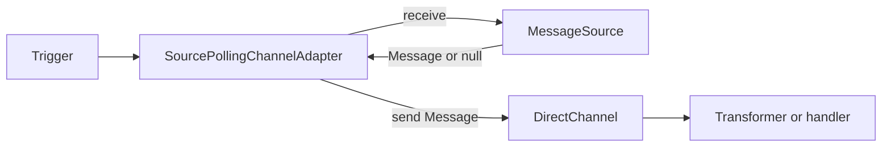
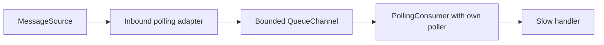

# Adapter with poller

## 1. Objectives and context

In the **Channel adapter** chapter of the **SPRING_INTEGRATION_CORE** module, this lesson shows how to bring data from a polled source into a message flow. After this lesson, you can identify where a poller is needed, configure schedules and messages per cycle, explain error propagation paths, and write controlled tests.

Suppose a legacy sales system only exposes a list of pending orders. That system does not proactively emit events. The integration application must periodically fetch orders, convert them into `Message<Order>`, and send them into a channel so transformers, routers, filters, or other endpoints can process them. A gateway is useful when the application initiates calls directly; in this case, the starting point is a scheduler-triggered adapter.

The lesson uses Java 17+ and Spring Integration 6.5.x configuration style as its illustrative baseline. Dependencies must belong to the same compatible version set managed by your project; do not arbitrarily mix Spring Framework, Spring Integration, and Spring Boot versions. The example does not require a database, file server, or external service.

## 2. Where does the poller sit in the flow?

A poller answers two questions: **when to try fetching data** and **how many fetches to perform in one cycle**. It is configuration controlling a polling endpoint's behavior, not a type of message channel.

There are two polling scenarios and one event-driven receiving scenario:

| Scenario | Responsible endpoint | Object being read | Trigger condition |
| --- | --- | --- | --- |
| Bringing data from a source into the flow | `SourcePollingChannelAdapter` | `MessageSource<?>` | Adapter trigger |
| Pulling messages already in a channel | `PollingConsumer` | `PollableChannel`, such as `QueueChannel` | Consumer trigger |
| Receiving messages on a subscribable channel | `EventDrivenConsumer` | `SubscribableChannel`, such as `DirectChannel` | A sender sends a message into the channel |

This distinction is described in the [Spring Integration Poller Documentation](https://docs.spring.io/spring-integration/reference/6.5/polling-consumer.html).



`MessageSource` is a logical role: it might read a file, call a repository, or pull an item from memory. The poller itself does not know how to access those resources; the adapter and source handle converting the result into a message.

An inbound adapter needs polling because its source must be polled, even when the output channel is a `DirectChannel`. Conversely, an outbound adapter connected to a `DirectChannel` can process immediately upon receiving a message and needs no poller. If an outbound adapter's input is a `QueueChannel`, the consumer needs polling to retrieve messages.

Also do not infer that every inbound adapter uses polling. Adapters receiving callbacks or events from external systems have their own triggering model. Identify the specific adapter's mechanism before adding a poller.

## 3. How does a single poll cycle happen?

For a polling inbound adapter, you can picture this sequence:

1. The scheduler determines the trigger permits execution.
2. The endpoint starts a poll cycle.
3. The endpoint calls `MessageSource.receive()`.
4. If a `Message` is returned, the endpoint sends it to the output channel.
5. If quota remains for the current cycle, the endpoint continues fetching messages.
6. If the source returns `null`, the current cycle ends early; if an unhandled error occurs inside, the error goes through the poller's error handling mechanism.
7. The trigger determines the next execution time.

The [Channel Adapter](https://docs.spring.io/spring-integration/reference/6.5/channel-adapter.html) documentation explains how `SourcePollingChannelAdapter` fetches data and limits receives per cycle.

### 3.1. Meaning of `null`

In the `MessageSource.receive()` contract, `null` means **there is no message in this receive attempt**. It is not a message with an empty payload and does not permanently stop the adapter.

```java
@Override
public Message<Order> receive() {
    Order order = pending.poll();
    return order == null
            ? null
            : MessageBuilder.withPayload(order).build();
}
```

Do not catch every exception and return `null`. Doing so makes connection errors look like an empty source and hides critical operational signals.

### 3.2. One message can contain multiple records

If the source returns `Message<List<Order>>`, one `receive()` call still produces only one message. `maxMessagesPerPoll(3)` does not mean at most three `Order` objects inside the list.

When you want to process each order independently, design the source to return individual `Message<Order>` instances, or place a splitter after the adapter. If choosing the second approach, account for the additional messages the splitter produces downstream.

### 3.3. Polling does not include built-in acknowledgment

The "read → send" sequence does not automatically restore records if a subsequent step fails. For instance, `Queue.poll()` already removed the item from the in-memory queue. If sending the message fails, that item does not automatically return to the queue.

Therefore, the in-memory example helps observe polling mechanics; a real system still needs acknowledgment, transactions, or data replay mechanisms tailored to the source's characteristics.

## 4. Choosing a schedule: fixed delay, fixed rate, and cron

| Schedule | Interpretation | When suitable |
| --- | --- | --- |
| Fixed delay | Waits an interval after the previous execution finishes | Want breathing room between cycles |
| Fixed rate | Computes cadence from periodic execution ticks | Want a relatively steady polling cadence |
| Cron | Computes trigger times from a schedule expression | Run only during business time windows |
| Custom trigger | Determines the next time programmatically | Custom adaptive scheduling requirements |

With polling running directly on the scheduler without a dedicated `taskExecutor`, assume one cycle takes 700 ms and the configured interval is 2 seconds:

```text
Fixed delay:
0.0s start → 0.7s finish → wait 2s → 2.7s next start

Fixed rate, when scheduler keeps up:
0.0s start → 0.7s finish → 2.0s next start
```

Fixed rate does not automatically mean multiple messages are processed in parallel. If tasks are slow or the scheduler is busy, actual start times can slip. When configuring a dedicated executor for the poller, the schedule is also affected by handing tasks off to the executor; do not mechanically apply the timeline diagram above to that model. Trigger and scheduler concepts are covered in [Task Execution and Scheduling](https://docs.spring.io/spring-framework/reference/integration/scheduling.html).

The following Java DSL options are mutually exclusive alternatives:

```java
Pollers.fixedDelay(Duration.ofSeconds(2)).maxMessagesPerPoll(3);

Pollers.fixedRate(Duration.ofSeconds(2)).maxMessagesPerPoll(3);

Pollers.cron("0 */5 * * * *").maxMessagesPerPoll(3);
```

The cron expression above has six fields in Spring syntax, starting with seconds: running at second 0 of every 5-minute mark. When requirements tie to Vietnam time, configure the time zone explicitly on the trigger rather than implicitly depending on the host machine's time zone:

```java
import java.time.ZoneId;
import org.springframework.scheduling.support.CronTrigger;

Pollers.trigger(new CronTrigger(
        "0 */5 * * * *",
        ZoneId.of("Asia/Ho_Chi_Minh")))
    .maxMessagesPerPoll(3);
```

A polling schedule inside one application does not automatically become a cluster-wide singleton schedule. If deploying three replicas with the same configuration, determine whether they access the same dataset concurrently.

## 5. Limiting a cycle with `maxMessagesPerPoll`

For `SourcePollingChannelAdapter`:

| Value | Behavior |
| --- | --- |
| Positive number `N` | Receives and forwards at most `N` messages in one cycle; stops early on `null` |
| Negative number, typically `-1` | No message limit; continues until source returns `null` or cycle is interrupted by error |
| `0` | Skips calling the source; since Spring Integration 5.5, can be used to pause ingestion when changing configuration at runtime |
| Unspecified | Polling inbound adapter defaults to receiving at most one message per cycle |

By contrast, `PollingConsumer`'s default is `-1`. Therefore, set limits explicitly so configuration is readable and behavior does not change unexpectedly when switching endpoint types. Values and default differences are noted in [Channel Adapter — Poller Configuration](https://docs.spring.io/spring-integration/reference/6.5/channel-adapter.html).

Example where the source currently has five orders and the limit is three:

```text
Cycle 1: receive A → receive B → receive C → limit reached
Cycle 2: receive D → receive E → receive null → early stop
Cycle 3: receive null → early stop
```

This is a per-cycle limit, not the total messages across the adapter's lifetime, not the thread pool size, and not the number of elements in a list-typed payload.

The value `-1` must be used intentionally. A source continuously generating data and never returning `null` can keep a poll cycle running too long. With a source generating a random number on every call, a finite limit is usually easier to control.

Suppose synchronous processing of each message takes 150 ms on average, the limit is 10, and fixed delay is 1 second. A simple estimate when the source always has data is:

```text
Cycle duration ≈ 10 × 0.15 = 1.5 seconds
Full period ≈ 1.5 + 1 = 2.5 seconds
Throughput ≈ 10 / 2.5 = 4 messages/second
```

This estimate ignores source read time, data transfer, and load variance. It shows why "poll every second" does not mean "finish one cycle every second", while helping choose an initial value to benchmark in practice.

## 6. Complete Java DSL example

The example includes an in-memory order source, an inbound adapter, a `DirectChannel`, a transformer, and a channel holding results for observation.

To use with Spring Boot providing compatible dependency management, include the `org.springframework.boot:spring-boot-starter-integration` starter. For a plain Spring application, use `org.springframework.integration:spring-integration-core` with compatible Spring dependencies. Java DSL is part of core; no separate Java DSL artifact is needed for this example.

Save the example class as `PollingOrdersConfiguration.java` in a Java project with dependencies configured:

```java
import java.math.BigDecimal;
import java.time.Duration;
import java.util.Queue;
import java.util.concurrent.ConcurrentLinkedQueue;

import org.springframework.context.annotation.Bean;
import org.springframework.context.annotation.Configuration;
import org.springframework.context.annotation.AnnotationConfigApplicationContext;
import org.springframework.integration.channel.DirectChannel;
import org.springframework.integration.channel.QueueChannel;
import org.springframework.integration.config.EnableIntegration;
import org.springframework.integration.core.MessageSource;
import org.springframework.integration.dsl.IntegrationFlow;
import org.springframework.integration.dsl.Pollers;
import org.springframework.integration.endpoint.SourcePollingChannelAdapter;
import org.springframework.integration.support.MessageBuilder;
import org.springframework.messaging.Message;

@Configuration(proxyBeanMethods = false)
@EnableIntegration
public class PollingOrdersConfiguration {

    public record Order(String id, BigDecimal total) { }

    public static class OrderSource implements MessageSource<Order> {
        private final Queue<Order> pending = new ConcurrentLinkedQueue<>();

        public void add(Order order) {
            pending.add(order);
        }

        @Override
        public Message<Order> receive() {
            Order order = pending.poll();
            if (order == null) {
                return null;
            }
            return MessageBuilder.withPayload(order)
                    .setHeader("orderId", order.id())
                    .setHeader("sourceSystem", "legacy-sales")
                    .build();
        }
    }

    @Bean
    public OrderSource orderSource() {
        return new OrderSource();
    }

    @Bean
    public DirectChannel orders() {
        return new DirectChannel();
    }

    @Bean
    public QueueChannel observedOrders() {
        return new QueueChannel(20);
    }

    @Bean
    public QueueChannel pollingErrors() {
        return new QueueChannel(20);
    }

    @Bean
    public IntegrationFlow ordersPollingFlow(OrderSource orderSource) {
        return IntegrationFlow
                .from(orderSource, endpoint -> endpoint
                        .id("ordersPollingAdapter")
                        .autoStartup(false)
                        .poller(Pollers.fixedDelay(Duration.ofSeconds(2))
                                .maxMessagesPerPoll(3)
                                .errorChannel("pollingErrors")))
                .channel("orders")
                .get();
    }

    @Bean
    public IntegrationFlow orderProcessingFlow() {
        return IntegrationFlow.from("orders")
                .<Order, String>transform(order ->
                        order.id() + ":" + order.total().toPlainString())
                .channel("observedOrders")
                .get();
    }

    public static void main(String[] args) {
        try (var context = new AnnotationConfigApplicationContext(
                PollingOrdersConfiguration.class)) {
            OrderSource source = context.getBean(OrderSource.class);
            for (int i = 1; i <= 5; i++) {
                source.add(new Order("ORD-" + i, new BigDecimal("100.00")));
            }

            QueueChannel output = context.getBean(
                    "observedOrders", QueueChannel.class);
            SourcePollingChannelAdapter adapter = context.getBean(
                    "ordersPollingAdapter", SourcePollingChannelAdapter.class);

            adapter.start();
            try {
                for (int i = 0; i < 5; i++) {
                    Message<?> message = output.receive(5_000);
                    if (message == null) {
                        throw new IllegalStateException("Did not receive enough results");
                    }
                    System.out.println(message.getPayload());
                }
            }
            finally {
                adapter.stop();
            }
        }
    }
}
```

Expected payload output:

```text
ORD-1:100.00
ORD-2:100.00
ORD-3:100.00
ORD-4:100.00
ORD-5:100.00
```

The first three orders are fetched in the first cycle; the remaining two are fetched in the next cycle. Actual print timing depends on the scheduler and runtime environment.

Points to note in the example:

- `OrderSource` is only responsible for returning one message or `null`.
- `.id("ordersPollingAdapter")` names the endpoint so its lifecycle can be controlled.
- `.autoStartup(false)` lets us load data and prepare the observer before calling `start()`.
- The poller is attached at `.from(orderSource, ...)`, because that is where data is pulled from the source.
- `orders` is a `DirectChannel`, so the transformer runs synchronously along the adapter's call path.
- `observedOrders` is an observation point; the main program actively calls `receive()`, so no additional polling consumer is needed here.

`@EnableIntegration` initializes Spring Integration infrastructure in this plain Spring configuration. `@EnableScheduling` is not needed merely for Spring Integration pollers to work.

The queue channels in the example have finite capacity and only serve a small illustrative dataset. If applied to a continuous flow, consumers must drain results and errors, and send timeouts must be designed appropriately to avoid blocking when queues are full.

The `Pollers` factory and configuration objects are described in [Java DSL — Pollers](https://docs.spring.io/spring-integration/reference/6.5/dsl/java-pollers.html).

## 7. Configuration with annotations and default poller

### 7.1. Annotation for a simple source

This is an alternative to the inbound flow above. Place the following method inside a Spring-managed bean, assuming the `orderSource` bean and `orders` channel already exist:

```java
import org.springframework.integration.annotation.InboundChannelAdapter;
import org.springframework.integration.annotation.Poller;
import org.springframework.messaging.Message;

@InboundChannelAdapter(
        channel = "orders",
        poller = @Poller(
                fixedDelay = "2000",
                maxMessagesPerPoll = "3",
                errorChannel = "pollingErrors"))
public Message<PollingOrdersConfiguration.Order> nextOrder() {
    return orderSource.receive();
}
```

Here `orderSource` is an injected field of type `PollingOrdersConfiguration.OrderSource`. The number `2000` in this configuration is in milliseconds. Placeholders can externalize configuration to the environment:

```java
@Poller(
        fixedDelay = "${orders.poll.delay-ms:2000}",
        maxMessagesPerPoll = "${orders.poll.max-messages:3}")
```

Do not register both the annotation adapter and the DSL adapter simultaneously if you only want one endpoint reading the source. Two declarations create two separate consumers, not two syntaxes that automatically merge. See annotation and placeholder mechanics in [Annotation Support](https://docs.spring.io/spring-integration/reference/6.5/configuration/annotations.html).

### 7.2. Shared default poller

When multiple endpoints genuinely share the same policy, you can declare a default poller:

```java
import java.time.Duration;

import org.springframework.context.annotation.Bean;
import org.springframework.integration.dsl.PollerSpec;
import org.springframework.integration.dsl.Pollers;
import org.springframework.integration.scheduling.PollerMetadata;

@Bean(name = PollerMetadata.DEFAULT_POLLER)
public PollerSpec defaultPoller() {
    return Pollers.fixedDelay(Duration.ofSeconds(2))
            .maxMessagesPerPoll(3);
}
```

Endpoints without their own poller can use that default configuration. Declare only one default poller in the application context. For an endpoint with distinct requirements, local configuration expresses intent more clearly.

When returning a `PollerSpec` from a `@Bean` method, return the spec directly so Spring runs the `FactoryBean` lifecycle; do not call `getObject()` manually inside that method. See [PollerSpec configuration guide](https://docs.spring.io/spring-integration/reference/6.5/dsl/java-pollers.html).

A default poller supplies shared metadata; it does not mean every endpoint shares a single polling thread or takes turns sharing a system-wide quota.

## 8. Does an outbound adapter need a poller?

Suppose normalized orders must be sent to another system. If the input is a `DirectChannel`, the handler receives immediately when the sender calls `send()`. If the input is a `QueueChannel`, an endpoint is needed to pull messages from the queue and invoke the handler.

The standalone example below reuses the `Order` type from earlier. The `legacySender` bean is an application-provided object with a `void send(Order order)` method:

```java
@Bean
public QueueChannel outboundOrders() {
    return new QueueChannel(100);
}

@Bean
public IntegrationFlow legacyOutboundFlow(LegacySender legacySender) {
    return IntegrationFlow.from("outboundOrders")
            .handle(legacySender, "send", endpoint -> endpoint
                    .id("legacyOutboundAdapter")
                    .poller(Pollers.fixedDelay(Duration.ofMillis(500))
                            .maxMessagesPerPoll(5)
                            .receiveTimeout(100)
                            .errorChannel("outboundErrors")))
            .get();
}
```

Declare the `outboundErrors` channel and a corresponding error-handling consumer in the application. This example is an additional configuration, not automatically part of the earlier demo class.

The key difference is the poller's placement: the poller attaches to the `.handle(...)` consumer because the consumer reads `outboundOrders`. It does not cause the target system to be called on schedule when the queue has no messages.

`receiveTimeout(100)` limits the wait time for receiving from the channel in this example. It does not set connect or read timeouts for HTTP clients, JDBC drivers, or SFTP clients. The API documents these properties separately in [PollerSpec](https://docs.spring.io/spring-integration/api/org/springframework/integration/dsl/PollerSpec.html).

For a `MessageSource` that only supports `receive()` and returns immediately, increasing `receiveTimeout` does not make that operation blocking or bound I/O duration. Timeouts for accessing external systems must be configured on the respective client or adapter.

## 9. Threads, latency, and downstream pressure

In the main example, the processing path is:

```text
Polling thread
  → source.receive()
  → DirectChannel.send()
  → transformer
  → put result into observedOrders
  → return to next receive iteration
```

If the transformer takes a long time, the poll cycle also takes a long time. You can consider decoupling heavy steps, provided you understand the consequences of an asynchronous boundary:



When the adapter succeeds in sending to the queue, that only proves the message was handed off into the queue. It does not prove the downstream handler completed business processing. Without configuring a persistent message store, a standard `QueueChannel` is also not durable storage across process stops.

One way to pick an initial configuration for a real scenario is to write down the assumptions explicitly:

| Operational assumption | Decision to consider |
| --- | --- |
| Source system accepts only a few requests per second | Increase polling interval; monitor empty read counts too |
| Downstream is slow and cannot tolerate large bursts | Bound per-poll count; bound queue; throttle ingestion rate |
| Source has a large backlog yet each read is fast | Increase limit incrementally and measure cycle duration |
| Must preserve ordering per order | Avoid adding arbitrary concurrency; consider keyed partitioning |
| Multiple replicas may read the same record | Design claiming, locking, or partitioning at the source |

Spring Integration lets you configure a `taskExecutor` on a poller. When doing so, tune the cadence, worker count, and task queue capacity together. The scheduler may keep handing off tasks while workers are busy, growing backlog. Configuring an executor also does not automatically make the source or handlers thread-safe. See [Message Endpoints — TaskExecutor Support and Asynchronous Polling](https://docs.spring.io/spring-integration/reference/6.5/endpoint.html).

Do not choose an executor merely out of a wish to "run faster". First measure whether time is spent reading the source, transforming data, calling the target system, or waiting on a queue. Those measurements tell you whether to increase parallelism or slow down ingestion.

## 10. Error handling: separating data-retrieval errors from processing errors

There are at least two failure points:

| Error point | Example | Information likely available |
| --- | --- | --- |
| Before a message is created | Repository loses connection inside `receive()` | Source exception; `failedMessage` may not exist yet |
| After a message is received | Transformer fails to parse data; handler rejects order | Processing exception and usually the related message |

For scheduled polling tasks, the error handling mechanism can turn exceptions into an `ErrorMessage`. In the main example, `.errorChannel("pollingErrors")` designates where poller errors go. Do not assume every exception on every thread automatically flows into this same channel. See [Error Handling](https://docs.spring.io/spring-integration/reference/6.5/error-handling.html).

Example observing errors after intentionally triggering an error condition in the source or transformer:

```java
import org.springframework.messaging.support.ErrorMessage;

QueueChannel errors = context.getBean("pollingErrors", QueueChannel.class);
Message<?> message = errors.receive(2_000);

if (message instanceof ErrorMessage errorMessage) {
    Throwable failure = errorMessage.getPayload();
    System.err.println(failure.getMessage());
}
```

In a long-running application, attach a consumer that reads the error channel and stores enough details for investigation or reprocessing. Merely declaring an error queue without draining it causes errors to accumulate.

When inserting a `QueueChannel` mid-flow, errors in the downstream consumer must be handled at that consumer's boundary. The sender to the queue already finished its send call; exceptions on another thread cannot unwind back through the old call stack.

### 10.1. A new poll cycle does not mean retrying the old message

If the source fails before fetching data, the next cycle may retry reading. But if the source already marked a record as processed and then the handler fails, the next cycle may no longer be able to read that record.

Retry design must specify clearly:

- Which operation is retried: reading the source, calling a handler, or an entire flow segment.
- Which exceptions are transient and which are data errors.
- Attempt count, backoff interval, and when to escalate to manual handling.
- The business key used to prevent executing side effects multiple times.

For example, a timeout when sending a payment request may happen after the receiver already recorded the payment. On replay, a transaction idempotency key is far more valuable than merely increasing retry counts.

## 11. Transactions and data consistency

A common issue with database sources:

```text
Read NEW order
→ mark DONE
→ send to external system
→ connection drops during send
```

Without a recovery design, the order may be skipped in future cycles even though business processing never completed.

A poller can be configured with transactions to wrap receiving from transaction-capable resources and associated synchronous processing. With Java DSL, once an appropriate transaction manager exists:

```java
Pollers.fixedDelay(Duration.ofSeconds(2))
        .maxMessagesPerPoll(3)
        .transactional(transactionManager);
```

Understand the limitations:

- Resources and data operations must genuinely participate in that transaction manager.
- Thread-bound transactions do not cross `QueueChannel` or `ExecutorChannel` boundaries automatically.
- A database transaction does not automatically roll back side effects of an HTTP request already accepted by another system.
- Do not infer that `maxMessagesPerPoll(3)` creates one shared atomic transaction for all three messages; examine receive-and-send boundaries and the endpoint's actual advice.

These mechanics and boundaries are presented in [Transaction Support](https://docs.spring.io/spring-integration/reference/6.5/transactions.html).

For real sources, you can design a lifecycle such as `NEW → PROCESSING → DONE`, where claiming must be atomic across workers. You need handling for rows stuck in `PROCESSING`, such as expiring leases and a reclamation process. That is a system design choice, not an automatic feature that appears when adding a poller.

If business logic must update a database and reliably emit events, evaluate the transactional outbox pattern. If the receiver can see the same order multiple times, use a stable business key for idempotent processing. The poller is just one component in ensuring this reliability.

## 12. Testing polling with a controlled schedule

Separate test goals:

| Goal | Approach |
| --- | --- |
| Source contract | Call `receive()` with available data and when empty |
| Per-cycle limit | Use a trigger that fires once and count messages |
| Error branch | Have source or downstream throw an exception then read the error channel |
| Lifecycle | Control when `start()` and `stop()` run |
| Integration with external systems | Also test claiming, ack, and timeouts in a suitable environment |

Instead of sleeping for an interval and guessing whether the scheduler ran enough times, use `OnlyOnceTrigger` to limit execution to a single firing. This utility is part of Spring Integration's testing support; see [Testing support — OnlyOnceTrigger](https://docs.spring.io/spring-integration/reference/6.5/testing.html).

The JUnit 5 example below is independent of the main configuration class. It requires `spring-integration-test` and JUnit Jupiter in test scope, using versions compatible with core:

```java
import static org.junit.jupiter.api.Assertions.assertEquals;
import static org.junit.jupiter.api.Assertions.assertNotNull;
import static org.junit.jupiter.api.Assertions.assertNull;

import java.util.Queue;
import java.util.concurrent.ConcurrentLinkedQueue;
import java.util.concurrent.atomic.AtomicInteger;

import org.junit.jupiter.api.Test;
import org.springframework.context.annotation.AnnotationConfigApplicationContext;
import org.springframework.context.annotation.Bean;
import org.springframework.context.annotation.Configuration;
import org.springframework.integration.channel.QueueChannel;
import org.springframework.integration.config.EnableIntegration;
import org.springframework.integration.core.MessageSource;
import org.springframework.integration.dsl.IntegrationFlow;
import org.springframework.integration.dsl.Pollers;
import org.springframework.integration.endpoint.SourcePollingChannelAdapter;
import org.springframework.integration.support.MessageBuilder;
import org.springframework.integration.test.util.OnlyOnceTrigger;

class AdapterWithPollerTest {

    @Configuration(proxyBeanMethods = false)
    @EnableIntegration
    static class TestFlow {
        final Queue<String> pending = new ConcurrentLinkedQueue<>();
        final AtomicInteger receiveCalls = new AtomicInteger();

        @Bean
        OnlyOnceTrigger trigger() {
            return new OnlyOnceTrigger();
        }

        @Bean
        QueueChannel results() {
            return new QueueChannel(10);
        }

        @Bean
        MessageSource<String> source() {
            return () -> {
                receiveCalls.incrementAndGet();
                String value = pending.poll();
                return value == null
                        ? null
                        : MessageBuilder.withPayload(value).build();
            };
        }

        @Bean
        IntegrationFlow flow(MessageSource<String> source,
                             OnlyOnceTrigger trigger) {
            return IntegrationFlow.from(source, endpoint -> endpoint
                            .id("testAdapter")
                            .autoStartup(false)
                            .poller(Pollers.trigger(trigger)
                                    .maxMessagesPerPoll(3)))
                    .channel("results")
                    .get();
        }
    }

    @Test
    void oneTriggerReceivesAtMostThreeMessages() {
        try (var context = new AnnotationConfigApplicationContext(TestFlow.class)) {
            TestFlow fixture = context.getBean(TestFlow.class);
            fixture.pending.addAll(java.util.List.of("A", "B", "C", "D"));
            QueueChannel output = context.getBean("results", QueueChannel.class);
            SourcePollingChannelAdapter adapter = context.getBean(
                    "testAdapter", SourcePollingChannelAdapter.class);

            adapter.start();
            try {
                for (String expected : java.util.List.of("A", "B", "C")) {
                    var message = output.receive(2_000);
                    assertNotNull(message);
                    assertEquals(expected, message.getPayload());
                }
                assertNull(output.receive(100));
                assertEquals(3, fixture.receiveCalls.get());
                assertEquals("D", fixture.pending.peek());
            }
            finally {
                adapter.stop();
            }
        }
    }
}
```

`OnlyOnceTrigger` produces a single trigger firing, while `maxMessagesPerPoll(3)` allows three receives within that firing. These are two distinct control layers. The `receive(timeout)` calls simply await results within test bounds; specific values can be adjusted for CI environments.

Cases to add when applying this to real-world problems:

- Source has only two items: receives two messages then one `null`, cycle finishes before the limit of three.
- Source is always empty: no output messages and no errors emitted merely from returning `null`.
- Source fails before creating a message: error channel has the exception, though no failed message is guaranteed.
- Handler fails after reading an item: verify the source's actual recovery mechanism.
- Multiple instances reading concurrently: verify a record is claimed by only one valid worker.

## 13. Operations and diagnostics

Naming endpoints clearly aids configuration tracing and lifecycle control. The main example uses `ordersPollingAdapter`; the application can look up that bean to call `start()` or `stop()` when needed. Stopping polling does not automatically roll back side effects that already occurred; in-flight I/O calls remain subject to the timeouts and shutdown rules of their respective components.

A small diagnostic table is usually enough to guide investigation:

| Symptom | What to check |
| --- | --- |
| No messages, no errors seen | Has the endpoint started; is the trigger firing on time; is the source returning `null`? |
| Backlog exists yet each cycle fetches only one message | Value of `maxMessagesPerPoll` on the inbound adapter |
| Polling seems to never pause | Is the source always returning data while the limit is `-1`? |
| Changed `receiveTimeout` yet HTTP still hangs | Connect/read timeouts on the HTTP client |
| Data entering queue grows, processed results do not | Consumer speed, downstream consumer poller, and queue capacity |
| No errors seen on head-of-flow poller | An async boundary exists; check downstream consumer and error channel |
| Multiple replicas produce duplicate results | Claiming, locking, partitioning, and idempotency mechanisms |

When monitoring load, separate poll cycle count, empty read count, received message count, cycle duration, error count, and age of the oldest waiting record. Looking only at successful poll counts can miss a source continuously returning `null` while records sit stuck due to a wrong query predicate.

## 14. Practice exercises

Based on the main example, work through these sequentially:

1. Load seven orders, set `maxMessagesPerPoll(2)`, and explain the minimum number of non-empty cycles needed.
2. Add a counter inside `receive()`; distinguish calls returning a message from calls returning `null`.
3. Make the transformer throw an error for `ORD-3`; read the error channel and check what items remain in the in-memory source. Explain why `ORD-3` should not be expected to reappear automatically.
4. Replace the `DirectChannel` between source and processing with a `QueueChannel`, then configure a poller for the first consumer reading that queue.
5. Write a test using `OnlyOnceTrigger` for the case where the source returns `null` before reaching the limit.

The expected result in step 1 is four non-empty cycles, yielding counts `2, 2, 2, 1`, assuming no errors and no newly added data. In step 4, describe separately when the adapter successfully hands off to the queue and when the consumer finishes processing.

## 15. Takeaways

- Identify whether an endpoint reads a source or reads a channel before placing a poller.
- Triggers pick timing; `maxMessagesPerPoll` bounds work within one cycle; the two settings do not substitute for each other.
- `null` ends the current cycle, not the adapter permanently.
- Start with finite limits, observe processing duration, and tune based on real load.
- Identify thread boundaries to understand how far errors and transactions propagate.
- Design retries, recovery, and deduplication around real resources; polling schedules do not provide those guarantees by themselves.
