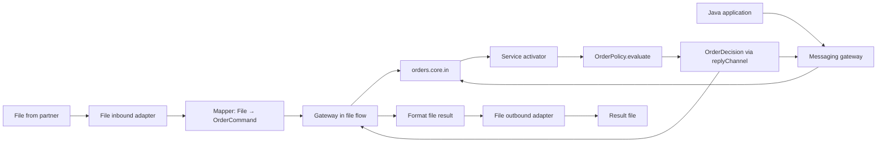

# Separating adapters from core handlers

In the **SPRING_INTEGRATION_CORE** module, the goal of this lesson is to design a message flow where the communication layer with external systems can change without changing business rules. This topic belongs to the **Channel adapter** chapter and ties directly to using `Message`, `MessageChannel`, endpoints, gateways, and Java DSL.

The ongoing example ingests orders, decides whether an order is auto-approved or needs review, and returns the decision to the caller. Orders can arrive from a file or from a Java call via a messaging gateway. Both entry points share the same core handler.

## 1. Outcomes to achieve

After this lesson, you can:

- Separate the responsibilities of adapters, the message orchestration layer, and the business core.
- Build a stable input/output contract instead of passing `File`, HTTP requests, or protocol library objects into the core.
- Wire a POJO into a flow using a service activator and Java DSL.
- Use gateways to reuse a core flow while returning results to the right caller.
- Allocate responsibilities for data validation, error handling, retries, and deduplication.
- Test core logic, mapping, flow configuration, and adapters within separate scopes.

Prerequisites are `Message` payloads/headers, sending to channels, and basic differences between synchronous processing and queue-backed processing.

## 2. Understanding adapters, endpoints, and core handlers properly

### 2.1. Channel adapters sit at the communication boundary

A channel adapter connects a message channel to an external system or resource. Inbound adapters bring data into the messaging system; outbound adapters send data from a channel outward. Examples include receiving files, reading from a broker, or writing results to a directory. [Spring Integration — Overview](https://docs.spring.io/spring-integration/reference/overview.html).

Inbound/outbound direction is viewed from the application being built. A partner process writes a file; our application reads that file with an inbound adapter. When our application writes results for the partner, the writing side is an outbound adapter.

An adapter can consist of multiple collaborating components:

```text
Connect to external resource
    → read data
    → decode format
    → map to internal contract
    → send into channel
```

You do not need to cram all work into a single class. In Java DSL, a file adapter, transformer, and header enricher can be separate endpoints that together belong to one architectural communication boundary.

### 2.2. Core handler is an architectural role

In this lesson, **core handler** refers to the object executing the use case or business rule. This is not the name of a mandatory Spring Integration interface.

A core handler can be a POJO:

```java
public OrderDecision evaluate(OrderCommand command) {
    // Apply business policy.
}
```

It does not have to:

- Implement `org.springframework.messaging.MessageHandler`.
- Accept `Message<?>` or read protocol headers.
- Know channel names, directory paths, broker addresses, or HTTP statuses.

A service activator bridges messages to POJO method calls. Java DSL expresses this via `.handle(...)`. [Spring Integration — Service Activators and the .handle() method](https://docs.spring.io/spring-integration/reference/dsl/java-handle.html).

If business logic needs to persist data or call another service, the core can depend on an application-defined interface. An implementation class of that interface handles JDBC, HTTP, or the relevant protocol. Separating adapters does not mean every business operation must be a pure function; what matters is keeping dependencies behind a contract with business meaning.

### 2.3. Separating three responsibilities

| Layer | Question answered | Example |
| --- | --- | --- |
| Boundary adapter and mapper | How do we communicate, and how is external data parsed? | Poll directory; read UTF-8; parse `ORD-1001\|1250000` |
| Message orchestration layer | Where does data flow, what gets invoked, and how are replies routed? | Channels; transformers; service activators; gateways; routers |
| Business core | Given a valid request, what is the business decision? | Orders over 50 million VND require review |

Class names or package names only help organize code. Real boundaries appear in parameter types, return types, dependencies, and how each part is tested.

## 3. Signs that an adapter is leaking into the core

Inspect the following code illustrating mixed responsibilities. This is an example for analysis, not part of the implementation code in later sections.

```java
public void handle(Message<File> message) throws IOException {
    File source = message.getPayload();
    String text = java.nio.file.Files.readString(source.toPath());
    String[] fields = text.strip().split("\\|");

    String orderId = fields[0];
    BigDecimal total = new BigDecimal(fields[1]);

    String status = total.compareTo(new BigDecimal("50000000")) <= 0
            ? "APPROVED"
            : "REVIEW_REQUIRED";

    java.nio.file.Files.writeString(
            Path.of("data/out", orderId + ".decision"),
            orderId + "|" + status
    );
}
```

This method knows about message types, file resources, record formatting, approval rules, and where results are stored. Consequently:

- Switching from files to HTTP forces modifying the object containing the approval policy.
- Testing the 50-million threshold requires setting up a filesystem.
- File read errors, parse errors, and business processing errors are hard to distinguish.
- Retrying the entire method can repeat side effects when the first part already succeeded.
- File paths and naming conventions become details the business logic must understand.

The fix is defining the internal contract first, then letting each component perform only its own part.

## 4. Target architecture and dependency direction



The diagram depicts two independent calls. Each gateway has its own reply path; a single result is not sent simultaneously to both gateways.

The contract at the core boundary is:

```text
OrderCommand → OrderDecision
```

Source-code dependency direction should flow like this:

```text
file adapter ──────┐
                   ├──→ core contract and business core
integration config ┤
Java gateway ──────┘

business core ─────→ standard Java and required business interfaces
```

The core does not import flow configuration or adapter classes. Spring configuration is where the pieces are assembled.

## 5. Building a stable business contract

### 5.1. Conventions for the example

We pick a small contract sufficient to clarify boundaries:

| Item | Convention |
| --- | --- |
| Order ID | 1–40 characters; uppercase letters, digits, or `-`; first character is a letter or digit |
| Total amount | Positive number, in VND, with no significant fractional part |
| Auto-approve | Total less than or equal to `50000000` |
| Review required | Total greater than `50000000` |
| File input | Each file contains exactly one record `orderId\|total` |
| File output | One record `orderId\|status` |

This is this example's policy, not a default provided by Spring Integration. When a problem involves multiple currencies, the contract should also carry currency and explicit rounding rules.

The implementation snippets below use modern Spring Integration Java DSL syntax with Java `record`s. Choose a JDK and compatible dependency versions via your application's BOM; do not arbitrarily mix Spring Framework, Spring Integration, and Spring Boot versions.

Artifacts needed for the example:

- `org.springframework.integration:spring-integration-core`.
- `org.springframework.integration:spring-integration-file` when using file input/output paths.
- JUnit Jupiter for the test examples.

The example uses plain Spring configuration without requiring Spring Boot. Each `public` type below belongs in its own Java file; the code is presented here for learning and assembling into an application.

### 5.2. Command enforcing shared invariants

```java
package example.order.core;

import java.math.BigDecimal;
import java.math.RoundingMode;
import java.util.Objects;

public record OrderCommand(String orderId, BigDecimal total) {

    public OrderCommand {
        Objects.requireNonNull(orderId, "orderId");
        Objects.requireNonNull(total, "total");

        orderId = orderId.strip();

        if (!orderId.matches("[A-Z0-9][A-Z0-9-]{0,39}")) {
            throw new IllegalArgumentException("Invalid order ID");
        }

        if (total.signum() <= 0) {
            throw new IllegalArgumentException("Total must be greater than 0");
        }

        try {
            total = total.setScale(0, RoundingMode.UNNECESSARY);
        }
        catch (ArithmeticException ex) {
            throw new IllegalArgumentException(
                    "VND total must be an integer value", ex);
        }
    }
}
```

`setScale(0, UNNECESSARY)` accepts representations like `1250000.00` since no value is lost, yet rejects `1250000.50`. The contract does not depend on whether the amount was read from a file or constructed directly in Java.

### 5.3. Result representing the decision

```java
package example.order.core;

public enum DecisionStatus {
    APPROVED,
    REVIEW_REQUIRED
}
```

```java
package example.order.core;

public record OrderDecision(String orderId, DecisionStatus status) {
}
```

`REVIEW_REQUIRED` is a normal business outcome. There is no need to throw an exception just because an order exceeds the auto-approval threshold.

### 5.4. Protocol-agnostic core handler

```java
package example.order.core;

import java.math.BigDecimal;
import java.util.Objects;

public final class OrderPolicy {

    private static final BigDecimal AUTO_APPROVAL_LIMIT =
            new BigDecimal("50000000");

    public OrderDecision evaluate(OrderCommand command) {
        Objects.requireNonNull(command, "command");

        DecisionStatus status =
                command.total().compareTo(AUTO_APPROVAL_LIMIT) <= 0
                        ? DecisionStatus.APPROVED
                        : DecisionStatus.REVIEW_REQUIRED;

        return new OrderDecision(command.orderId(), status);
    }
}
```

`OrderPolicy` holds no per-request mutable state, so a single instance can serve many calls. For a stateful core or one accessing data, evaluate thread safety and transaction boundaries separately.

The boundary check is: to run `evaluate`, you only need to construct an `OrderCommand` and call a Java method.

## 6. Wiring the core into Spring Integration

Register an input channel and use a service activator to invoke the POJO:

```java
package example.order.integration;

import example.order.core.OrderPolicy;
import org.springframework.context.annotation.Bean;
import org.springframework.context.annotation.Configuration;
import org.springframework.integration.channel.DirectChannel;
import org.springframework.integration.config.EnableIntegration;
import org.springframework.integration.dsl.IntegrationFlow;
import org.springframework.messaging.MessageChannel;

@Configuration
@EnableIntegration
public class OrderCoreFlowConfig {

    @Bean("orders.core.in")
    public MessageChannel orderCoreInput() {
        return new DirectChannel();
    }

    @Bean
    public OrderPolicy orderPolicy() {
        return new OrderPolicy();
    }

    @Bean
    public IntegrationFlow orderCoreFlow(OrderPolicy orderPolicy) {
        return IntegrationFlow.from("orders.core.in")
                .handle(orderPolicy, "evaluate",
                        endpoint -> endpoint
                                .id("orderPolicyEndpoint")
                                .requiresReply(true))
                .get();
    }
}
```

This flow has a clear entry point and is not hardcoded to an outbound adapter. `requiresReply(true)` surfaces an error if the method finishes without returning a result. When no output channel is configured, the service activator can return the result via the request's `replyChannel` header. [Spring Integration — Service Activator](https://docs.spring.io/spring-integration/reference/service-activator.html).

Do not add `@ServiceActivator(inputChannel = "orders.core.in")` onto `evaluate` at the same time as this `.handle(orderPolicy, "evaluate")` configuration. Doing so can register two endpoints both receiving from the channel when only one processing step was intended.

### Why use DirectChannel here?

`DirectChannel` invokes its subscriber on the sending thread and has point-to-point semantics. `QueueChannel` buffers messages for a consumer to receive later; buffering defaults to memory. Changing the channel changes execution threading, blocking behavior, and error propagation. [Spring Integration — Message Channel Implementations](https://docs.spring.io/spring-integration/reference/channel/implementations.html).

In the example, we choose `DirectChannel` because the core runs quickly and needs straightforward request–reply. Separating adapters from the core is achieved through contracts and configuration; there is no need to add a queue just to create this boundary.

If multiple subscribers exist on the same `DirectChannel`, do not expect all of them to receive a copy. To duplicate messages for multiple purposes, design an explicit fan-out and define the impact when one branch fails.

## 7. File adapter: mapping before calling the core

### 7.1. Mapper owns external format parsing

Create the mapper in the adapter package:

```java
package example.order.adapter.file;

import example.order.core.OrderCommand;
import java.io.File;
import java.io.IOException;
import java.math.BigDecimal;
import java.nio.charset.StandardCharsets;
import java.util.Objects;

public final class FileOrderMapper {

    public OrderCommand read(File source) throws IOException {
        String text = java.nio.file.Files.readString(
                source.toPath(), StandardCharsets.UTF_8);
        return parse(text);
    }

    public OrderCommand parse(String text) {
        Objects.requireNonNull(text, "text");

        String[] fields = text.strip().split("\\|", -1);
        if (fields.length != 2) {
            throw new IllegalArgumentException(
                    "Record must have the format orderId|total");
        }

        BigDecimal total;
        try {
            total = new BigDecimal(fields[1].strip());
        }
        catch (NumberFormatException ex) {
            throw new IllegalArgumentException(
                    "Total is not a valid number format", ex);
        }

        return new OrderCommand(fields[0].strip(), total);
    }
}
```

Use `split("\\|", -1)` so trailing empty fields are not dropped. A record `ORD-1001|` must be detected as missing the amount rather than accidentally turning into a different structure.

This example is not a general-purpose CSV parser: it has no escaping, quoting, or multiline conventions. If an input protocol needs those capabilities, use an appropriate parser and keep those changes inside the adapter.

Data validation boundaries are split as follows:

- `FileOrderMapper` validates record structure and numeric representation.
- `OrderCommand` enforces shared invariants like valid order ID and positive amount.
- `OrderPolicy` applies the approval policy.

Thus, Java callers cannot bypass invariants merely because they skip the file mapper.

### 7.2. File flow calls the core then formats its own result

```java
package example.order.adapter.file;

import example.order.core.OrderDecision;
import java.io.File;
import org.springframework.beans.factory.annotation.Value;
import org.springframework.context.annotation.Bean;
import org.springframework.context.annotation.Configuration;
import org.springframework.integration.dsl.IntegrationFlow;
import org.springframework.integration.dsl.Pollers;
import org.springframework.integration.file.dsl.Files;
import org.springframework.integration.file.support.FileExistsMode;

@Configuration
public class FileOrderFlowConfig {

    @Bean
    public FileOrderMapper fileOrderMapper() {
        return new FileOrderMapper();
    }

    @Bean
    public IntegrationFlow fileOrderFlow(
            FileOrderMapper mapper,
            @Value("${orders.file.in:data/orders-in}") String inputDirectory,
            @Value("${orders.file.out:data/orders-out}") String outputDirectory) {

        return IntegrationFlow
                .from(Files.inboundAdapter(new File(inputDirectory))
                                .autoCreateDirectory(true)
                                .patternFilter("*.order"),
                        endpoint -> endpoint
                                .id("fileOrderInbound")
                                .poller(Pollers.fixedDelay(1000)
                                        .maxMessagesPerPoll(10)))
                .transform(mapper, "read")
                .gateway("orders.core.in")
                .enrichHeaders(headers -> headers.headerExpression(
                        "decisionFileName",
                        "payload.orderId() + '.decision'"))
                .<OrderDecision, String>transform(decision ->
                        decision.orderId() + "|"
                                + decision.status().name() + "\n")
                .handle(Files.outboundAdapter(new File(outputDirectory))
                        .autoCreateDirectory(true)
                        .charset("UTF-8")
                        .fileNameGenerator(message ->
                                message.getHeaders().get(
                                        "decisionFileName", String.class))
                        .fileExistsMode(FileExistsMode.REPLACE))
                .get();
    }
}
```

Directory names are adapter configuration. The core does not need to read these properties.

The pipeline can be read step by step:

1. The file inbound adapter detects files ending in `.order`.
2. The poller receives at most 10 messages per poll cycle in this configuration.
3. The transformer calls `mapper.read(File)` and produces an `OrderCommand` payload.
4. `gateway("orders.core.in")` calls the core flow and awaits an `OrderDecision`.
5. The `decisionFileName` header is generated from the result before the payload becomes a string.
6. The transformer formats the output record.
7. The file outbound adapter writes the UTF-8 string to the target directory and ends the branch.

The file inbound source produces messages with a `File` payload, so a mapping step is required before the core. The file adapter documentation describes combining file sources with pollers in Java DSL. [Spring Integration — Reading Files](https://docs.spring.io/spring-integration/reference/file/reading.html).

`Files.outboundAdapter(...)` creates a one-way sending handler; `Files.outboundGateway(...)` is for cases needing the file-write result for further processing. [Spring Integration — Files API](https://docs.spring.io/spring-integration/api/org/springframework/integration/file/dsl/Files.html).

We deliberately name the output using `decisionFileName`, rather than reusing the input name `ORD-1001.order`. `REPLACE` is chosen for the example: a reprocessed order overwrites the decision file of the same name. Overwrite policy belongs to the adapter and must be agreed with the receiving system. [Spring Integration — Writing files](https://docs.spring.io/spring-integration/reference/file/writing.html).

### 7.3. Why use a gateway instead of wiring the channel directly?

A misleading diagram would be:

```text
file ingress → orders.core.in → core handler → ?
```

If the core's output channel is hardcoded to `files.out`, every other caller is forced back to files too. If there is no output channel and the request provides no `replyChannel`, the result has no valid place to return.

`.gateway("orders.core.in")` establishes a request–reply interaction with another flow and brings the reply back to the next step in the file flow. Thus, the core does not have to know how callers format results. [Spring Integration — Operator gateway()](https://docs.spring.io/spring-integration/reference/dsl/java-gateway.html).

Use `.channel("orders.core.in")` only when intentionally forwarding a message and the post-core path is already fixed. `.channel(...)` does not create the call-and-return-to-caller's-next-step semantics of a gateway.

### 7.4. An illustrative run

File `data/orders-in/ORD-1001.order` contains:

```text
ORD-1001|1250000
```

After the flow processes it, `data/orders-out/ORD-1001.decision` contains:

```text
ORD-1001|APPROVED
```

If the total is `50000001`, the status is `REVIEW_REQUIRED`. The original input remains in this example; there is no archiving or error-file move step yet.

In real execution, land files under a temporary name and rename to `.order` once writing completes. Filtering solely by file extension does not guarantee a file written directly under its final name has finished writing.

## 8. Adding a Java entry point via a messaging gateway

Other code in the same process can invoke the core through an interface:

```java
package example.order.adapter.gateway;

import example.order.core.OrderCommand;
import example.order.core.OrderDecision;
import org.springframework.integration.annotation.MessagingGateway;

@MessagingGateway(defaultRequestChannel = "orders.core.in")
public interface OrderGateway {

    OrderDecision evaluate(OrderCommand command);
}
```

Register gateway scanning separately:

```java
package example.order.adapter.gateway;

import org.springframework.context.annotation.Configuration;
import org.springframework.integration.config.IntegrationComponentScan;

@Configuration
@IntegrationComponentScan(basePackageClasses = OrderGateway.class)
public class OrderGatewayConfig {
}
```

A messaging gateway hides the messaging API behind a Java interface. For normal request–reply, the gateway supplies a temporary reply channel for the request. [Spring Integration — Messaging Gateways](https://docs.spring.io/spring-integration/reference/gateway.html).

Assemble the configurations in a direct Spring application:

```java
package example.order;

import example.order.adapter.file.FileOrderFlowConfig;
import example.order.adapter.gateway.OrderGateway;
import example.order.adapter.gateway.OrderGatewayConfig;
import example.order.core.OrderCommand;
import example.order.core.OrderDecision;
import example.order.integration.OrderCoreFlowConfig;
import java.math.BigDecimal;
import org.springframework.context.annotation.AnnotationConfigApplicationContext;

public final class OrderDemo {

    public static void main(String[] args) {
        try (var context = new AnnotationConfigApplicationContext(
                OrderCoreFlowConfig.class,
                OrderGatewayConfig.class,
                FileOrderFlowConfig.class)) {

            OrderGateway gateway = context.getBean(OrderGateway.class);

            OrderDecision decision = gateway.evaluate(
                    new OrderCommand(
                            "ORD-2001", new BigDecimal("60000000")));

            System.out.println(decision);
        }
    }
}
```

The call above returns `OrderDecision` to the Java caller; it does not pass through file output. When `try` finishes, the context closes and the file poller stops too. To observe the file flow over time, run in an application with a continuous serving lifecycle or keep the context alive via the application's mechanism.

Neither `OrderPolicy` nor `OrderCoreFlowConfig` needed modification when adding this gateway. That is the concrete benefit of choosing a stable core contract.

### Adapters and gateways have different roles

| Component | Communication contract in the example |
| --- | --- |
| File inbound adapter | Brings files into the flow |
| File outbound adapter | Writes results; produces no reply to continue the flow |
| Java messaging gateway | Sends command and receives decision via an interface |
| `.gateway(...)` in DSL | Invokes core flow and continues caller flow with the reply |

An outbound channel adapter can still perform synchronous I/O. One-way sending describes the message contract, not automatically running on a separate thread.

## 9. Managing payloads and headers at the right boundary

### 9.1. Data affecting business decisions should be explicit

If approval thresholds differ per customer, the core should receive the customer identifier as a field on the command or a typed business context.

Avoid letting the core infer context implicitly:

```java
// Example of hard-to-reuse design:
if (message.getHeaders().containsKey("http_requestMethod")) {
    // Apply a different approval policy.
}
```

The transport mechanism should not implicitly dictate policy. If rules vary by sales channel, model `salesChannel` as a business concept and determine a trustworthy data source for it.

### 9.2. Technical headers for orchestration

| Information type | Typically appropriate place |
| --- | --- |
| Order ID, total amount, customer | Command or business context |
| Original filename, file path | Adapter metadata |
| Reply path, error path | `replyChannel`, `errorChannel` headers in the flow |
| Single-attempt tracing info | Technical header following application conventions |
| Key to prevent re-executing a command | Contract field or explicitly designed context |

Do not conflate trace IDs with deduplication keys. A replayed message may get a new trace ID while still representing the exact same business command.

If a transformer manually constructs a new `Message`, verify it preserves orchestration headers needed downstream. In the example, the mapper returns a payload so the framework manages message wrapping; the core does not create headers on its own.

### 9.3. Internal boundaries differ from external boundaries

Inside the same application, `replyChannel` can be an in-memory channel object. When sending a message to a broker or serializing to JSON, do not dump an entire header map containing runtime objects.

Outbound mappers should explicitly list business fields and metadata permitted externally. That mapping also prevents partner contracts from depending on Spring implementation details.

## 10. Handling errors by origin and execution point

### 10.1. Separating technical errors from business outcomes

| Situation | Where detected | Appropriate handling |
| --- | --- | --- |
| Cannot read file | File reading adapter | Classify permission issues, missing resource, transient errors |
| Wrong field count or unparseable amount | Mapper | Mark input data invalid |
| Non-positive total | Core contract | Reject invalid request |
| Total exceeds 50 million | Core policy | Return `REVIEW_REQUIRED` |
| Cannot write result file | Outbound adapter | Preserve result to send and provide resend mechanism |

Do not collapse every case into `catch (Exception) { return null; }`. With request–reply, that loses the failure reason and can leave the caller waiting for a result that never arrives.

### 10.2. Threads determine where errors return

Along a `DirectChannel` chain, exceptions typically unwind up the call stack to the caller. For asynchronous tasks or framework-managed poller tasks, the error handler mechanism can emit an `ErrorMessage` to an error channel. Merely attaching an `errorChannel` header does not turn every synchronous exception into an error message. [Spring Integration — Error Handling](https://docs.spring.io/spring-integration/reference/error-handling.html).

Applied to the example:

- The Java caller invokes the gateway into the core synchronously. Processing errors propagate back through the gateway per the gateway's error policy; no error file is created by default.
- File input starts from a poller. Errors along the synchronous downstream path—including mapper, core, or output writing—can unwind back to the poller task.
- The sample code does not yet configure a dedicated error flow for quarantine or replay. Add that workflow before putting it into production.

An error during decision evaluation and an error during file writing should be tracked as two separate stages. Do not conclude the core failed merely because the outbound adapter failed to write the result.

### 10.3. Requirements for a production error flow

An operational error flow should define:

1. How to locate the message and original resource related to the failure.
2. Classification of data errors, unusual business errors, and infrastructure errors.
3. Where to store details for human remediation or system replay.
4. Retry termination conditions and escalation to manual intervention.
5. Order ID or request key used to correlate with processing state.

Do not assume every `Throwable` has the exact same structure or always contains the original file. When handling `MessagingException`, check whether `failedMessage` exists; for errors during ingestion, a business message may not have been created yet.

## 11. Retries, idempotency, and transactions

Layer separation puts these policies in the right places, yet does not create an exactly-once guarantee by itself.

### 11.1. Retrying repeatable operations

Suppose the core wrote an order status to the database and then the outbound adapter failed to write the file. Retrying the entire flow from the beginning could invoke the database write again.

A design must make an explicit choice:

- Retry only the failed communication step when it is known to be safe to repeat.
- Or retry the entire use case with an idempotency mechanism designed for it.
- Persist intermediate state when a result was created but not yet delivered to the receiving system.

For `OrderPolicy` in this lesson, recomputing a decision has no side effects. That property does not automatically hold for handlers that send emails, charge money, or post ledger entries.

### 11.2. Preventing file re-ingestion differs from preventing business re-execution

The file adapter can use a filter to prevent re-reading the same file. `AcceptOnceFileListFilter` holds state in memory by default; surviving restarts requires an appropriate persistent store. That is a file-ingestion mechanism, not proof that the entire business operation finished. [Spring Integration — Reading Files](https://docs.spring.io/spring-integration/reference/file/reading.html).

The same command might be sent by a partner under a new filename. Conversely, a file might be marked received while downstream processing failed. Therefore, design processing/replay states and request keys around business semantics.

Do not blindly use `orderId` as the deduplication key for every command. The same order may have create, update, cancel, or resend commands with different versions. A suitable key may be `requestId`, or a combination of command type and version per system contract.

### 11.3. Transactions do not expand merely because steps sit side by side

`DirectChannel` can keep steps on the same thread, yet the channel itself does not open a transaction. A local database transaction also does not cover file writes or HTTP calls automatically.

If you must update a database and reliably emit results, design an outbox within the same database transaction and let a separate sending flow handle delivery. The core expresses business intent; the sending adapter handles protocol, retries, and delivery tracking.

### 11.4. Two notes specific to the file example

- `REPLACE` only causes the result under the same filename to be overwritten. It does not prevent the core from being called multiple times.
- The sample code does not automatically move inputs after success or reset filters when downstream fails. Add archive, quarantine, and replay mechanisms before expecting reliable file processing across restarts.

## 12. Testing at each boundary

The goal is not merely verifying a method was called. Each test group should catch a specific class of defect.

### 12.1. Testing core rules without starting Spring

```java
package example.order.core;

import java.math.BigDecimal;
import org.junit.jupiter.api.Test;

import static org.junit.jupiter.api.Assertions.assertEquals;
import static org.junit.jupiter.api.Assertions.assertThrows;

class OrderPolicyTest {

    private final OrderPolicy policy = new OrderPolicy();

    @Test
    void approvesAtTheLimit() {
        OrderDecision decision = policy.evaluate(
                new OrderCommand(
                        "ORD-3001", new BigDecimal("50000000")));

        assertEquals(
                new OrderDecision("ORD-3001", DecisionStatus.APPROVED),
                decision);
    }

    @Test
    void requestsReviewAboveTheLimit() {
        OrderDecision decision = policy.evaluate(
                new OrderCommand(
                        "ORD-3002", new BigDecimal("50000001")));

        assertEquals(DecisionStatus.REVIEW_REQUIRED, decision.status());
    }

    @Test
    void rejectsNonPositiveTotal() {
        assertThrows(IllegalArgumentException.class,
                () -> new OrderCommand("ORD-3003", BigDecimal.ZERO));
    }

    @Test
    void rejectsFractionalVndValue() {
        assertThrows(IllegalArgumentException.class,
                () -> new OrderCommand(
                        "ORD-3004", new BigDecimal("1000.50")));
    }
}
```

Values right at and just above the threshold catch `<` vs. `<=` mistakes. These are business rule tests; they need neither channels nor files.

### 12.2. Testing mapping at the boundary

```java
package example.order.adapter.file;

import example.order.core.OrderCommand;
import java.math.BigDecimal;
import org.junit.jupiter.api.Test;

import static org.junit.jupiter.api.Assertions.assertEquals;
import static org.junit.jupiter.api.Assertions.assertThrows;

class FileOrderMapperTest {

    private final FileOrderMapper mapper = new FileOrderMapper();

    @Test
    void mapsAnExternalRecordToTheCoreContract() {
        assertEquals(
                new OrderCommand(
                        "ORD-4001", new BigDecimal("1250000")),
                mapper.parse(" ORD-4001 | 1250000.00 \n"));
    }

    @Test
    void rejectsAMissingAmount() {
        assertThrows(IllegalArgumentException.class,
                () -> mapper.parse("ORD-4001|"));
    }

    @Test
    void rejectsAnUnexpectedExtraField() {
        assertThrows(IllegalArgumentException.class,
                () -> mapper.parse("ORD-4001|1250000|EXTRA"));
    }
}
```

To test `read(File)`, add a test using a temporary directory and UTF-8 content. That group verifies resource reading; there is no need to repeat the entire approval policy matrix.

### 12.3. Testing that the core flow actually sends replies

The test below loads only the core configuration, sends to the real channel, and collects the reply. It catches channel miswiring or missing reply paths that `OrderPolicy` unit tests cannot detect.

```java
package example.order.integration;

import example.order.core.DecisionStatus;
import example.order.core.OrderCommand;
import example.order.core.OrderDecision;
import java.math.BigDecimal;
import org.junit.jupiter.api.Test;
import org.springframework.context.annotation.AnnotationConfigApplicationContext;
import org.springframework.integration.channel.QueueChannel;
import org.springframework.messaging.Message;
import org.springframework.messaging.MessageChannel;
import org.springframework.messaging.support.MessageBuilder;

import static org.junit.jupiter.api.Assertions.assertEquals;
import static org.junit.jupiter.api.Assertions.assertNotNull;
import static org.junit.jupiter.api.Assertions.assertTrue;

class OrderCoreFlowTest {

    @Test
    void repliesToTheCallerProvidedChannel() {
        try (var context = new AnnotationConfigApplicationContext(
                OrderCoreFlowConfig.class)) {

            MessageChannel input = context.getBean(
                    "orders.core.in", MessageChannel.class);
            QueueChannel replies = new QueueChannel(1);

            Message<OrderCommand> request = MessageBuilder
                    .withPayload(new OrderCommand(
                            "ORD-5001", new BigDecimal("900000")))
                    .setReplyChannel(replies)
                    .build();

            assertTrue(input.send(request));

            Message<?> reply = replies.receive(0);
            assertNotNull(reply);
            assertEquals(
                    new OrderDecision(
                            "ORD-5001", DecisionStatus.APPROVED),
                    reply.getPayload());
        }
    }
}
```

`receive(0)` is valid in this test because the entire core flow runs synchronously through `DirectChannel`; the reply was already produced before `send` returned. Do not copy that assumption to flows with executors or pollers.

### 12.4. Testing that two callers do not mix up results

Another useful integration test is:

1. Load core, gateway, and file flow with two temporary directories.
2. Call `OrderGateway` with `ORD-JAVA-1`.
3. Place the file for `ORD-FILE-1` into the input directory.
4. Assert Java receives the decision matching its order ID.
5. Wait with a bounded timeout to check file `ORD-FILE-1.decision`.
6. Assert no result file appears for `ORD-JAVA-1`.

This test validates the benefit of the gateway structure: the file adapter continues its own branch while the Java caller receives its own reply.

### 12.5. Controlling adapter lifecycle in tests

When testing only the core, not loading adapter configuration is a simple way to avoid pollers running automatically. In a larger test context, `@SpringIntegrationTest(noAutoStartup = ...)` prevents endpoints from auto-starting, and `MockIntegrationContext` helps swap integration components. [Spring Integration — Testing support](https://docs.spring.io/spring-integration/reference/testing.html).

Assign stable endpoint IDs, like `fileOrderInbound` in the example, so tests and operations can explicitly reference the component to control. For real file tests, use bounded waits or condition-awaiting utilities; avoid relying on a fixed `sleep` and assuming the system definitely finished.

The test snippets in this lesson are illustrative code meant to run in an application with matching dependencies declared; presenting code does not substitute for execution results in a concrete project.

## 13. Where do transformers, filters, routers, and aggregators belong?

Separating adapters from the core does not eliminate enterprise integration patterns. It helps choose the right inputs and responsibilities for each pattern.

| Pattern | Placement in this architecture |
| --- | --- |
| Transformer | Parses external formats into commands; serializes decisions into partner formats |
| Filter | Excludes out-of-scope data per contract, with an explicit discard policy |
| Router | Selects processing paths or targets based on normalized data |
| Aggregator | Combines related parts before invoking a use case, or gathers results after processing |
| Service activator | Calls core handler and returns results back to the messaging system |
| Gateway | Bridges callers into a flow or calls a shared flow under a request–reply contract |

Extension example: the core returns `REVIEW_REQUIRED`, and then a router directs the result to a review system. The core still decides the status, while the router decides which endpoint receives the message.

If using a filter on a request–reply path, define what the caller receives when a message is filtered out. Disappearing from the flow does not automatically produce a business rejection result.

If aggregating multiple order lines before calling the core, define correlation keys, group completion conditions, timeouts, and incomplete-group handling. Those group lifecycle rules belong to flow design; invariants of a complete order still need protection in the core.

You do not need to cram every pattern into one flow. Only use components that solve a concrete requirement.

## 14. Organizing source code and configuration

One way to organize the example:

```text
example.order
├── core
│   ├── OrderCommand
│   ├── OrderDecision
│   ├── DecisionStatus
│   └── OrderPolicy
├── integration
│   └── OrderCoreFlowConfig
└── adapter
    ├── file
    │   ├── FileOrderMapper
    │   └── FileOrderFlowConfig
    └── gateway
        ├── OrderGateway
        └── OrderGatewayConfig
```

`OrderCoreFlowConfig` knows about Spring Integration, whereas `OrderPolicy` does not. Mappers know core data types in order to convert; the core does not know those mappers exist.

Values such as directories, poll intervals, messages per poll, connection timeouts, or endpoint addresses should be configured in the appropriate communication/orchestration layer. A number like the approval threshold is a business policy; if it must be dynamically configurable, pass it into the core through a clearly contracted and tested mechanism.

Channel names are also part of the internal integration contract. When renaming `orders.core.in`, update caller configurations and re-test wiring; separating adapters does not make contract changes free.

## 15. How to migrate from a mixed handler to a separated design

Proceed step by step to keep behavior easy to verify:

1. Record current behavior for valid data, invalid data, and downstream failure cases.
2. Define commands and results in business terms.
3. Extract parsing/serialization into boundary mappers.
4. Move decision rules into a POJO and unit-test boundary conditions directly.
5. Create a core flow that only invokes the POJO from an input channel.
6. Have the existing adapter call the core via a gateway or a clearly designed one-way send contract.
7. Verify replies, required headers, errors, and side effects on replay.
8. Add a second entry point to prove core reusability.

After splitting, inspect the core method signatures. If they still accept `File`, HTTP requests, or protocol client objects just to extract a few business fields, contract normalization is not complete yet.

Conversely, do not create a wrapper class for every simple string concatenation or trivial type conversion. Keep mappers and flows small enough that boundaries are clear, avoiding adding abstractions without distinct responsibilities.

## 16. Common design mistakes

| Mistake | Consequence | Remediation |
| --- | --- | --- |
| Moving packages while core still takes `Message<File>` | Protocol coupling remains | Switch the contract to a business command |
| Core directly writes results to files or brokers | Return path cannot be reused | Return a result or invoke an appropriate business port |
| Core flow hardcodes output channel to one adapter | New callers receive results on the wrong path | Use caller replies or explicitly split output branches |
| Returning `null` for every unaccepted case | Caller cannot distinguish errors, rejections, and missing replies | Return an explicit decision or throw classified errors |
| Adding queues just to "reduce coupling" | Introduces unresolved latency, error, and durability issues | Choose channels based on execution requirements |
| Retrying the entire flow after side effects occurred | Repeated side effects | Scope retries properly and add idempotency |
| Testing core only via direct method calls | Misses message wiring errors | Add channel/reply tests and adapter tests |
| Treating file filters as business completion state | Missed or duplicated processing across crashes/restarts | Manage state and replay per actual requirements |

## 17. Self-evaluating your design

Check your flow against these criteria:

- Business policies can be tested without opening connections or preparing files.
- Every adapter converts external data into the same core contract.
- Adding an adapter does not require the core to inspect source protocol types.
- Every caller has an explicit result-receiving path or one-way send contract.
- Data read/write errors are distinguished from business outcomes.
- You can explain what happens when the core succeeds but the outbound adapter fails.
- Tests verify data travels along the right paths, not merely that a method was invoked.

In this example, `OrderPolicy` owns the decision rules; channels and the service activator deliver commands to the right place; gateways manage caller interactions; and the file adapter and mapper encapsulate all file details. When changing how orders are received, edits stay concentrated at the communication boundary.
