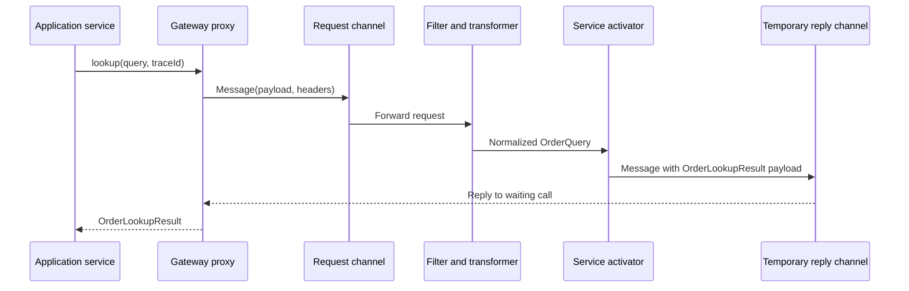

# What is a Messaging Gateway

## 1. Lesson Objectives and Scope

In the **Messaging gateway** chapter of the **SPRING_INTEGRATION_CORE** module, a gateway is the connection point between application code and a message processing flow. This lesson focuses on Java interface-based gateways: the application calls a business method, and Spring Integration translates that call into a `Message` exchange over a `MessageChannel`.

After this lesson, you can:

- Explain the responsibilities of a gateway compared to a channel, an endpoint, and a service activator.
- Trace a call from Java parameters, through payload/headers, to the return value.
- Declare `@MessagingGateway`, register the proxy, and connect it to an `IntegrationFlow` using Java DSL.
- Design reply, timeout, and error contracts for a request–reply flow.
- Write tests that go through a real gateway to observe filters, transformers, and handlers.

The examples use order status lookup. Routers, aggregators, and external system integrations are mentioned only when they affect the gateway contract; detailed configuration for those belongs to separate topics in the module.

## 2. The Problem: Calling Business Logic Without Manually Driving Messaging

Suppose a feature needs to look up an order. The caller wants to express the request as follows:

```java
OrderLookupResult result = gateway.lookup(
        new OrderQuery(" ord-42 "),
        "trace-001"
);
```

Meanwhile, the processing flow needs to validate the order ID, normalize the data, and call the lookup component. If every call site manually constructs messages, selects channels, sets reply addresses, and receives results, messaging details will leak into controllers or application services.

**A messaging gateway encapsulates communication with the messaging system behind a business-meaningful interface.** This is an Enterprise Integration Patterns pattern: the consumer interacts with domain methods, while the gateway manages messaging-specific operations. [Source: Messaging Gateway pattern](https://www.enterpriseintegrationpatterns.com/patterns/messaging/MessagingGateway.html).

In Spring Integration, `GatewayProxyFactoryBean` creates a proxy for the interface. The bean injected into the application is that proxy; when a method is called, the proxy coordinates sending the request and receiving the reply. There is no need to manually write a class that `implements OrderLookupGateway` for this configuration. [Source: Spring Integration — Messaging Gateways](https://docs.spring.io/spring-integration/reference/gateway.html).

A suitable separation of responsibilities for the example:

| Component | Question it answers | In the example |
| --- | --- | --- |
| Application service | What operation needs to be performed? | Calls `lookup(...)` |
| Messaging gateway | How is a Java call mapped to a message exchange? | `OrderLookupGateway` |
| Message | What data and context accompany the request? | Payload `OrderQuery`, header `traceId` |
| MessageChannel | At what point does the message enter the flow? | `orders.lookup.requests` |
| Filter | Does the request qualify to proceed? | Rejects blank order IDs |
| Transformer | How should the data be normalized? | Trims whitespace and uppercases the order ID |
| Service activator | Which business handler object is invoked? | Endpoint created by `.handle(...)` |
| Business object | How is the lookup performed and the result created? | `OrderLookupService` |

The gateway establishes the entry point of the feature; the internal processing structure is still handled by endpoints and channels.

## 3. From Java Call to Reply

### 3.1. Mapping the Method Contract

With the illustrative contract:

```java
OrderLookupResult lookup(OrderQuery query,
                         @Header("traceId") String traceId);
```

We design the mapping as follows:

| Part of the call | Part of the messaging exchange |
| --- | --- |
| `query` | Payload of the request message |
| Parameter with `@Header("traceId")` | `traceId` header |
| Channel configured for the gateway | Where the request is sent |
| Result produced by the flow | Payload of the reply message |
| `OrderLookupResult` | Return value type for the caller |

`@Gateway` allows overriding configuration on a per-method basis. A `@Header` parameter maps an individual header, while `@Headers` can accept a header map. If the method returns a regular data type, the gateway extracts the reply payload and applies supported type conversions when needed. `Message<?>` can be used in the contract when full access to the message is genuinely required. [Source: Javadoc — Gateway](https://docs.spring.io/spring-integration/docs/current/api/org/springframework/integration/annotation/Gateway.html).

In this example, using DTOs for the request and result helps callers understand the contract in terms of `OrderQuery` and `OrderLookupResult`. `traceId` is tracing information, so it is placed in a header. Multiple business fields that together form a single request should be grouped into a DTO, rather than letting the gateway infer multiple payload parameters.

### 3.2. Reply Address and the Role of the Final Endpoint

In a standard request–reply flow, the gateway creates a temporary reply channel and puts that address into the `replyChannel` header. Usually, there is no need to declare a separate reply channel bean. [Source: Setting the Default Reply Channel](https://docs.spring.io/spring-integration/reference/gateway.html#gateway-default-reply-channel).

An endpoint with output prioritizes its configured output channel. If no output channel is configured, a service activator can use the `replyChannel` header on the request to send the result back to the waiting caller. In Java DSL, `.handle(...)` represents a service activator. [Source: Spring Integration — Service Activator](https://docs.spring.io/spring-integration/reference/service-activator.html).



The diagram depicts the logical path of the message, not that each column runs on a different thread. In the `DirectChannel` configuration in the hands-on section, all processing steps run on the thread calling the gateway.

When adding transformers or handlers that manually construct messages, preserve the request's reply path. Endpoint annotations support receiving payloads, headers, or the entire message; endpoints with output coordinate output channels and reply headers to form a pipeline. [Source: Spring Integration — Annotation Support](https://docs.spring.io/spring-integration/reference/configuration/annotations.html).

## 4. Choosing the Right Gateway Contract Form

| Contract | Expected semantics | What needs to be designed |
| --- | --- | --- |
| `OrderLookupResult lookup(OrderQuery query)` | One result for the request | Result type, errors, and wait timeout |
| `void submit(OrderCommand command)` | No business reply value | How to track errors and confirm completion if needed |
| `CompletableFuture<OrderLookupResult> lookupAsync(OrderQuery query)` | Receives an object representing a future result | Executor, completion handling, and error handling |

A `void` method only declares that the caller receives no return value. It does not guarantee that the task is offloaded to another thread. With `DirectChannel`, the handler is still invoked on the sending thread; with `ExecutorChannel`, dispatching is delegated to an executor; `QueueChannel` stores messages for consumers to receive. The default in-memory queue also provides no persistence guarantee. [Source: Message Channel Implementations](https://docs.spring.io/spring-integration/reference/channel/implementations.html).

For `CompletableFuture`, the typical mode uses the gateway's async executor to perform the call. If the executor is explicitly disabled, the contract may instead require downstream to return a future in the payload. Therefore, determine the usage mode before changing the return type. [Source: Asynchronous Gateway](https://docs.spring.io/spring-integration/reference/gateway.html#async-gateway).

For this short lookup example, choosing `OrderLookupResult` clearly illustrates a one-request → one-result contract. When moving to multi-minute order processing, a reasonable design might return a task ID and provide a separate status tracking flow; switching to `void` alone does not solve completion confirmation.

## 5. Practice: Gateway Interface and Java DSL

### 5.1. Prerequisites for the Example

The API baseline for the example is **Java 17 and Spring Integration 6.2.x**, with compatible Spring libraries. `errorOnTimeout` on `@MessagingGateway` is available since Spring Integration 6.2. If using Spring Boot, let an appropriate parent/BOM manage dependency versions. Do not treat library versions in the example as the inspection result of the current project. [Source: Javadoc — MessagingGateway](https://docs.spring.io/spring-integration/docs/current/api/org/springframework/integration/annotation/MessagingGateway.html).

In a project that already has a Spring Boot parent/BOM, the minimal dependencies for the demonstration and tests are:

```xml
<dependencies>
    <dependency>
        <groupId>org.springframework.boot</groupId>
        <artifactId>spring-boot-starter-integration</artifactId>
    </dependency>
    <dependency>
        <groupId>org.springframework.boot</groupId>
        <artifactId>spring-boot-starter-test</artifactId>
        <scope>test</scope>
    </dependency>
</dependencies>
```

This is a dependency snippet to place into an existing Maven configuration, not a complete `pom.xml`. The runnable part below uses `AnnotationConfigApplicationContext`, so there is no need to set up a web server, database, or message broker.

Each `public` class/interface goes into its corresponding `.java` file under the same `example.messaginggateway` package. The file names in the lesson are instructions for learners to create the example, not pre-created source files provided by this document.

### 5.2. The Two Contract Data Types

`OrderQuery.java`:

```java
package example.messaginggateway;

public record OrderQuery(String orderId) {
}
```

`OrderLookupResult.java`:

```java
package example.messaginggateway;

public record OrderLookupResult(
        String orderId,
        String state,
        String traceId
) {
}
```

The example returns `traceId` in the DTO so learners can see the result of header mapping. In a real application, whether to include tracing information in the result contract is a separate design decision.

### 5.3. Declaring the Entry Point

`OrderLookupGateway.java`:

```java
package example.messaginggateway;

import org.springframework.integration.annotation.MessagingGateway;
import org.springframework.messaging.handler.annotation.Header;

@MessagingGateway(
        defaultRequestChannel = "orders.lookup.requests",
        defaultRequestTimeout = "1000",
        defaultReplyTimeout = "2000",
        errorOnTimeout = true
)
public interface OrderLookupGateway {

    OrderLookupResult lookup(
            OrderQuery query,
            @Header("traceId") String traceId
    );
}
```

The timeout values are in milliseconds. In the interface-level annotation, these two timeout attributes are declared as strings. `defaultRequestChannel` is the channel bean name that the configuration below will provide. The example intentionally selects these values so the contract has explicit wait limits; they are not a guarantee that total execution time is always under two seconds.

`errorOnTimeout = true` ensures that a reply timeout is represented as an error instead of returning `null` in this configuration. There is no dedicated `errorChannel` in the main example, so errors propagate to the caller. [Source: Javadoc — MessagingGateway](https://docs.spring.io/spring-integration/docs/current/api/org/springframework/integration/annotation/MessagingGateway.html).

### 5.4. Simulated Business Component

`OrderLookupService.java`:

```java
package example.messaginggateway;

import org.springframework.messaging.handler.annotation.Header;

public class OrderLookupService {

    public OrderLookupResult lookup(
            OrderQuery query,
            @Header("traceId") String traceId
    ) {
        if ("FAIL".equals(query.orderId())) {
            throw new IllegalStateException("Order backend unavailable");
        }

        String state = "ORD-42".equals(query.orderId())
                ? "READY"
                : "NOT_FOUND";

        return new OrderLookupResult(query.orderId(), state, traceId);
    }
}
```

This is simulated data: only `ORD-42` is considered available; `FAIL` simulates a backend error. Any other ID produces a `NOT_FOUND` result instead of returning `null`. Thus, a missing order is a meaningful result in the contract, distinct from not receiving a reply.

### 5.5. Registering the Proxy, Channel, and Endpoints

`OrderGatewayConfiguration.java`:

```java
package example.messaginggateway;

import java.util.Locale;

import org.springframework.context.annotation.Bean;
import org.springframework.context.annotation.Configuration;
import org.springframework.integration.annotation.IntegrationComponentScan;
import org.springframework.integration.channel.DirectChannel;
import org.springframework.integration.config.EnableIntegration;
import org.springframework.integration.dsl.IntegrationFlow;

@Configuration
@EnableIntegration
@IntegrationComponentScan(basePackageClasses = OrderLookupGateway.class)
public class OrderGatewayConfiguration {

    @Bean(name = "orders.lookup.requests")
    public DirectChannel orderLookupRequests() {
        return new DirectChannel();
    }

    @Bean
    public OrderLookupService orderLookupService() {
        return new OrderLookupService();
    }

    @Bean
    public IntegrationFlow orderLookupFlow(OrderLookupService service) {
        return IntegrationFlow
                .from("orders.lookup.requests")
                .filter(
                        OrderQuery.class,
                        query -> query.orderId() != null
                                && !query.orderId().isBlank(),
                        spec -> spec.throwExceptionOnRejection(true)
                )
                .<OrderQuery, OrderQuery>transform(query ->
                        new OrderQuery(
                                query.orderId().strip()
                                        .toUpperCase(Locale.ROOT)
                        )
                )
                .handle(service, "lookup", spec -> spec.requiresReply(true))
                .get();
    }
}
```

There are three distinct registrations in the configuration:

1. `@EnableIntegration` activates the Spring Integration infrastructure for the plain Java context used here.
2. `@IntegrationComponentScan` scans for interfaces annotated with `@MessagingGateway` and registers proxies. `basePackageClasses` selects the package via a Java type, avoiding typos in package name strings during refactoring. Standard component scanning is not sufficient to process gateway interfaces. [Source: IntegrationComponentScan](https://docs.spring.io/spring-integration/docs/current/api/org/springframework/integration/annotation/IntegrationComponentScan.html).
3. `@Bean` methods provide the channel, business object, and flow. Java DSL describes how the components are wired into a processing flow. [Source: Spring Integration — Java DSL](https://docs.spring.io/spring-integration/reference/dsl.html).

From the input `" ord-42 "`, the filter lets it pass, the transformer produces `OrderQuery("ORD-42")`, and then the service returns `OrderLookupResult("ORD-42", "READY", "trace-001")`.

The filter is configured to throw an exception on rejection. If it simply drops the message and ends the processing path, the request–reply call will lack a reply. Spring Integration supports both rejecting with an exception and routing the message to a discard channel; the choice here is to report an error immediately. [Source: Spring Integration — Filter](https://docs.spring.io/spring-integration/reference/filter.html).

`requiresReply(true)` states that this service activator must produce a reply. It detects when the handler returns `null`, though it does not establish a deadline to interrupt a running handler. [Source: Spring Integration — Service Activator](https://docs.spring.io/spring-integration/reference/service-activator.html).

### 5.6. Calling Through the Spring Context

`GatewayDemo.java`:

```java
package example.messaginggateway;

import org.springframework.context.annotation.AnnotationConfigApplicationContext;

public class GatewayDemo {

    public static void main(String[] args) {
        try (var context = new AnnotationConfigApplicationContext(
                OrderGatewayConfiguration.class)) {
            OrderLookupGateway gateway =
                    context.getBean(OrderLookupGateway.class);

            OrderLookupResult result = gateway.lookup(
                    new OrderQuery(" ord-42 "),
                    "trace-001"
            );

            System.out.println(result);
        }
    }
}
```

Expected output when running the example in a project with compatible dependencies configured:

```text
OrderLookupResult[orderId=ORD-42, state=READY, traceId=trace-001]
```

The caller only needs to know the gateway and the contract data types. When switching the lookup from simulated data to a real backend, you can replace the handler component in the flow as long as the published request, reply, and error semantics are preserved.

## 6. Timeouts: Distinguishing Sending Requests from Waiting for Replies

`requestTimeout` relates to sending the message into the request channel when the send operation might block, such as when a bounded queue is full. `replyTimeout` relates to waiting for a reply; the wait timer starts when control returns to the gateway after the send operation. Method-level configuration can override interface-level defaults. [Source: Javadoc — Gateway timeout attributes](https://docs.spring.io/spring-integration/docs/current/api/org/springframework/integration/annotation/Gateway.html).

Because the example uses `DirectChannel`, the handler runs on the same calling thread. If the backend takes 10 seconds to return, setting `defaultReplyTimeout = "2000"` does not cause the call to stop automatically at the two-second mark. The reply wait limit takes effect when the thread has returned to the gateway to wait for a result from another processing segment. [Source: Gateway Behavior When No Response Arrives](https://docs.spring.io/spring-integration/reference/gateway.html#gateway-behavior-no-response).

Two scenarios help interpret the configuration:

| Illustrative scenario | Interpretation |
| --- | --- |
| Request queue is full, `requestTimeout = 1000` | The gateway can only wait to send within the configured duration; this is not the time the backend is allowed to run |
| Request has been handed off to a worker, `replyTimeout = 2000` | The thread waiting for a reply has a time limit; the worker may still be processing after the caller stops waiting |

When replacing the simulated service with HTTP or JDBC, you must also design timeouts for the I/O operations themselves. When a call times out, avoid assuming that the backend write definitely did not occur. If the business operation has side effects and allows retries, you need to determine how to identify duplicate requests and look up already executed results.

Negative values, zero, and defaults can alter waiting behavior. For an application contract, explicitly set the desired value and verify against the API of the version in use rather than relying on a remembered default.

## 7. Error Contracts and Branches That Lose Replies

### 7.1. Same-Thread Errors vs. Post-Thread-Handoff Errors

With the synchronous flow in the example, exceptions from the handler can return to the caller via the gateway. If processing is handed off to an executor or poller, errors cannot unwind back through the normal Java call stack. Spring Integration's error handling infrastructure uses `ErrorMessage` with the exception as its payload; typically it prioritizes the message's `errorChannel` header before falling back to the global error channel. [Source: Spring Integration — Error Handling](https://docs.spring.io/spring-integration/reference/error-handling.html).

If an `errorChannel` is declared for the gateway, the error flow can transform an error into a result matching the method contract. Merely logging and terminating the error flow can leave the caller without a reply. If you choose to return an error result, that result must also use a type the gateway can return to the caller. [Source: Messaging Gateways — Error Handling](https://docs.spring.io/spring-integration/reference/gateway.html#gateway-error-handling).

For the main example, there is no dedicated error flow yet:

| Input | Designed outcome |
| --- | --- |
| `OrderQuery(" ord-42 ")` | `OrderLookupResult` with state `READY` |
| `OrderQuery("missing")` | `OrderLookupResult` with state `NOT_FOUND` |
| `OrderQuery("   ")` | Filter rejects with an exception |
| `OrderQuery("fail")` | Service throws a backend exception after the ID is normalized |
| No reply received within the wait limit | Timeout error per gateway configuration, not `NOT_FOUND` |

Do not turn every exception into `NOT_FOUND`: an unavailable backend and a nonexistent order lead to different follow-up actions for the user.

### 7.2. Reasoning When a Flow Adds Routers or Aggregators

When extending the flow, treat each branch as an execution path of the `lookup` method:

- **Filter:** the rejected branch must have a clear error or reply policy.
- **Router:** every selectable branch must lead somewhere that returns an appropriate result; the unroutable/default branch must also be handled.
- **Splitter/aggregator:** if a call creates multiple work items, define completion conditions and how incomplete groups are handled. The caller still needs to know when a final result is received.
- **Handler returning `void`:** if it is the terminal point, the request–reply contract has no component producing a result.
- **Manually constructed messages:** review headers used for replies and errors when replacing the original message.

This is how to audit the contract of the lookup flow itself: from a single request, identify the observable outcome of every path. The gateway does not replace business decisions for those branches.

## 8. Testing Through a Real Gateway

Mocking `OrderLookupGateway` is appropriate when unit-testing the application service in isolation, but it does not verify proxy creation, channel names, or payload/header mapping. This section uses a real context and the simulated handler above to test the integration path. Spring Integration also provides `spring-integration-test` for scenarios requiring mocked endpoints or replacing part of a flow; this example only needs Spring Test and JUnit. [Source: Spring Integration — Testing Support](https://docs.spring.io/spring-integration/reference/testing.html).

Place `OrderLookupGatewayTest.java` in the test sources under the same package:

```java
package example.messaginggateway;

import org.junit.jupiter.api.Test;
import org.springframework.beans.factory.annotation.Autowired;
import org.springframework.integration.MessageRejectedException;
import org.springframework.test.context.junit.jupiter.SpringJUnitConfig;

import static org.junit.jupiter.api.Assertions.assertEquals;
import static org.junit.jupiter.api.Assertions.assertThrows;

@SpringJUnitConfig(OrderGatewayConfiguration.class)
class OrderLookupGatewayTest {

    @Autowired
    private OrderLookupGateway gateway;

    @Test
    void normalizesPayloadAndMapsTraceHeader() {
        OrderLookupResult result = gateway.lookup(
                new OrderQuery(" ord-42 "),
                "trace-001"
        );

        assertEquals("ORD-42", result.orderId());
        assertEquals("READY", result.state());
        assertEquals("trace-001", result.traceId());
    }

    @Test
    void representsMissingOrderAsBusinessResult() {
        OrderLookupResult result = gateway.lookup(
                new OrderQuery("missing"),
                "trace-002"
        );

        assertEquals("MISSING", result.orderId());
        assertEquals("NOT_FOUND", result.state());
    }

    @Test
    void rejectsBlankOrderId() {
        assertThrows(MessageRejectedException.class, () ->
                gateway.lookup(new OrderQuery("   "), "trace-003")
        );
    }

    @Test
    void propagatesBackendFailure() {
        IllegalStateException error = assertThrows(
                IllegalStateException.class,
                () -> gateway.lookup(new OrderQuery("fail"), "trace-004")
        );

        assertEquals("Order backend unavailable", error.getMessage());
    }
}
```

`MessageRejectedException` is the exception representing message rejection by a selector. In this example, there is no error flow and the gateway method does not declare `throws`, so the runtime exception from the service is found in the cause chain by the gateway and rethrown to the caller; hence the backend test expects `IllegalStateException`. [Source: MessageRejectedException API](https://docs.spring.io/spring-integration/docs/current/api/org/springframework/integration/MessageRejectedException.html), [Gateway Error Handling](https://docs.spring.io/spring-integration/reference/gateway.html#gateway-error-handling).

The four tests above verify the sample contract, though they do not test timeout across a thread boundary. To test that scenario, you need a separate test context with an executor/queue boundary and a handler controlled by a synchronization signal. Have the handler hold the reply, call the gateway with a short wait limit and verify the timeout outcome, then release the handler during cleanup. This allows deterministic control over test conditions, avoiding reliance on an arbitrary `sleep` duration.

The code in this section is an example for learners to run in a compatible project; this article does not claim that the tests have been compiled or executed in the current repository.

## 9. Distinguishing Uses of the Name “Gateway”

| Concept | Role and responsibility |
| --- | --- |
| `@MessagingGateway` interface | Entry point for Java code to invoke a messaging flow via a method contract |
| Service activator | Endpoint that receives messages and invokes a handler object within a flow |
| Channel adapter | Connects messaging to a source/destination for one-way transfer |
| Protocol-specific gateway, such as HTTP/JMS outbound gateway | Request–reply exchange with an external system or protocol |
| `.gateway(...)` operator in Java DSL | Calls another flow/endpoint and receives a reply to continue the current flow |
| API gateway at the system boundary | Routing/policy role for APIs; different position and responsibility from the interface gateway in this lesson |

The `.gateway(...)` DSL operator is useful when one flow needs to reuse another flow's functionality in a request–reply manner. Using `.from("orders.lookup.requests")` in the example only selects the flow's input; it does not itself create an interface gateway—the proxy was registered via `@IntegrationComponentScan`. [Source: Spring Integration — Operator gateway()](https://docs.spring.io/spring-integration/reference/dsl/java-gateway.html).

Within the scope of Spring Integration Core, gateways, channels, and endpoints can all be practiced inside a single JVM. When adding a broker or HTTP gateway, data contracts, reply addresses, and error handling must also be designed across the corresponding integration boundaries.

## 10. Choosing a Gateway in Application Design

A gateway is a good fit when an application feature needs to call into a flow while keeping the caller dependent on a stable business contract. In the example, the `lookup` method remains meaningful even when the internals evolve from a single handler to normalization, routing, or aggregation steps.

If the feature is simply a local calculation with no need for messaging orchestration, weigh the configuration overhead before placing it into a flow. The value of a gateway becomes clear when it establishes a useful boundary for a genuine integration flow.

Before applying the sample contract to a concrete feature, you should decide:

1. Which fields belong to the business request and which information belongs in headers.
2. How successful results, not-found results, and technical errors are represented.
3. Which thread the flow runs on and which operations can block.
4. Whether each branch produces a reply, reports an error, or terminates as a one-way contract.
5. Upon timeout, whether the caller re-queries, retries, or returns an in-progress status.
6. Which tests prove that the proxy, channel, payload/headers, and errors work together properly.

With those decisions in place, a concise Java method like `lookup(query, traceId)` becomes a clearly contracted entry point for Spring Integration's `Message` → `MessageChannel` → endpoint → reply flow.