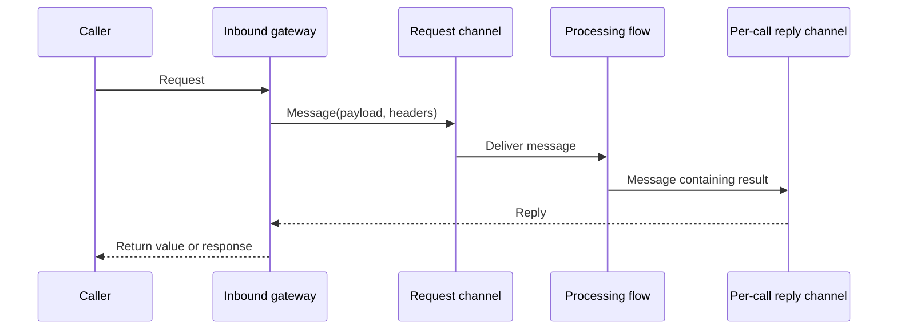

# Inbound Gateway

## Objectives

In the Messaging gateway chapter of the SPRING_INTEGRATION_CORE module, an inbound gateway is the entry point for a caller to send a request into a message flow and receive a result. This lesson connects `Message`, `MessageChannel`, endpoints, and Java DSL into a request–reply flow callable from Java or HTTP.

After this lesson, you can accurately identify the inbound direction, build a quote flow, explain the reply path, design timeouts, and recognize branches that cause the caller not to receive a result.

## 1. Understanding Inbound from the Integration System's Perspective

Take the Spring Integration flow as the reference point:

- **Inbound gateway** receives a request from outside the flow, puts the request onto a channel, and returns the flow's reply to the caller.
- **Outbound gateway** receives a message within the flow, calls an external system, and brings the result back into the flow.
- **Inbound channel adapter** brings data into the flow under a one-way contract; the flow does not have to produce a business reply for that send.

“Outside” can be a remote application or a Java service within the same application. It only needs to lie outside the message flow under consideration. A `@MessagingGateway` interface is an entry point via a Java method call; an HTTP inbound gateway is an entry point via the HTTP protocol. Both approaches can share the same processing channel.

| Scenario | Suitable choice | Result the caller needs |
| --- | --- | --- |
| A Java service asks for the price of a shopping cart | Interface-based messaging gateway | Quote object or error |
| A partner sends an HTTP request to calculate fees | HTTP inbound gateway | HTTP response carrying result or error |
| Application receives an event solely for later processing | Inbound channel adapter | No business result from the flow needed on send |
| Flow calls a shipping carrier's API | HTTP outbound gateway | API result to continue processing |

An HTTP adapter must still conclude the HTTP exchange with a protocol-level response. What distinguishes a gateway is that the business response is produced from the flow's reply. The [HTTP Namespace Support](https://docs.spring.io/spring-integration/reference/http/namespace.html) documentation describes these two contracts.

The gateway in this lesson also does not refer to an API management product like a reverse proxy. It is a component that adapts between the caller's interface and the messaging system.

## 2. Lifecycle of a Request



A single exchange has five steps:

1. The gateway converts Java parameters or a protocol request into a message.
2. The gateway sends the message to the request channel.
3. Transformers, routers, and endpoints process the payload.
4. The final endpoint creates a reply and sends it to the reply address.
5. The gateway converts the reply into the value required by the caller's contract.

With a Java gateway, the framework typically creates a temporary reply channel per call and places that address in the `replyChannel` header. Therefore, the basic example does not need a shared `quoteReplies` bean. This mechanism is presented in [Messaging Gateways — Setting the Default Reply Channel](https://docs.spring.io/spring-integration/reference/gateway.html#gateway-default-reply-channel).

Distinguish three kinds of information:

| Information | Role |
| --- | --- |
| Payload | Business data, such as item SKU and quantity |
| `replyChannel` | Return address of the ongoing exchange |
| Application-supplied `requestId` | Trace or business correlation ID |

`requestId` does not replace `replyChannel`. Nor does a correlation header by itself provide durable storage or guarantee exactly-once processing.

## 3. Java DSL Example: Quote Entry Point

The example uses Java 17 and the Spring Integration 6.5 API. The core part requires `org.springframework.integration:spring-integration-core`; the test part requires JUnit Jupiter and `spring-test`. Use a BOM or the project's dependency management mechanism to align Spring versions.

The classes are placed inside the same configuration class so the entire example can be followed in one place. In a real application, DTOs, the gateway interface, and the quote service can be separated into individual files.

### 3.1. Complete Configuration for the Java Entry Point

```java
package lesson.gateway;

import java.math.BigDecimal;
import java.util.Locale;

import org.springframework.context.annotation.Bean;
import org.springframework.context.annotation.Configuration;
import org.springframework.context.annotation.Import;
import org.springframework.integration.annotation.MessagingGateway;
import org.springframework.integration.channel.DirectChannel;
import org.springframework.integration.config.EnableIntegration;
import org.springframework.integration.dsl.IntegrationFlow;
import org.springframework.messaging.MessageChannel;
import org.springframework.messaging.handler.annotation.Header;
import org.springframework.messaging.handler.annotation.Payload;

@Configuration
@EnableIntegration
@Import(QuoteIntegrationConfig.QuoteGateway.class)
public class QuoteIntegrationConfig {

    public record QuoteRequest(String sku, int quantity) {
    }

    public record QuoteReply(
            String sku,
            int quantity,
            BigDecimal total,
            String currency) {
    }

    @MessagingGateway(
            defaultRequestChannel = "quoteRequests",
            defaultRequestTimeout = "200",
            defaultReplyTimeout = "1500")
    public interface QuoteGateway {

        QuoteReply quote(
                @Payload QuoteRequest request,
                @Header("requestId") String requestId);
    }

    @Bean
    public MessageChannel quoteRequests() {
        return new DirectChannel();
    }

    @Bean
    public IntegrationFlow quoteFlow() {
        return IntegrationFlow.from("quoteRequests")
                .transform(
                        QuoteRequest.class,
                        QuoteIntegrationConfig::normalize)
                .handle(
                        QuoteRequest.class,
                        (request, headers) -> calculate(request),
                        endpoint -> endpoint.requiresReply(true))
                .get();
    }

    private static QuoteRequest normalize(QuoteRequest request) {
        if (request.sku() == null || request.sku().isBlank()) {
            throw new IllegalArgumentException("sku must not be blank");
        }
        if (request.quantity() <= 0) {
            throw new IllegalArgumentException("quantity must be positive");
        }

        return new QuoteRequest(
                request.sku().trim().toUpperCase(Locale.ROOT),
                request.quantity());
    }

    private static QuoteReply calculate(QuoteRequest request) {
        if (!"BOOK-001".equals(request.sku())) {
            throw new IllegalArgumentException("unknown sku");
        }

        BigDecimal unitPrice = new BigDecimal("125000");
        BigDecimal total = unitPrice.multiply(
                BigDecimal.valueOf(request.quantity()));

        return new QuoteReply(
                request.sku(),
                request.quantity(),
                total,
                "VND");
    }
}
```

`@EnableIntegration` registers the integration infrastructure in a standalone Java configuration. `@Import` registers the gateway interface using a mechanism supported since Spring Integration 6.0. Another option is `@IntegrationComponentScan`, which scans the package containing the interface; standard `@ComponentScan` does not automatically create proxies for gateway interfaces. See [Messaging Gateways — @MessagingGateway Annotation](https://docs.spring.io/spring-integration/reference/6.5/gateway.html#messaging-gateway-annotation).

In this flow:

- The `QuoteRequest` parameter becomes the payload; `requestId` becomes a header.
- The transformer validates the input and normalizes the item SKU.
- The service activator calculates the price and returns a `QuoteReply`.
- The final endpoint has no explicit output channel, so it replies via `replyChannel`.
- `requiresReply(true)` causes an error immediately if this handler returns `null`.

How an endpoint determines where to send results and the meaning of `requiresReply` are explained in [Service Activator](https://docs.spring.io/spring-integration/reference/service-activator.html).

### 3.2. Calling the Gateway

You can use a standalone context to test the Java entry point; this approach does not start an HTTP server:

```java
package lesson.gateway;

import org.springframework.context.annotation.AnnotationConfigApplicationContext;

import lesson.gateway.QuoteIntegrationConfig.QuoteGateway;
import lesson.gateway.QuoteIntegrationConfig.QuoteReply;
import lesson.gateway.QuoteIntegrationConfig.QuoteRequest;

public class QuoteDemo {

    public static void main(String[] args) {
        try (var context = new AnnotationConfigApplicationContext(
                QuoteIntegrationConfig.class)) {

            QuoteGateway gateway = context.getBean(QuoteGateway.class);

            QuoteReply reply = gateway.quote(
                    new QuoteRequest(" book-001 ", 2),
                    "REQ-1001");

            if (reply == null) {
                throw new IllegalStateException("No quote reply received");
            }

            System.out.println(reply);
        }
    }
}
```

Expected output:

```text
QuoteReply[sku=BOOK-001, quantity=2, total=250000, currency=VND]
```

The caller depends only on the `QuoteGateway` contract. Normalization and pricing rules remain inside the flow. With the current configuration, `DirectChannel` processes on the sender's thread; using a gateway does not by itself make the calculation run asynchronously.

In the example, `requestId` illustrates attaching metadata to a message; the pricing algorithm does not use it yet. When logging is needed, an interceptor or handler can read this header.

## 4. Opening an Additional HTTP Entry Point for the Same Flow

A system can serve both internal Java services and HTTP partners:

```text
Java Service -> QuoteGateway --------+
                                     +-> quoteRequests -> quoteFlow
HTTP client -> HTTP inbound gateway -+
```

The HTTP inbound gateway sends directly into `quoteRequests`. It does not invoke `QuoteGateway` methods; timeouts and mappings for the two gateways are configured separately.

To use this part, add `spring-integration-http`, Spring MVC, a JSON converter, and a servlet environment. If using Spring Boot, a servlet web application with compatible dependency configuration is required. `AnnotationConfigApplicationContext` from the previous section is only sufficient for the Java example.

Below is the HTTP configuration class. An error flow accompanies the configuration so that error responses also have a clear contract.

```java
package lesson.gateway;

import java.util.Map;

import org.springframework.context.annotation.Bean;
import org.springframework.context.annotation.Configuration;
import org.springframework.context.annotation.Import;
import org.springframework.http.HttpMethod;
import org.springframework.http.HttpStatus;
import org.springframework.integration.MessageTimeoutException;
import org.springframework.integration.channel.DirectChannel;
import org.springframework.integration.dsl.IntegrationFlow;
import org.springframework.integration.http.HttpHeaders;
import org.springframework.integration.http.dsl.Http;
import org.springframework.messaging.MessageChannel;
import org.springframework.messaging.support.MessageBuilder;

import lesson.gateway.QuoteIntegrationConfig.QuoteRequest;

@Configuration
@Import(QuoteIntegrationConfig.class)
public class HttpQuoteConfig {

    @Bean
    public IntegrationFlow httpQuoteEntry() {
        return IntegrationFlow.from(
                        Http.inboundGateway("/integration/quotes")
                                .requestMapping(mapping -> mapping
                                        .methods(HttpMethod.POST)
                                        .consumes("application/json")
                                        .produces("application/json"))
                                .requestPayloadType(QuoteRequest.class)
                                .requestTimeout(200)
                                .replyTimeout(1500)
                                .errorOnTimeout(true)
                                .errorChannel("httpQuoteErrors"))
                .channel("quoteRequests")
                .get();
    }

    @Bean
    public MessageChannel httpQuoteErrors() {
        return new DirectChannel();
    }

    @Bean
    public IntegrationFlow httpQuoteErrorFlow() {
        return IntegrationFlow.from("httpQuoteErrors")
                .handle(Throwable.class, (failure, headers) -> {
                    HttpStatus status;
                    String code;

                    if (hasCause(failure, MessageTimeoutException.class)) {
                        status = HttpStatus.GATEWAY_TIMEOUT;
                        code = "QUOTE_TIMEOUT";
                    }
                    else if (hasCause(failure, IllegalArgumentException.class)) {
                        status = HttpStatus.BAD_REQUEST;
                        code = "INVALID_QUOTE_REQUEST";
                    }
                    else {
                        status = HttpStatus.INTERNAL_SERVER_ERROR;
                        code = "QUOTE_INTERNAL_ERROR";
                    }

                    return MessageBuilder
                            .withPayload(Map.of("code", code))
                            .setHeader(HttpHeaders.STATUS_CODE, status)
                            .build();
                }, endpoint -> endpoint.requiresReply(true))
                .get();
    }

    private static boolean hasCause(
            Throwable failure,
            Class<? extends Throwable> expectedType) {

        Throwable current = failure;
        while (current != null) {
            if (expectedType.isInstance(current)) {
                return true;
            }
            Throwable next = current.getCause();
            if (next == current) {
                break;
            }
            current = next;
        }
        return false;
    }
}
```

Placing `Http.inboundGateway(...)` at the start of a flow is illustrated in [Configuring HTTP Endpoints with Java](https://docs.spring.io/spring-integration/reference/http/java-config.html). Options such as `requestTimeout`, `replyTimeout`, and `errorOnTimeout` belong to [MessagingGatewaySpec](https://docs.spring.io/spring-integration/api/org/springframework/integration/dsl/MessagingGatewaySpec.html).

Once the web application is running, send a request:

```http
POST /integration/quotes HTTP/1.1
Host: localhost:8080
Content-Type: application/json
Accept: application/json

{"sku":" book-001 ","quantity":2}
```

Expected success response:

```http
HTTP/1.1 200 OK
Content-Type: application/json

{"sku":"BOOK-001","quantity":2,"total":250000,"currency":"VND"}
```

With a syntactically valid body where `quantity` is `0`, the example's validation error is converted by the error flow into:

```http
HTTP/1.1 400 Bad Request
Content-Type: application/json

{"code":"INVALID_QUOTE_REQUEST"}
```

The error codes above are a design decision of the example. Mismatched URLs, HTTP methods, or media types can be handled at the MVC layer before entering this flow. If a unified error format is required across the entire API, that handler layer must also be designed.

The gateway relies on `Content-Type` and converters to create `QuoteRequest`, then converts `QuoteReply` or the error payload into a response. JSON conversion does not replace business data validation. See [HTTP Inbound Components](https://docs.spring.io/spring-integration/reference/http/inbound.html).

## 5. Preserving the Reply Path Across the Flow

A flow may calculate the exact right price yet the caller still fails to receive it if the result is sent to the wrong place.

When handling messages manually outside the endpoint's header-propagation mechanism, preserve the required headers:

```java
Message<QuoteReply> reply = MessageBuilder
        .withPayload(calculatedQuote)
        .copyHeaders(requestMessage.getHeaders())
        .build();
```

This snippet illustrates preserving metadata when `requestMessage` and `calculatedQuote` are already available; it does not need to be added to the quote flow above. The builder manages read-only headers such as `id` according to Spring Messaging rules.

For endpoints returning regular payloads in Java DSL, the framework handles message creation and header propagation. When writing a custom `MessageHandler` and calling `send` yourself, you must manage the reply path.

Several scenarios to review:

| Change in the flow | Consequence to check |
| --- | --- |
| Final endpoint has an explicit output channel | Result goes to that channel first; there must be a path continuing back to the gateway |
| Custom handler creates a new message and sends it manually | May lose the reply address |
| Result is sent to `nullChannel` | Request–reply caller receives no result |
| Splits into multiple branches that each produce a reply | Needs a rule to select or aggregate results before replying |

If messages must be persisted long-term or sent across a broker, an in-memory temporary reply address is not a cross-process correlation contract. For remote exchanges, design a request ID, reply destination, expiration, and storage mechanism according to the protocol.

## 6. What Do Timeouts Limit?

In this lesson, all timeout values are in milliseconds and set explicitly.

| Setting | Primary limit | Example |
| --- | --- | --- |
| `requestTimeout` | Wait time to send a message when the channel supports blocking sends | A capacity-bounded queue is full |
| `replyTimeout` | Time the gateway waits to receive a reply after completing the send or handoff | Another worker has not returned a result yet |
| Timeout of HTTP client, database, or other service | Wait time for a specific I/O operation | Quote query to a partner system |

[HTTP Timeout Handling](https://docs.spring.io/spring-integration/reference/http/timeout.html) distinguishes channel timeouts from timeouts when calling a remote HTTP system. Do not use a single global number to replace every deadline in the system.

### 6.1. DirectChannel Does Not Create an Asynchronous Boundary

Consider a hypothetical scenario where the quote handler takes 10 seconds while `replyTimeout` is 1.5 seconds. If the entire flow runs synchronously over a `DirectChannel`, the call remains inside the handler. `replyTimeout` has no capability to interrupt the handler after 1.5 seconds.

If an `ExecutorChannel` is inserted with an executor running tasks on another thread, the gateway can wait for a reply after handing off the task. Upon timeout, the worker may still continue processing. This is a consequence that must be accounted for when designing task cancellation or retries.

For the example's Java gateway, failing to receive a reply before the deadline can result in `null`. Since Spring Integration 6.2, the gateway annotation provides the `errorOnTimeout` option to throw a timeout exception instead of returning `null`. This behavior and when the reply wait begins are described in [Gateway Behavior When No Response Arrives](https://docs.spring.io/spring-integration/reference/6.5/gateway.html#gateway-no-response).

### 6.2. QueueChannel Needs a Consumer

`QueueChannel` buffers messages waiting to be received; a successful send does not prove business processing has finished. When an endpoint reads from this channel, a poller must be configured. Queue capacity also determines when the sender must wait.

`ExecutorChannel` hands off processing via an executor, whereas `DirectChannel` invokes subscribers on the sending thread. Choosing a channel type is an execution-model decision, not merely changing a bean name. See [Message Channel Implementations](https://docs.spring.io/spring-integration/reference/channel/implementations.html).

### 6.3. Timeout Does Not Prove Business Failure

Suppose an order placement gateway times out, yet the worker just succeeded in recording the order. If the caller resends, the system could create two orders.

An appropriate design requires:

- An idempotency key tied to the business operation.
- Rules to detect duplicate requests and return the already-recorded result.
- Handling for late-arriving replies.
- Time budgets for downstream service calls.

These are requirements of the hypothetical ordering scenario, not capabilities added automatically merely by declaring a gateway.

## 7. Do Not Let a Branch Silently Drop a Reply

When extending the quote flow, examine the outcome of every path.

| Component | Reply-loss scenario | Design for a request–reply entry point |
| --- | --- | --- |
| Filter | Drops the request and ends without returning a result | Return a rejection result or throw an explicit exception |
| Router | No matching branch, or the selected branch only logs | Provide a meaningful default path or configure an error when unresolvable |
| Service activator | Returns `null` or `void` | Return a result; enable `requiresReply` when mandatory |
| Aggregator | Missing messages prevent the group from releasing | Set completion conditions and a group timeout policy |
| Error flow | Only logs | If the caller expects a response, the error flow must also produce a reply or throw an error |

For example, using a filter to silently discard unknown SKUs will force the caller to wait until timeout. For a quote API, immediately returning an “unknown SKU” error during validation is usually an easier contract to consume.

If a process takes minutes, the entry point can be designed to return only an acceptance ID alongside a status-lookup API. In that case, “accepted” is the result of the current call; the final processing result belongs to a separate exchange.

## 8. Error Handling at the Gateway Boundary

Two error paths must be distinguished:

- With a synchronous flow, exceptions can unwind back up the call stack. The Java gateway propagates errors to the caller according to its exception handling rules.
- Across an asynchronous boundary, exceptions cannot automatically jump back to the old call stack. Spring Integration's infrastructure has a mechanism to create an `ErrorMessage` and route errors.

In the asynchronous infrastructure's error-publishing mechanism, the `errorChannel` header takes precedence over the global channel of the same name. However, having a global `errorChannel` bean does not mean all synchronous exceptions are automatically routed there. [Error Handling](https://docs.spring.io/spring-integration/reference/6.5/error-handling.html) explains this boundary.

The HTTP configuration in this lesson attaches a dedicated `httpQuoteErrors` channel to the HTTP entry point. The error flow converts the error into a JSON-serializable payload and sets the HTTP status header. It does not return raw stack traces to the client.

When adding error handling for a Java gateway, the returned payload must conform to the `QuoteReply` type, or you must change the contract to a result type capable of representing both success and failure. Returning an error message string to a method expecting `QuoteReply` will introduce an additional type-conversion error.

Logging, retrying, or sending errors to a monitoring channel can still be done, but it must be clear which operation is responsible for concluding the waiting exchange.

## 9. Testing the Entry Point Contract

Do not test only the multiplication inside the service; invoke the gateway itself to verify the proxy, payload mapping, endpoint chain, and return path.

Place the following illustrative class in the test sources, using the same version-managed Spring dependencies:

```java
package lesson.gateway;

import java.math.BigDecimal;

import org.junit.jupiter.api.Test;
import org.springframework.beans.factory.annotation.Autowired;
import org.springframework.test.context.junit.jupiter.SpringJUnitConfig;

import lesson.gateway.QuoteIntegrationConfig.QuoteGateway;
import lesson.gateway.QuoteIntegrationConfig.QuoteReply;
import lesson.gateway.QuoteIntegrationConfig.QuoteRequest;

import static org.junit.jupiter.api.Assertions.assertEquals;
import static org.junit.jupiter.api.Assertions.assertNotNull;
import static org.junit.jupiter.api.Assertions.assertThrows;

@SpringJUnitConfig(QuoteIntegrationConfig.class)
class QuoteGatewayTest {

    @Autowired
    QuoteGateway gateway;

    @Test
    void normalizesSkuAndReturnsQuote() {
        QuoteReply reply = gateway.quote(
                new QuoteRequest(" book-001 ", 2),
                "REQ-TEST-1");

        assertNotNull(reply);
        assertEquals("BOOK-001", reply.sku());
        assertEquals(2, reply.quantity());
        assertEquals(new BigDecimal("250000"), reply.total());
        assertEquals("VND", reply.currency());
    }

    @Test
    void propagatesInvalidQuantity() {
        assertThrows(IllegalArgumentException.class, () ->
                gateway.quote(
                        new QuoteRequest("BOOK-001", 0),
                        "REQ-TEST-2"));
    }

    @Test
    void rejectsUnknownSku() {
        assertThrows(IllegalArgumentException.class, () ->
                gateway.quote(
                        new QuoteRequest("UNKNOWN", 1),
                        "REQ-TEST-3"));
    }
}
```

The three tests above target the core configuration and do not start a web server. To test the HTTP entry point, use an MVC context with `MockMvc` or a test web application. Spring Integration lists these tools in [Testing Support](https://docs.spring.io/spring-integration/reference/testing.html).

Cases to add when extending the example:

| Case | What to assert |
| --- | --- |
| Valid HTTP request | Status, media type, and quote JSON are correct |
| Invalid HTTP quantity | `400` and the designated error code |
| Async handler produces no reply | Timeout behavior matches the contract |
| Two concurrent requests | Each caller receives its own correct quote |
| Trace ID passes through transformer | Required header is preserved |
| Error flow | Produces a final response, not merely logs |

When testing timeouts, use a controllable worker coordination mechanism and bounded test timing. Avoid asserting that a flow with only `DirectChannel` gets interrupted at `replyTimeout`.

## 10. Diagnosing Common Failures

| Symptom | First thing to check |
| --- | --- |
| Cannot inject gateway interface | Was the interface `@Import`-ed or scanned with `@IntegrationComponentScan`? |
| Request channel has no subscribers | Was the flow registered and started, and is the channel name exact? |
| Caller receives `null` | Did a branch produce no reply, or did the wait time expire? |
| Calculation finishes but caller keeps waiting | Which channel did the reply go to, and was the reply address lost? |
| Increasing `replyTimeout` still does not fix hangs | Is the handler blocking on the same thread? |
| HTTP JSON does not deserialize into DTO | Do `Content-Type`, payload type, and converter match? |
| Error flow logged but caller is still waiting | Does the error flow return a valid payload? |
| Fails only under concurrent requests | Is shared mutable state or an incorrect manual reply address being used? |

When tracing a request, start from the trace ID, the payload at the entry point, and the final endpoint that actually receives the message. Then inspect the reply path and error path. This tracing approach separates business bugs from message-routing bugs.

## 11. Practice Exercise

Extend the quote example in sequence:

1. Add SKU `PEN-001` with unit price `10000` VND; verify both SKUs produce accurate results.
2. Use a router to branch by SKU, ensuring unsupported SKUs still terminate with a clear error.
3. Add `customerTier` metadata and record it before the pricing endpoint.
4. Create a variant with an asynchronous worker to observe timeouts and late replies.
5. Add a branch checking multiple price sources; return a reply only after selecting a price according to business rules.

The completion criterion is that each entry point has a clear contract for accepted data, returned data, errors, and wait timeouts. Every branch of the flow must lead to an outcome consistent with that contract.