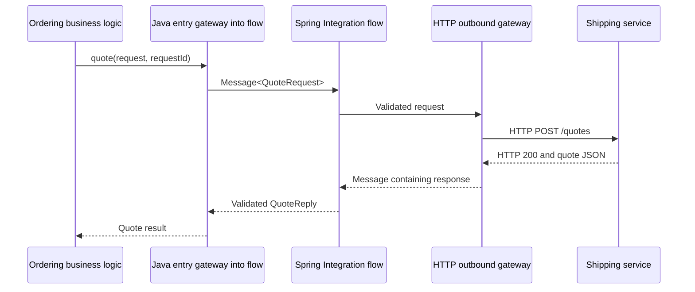

# Outbound Gateway

## 1. Objectives and Scope

In the **Messaging gateway** chapter of the **SPRING_INTEGRATION_CORE** module, this lesson explains how a message flow proactively calls an external system and brings the result back into the flow. This step connects concepts of `Message`, `MessageChannel`, endpoints, and Java DSL with a practical integration scenario: querying a shipping service for a quote before continuing order processing.

After this lesson, you can:

- Identify an outbound gateway from the direction of request initiation.
- Distinguish between an outbound gateway, an outbound channel adapter, and a gateway created with `@MessagingGateway`.
- Design the request–reply contract, reply path, and required headers.
- Configure an HTTP outbound gateway using Java DSL.
- Distinguish channel timeouts, network timeouts, and result wait times.
- Design error handling, bounded retries, and testing at the HTTP boundary.

The Java examples use **Java 17 or higher, Spring Integration 6.5.x, and Spring Framework 6.2.x**. This is the API baseline for the code snippets below; it is not a requirement to upgrade or downgrade a project's version. In Spring Integration 7.1 and later, the HTTP DSL has `RestClient`-based configuration and `RestTemplate`-based configuration is marked deprecated. When applying this lesson to that branch, switch the HTTP client and corresponding test utilities. [Configuring HTTP with Java](https://docs.spring.io/spring-integration/reference/http/java-config.html)

## 2. What Is an Outbound Gateway?

**An outbound gateway is an endpoint that receives a request from a messaging flow, performs an operation with a service or resource outside the flow, and then produces a reply message so the flow can continue processing.**

The “outbound” direction is evaluated at the messaging application boundary: this application initiates the request. The reply entering the application does not turn the endpoint into an inbound gateway. The defining characteristic is a two-way exchange initiated proactively by the flow. The invoked resource can be an HTTP API, a JMS system, an SFTP server, or a database; it does not have to be another microservice. [Integration Endpoint Classification](https://docs.spring.io/spring-integration/reference/6.5/endpoint-summary.html)

For example, when a customer chooses a delivery address:

1. The flow receives the order information.
2. The outbound gateway sends a quote request to the shipping partner.
3. The partner returns the amount and currency.
4. The flow validates the result, then returns the quote to the ordering business logic.



The diagram depicts the logical path. Whether the steps run on the same thread or across multiple threads is a separate configuration choice.

## 3. Distinguishing Similarly Named Components

| Component | Role at the messaging boundary | Result for the flow |
|---|---|---|
| Inbound channel adapter | Brings data into the flow one-way | Does not provide a reply cycle back to the data producer |
| Outbound channel adapter | Sends data or executes an external action one-way | Does not emit a business result as a reply for further processing |
| Inbound gateway | Receives an externally initiated request, passes it into the flow, and returns a result to the caller | Request goes in, reply goes out |
| Outbound gateway | Receives a request from the flow, calls an external resource, and brings the result back into the flow | Request goes out, reply comes back |

This table applies Spring Integration's endpoint classification. An HTTP outbound channel adapter still handles a protocol-level response; “one-way” here refers to the flow's contract, not that HTTP has no response. [Endpoint quick reference](https://docs.spring.io/spring-integration/reference/6.5/endpoint-summary.html)

### 3.1. `@MessagingGateway` Does Not Automatically Create an HTTP Outbound Gateway

The interface below creates a Java-style entry point into the messaging system:

```java
@MessagingGateway(defaultRequestChannel = "shipping.quote.requests")
public interface ShippingQuoteGateway {
    QuoteReply quote(QuoteRequest request);
}
```

When business code calls `quote(...)`, the proxy converts the arguments into a message and sends it to the channel. This interface does not declare a URL, HTTP method, or HTTP client; by itself it performs no HTTP call.

In a design that has both an interface gateway and an HTTP outbound gateway, the two components sit at different positions:

```text
Java caller
    -> @MessagingGateway
    -> request channel
    -> HTTP outbound gateway
    -> external service
    -> reply processing in flow
    -> Java caller
```

`@MessagingGateway` hides the messaging API from the Java caller. The gateway automatically manages the temporary reply path for calls requiring a result. [Messaging Gateways](https://docs.spring.io/spring-integration/reference/6.5/gateway.html)

### 3.2. `.gateway(...)` in Java DSL Can Simply Call an Internal Flow

Example:

```java
.gateway("address.validation.requests")
```

This operator sends a request to the input of another endpoint or flow and waits for a reply. It does not by itself choose HTTP, JMS, or any external protocol. To call HTTP, there must be an HTTP endpoint in the invoked branch or `.handle(Http.outboundGateway(...))` used at the appropriate position. [The gateway operator in Java DSL](https://docs.spring.io/spring-integration/docs/6.1.x/reference/html/dsl.html#java-dsl-gateway)

## 4. Request–Reply Contract and Reply Path

Before writing DSL, describe the contract in terms of data and expected outcomes.

| Question | Quote example contract |
|---|---|
| What is the input data? | Order ID, destination, weight |
| What does success return? | Order ID, non-negative amount, three-letter currency code |
| Is an HTTP response without a body valid? | No, because business logic requires a concrete quote |
| How are HTTP 4xx or 5xx represented? | Call failure; not converted into a fallback quote result |
| Is it retried automatically? | The basic example does not retry |
| What is used for tracing? | Caller-provided `X-Request-Id` |

### 4.1. Protocol Payload vs. Business Payload

The HTTP client can deserialize JSON into `QuoteReply`. However, the flow still needs to verify business semantics: does a body exist, is the amount valid, is the currency properly formatted?

`expectedResponseType(QuoteReply.class)` specifies the type to decode from the HTTP response body; it does not replace business validation rules.

In the example, configuring `extractResponseBody(false)` preserves the full `ResponseEntity` as the reply message payload. The subsequent transformer step inspects the status and body to return an explicit `QuoteReply`. For an HTTP response with no body, the gateway can return a `ResponseEntity` payload even when an expected body type is set; therefore, never assume every response payload is a DTO. [HTTP outbound components](https://docs.spring.io/spring-integration/reference/6.5/http/outbound.html)

### 4.2. Where Does the Reply Go?

For handlers that produce a reply, an explicit output channel configuration is used to emit the result. If no output channel is configured, the reply mechanism can use the request message's `replyChannel` header.

In a DSL chain, the next step is where the previous step's output goes. At the end of the example flow, the transformer creates the DTO and the reply returns to the temporary channel that the Java gateway placed on the message. Therefore, there is no need to create a shared reply `QueueChannel` just to return to the interface gateway. [Gateway reply path](https://docs.spring.io/spring-integration/reference/6.5/gateway.html#gateway-default-reply-channel)

When manually rebuilding a message, preserve relevant control headers:

```java
Message<?> next = MessageBuilder.fromMessage(original)
        .setPayload(normalizedPayload)
        .build();
```

This illustrates the principle of message construction, with `original` and `normalizedPayload` supplied by the processing step. If you use `MessageBuilder.withPayload(...)` to create a new message and drop all old headers, the flow can lose the reply path.

Do not send a Java channel object over HTTP or a broker as business data. An in-JVM reply path and an external protocol's correlation identifier are two mechanisms that must be configured properly at each boundary.

## 5. Complete Example: Calling a Quote Service Over HTTP

### 5.1. Dependencies and Runtime Prerequisites

The snippets below belong to the same package `example.shipping`, with each public type in its corresponding Java file. The project needs a BOM managing versions compatible with the Spring Integration 6.5.x / Spring Framework 6.2.x baseline stated at the start of the lesson.

In a Spring Boot project with an appropriate BOM, the relevant dependencies are:

```xml
<dependencies>
    <dependency>
        <groupId>org.springframework.boot</groupId>
        <artifactId>spring-boot-starter-integration</artifactId>
    </dependency>
    <dependency>
        <groupId>org.springframework.integration</groupId>
        <artifactId>spring-integration-http</artifactId>
    </dependency>
    <dependency>
        <groupId>org.springframework.boot</groupId>
        <artifactId>spring-boot-starter-json</artifactId>
    </dependency>
    <dependency>
        <groupId>org.springframework.boot</groupId>
        <artifactId>spring-boot-starter-test</artifactId>
        <scope>test</scope>
    </dependency>
</dependencies>
```

This is a dependency snippet to integrate into a project, not a standalone `pom.xml`. Jackson on the classpath provides the JSON converter for `RestTemplate`.

The shipping service in the example has the contract:

```http
POST /quotes
Content-Type: application/json
X-Request-Id: req-order-1001

{
  "orderId": "ORDER-1001",
  "destination": "700000",
  "weightKg": 1.5
}
```

Success response:

```http
HTTP/1.1 200 OK
Content-Type: application/json

{
  "orderId": "ORDER-1001",
  "amount": 35000,
  "currency": "VND"
}
```

The default URL in the configuration is `http://localhost:8091/quotes`, intended for a mock service or local development service. For real calls, pass the `shipping.quote.url` property via application environment configuration.

### 5.2. Business Data

`QuoteRequest.java`:

```java
package example.shipping;

import java.math.BigDecimal;

public record QuoteRequest(
        String orderId,
        String destination,
        BigDecimal weightKg) {
}
```

`QuoteReply.java`:

```java
package example.shipping;

import java.math.BigDecimal;

public record QuoteReply(
        String orderId,
        BigDecimal amount,
        String currency) {
}
```

### 5.3. Interface for the Java Caller

`ShippingQuoteGateway.java`:

```java
package example.shipping;

import org.springframework.integration.annotation.MessagingGateway;
import org.springframework.messaging.handler.annotation.Header;

@MessagingGateway(
        name = "shippingQuoteGateway",
        defaultRequestChannel = "shipping.quote.requests",
        defaultRequestTimeout = "500",
        defaultReplyTimeout = "4000",
        errorOnTimeout = true)
public interface ShippingQuoteGateway {

    QuoteReply quote(
            QuoteRequest request,
            @Header("X-Request-Id") String requestId);
}
```

The `request` argument becomes the payload; `requestId` is mapped into a header. `errorOnTimeout = true` requests throwing an error when the reply wait time expires instead of returning `null`. This attribute has been available since Spring Integration 6.2. It does not turn `defaultReplyTimeout` into an HTTP execution time limit. [MessagingGateway API](https://docs.spring.io/spring-integration/docs/6.4.2/api/org/springframework/integration/annotation/MessagingGateway.html)

### 5.4. Configuring Channel, HTTP Client, and IntegrationFlow

`ShippingIntegrationConfig.java`:

```java
package example.shipping;

import org.springframework.beans.factory.annotation.Qualifier;
import org.springframework.context.annotation.Bean;
import org.springframework.context.annotation.Configuration;
import org.springframework.core.env.Environment;
import org.springframework.http.HttpHeaders;
import org.springframework.http.HttpMethod;
import org.springframework.http.MediaType;
import org.springframework.http.ResponseEntity;
import org.springframework.http.client.SimpleClientHttpRequestFactory;
import org.springframework.integration.channel.DirectChannel;
import org.springframework.integration.config.EnableIntegration;
import org.springframework.integration.annotation.IntegrationComponentScan;
import org.springframework.integration.dsl.IntegrationFlow;
import org.springframework.integration.http.dsl.Http;
import org.springframework.web.client.RestTemplate;

@Configuration
@EnableIntegration
@IntegrationComponentScan(basePackageClasses = ShippingQuoteGateway.class)
public class ShippingIntegrationConfig {

    @Bean(name = "shipping.quote.requests")
    public DirectChannel shippingQuoteRequests() {
        return new DirectChannel();
    }

    @Bean
    public RestTemplate shippingRestTemplate() {
        SimpleClientHttpRequestFactory requestFactory =
                new SimpleClientHttpRequestFactory();

        requestFactory.setConnectTimeout(1000);
        requestFactory.setReadTimeout(2000);

        return new RestTemplate(requestFactory);
    }

    @Bean
    public IntegrationFlow shippingQuoteFlow(
            @Qualifier("shippingRestTemplate") RestTemplate restTemplate,
            Environment environment) {

        String url = environment.getProperty(
                "shipping.quote.url",
                "http://localhost:8091/quotes");

        return IntegrationFlow.from("shipping.quote.requests")
                .filter(
                        QuoteRequest.class,
                        ShippingIntegrationConfig::validRequest,
                        endpoint -> endpoint.throwExceptionOnRejection(true))
                .enrichHeaders(headers -> headers
                        .header(
                                HttpHeaders.CONTENT_TYPE,
                                MediaType.APPLICATION_JSON_VALUE)
                        .header(
                                HttpHeaders.ACCEPT,
                                MediaType.APPLICATION_JSON_VALUE))
                .handle(
                        Http.outboundGateway(url, restTemplate)
                                .httpMethod(HttpMethod.POST)
                                .expectedResponseType(QuoteReply.class)
                                .extractResponseBody(false)
                                .mappedRequestHeaders(
                                        "Content-Type",
                                        "Accept",
                                        "X-Request-Id"),
                        endpoint -> endpoint.id("shippingHttpEndpoint"))
                .<ResponseEntity<?>, QuoteReply>transform(
                        ShippingIntegrationConfig::requireQuote)
                .get();
    }

    private static boolean validRequest(QuoteRequest request) {
        return request.orderId() != null
                && !request.orderId().isBlank()
                && request.destination() != null
                && !request.destination().isBlank()
                && request.weightKg() != null
                && request.weightKg().signum() > 0;
    }

    private static QuoteReply requireQuote(ResponseEntity<?> response) {
        if (!response.getStatusCode().is2xxSuccessful()) {
            throw new IllegalStateException(
                    "Unexpected quote status: " + response.getStatusCode());
        }

        if (!(response.getBody() instanceof QuoteReply quote)) {
            throw new IllegalStateException(
                    "Quote response must contain a QuoteReply body");
        }

        if (quote.orderId() == null
                || quote.orderId().isBlank()
                || quote.amount() == null
                || quote.amount().signum() < 0
                || quote.currency() == null
                || !quote.currency().matches("[A-Z]{3}")) {
            throw new IllegalStateException("Invalid quote response");
        }

        return quote;
    }
}
```

The HTTP outbound gateway is attached to the flow via `.handle(Http.outboundGateway(...))`. This declaration connects the HTTP endpoint with standard messaging steps. [HTTP outbound gateway with Java DSL](https://docs.spring.io/spring-integration/reference/6.5/http/java-config.html)

Several decisions in the configuration are intentional:

- `IntegrationComponentScan` discovers `@MessagingGateway` interfaces; `EnableIntegration` enables Spring Integration infrastructure.
- The filter rejects invalid input with an exception. If it merely discards the request without producing a result or error, the request–reply caller may have to wait until timeout.
- The header enricher sets the JSON content type and accepted media type.
- The HTTP gateway retains `ResponseEntity` so the next step uniformly checks both responses with a body and responses without a body.
- The transformer produces the final DTO or throws an exception; it does not return `null`.
- The example checks the shape of the response, though it does not yet cross-check the returned `orderId` against the original `orderId`. If the partner contract risks returning the wrong order, keep the original order ID in an internal header and add a verification step before returning the result.

### 5.5. Calling from the Business Layer

The following snippet runs inside a bean that has `ShippingQuoteGateway` injected:

```java
QuoteReply reply = shippingQuoteGateway.quote(
        new QuoteRequest(
                "ORDER-1001",
                "700000",
                new BigDecimal("1.5")),
        "req-order-1001");
```

The business layer receives `QuoteReply` without directly invoking `MessageChannel` or `RestTemplate`. The integration layer is responsible for protocol conversion, response validation, and deciding how errors are represented.

## 6. Header Mapping and Correlation

There are three distinct groups of information in the example:

| Group | Example | Scope |
|---|---|---|
| Business data | `orderId`, `weightKg`, `amount` | Request and response body |
| Selected transport headers | `Content-Type`, `Accept`, `X-Request-Id` | HTTP |
| Internal control headers | `replyChannel`, `errorChannel` | In-application messaging flow |

`mappedRequestHeaders(...)` sets the set of headers mapped out to HTTP. Configuring explicit names replaces the default mapping behavior, so include any standard headers you still want to send. Custom headers like `X-Request-Id` must be explicitly configured; do not assume all internal headers are automatically sent over the network. [HTTP header mappings](https://docs.spring.io/spring-integration/reference/6.5/http/header-mapping.html)

`X-Request-Id` in this lesson serves tracing. The mock service does not need to echo this header for the HTTP call to return the right response: the HTTP client inherently associates the response with the in-flight request.

With broker-based protocols, correlation can be an essential part of selecting the right reply. A JMS outbound gateway sends a message to a request destination and receives a reply from a configured reply destination or a temporary destination. Depending on the strategy, `JMSReplyTo`, `JMSCorrelationID`, or a correlation key must be agreed upon by both sides. Do not copy HTTP configuration directly over to JMS. [JMS request–reply](https://docs.spring.io/spring-integration/reference/6.5/jms.html)

If the system calls multiple partners, standardize business identifiers and trace identifiers at the start of the flow. Expose externally only the information required by the partner contract.

## 7. Timeouts: Pinpoint Exactly Where Waiting Happens

An outbound operation often has multiple independent waiting points. Similar property names do not mean they bound the same duration.

| Waiting point | Related setting | Meaning |
|---|---|---|
| Putting request onto channel | `defaultRequestTimeout` on Java gateway | Send wait time when the channel can block |
| Establishing HTTP connection | Connect timeout on HTTP request factory | Limits the connection phase per client capabilities |
| Reading HTTP response | Read timeout on HTTP request factory | Limits read/data-wait operations per client |
| Acquiring connection from pool | Pooled HTTP client configuration | Waits for a connection resource before sending the request |
| Emitting reply to output channel | `sendTimeout` on handler; XML HTTP uses `reply-timeout` | Waits to send reply if output channel can block |
| Waiting for reply at Java gateway | `defaultReplyTimeout` | Waits for the result on the reply path after sending the request |

Specifically, `reply-timeout` on the **HTTP outbound gateway in XML** maps to the send timeout for putting the reply message onto the channel, not the time spent waiting for the remote HTTP server to respond. Network timeouts must be configured on the HTTP client or request factory. [HTTP timeout handling](https://docs.spring.io/spring-integration/reference/6.5/http/timeout.html)

### 7.1. Why `defaultReplyTimeout = "4000"` Does Not Guarantee the Call Finishes in 4 Seconds

In the example, `DirectChannel` invokes the handler on the sender's thread. That thread may be executing HTTP before the Java gateway even returns to the reply-waiting step. If the HTTP client hangs, the gateway's reply wait timeout does not interrupt the running HTTP code.

For that reason, the example explicitly sets a 1,000 ms connect timeout and a 2,000 ms read timeout. Nor do these values by themselves form an absolute deadline for the entire call: DNS, TLS, multiple reads, client mechanics, and retries can affect total duration.

If the flow hands work off to another thread, the Java gateway can time out waiting for a reply while background work continues. A caller-side timeout does not equate to successfully canceling the external operation. [Gateway timeout behavior](https://docs.spring.io/spring-integration/reference/6.5/gateway.html#gateway-no-response)

### 7.2. Designing a Time Budget

One planning approach is to estimate:

```text
End-to-end duration
    ≈ queue wait time
      + sum of call durations
      + sum of backoff durations
      + internal processing time
```

This is a budgeting formula, not a framework execution guarantee.

For example, if the business can only wait about 5 seconds, then three attempts each potentially taking several seconds already exceed the budget before counting backoff. Network timeouts, retry counts, and reply wait times must be chosen under a single budget.

For strict deadlines, you also need to design deadline propagation, appropriate client time limits, and a policy for work still running after timeout. Simply increasing `defaultReplyTimeout` only makes the caller wait longer.

## 8. Error Handling Must Preserve the Reply Contract

### 8.1. Classifying Errors by Origin

| Error category | Example | Perspective from the quote contract |
|---|---|---|
| Input | Weight is 0, missing destination | Reject before calling the partner |
| Connection or transport | Cannot connect, read error | No reliable quote available |
| HTTP status | `400`, `429`, `503` | Classify according to partner contract and policy |
| Decoding | Malformed JSON, wrong types | Data contract violation |
| Business content | Negative amount, missing currency | Do not return that data as a valid quote |
| Messaging path | No consumer, reply channel not found | Topology or flow configuration error |

With `RestTemplate` and its default error handler, 4xx and 5xx HTTP statuses are turned into exceptions. Therefore, do not expect a router downstream of the gateway to receive every status as a normal response. To let certain statuses continue as data, explicitly customize the error handler and redefine the result-normalization step. [DefaultResponseErrorHandler](https://docs.spring.io/spring-framework/docs/6.2.x/javadoc-api/org/springframework/web/client/DefaultResponseErrorHandler.html)

In the example, `503` raises an error at the HTTP gateway. Meanwhile, `204` is an HTTP-level success status without a quote; the `requireQuote(...)` transformer rejects that result per the business contract.

### 8.2. Synchronous Errors vs. Channel-Routed Errors

When executing on the same thread, exceptions can propagate back up the call stack to the caller. With `QueueChannel` or `ExecutorChannel`, the original sender and the executor may run on different threads; the asynchronous component's mechanism can wrap the error into an `ErrorMessage`.

When the framework publishes errors through that mechanism, the message's `errorChannel` header takes precedence, followed by the shared `errorChannel` bean. Merely adding this header does not make every synchronous `send(...)` automatically convert exceptions into error messages. [Error Handling](https://docs.spring.io/spring-integration/reference/6.5/error-handling.html)

In a request–reply flow, there are two common strategies:

1. **Propagate the error to the caller:** treat the error as a failed operation outcome for the business layer to decide.
2. **Convert the error into a typed result:** return a data type capable of representing both success and failure, such as `QuoteOutcome`.

If you choose the second strategy, update the gateway signature accordingly. Do not return an error description string to a method declaring `QuoteReply`.

An error flow that only logs and terminates can lose the result the caller is waiting for. When providing a fallback, the error flow must produce a compatible reply and preserve the reply path. At the same time, distinguish real quotes from fallback data in the business contract.

### 8.3. No Reply vs. Reply Without a Body Are Two Different Scenarios

- **No reply:** a component fails to produce an output message, or the reply does not arrive before timeout.
- **HTTP reply without a body:** a protocol response was received, such as `204`; the HTTP gateway can represent it as a `ResponseEntity`.

`requiresReply` governs whether a handler fails to produce a result; it does not validate that a DTO has all fields or a valid amount. Likewise, `errorOnTimeout` on the Java gateway only handles reply wait expiration, not body validation.

For endpoints or service activators that may return `null`, consider configuring `requiresReply` appropriately to turn missing results into an explicit error. Check the default behavior on the exact endpoint type and version in use rather than inferring it from the name “gateway”.

## 9. Retries and Safe Repeatability

Retries make sense when transient failures are likely to clear and the operation can be repeated without unintended side effects. The basic quote example does not configure retries so the behavior of each call stays clear.

Spring Integration provides `RequestHandlerRetryAdvice` backed by Spring Retry; you can attach the advice to an outbound endpoint via `endpoint.advice(...)`. Scope retries narrowly to the operation that needs retrying, rather than accidentally re-running an entire flow segment with multiple side effects. [Retry advice](https://docs.spring.io/spring-integration/reference/6.5/handler-advice/classes.html#retry-advice)

Before adding retries, decide:

| Decision | Applied to the quote example |
|---|---|
| Which errors are retried? | Certain connection errors or `503` per partner contract |
| Which errors stop immediately? | Invalid input, authentication failure, schema violation in response |
| How many attempts? | A small cap fitting the time budget |
| How long to wait? | Bounded backoff; avoid many callers piling up at the same instant |
| What happens when attempts are exhausted? | Propagate the error or return a typed failure result |
| Is repeating safe? | Verify the quote API does not create unintended billable transactions |

Do not infer that a `POST` request is safe to retry solely from the business name “quote”. Some partners record a transaction or charge per call.

A scenario requiring special attention: the server processed successfully, but the response was lost. The client sees a timeout and does not know the final outcome. For payments or shipment creation, you typically need an idempotency key supported by the receiver, persisted state, or result lookup.

**A `Request ID` for tracing does not by itself create idempotency.** Both sides must agree on the meaning of the idempotency key and how duplicate keys are handled.

Circuit breakers, concurrency limits, and retries solve different problems. During a prolonged partner outage, increasing retry counts can increase queue depth and waiting threads.

## 10. Threads, Pollers, and Load Capacity

An outbound gateway does not by default imply an asynchronous task. How the endpoint receives messages and how the protocol client performs I/O determine which thread must wait.

| Channel before endpoint | How the endpoint is triggered | Consequence to consider |
|---|---|---|
| `DirectChannel` | Consumer is invoked directly | Caller may wait for both HTTP and subsequent steps |
| `ExecutorChannel` | Work is handed off to an executor | Worker performs blocking I/O; executor must be bounded |
| `QueueChannel` | Consumer pulls messages via a poller | Introduces queue wait time and requires poller configuration |

An endpoint consuming messages from a `QueueChannel` needs a polling mechanism. If the example's input channel is replaced with a queue, the first endpoint pulling from the queue is the **filter**, so the poller must be configured on that consuming endpoint or via an appropriate default poller. Placing a poller on the HTTP handler after the filter does not solve an unpolled input queue. [Message channel configuration](https://docs.spring.io/spring-integration/reference/6.5/channel/configuration.html)

Moving a synchronous HTTP client onto an `ExecutorChannel` decouples the caller thread from the worker executing the call; the worker still blocks on I/O. Queue capacity, worker count, and connection limits must be sized to match partner capacity.

A planning estimate is:

```text
Average in-flight tasks
    ≈ requests per second × average processing time in seconds
```

For example, 80 requests/second with an average call duration of 0.5 seconds corresponds to roughly 40 in-flight operations, before accounting for variance and retries. This is a load estimate to verify through measurement; it does not directly dictate optimal pool sizes.

## 11. Same Pattern, Differences by Protocol

| Outbound gateway type | Request from flow | Result moving forward | Protocol-specific design considerations |
|---|---|---|---|
| HTTP | HTTP request | Body or `ResponseEntity` per configuration | Converters, status codes, network timeouts, header mapping |
| JMS | Message to request destination | Reply message matched to request | Reply destination, correlation, wait timeouts |
| TCP | Data sent over connection | Response data | Framing, correlation, and connection usage |
| SFTP | Command such as `ls` or `get` | File list, file, or stream per command | Permissions, paths, session/stream lifecycle |

With a TCP gateway, do not assume arbitrary concurrent requests can be multiplexed over a single connection like HTTP. Concurrency and request–reply matching depend on gateway and connection factory configuration. [TCP Gateways](https://docs.spring.io/spring-integration/reference/6.5/ip/tcp-gateways.html)

With an SFTP gateway, the “reply” may be a list of file info entries or a downloaded `File` object; there is no application on the server constructing a response DTO. If choosing stream-based retrieval, manage closing the stream and session according to the endpoint documentation. [SFTP Outbound Gateway](https://docs.spring.io/spring-integration/reference/6.5/sftp/outbound-gateway.html)

The common thread is that the flow emits a request and receives a result to continue. Transport mechanics, correlation, errors, and resource lifecycles must be studied per protocol module.

## 12. Testing the Flow at the HTTP Boundary

Two testing boundaries should be distinguished:

- Replace the HTTP handler with a mock to test flow logic in isolation.
- Keep the real HTTP gateway, converters, and transformers, mocking only the HTTP server side to verify the request–response contract.

Spring Integration provides endpoint mocking utilities and test context configuration. For this HTTP example, `MockRestServiceServer` is sufficient to verify outgoing request data and how the flow processes responses without needing an external server. [Testing support](https://docs.spring.io/spring-integration/reference/6.5/testing.html)

### 12.1. JUnit Example for the Classes in Section 5

Place the test in the same package `example.shipping`. The test dependencies were listed in Section 5.1.

```java
package example.shipping;

import java.math.BigDecimal;

import org.junit.jupiter.api.AfterEach;
import org.junit.jupiter.api.BeforeEach;
import org.junit.jupiter.api.Test;
import org.springframework.beans.factory.annotation.Autowired;
import org.springframework.beans.factory.annotation.Qualifier;
import org.springframework.http.HttpMethod;
import org.springframework.http.HttpStatus;
import org.springframework.http.MediaType;
import org.springframework.test.context.TestPropertySource;
import org.springframework.test.context.junit.jupiter.SpringJUnitConfig;
import org.springframework.test.web.client.MockRestServiceServer;
import org.springframework.web.client.HttpServerErrorException;
import org.springframework.web.client.RestTemplate;

import static org.junit.jupiter.api.Assertions.assertEquals;
import static org.junit.jupiter.api.Assertions.assertThrows;
import static org.junit.jupiter.api.Assertions.assertTrue;
import static org.springframework.test.web.client.match.MockRestRequestMatchers.content;
import static org.springframework.test.web.client.match.MockRestRequestMatchers.header;
import static org.springframework.test.web.client.match.MockRestRequestMatchers.method;
import static org.springframework.test.web.client.match.MockRestRequestMatchers.requestTo;
import static org.springframework.test.web.client.response.MockRestResponseCreators.withNoContent;
import static org.springframework.test.web.client.response.MockRestResponseCreators.withStatus;
import static org.springframework.test.web.client.response.MockRestResponseCreators.withSuccess;

@SpringJUnitConfig(ShippingIntegrationConfig.class)
@TestPropertySource(properties =
        "shipping.quote.url=http://shipping.test/quotes")
class ShippingQuoteFlowTest {

    @Autowired
    private ShippingQuoteGateway gateway;

    @Autowired
    @Qualifier("shippingRestTemplate")
    private RestTemplate restTemplate;

    private MockRestServiceServer server;

    @BeforeEach
    void setUp() {
        server = MockRestServiceServer.bindTo(restTemplate).build();
    }

    @AfterEach
    void verifyRequests() {
        server.verify();
    }

    @Test
    void returnsQuoteAndSendsExpectedRequest() {
        server.expect(requestTo("http://shipping.test/quotes"))
                .andExpect(method(HttpMethod.POST))
                .andExpect(header("X-Request-Id", "req-order-1001"))
                .andExpect(content().json("""
                        {
                          "orderId": "ORDER-1001",
                          "destination": "700000",
                          "weightKg": 1.5
                        }
                        """))
                .andRespond(withSuccess("""
                        {
                          "orderId": "ORDER-1001",
                          "amount": 35000,
                          "currency": "VND"
                        }
                        """, MediaType.APPLICATION_JSON));

        QuoteReply reply = gateway.quote(
                request(), "req-order-1001");

        assertEquals("ORDER-1001", reply.orderId());
        assertEquals(
                0,
                new BigDecimal("35000").compareTo(reply.amount()));
        assertEquals("VND", reply.currency());
    }

    @Test
    void rejectsSuccessfulHttpResponseWithoutQuoteBody() {
        server.expect(requestTo("http://shipping.test/quotes"))
                .andRespond(withNoContent());

        RuntimeException error = assertThrows(
                RuntimeException.class,
                () -> gateway.quote(request(), "req-empty"));

        assertTrue(hasCause(error, IllegalStateException.class));
    }

    @Test
    void propagatesRemoteServiceFailure() {
        server.expect(requestTo("http://shipping.test/quotes"))
                .andRespond(withStatus(HttpStatus.SERVICE_UNAVAILABLE)
                        .contentType(MediaType.APPLICATION_JSON)
                        .body("""
                                {"code": "TEMPORARILY_UNAVAILABLE"}
                                """));

        RuntimeException error = assertThrows(
                RuntimeException.class,
                () -> gateway.quote(request(), "req-unavailable"));

        assertTrue(hasCause(error, HttpServerErrorException.class));
    }

    private static QuoteRequest request() {
        return new QuoteRequest(
                "ORDER-1001",
                "700000",
                new BigDecimal("1.5"));
    }

    private static boolean hasCause(
            Throwable error,
            Class<? extends Throwable> expectedType) {

        for (Throwable current = error;
                current != null;
                current = current.getCause()) {
            if (expectedType.isInstance(current)) {
                return true;
            }
        }

        return false;
    }
}
```

`MockRestServiceServer` must bind to the exact `RestTemplate` used by the HTTP gateway. Creating a different `RestTemplate` in the test will not mock calls from the real gateway.

The three tests focus on three behaviors:

1. The request has the right method, URL, header, and body; the response is decoded into a DTO.
2. `204` is not interpreted as a valid quote.
3. `503` is converted into an error; the test checks the cause type in the exception chain so it does not depend on whether the gateway wraps or unwraps exceptions.

### 12.2. Limitations of Mocking and Extended Scenarios

`MockRestServiceServer` uses a simulated request factory; it does not perform real network connections. Therefore, the tests above do not prove that the 1-second connect timeout or 2-second read timeout works with a real client.

To test timeouts and transport behavior, use a mock web server listening on a local port, configure delayed responses, and keep the actual HTTP client under test. That is a different testing boundary from mocking the request factory. [Testing Client Applications](https://docs.spring.io/spring-framework/reference/6.2/testing/spring-mvc-test-client.html)

Scenarios to add when extending the example:

| Scenario | What to verify |
|---|---|
| Invalid input | No request is sent to the partner |
| Wrong JSON types | Does not return a seemingly successful DTO |
| Negative amount or missing currency | Data contract violation is detected |
| With retries | Exact attempt count and adherence to the time budget |
| Caller times out | Policy exists for late replies and in-flight work |
| With async processing | Errors route via the proper mechanism; executor and queue are bounded |
| With idempotency key | Retries preserve the same key per receiver contract |

The test snippets in this lesson are templates to place into a learning project; having test code in the documentation does not imply the tests have been executed in the reader's environment.

## 13. Diagnosing Design Bugs from Symptoms

| Symptom | First place to check |
|---|---|
| Caller waits and times out even though HTTP succeeded | Was the reply channel lost; did a downstream step drop the message? |
| Small `defaultReplyTimeout` set, yet calls still take very long | Is HTTP running on the same thread; are client timeouts configured properly? |
| Switched input to `QueueChannel` and flow stopped running | Does the first endpoint consuming the queue have a poller? |
| `X-Request-Id` not seen by the partner | Did the header exist before the HTTP gateway, and is it in the mapping? |
| Type conversion error upon receiving `204` | Is code assuming payload is always a DTO instead of `ResponseEntity`? |
| Caller sees no error while system only logs | Does the error flow create a reply or propagate the error per contract? |
| Partner transaction count rises after timeout | Did retries repeat the operation; is idempotency truly supported? |
| Waiting threads and queue depth grow | Do partner latency, connection count, concurrency, and retries exceed capacity? |

In operations, monitor call count, latency, HTTP status groups, decoding errors, timeouts, retry counts, and queue depth when queues are used. Log request IDs and necessary business keys to correlate processing stages; avoid logging entire bodies or sensitive headers solely for tracing.

## 14. Applying to a Larger Integration Flow

Once a standalone outbound gateway is understood, it can be combined with other core components:

- **Transformer:** converts the internal model to the partner contract, then normalizes responses back to the internal model.
- **Filter:** blocks invalid requests while ensuring the caller receives an explicit error or rejection result.
- **Router:** selects a partner by delivery region or order type; every branch must honor the shared reply contract.
- **Aggregator:** combines quotes from multiple partners after splitting a request; defines correlation, completion criteria, and how timed-out branches are handled.
- **Error flow:** classifies partner errors and data errors to decide between propagating, falling back, or routing elsewhere.

A sensible extension example is calling two carriers and choosing the suitable quote. Before adding a splitter and aggregator, decide whether when one partner fails to respond the system returns the remaining quote, returns an error, or returns a partial status. That rule belongs to the business contract; the outbound gateway simply provides the mechanism to fetch results at each boundary.

A usable outbound gateway configuration must clearly express outgoing data, expected results, reply paths, wait limits, and error reporting. These decisions help the flow proceed intentionally when the external system succeeds, returns incomplete data, or fails to complete on time.