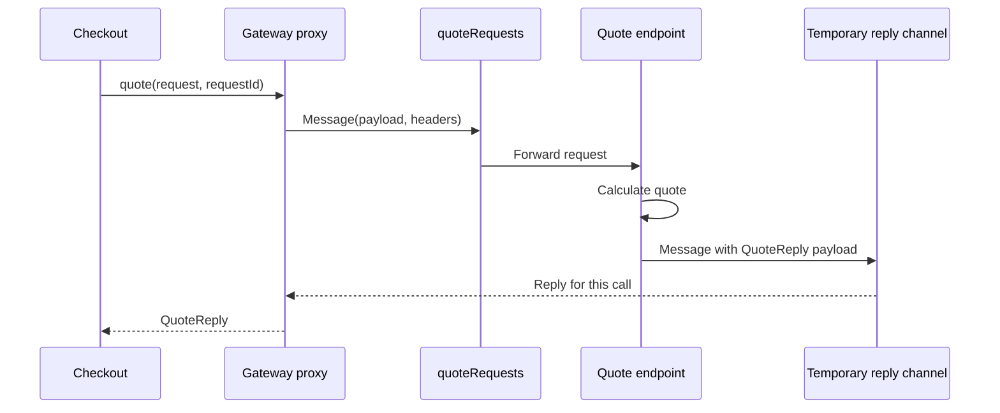
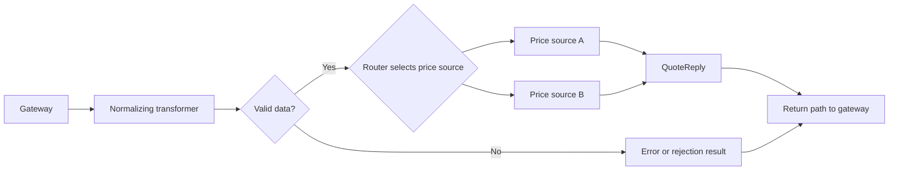

# Request-Reply Gateway

## Objectives and Scope

In the **Messaging gateway** chapter of the **SPRING_INTEGRATION_CORE** module, this lesson explains how to turn a value-returning Java call into a request-reply message exchange. You will connect `Message`, `MessageChannel`, endpoints, and gateways using Java DSL, and then observe what happens when a flow returns a result, raises an error, or produces no reply.

After this lesson, you can:

- Design a gateway interface with clear input, output, and timeout contracts.
- Trace a request from method parameters to payload/headers, and trace the reply back to the caller.
- Explain the role of `replyChannel` and the difference between same-thread execution and execution via an executor or queue.
- Design termination paths for transformers, routers, filters, and aggregators in a flow that requires a reply.
- Write tests for successful outcomes, business errors, and missing-reply scenarios.

The examples use `record` from Java 17+ and the Spring Integration 6.2+ API; specifically, `@MessagingGateway(errorOnTimeout = true)` was introduced in version 6.2. Use a compatible set of versions managed by the application platform. [Javadoc `MessagingGateway`](https://docs.spring.io/spring-integration/api/org/springframework/integration/annotation/MessagingGateway.html#errorOnTimeout()).

## 1. What Contract Is Request-Reply?

Suppose checkout needs to calculate a quote before letting a customer confirm an order:

```java
QuoteReply reply = quoteGateway.quote(request, "req-1001");
```

To checkout, this is a method that takes a `QuoteRequest` and returns a `QuoteReply`. Inside the gateway, the call is mapped to a message sent into the integration flow; the flow's result is mapped back to the return value. The gateway proxy is the boundary between Java method-based programming and coordinating endpoints via messages. [Javadoc `GatewayProxyFactoryBean`](https://docs.spring.io/spring-integration/api/org/springframework/integration/gateway/GatewayProxyFactoryBean.html).

A request-reply contract should answer four questions:

| Question | Decision in the quote example |
| --- | --- |
| What data is sent? | Product SKU and quantity in `QuoteRequest` |
| What does the result mean? | The calculated quote, represented by `QuoteReply` |
| How long to wait? | Configured send timeout and reply wait timeout |
| When no result can be produced? | Throw an error or return a business result describing failure per the chosen contract |

A successful message send only indicates that the send operation was accepted by the channel according to that channel's mechanics. For example, a queue accepting a request does not mean the quote service has finished processing. Checkout can only use the price once it receives a valid reply.

## 2. Path of a Call



In a standard configuration, the gateway creates a temporary, anonymous reply channel for the exchange and sets the return address in the `replyChannel` header. Therefore, you do not need to create a reply channel bean yourself just to receive results. If a named reply channel is declared, the framework creates a bridge to forward replies back to the call's temporary channel. [Messaging Gateways — Setting the Default Reply Channel](https://docs.spring.io/spring-integration/reference/gateway.html#gateway-default-reply-channel).

Do not confuse these three pieces of information:

| Information | Purpose |
| --- | --- |
| `replyChannel` | Address to send the reply back to the waiting exchange |
| Application-supplied `requestId` | Tracking a business request across logs or retries |
| Flow-scoped `correlationId` | Grouping related messages, such as parts to be aggregated |

A `requestId` header does not automatically become a reply address. Likewise, setting `correlationId` manually does not replace preserving the proper return path to the gateway.

For a service activator, if an output channel is present, the result is sent onto the output channel; if none is configured, the endpoint can use `replyChannel` on the request. Hence, an endpoint computing a value is not enough: that value must also reach the right destination. [Service Activator](https://docs.spring.io/spring-integration/reference/service-activator.html).

## 3. Complete Example: Calculating Quotes with Annotations and Java DSL

The following example is a plain Spring application in package `example.gateway`. Each `public` type goes into a correspondingly named Java file. It requires `spring-integration-core` and Spring Context; the test section below also uses Spring Test and JUnit Jupiter. With Spring Boot, you can use the integration starter and test starter under the application's dependency management.

### 3.1. Business Data Types

```java
package example.gateway;

public record QuoteRequest(String sku, int quantity) {
}
```

```java
package example.gateway;

import java.math.BigDecimal;

public record QuoteReply(String sku, BigDecimal total, String currency) {
}
```

Using a dedicated output type makes the contract easier to read than `Object` or an unstructured JSON string. This example only calculates a price; it does not create orders or deduct inventory.

### 3.2. Gateway Interface

```java
package example.gateway;

import org.springframework.integration.annotation.MessagingGateway;
import org.springframework.messaging.handler.annotation.Header;

@MessagingGateway(
        defaultRequestChannel = "quoteRequests",
        defaultRequestTimeout = "300",
        defaultReplyTimeout = "1500",
        errorOnTimeout = true)
public interface QuoteGateway {

    QuoteReply quote(
            QuoteRequest request,
            @Header("requestId") String requestId);
}
```

`request` becomes the payload, and the parameter marked with `@Header` becomes a header. When the return type is `QuoteReply`, the gateway extracts the reply payload to return; if headers are also needed, the return type can be declared as `Message<QuoteReply>`. [Javadoc `Gateway`](https://docs.spring.io/spring-integration/api/org/springframework/integration/annotation/Gateway.html).

The two timeout values on the interface-level annotation are strings and are in milliseconds. `errorOnTimeout = true` chooses to report an error when the reply wait time expires instead of returning `null`; the example has no dedicated error channel declared, so errors are propagated to the caller. [Javadoc `MessagingGateway`](https://docs.spring.io/spring-integration/api/org/springframework/integration/annotation/MessagingGateway.html).

### 3.3. Pricing Service

```java
package example.gateway;

import java.math.BigDecimal;

public class QuoteService {

    public QuoteReply calculate(QuoteRequest request) {
        if (request.quantity() <= 0) {
            throw new IllegalArgumentException("quantity must be greater than 0");
        }

        if (!"BOOK-01".equals(request.sku())) {
            throw new IllegalArgumentException("No price available for this SKU");
        }

        BigDecimal unitPrice = new BigDecimal("39.90");
        BigDecimal total = unitPrice.multiply(
                BigDecimal.valueOf(request.quantity()));

        return new QuoteReply(request.sku(), total, "USD");
    }
}
```

The service only accepts and returns business data. It does not need to know channel names or how the caller is waiting for the result.

### 3.4. Flow Configuration

```java
package example.gateway;

import org.springframework.context.annotation.Bean;
import org.springframework.context.annotation.Configuration;
import org.springframework.integration.channel.DirectChannel;
import org.springframework.integration.config.EnableIntegration;
import org.springframework.integration.config.IntegrationComponentScan;
import org.springframework.integration.dsl.IntegrationFlow;

@Configuration
@EnableIntegration
@IntegrationComponentScan(basePackageClasses = QuoteGateway.class)
public class QuoteIntegrationConfig {

    @Bean
    public DirectChannel quoteRequests() {
        return new DirectChannel();
    }

    @Bean
    public QuoteService quoteService() {
        return new QuoteService();
    }

    @Bean
    public IntegrationFlow quoteFlow(QuoteService quoteService) {
        return IntegrationFlow.from("quoteRequests")
                .handle(quoteService, "calculate",
                        endpoint -> endpoint.requiresReply(true))
                .get();
    }
}
```

`@IntegrationComponentScan` scans for `@MessagingGateway` interfaces to register proxies; standard component scanning does not automatically process this kind of interface. `@EnableIntegration` enables the infrastructure required for the plain Spring configuration in the example. [Javadoc `MessagingGateway`](https://docs.spring.io/spring-integration/api/org/springframework/integration/annotation/MessagingGateway.html), [Messaging Gateways — annotation](https://docs.spring.io/spring-integration/reference/gateway.html).

At the end of the flow there is no output channel. The result from `calculate` is routed back to the request's reply address. `requiresReply(true)` makes the endpoint throw an error if the method returns `null`, catching contract violations close to their origin. It does not force a hanging method to terminate. [Service Activator](https://docs.spring.io/spring-integration/reference/service-activator.html), [Javadoc `GenericEndpointSpec`](https://docs.spring.io/spring-integration/docs/current/api/org/springframework/integration/dsl/GenericEndpointSpec.html).

### 3.5. Trial Invocation

```java
package example.gateway;

import org.springframework.context.annotation.AnnotationConfigApplicationContext;

public class QuoteDemo {

    public static void main(String[] args) {
        try (var context = new AnnotationConfigApplicationContext(
                QuoteIntegrationConfig.class)) {

            QuoteGateway gateway = context.getBean(QuoteGateway.class);
            QuoteReply reply = gateway.quote(
                    new QuoteRequest("BOOK-01", 2), "req-1001");

            System.out.println(reply.total());     // 79.80
            System.out.println(reply.currency());  // USD
        }
    }
}
```

In a real application, inject `QuoteGateway` into checkout via constructor injection. The caller uses the Spring-managed proxy bean; merely declaring an interface in source code does not create an entry point into the flow.

## 4. Method Mapping and Per-Call Overrides

When there are multiple business parameters, explicitly specify payload/headers to avoid ambiguity. Another contract example:

```java
QuoteReply quote(
        @org.springframework.messaging.handler.annotation.Payload
        QuoteRequest request,
        @org.springframework.messaging.handler.annotation.Header("tenantId")
        String tenantId,
        @org.springframework.messaging.handler.annotation.Header("requestId")
        String requestId);
```

A `Map` parameter should not be left to inference when both payload and headers can be maps. Use `@Payload`, `@Header`, or `@Headers` to express intent. [Javadoc `Gateway`](https://docs.spring.io/spring-integration/api/org/springframework/integration/annotation/Gateway.html).

A method can set its own timeouts with `@Gateway`. The snippet below shows how to replace the method declaration in the existing interface:

```java
@org.springframework.integration.annotation.Gateway(
        requestTimeout = 200,
        replyTimeout = 800)
QuoteReply quote(
        QuoteRequest request,
        @org.springframework.messaging.handler.annotation.Header("requestId")
        String requestId);
```

At the method level, `requestTimeout` and `replyTimeout` take `long`, unlike the string-based default attributes on `@MessagingGateway`. Method-level values override the corresponding interface defaults. [Javadoc `Gateway`](https://docs.spring.io/spring-integration/api/org/springframework/integration/annotation/Gateway.html#replyTimeout()).

Keep the return type consistent across all terminal branches. If the gateway returns `QuoteReply`, a branch returning the string `"OUT_OF_STOCK"` creates a hard-to-use contract and can cause type-conversion errors. To represent an out-of-stock result as normal data, design a result type with an explicit status from the beginning.

## 5. Two Timeouts Protecting Two Different Phases

| Setting | Bounded phase | Example |
| --- | --- | --- |
| `requestTimeout` | Waiting to send a message when the send operation can block | A bounded `QueueChannel` is full |
| `replyTimeout` | Waiting for a reply after the send operation returns control to the gateway | Request handed off to a worker, caller waits for result |
| HTTP client/JDBC client timeout | I/O operation performed by the endpoint | Reading response from an external pricing service |

`requestTimeout` is not the processing budget for the entire request. In particular, it imposes no execution limit on a service invoked via `DirectChannel`. Wait time when sending to a blocking channel is described in [Javadoc `Gateway`](https://docs.spring.io/spring-integration/api/org/springframework/integration/annotation/Gateway.html#requestTimeout()) and [QueueChannel](https://docs.spring.io/spring-integration/reference/channel/implementations.html#channel-implementations-queuechannel).

### 5.1. Entire Flow Running on the Same Thread

`DirectChannel` dispatches processing to the subscriber on the sending thread. If `calculate` takes 8 seconds, the caller is still executing inside its own send operation. Setting `replyTimeout = 1500` does not interrupt that method after 1.5 seconds. [Message Channel Implementations](https://docs.spring.io/spring-integration/reference/channel/implementations.html), [Gateway Behavior When No response Arrives](https://docs.spring.io/spring-integration/reference/gateway.html#gateway-no-response).

```text
caller: enter gateway -> send -> calculate runs 8 seconds -> reply arrives -> return result
```

This is why HTTP/JDBC client timeouts are needed if a service performs I/O. A gateway timeout does not replace time-limiting mechanisms on the running operation.

### 5.2. Flow Offloading Processing to a Worker

When an executor or queue boundary exists, the caller can return to the gateway to wait while a worker continues processing. At that point, `replyTimeout` bounds the reply wait step. [Gateway Behavior When No response Arrives](https://docs.spring.io/spring-integration/reference/gateway.html#gateway-no-response).

To try this variant, **replace** the `quoteRequests()` bean in the configuration with the following two beans while keeping `quoteFlow` unchanged:

```java
@Bean
public org.springframework.scheduling.concurrent.ThreadPoolTaskExecutor
quoteExecutor() {
    var executor = new org.springframework.scheduling.concurrent
            .ThreadPoolTaskExecutor();
    executor.setCorePoolSize(4);
    executor.setMaxPoolSize(4);
    executor.setQueueCapacity(32);
    executor.setThreadNamePrefix("quote-");
    return executor;
}

@Bean
public org.springframework.integration.channel.ExecutorChannel quoteRequests(
        org.springframework.scheduling.concurrent.ThreadPoolTaskExecutor
                quoteExecutor) {
    return new org.springframework.integration.channel.ExecutorChannel(
            quoteExecutor);
}
```

Spring manages initialization and lifecycle of the executor bean. When the executor accepts work, the caller typically moves to waiting for a reply while the worker executes the service. Keep executor capacity bounded and configure an appropriate rejection policy; if configured to run tasks on the caller thread upon overload, assumptions about thread boundaries change. [ExecutorChannel](https://docs.spring.io/spring-integration/reference/channel/implementations.html#channel-implementations-executorchannel).

```text
caller: dispatch to worker -> wait for reply -> expires -> receive timeout error
worker:                      continues calculate -> may finish late
```

With `QueueChannel`, adding a queue also requires a consumer using a poller; merely creating a queue and sending requests into it does not automatically create a worker pulling messages out. Time spent in the queue also consumes the caller's waiting time. [Message Channel Implementations](https://docs.spring.io/spring-integration/reference/channel/implementations.html).

### 5.3. Timeout Does Not Mean Work Is Canceled

Suppose a worker creates a quote stored in a database, but the reply arrives after checkout has timed out. Checkout has not received the result, yet the quote may already exist. Consequently, you must design:

- A stable request ID across retries to identify the same business operation.
- A way to query the created result if the contract permits late completion.
- Logging of wait times, processing times, and request IDs for reconciliation.
- An idempotency mechanism if the operation has side effects and the caller may retry.

This is a design consequence of caller and worker finishing at different times. A gateway does not automatically provide exactly-once guarantees, roll back external operations, or cancel a worker merely because the caller timed out.

## 6. When Does a Gateway Return `null`, and When an Exception?

In this lesson, `errorOnTimeout = true` and there is no dedicated error channel, so reply wait expiration is reported with `MessageTimeoutException`. If `errorOnTimeout = false` is kept, a reply wait timeout can return `null`. [Javadoc `MessagingGateway`](https://docs.spring.io/spring-integration/api/org/springframework/integration/annotation/MessagingGateway.html#errorOnTimeout()).

Distinguish **service returning `null`** from **gateway returning `null`**. A service returning `null` usually means the endpoint emits no reply message; the gateway only knows it has not received a reply yet, and handles it according to the configured timeout. `requiresReply(true)` turns a service returning `null` into an error at the endpoint. [Service Activator](https://docs.spring.io/spring-integration/reference/service-activator.html).

| Scenario | Expected consequence |
| --- | --- |
| Service returns `QuoteReply` and return path is intact | Caller receives the result |
| Service throws an error in the synchronous example | Caller receives an exception per gateway rules |
| Service returns `null`, `requiresReply` not enabled on endpoint | No reply emitted; caller may wait until timeout |
| Service returns `null`, `requiresReply(true)` enabled | Endpoint throws `ReplyRequiredException` |
| Filter drops request with no reply branch | Gateway still waits even though the request was rejected |
| Reply is routed to an output channel with no path back | Result never reaches the waiting call |
| Waiting indefinitely on a branch that emits no reply | Can block the caller indefinitely |

Avoid primitive return types if the contract still permits `null` on timeout, because primitives cannot represent that outcome. It is better to decide explicitly between “result may be absent” and “missing reply is an error”, and express it consistently in the interface and caller.

## 7. Every Flow Branch Needs a Termination Path

A quote-calculation flow may need to normalize data, select a pricing service, and aggregate multiple components:



This diagram illustrates a router selecting **one** price source. If multiple sources must be queried and compared, branching and aggregation must be designed separately.

| Component | Questions when placed in request-reply |
| --- | --- |
| Transformer | Is the output the exact type the next endpoint expects? Are routing headers preserved? |
| Filter | Will dropped messages throw an error immediately or go to a branch returning a rejection result? |
| Router | How will a value matching no branch be handled? |
| Aggregator | When is a group released? If a part is missing, under what policy does it expire? |
| Final endpoint | Does it produce a result and send it to the right reply address? |

By default, a filter can drop a message without producing a reply. When the contract treats rejected input as an error, `throwExceptionOnRejection(true)` can be used; if it is a normal business case, design a discard flow returning an appropriate result. [Filter](https://docs.spring.io/spring-integration/reference/filter.html).

Example inserting a filter into the flow before the service:

```java
return IntegrationFlow.from("quoteRequests")
        .<QuoteRequest>filter(
                request -> request.quantity() > 0,
                filter -> filter.throwExceptionOnRejection(true))
        .handle(quoteService, "calculate",
                endpoint -> endpoint.requiresReply(true))
        .get();
```

`requiresReply` only checks the endpoint on which it is configured. It cannot detect requests dropped by an earlier filter, nor automatically complete an aggregator group missing messages. Therefore, trace every branch from input to termination point rather than inspecting only the final method.

For an aggregator, decide the group wait budget before choosing the gateway timeout. For example, if the business allows at most 900 ms for a group to complete while the gateway waits only 500 ms after dispatching, the caller can leave before the group is released. Queue time, service calls, and result dispatch must all be factored into the end-to-end budget.

## 8. Preserving the Reply Path When Handling `Message`

Prefer letting ordinary endpoints process payloads unless direct message manipulation is needed. When manually constructing a new message in a custom handler, pay attention to headers still used by downstream steps.

The example below illustrates building a message derived from the request:

```java
import org.springframework.messaging.Message;
import org.springframework.messaging.support.MessageBuilder;

public Message<QuoteReply> calculateMessage(Message<QuoteRequest> request) {
    QuoteReply reply = calculate(request.getPayload());

    return MessageBuilder.withPayload(reply)
            .copyHeaders(request.getHeaders())
            .setHeader("quoteSource", "local-catalog")
            .build();
}
```

This snippet is an alternative to payload handling inside a custom message handler, not a method to add to `QuoteService` in the main example. Copying headers should be intentional; when crossing out to another system, transmit only protocol-allowed headers.

An in-memory temporary reply channel object is not an address that can be directly serialized and carried to another process. When crossing HTTP, JMS, or AMQP, the protocol's gateway/adapter must map the appropriate reply/correlation mechanism. An internal `replyChannel` header does not by itself tell a remote service how to call back into the JVM.

With multiple concurrent calls, do not send results onto a shared queue and manually pop “the next message” to return to a caller. Completion order can differ from send order. Let the gateway mechanism and per-exchange reply path handle matching results; business request IDs assist observation and reconciliation.

## 9. Error Handling in Request-Reply

### 9.1. Keeping Errors as Exceptions

In the `DirectChannel` flow of the main example, exceptions from `QuoteService` travel back to the gateway. The gateway applies cause-unwrapping rules; the exception type received by the caller relates to the cause chain and the interface's `throws` declarations. With `IllegalArgumentException` in the example, the caller can catch this business validation error. [Messaging Gateways — Error Handling](https://docs.spring.io/spring-integration/reference/gateway.html#gateway-error-handling).

```java
try {
    QuoteReply reply = gateway.quote(
            new QuoteRequest("BOOK-01", 0), "req-invalid");
} catch (IllegalArgumentException ex) {
    // Convert into an appropriate message at the application's UI/API boundary.
}
```

### 9.2. Converting Errors into a Structured Result

If the business wants the caller to receive data describing the failure, design a return type covering both states, such as:

```java
public record QuoteOutcome(
        boolean successful,
        QuoteReply quote,
        String errorCode) {
}
```

When changing the gateway to `QuoteOutcome`, both the success flow and the error flow must return this type. An error flow can map an exception to `QuoteOutcome(false, null, "PRICE_UNAVAILABLE")`; do not change only the interface return type while the success branch still returns `QuoteReply`.

A gateway allows configuring an `errorChannel` to route errors to a separate flow and use that flow's result as the reply. An error flow that only logs, returns `void`, or consumes the message without returning a result can leave the request-reply contract without a reply. [Messaging Gateways — Error Handling](https://docs.spring.io/spring-integration/reference/gateway.html#gateway-error-handling).

Do not use a total price of 0 to simulate successful pricing when the pricing service fails. To checkout, “price is 0” and “price could not be determined” are two distinct business outcomes.

### 9.3. Across a Thread Boundary

Errors on a worker thread cannot automatically jump across the Java call stack to the caller. Asynchronous infrastructure uses `ErrorMessage` and routes errors via error channels; the message's `errorChannel` header takes precedence over the global error channel. For request-reply, preserve the error reply path back to the waiting exchange. [Error Handling](https://docs.spring.io/spring-integration/reference/error-handling.html).

If you manually spawn threads with `new Thread(...)` or submit work to a separate executor outside endpoint mechanics, you must manually forward results/errors back to the flow. Seeing an error in worker logs does not mean the gateway received a completion signal.

## 10. A Synchronous Gateway Does Not Dictate the Entire Execution Model

```java
QuoteReply quote(QuoteRequest request);
```

This contract makes the caller wait directly for a result. Internally, it can still use an `ExecutorChannel`, queues, and multiple workers. Conversely, `DirectChannel` keeps work on the caller thread in the main example. Inspect the actual channels and endpoints when analyzing blocking behavior, concurrent load, and where errors originate.

If the caller cannot hold a thread while waiting, you can design the gateway to return `CompletableFuture<QuoteReply>` or another supported async type. However, that is a contract change for the caller; merely switching the channel to an executor does not turn a method returning `QuoteReply` into a non-blocking API. [Messaging Gateways — Asynchronous Gateway](https://docs.spring.io/spring-integration/reference/gateway.html).

Likewise, request-reply does not automatically open a system-wide transaction. When a flow switches to a worker, do not assume a transaction bound to the caller thread travels with it; place transaction boundaries where the work is executed and consider coordination mechanisms with external resources.

## 11. Two Ways to Use Gateways in Java DSL

### 11.1. Creating a Gateway from an Interface at the Start of a Flow

Instead of scanning annotated interfaces, you can declare a plain interface and let the DSL create the proxy:

```java
package example.gateway;

public interface PlainQuoteGateway {
    QuoteReply quote(QuoteRequest request);
}
```

```java
@Bean
public IntegrationFlow plainQuoteFlow(QuoteService quoteService) {
    return IntegrationFlow.from(PlainQuoteGateway.class, gateway -> gateway
                    .beanName("plainQuoteGateway")
                    .replyTimeout(1500))
            .handle(quoteService, "calculate",
                    endpoint -> endpoint.requiresReply(true))
            .get();
}
```

The DSL provides an internal input channel for the interface's methods. Therefore, `requestChannel` on annotations is not used to select a different flow in this declaration style. Choose a single registration method per gateway to avoid accidentally creating multiple proxies. [IntegrationFlow as a Gateway](https://docs.spring.io/spring-integration/reference/dsl/integration-flow-as-gateway.html).

This DSL snippet only illustrates proxy creation; it does not replicate the full timeout error policy of the annotation example. When changing real configurations, preserve the timeout/error contract that callers rely on.

### 11.2. Calling a Subflow with `.gateway(...)`

Inside a flow currently processing a message, the `.gateway(...)` operator can call another flow via its input channel and wait for a reply before continuing the pipeline. This is an in-flow call point, positioned differently from the `QuoteGateway` interface called by checkout. [Operator gateway()](https://docs.spring.io/spring-integration/reference/dsl/java-gateway.html).

```java
@Bean
public IntegrationFlow quoteSubflow(QuoteService quoteService) {
    return IntegrationFlow.from("quoteSubflow.input")
            .handle(quoteService, "calculate",
                    endpoint -> endpoint.requiresReply(true))
            .get();
}

@Bean
public IntegrationFlow checkoutQuoteFlow() {
    return IntegrationFlow.from("checkoutQuote.input")
            .gateway("quoteSubflow.input")
            .<QuoteReply, String>transform(
                    reply -> reply.total() + " " + reply.currency())
            .get();
}
```

This is an independent variant: the `checkoutQuote.input` entry receives a `QuoteRequest`, while the final output is a `String`. If exposing an interface gateway into this flow, the interface's return type must match the final string. An outer gateway's contract does not have to match the reply type of the subflow-calling gateway.

## 12. Testing the Request-Reply Contract

The following test targets the synchronous configuration in Section 3, before any variants that swap channels or add filters. It tests the real proxy and real flow inside a Spring context, rather than mocking the gateway and merely asserting that the mock returns a stubbed value.

```java
package example.gateway;

import java.math.BigDecimal;

import org.junit.jupiter.api.Test;
import org.springframework.beans.factory.annotation.Autowired;
import org.springframework.test.context.junit.jupiter.SpringJUnitConfig;

import static org.junit.jupiter.api.Assertions.assertEquals;
import static org.junit.jupiter.api.Assertions.assertThrows;

@SpringJUnitConfig(QuoteIntegrationConfig.class)
class QuoteGatewayTest {

    @Autowired
    private QuoteGateway gateway;

    @Test
    void returnsCalculatedQuote() {
        QuoteReply reply = gateway.quote(
                new QuoteRequest("BOOK-01", 2), "req-test-1");

        assertEquals("BOOK-01", reply.sku());
        assertEquals(new BigDecimal("79.80"), reply.total());
        assertEquals("USD", reply.currency());
    }

    @Test
    void propagatesInvalidQuantity() {
        assertThrows(IllegalArgumentException.class, () -> gateway.quote(
                new QuoteRequest("BOOK-01", 0), "req-test-2"));
    }
}
```

For missing-reply scenarios, create a separate test context so you do not alter the main example:

| Test scenario | Controlled setup | What to verify |
| --- | --- | --- |
| Endpoint violates contract | Simulated service returns `null`, `requiresReply(true)` enabled | Missing-reply error occurs at endpoint |
| Request produces no reply | Terminal flow uses a `void`-returning handler, short finite timeout | Receives `null` or timeout error per config |
| Worker finishes late | Worker waits on `CountDownLatch`; caller has a finite timeout | Caller expires before latch release; always release latch in cleanup |
| Queue is full | Capacity-1 queue already holds a message, no consumer | Subsequent send is bounded by request timeout |
| Multiple concurrent requests | Distinct input data and out-of-order completion | Each caller receives the result matching its own request |

Do not assert that a timeout happens at an exact millisecond. Thread scheduling and machine load can cause measurements to fluctuate. Assert the result/error type, event ordering, and a time bound wide enough to catch hangs; use latches to coordinate workers rather than relying on flaky `sleep` sequences.

## 13. Diagnosing When the Caller Receives No Reply

| Symptom | First check |
| --- | --- |
| Cannot inject gateway | Was the interface scanned or proxied via DSL? |
| Immediate send failure on call | Does the input channel have a subscriber? Do channel names match? Did the executor reject work? |
| Receives `null` after a wait | Does the contract allow timeout to return `null`? Which branch failed to produce a reply? |
| Logs show price calculated, yet caller keeps waiting | Are the final output channel and reply headers still intact? |
| Short reply timeout yet caller still blocked for long | Is a slow endpoint running on the same thread via `DirectChannel`? |
| Fails only under concurrent requests | Is custom code pulling replies from a shared queue or overwriting routing headers? |
| Only error logs from worker appear | Does the error flow route the error back to the waiting exchange? |
| Multiple replies for one request | Is a publish-subscribe/fan-out branch emitting multiple final results outside the contract? |

To make logs useful, record request ID, endpoint name, executing thread, and start/end timestamps at key boundaries. For timeouts, distinguish send wait time, queue wait time, processing time, and reply wait time; a single total number rarely reveals where the bottleneck lies.

## 14. Hands-On Practice

1. Run the synchronous example with `BOOK-01`, quantity 2; predict the request payload, `requestId` header, and result before reading the output.
2. Have `QuoteService` return `null` in one branch and compare behavior with `requiresReply` enabled vs. disabled, always keeping a finite timeout.
3. Replace the input channel with `ExecutorChannel`. Use a controlled wait gate in the service to observe the caller timing out while the worker has not yet finished.
4. Add a filter rejecting invalid quantities. Design termination via exception or a rejection result type, and verify the caller does not wait for a reply that can never arrive.
5. Extend the problem to fetching two price components that must be aggregated. Define the missing-component policy before choosing the gateway timeout.

Key takeaway to explain after practicing: the caller waits for a business-meaningful result; channels determine handoff and threading model; endpoints determine result production; the reply path delivers the result back to the exact originating call. A complete request-reply design must have explicit termination for success, errors, and missing replies.