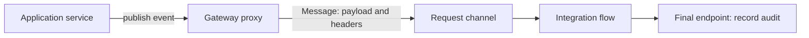
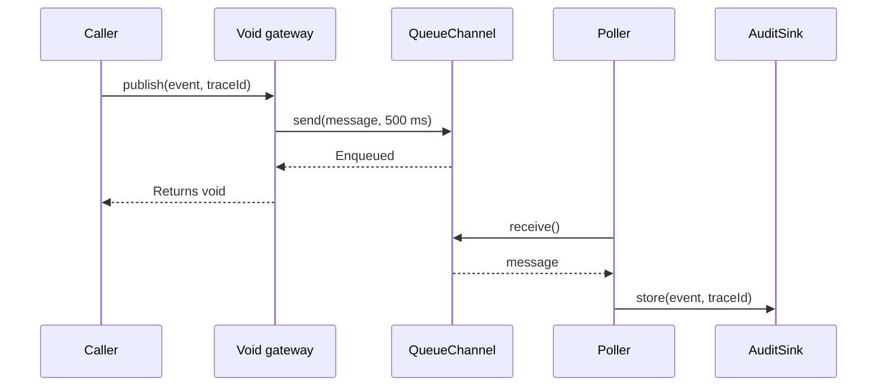

# One-Way Gateway

This lesson belongs to the **Messaging gateway** chapter of the **SPRING_INTEGRATION_CORE** module. It focuses on sending a Java call into a message flow via a one-way gateway using `Message`, `MessageChannel`, endpoints, and Java DSL, while clarifying how to handle errors and test at that boundary.

## 1. Objectives and Use Cases

After this lesson, you can:

- Declare a gateway with a `void`-returning method and map arguments to payload and headers.
- Explain when the method returns when using `DirectChannel`, `QueueChannel`, or `ExecutorChannel`.
- Choose appropriate timeouts for send operations, design error handling paths, and test one-way behavior.
- Distinguish message acceptance from business task completion.

Suppose an application needs to record an event when a user downloads a report. Business code wants to call an interface such as `auditGateway.publish(event, traceId)` without manually creating a `Message` or looking up channels. The result of recording the audit does not need to become the return value of this call. This is a suitable scenario to start with a one-way gateway.

However, the requirement “no return value needed” must still come with an explicit contract: must auditing succeed before proceeding or can it be processed later; when the system is overloaded, should it reject or wait; if recording fails, who is responsible for handling it.

## 2. How Is a One-Way Contract Expressed?

A gateway method returning `void` represents sending a message without waiting for a reply to convert into a Java result. Spring creates a proxy for the interface; the caller receives the proxy via dependency injection. [Reference: Messaging Gateways](https://docs.spring.io/spring-integration/reference/gateway.html).

```java
public interface AuditGateway {
    void publish(AuditEvent event, String traceId);
}
```

This is just the shape of the contract. The complete configuration in Section 4 will specify the target channel and how `traceId` is mapped.



In this example, the caller hands an event off to the integration system. You can add a transformer to normalize content, a router to pick destinations, or a filter to apply policies before writing the audit. Those steps belong to the message flow; the caller-side interface can remain unchanged.

### 2.1. Distinguishing Three Commonly Conflated Concepts

| Concept | Question it answers | Example in this lesson |
| --- | --- | --- |
| One-way | Does the caller receive a reply via a return value? | `void publish(...)` |
| Asynchronous | Is work handed off to another thread or processing stage? | Gateway sends to a queue, a poller processes later |
| Durable | Are accepted messages preserved across process failures? | Requires an appropriate storage mechanism or infrastructure |

For the audit recording requirement, answer each question separately. One design can be one-way yet run synchronously and store data only in memory. Another design can accept messages and process them later on persistent infrastructure. A `void` signature alone is insufficient to distinguish between those two designs.

### 2.2. One-Way Differs from Request-Reply at the Contract

```java
// One-way contract: receives no business result via return value.
void submitAudit(AuditEvent event);

// Request-reply contract: requires a result to be returned.
AuditReceipt submitAuditAndGetReceipt(AuditEvent event);
```

In the second line, `AuditReceipt` must carry a concrete meaning. An acceptance receipt, a data-persistence result, and full business completion are distinct milestones. If the caller needs a certain milestone to decide the next step, model that milestone in the contract rather than inferring it from a `void` method returning.

For example, downloading a report might allow recording analytics later. Confirming payment collection usually requires proof of processing outcome. Both may emit messages, yet their requirements for returning a result to the caller differ.

## 3. The Channel Determines the Execution Boundary

| Channel at handoff point | Typical execution path | What a normal return from the send call means |
| --- | --- | --- |
| `DirectChannel` | Subscriber is invoked on the sending thread | The synchronous segment traversed by this thread has finished |
| `QueueChannel` | Buffered in queue; consumer receives separately | The message has been placed into the queue |
| `ExecutorChannel` | Task handed off to executor | The send task was accepted by the executor per its configuration |

`QueueChannel` stores messages in memory by default and can block senders when a bounded queue is full. `ExecutorChannel` also depends on the executor and overload policy; a caller-runs policy can execute the task directly on the sending thread. [Reference: Message Channel Implementations](https://docs.spring.io/spring-integration/reference/channel/implementations.html).

When analyzing a flow, trace the entire path. If the request channel is a `DirectChannel` with a queue further downstream, when the caller returns only reflects the synchronous segment up to that handoff point. It does not reflect steps executed later by the queue's consumer.

### 3.1. Send Timeout vs. Reply Wait Timeout

`requestTimeout` on `@Gateway` limits how long to wait when sending if the channel supports blocking sends, such as a full queue. `replyTimeout` applies to waiting for a reply. Annotation timeout values are in milliseconds. [@Gateway API](https://docs.spring.io/spring-integration/docs/6.5.0/api/org/springframework/integration/annotation/Gateway.html).

| Setting or limit | Purpose in the audit example |
| --- | --- |
| `@Gateway(requestTimeout = 500)` | Wait at most 500 ms to place a message into a full queue |
| `replyTimeout` | Adds no business reply waiting step for a `void` method |
| Timeout on database or external service client | Bounds I/O operations performed by the handler |

If a synchronous handler is calling a hanging external system, setting `requestTimeout` on the gateway does not create a mechanism to interrupt the handler after 500 ms. Configure limits on the client and the component executing the work. These are two different control points in the design.

Nor should you turn a request-reply method into a one-way one by setting `replyTimeout = 0`. If the caller does not need a reply, declare a `void` contract from the start.

## 4. Complete Example: Synchronous One-Way Gateway

The example uses Java 17 or higher and Spring Integration 6.5 APIs. It requires `org.springframework.integration:spring-integration-core`; tests use JUnit Jupiter. Use versions managed by the project's BOM. No broker or database is needed to practice this example.

The classes below live in package `example.gateway`. Each `public` type goes in a Java file of the same name. `AuditSink` is an in-memory test recorder; the `FAIL_STORE` action is simply an error-simulation hook for this lesson.

### 4.1. Business Payload

```java
package example.gateway;

import java.time.Instant;
import java.util.Objects;

public record AuditEvent(
        String eventId,
        String actor,
        String action,
        Instant occurredAt) {

    public AuditEvent {
        Objects.requireNonNull(eventId, "eventId");
        Objects.requireNonNull(actor, "actor");
        Objects.requireNonNull(action, "action");
        Objects.requireNonNull(occurredAt, "occurredAt");
    }
}
```

`eventId` is an application-assigned identifier for the event. When designing a retry mechanism, this identifier can be used to recognize the same event. Having an ID field does not automatically create duplicate-processing protection; the storage destination must enforce the corresponding rule.

### 4.2. Gateway Interface and Header

```java
package example.gateway;

import org.springframework.integration.annotation.Gateway;
import org.springframework.integration.annotation.MessagingGateway;
import org.springframework.messaging.handler.annotation.Header;
import org.springframework.messaging.handler.annotation.Payload;

@MessagingGateway(defaultRequestChannel = "auditInput")
public interface AuditGateway {

    @Gateway(requestTimeout = 500)
    void publish(
            @Payload AuditEvent event,
            @Header("auditTraceId") String traceId);
}
```

`@Payload` designates the argument as the message content; `@Header` places the remaining argument into a header named `auditTraceId`. This is a custom header for tracing events in the example, not a distributed tracing setup. [@Gateway Parameter Mapping API](https://docs.spring.io/spring-integration/docs/6.5.0/api/org/springframework/integration/annotation/Gateway.html).

The caller depends only on the `AuditGateway` interface and the `AuditEvent` object. The caller does not need to hold a reference to a `MessageChannel` or manually assemble messages.

### 4.3. Recording Sink for Observation

```java
package example.gateway;

import java.util.List;
import java.util.Objects;
import java.util.concurrent.CopyOnWriteArrayList;

public final class AuditSink {

    private final List<StoredAudit> stored = new CopyOnWriteArrayList<>();

    public void store(AuditEvent event, String traceId) {
        Objects.requireNonNull(traceId, "traceId");
        if ("FAIL_STORE".equals(event.action())) {
            throw new IllegalStateException("Audit store unavailable");
        }
        stored.add(new StoredAudit(
                event,
                traceId,
                Thread.currentThread().getName()));
    }

    public List<StoredAudit> snapshot() {
        return List.copyOf(stored);
    }

    public record StoredAudit(
            AuditEvent event,
            String traceId,
            String threadName) {
    }
}
```

This list only helps the hands-on exercise inspect payload, headers, and executing thread. It does not represent a durable audit store. `CopyOnWriteArrayList` was chosen so the example reads results safely when switching to a poller in the next section, given a small number of test events.

### 4.4. Configuring Channel and Endpoint with Java DSL

```java
package example.gateway;

import org.springframework.context.annotation.Bean;
import org.springframework.context.annotation.Configuration;
import org.springframework.integration.annotation.IntegrationComponentScan;
import org.springframework.integration.channel.DirectChannel;
import org.springframework.integration.config.EnableIntegration;
import org.springframework.integration.dsl.IntegrationFlow;
import org.springframework.messaging.MessageChannel;

@Configuration
@EnableIntegration
@IntegrationComponentScan(basePackageClasses = AuditGateway.class)
public class AuditFlowConfig {

    @Bean
    public MessageChannel auditInput() {
        return new DirectChannel();
    }

    @Bean
    public AuditSink auditSink() {
        return new AuditSink();
    }

    @Bean
    public IntegrationFlow auditFlow(AuditSink sink) {
        return IntegrationFlow.from("auditInput")
                .handle(AuditEvent.class, (event, headers) -> {
                    sink.store(event, (String) headers.get("auditTraceId"));
                    return null;
                })
                .get();
    }
}
```

`@IntegrationComponentScan` finds interfaces annotated with `@MessagingGateway` to register proxies. Standard component scanning does not do this for interfaces. [Reference: Annotation Support](https://docs.spring.io/spring-integration/reference/6.5/configuration/annotations.html).

The final handler finishes its side effect and returns `null`, so no result message is emitted. `requiresReply(true)` is not configured on this endpoint. A service activator can end by returning `void` or `null`; enabling reply requirement and returning `null` raises `ReplyRequiredException`. [Reference: Service Activator Behavior](https://docs.spring.io/spring-integration/docs/6.0.3/reference/html/messaging-endpoints.html).

### 4.5. Calling Through the Spring Context

```java
package example.gateway;

import java.time.Instant;
import org.springframework.context.annotation.AnnotationConfigApplicationContext;

public final class AuditGatewayDemo {

    public static void main(String[] args) {
        try (var context =
                new AnnotationConfigApplicationContext(AuditFlowConfig.class)) {
            AuditGateway gateway = context.getBean(AuditGateway.class);
            AuditSink sink = context.getBean(AuditSink.class);

            gateway.publish(
                    new AuditEvent(
                            "audit-001",
                            "user-42",
                            "REPORT_DOWNLOADED",
                            Instant.now()),
                    "trace-001");

            System.out.println(sink.snapshot());
        }
    }
}
```

With the `DirectChannel` and handler configuration above, the result is already in `AuditSink` when `publish` returns. The `threadName` field shows the handler ran on the calling `main` thread. No Java value is returned from the gateway, yet the call still passes through the `store` operation before continuing.

When applying this in a real application, inject the gateway into the application service. Do not manually instantiate an implementation with `new` and expect Spring to automatically turn calls on that object into messages.

## 5. Switching to a Queue: Same Contract, Different Completion Time

Suppose the report-download feature is allowed to continue immediately once the audit is accepted into a buffer. In `AuditFlowConfig`, replace the two methods `auditInput` and `auditFlow` with the snippet below; keep the `auditSink` bean and configuration annotations. This is a replacement alternative, not registering two beans with the same name side by side.

Add two imports:

```java
import java.time.Duration;
import org.springframework.integration.channel.QueueChannel;
import org.springframework.integration.dsl.Pollers;
```

```java
@Bean
public QueueChannel auditInput() {
    return new QueueChannel(100);
}

@Bean
public IntegrationFlow auditFlow(AuditSink sink) {
    return IntegrationFlow.from("auditInput")
            .handle(AuditEvent.class, (event, headers) -> {
                sink.store(event, (String) headers.get("auditTraceId"));
                return null;
            }, endpoint -> endpoint.poller(
                    Pollers.fixedDelay(Duration.ofMillis(100))
                            .maxMessagesPerPoll(20)))
            .get();
}
```

An endpoint receiving from a queue needs to be polled. The configuration above chooses a poller with a 100 ms fixed delay and a limit of 20 messages per poll. [Pollers API](https://docs.spring.io/spring-integration/docs/6.5.0/api/org/springframework/integration/dsl/Pollers.html).



The diagram illustrates the case where the consumer runs after the caller has returned. In practice, the poller may pick up the message very quickly and process it before the caller even proceeds. Do not write logic or tests assuming the task has definitely not started when `publish` returns.

With this variant:

- A successful `publish` indicates the message entered the queue, not that an audit record exists yet.
- If the 100-element queue is full, the call may have to wait to send within the configured limit.
- If no consumer is present, messages just sit waiting; the `void` signature does not catch that design bug for you.
- Do not use the short `main` snippet from the previous section to conclude background work is complete: reading the snapshot immediately may see an empty list, and closing the context right after makes the test outcome timing-dependent.

In a long-running service, manage consumer lifecycles and application shutdown. In tests, wait on an explicit completion signal or receive messages at an observation channel with a finite timeout.

## 6. Error Handling: What Are the Responsibilities of Caller vs. Error Flow?

### 6.1. Errors on the Synchronous Path

When no `errorChannel` is configured, errors occurring on the calling thread can propagate back to the caller. For a gateway that does not declare `throws`, the framework can unwrap `MessagingException` to throw the underlying business runtime exception. [Reference: Gateway Error Handling](https://docs.spring.io/spring-integration/reference/gateway.html#error-handling).

In the synchronous configuration of Section 4, the caller can observe the simulated error as follows:

```java
try {
    gateway.publish(
            new AuditEvent(
                    "audit-fail",
                    "user-42",
                    "FAIL_STORE",
                    Instant.now()),
            "trace-fail");
} catch (IllegalStateException failure) {
    // Choose an appropriate business reaction when the audit was not recorded.
    System.err.println(failure.getMessage());
}
```

This is a call exception, not a business reply. Therefore, `void` still permits reporting failure via Java's exception mechanism.

### 6.2. Errors After Handoff to a Poller

An exception occurring on a background processing thread cannot unwind back to the caller's already-finished call stack. Spring Integration's standard error-handling mechanism creates an `ErrorMessage`; it prioritizes the destination in the `errorChannel` header before falling back to the global error channel. [Reference: Error Handling](https://docs.spring.io/spring-integration/reference/error-handling.html).

For `void` methods, configuring `errorChannel` on the gateway also places it into the message header for the asynchronous flow to use. [Reference: Error Configuration for One-Way Gateways](https://docs.spring.io/spring-integration/reference/gateway.html#error-handling).

To observe errors in the queue variant, update the annotation on `AuditGateway`:

```java
@MessagingGateway(
        defaultRequestChannel = "auditInput",
        errorChannel = "auditErrors")
public interface AuditGateway {

    @Gateway(requestTimeout = 500)
    void publish(
            @Payload AuditEvent event,
            @Header("auditTraceId") String traceId);
}
```

Add the following bean to the queue configuration:

```java
@Bean
public QueueChannel auditErrors() {
    return new QueueChannel();
}
```

Here, `auditErrors` is an observation point for the hands-on exercise: the test actively calls `receive(timeout)` to retrieve the error. When deploying a real application, you need a consumer for the error path and a clear handling policy; letting errors pile up in a queue is not a recovery mechanism.

You can observe one error occurrence with the snippet below, inside a context running the queue configuration and the gateway with `errorChannel`:

```java
import org.springframework.messaging.Message;
import org.springframework.messaging.MessagingException;
import org.springframework.messaging.support.ErrorMessage;

QueueChannel errors = context.getBean("auditErrors", QueueChannel.class);

// With an empty queue and no send error, publish finishes acceptance.
gateway.publish(
        new AuditEvent(
                "audit-fail-async",
                "user-42",
                "FAIL_STORE",
                Instant.now()),
        "trace-fail-async");

Message<?> observed = errors.receive(2_000);
if (!(observed instanceof ErrorMessage errorMessage)) {
    throw new AssertionError("Did not receive ErrorMessage within timeout");
}

Throwable failure = errorMessage.getPayload();
if (failure instanceof MessagingException messagingFailure) {
    Message<?> failed = messagingFailure.getFailedMessage();
    if (failed != null) {
        System.out.println(failed.getHeaders().get("auditTraceId"));
    }
}
```

In this situation, trace the failing message via `failedMessage` when the exception provides it. Do not assume every `Throwable` carries a source message or that `ErrorMessage` headers always match the request headers.

### 6.3. Configuring an Error Channel Can Change How the Caller Sees Errors

When a gateway is configured to route errors to an error channel, an error flow that handles the error successfully can cause the call to return normally even though the target business operation failed. This is a change to the error contract that must be decided intentionally. [@MessagingGateway.errorChannel API](https://docs.spring.io/spring-integration/docs/6.5.0/api/org/springframework/integration/annotation/MessagingGateway.html#errorChannel()).

For the audit example, you might choose to persist failed events for operations to process later. If a feature requires auditing to succeed before continuing, re-verify whether routing errors to a separate path still satisfies that requirement.

Errors when sending the request, such as a full queue or an executor rejecting submission, still require a separate policy. They occur at the handoff point; do not conflate them with `store` errors that happen later. Consumers must also protect the error path: if the error-recording destination fails, there must be a way to observe that secondary failure.

## 7. Unintended Replies and Terminal Endpoints

Since Spring Integration 5.4, `void` gateway methods are assigned a `replyChannel` pointing to `nullChannel` if that header is not already set, so unintended replies are discarded. [Reference: ReplyChannel Behavior of One-Way Gateways](https://docs.spring.io/spring-integration/reference/gateway.html#setting-the-default-reply-channel).

This is helpful when a downstream step may return a value but the caller chose a contract that receives no result. Nonetheless, the design should still make clear which endpoint performs the final side effect and where results are no longer needed.

A one-way flow can still transform data across multiple steps. For instance, a transformer normalizes action names, a router picks a storage backend, and then a service activator writes the data. “One-way” describes the gateway boundary; it does not forbid internal steps from passing messages to the next step.

Distinguish two configurations:

| Configuration | Information discarded |
| --- | --- |
| Reply of a `void` gateway routed to `nullChannel` by default | Downstream result that the contract does not need |
| Explicitly setting `errorChannel = "nullChannel"` | Errors routed to a discard destination |

The second configuration can cause operations to lose failure information. If audits must be tracked, provide an error flow that records sufficient identifiers and causes rather than discarding errors. [errorChannel Configuration API](https://docs.spring.io/spring-integration/docs/6.5.0/api/org/springframework/integration/annotation/MessagingGateway.html#errorChannel()).

## 8. Testing the Contract Instead of Guessing Timing

The test snippets below are hands-on code to run in a project with JUnit Jupiter. The two test configurations serve different purposes: the synchronous configuration in Section 4 checks results immediately at call time; the standalone queue configuration in Section 8.2 tests handoff and timeouts without a poller racing against the test.

### 8.1. Testing Payload, Headers, Thread, and Synchronous Errors

Use the gateway from Section 4 as-is, without `errorChannel`, and the original `DirectChannel` configuration:

```java
package example.gateway;

import java.time.Instant;
import org.junit.jupiter.api.Test;
import org.springframework.context.annotation.AnnotationConfigApplicationContext;

import static org.junit.jupiter.api.Assertions.assertEquals;
import static org.junit.jupiter.api.Assertions.assertThrows;

class AuditGatewaySyncTest {

    @Test
    void storesPayloadAndHeaderBeforeReturning() {
        try (var context =
                new AnnotationConfigApplicationContext(AuditFlowConfig.class)) {
            AuditGateway gateway = context.getBean(AuditGateway.class);
            AuditSink sink = context.getBean(AuditSink.class);
            AuditEvent event = new AuditEvent(
                    "audit-test-1",
                    "user-42",
                    "REPORT_DOWNLOADED",
                    Instant.parse("2026-01-01T00:00:00Z"));
            String callerThread = Thread.currentThread().getName();

            gateway.publish(event, "trace-test-1");

            assertEquals(1, sink.snapshot().size());
            AuditSink.StoredAudit stored = sink.snapshot().get(0);
            assertEquals(event, stored.event());
            assertEquals("trace-test-1", stored.traceId());
            assertEquals(callerThread, stored.threadName());
        }
    }

    @Test
    void propagatesFailureOnTheCallerThread() {
        try (var context =
                new AnnotationConfigApplicationContext(AuditFlowConfig.class)) {
            AuditGateway gateway = context.getBean(AuditGateway.class);
            AuditEvent event = new AuditEvent(
                    "audit-test-fail",
                    "user-42",
                    "FAIL_STORE",
                    Instant.parse("2026-01-01T00:00:00Z"));

            IllegalStateException failure = assertThrows(
                    IllegalStateException.class,
                    () -> gateway.publish(event, "trace-test-fail"));

            assertEquals("Audit store unavailable", failure.getMessage());
            assertEquals(0, context.getBean(AuditSink.class).snapshot().size());
        }
    }
}
```

The first test checks an observable promise: the data has been recorded when the synchronous gateway returns. The second test checks the caller's reaction to the simulated error. If you change channels or add an error flow, re-evaluate those promises before modifying assertions.

### 8.2. Testing One-Way Over a Queue and Full-Queue Behavior

This test places its interface and configuration directly inside the test class; it does not enable `@IntegrationComponentScan` or load `AuditFlowConfig`. That way it does not accidentally pull in consumers from another example.

```java
package example.gateway;

import java.time.Instant;
import org.junit.jupiter.api.Test;
import org.springframework.context.annotation.Bean;
import org.springframework.context.annotation.Configuration;
import org.springframework.context.annotation.AnnotationConfigApplicationContext;
import org.springframework.integration.channel.QueueChannel;
import org.springframework.integration.config.EnableIntegration;
import org.springframework.integration.gateway.GatewayProxyFactoryBean;
import org.springframework.messaging.Message;
import org.springframework.messaging.MessageDeliveryException;
import org.springframework.messaging.handler.annotation.Header;
import org.springframework.messaging.handler.annotation.Payload;

import static org.junit.jupiter.api.Assertions.assertEquals;
import static org.junit.jupiter.api.Assertions.assertNotNull;
import static org.junit.jupiter.api.Assertions.assertThrows;

class AuditGatewayQueueTest {

    interface QueueOnlyGateway {
        void publish(
                @Payload AuditEvent event,
                @Header("auditTraceId") String traceId);
    }

    @Configuration
    @EnableIntegration
    static class QueueOnlyConfig {

        @Bean
        QueueChannel auditInput() {
            return new QueueChannel(1);
        }

        @Bean
        GatewayProxyFactoryBean<QueueOnlyGateway> queueOnlyGateway() {
            var factory = new GatewayProxyFactoryBean<>(QueueOnlyGateway.class);
            factory.setDefaultRequestChannelName("auditInput");
            factory.setDefaultRequestTimeout(0L);
            return factory;
        }
    }

    @Test
    void returnsWithoutAConsumerAndPreservesMessageData() {
        try (var context =
                new AnnotationConfigApplicationContext(QueueOnlyConfig.class)) {
            QueueOnlyGateway gateway = context.getBean(QueueOnlyGateway.class);
            QueueChannel input = context.getBean("auditInput", QueueChannel.class);
            AuditEvent event = event("audit-queue-1");

            gateway.publish(event, "trace-queue-1");

            assertEquals(1, input.getQueueSize());
            Message<?> message = input.receive(0);
            assertNotNull(message);
            assertEquals(event, message.getPayload());
            assertEquals("trace-queue-1",
                    message.getHeaders().get("auditTraceId"));
        }
    }

    @Test
    void failsToSendWhenQueueHasNoCapacity() {
        try (var context =
                new AnnotationConfigApplicationContext(QueueOnlyConfig.class)) {
            QueueOnlyGateway gateway = context.getBean(QueueOnlyGateway.class);
            QueueChannel input = context.getBean("auditInput", QueueChannel.class);

            gateway.publish(event("audit-queue-1"), "trace-queue-1");

            assertThrows(MessageDeliveryException.class,
                    () -> gateway.publish(
                            event("audit-queue-2"), "trace-queue-2"));
            assertEquals(1, input.getQueueSize());
        }
    }

    private static AuditEvent event(String id) {
        return new AuditEvent(
                id,
                "user-42",
                "REPORT_DOWNLOADED",
                Instant.parse("2026-01-01T00:00:00Z"));
    }
}
```

`GatewayProxyFactoryBean` is the Java-based way to register a proxy instead of annotation scanning; the returned bean is the factory, while `getBean(QueueOnlyGateway.class)` retrieves the proxy created by the factory. [GatewayProxyFactoryBean API](https://docs.spring.io/spring-integration/docs/6.5.0/api/org/springframework/integration/gateway/GatewayProxyFactoryBean.html).

Having no consumer in the test is intentional: the first message occupies the single slot, so the second message cannot enter the queue. A send timeout of `0` makes the test reject immediately without measuring approximate milliseconds. The first test also demonstrates that a `void` gateway does not require a consumer to produce a reply before the caller proceeds.

### 8.3. Testing the Error Path of the Polled Queue Variant

With the configuration from Section 5 and `auditErrors` from Section 6, an integration test should prove all of the following points:

1. Publish a `FAIL_STORE` event with a distinct `eventId` and `auditTraceId`.
2. Receive from `auditErrors` within a finite timeout, such as 2 seconds.
3. Verify an `ErrorMessage` is received and its root cause is the sink's simulated error.
4. When the payload is a `MessagingException`, retrieve `failedMessage` and verify its payload and identifying header.
5. Verify the sink has no successful record for the failed event.

Do not merely assert “the gateway did not throw an exception”: that does not prove the consumer ran or the error path worked. Similarly, `Thread.sleep(100)` followed by reading the snapshot makes tests dependent on machine speed. Wait at an observation point that directly reflects the condition to prove.

## 9. Reliability, Transactions, and Observability

For the audit problem, a clear operational contract can be stated as: “Accept events into a buffer within at most 500 ms; process writes separately; failed events are stored on the error path and handled later by an operator or process.” Each clause requires a corresponding implementing component and measurement.

| Concern | Design decision required |
| --- | --- |
| Acceptance | Which channel accepts, what capacity, and what happens when full |
| Completion | Which milestone confirms the audit was written; does the caller need to know it |
| Failure | Error destination, event identifier, cause, and follow-up handling |
| Resending | When to resend, limits, and whether duplicate-write prevention exists |
| Startup and shutdown | How pending messages are preserved, resumed, or rejected |
| Observability | Counts of accepted, succeeded, and failed events, plus wait durations |

You cannot infer “written exactly once” from `publish` returning. For instance, if the process stops after the queue receives the message but before the sink writes the data, the application needs a mechanism to persist and resume work. If the caller resends after an ambiguous error, the sink must handle receiving the same `eventId` multiple times.

Likewise, do not infer an atomic transaction between a business update and audit recording merely because both operations appear in the same Java method. If they must commit together, define the resources, transaction manager, and commit boundary. When requirements demand persisting business changes alongside emitted events, consider the transactional outbox pattern as a dedicated design.

Specifically when crossing a queue or executor, re-evaluate transaction context, security context, and tracing info at the thread handoff point. Do not rely on the caller's thread-local to supply mandatory data to the consumer. In this example, `auditTraceId` is explicitly placed in the message so the consumer can read it.

## 10. Common Design Pitfalls

| Symptom | Faulty assumption | How to adjust |
| --- | --- | --- |
| Caller blocks for a long time even though gateway is `void` | One-way always runs in the background | Trace the channel and synchronous steps; set timeouts on I/O operations |
| Caller proceeds yet audit has not appeared | Returning means writing is complete | Distinguish acceptance milestone from completion milestone; observe consumer |
| Messages enter queue but go unprocessed | Queue invokes handler automatically | Configure consumer and poller; check lifecycle |
| `try/catch` around gateway misses background sink errors | Background exceptions unwind to old caller | Design an error flow and test at the error channel |
| No gateway bean available to inject | Standard scan creates implementations for interfaces | Enable `@IntegrationComponentScan` or register factory explicitly |
| Final endpoint reports missing reply | `requiresReply` enabled on a side-effect-only task | End consistently with a `void` or `null`-returning handler |
| Failed event context is lost | Assuming errors always keep all headers on the outer message | Inspect `failedMessage` and record available identifiers |
| Duplicate writes on resend | Gateway automatically provides deduplication | Design idempotency at storage or business-handling layer |

## 11. Reinforcement Exercise

Perform sequentially in a sandbox project:

1. Run the `DirectChannel` example; confirm the snapshot has exactly one event and the recording thread matches the calling thread.
2. Send a `FAIL_STORE` action; verify the caller receives the error per the initial synchronous contract.
3. Switch to a queue, keep the `void` signature, add an error path, and verify `ErrorMessage` correlates with the right event.
4. Use a queue configuration without a consumer in a test to deterministically reproduce a full-queue condition.
5. Add an `action` normalization step before the sink; identify which steps still emit a next message and which step terminates the flow.
6. Write a contract description for a real application: what the caller knows after `publish`, where errors go, and who is responsible for completing the task.

When explaining a design, use three concrete facts: **what type the gateway method returns**, **where processing is handed off**, and **where failures are observed**. With these three facts, you can evaluate a one-way flow without guessing from method names or the buzzword “fire-and-forget”.