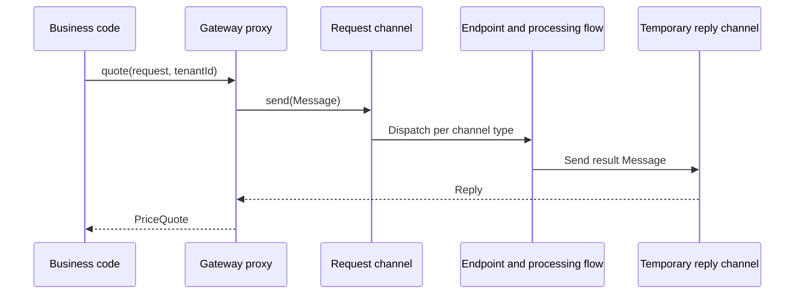

# Request Channel

## Objectives and Scope

In the **Messaging gateway** chapter of the **SPRING_INTEGRATION_CORE** module, the request channel is the channel onto which the gateway sends a request message when business code invokes a Java method. Choosing this channel also means choosing the starting point of an integration flow.

This lesson connects the gateway contract with Spring Integration's core components: `Message`, `MessageChannel`, endpoints, and Java DSL. The running example is a pricing service with two flows: standard pricing and wholesale pricing. From this example, learners can:

- Configure a default request channel and override it per method.
- Distinguish a successful request send from business completion.
- Choose `DirectChannel`, `QueueChannel`, or `ExecutorChannel` according to the desired execution model.
- Correctly explain `requestTimeout`, `replyTimeout`, and the reply return path.
- Identify wiring errors, missing consumers, and flows that produce no reply.
- Write tests verifying that the gateway places requests onto the right channel.

## 1. Where Does the Request Channel Sit in the Flow?

A call like `pricingGateway.quote(request, tenantId)` is converted by the gateway into a message. The gateway sends that message onto the configured request channel; an endpoint receives the message from the channel and performs the work.

`MessageChannel` provides the `send(...)` operation. Endpoints are the components that execute transformers, routers, or service calls. The channel itself should not be viewed as a business method. Two key interface families are `SubscribableChannel`, which dispatches to registered handlers, and `PollableChannel`, which lets consumers call `receive(...)`. See [MessageChannel and Its Sub-Interfaces](https://docs.spring.io/spring-integration/reference/channel/interfaces.html).



The diagram depicts the logical path. When each step runs and on which thread depends on the channel type.

The following three components hold distinct responsibilities:

| Component | Question it answers | Example |
|---|---|---|
| Request channel | Which flow does the request enter? | `priceRequests` |
| First endpoint | Who receives and processes the request? | Transformer normalizing SKU |
| Reply channel | Where does the result return? | Temporary channel managed by the gateway |

For a standard request–reply gateway, there is no need to create a named reply channel yourself. The gateway manages the reply destination for the call; the flow must preserve that return path. [Messaging Gateways](https://docs.spring.io/spring-integration/reference/gateway.html) describes the temporary reply channel mechanism and the role of the `replyChannel` header.

## 2. Configuring Request Channel at Two Levels

### 2.1. Interface-Level Default

```java
@MessagingGateway(
        defaultRequestChannel = "priceRequests",
        defaultRequestTimeout = "500",
        defaultReplyTimeout = "3000")
public interface PricingGateway {

    PriceQuote quote(PriceRequest request,
                     @Header("tenantId") String tenantId);
}
```

Any messaging method without its own request channel declaration uses `priceRequests`. The timeouts in the example are deliberately chosen lesson values, in milliseconds.

### 2.2. Method-Level Override

```java
@Gateway(requestChannel = "wholesalePriceRequests")
PriceQuote quoteWholesale(PriceRequest request,
                          @Header("tenantId") String tenantId);
```

The `quoteWholesale(...)` method sends to `wholesalePriceRequests`. The `quote(...)` method still uses the interface default.

Rules to remember:

1. If `@Gateway(requestChannel = "...")` is present on the method, use that setting.
2. If there is no method-specific value, use `@MessagingGateway(defaultRequestChannel = "...")`.
3. If no effective request channel configuration exists from gateway registration, configuration must be supplied; destination names are not inferred from method names.

Names in the annotations resolve to channels in the Spring context. They are not implicitly URLs, Kafka topic names, or `IntegrationFlow` bean names. Read [Javadoc for MessagingGateway](https://docs.spring.io/spring-integration/api/org/springframework/integration/annotation/MessagingGateway.html) and [Javadoc for Gateway](https://docs.spring.io/spring-integration/api/org/springframework/integration/annotation/Gateway.html) to compare the two levels of configuration.

For example, `standardPricingFlow` might be the bean name describing the entire flow, while `priceRequests` is the entry channel. Writing `defaultRequestChannel = "standardPricingFlow"` will not automatically turn a flow bean into a channel.

In XML, the corresponding configuration can be written as follows; this is only the gateway declaration snippet inside a configuration already having the Spring Integration namespace:

```xml
<int:gateway id="pricingGateway"
             service-interface="example.gateway.PricingGateway"
             default-request-channel="priceRequests"
             default-request-timeout="500"
             default-reply-timeout="3000">
    <int:method name="quoteWholesale"
                request-channel="wholesalePriceRequests"/>
</int:gateway>
```

Choose a single registration approach for the same gateway in an application. The complete example below uses annotations.

## 3. Complete Example: Two Request Channels for a Pricing Service

### 3.1. Prerequisites

The example uses Java 17 or higher, `spring-integration-core`, and compatible Spring dependencies managed by the project's BOM. Tests use JUnit Jupiter. In a Spring Boot project, you can use the Integration starter and Test starter whose versions are managed by Boot.

Place the types below in package `example.gateway`, each `public` type in a correspondingly named Java file. This is a standalone Spring Java configuration requiring no HTTP server or message broker.

### 3.2. Data Contract

`PriceRequest.java`:

```java
package example.gateway;

public record PriceRequest(String sku, int quantity) {

    public PriceRequest {
        if (sku == null || sku.isBlank()) {
            throw new IllegalArgumentException("sku must not be blank");
        }
        if (quantity <= 0) {
            throw new IllegalArgumentException("quantity must be positive");
        }
    }
}
```

`PriceQuote.java`:

```java
package example.gateway;

import java.math.BigDecimal;

public record PriceQuote(
        String sku,
        BigDecimal total,
        String tenantId,
        String pricingMode) {
}
```

The input record performs basic validation before the gateway is invoked. Prices use `BigDecimal`. Fixed unit prices only serve to illustrate the flow; a real application can read price tables from a dedicated service.

### 3.3. Gateway

`PricingGateway.java`:

```java
package example.gateway;

import org.springframework.integration.annotation.Gateway;
import org.springframework.integration.annotation.MessagingGateway;
import org.springframework.messaging.handler.annotation.Header;

@MessagingGateway(
        defaultRequestChannel = "priceRequests",
        defaultRequestTimeout = "500",
        defaultReplyTimeout = "3000")
public interface PricingGateway {

    PriceQuote quote(
            PriceRequest request,
            @Header("tenantId") String tenantId);

    @Gateway(requestChannel = "wholesalePriceRequests")
    PriceQuote quoteWholesale(
            PriceRequest request,
            @Header("tenantId") String tenantId);
}
```

In both methods:

- `request` is the payload.
- `tenantId` becomes a header via `@Header`.
- The return value is the payload of the result message, converted by the gateway to `PriceQuote`.

The business contract does not need to accept a `MessageChannel` parameter. The two methods select two explicit entry points; the caller does not need to know which endpoints handle them behind the scenes.

### 3.4. Channels and Java DSL

`PricingIntegrationConfig.java`:

```java
package example.gateway;

import java.math.BigDecimal;
import java.util.Locale;

import org.springframework.context.annotation.Bean;
import org.springframework.context.annotation.Configuration;
import org.springframework.integration.annotation.IntegrationComponentScan;
import org.springframework.integration.channel.DirectChannel;
import org.springframework.integration.config.EnableIntegration;
import org.springframework.integration.dsl.IntegrationFlow;

@Configuration
@EnableIntegration
@IntegrationComponentScan(basePackageClasses = PricingGateway.class)
public class PricingIntegrationConfig {

    @Bean
    public DirectChannel priceRequests() {
        return new DirectChannel();
    }

    @Bean
    public DirectChannel wholesalePriceRequests() {
        return new DirectChannel();
    }

    @Bean
    public IntegrationFlow standardPricingFlow() {
        return IntegrationFlow.from(priceRequests())
                .<PriceRequest, PriceRequest>transform(this::normalize)
                .<PriceRequest>handle(
                        (request, headers) -> calculate(
                                request,
                                (String) headers.get("tenantId"),
                                new BigDecimal("100000"),
                                "STANDARD"),
                        endpoint -> endpoint.requiresReply(true))
                .get();
    }

    @Bean
    public IntegrationFlow wholesalePricingFlow() {
        return IntegrationFlow.from(wholesalePriceRequests())
                .<PriceRequest, PriceRequest>transform(this::normalize)
                .<PriceRequest>handle(
                        (request, headers) -> calculate(
                                request,
                                (String) headers.get("tenantId"),
                                new BigDecimal("90000"),
                                "WHOLESALE"),
                        endpoint -> endpoint.requiresReply(true))
                .get();
    }

    private PriceRequest normalize(PriceRequest request) {
        return new PriceRequest(
                request.sku().trim().toUpperCase(Locale.ROOT),
                request.quantity());
    }

    private PriceQuote calculate(
            PriceRequest request,
            String tenantId,
            BigDecimal unitPrice,
            String mode) {

        return new PriceQuote(
                request.sku(),
                unitPrice.multiply(
                        BigDecimal.valueOf(request.quantity())),
                tenantId,
                mode);
    }
}
```

`@EnableIntegration` enables the Integration infrastructure for this Spring configuration. `@IntegrationComponentScan` locates gateway interfaces and registers proxies. Standard component scanning alone is not enough to discover `@MessagingGateway` interfaces; see [MessagingGateway registration requirements](https://docs.spring.io/spring-integration/api/org/springframework/integration/annotation/MessagingGateway.html).

The `@Bean` methods reside inside a `@Configuration` class with default proxying, so calling `priceRequests()` in the flow references the Spring-managed channel bean.

The path of a quote is typically:

```text
PricingGateway.quote(...)
    -> priceRequests
    -> transformer normalizing sku
    -> service activator calculating STANDARD price
    -> call's replyChannel
    -> PriceQuote
```

`.handle(...)` represents a service activator. The final endpoint returns an object and has no fixed output channel, so it can use the reply address on the message. `requiresReply(true)` catches accidental `null` returns from this handler. See [Service Activator: output channel, replyChannel, and requiresReply](https://docs.spring.io/spring-integration/reference/service-activator.html).

The two flows in the example have distinct bean and channel names so learners can observe destination selection. In a larger system, shared pricing logic can be extracted into a service.

### 3.5. Calling the Gateway

`PricingDemo.java`:

```java
package example.gateway;

import org.springframework.context.annotation.AnnotationConfigApplicationContext;

public class PricingDemo {

    public static void main(String[] args) {
        try (var context = new AnnotationConfigApplicationContext(
                PricingIntegrationConfig.class)) {

            PricingGateway gateway =
                    context.getBean(PricingGateway.class);

            PriceRequest request = new PriceRequest(" book-01 ", 2);

            System.out.println(gateway.quote(request, "tenant-a"));
            System.out.println(gateway.quoteWholesale(request, "tenant-a"));
        }
    }
}
```

Expected data outcomes:

| Call | Normalized SKU | Total | Mode |
|---|---|---:|---|
| `quote(...)` | `BOOK-01` | `200000` | `STANDARD` |
| `quoteWholesale(...)` | `BOOK-01` | `180000` | `WHOLESALE` |

Both results preserve `tenantId = tenant-a`. If both methods return `STANDARD`, check the request channel override configuration before checking the pricing formula.

## 4. The Request Channel Type Determines How Delivery Works

The same name `priceRequests` can point to different `MessageChannel` implementations. Changing the bean type can alter wait times and error paths even while the gateway interface stays the same.

| Channel type | Delivery mechanism | Decisions required when used as an entry point |
|---|---|---|
| `DirectChannel` | Invokes handler on the sending thread | Suited for short flows; handler duration directly affects the caller |
| `QueueChannel` | Buffers requests for a consumer to retrieve | Requires consumer/poller, capacity, and full-queue policy |
| `ExecutorChannel` | Hands off work via an executor | Requires managing pool, executor queue, and rejection policy |
| `PublishSubscribeChannel` | Broadcasts to multiple subscribers | Must explicitly design which side produces the return result |

`DirectChannel` is an easy-to-observe starting point for request–reply. It has point-to-point semantics; registering an additional consumer on the same channel creates competing consumption of requests. To record audits, design an appropriate observation branch rather than blindly adding another business consumer to this channel. Same-thread execution is noted in [Javadoc DirectChannel](https://docs.spring.io/spring-integration/api/org/springframework/integration/channel/DirectChannel.html).

`PublishSubscribeChannel` is useful for events, but requires care for a Java call expecting a single result. If multiple branches produce replies, there must be a clear rule to aggregate or select a result.

`ExecutorChannel` typically separates the processing thread from the calling thread. However, an executor using `CallerRunsPolicy` can execute the task directly on the sending thread under overload. Do not treat using an executor as an absolute guarantee that the caller is always decoupled from downstream work. Compare [channel implementations](https://docs.spring.io/spring-integration/reference/channel/implementations.html).

## 5. Switching the Entry Point to QueueChannel

Suppose the service wants to accept a bounded number of requests and process them via a poller. Replace **the `priceRequests` bean and `standardPricingFlow` flow** in the Section 3 configuration with the two declarations below; keep the remaining components.

Add imports:

```java
import org.springframework.integration.channel.QueueChannel;
import org.springframework.integration.dsl.Pollers;
```

Replacement configuration:

```java
@Bean
public QueueChannel priceRequests() {
    return new QueueChannel(20);
}

@Bean
public IntegrationFlow standardPricingFlow() {
    return IntegrationFlow.from(priceRequests())
            .<PriceRequest>handle(
                    (request, headers) -> calculate(
                            normalize(request),
                            (String) headers.get("tenantId"),
                            new BigDecimal("100000"),
                            "STANDARD"),
                    endpoint -> endpoint
                            .poller(Pollers.fixedDelay(100)
                                    .maxMessagesPerPoll(10))
                            .requiresReply(true))
            .get();
}
```

Here the first handler receives directly from the queue, so the poller is placed on that endpoint. Do not keep the old versions of the two same-named beans.

Sequence of events for a call:

1. The gateway attempts to put the request into the capacity-20 queue.
2. If space is available, the request is stored and the send operation completes.
3. The poller retrieves the request, normalizes the SKU, and calculates the price.
4. The gateway receives the reply or finishes waiting upon reply timeout.

`fixedDelay(100)` sets the delay interval between poll cycles; it does not promise each request finishes in 100 ms. `maxMessagesPerPoll(10)` limits how many messages are fetched per poll cycle, rather than creating 10 parallel workers.

When the queue is full, the send operation can wait for an available slot. The capacity constructor expresses the admission limit; see [Javadoc QueueChannel](https://docs.spring.io/spring-integration/api/org/springframework/integration/channel/QueueChannel.html).

The gateway in the example still returns `PriceQuote` synchronously to the caller. Processing on a poller thread does not automatically turn that Java method into a non-blocking immediate-return call.

Nor does the queue provide data durability by itself. With a plain `new QueueChannel(20)`, waiting requests reside in memory. If business requirements demand durably accepting work and returning a tracking ID, design storage, state, and an acceptance contract accordingly.

## 6. Understanding requestTimeout and replyTimeout Properly

### 6.1. Two Timeouts Applying to Two Phases

| Attribute | Scope | Example in this lesson |
|---|---|---|
| `requestTimeout` / `defaultRequestTimeout` | Wait time to send a request when the channel has a blocking send mechanism | Queue is full, wait at most 500 ms for a slot |
| `replyTimeout` / `defaultReplyTimeout` | Time the gateway waits for a reply after regaining control from the send | Request is in the queue, wait at most 3000 ms for the result |

`requestTimeout` is not the maximum deadline for the entire business operation. Nor does `replyTimeout` forcibly interrupt a handler running on the same thread. The Javadoc clearly specifies the send scope and when reply waiting begins; see [Gateway: requestTimeout and replyTimeout](https://docs.spring.io/spring-integration/api/org/springframework/integration/annotation/Gateway.html).

### 6.2. The DirectChannel Case

Suppose we change the configuration to:

```java
@Gateway(
        requestChannel = "priceRequests",
        requestTimeout = 100,
        replyTimeout = 200)
PriceQuote quoteFast(
        PriceRequest request,
        @Header("tenantId") String tenantId);
```

If the entire flow runs on the same thread via `DirectChannel` and the handler takes 2 seconds, these two timeouts will not make the handler stop at 100 ms or 200 ms. The calling thread is still executing the downstream work.

For HTTP, database, or external library calls, configure timeouts on the respective operations. The gateway does not replace those limits.

### 6.3. The QueueChannel Case

With a 500 ms request timeout and a 3000 ms reply timeout, possible outcomes include:

- Queue has room, handler returns result in ~200 ms: caller receives the quote.
- Queue remains full for the entire send wait: an error occurs at the request handoff stage.
- Request entered the queue, but was not picked up before the reply wait expired: caller receives no quote within the limit.
- Request was picked up, but the handler takes too long: caller may time out while the handler continues running.

Time spent waiting in the queue **after a successful send** counts toward the gateway's reply wait time. It is no longer time spent waiting for a slot to send.

With the default timeout policy configuration of the gateway in the example, expiring while waiting for a reply can return `null`. Define how the caller handles a missing result; do not treat `null` as a price of 0. Versions supporting `errorOnTimeout` let you opt into throwing an exception; check your project version's API before using it.

A caller-side timeout does not cancel a message that was already accepted. For write operations such as order creation, avoid blind retries: use a stable request ID and duplicate-processing protection. That is the design consequence of “caller stopped waiting while work kept running”.

## 7. Payload, Headers, and Request Channel Do Not Replace Each Other

In the example:

```java
PriceQuote quote(
        PriceRequest request,
        @Header("tenantId") String tenantId);
```

The payload describes the work to be done; the `tenantId` header carries context; the request channel determines the entry point.

Changing `tenantId` does not automatically change the request channel. Likewise, a custom header named `requestChannel` does not automatically override the destination configured on the gateway.

When a flow needs to be selected based on content, there are two easy-to-follow design options:

- If they are two distinct business capabilities, use two methods with separate request channels, such as `quote` and `quoteWholesale`.
- If it is one capability with internal routing rules, send to a shared channel and place a router inside the flow.

For example, the gateway could expose only `quote(...)`, while a router inspects customer tier to pick a price table. Then the caller does not have to decide channel names or pricing modes.

Do not pass multiple unmapped parameters into a gateway expecting the framework to guess the payload. For complex contracts, group business data into a request object; use headers for metadata that needs to travel with the message.

## 8. Connecting with Transformers, Routers, Filters, and Aggregators

The request channel only determines the entry point. Downstream integration patterns must collectively satisfy the gateway's reply contract.

| Downstream component | Example in the pricing service | What must be clarified for request–reply |
|---|---|---|
| Transformer | Normalize SKU | Preserve context needed by subsequent steps |
| Router | Select price table by customer group | Every valid branch needs an appropriate termination path |
| Filter | Reject unquotable items | Choose an error or rejection result; avoid silently dropping and leaving caller waiting |
| Aggregator | Gather quotes from multiple suppliers | Specify completion conditions and handling for incomplete groups |
| Service activator | Calculate total price | Return the exact data type required by the gateway contract |

For instance, if a request passes through `priceRequests` but is dropped by a filter, a “successful send” produces no `PriceQuote`. Similarly, an aggregator waiting for three suppliers when only two branches reply can cause the gateway to time out.

Design business deadlines for branches and aggregation steps to fit the duration callers are willing to wait. Do not merely increase the reply timeout when the root cause is a branch that never produces a result.

When reusing smaller flows, input channels can act as connection points between them. [Integration Flows Composition](https://docs.spring.io/spring-integration/reference/dsl/integration-flows-composition.html) explains composing flows via channels and DSL operators.

## 9. Common Errors and How to Isolate Them

### 9.1. Mismatched Channel Name

```java
@MessagingGateway(defaultRequestChannel = "priceRequest")
// Bean in the configuration is actually named priceRequests.
```

The configured destination does not match the bean. Check the channel name, bean type, and the context registering it. Depending on how gateways are initialized and resolved, the error may surface at context startup or when invoking the method; do not rely solely on the application starting up to conclude destinations are valid.

### 9.2. Channel Exists Without a Receiving Endpoint

With `DirectChannel`, a registered handler is required. When an error reports no subscribers, check that the flow is registered and started, and that the input name matches.

With `QueueChannel`, messages can be buffered even when no consumer exists. In that case, the caller usually appears to wait for a reply while the queue grows. Check the poller and the endpoint pulling messages out.

### 9.3. Endpoint Exists Without a Reply

Causes include a handler returning `null`, a branch ending in a sink, a filter dropping the message, or the result being sent to an output channel that never leads back to the gateway.

`requiresReply(true)` on the pricing handler only enforces a reply from that handler. It does not automatically fix every reply-losing branch across the entire flow.

### 9.4. Changing Channels Changes Error Propagation

In a same-thread flow, downstream errors can travel back to the caller via the call stack. When processing runs through an executor or poller, you cannot rely solely on throwing an exception from a worker to make the error appear on the caller's stack; Spring Integration's error messaging mechanism is needed.

The gateway and error-handling infrastructure coordinate via `errorChannel`, message headers, and the reply path. If a dedicated error flow is configured, decide whether it produces a fallback result, propagates the error to the caller, or only records the error. A branch that only logs does not implicitly produce a quote to return. See [Error Handling](https://docs.spring.io/spring-integration/reference/error-handling.html).

Quick triage table:

| Symptom | Check first |
|---|---|
| Cannot inject gateway | Package scan and gateway proxy registration |
| Cannot resolve destination | Request channel name and bean type |
| Direct channel reports no subscribers | Entry flow/endpoint |
| Queue grows, caller waits | Consumer, poller, and processing throughput |
| Handler ran yet caller has no result | Reply type, output channel, reply headers |
| Changing tenant still enters the same flow | Valid configuration if no router reads tenant yet |

## 10. Testing Request Channel Selection

The sample tests below use the `DirectChannel` configuration from Section 3. They illustrate how to verify the contract; do not run them simultaneously with the queue variant without adjusting bean types in the test.

`PricingGatewayTest.java`:

```java
package example.gateway;

import java.math.BigDecimal;
import java.util.concurrent.atomic.AtomicReference;

import org.junit.jupiter.api.Test;
import org.springframework.context.annotation.AnnotationConfigApplicationContext;
import org.springframework.integration.channel.DirectChannel;
import org.springframework.messaging.Message;
import org.springframework.messaging.MessageChannel;
import org.springframework.messaging.support.ChannelInterceptor;

import static org.junit.jupiter.api.Assertions.assertEquals;
import static org.junit.jupiter.api.Assertions.assertNotNull;

class PricingGatewayTest {

    @Test
    void usesDefaultRequestChannel() {
        try (var context = new AnnotationConfigApplicationContext(
                PricingIntegrationConfig.class)) {

            PricingGateway gateway =
                    context.getBean(PricingGateway.class);

            PriceQuote quote = gateway.quote(
                    new PriceRequest(" book-01 ", 2),
                    "tenant-a");

            assertNotNull(quote);
            assertEquals("BOOK-01", quote.sku());
            assertEquals("STANDARD", quote.pricingMode());
            assertEquals("tenant-a", quote.tenantId());
            assertEquals(0,
                    new BigDecimal("200000").compareTo(quote.total()));
        }
    }

    @Test
    void methodOverrideSendsToWholesaleChannel() {
        try (var context = new AnnotationConfigApplicationContext(
                PricingIntegrationConfig.class)) {

            AtomicReference<Message<?>> captured =
                    new AtomicReference<>();

            DirectChannel channel = context.getBean(
                    "wholesalePriceRequests", DirectChannel.class);

            channel.addInterceptor(new ChannelInterceptor() {
                @Override
                public Message<?> preSend(
                        Message<?> message,
                        MessageChannel messageChannel) {

                    captured.set(message);
                    return message;
                }
            });

            PriceRequest request = new PriceRequest(" book-01 ", 2);

            PriceQuote quote = context.getBean(PricingGateway.class)
                    .quoteWholesale(request, "tenant-a");

            Message<?> sent = captured.get();

            assertNotNull(sent);
            assertEquals(request, sent.getPayload());
            assertEquals("tenant-a",
                    sent.getHeaders().get("tenantId"));

            assertNotNull(quote);
            assertEquals("WHOLESALE", quote.pricingMode());
            assertEquals(0,
                    new BigDecimal("180000").compareTo(quote.total()));
        }
    }
}
```

The first test verifies that a non-overridden method uses the default flow. The second test observes the target channel itself, checks the payload/headers at entry, and verifies the wholesale result. The payload at `preSend` still holds the original SKU because the transformer has not run yet.

When practicing the queue variant, add the following scenarios in a separate context:

| Scenario | Setup | Observed outcome |
|---|---|---|
| Queue has room, poller active | Consumer returns normal result | `PriceQuote` received |
| Queue is full | Fill to capacity, prevent consumer from pulling | Request send fails after wait timeout |
| Accepted but missing reply | Allow message retrieval then terminate without returning a result | Caller handles expiration |
| Worker replies late | Control worker with a latch | Caller timing out does not mean work was canceled |

Timeout tests should use tolerances and coordinate ordering with latches. Avoid asserting “exactly 500 ms”, as schedulers and runtime environments can skew measured timings.

## 11. Request Channel Design Workflow

When adding a gateway for a new feature, follow this sequence:

1. **Define the call contract:** does the caller need an immediate result, or only acceptance confirmation?
2. **Name the entry point:** use a name reflecting the request group, such as `priceRequests` or `invoiceCommands`.
3. **Choose the channel type:** weigh same-thread execution, worker handoff, or bounded buffering.
4. **Wire the receiving endpoint:** having a channel is not enough; an appropriate consumer must exist.
5. **Design termination paths:** success, business rejections, and errors must all have explicit behavior.
6. **Set time limits:** distinguish send wait, reply wait, and downstream resource timeouts.
7. **Verify the entry point:** call both default and overridden methods, observing the actual channels.

For example, a screen requiring an immediate quote can start with `DirectChannel` and an explicitly timed-out read. A batch ingestion process may need a bounded queue, admission policy, and job tracking ID. These two cases differ in the contract the caller needs, not merely in processing speed.

## 12. Key Takeaways

A request channel connects a gateway method to the entry point of a message flow. `defaultRequestChannel` sets the interface default; `@Gateway(requestChannel = "...")` selects a per-method destination.

The channel type dictates how requests are delivered. To understand wait times and errors, inspect the channel type, the receiving endpoint, and all downstream steps together.

A complete request–reply configuration must accomplish three things: receive requests in the right place, process them per contract, and return results or errors to the caller with well-defined behavior.