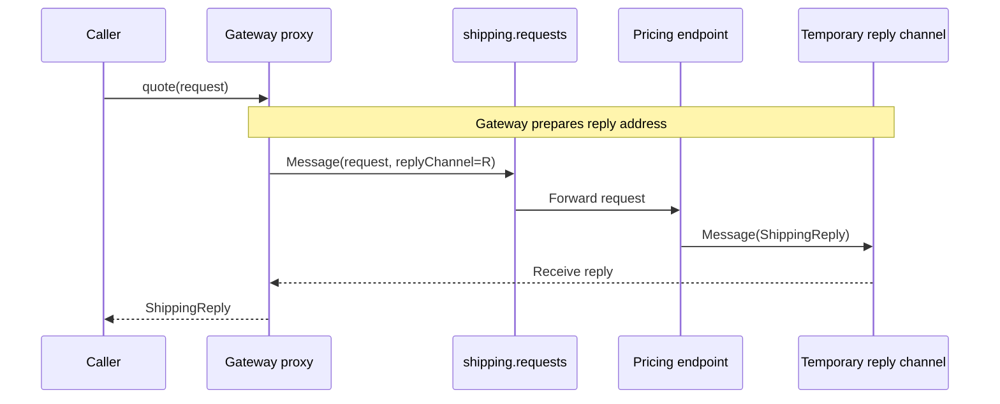
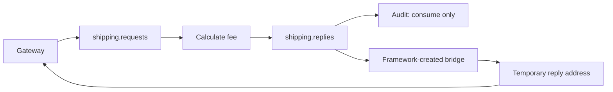

# Reply Channel

## 1. The Problem to Solve

A sales application calls a method to calculate shipping fees:

```java
ShippingReply reply = shippingGateway.quote(
        new ShippingRequest("ORDER-101", 3));
```

After this call, the request may pass through a data-normalizing transformer, a carrier-selecting router, and a pricing endpoint. The result must return to the exact `quote()` call that is waiting, even when multiple orders are processed concurrently. Knowing the path to the pricing endpoint is not enough to determine the return path.

In the **Messaging gateway** chapter of the **SPRING_INTEGRATION_CORE** module, the reply channel is the link connecting `Message`, `MessageChannel`, endpoints, and the gateway's return value. Understanding this link helps you design Java DSL flows with clear replies, spot branches that lose replies, and test the request–reply contract.

After this lesson, you should be able to answer three questions: who provides the reply address, which address an endpoint chooses, and what happens when the reply never arrives.

## 2. Reply Channel Is a Channel Role

**Reply channel** is the channel that receives reply messages in a request–reply exchange. It is a role in the processing flow; Spring Integration does not require every reply channel to have the same implementation class or bean name.

For example, requests are sent to `shipping.requests`. The final endpoint produces `ShippingReply`; the gateway extracts the reply message's payload and completes the `quote()` call.

| Component | Role in the example |
| --- | --- |
| Gateway interface | Exposes the `quote()` method to business code |
| Request channel | Delivers the request into the pricing flow |
| Reply-producing endpoint | Computes the fee result and sends the reply |
| Reply channel | Receives the reply to complete the exchange |
| Caller | Receives `ShippingReply`, or handles errors/missing replies per contract |

Do not infer functionality from channel names. A bean named `shipping.replies` only participates in the reply path if endpoint and gateway configuration actually wires into it.

## 3. Distinguishing Headers from Gateway Configuration

Several places bear the words “reply channel” yet sit at different layers:

| Location | Example | Meaning |
| --- | --- | --- |
| Request header | `MessageHeaders.REPLY_CHANNEL`, whose actual name is `replyChannel` | Return address attached to the message |
| Gateway configuration | `@MessagingGateway(defaultReplyChannel = "shipping.replies")` | Named reply channel used by default for methods |
| Per-method configuration | `@Gateway(replyChannel = "priority.replies")` | Overrides the default reply channel for that method |
| Endpoint output | `outputChannel` or `.channel("shipping.replies")` | Routes the endpoint's result to an explicitly configured channel |

`defaultReplyChannel` and `replyChannel` in annotations are **configured channel names**. The `replyChannel` header can hold a `MessageChannel` instance or a string to be resolved. An arbitrary string is only useful when the resolution infrastructure can locate the corresponding channel.

Method-level attributes are documented in [Javadoc for `@Gateway`](https://docs.spring.io/spring-integration/docs/6.2.6/api/org/springframework/integration/annotation/Gateway.html). Standard header keys are declared in [Javadoc for `MessageHeaders`](https://docs.spring.io/spring-framework/docs/current/javadoc-api/org/springframework/messaging/MessageHeaders.html).

## 4. Temporary Reply Path Created by the Gateway

For a gateway that returns a value, declaring a reply channel is usually unnecessary. The gateway creates a temporary, anonymous reply channel with point-to-point semantics and places that address in the `replyChannel` header. If a named reply channel is configured, the framework connects that channel to the temporary reply path via a bridge. This mechanism is presented in [Setting the Default Reply Channel](https://docs.spring.io/spring-integration/reference/6.5/gateway.html#gateway-default-reply-channel).



The diagram describes send-and-receive relationships. It does not assert that each arrow runs on a separate thread. With `DirectChannel`, the fee calculation can run directly on the thread calling the gateway.

Imagine two requests A and B carrying two reply addresses RA and RB. An endpoint finishing B first can still send B to RB and then A to RA. Do not replace all these addresses with a single shared queue and assume receive order will always match call order.

The reply channel fulfills the **Return Address** role. An `orderId` in the payload identifies the order; a `correlationId` may serve grouping; neither by itself becomes the return address for replies.

## 5. How Does an Endpoint Decide Where to Send Its Result?

For a service activator producing a non-`null` result, the output lookup order is:

1. Output channel configured on the endpoint.
2. The request's `replyChannel` header if no configured output channel exists.
3. The `replyChannel` header on the result if the result is a `Message` and the request lacked this header.

A string-based address must resolve to a channel. Without a valid output destination, producing a result payload is not enough to complete the exchange. Exact rules are described in [Service Activator](https://docs.spring.io/spring-integration/reference/6.5/service-activator.html).

For example, the following flow still has a persistence step after calculating the fee:

```java
IntegrationFlow.from("shipping.requests")
        .handle(shippingService, "quote")
        .channel("shipping.persist")
        .handle(shippingStore, "saveAndReturn")
        .get();
```

`shippingService` and `shippingStore` here are illustrative beans. `quote()` creates an intermediate result; the configured output sends that result to `shipping.persist`. Only when `saveAndReturn()` returns a result and the final endpoint can use the reply address does the caller receive a reply.

If `saveAndReturn()` is changed to a `void` method, the flow stops at the save operation. The fact that `quote()` returned an object mid-flow does not ensure the gateway receives that object.

## 6. Java DSL Example: Calculating Fees and Returning via Header

The example uses Java 17+ and the Spring Integration 6.5 API. The project requires `spring-integration-core`; when using Spring Boot, declare `spring-boot-starter-integration` and let the project's dependency management select compatible versions.

The snippets below are illustrative Java files in package `example.reply`. Fee amounts only serve to practice the reply mechanism.

### 6.1. Business Data Types

```java
package example.reply;

public record ShippingRequest(String orderId, int weightKg) {
}
```

```java
package example.reply;

public record ShippingReply(String orderId, int feeVnd) {
}
```

Keeping `orderId` in the reply helps callers and tests confirm which order the result belongs to. It adds business verification alongside the framework's reply mechanism.

### 6.2. Gateway Interface

```java
package example.reply;

import org.springframework.integration.annotation.MessagingGateway;

@MessagingGateway(
        defaultRequestChannel = "shipping.requests",
        defaultReplyTimeout = "2000")
public interface ShippingGateway {

    ShippingReply quote(ShippingRequest request);
}
```

The interface does not declare `defaultReplyChannel`. The temporary reply path satisfies the one-reply-per-call requirement. The timeout is set explicitly so the example does not rely on version-specific defaults.

### 6.3. Declaring Channel and Processing Flow

```java
package example.reply;

import org.springframework.context.annotation.Bean;
import org.springframework.context.annotation.Configuration;
import org.springframework.integration.annotation.IntegrationComponentScan;
import org.springframework.integration.channel.DirectChannel;
import org.springframework.integration.config.EnableIntegration;
import org.springframework.integration.dsl.IntegrationFlow;
import org.springframework.messaging.MessageChannel;

@Configuration
@EnableIntegration
@IntegrationComponentScan(basePackageClasses = ShippingGateway.class)
public class ShippingConfiguration {

    @Bean(name = "shipping.requests")
    public MessageChannel shippingRequests() {
        return new DirectChannel();
    }

    @Bean
    public IntegrationFlow shippingFlow() {
        return IntegrationFlow.from("shipping.requests")
                .handle(ShippingRequest.class, (request, headers) -> {
                    if (request.weightKg() <= 0) {
                        throw new IllegalArgumentException(
                                "weightKg must be positive");
                    }
                    int fee = 20_000 + request.weightKg() * 5_000;
                    return new ShippingReply(request.orderId(), fee);
                })
                .get();
    }
}
```

`@IntegrationComponentScan` registers the gateway interface as a proxy. The final handler returns `ShippingReply` with no configured output channel, so the reply path is taken from the request. The caller receives the `ShippingReply` payload rather than manually receiving a `Message` from a channel.

### 6.4. Calling the Gateway

```java
package example.reply;

import org.springframework.context.annotation.AnnotationConfigApplicationContext;

public class ShippingDemo {

    public static void main(String[] args) {
        try (var context = new AnnotationConfigApplicationContext(
                ShippingConfiguration.class)) {
            ShippingGateway gateway = context.getBean(ShippingGateway.class);
            ShippingReply reply = gateway.quote(
                    new ShippingRequest("ORDER-101", 3));
            System.out.println(reply);
        }
    }
}
```

Expected output:

```text
ShippingReply[orderId=ORDER-101, feeVnd=35000]
```

Follow the full contract: the gateway sends `ShippingRequest`, the handler produces the right reply type, the header provides the return path, and the proxy completes the Java method.

## 7. When a Named Reply Channel Is Needed

Suppose operations wants to observe every completed quote. Replies can pass through a named channel while preserving the return path back to the gateway.

This is a **replacement variant** for the configuration in Section 6. Do not register a second gateway with the same interface or a second `shippingFlow` consuming the same requests alongside these snippets.

First, update the annotation on `ShippingGateway`:

```java
@MessagingGateway(
        defaultRequestChannel = "shipping.requests",
        defaultReplyChannel = "shipping.replies",
        defaultReplyTimeout = "2000")
public interface ShippingGateway {
    ShippingReply quote(ShippingRequest request);
}
```

Add the following bean to `ShippingConfiguration`, importing `org.springframework.integration.channel.PublishSubscribeChannel`:

```java
@Bean(name = "shipping.replies")
public PublishSubscribeChannel shippingReplies() {
    return new PublishSubscribeChannel();
}
```

In `shippingFlow()`, add `.channel("shipping.replies")` immediately after `.handle(...)` and before `.get()`. Also add the observation flow:

```java
@Bean
public IntegrationFlow shippingReplyAuditFlow() {
    return IntegrationFlow.from("shipping.replies")
            .handle(message -> {
                ShippingReply reply = (ShippingReply) message.getPayload();
                System.out.printf("Quoted %s: %d VND%n",
                        reply.orderId(), reply.feeVnd());
            })
            .get();
}
```

Relationship between the components:



Declaring `defaultReplyChannel` on the gateway does not automatically route every endpoint's output to that channel. In the example, `.channel("shipping.replies")` sends the pricing result to the broadcast point. The reply address header must still remain intact so the bridge can deliver the reply back to the right call.

`PublishSubscribeChannel` broadcasts messages to subscribers; `DirectChannel` and `QueueChannel` have point-to-point semantics. Consequently, adding audit as a consumer on a point-to-point channel could cause audit to steal messages intended for the reply path. Details of channel types are described in [Message Channel Implementations](https://docs.spring.io/spring-integration/reference/6.5/channel/implementations.html).

The audit branch in the example only consumes. If that branch also produced replies to the same temporary address, one request could generate competing responses. For time-consuming audits, design offloading to a separate branch with error and overload policies; a named channel does not by itself create thread isolation.

## 8. Preserving the Reply Address When Transforming Messages

In a multi-step flow, the payload may change from request to normalized data and finally to the final result. The reply address must still survive across those segments.

An obvious risk lies in custom code that manually builds and sends messages, such as a `MessageHandler`:

```java
// request is the received Message<?>; nextChannel is the output MessageChannel.
ShippingRequest input = (ShippingRequest) request.getPayload();
ShippingReply result = new ShippingReply(input.orderId(), 35_000);

// Request headers are lost in this manual send operation.
nextChannel.send(MessageBuilder.withPayload(result).build());
```

If downstream expects the `replyChannel` header, it no longer knows the return path. In a custom bridge that must continue the same exchange, copy headers using `org.springframework.messaging.support.MessageBuilder`:

```java
Message<ShippingReply> outgoing = MessageBuilder.withPayload(result)
        .copyHeaders(request.getHeaders())
        .build();

if (!nextChannel.send(outgoing)) {
    throw new IllegalStateException("Cannot forward shipping reply");
}
```

This snippet requires importing `org.springframework.messaging.Message`. Headers are copied according to the builder's rules; do not assume this preserves the `id` and `timestamp` of every message. The standard header map is immutable, so do not modify it directly via `request.getHeaders().put(...)`. See [MessageHeaders](https://docs.spring.io/spring-framework/docs/current/javadoc-api/org/springframework/messaging/MessageHeaders.html).

Distinguish the **manual send** above from returning a payload or `Message` from an endpoint that uses the framework's header-propagation mechanism. You cannot conclude every new `Message` returned from a transformer loses `replyChannel`; check how the enclosing endpoint handles headers.

At JMS, message-store, or serialization boundaries, an in-JVM channel object is not an address that can be sent verbatim to another process. Spring Integration has `HeaderChannelRegistry` to map channels to strings and resolve them back within the registry's context, per [Header Channel Registry](https://docs.spring.io/spring-integration/reference/6.5/content-enrichment.html#header-channel-registry).

The registry has a lifecycle and retention duration for mappings. For replies from external services, explicitly define the transport reply destination, correlation, and where replies are forwarded back to the gateway. Turning a channel reference into a string does not automatically create a cross-process reply protocol.

## 9. Timeouts and Missing-Reply Cases

The reply channel provides the return path; it does not force every processing branch to produce a reply.

| Scenario in the pricing flow | Impact to consider |
| --- | --- |
| Handler returns non-`null` result and return path is valid | Gateway can complete with the result |
| Handler returns `null` or `void` | No reply is created at that step |
| Filter drops request without throwing an error | Processing branch may stop before the reply-producing step |
| Router fails to route request to a result-producing branch | Caller may wait with no reply |
| Aggregator has not met release conditions | Aggregated reply has not been created yet |
| Result is sent to `nullChannel` | Result is consumed and does not reach caller via that path |
| Reply arrives after caller times out | Do not assume the caller will receive late results |

In a regular synchronous gateway, timing out while waiting for a reply can return `null`. Spring Integration 6.2+ provides the `errorOnTimeout` option to throw `MessageTimeoutException` instead. Timeout does not cancel downstream work; with `DirectChannel`, if the handler is still running on the caller thread, `replyTimeout` cannot interrupt the handler. This timeout scope and behavior are explained at [Gateway Behavior When No response Arrives](https://docs.spring.io/spring-integration/reference/6.5/gateway.html#gateway-no-response).

Example of a fully synchronous flow:

```text
t = 0 ms       Caller enters gateway, handler starts running
t = 2000 ms    Handler is still running on the caller's own thread
t = 5000 ms    Handler finally finishes and sends reply
```

Setting `defaultReplyTimeout = "2000"` does not turn this call into a two-second deadline. To bound HTTP or database calls inside the handler, configure appropriate timeouts on those operations themselves.

If there is a handoff to another thread, such as `ExecutorChannel`, the caller gets a chance to return to the gateway and wait for the reply for the configured duration. Upon timeout, downstream processing can still continue creating side effects. Therefore, if the caller resends a fee-calculation or shipment-creation request, define a business key to detect duplicate executions.

`requestTimeout` relates to sending into a potentially blocking request channel, such as a full queue. `replyTimeout` relates to waiting for a reply. Do not treat either value as proof that the total duration of the entire call is bounded.

## 10. Reply Channel, Error Channel, and One-Way Gateways

The reply channel serves reply messages; the error channel serves error messages. An error flow intending to return a fallback result must produce a reply matching the gateway's return type and preserve the exchange's return path.

Suppose `ShippingReply` only has `orderId` and `feeVnd`. Turning an error into the string `"TIMEOUT"` and returning it to `ShippingGateway.quote()` creates an inconsistent type contract. If failure status must be returned as business data, design a result type with an explicit status field or choose an exception-throwing contract.

A branch that merely logs and terminates produces no `ShippingReply`. Explicitly decide whether the caller receives an error, receives a fallback result, or waits until timeout; do not treat logging as a reply.

For `void`-returning gateway methods, the caller does not wait for a business result. In Spring Integration 6.5, if no explicit reply header is supplied, the framework uses `nullChannel` for replies emitted by this kind of method. This behavior is documented in [Messaging Gateways documentation](https://docs.spring.io/spring-integration/reference/6.5/gateway.html). Even so, a `void` signature does not automatically cause the handler to run on another thread.

## 11. Calling a Subflow with Java DSL

Besides interface gateways for callers, Java DSL has the `.gateway(...)` operator for one flow to invoke another flow and receive a result before continuing. This role is described in [Operator gateway()](https://docs.spring.io/spring-integration/reference/6.5/dsl/java-gateway.html).

Structural example:

```java
IntegrationFlow.from("checkout.requests")
        .gateway("shipping.requests")
        .handle(checkoutService, "attachShippingQuote")
        .get();
```

`checkoutService` is an illustrative bean. In this design, `attachShippingQuote()` must accept the result returned by the pricing flow. If the original checkout data is also needed, keep it in a wrapper payload, appropriate headers, or use an enricher pattern; `.gateway()` does not automatically merge every input payload with the reply payload.

There are two exchange scopes: checkout waits for the pricing part, and then overall checkout returns a result to the external caller. Do not replace nested reply addresses with a single shared channel merely because all replies happen to share a Java type.

## 12. Testing the Reply Path

Testing should start from the contract of what the caller receives. Then inspect headers and routing when diagnosing configuration.

For the basic configuration in Section 6, the following JUnit Jupiter example tests both the gateway and the endpoint. The project needs the corresponding JUnit Jupiter test dependency.

```java
package example.reply;

import org.junit.jupiter.api.Test;
import org.springframework.context.annotation.AnnotationConfigApplicationContext;
import org.springframework.integration.channel.QueueChannel;
import org.springframework.messaging.Message;
import org.springframework.messaging.MessageChannel;
import org.springframework.messaging.support.MessageBuilder;

import static org.junit.jupiter.api.Assertions.assertEquals;
import static org.junit.jupiter.api.Assertions.assertNotNull;

class ShippingReplyChannelTest {

    @Test
    void returnsQuoteToGatewayCaller() {
        try (var context = new AnnotationConfigApplicationContext(
                ShippingConfiguration.class)) {
            ShippingGateway gateway = context.getBean(ShippingGateway.class);

            ShippingReply reply = gateway.quote(
                    new ShippingRequest("ORDER-101", 3));

            assertEquals(new ShippingReply("ORDER-101", 35_000), reply);
        }
    }

    @Test
    void endpointUsesReplyAddressFromRequest() {
        try (var context = new AnnotationConfigApplicationContext(
                ShippingConfiguration.class)) {
            MessageChannel requests = context.getBean(
                    "shipping.requests", MessageChannel.class);
            QueueChannel replies = new QueueChannel(1);

            requests.send(MessageBuilder
                    .withPayload(new ShippingRequest("ORDER-202", 2))
                    .setReplyChannel(replies)
                    .build());

            Message<?> response = replies.receive(0);
            assertNotNull(response);
            assertEquals(new ShippingReply("ORDER-202", 30_000),
                    response.getPayload());
        }
    }
}
```

In the second test, `replies` is a test-supplied reply address, not the gateway's internal temporary channel. Because Section 6's configuration uses `DirectChannel`, the handler has already finished when `requests.send(...)` returns; `receive(0)` inspects the result immediately without `sleep`.

When switching to the variant with fixed output `shipping.replies`, the test supplying a direct reply address must be adapted to that topology. Do not treat tests of the basic configuration as covering every variant.

Additional scenarios worth testing in a real deployment:

| Scenario | What to prove |
| --- | --- |
| Two requests with different `orderId` and weights running concurrently | Each caller receives the right order and fee |
| Filter rejects a request | Caller receives the chosen rejection behavior instead of waiting inexplicably |
| Handler required to reply returns `null` | `requiresReply` on the endpoint catches the contract violation |
| Audit branch is added | Caller still receives exactly one business result |
| Async downstream replies late | Timeout occurs per config and late results have explicit handling |
| Custom code builds and manually sends messages | Necessary reply address is preserved |

To test timeouts in an asynchronous flow, coordinate workers with a latch or barrier and bounded wait times. Avoid simply adding `Thread.sleep()` and inferring the reply path is correct.

## 13. Diagnosing When the Caller Receives No Result

Suppose logs show the fee was calculated, yet `quote()` does not return the right result. Trace the reply path in order:

1. Confirm the gateway actually expects a result and the final endpoint produces the right payload type.
2. Observe the `replyChannel` header on the request at flow entry and before the result-sending step.
3. Check whether a fixed output channel diverts the result to another branch before returning to the gateway.
4. For named channels, confirm the bean exists, has the right consumer, and replies are actually sent there.
5. Check whether filters, routers, aggregators, or `void` sinks stop the reply-producing branch.
6. Identify whether thread switches occur so timeouts are interpreted accurately.
7. Compare `orderId`, completion timestamps, and caller timeout timestamps to distinguish a lost return path from a late reply.

If the requirement is “create a shipment over several minutes and notify later”, consider returning a task ID and emitting a completion event. A temporary reply address tied to the current call does not replace lifecycle design for long-running work.

## 14. Key Takeaways

- `replyChannel` is a reply address in the message; a named reply channel is a gateway- or flow-level configuration.
- For one-reply-per-call exchanges, start with the gateway-managed temporary mechanism.
- When replies must be observed via a named channel, wire the output to that channel and choose appropriate dispatch semantics.
- A result payload reaches the caller only when the reply path remains valid and the processing branch actually sends a reply.
- Timeouts, errors, and non-replying branches are all part of the request–reply contract that must be designed and tested.