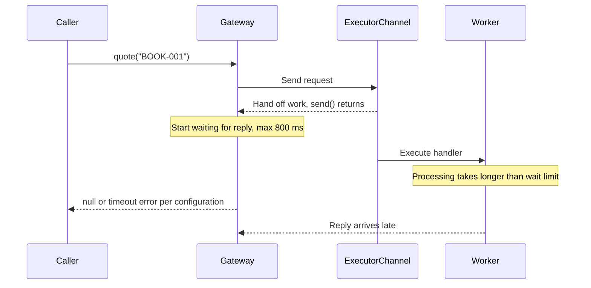

# Reply Timeout in Messaging Gateway

> In the Messaging gateway chapter of SPRING_INTEGRATION_CORE, `replyTimeout` helps determine how long the caller will wait for a response during the reply-receiving phase. To design it properly, you need to examine `Message`, `MessageChannel`, endpoints, and execution-thread boundaries together.

## 1. The Problem: Calling a Java Method While the Reply Travels Through Messaging

Suppose an application looks up a price through a gateway:

```java
String price = priceGateway.quote("BOOK-001");
```

From the caller's perspective, this is a method call needing a `String`. Internally, the gateway turns the parameter into a message, sends it to the request channel, and waits for a reply to produce the return value.

In an integration flow, not every request produces a reply: a filter may drop the message; a handler may return `null`; a router may lead to a log-only branch; an aggregator may not have enough elements to release yet. A service might also still be processing when the caller has already waited too long.

This lesson aims at three things: configuring explicit wait times, accurately explaining behavior when changing channel types, and designing an appropriate contract for returning results or reporting errors to the caller.

The examples use Java 17+, Spring Integration 6.5.x, and Java DSL with `IntegrationFlow.from(...)`. Timeout values are configured explicitly so learners do not have to rely on defaults from another version.

## 2. Which Phase Does Reply Timeout Control?

### 2.1. Two Phases to Distinguish

| Attribute | Affected phase | Typical scenario | What does it NOT guarantee? |
| --- | --- | --- | --- |
| `requestTimeout` | Sending the request to the request channel, if the send operation supports bounded waiting | A capacity-bounded `QueueChannel` is full | Does not impose an execution limit on a handler running directly inside `send()` |
| `replyTimeout` | Waiting to receive a reply after the send operation returns control to the gateway | Request handed off to an executor or queue | Does not automatically cancel downstream work, roll back, or stop I/O |

Timeout values are in **milliseconds**: `800` means 0.8 seconds. `requestTimeout` applies to potentially blocking send operations; do not interpret it as the execution deadline for the entire gateway method. See [JavaDoc `Gateway.requestTimeout()`](https://docs.spring.io/spring-integration/docs/6.5.0/api/org/springframework/integration/annotation/Gateway.html#requestTimeout()).

### 2.2. When the Timer Starts

The decisive point is: the reply wait timer starts **when the request-sending thread returns to the gateway**, after `send()` returns control. The timer does not inherently start the instant the application calls the method. This rule is stated directly in [JavaDoc `Gateway.replyTimeout()`](https://docs.spring.io/spring-integration/docs/6.5.0/api/org/springframework/integration/annotation/Gateway.html#replyTimeout()).

To analyze a call, you can use the following approximate model:

```text
Duration observed by caller
  ≈ request creation time
  + time before send() returns
  + reply wait time
  + result conversion / error handling time
```

This is an analysis model, not a real-time guarantee formula. `replyTimeout` only bounds the reply wait portion; the other parts can still stretch out. If an error flow executes additional synchronous work, the caller must wait for that work as well.

### 2.3. Positive, Zero, and Negative Values

| Value | Interpretation during reply reception | Design consequence |
| --- | --- | --- |
| `> 0` | Wait at most the configured number of milliseconds | Use when the caller requires a finite wait limit |
| `0` | Do not wait further if no reply is present at receive time | An already-ready reply can still be retrieved; does not turn the gateway into a one-way send |
| `< 0` | Wait indefinitely | Can block the caller forever if the flow emits no reply |

For `@MessagingGateway` and `@Gateway` annotations in Spring Integration 6.5.0, the default published in the JavaDoc is `30000` ms. Even so, set a value suited to your application's contract. See [`@MessagingGateway` defaults](https://docs.spring.io/spring-integration/docs/6.5.0/api/org/springframework/integration/annotation/MessagingGateway.html#defaultReplyTimeout()) and [channel receive timeout conventions](https://docs.spring.io/spring-integration/reference/6.5/channel/implementations.html#channel-implementations-queuechannel).

Do not mechanically apply this default to every HTTP/TCP/JMS gateway or every Spring Integration version. This lesson focuses on gateway proxies invoked from Java methods.

## 3. Thread Boundaries Determine Practical Effectiveness

### 3.1. Flow with Only DirectChannel

Suppose the entire flow runs on the caller's thread:

```text
caller → gateway → DirectChannel → handler → reply
                   same execution thread
```

Set `replyTimeout = 200` ms and suppose the handler takes about 1,200 ms to return a result. While the handler has not finished, `send()` has not yet returned to the gateway. The caller may receive the result after more than 1,200 ms, even though the configuration says 200 ms. By the time the gateway reaches the receive phase, the handler's reply is already ready.

If the handler blocks forever along this synchronous path, lowering `replyTimeout` to 1 ms still will not release the caller. Behavior for synchronous flows vs. flows handing off to another thread is presented in [Messaging Gateways — Gateway Behavior When No Response Arrives](https://docs.spring.io/spring-integration/reference/6.5/gateway.html#gateway-no-response).

### 3.2. Flow with ExecutorChannel

With an executor that actually runs work on another thread, the send operation can return to the gateway once the work is accepted by the executor. The caller begins waiting for the reply while the worker processes:



The diagram illustrates one possible execution schedule; the worker can also start before `send()` returns. The critical milestone remains when the gateway enters reply reception.

`ExecutorChannel` delegates work to an `Executor`; the executor itself determines how execution happens. `SyncTaskExecutor` or an overload policy running tasks on the caller thread can eliminate the expected asynchronous boundary. Additionally, a transaction bound to the caller thread does not automatically follow the worker. See [JavaDoc `ExecutorChannel`](https://docs.spring.io/spring-integration/docs/6.5.0/api/org/springframework/integration/channel/ExecutorChannel.html).

### 3.3. QueueChannel Also Needs a Consumer

With `QueueChannel`, a successful send means the request has been placed in the queue. To get a reply, a consumer is required—typically a polling endpoint. If there is no consumer, the caller can still time out even though the send operation succeeded.

In a queue-based design example, time waiting for the consumer to poll the message, waiting for resources, and executing the handler all consume the reply wait budget. A full queue prior to a successful send instead relates to `requestTimeout`. This send/receive mechanism is described in [QueueChannel](https://docs.spring.io/spring-integration/reference/6.5/channel/implementations.html).

## 4. Configuration via Annotations

### 4.1. Gateway Defaults and Per-Method Overrides

```java
package demo.integration.timeout;

import org.springframework.integration.annotation.Gateway;
import org.springframework.integration.annotation.MessagingGateway;

@MessagingGateway(
        defaultRequestChannel = "priceRequests",
        defaultRequestTimeout = "100",
        defaultReplyTimeout = "800")
public interface PriceGateway {

    String quote(String sku);

    @Gateway(replyTimeout = 200)
    String quickQuote(String sku);
}
```

`quote()` uses an 800 ms reply timeout; `quickQuote()` overrides it to 200 ms. Both send to `priceRequests`. A string in `defaultReplyTimeout` and an integer in `replyTimeout` match the exact attribute types of the two annotations.

In a standard Spring context, the interface must be registered as a gateway proxy, for instance with `@IntegrationComponentScan`. Manually instantiating an implementation will not automatically provide messaging behavior. Refer to [JavaDoc `@MessagingGateway`](https://docs.spring.io/spring-integration/docs/6.5.0/api/org/springframework/integration/annotation/MessagingGateway.html).

### 4.2. Computing Timeout Per Call

The snippet below is a method variant to add to the gateway when business logic requires a per-call wait budget:

```java
@Gateway(
        payloadExpression = "args[0]",
        replyTimeoutExpression = "args[1]")
String quoteWithin(String sku, long replyWaitMillis);
```

`payloadExpression` selects the SKU as the payload; the second argument is used to compute the timeout. The calling layer should validate `replyWaitMillis` within an allowed range, e.g., 50–2,000 ms. Passing arbitrary input straight into the configuration risks negative values leading to indefinite waits.

The expression returns the **wait duration at the gateway**. It does not automatically become a shared deadline for HTTP clients, databases, or downstream endpoints. The expression mechanism is described in [JavaDoc `Gateway.replyTimeoutExpression()`](https://docs.spring.io/spring-integration/docs/6.5.0/api/org/springframework/integration/annotation/Gateway.html#replyTimeoutExpression()).

## 5. Java DSL Example: Price Lookup Flow with Dedicated Workers

The example consists of three Java files in the same package `demo.integration.timeout`: `PriceGateway` above, plus `PriceService` and `PriceFlowConfiguration` below. The variant configuration snippets in later sections are studied separately and do not need to be added simultaneously to the main example.

The example requires `spring-integration-core` and compatible Spring libraries provided by the project's dependency management; no external broker or server is needed.

### 5.1. Service Contract

```java
package demo.integration.timeout;

public interface PriceService {
    String lookup(String sku);
}
```

### 5.2. Channel, Executor, and Endpoint

```java
package demo.integration.timeout;

import org.springframework.beans.factory.annotation.Qualifier;
import org.springframework.context.annotation.Bean;
import org.springframework.context.annotation.Configuration;
import org.springframework.integration.channel.ExecutorChannel;
import org.springframework.integration.config.EnableIntegration;
import org.springframework.integration.config.IntegrationComponentScan;
import org.springframework.integration.dsl.IntegrationFlow;
import org.springframework.messaging.MessageChannel;
import org.springframework.scheduling.concurrent.ThreadPoolTaskExecutor;

@Configuration(proxyBeanMethods = false)
@EnableIntegration
@IntegrationComponentScan(basePackageClasses = PriceGateway.class)
public class PriceFlowConfiguration {

    @Bean
    public ThreadPoolTaskExecutor priceExecutor() {
        ThreadPoolTaskExecutor executor = new ThreadPoolTaskExecutor();
        executor.setCorePoolSize(2);
        executor.setMaxPoolSize(2);
        executor.setQueueCapacity(10);
        executor.setThreadNamePrefix("price-worker-");
        return executor;
    }

    @Bean
    public MessageChannel priceRequests(
            @Qualifier("priceExecutor") ThreadPoolTaskExecutor executor) {
        return new ExecutorChannel(executor);
    }

    @Bean
    public PriceService priceService() {
        return sku -> "sku=" + sku + ";priceVnd=250000";
    }

    @Bean
    public IntegrationFlow priceFlow(PriceService service) {
        return IntegrationFlow.from("priceRequests")
                .handle(String.class,
                        (sku, headers) -> service.lookup(sku),
                        endpoint -> endpoint.requiresReply(true))
                .get();
    }
}
```

Spring manages the lifecycle of `ThreadPoolTaskExecutor` because it is a bean, including resource initialization and shutdown. The example does not use `CallerRunsPolicy`; evaluate the rejection policy when the executor is full before applying it to production load.

Path of a request:

1. The gateway creates a message with SKU as the payload.
2. `priceRequests` dispatches the work to the executor.
3. The `.handle(...)` endpoint calls `PriceService.lookup()` on a worker.
4. A non-`null` return value becomes the reply.
5. The gateway converts the reply payload to a `String` for the caller if it is still waiting.

The flow specifies no output channel on the final endpoint, so the framework uses the `replyChannel` information on the request. When no separate reply channel is configured for the gateway, the gateway can use a temporary reply channel. See [Service Activator — choosing reply channel](https://docs.spring.io/spring-integration/reference/6.5/service-activator.html) and [JavaDoc `GatewayProxyFactoryBean.setDefaultReplyChannel()`](https://docs.spring.io/spring-integration/docs/6.5.0/api/org/springframework/integration/gateway/GatewayProxyFactoryBean.html#setDefaultReplyChannel(org.springframework.messaging.MessageChannel)).

The example returns a price immediately to make the flow structure clear. The testing section will replace this service with a controlled blocking service, thereby triggering timeouts without relying on an arbitrary `Thread.sleep()`.

### 5.3. Why Set requiresReply(true)?

If `lookup()` returns `null`, the endpoint should raise a contract error instead of finishing without emitting a reply. `requiresReply(true)` serves this case; it does not check how long the handler has been running.

A handler stuck in I/O may never even reach the result-checking step. Therefore, configure I/O timeouts on the client calling the external system. See [Service Activator — null results and requires-reply](https://docs.spring.io/spring-integration/reference/6.5/service-activator.html).

## 6. Contract on Timeout

### 6.1. Default: The Caller Can Receive null

With the main gateway in the example, when the wait time expires without a reply, `errorOnTimeout` defaults to `false`. The caller must handle the missing-result case:

```java
String quote = priceGateway.quote("BOOK-001");
if (quote == null) {
    // No reply received within the wait time of this call.
    // The application layer decides on an appropriate status to return to the user.
    return;
}
System.out.println(quote);
```

This branch only concludes that the caller did not receive a reply within the wait time. It is insufficient to conclude the SKU does not exist, the worker stopped, or the backend system has not updated data.

Use reference types when an absent result needs to be represented; a method returning a primitive type such as `int` has no valid `null` value to return. It is better to design explicitly whether the gateway returns an optional result, returns a status DTO, or throws an error.

### 6.2. Since Spring Integration 6.2: errorOnTimeout

In a variant requiring the caller to catch timeout errors explicitly:

```java
package demo.integration.timeout;

import org.springframework.integration.annotation.MessagingGateway;

@MessagingGateway(
        defaultRequestChannel = "priceRequests",
        defaultReplyTimeout = "800",
        errorOnTimeout = true)
public interface StrictPriceGateway {
    String quote(String sku);
}
```

Without a dedicated error channel configured, the caller can catch:

```java
import org.springframework.integration.MessageTimeoutException;

try {
    String quote = strictPriceGateway.quote("BOOK-001");
    System.out.println(quote);
}
catch (MessageTimeoutException ex) {
    // Record that waiting for the reply expired and map to an application error.
}
```

`errorOnTimeout` has been available since 6.2. When enabled, the gateway creates a timeout error instead of the normal `null` result; if an error channel is configured, the error can be routed into an error flow. See [JavaDoc `MessagingGatewaySupport.setErrorOnTimeout()`](https://docs.spring.io/spring-integration/docs/6.5.0/api/org/springframework/integration/gateway/MessagingGatewaySupport.html#setErrorOnTimeout(boolean)).

An error flow can turn the error into a fallback reply, or let the error continue propagating to the caller. Therefore, inspect both the gateway configuration and the error flow contract; do not infer from a single flag alone that the caller always receives the same kind of outcome.

### 6.3. Do Not Confuse Three Categories of Situations

| Situation | What is known | How to handle |
| --- | --- | --- |
| Cannot send to request channel | The send step failed per channel mechanics and config | Check capacity, consumers, rejection, and send errors |
| Send succeeded but no reply arrived on time | The result for the request may still be in progress | Return timeout status; reconcile before retrying side-effecting operations |
| Endpoint detected invalid data or threw an error | A concrete processing error occurred | Preserve the business/technical error meaning when mapping back to caller |

Do not catch every `MessagingException` and turn it into “timed out”: doing so masks channel configuration errors, type-conversion errors, and handler errors.

## 7. Late Replies and Side Effects

Suppose an ordering flow has the following execution timeline. This is an analytical scenario for application design:

```text
t =    0 ms: caller sends order creation request with operationId = O-123
t ≈  800 ms: caller times out waiting for reply
t ≈ 1100 ms: worker succeeds in persisting the order
t ≈ 1200 ms: worker produces reply, but the original call has already ended
```

Reducing the timeout does not cancel messages sitting in a queue and does not automatically interrupt the worker. Nor does timeout automatically roll back a transaction running separately on the worker.

With a temporary reply channel, a late reply does not make the already-ended call “return a result a second time”. The messaging infrastructure has a mechanism to detect replies arriving after the receiver stopped waiting; whether a warning is logged or an exception is thrown depends on the specific mechanism and configuration. Do not treat late-reply logging as a store for business results. See [JavaDoc `GenericMessagingTemplate.setThrowExceptionOnLateReply()`](https://docs.spring.io/spring-framework/docs/6.2.7/javadoc-api/org/springframework/messaging/core/GenericMessagingTemplate.html#setThrowExceptionOnLateReply(boolean)).

For data-writing operations, an application design can include:

- **Stable operation ID:** the caller uses the same ID when retrying the same operation.
- **Idempotency:** the system checks the ID before creating side effects, with appropriate storage constraints to handle concurrent requests.
- **Status lookup:** the caller has a way to query the operation's outcome after timing out.
- **Business deadline:** if work becomes valueless after a point in time, pass that timestamp in an application-defined header and check it before resource-heavy or side-effecting steps.

A deadline header is an extra application design piece; `replyTimeout` does not automatically propagate a shared deadline across the flow. If a deadline crosses multiple machines, account for clock synchronization and timestamp interpretation.

## 8. Endpoints That Can Cause a Gateway to Time Out

| Component | Why is there no reply yet? | Flow contract adjustment |
| --- | --- | --- |
| Service activator | Returns `null`, or method just performs work and returns `void` | If a result is mandatory, enable `requiresReply(true)` or fix return type |
| Filter | Message is dropped and the rejection branch produces no reply | Consider `throwExceptionOnRejection(true)` or a rejection branch returning a clear result |
| Router | Selected branch does not end at a reply-producing endpoint | Check all business branches, including the default branch |
| Aggregator | Group release criteria not yet met | Design release rules, group timeouts, and partial-data results suited to caller |
| Custom code creating a new Message | Reply headers lost | Preserve required headers or configure an explicit reply path |
| Error flow | Only logs and terminates | Decide explicitly whether caller needs an error, fallback result, or one-way contract |

For example, if blank SKUs must be rejected immediately, place a filter before the handler in the main flow:

```java
return IntegrationFlow.from("priceRequests")
        .<String>filter(sku -> !sku.isBlank(),
                endpoint -> endpoint.throwExceptionOnRejection(true))
        .handle(String.class,
                (sku, headers) -> service.lookup(sku),
                endpoint -> endpoint.requiresReply(true))
        .get();
```

This configuration distinguishes rejected data from waiting too long for a reply. If using a discard channel, sending the message to the discard branch alone does not guarantee the gateway will receive a reply. See [Filter — handling rejected messages](https://docs.spring.io/spring-integration/reference/6.5/filter.html).

An aggregator's timeout is a group-management policy, whereas the gateway's wait time is a caller policy. For example, if the caller waits 800 ms while the group only expires after 5 seconds, either accept that the caller finishes earlier or adjust the design. Do not assume the two timeout types synchronize automatically.

When transforming messages in custom code, one way to preserve headers is creating the message with the new payload and copying headers, such as `MessageBuilder.withPayload(newPayload).copyHeaders(request.getHeaders()).build()`. Do not pass in-memory channel objects in headers across persistence or network boundaries without an appropriate mapping mechanism.

## 9. Choosing a Time Budget and Observing Load

Suppose an application's HTTP layer has a 2-second response budget. An initial design breakdown might be:

| Work segment | Illustrative budget |
| --- | --- |
| Input validation, request creation, handoff | 100 ms |
| Waiting for reply at gateway | 1,200 ms |
| Result mapping, response creation, and buffer | 700 ms |

These numbers are hypothetical for analysis, not default recommendations for every system. Measure actual latency, traffic, and overload levels to tune them. For synchronous processing before the handoff, factor that duration into its own budget.

If an external service is called downstream of the gateway, set connection timeouts, read/response timeouts, and retry caps on the respective client. For instance, two attempts each potentially taking 700 ms plus backoff easily exceed a 1,200 ms wait budget.

Under rising load, callers timing out sooner does not mean the system has reduced its workload. Old requests may still occupy workers while retries generate new requests. Thus, monitor both wait times and remaining in-flight work together.

Useful observability signals include gateway timeout counts, executor/queue wait times, active worker counts, dropped message counts, handler durations, and operations completing after callers stopped waiting. Attach an operation ID to logs or traces to correlate a single request; avoid using individual request IDs as metric labels that cause excessive time-series cardinality.

## 10. Testing: Caller Times Out While Worker Has Not Stopped

A good test should control event ordering rather than simply sleeping 1 second and hoping the scheduler creates the right condition. The example below uses JUnit Jupiter and `spring-test`, alongside the three Java files from the main example.

Place the test in the same package so `@IntegrationComponentScan` finds `PriceGateway`. `@Primary` selects the test service over the immediate-return service. The test does not require Spring Boot.

```java
package demo.integration.timeout;

import java.util.concurrent.CountDownLatch;
import java.util.concurrent.ExecutorService;
import java.util.concurrent.Executors;
import java.util.concurrent.Future;
import java.util.concurrent.TimeUnit;

import org.junit.jupiter.api.Test;
import org.springframework.beans.factory.annotation.Autowired;
import org.springframework.context.annotation.Bean;
import org.springframework.context.annotation.Configuration;
import org.springframework.context.annotation.Primary;
import org.springframework.test.annotation.DirtiesContext;
import org.springframework.test.context.junit.jupiter.SpringJUnitConfig;

import static org.junit.jupiter.api.Assertions.assertEquals;
import static org.junit.jupiter.api.Assertions.assertNull;
import static org.junit.jupiter.api.Assertions.assertTrue;

@SpringJUnitConfig({
        PriceFlowConfiguration.class,
        ReplyTimeoutTest.ControlledConfiguration.class
})
@DirtiesContext(classMode = DirtiesContext.ClassMode.AFTER_CLASS)
class ReplyTimeoutTest {

    @Autowired
    PriceGateway gateway;

    @Autowired
    ControlledPriceService service;

    @Test
    void callerTimesOutWhileWorkerRemainsBlocked() throws Exception {
        ExecutorService caller = Executors.newSingleThreadExecutor();
        try {
            Future<String> result = caller.submit(
                    () -> gateway.quote("BOOK-001"));

            assertTrue(service.entered.await(5, TimeUnit.SECONDS));

            // Gateway waits 800 ms for reply; leave generous headroom for test environment.
            assertNull(result.get(5, TimeUnit.SECONDS));

            // The call finished, yet the handler is still blocked.
            assertEquals(1L, service.completed.getCount());

            service.release.countDown();
            assertTrue(service.completed.await(5, TimeUnit.SECONDS));
        }
        finally {
            service.release.countDown();
            caller.shutdownNow();
        }
    }

    @Configuration(proxyBeanMethods = false)
    static class ControlledConfiguration {

        @Bean
        @Primary
        ControlledPriceService controlledPriceService() {
            return new ControlledPriceService();
        }
    }

    static class ControlledPriceService implements PriceService {

        final CountDownLatch entered = new CountDownLatch(1);
        final CountDownLatch release = new CountDownLatch(1);
        final CountDownLatch completed = new CountDownLatch(1);

        @Override
        public String lookup(String sku) {
            entered.countDown();
            try {
                if (!release.await(10, TimeUnit.SECONDS)) {
                    throw new IllegalStateException("Test did not release worker");
                }
                return "sku=" + sku + ";priceVnd=250000";
            }
            catch (InterruptedException ex) {
                Thread.currentThread().interrupt();
                throw new IllegalStateException("Worker interrupted", ex);
            }
            finally {
                completed.countDown();
            }
        }
    }
}
```

The test proves two facts: the caller receives `null` when no reply arrives within the wait time, and the handler has not finished when the caller returns. The `completed` latch only marks that `lookup()` exited the method; it does not prove whether the late reply was consumed by the gateway.

`Future.get(5, ...)` here is the test's wait bound to catch hangs. It differs from the gateway's `defaultReplyTimeout = "800"`. Nor does the test assert that timing is exactly 800 ms; actual duration depends on the scheduler and machine load.

Additional scenarios worth testing in the exercise:

| Scenario | How to set up | Observed result |
| --- | --- | --- |
| Normal reply | Service returns price immediately | Caller receives exact price string |
| Timeout as exception | Enable `errorOnTimeout = true`, keep worker blocked | Caller receives `MessageTimeoutException` when no error flow alters outcome |
| Slow DirectChannel | Change `priceRequests` bean to `DirectChannel`, call from test thread then actively release handler | Caller still waits for handler; `replyTimeout` does not interrupt send step |
| Handler returns null | Service returns `null`, keep `requiresReply(true)` | Receives reply-requirement violation error instead of merely waiting for timeout |
| Filter rejects | Add filter and send blank SKU | Receives explicit rejection error per configuration |
| Queue without consumer | Create standalone variant using `QueueChannel` with no polling endpoint | Message enters queue, yet caller receives no reply on time |

For `DirectChannel` tests, always release the latch in `finally` and wait for the task to finish to avoid leaking threads after the test. The latches in the example are single-use; each scenario needs a fresh fixture or fresh context.

## 11. Check Your Understanding

**If `replyTimeout = 100` ms is set, does the method always return within 100 ms?** No. The handler may be running synchronously inside `send()`, before the gateway even starts waiting for a reply.

**Does the gateway returning `null` prove the handler returned `null`?** No. The handler might not have finished yet, the message might have been dropped, or the reply path may no longer work properly.

**Does switching to ExecutorChannel solve all timeouts by itself?** You still need an executor that actually hands off to another thread, an active consumer, a valid reply path, and appropriate resource limits. I/O clients still need their own timeouts.

**Does `requiresReply(true)` stop a hanging HTTP request?** No. It checks whether the endpoint produces a reply after processing; HTTP client timeouts address the I/O phase.

**Should an order-creation command be retried immediately after a timeout?** Determine the operation's status and ensure idempotency, because the previous request might still complete.

**Why can `replyTimeout = 0` still receive a result?** Because by the time the gateway reaches the receive step, the reply may already be ready, especially in a synchronous flow.

## 12. Key Takeaways When Applying

`replyTimeout` is the gateway's reply-wait policy. To understand its effect, identify which segment runs on the caller thread, which segment is handed off to workers, and whether each branch ends in a reply, an error, or a discarded message.

For request–reply flows, configure a finite wait time, explicitly choose a `null` or timeout-exception contract, inspect branches that produce no reply, and design handling for work still running after timeout. When an end-to-end time limit is required, coordinate the budgets of the caller, queues, endpoints, retries, and external system clients.
