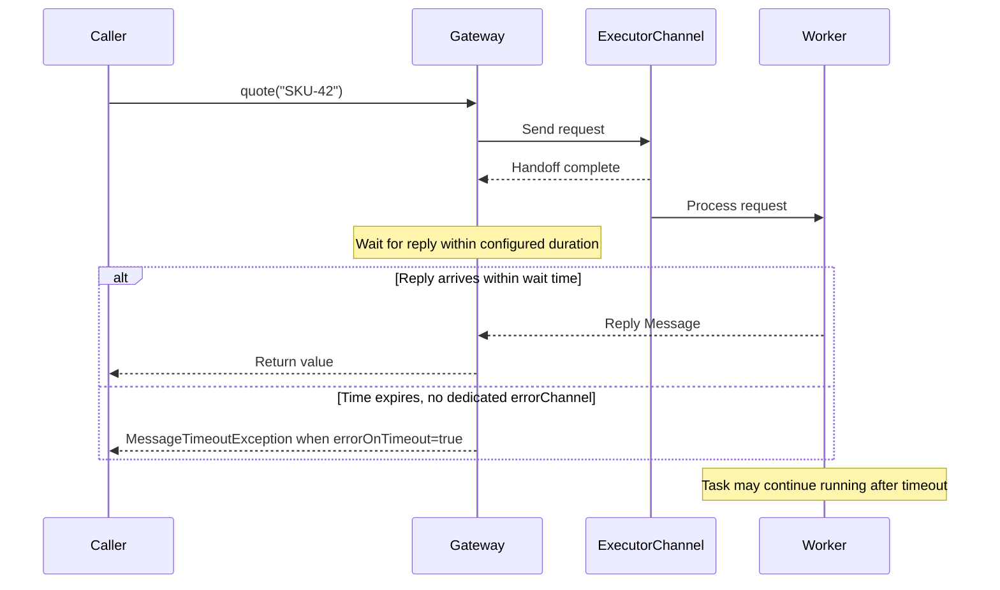

# errorOnTimeout in Messaging Gateway

## 1. Objectives and Scope

In the **SPRING_INTEGRATION_CORE** module, a messaging gateway is the connection point between a Java method call and a message processing flow. Arguments are placed into a `Message`, the request flows through `MessageChannel` and endpoints, and the reply is converted into a return value. This lesson belongs to the **Messaging gateway** chapter and focuses on one choice of the request–reply contract: what does the caller receive when the wait time expires without a reply?

After this lesson, you can:

- Choose between a `null` result, a timeout exception, and a fallback reply.
- Configure `errorOnTimeout` using annotations, factory beans, and Java DSL.
- Recognize the impact of `DirectChannel`, `ExecutorChannel`, and `QueueChannel` on when reply waiting begins.
- Design error flows, test missing-reply scenarios, and handle late-arriving results.

The examples use **Java 17+ and Spring Integration 6.2+**; the API baseline is referenced against the 6.3 branch. No specific network protocol is required to learn this feature. `errorOnTimeout` has been available on `@MessagingGateway`, `GatewayProxyFactoryBean`, and `GatewayEndpointSpec` since **6.2**; similar capability in the underlying `MessagingGatewaySupport` existed earlier. [Source: Messaging Gateways](https://docs.spring.io/spring-integration/reference/6.3/gateway.html#gateway-no-response).

## 2. The Problem: What Does a Missing Reply Mean?

Suppose an application calls a quote service:

```java
String quote = quoteGateway.quote("SKU-42");
```

The caller needs to distinguish two outcomes:

1. The service replied that there is no price for the product.
2. The gateway did not receive a reply within the allowed duration.

The two situations lead to different decisions: the first may display “price unavailable”; the second may suggest retrying or checking request status. If both are represented as `null`, business code can easily conflate nonexistent data with an incomplete message exchange.

For a request–reply gateway, `errorOnTimeout` determines how the second situation is represented:

| Setting | When reply wait time expires |
| --- | --- |
| `errorOnTimeout = false` | Can return `null` for reference return types such as `String`. |
| `errorOnTimeout = true`, no dedicated error channel configured | Throws `org.springframework.integration.MessageTimeoutException`. |
| `errorOnTimeout = true`, dedicated error channel configured | The timeout error is routed to the error flow; what the caller receives depends on how the error flow handles and replies. |

The default value of this attribute on `@MessagingGateway` is **`false`**. It is a boolean flag, so write `errorOnTimeout = true`, not `errorOnTimeout = "true"`. [Source: MessagingGateway API](https://docs.spring.io/spring-integration/docs/6.4.2/api/org/springframework/integration/annotation/MessagingGateway.html#errorOnTimeout()).

Do not use a primitive type like `int` while implicitly assuming timeout will become `0`: primitive types cannot hold `null`. Choose an explicit contract, such as a result DTO or a handleable exception.

## 3. Distinguishing Three Related Settings

| Setting | Question it answers | Scope |
| --- | --- | --- |
| `requestTimeout` / `defaultRequestTimeout` | How long to wait to send the request into the channel? | Meaningful when the send operation can block, such as a full bounded queue. |
| `replyTimeout` / `defaultReplyTimeout` | How long to wait to receive a reply? | The reply-waiting phase after the send operation. |
| `errorOnTimeout` | How is a missing reply after the wait duration represented? | Result policy when no reply arrives. |

Timeout values here are in **milliseconds**. The `@Gateway` annotation allows overriding timeouts per method; `errorOnTimeout` in the APIs used in this lesson is a gateway-level setting, not an attribute of `@Gateway`. [Source: Gateway API](https://docs.spring.io/spring-integration/docs/6.4.2/api/org/springframework/integration/annotation/Gateway.html).

For example, `requestTimeout = 100` does not limit the handler to 100 ms; it can only limit waiting to send into a blocking-capable channel. Nor should `replyTimeout = 300` be treated as a guarantee that the entire Java method always finishes in 300 ms.

When designing examples or services, explicitly set finite timeouts. Enabling `errorOnTimeout` alone does not impose a finite deadline on a configuration that waits indefinitely.

## 4. Why Thread Boundaries Determine Timeout Effectiveness

### 4.1. Entire Flow Runs on the Caller Thread

```text
caller -> gateway -> DirectChannel -> handler runs 2 seconds -> reply
         same execution thread throughout
```

If the handler holds the thread for two seconds, the caller is still stuck inside the send operation. The gateway has not yet regained control to wait for a reply in the usual way. Therefore, a short `replyTimeout` does not interrupt the handler mid-flight; enabling `errorOnTimeout` does not change that either.

Once the handler finishes and the reply is already available, the gateway can immediately retrieve the result, even if the total call time exceeded `replyTimeout`. The documentation states that the reply wait clock starts after control returns to the gateway. [Source: Gateway Behavior When No response Arrives](https://docs.spring.io/spring-integration/reference/gateway.html#gateway-no-response).

### 4.2. Flow Offloads Work to Another Thread



`ExecutorChannel` normally hands off the handler to an executor; `QueueChannel` stores messages for a consumer to pick up later. These are ways to create an asynchronous boundary between sending a request and business processing. When a queue has space or an executor accepts work quickly, the gateway can start waiting for a reply while downstream processing proceeds. Specifically, an executor using `CallerRunsPolicy` can run the task back on the sending thread under overload. [Source: Message Channel Implementations](https://docs.spring.io/spring-integration/reference/channel/implementations.html).

Design implication: inspect the channel type, executor, and overload policy together. Looking at timeout attribute names alone is insufficient to assess how long a caller may be blocked.

## 5. Annotation and Quote Flow Example

### 5.1. Declaring the Gateway

The classes in this section live in the same package `example.gateway`, each public class in its corresponding Java file. The project needs `spring-integration-core` and compatible Spring dependencies; use a BOM or the application's dependency management mechanism.

```java
package example.gateway;

import org.springframework.integration.annotation.MessagingGateway;

@MessagingGateway(
        defaultRequestChannel = "quoteRequests",
        defaultRequestTimeout = "100",
        defaultReplyTimeout = "300",
        errorOnTimeout = true)
public interface QuoteGateway {
    String quote(String sku);
}
```

Timeout values on `@MessagingGateway` are strings; the `errorOnTimeout` flag is a boolean. For Spring to create a proxy for the interface in this plain Java configuration example, use `@IntegrationComponentScan` as shown below. [Source: MessagingGateway declaration](https://github.com/spring-projects/spring-integration/blob/v6.3.0/spring-integration-core/src/main/java/org/springframework/integration/annotation/MessagingGateway.java).

### 5.2. Creating the Asynchronous Channel and Endpoints

```java
package example.gateway;

import org.springframework.context.annotation.Bean;
import org.springframework.context.annotation.Configuration;
import org.springframework.integration.annotation.IntegrationComponentScan;
import org.springframework.integration.channel.ExecutorChannel;
import org.springframework.integration.config.EnableIntegration;
import org.springframework.integration.dsl.IntegrationFlow;
import org.springframework.messaging.MessageChannel;
import org.springframework.scheduling.concurrent.ThreadPoolTaskExecutor;

@Configuration
@EnableIntegration
@IntegrationComponentScan(basePackageClasses = QuoteGateway.class)
public class QuoteConfiguration {

    @Bean
    public ThreadPoolTaskExecutor quoteExecutor() {
        ThreadPoolTaskExecutor executor = new ThreadPoolTaskExecutor();
        executor.setCorePoolSize(2);
        executor.setMaxPoolSize(2);
        executor.setQueueCapacity(100);
        executor.setThreadNamePrefix("quote-");
        return executor;
    }

    @Bean
    public MessageChannel quoteRequests(ThreadPoolTaskExecutor quoteExecutor) {
        return new ExecutorChannel(quoteExecutor);
    }

    @Bean
    public IntegrationFlow quoteFlow() {
        return IntegrationFlow.from("quoteRequests")
                .<String>filter(sku -> !"MISSING".equals(sku))
                .<String, String>transform(sku -> "PRICE:" + sku)
                .get();
    }
}
```

This flow demonstrates the mechanism, not a pricing algorithm. Two paths can be observed:

| Input | Behavior | Expected outcome |
| --- | --- | --- |
| `SKU-42` | Filter lets it pass; transformer produces reply. | `PRICE:SKU-42` if reply arrives within wait time. |
| `MISSING` | Filter drops message; no reply is produced. | `MessageTimeoutException` when wait time expires. |

Having a filter drop the message is a way to create a missing-reply scenario without calling a slow network service or inserting `Thread.sleep`. In a real quoting application, “no price available” should normally be an explicit business result rather than intentionally dropping replies.

### 5.3. Handling at the Caller

```java
import org.springframework.integration.MessageTimeoutException;

try {
    String result = quoteGateway.quote("MISSING");
    // Process business result when a reply is received.
}
catch (MessageTimeoutException timeout) {
    // Record that the exchange did not receive a reply within the deadline.
    // Retry policy or returning a fallback result is decided by the application.
}
```

Here `quoteGateway` is the `QuoteGateway` bean injected into the caller. The exact exception is **`org.springframework.integration.MessageTimeoutException`**; do not confuse it with `java.util.concurrent.TimeoutException`. It belongs to the `MessagingException` hierarchy and is an unchecked exception. [Source: MessageTimeoutException API](https://docs.spring.io/spring-integration/docs/6.4.2/api/org/springframework/integration/MessageTimeoutException.html).

## 6. Adding an errorChannel to Return a Fallback Reply

Some business cases allow the caller to receive a “temporarily unavailable” result instead of an exception. In that case, update the annotation on `QuoteGateway`:

```java
@MessagingGateway(
        defaultRequestChannel = "quoteRequests",
        defaultRequestTimeout = "100",
        defaultReplyTimeout = "300",
        errorChannel = "quoteErrors",
        errorOnTimeout = true)
public interface QuoteGateway {
    String quote(String sku);
}
```

Then add the following two beans to `QuoteConfiguration`:

```java
@Bean
public MessageChannel quoteErrors() {
    return new org.springframework.integration.channel.DirectChannel();
}

@Bean
public IntegrationFlow quoteErrorFlow() {
    return IntegrationFlow.from("quoteErrors")
            .<Throwable, String>transform(error -> {
                if (error instanceof
                        org.springframework.integration.MessageTimeoutException) {
                    return "QUOTE_TEMPORARILY_UNAVAILABLE";
                }
                if (error instanceof RuntimeException runtime) {
                    throw runtime;
                }
                throw new IllegalStateException("Quote processing failed", error);
            })
            .get();
}
```

This is a **replacement variant** for the gateway in Section 5; do not register a second proxy with the same name. The error flow receives an `ErrorMessage`; the transformer in the example uses the `Throwable` payload to decide the reply. The returned `String` matches the `quote` signature, so the caller can receive `QUOTE_TEMPORARILY_UNAVAILABLE` after timeout.

Read `errorOnTimeout = true` as “produce an error when a reply is missing”, not “the caller always receives an exception”. An error flow can convert the error into a fallback result. `GatewayProxyFactoryBean` supports publishing errors to an error channel instead of throwing directly to the caller. [Source: setErrorOnTimeout](https://docs.spring.io/spring-integration/docs/6.4.2/api/org/springframework/integration/gateway/GatewayProxyFactoryBean.html#setErrorOnTimeout(boolean)).

### 6.1. The Error Flow Must Have a Reply Contract

If the error flow merely logs and finishes without returning a reply, the gateway still lacks a result. In the 6.3 branch implementation, when `errorOnTimeout` is enabled, a missing reply from the error channel can continue to raise `MessageTimeoutException`; the error message distinguishes the case of receiving no reply from the error channel. Returning a message with a `Throwable` payload also means re-emitting an error, not a normal business reply. [Source: error handling in MessagingGatewaySupport](https://github.com/spring-projects/spring-integration/blob/v6.3.0/spring-integration-core/src/main/java/org/springframework/integration/gateway/MessagingGatewaySupport.java).

Therefore, design the error flow along one of two explicit directions:

- Produce a fallback reply of the proper type and return it via the failed request's reply path.
- Let the error continue propagating to the caller if business rules do not permit a fallback reply.

Avoid letting “logged” be mistaken for “replied to the caller”. Additional processing in the error flow also increases total latency; do not assume total call duration equals exactly one `replyTimeout`.

In production code, prefer a DTO carrying statuses such as `AVAILABLE`, `NOT_FOUND`, `TEMPORARILY_UNAVAILABLE` instead of magic strings. That way, success data and fallback replies remain under the same type contract.

## 7. Configuration via Java DSL and Factory Bean

### 7.1. Mid-Flow Gateway

The `.gateway(...)` operator calls another flow in a request–reply manner and brings the result back into the running flow:

```java
@Bean
public IntegrationFlow orderPricingFlow() {
    return IntegrationFlow.from("pricingCommands")
            .gateway("quoteRequests", gateway -> gateway
                    .requestTimeout(100L)
                    .replyTimeout(300L)
                    .errorOnTimeout(true))
            .channel("pricedOrders")
            .get();
}
```

This is an illustrative configuration snippet to wire into an application that already has `pricingCommands`, `quoteRequests`, and `pricedOrders` channels. The input payload must match the quote flow. `GatewayEndpointSpec.errorOnTimeout(boolean)` has been available since 6.2; the `replyTimeout` parameter in this DSL is `Long`, so the example uses `300L`. [Source: GatewayEndpointSpec](https://github.com/spring-projects/spring-integration/blob/v6.3.0/spring-integration-core/src/main/java/org/springframework/integration/dsl/GatewayEndpointSpec.java).

If the mid-flow gateway times out, downstream steps such as sending to `pricedOrders` do not automatically receive a successful quote result. The error continues through the enclosing flow's error-handling mechanism; depending on execution boundaries, it may be thrown on the sending thread or turned into an error message on the asynchronous side.

Distinguish the APIs sharing the name gateway:

| Usage | Role |
| --- | --- |
| `@MessagingGateway` or `GatewayProxyFactoryBean` | Creates an interface proxy for Java code calling into messaging. |
| `.gateway("someChannel", spec -> ...)` | Creates a request–reply endpoint mid-flow. |
| `IntegrationFlow.from(SomeInterface.class)` | Creates a flow starting from an interface's proxy. |

`IntegrationFlow.from(SomeInterface.class)` supports using an interface as input and applying gateway annotation attributes. This is not the same configuration point as `GatewayEndpointSpec` on the `.gateway(...)` operator. [Source: IntegrationFlow as a Gateway](https://docs.spring.io/spring-integration/reference/dsl/integration-flow-as-gateway.html).

### 7.2. Declaring the Factory Bean Directly

If annotation scanning is not used, an alternative configuration is:

```java
@Bean
public org.springframework.integration.gateway.GatewayProxyFactoryBean<QuoteGateway>
        quoteGateway() {
    var factory = new org.springframework.integration.gateway.GatewayProxyFactoryBean<>(
            QuoteGateway.class);
    factory.setDefaultRequestChannelName("quoteRequests");
    factory.setDefaultRequestTimeout(100L);
    factory.setDefaultReplyTimeout(300L);
    factory.setErrorOnTimeout(true);
    return factory;
}
```

In this variant, the `QuoteGateway` interface is used without `@MessagingGateway` and is not re-scanned into another proxy. Spring manages the factory bean lifecycle and exposes the proxy to callers. This declaration style is also handy in tests because timeout options sit right inside the test configuration. [Source: GatewayProxyFactoryBean](https://github.com/spring-projects/spring-integration/blob/v6.3.0/spring-integration-core/src/main/java/org/springframework/integration/gateway/GatewayProxyFactoryBean.java).

## 8. Testing Missing-Reply Behavior

A reliable timeout test should assert the **observable outcome**: returning `null`, throwing an exception, or returning a fallback. There is no need to assert that the call finishes at an exact millisecond count.

The standalone example below uses JUnit Jupiter and a plain Spring context. A `QueueChannel` with capacity but no consumer simulates a request accepted onto the channel with no reply; the test runs no sleep tasks. Required dependencies are `spring-integration-core` and `junit-jupiter`, along with compatible transitive dependencies.

```java
package example.gateway;

import org.junit.jupiter.api.Test;
import org.springframework.context.annotation.AnnotationConfigApplicationContext;
import org.springframework.context.annotation.Bean;
import org.springframework.context.annotation.Configuration;
import org.springframework.integration.MessageTimeoutException;
import org.springframework.integration.channel.DirectChannel;
import org.springframework.integration.channel.QueueChannel;
import org.springframework.integration.config.EnableIntegration;
import org.springframework.integration.dsl.IntegrationFlow;
import org.springframework.integration.gateway.GatewayProxyFactoryBean;
import org.springframework.messaging.MessageChannel;

import static org.junit.jupiter.api.Assertions.assertEquals;
import static org.junit.jupiter.api.Assertions.assertNull;
import static org.junit.jupiter.api.Assertions.assertThrows;

public class GatewayTimeoutTest {

    public interface Exchange {
        String exchange(String request);
    }

    @Configuration
    @EnableIntegration
    public static class TestConfiguration {

        @Bean
        public QueueChannel noReplyRequests() {
            return new QueueChannel(10);
        }

        @Bean
        public MessageChannel healthyRequests() {
            return new DirectChannel();
        }

        @Bean
        public MessageChannel recoveryErrors() {
            return new DirectChannel();
        }

        @Bean
        public GatewayProxyFactoryBean<Exchange> relaxedGateway() {
            return factory("noReplyRequests", false);
        }

        @Bean
        public GatewayProxyFactoryBean<Exchange> strictGateway() {
            return factory("noReplyRequests", true);
        }

        @Bean
        public GatewayProxyFactoryBean<Exchange> healthyGateway() {
            return factory("healthyRequests", true);
        }

        @Bean
        public GatewayProxyFactoryBean<Exchange> recoveredGateway() {
            GatewayProxyFactoryBean<Exchange> factory =
                    factory("noReplyRequests", true);
            factory.setErrorChannelName("recoveryErrors");
            return factory;
        }

        @Bean
        public IntegrationFlow healthyFlow() {
            return IntegrationFlow.from("healthyRequests")
                    .<String, String>transform(value -> "OK:" + value)
                    .get();
        }

        @Bean
        public IntegrationFlow recoveryFlow() {
            return IntegrationFlow.from("recoveryErrors")
                    .<Throwable, String>transform(error -> {
                        if (error instanceof MessageTimeoutException) {
                            return "FALLBACK";
                        }
                        throw new IllegalStateException("Unexpected error", error);
                    })
                    .get();
        }

        private GatewayProxyFactoryBean<Exchange> factory(
                String requestChannel, boolean errorOnTimeout) {
            GatewayProxyFactoryBean<Exchange> factory =
                    new GatewayProxyFactoryBean<>(Exchange.class);
            factory.setDefaultRequestChannelName(requestChannel);
            factory.setDefaultRequestTimeout(100L);
            factory.setDefaultReplyTimeout(100L);
            factory.setErrorOnTimeout(errorOnTimeout);
            return factory;
        }
    }

    @Test
    void returnsNullWhenTimeoutIsAllowed() {
        try (var context = new AnnotationConfigApplicationContext(
                TestConfiguration.class)) {
            Exchange gateway = context.getBean("relaxedGateway", Exchange.class);
            assertNull(gateway.exchange("A"));
        }
    }

    @Test
    void throwsWhenReplyDoesNotArrive() {
        try (var context = new AnnotationConfigApplicationContext(
                TestConfiguration.class)) {
            Exchange gateway = context.getBean("strictGateway", Exchange.class);
            assertThrows(MessageTimeoutException.class,
                    () -> gateway.exchange("A"));
        }
    }

    @Test
    void keepsSuccessfulReplies() {
        try (var context = new AnnotationConfigApplicationContext(
                TestConfiguration.class)) {
            Exchange gateway = context.getBean("healthyGateway", Exchange.class);
            assertEquals("OK:A", gateway.exchange("A"));
        }
    }

    @Test
    void convertsTimeoutToFallbackThroughErrorFlow() {
        try (var context = new AnnotationConfigApplicationContext(
                TestConfiguration.class)) {
            Exchange gateway = context.getBean("recoveredGateway", Exchange.class);
            assertEquals("FALLBACK", gateway.exchange("A"));
        }
    }
}
```

Each test opens its own context and closes it after use; the queue from an earlier test does not affect later tests. The four tests illustrate four contract branches, where the success test confirms that enabling the flag does not alter normal replies.

When testing production flows with late-arriving tasks, you can use a latch to hold the worker, wait for the gateway to finish via timeout, and release the worker in `finally`. That lets you observe the two events “caller stopped waiting” and “worker finished” separately. That is an additional test design, not something inferred solely from checking an exception.

## 9. Timeout Does Not Replace Individual Endpoint Contracts

A request having no reply can stem from flawed flow design, not just a slow system. Fix the cause where sufficient context exists:

| Cause | Appropriate design fix |
| --- | --- |
| Handler that should return data returns `null` | Enable `requiresReply(true)` on that endpoint if a missing result is an error. |
| Filter drops request while caller still expects a result | Return a rejection result via a suitable branch, or proactively throw an exception on rejection. |
| Router branch leads to a one-way endpoint | Add a business reply for that branch or revise the gateway contract. |
| Aggregator has not met release conditions | Review correlation, release strategy, and policies for incomplete groups. |
| Reply path header lost when constructing a new message | Preserve the needed reply path when transforming or rebuilding messages. |

Example forcing a service activator to error when returning `null`:

```java
.handle(orderService, "lookup", endpoint -> endpoint.requiresReply(true))
```

`orderService` here is an application service injected into the configuration. `requiresReply` applies at the endpoint, unlike having the gateway wait until timeout to discover no result arrived. When an endpoint requires a reply and the handler returns `null`, the resulting error is `ReplyRequiredException`. [Source: Service Activator](https://docs.spring.io/spring-integration/reference/service-activator.html).

Example filter proactively throwing an exception on rejection:

```java
.<String>filter(value -> !value.isBlank(),
        filter -> filter.throwExceptionOnRejection(true))
```

This option fits when rejected input is an error to report immediately. Filters also support a discard channel; if designing a branch to handle rejected requests, decide whether that branch returns a reply to the gateway. [Source: Filter](https://docs.spring.io/spring-integration/reference/filter.html).

Thus, `errorOnTimeout` is a policy at the gateway boundary; each endpoint still needs a consistent message-processing contract.

## 10. Late Results and Retry Policies

Consider a request to record an order with business ID `ORDER-42`. The gateway times out, yet the worker may still succeed in writing it afterward. To the caller, the status at this moment is “unknown outcome”, not automatically “write failed”.

A design for this scenario should answer:

- If the caller resends `ORDER-42`, will the system recognize it as the same operation?
- Is there a way to look up the order's final status?
- When the worker produces a reply after the caller stopped waiting, how does the system observe and handle it?

For operations with side effects, use a stable business identifier and duplicate-processing protection where the operation executes. Retries must be grounded in business semantics and queryable state rather than merely exception names.

At the same time, timeouts for HTTP, JDBC, or downstream protocol clients must be configured on those clients themselves. A gateway timeout does not automatically send a cancel signal or undo already-executed changes. If transactions exist, rollback also depends on transaction boundaries, execution threads, and how exceptions are handled.

Operationally, track missing-reply counts, fallback usage counts, executor utilization, and queue depth. Use a correlation ID or request ID to link caller traces with downstream processing; avoid turning every timeout into an indistinguishable success message.

## 11. Key Takeaways When Applying

- Enable `errorOnTimeout` when the contract treats a missing reply as an explicit error event to handle.
- Set a finite `replyTimeout` and inspect execution boundaries before assessing caller latency.
- Use an error flow to return fallbacks when business rules allow, with a data type compatible with the gateway signature.
- Ensure transformer, router, filter, and aggregator branches all terminate according to an intentional contract.
- Test successful replies, missing replies, and fallback replies; evaluate late-finishing workers separately.

From a Java call through messages, channels, and endpoints, `errorOnTimeout` brings missing replies into the gateway's contract. The practical value of the setting lies in how both the caller and the entire flow understand, observe, and handle that situation.