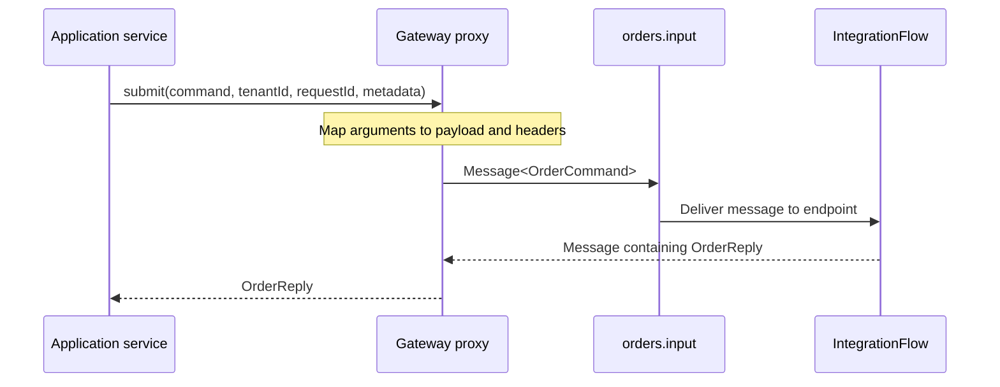

# Gateway Method Argument Mapping

## 1. From a Java Call to a Message Contract

In the **Messaging gateway** chapter of the **SPRING_INTEGRATION_CORE** module, argument mapping is the step that converts Java method arguments into a message's payload and headers. This is where the application determines which data needs to be processed and which data helps route or trace the flow.

This lesson focuses on designing this contract using `Message`, `MessageChannel`, gateways, and Java DSL. Downstream components such as transformers, routers, filters, aggregators, and business-processing endpoints all depend on the message produced by the gateway. If mapping is wrong from the start, a router may miss a header or a transformer may receive the wrong payload type even though their own configurations are correct.

After this lesson, you can:

- Choose the right payload when a method has multiple arguments.
- Use `@Payload`, `@Header`, and `@Headers` to describe each argument's role.
- Identify `Map` cases that easily cause ambiguity.
- Produce payloads or headers using SpEL in the proper context.
- Test the actual message entering the channel.

The running example is a tenant-aware order-intake application:

```java
OrderReply reply = orderGateway.submit(
        new OrderCommand("ORD-2401", 3),
        "tenant-hcm",
        "req-701",
        Map.of("clientVersion", "web-3"));
```

Desired message contract:

```text
payload:
  OrderCommand(orderId="ORD-2401", quantity=3)

business headers:
  tenantId      = "tenant-hcm"
  requestId     = "req-701"
  clientVersion = "web-3"
```

Infrastructure-generated headers, such as `id` or `replyChannel`, are not all listed here.



The gateway lets callers work through a Java interface; proxy creation and messaging interactions are handled by Spring Integration. See [Messaging Gateways overview](https://docs.spring.io/spring-integration/reference/gateway.html).

## 2. Payload, Header, and Argument Are Three Distinct Concepts

An **argument** is a value passed when calling a method. The **payload** is the main content of a message. A **header** is a piece of metadata traveling with the message.

A call with four arguments does not mean the message has four payloads. You must designate one final payload; the other values can become headers or be used to build the payload via an expression.

| Input value | Chosen role | Design rationale |
|---|---|---|
| `OrderCommand` | Payload | The endpoint needs this data to process the order |
| `tenantId` | Header | A router can select a flow by tenant |
| `requestId` | Header | Tracks the request across endpoints |
| `clientVersion` | Header | Adds observability or compatibility context |

Placing a value in a header is a contract decision, not a security transformation. A caller-supplied `tenantId` still must be checked against authorized tenants. The gateway does not automatically validate that value.

If tenant is a mandatory property of a business document that must be persisted and replayed independently, placing tenant inside the DTO may be more suitable. Decide according to system needs and keep a single authoritative source when information appears in multiple places.

## 3. Mapping Conventions Without Annotations

Default conventions keep interfaces concise in simple cases. The table below assumes non-`null` payload values and no payload expression or custom mapper:

| Method signature | Payload by convention | Headers from arguments | Notes |
|---|---|---|---|
| `void send(String body)` | `body` | No extra business headers | Single argument |
| `void send(OrderCommand command)` | `command` | No extra business headers | One unambiguous DTO |
| `void send(Map<String, Object> document)` | Entire `document` | Does not unpack map into headers | A single map remains the payload |
| `void send(String body, Map<String, Object> metadata)` | `body` | Entries inside `metadata` | Non-map payload |
| `void send(Map<String, Object> first, Map<String, Object> second)` | Ambiguous | No valid contract | Roles must be specified |
| `void send(String body, String tenant)` | Cannot determine a single payload | `tenant` does not become a header | Needs annotations or expressions |

Variable names like `metadata`, `headers`, or `tenant` do not automatically dictate argument roles. Nor should you generalize a rule that “the first parameter is always the payload”.

Conventions with `Object` can become hard to read when the runtime value is a `Map`. For interfaces used in many places, declare concrete types and explicit annotations. Map cases and multiple payload candidates are described in [Mapping Method Arguments to a Message](https://docs.spring.io/spring-integration/reference/gateway.html#mapping-method-arguments).

## 4. Specifying Roles with Annotations

Annotations related to message parts belong to Spring Messaging:

```java
import org.springframework.messaging.handler.annotation.Header;
import org.springframework.messaging.handler.annotation.Headers;
import org.springframework.messaging.handler.annotation.Payload;
```

Gateway configuration annotations belong to Spring Integration:

```java
import org.springframework.integration.annotation.Gateway;
import org.springframework.integration.annotation.GatewayHeader;
import org.springframework.integration.annotation.MessagingGateway;
```

`@Header` in this lesson is not the controller annotation for reading HTTP headers.

### 4.1. `@Payload`: Selecting the Main Content

```java
void enqueue(@Payload OrderCommand command);
```

The annotation indicates that the `command` argument supplies the payload. The contract remains easy to spot even when additional parameters are added to the method.

When business data has multiple fields, bundle them into a DTO:

```java
public record OrderCommand(String orderId, int quantity) {
}
```

Do not annotate two parameters with `@Payload` to represent two parts of an order. If data from multiple arguments must be combined, build a DTO before calling the gateway or use a method-level payload expression.

`@Payload` also supports expressions; the expression's meaning depends on where the annotation sits. The SpEL section below separates those two cases clearly. See [Payload API](https://docs.spring.io/spring-framework/docs/current/javadoc-api/org/springframework/messaging/handler/annotation/Payload.html).

### 4.2. `@Header`: One Argument to One Header

```java
void enqueue(
        @Payload OrderCommand command,
        @Header("tenantId") String tenantId,
        @Header("requestId") String requestId);
```

Calling `gateway.enqueue(command, "tenant-hcm", "req-701")` places tenant and request into the named headers. Renaming the Java variable from `tenantId` to `tenant` does not change the header name declared via the string `"tenantId"`.

Explicitly specify the name in `@Header("...")` so the contract does not depend on the compiler retaining parameter names. Optional headers can be declared as follows:

```java
void enqueue(
        @Payload OrderCommand command,
        @Header("tenantId") String tenantId,
        @Header(name = "locale", required = false) String locale);
```

If `locale` is `null`, consumers must handle the missing header. For required headers, validating early before the call helps return clearer business errors.

Do not overgeneralize every annotation behavior on message-receiving endpoints to message-sending gateways. When a default locale is needed, normalize it explicitly in the application service:

```java
String effectiveLocale = locale == null ? "vi-VN" : locale;
gateway.enqueue(command, tenantId, effectiveLocale);
```

Annotation names and attributes are documented in [Header API](https://docs.spring.io/spring-framework/docs/current/javadoc-api/org/springframework/messaging/handler/annotation/Header.html).

### 4.3. `@Headers`: One Map to Multiple Headers

```java
void enqueue(
        @Payload OrderCommand command,
        @Headers Map<String, Object> metadata);
```

Example:

```java
gateway.enqueue(
        command,
        Map.of("clientVersion", "web-3", "sourceSystem", "checkout"));
```

The two map entries become two separate headers. The map is neither placed under a header named `metadata` nor attached to the DTO payload.

When you want the entire map to be **the value of a single header**, use singular `@Header`:

```java
void enqueue(
        @Payload OrderCommand command,
        @Header("clientMetadata") Map<String, Object> metadata);
```

The two declarations serve two different contracts:

```text
@Headers map:
  headers["clientVersion"] = "web-3"

@Header("clientMetadata") map:
  headers["clientMetadata"] = {"clientVersion": "web-3"}
```

`@Headers` requires a map type compatible with `String` header names and `Object` values. See [Headers API](https://docs.spring.io/spring-framework/docs/current/javadoc-api/org/springframework/messaging/handler/annotation/Headers.html).

## 5. Special Case: `Map` as Business Data

Suppose a system accepts flexible order documents:

```java
Map<String, Object> document = Map.of(
        "orderId", "ORD-2401",
        "quantity", 3);
```

If this is the sole argument, the map can serve as the payload by convention. When both a data map and a metadata map exist, annotate both roles explicitly:

```java
void acceptDocument(
        @Payload Map<String, Object> document,
        @Headers Map<String, Object> metadata);
```

Call:

```java
gateway.acceptDocument(
        Map.of("orderId", "ORD-2401", "quantity", 3),
        Map.of("tenantId", "tenant-hcm"));
```

Resulting message:

```text
payload["orderId"]  = "ORD-2401"
payload["quantity"] = 3
headers["tenantId"] = "tenant-hcm"
```

A common design mistake is putting `@Headers` on the data map simply because a map holds key-value pairs. Then `orderId` and `quantity` can be interpreted as metadata instead of business content, leaving the method with no valid payload source.

When document structure is stable, a DTO usually helps the IDE and compiler catch bugs earlier than a map. Maps fit better at dynamic data boundaries, though schema and value types must be validated before endpoints use them.

## 6. Payload Expressions and SpEL Context

Not every expression in Spring Integration is evaluated against the same root object. Check the context before writing an expression:

| Declaration site | Root object used | Access examples |
|---|---|---|
| `@Payload("...")` on parameter | Value of that argument itself | `trim()`, `#this` |
| `@Payload("...")` on method | Invocation context holding method and args | `args[0]`, `args[1]` |
| `@Gateway(payloadExpression = "...")` | Invocation context holding method and args | `args[0]` |
| `@GatewayHeader(expression = "...")` | Invocation context holding method and args | `args[1]`, `method.name` |
| Downstream message-processing expression | Usually the endpoint's input message | `payload`, `headers['tenantId']` |

The last row applies only to endpoints whose root is the message; check the expression contract of the specific component being configured.

### 6.1. Expression on a Parameter

```java
void sendCode(@Payload("trim()") String rawCode);
```

With `rawCode = "  ORD-2401  "`, the payload is the string with leading and trailing whitespace trimmed. `trim()` is invoked on the string argument.

Do not write `args[0]` here assuming the root is always the full invocation. Instead, `#this` can be used here to refer to the argument itself.

Keep expressions short. If normalization needs multiple conditions, call a dedicated bean or move normalization into a transformer so the code has a name and is easy to test and observe.

### 6.2. Expression on a Method

```java
@Payload("args[0] + ':' + args[1]")
void sendReference(String region, String orderId);
```

With `region = "VN"` and `orderId = "ORD-2401"`, the payload is `"VN:ORD-2401"`. Both arguments are used to compute one payload, rather than automatically becoming two separate payload parts.

The equivalent configuration using the gateway annotation:

```java
@Gateway(payloadExpression = "args[0] + ':' + args[1]")
void sendReference(String region, String orderId);
```

These are two alternative options. Within the same method, pick one place to specify the payload so readers do not have to reason across multiple configuration sources. Also avoid combining a method-level payload expression with a separate `@Payload` parameter.

Positions in `args` are 0-based. Reordering parameters changes the expression contract, even if parameters share the same type and Java still compiles.

### 6.3. Generating Headers from Arguments

```java
@Gateway(
        payloadExpression = "args[0]",
        headers = {
                @GatewayHeader(name = "tenantId", expression = "args[1]"),
                @GatewayHeader(name = "operation", value = "CREATE_ORDER")
        })
OrderReply submitWithExpressions(OrderCommand command, String tenantId);
```

The method selects the first argument as the payload, takes tenant from the second argument, and adds a constant header. Do not add `@Payload` onto `command` in this example because the payload is already chosen at the method level.

`value = "CREATE_ORDER"` is a string literal value. `expression = "args[1]"` is an expression to evaluate. If using a string constant inside `expression`, follow SpEL literal syntax, such as `expression = "'CREATE_ORDER'"`.

These options are documented in [Gateway API](https://docs.spring.io/spring-integration/api/org/springframework/integration/annotation/Gateway.html) and [GatewayHeader API](https://docs.spring.io/spring-integration/api/org/springframework/integration/annotation/GatewayHeader.html).

User data should be call arguments; expressions are application-controlled configuration. Never feed user-entered expression strings directly into configuration.

## 7. Multiple Header Sources and Overwrite Risks

A gateway can receive headers from arguments, interface defaults, or method-specific configuration. When names collide, the final value is part of the contract that must be tested.

Example default header identifying the source:

```java
@MessagingGateway(
        defaultRequestChannel = "orders.input",
        defaultHeaders = @GatewayHeader(name = "sourceSystem", value = "checkout"))
public interface TaggedOrderGateway {

    OrderReply submit(
            @Payload OrderCommand command,
            @Header("tenantId") String tenantId);
}
```

Partition header name ownership cleanly:

- Shared configuration owns `sourceSystem`.
- Named parameters own `tenantId` and `requestId`.
- The metadata map only supplies agreed extension keys, such as `clientVersion`.

With the default mapper, method-specific configured headers can override parameter headers, while default headers are added when no value with the same name exists yet. Do not rely on default headers to lock down an immutable value. If `@Header` and `@Headers` both supply the same key, eliminate the conflict from the contract. Source-merging logic is implemented in [GatewayMethodInboundMessageMapper source](https://github.com/spring-projects/spring-integration/blob/main/spring-integration-core/src/main/java/org/springframework/integration/gateway/GatewayMethodInboundMessageMapper.java).

When accepting an arbitrary map from an external layer, filter keys at the application boundary before invoking the gateway. Avoid letting arbitrary data control infrastructure headers like `replyChannel`, `errorChannel`, or overwrite an authenticated tenant.

## 8. Complete Example: Gateway and Java DSL

The code snippets below form a standalone example using Java 17+, `spring-integration-core`, Spring Context, and the Java DSL API available in Spring Integration 6.x. Use the version set managed by the project's BOM; the lesson does not require picking the latest version.

Place each public type in its own Java file under package `example.gatewaymapping`. The short snippets in earlier sections are alternative contract choices and do not all need to be combined into this interface.

### 8.1. Data Types

`OrderCommand.java`:

```java
package example.gatewaymapping;

public record OrderCommand(String orderId, int quantity) {
}
```

`OrderReply.java`:

```java
package example.gatewaymapping;

public record OrderReply(
        String orderId,
        String tenantId,
        String requestId,
        int acceptedQuantity) {
}
```

### 8.2. Gateway Interface

`OrderGateway.java`:

```java
package example.gatewaymapping;

import java.util.Map;

import org.springframework.integration.annotation.MessagingGateway;
import org.springframework.messaging.handler.annotation.Header;
import org.springframework.messaging.handler.annotation.Headers;
import org.springframework.messaging.handler.annotation.Payload;

@MessagingGateway(defaultRequestChannel = "orders.input")
public interface OrderGateway {

    OrderReply submit(
            @Payload OrderCommand command,
            @Header("tenantId") String tenantId,
            @Header("requestId") String requestId,
            @Headers Map<String, Object> metadata);
}
```

Example convention: `metadata` only contains extension keys, not `tenantId` or `requestId`. The caller is responsible for upholding this convention; the Java signature does not automatically enforce an allowlist of keys.

### 8.3. Channel and Processing Endpoint

`OrderFlowConfiguration.java`:

```java
package example.gatewaymapping;

import org.springframework.context.annotation.Bean;
import org.springframework.context.annotation.Configuration;
import org.springframework.integration.channel.DirectChannel;
import org.springframework.integration.config.EnableIntegration;
import org.springframework.integration.config.IntegrationComponentScan;
import org.springframework.integration.dsl.IntegrationFlow;

@Configuration
@EnableIntegration
@IntegrationComponentScan(basePackageClasses = OrderGateway.class)
public class OrderFlowConfiguration {

    @Bean(name = "orders.input")
    public DirectChannel ordersInput() {
        return new DirectChannel();
    }

    @Bean
    public IntegrationFlow orderFlow() {
        return IntegrationFlow.from("orders.input")
                .handle(OrderCommand.class, (command, headers) -> {
                    if (command.quantity() <= 0) {
                        throw new IllegalArgumentException(
                                "quantity must be greater than zero");
                    }
                    return new OrderReply(
                            command.orderId(),
                            (String) headers.get("tenantId"),
                            (String) headers.get("requestId"),
                            command.quantity());
                })
                .get();
    }
}
```

`@IntegrationComponentScan` registers the gateway interface; `@EnableIntegration` enables integration infrastructure in this standalone Java configuration. Do not manually write an `OrderGateway` implementation class just to build messages.

The endpoint returns `OrderReply`, giving the call a reply result. A consumer that merely logs and returns `null` does not satisfy this reply contract.

`DirectChannel` makes the example easy to trace because the endpoint is invoked synchronously on the sending thread. Switching to a queued or executor-backed channel is a separate execution decision; mapping annotations do not by themselves make the call asynchronous.

### 8.4. Caller Using the Contract

```java
try (var context = new org.springframework.context.annotation
        .AnnotationConfigApplicationContext(OrderFlowConfiguration.class)) {
    OrderGateway gateway = context.getBean(OrderGateway.class);

    OrderReply reply = gateway.submit(
            new OrderCommand("ORD-2401", 3),
            "tenant-hcm",
            "req-701",
            Map.of("clientVersion", "web-3"));

    System.out.println(reply);
}
```

Expected business output:

```text
OrderReply[orderId=ORD-2401, tenantId=tenant-hcm, requestId=req-701, acceptedQuantity=3]
```

The gateway builds the input per the contract. The `quantity > 0` check belongs to the processing endpoint, separate from errors caused by an ambiguous payload or a missing required header argument.

## 9. Testing Messages at the Gateway Boundary

A test that only checks `reply.orderId()` does not prove `tenantId` or `clientVersion` landed in the right headers. An endpoint could accidentally obtain them from elsewhere. The test below intercepts the message at the input channel and directly verifies the mapping.

JUnit Jupiter is required in test dependencies. `GatewayArgumentMappingTest.java` goes in the same package as the example:

```java
package example.gatewaymapping;

import java.util.Map;
import java.util.concurrent.atomic.AtomicReference;

import org.junit.jupiter.api.Test;
import org.springframework.context.annotation.AnnotationConfigApplicationContext;
import org.springframework.integration.channel.DirectChannel;
import org.springframework.messaging.Message;
import org.springframework.messaging.MessageChannel;
import org.springframework.messaging.support.ChannelInterceptor;

import static org.junit.jupiter.api.Assertions.assertEquals;
import static org.junit.jupiter.api.Assertions.assertNotNull;
import static org.junit.jupiter.api.Assertions.assertSame;

class GatewayArgumentMappingTest {

    @Test
    void mapsBusinessArgumentsToPayloadAndHeaders() {
        try (var context = new AnnotationConfigApplicationContext(
                OrderFlowConfiguration.class)) {
            var captured = new AtomicReference<Message<?>>();
            DirectChannel input = context.getBean(
                    "orders.input", DirectChannel.class);

            input.addInterceptor(new ChannelInterceptor() {
                @Override
                public Message<?> preSend(
                        Message<?> message, MessageChannel channel) {
                    captured.set(message);
                    return message;
                }
            });

            OrderCommand command = new OrderCommand("ORD-2401", 3);
            OrderGateway gateway = context.getBean(OrderGateway.class);

            OrderReply reply = gateway.submit(
                    command,
                    "tenant-hcm",
                    "req-701",
                    Map.of("clientVersion", "web-3"));

            Message<?> sent = captured.get();
            assertNotNull(sent);
            assertSame(command, sent.getPayload());
            assertEquals("tenant-hcm", sent.getHeaders().get("tenantId"));
            assertEquals("req-701", sent.getHeaders().get("requestId"));
            assertEquals("web-3", sent.getHeaders().get("clientVersion"));
            assertEquals(
                    new OrderReply("ORD-2401", "tenant-hcm", "req-701", 3),
                    reply);
        }
    }
}
```

`assertSame` fits this example because it picks the DTO directly as payload, with no payload expression creating a new object. When adding a step that creates a new payload at the gateway, assert type and contents instead of requiring reference identity.

Do not compare the entire headers map against a hand-built map in tests: the framework can add infrastructure headers. Only assert the contract keys that must be guaranteed.

Tests can be extended to cover:

| Scenario | What to verify |
|---|---|
| One business map and one metadata map | Business map remains intact as payload; metadata sits in headers |
| Optional header receives `null` | Downstream handles the missing header |
| Missing required header | Call fails before business logic processes the request |
| Two parameters share payload role | Contract is rejected rather than silently picking one argument |
| Payload expression uses two arguments | Final payload is accurate after concatenation or transformation |
| Configured header shares name with parameter header | Final value matches the chosen contract |
| Invalid order quantity | Distinguish endpoint errors from input mapping errors |

The test snippets are hands-on reference material. When placing them in a project, run them with the project's own build tool and version set.

## 10. Invalid Configurations to Recognize

### 10.1. Two Independent Payload Sources

```java
// Invalid contract: two parameters are both marked as payload.
void broken(@Payload String orderId, @Payload Integer quantity);
```

Fix using a DTO:

```java
void corrected(@Payload OrderCommand command);
```

If the caller has two separate values, the caller constructs `new OrderCommand(orderId, quantity)` before calling the gateway.

### 10.2. One Parameter Carrying Two Message Roles

```java
// Invalid contract: the same argument is both payload and header.
void broken(@Payload @Header("orderId") String value);
```

If order ID must appear in both payload and header, explicitly design the duplication: the payload is `OrderCommand`, while the header is derived from `args[0].orderId()` via method configuration. In that case, designate which component owns the source of truth.

### 10.3. `@Headers` Placed on a Non-Map Type

```java
// Invalid contract: metadata is not a Map.
void broken(@Payload OrderCommand command, @Headers String metadata);
```

If the string is a single header value, use `@Header("metadata")`. If multiple headers are needed, convert it into an appropriate map at the application boundary.

### 10.4. Confusing Expression Context

```java
// Unsuitable: @Payload on a String parameter does not have Message as root.
void broken(@Payload("payload.orderId") String rawCode);
```

The root here is the `rawCode` string. To access a DTO property from the full call, use a method-level expression like `args[0].orderId()`; to operate on a string argument, use an expression valid for a string.

### 10.5. Payload or Expression Result Is `null`

A message requires a non-`null` payload. Do not use `@Payload(required = false)` as a way to create requests with an empty payload in a gateway. If “no data” is a meaningful command, represent it with an explicit value such as a command DTO or a literal.

For a zero-argument method that needs to proactively send a command, provide a payload expression:

```java
@Gateway(payloadExpression = "'REFRESH_CATALOG'")
void refreshCatalog();
```

Do not assume every zero-argument method automatically sends an empty request. A gateway also supports receive behavior for zero-argument methods when no payload is configured; that is a different contract.

## 11. When the Caller Already Passes a `Message<?>`

An infrastructure-adjacent interface can accept a pre-built message:

```java
void forward(org.springframework.messaging.Message<OrderCommand> request);
```

The caller has already decided the payload and some headers. The gateway's job is not to turn `Message<OrderCommand>` into a business field inside `OrderCommand`; this is an entry point for pre-constructed messages.

This approach is useful for infrastructure components, bridges, or tests needing direct message control. In return, the caller must know Spring Messaging and can easily pass extra out-of-contract headers. For typical application services, an interface accepting DTOs and named headers is usually easier to maintain.

The return side must also be distinguished:

```java
OrderReply submit(OrderCommand command);

org.springframework.messaging.Message<OrderReply> submitMessage(
        OrderCommand command);
```

The first form serves callers needing only the business result; the second fits when the caller also needs reply headers. Choosing the return type does not fix a mismapped request.

## 12. When Is a Custom `MethodArgsMessageMapper` Needed?

If a legacy interface has a special structure that annotations or short expressions cannot express cleanly, you can provide a `MethodArgsMessageMapper`. The mapper receives method info and arguments via `MethodArgsHolder`, and builds a message per an application-controlled contract. This is the extension point for the entire mapping process, per [MethodArgsMessageMapper API](https://docs.spring.io/spring-integration/api/org/springframework/integration/gateway/MethodArgsMessageMapper.html).

Reasonable use cases include converting many legacy gateway methods into a unified envelope, or enforcing a shared header allowlist without changing existing interfaces.

A custom mapper must take explicit responsibility for:

- Accepted argument types and counts.
- Producing a non-`null` payload.
- Header names, key-collision rules, and data allowed into headers.
- Clear error reporting when an unsupported contract is encountered.

`@MessagingGateway(mapper = "...")` points to the mapper bean. When using a custom mapper, do not simultaneously configure payload expressions and gateway headers that split message-building responsibility in half. This restriction is documented in [MessagingGateway API](https://docs.spring.io/spring-integration/api/org/springframework/integration/annotation/MessagingGateway.html).

Before opting for a custom mapper, try simplifying the interface to a DTO and a few named headers. A custom mapper for a signature expressible with three annotations usually increases maintenance cost.

## 13. Diagnosing Errors at the Right Boundary

When a gateway call does not produce the expected outcome, trace these technical questions:

1. **Is the gateway bean registered?** If the interface cannot be injected, inspect gateway registration configuration before analyzing argument mapping.
2. **Is there a single unambiguous payload source?** Check for multiple unannotated arguments, two maps, an expression returning `null`, or multiple `@Payload` annotations.
3. **Are header names and types accurate?** Verify exact `tenantId` spelling, value types, and metadata key conventions.
4. **Did the message reach the request channel?** Use an interceptor at the entry point like the test example. Mapping errors before sending can prevent the interceptor from ever seeing a message.
5. **Did the endpoint process the payload properly?** If `OrderCommand` arrived yet quantity failed, that is a business-processing issue.
6. **Did the flow return a reply for a value-returning method?** Analyze the reply path after confirming the request contract.

Do not treat every mapping error as an event guaranteed to appear on a downstream endpoint's `errorChannel`. If the message was never created or never sent, that endpoint had no input to process. Error tests should verify both the exception at the call site and whether downstream ran.

Boundary logs should record operation name, request ID, and payload type needed for diagnosis. Avoid dumping entire args or headers when personal data, credentials, or sensitive order contents are present.

## 14. Connections to Flow Components

Keeping gateway mapping clean gives downstream core components a stable contract:

| Component | Information typically used | Consequence if mapping is wrong |
|---|---|---|
| Transformer | Payload type and structure | Cannot read expected data |
| Router | Agreed payload field or header | Routes to default branch or wrong branch |
| Filter | Business condition or metadata | Drops messages mistakenly |
| Aggregator | Correlation key and grouping rules | Messages are not grouped as intended |
| Error-handling endpoint | Error and related message if available | Lacks diagnostic context |

`requestId` in the example serves request tracing; it does not automatically become the aggregator's correlation strategy. If the flow aggregates by request, configure the corresponding strategy and define group completion rules.

Do not put entire business transformations into gateway SpEL just because expressions can access every argument. The gateway should represent the call boundary; reusable or independently observable transformations belong in explicit transformers or processing beans.

## 15. Hands-On Exercise

Use the order example as a baseline:

1. Add `@Header(name = "locale", required = false)` to the gateway. Update tests for both a non-null locale and `null`.
2. Create a gateway method accepting `@Payload Map<String, Object>` and `@Headers Map<String, Object>`. Verify `orderId` is in the payload while `tenantId` is in headers.
3. Create a method using `@Gateway(payloadExpression = "args[0] + ':' + args[1]")`. Verify the payload after combining the two strings.
4. Add a default header `sourceSystem`, then configure a method-specific header with the same name. Observe the message value via an interceptor.
5. Pass metadata containing a duplicate `tenantId` key in a separate test. Add key-list validation at the caller and verify duplicates are blocked before sending.

Completion criteria: explain where each argument goes, prove the payload and headers via channel-level tests, and distinguish mapping errors from order-processing endpoint errors.