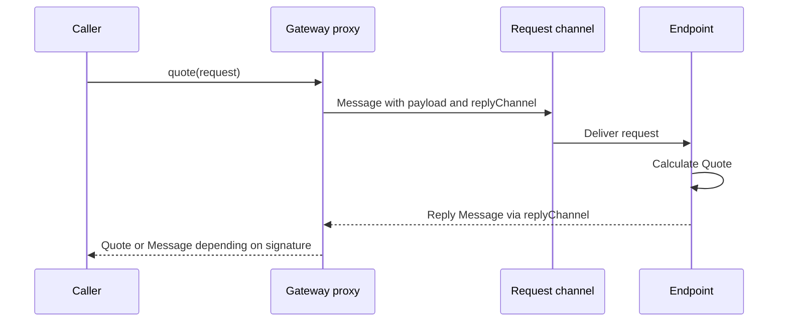

# Gateway Return Value: Designing the Return Value of a Messaging Gateway

In the **Messaging gateway** chapter of the `SPRING_INTEGRATION_CORE` module, the return type of a gateway method is the contract between business code and the message flow. This contract governs what data the caller receives, whether headers are needed, whether it waits for a reply, and how errors are observed.

This lesson focuses on Java interface-based gateways. The examples connect `Message`, `MessageChannel`, endpoints, and Java DSL to form a path from method invocation to reply. Transformers, routers, filters, and aggregators are examined where they affect the outcome received by the caller.

After this lesson, you can:

- Choose between a DTO, `Message<T>`, `void`, and asynchronous return types.
- Explain the difference between having no reply, an empty business outcome, and a processing error.
- Design the reply path, timeouts, and error flow to match the gateway signature.
- Write tests that observe return values, headers, and missing-reply scenarios.

The main examples use Java 17 and Spring Integration 6.2+ APIs. The required dependency is `spring-integration-core`; the test example uses JUnit Jupiter. Use the version set managed by your project. The `Mono` section requires Project Reactor. The `@MessagingGateway(errorOnTimeout = true)` attribute has been available since Spring Integration 6.2, per [Javadoc for MessagingGateway](https://docs.spring.io/spring-integration/api/org/springframework/integration/annotation/MessagingGateway.html#errorOnTimeout()).

## 1. Reply Message and Return Value Are Two Different Layers

An endpoint typically produces a **reply message** inside the flow. The gateway converts that reply into the **return value of the Java method**.

For example, an endpoint builds a message with payload `Quote` and header `quoteSource`. A method declared as `Quote quote(...)` extracts the payload; a method declared as `Message<Quote> quoteMessage(...)` gives the caller access to both payload and headers. These are the mapping rules of the [Gateway annotation](https://docs.spring.io/spring-integration/api/org/springframework/integration/annotation/Gateway.html).

| Method signature | Contract from caller's view | When to use |
| --- | --- | --- |
| `Quote quote(QuoteRequest request)` | Business result of a request | Service needs the selling price to continue calculations |
| `Message<Quote> quoteMessage(QuoteRequest request)` | Result together with reply metadata | Need to know the quote source or correlation ID |
| `void audit(QuoteRequest request)` | No reply value required | Sending information for recording purposes |
| `CompletableFuture<Quote> quoteAsync(QuoteRequest request)` | Receives an object representing a future result | Caller needs to compose asynchronous tasks |
| `Mono<Quote> quoteReactive(QuoteRequest request)` | Receives a publisher for at most one result | Caller is building a Reactor pipeline |

The table above shows how contracts are chosen for this lesson's examples. Do not change every method to `Object` just to avoid deciding on a data type: that pushes result validation onto every caller.

An important design distinction: the `boolean` value of `MessageChannel.send(...)` reflects the send operation. If a gateway declares `boolean approve(...)`, that value must come from a reply payload convertible to `boolean`; it does not automatically become a send-acknowledgment receipt.

## 2. How Does the Value Travel Back to the Gateway?



When no separate reply channel is configured, the gateway uses a temporary channel for the reply. The `replyChannel` header holds this return path. The temporary channel mechanism is described in [MessagingGatewaySupport](https://docs.spring.io/spring-integration/api/org/springframework/integration/gateway/MessagingGatewaySupport.html#setReplyChannel(org.springframework.messaging.MessageChannel)).

On a service activator, an explicitly configured output channel takes priority. If there is no output channel, the endpoint can use the request's `replyChannel` to send the result. Thus, a flow ending at a result-producing handler can still return to the gateway even without declaring a bean named `replyChannel`. See [Service Activator](https://docs.spring.io/spring-integration/reference/service-activator.html).

When designing a quoting flow, verify three things:

1. The processing branch produces a result matching the type the gateway promises to return.
2. Steps that rebuild messages do not drop the required return path.
3. No terminal output channel sends the reply to another consumer that finishes without returning to the gateway.

If the caller needs to know which system the data came from, place that info into a reply header or DTO per the chosen contract. Do not force callers to infer the processing source from internal channel names.

## 3. Complete Example: Returning Payload, Returning Message, and Observing Missing Replies

The following example is a standalone Java file named `GatewayReturnDemo.java` in package `example.gatewayreturns`. It creates three business flows and one consumerless queue to practice timeouts.

```java
package example.gatewayreturns;

import java.math.BigDecimal;

import org.springframework.context.annotation.AnnotationConfigApplicationContext;
import org.springframework.context.annotation.Bean;
import org.springframework.context.annotation.Configuration;
import org.springframework.integration.annotation.Gateway;
import org.springframework.integration.annotation.IntegrationComponentScan;
import org.springframework.integration.annotation.MessagingGateway;
import org.springframework.integration.channel.DirectChannel;
import org.springframework.integration.channel.QueueChannel;
import org.springframework.integration.config.EnableIntegration;
import org.springframework.integration.dsl.IntegrationFlow;
import org.springframework.messaging.Message;
import org.springframework.messaging.MessageChannel;

@Configuration(proxyBeanMethods = false)
@EnableIntegration
@IntegrationComponentScan(basePackageClasses = GatewayReturnDemo.class)
public class GatewayReturnDemo {

    public record QuoteRequest(String sku, int quantity) {
    }

    public record Quote(String sku, BigDecimal total) {
    }

    @MessagingGateway(
        defaultRequestChannel = "quotes.requests",
        defaultReplyTimeout = "500"
    )
    public interface QuoteGateway {

        Quote quote(QuoteRequest request);

        Message<Quote> quoteMessage(QuoteRequest request);

        @Gateway(requestChannel = "counts.requests")
        Integer count(String request);

        @Gateway(requestChannel = "audit.requests")
        void audit(QuoteRequest request);

        // For experimentation only: this queue has no consumer.
        @Gateway(requestChannel = "quotes.unconsumed", replyTimeout = 30)
        Quote noReply(QuoteRequest request);
    }

    @Bean("quotes.requests")
    MessageChannel quoteRequests() {
        return new DirectChannel();
    }

    @Bean("quotes.unconsumed")
    QueueChannel unconsumedRequests() {
        return new QueueChannel(10);
    }

    @Bean
    IntegrationFlow quoteFlow() {
        return IntegrationFlow.from("quotes.requests")
            .handle(QuoteRequest.class, (request, headers) -> {
                if (request.quantity() <= 0) {
                    throw new IllegalArgumentException("quantity must be positive");
                }
                BigDecimal unitPrice = new BigDecimal("120000");
                BigDecimal total = unitPrice.multiply(
                    BigDecimal.valueOf(request.quantity()));
                return new Quote(request.sku(), total);
            }, endpoint -> endpoint.requiresReply(true))
            .enrichHeaders(headers -> headers.header("quoteSource", "catalog"))
            .get();
    }

    @Bean
    IntegrationFlow countFlow() {
        return IntegrationFlow.from("counts.requests")
            .handle(String.class, (request, headers) -> "7",
                endpoint -> endpoint.requiresReply(true))
            .get();
    }

    @Bean
    IntegrationFlow auditFlow() {
        return IntegrationFlow.from("audit.requests")
            .handle(QuoteRequest.class, (request, headers) -> {
                System.out.println("AUDIT " + request.sku());
                return null;
            })
            .get();
    }

    public static void main(String[] args) {
        try (var context = new AnnotationConfigApplicationContext(
                GatewayReturnDemo.class)) {
            QuoteGateway gateway = context.getBean(QuoteGateway.class);
            QuoteRequest request = new QuoteRequest("BOOK-01", 2);

            Quote quote = gateway.quote(request);
            System.out.println(quote.total());

            Message<Quote> reply = gateway.quoteMessage(request);
            System.out.println(reply.getPayload().total());
            System.out.println(reply.getHeaders().get("quoteSource"));

            System.out.println(gateway.count("count active offers"));
            gateway.audit(request);
        }
    }
}
```

Expected business output from `main`:

```text
240000
240000
catalog
7
AUDIT BOOK-01
```

The framework may emit additional context startup and shutdown logs. The two calls `quote` and `quoteMessage` are two separate requests; the example simply shows that the same flow can serve two result-receiving contracts.

`@EnableIntegration` enables Spring Integration infrastructure in a plain Java context. `@IntegrationComponentScan` discovers gateway interfaces; standard component scanning does not replace scanning for these interfaces, as [Javadoc MessagingGateway](https://docs.spring.io/spring-integration/api/org/springframework/integration/annotation/MessagingGateway.html) explains. The flows use `IntegrationFlow.from(...).handle(...).get()` per the component registration mechanism of [Java DSL IntegrationFlow](https://docs.spring.io/spring-integration/api/org/springframework/integration/dsl/IntegrationFlow.html).

The `noReply` method is not called in `main`. It is reserved for the tests below. The queue has capacity 10 so the experiment does not create an unbounded buffer; unprocessed messages sit in the queue until consumed or the context closes.

## 4. Return the Payload or Return the Whole Message?

### 4.1. Return a DTO So Callers Work with Domain Types

With `Quote quote(...)`, services can continue processing using domain data:

```java
Quote quote = gateway.quote(new QuoteRequest("BOOK-01", 2));
BigDecimal payable = quote.total().add(new BigDecimal("30000"));
```

In this design, the caller only needs to know the price and how to compute the payment amount. The `Quote` type makes the contract clearer than `Map<String, Object>` or `Object`.

### 4.2. Return Message When Metadata Is Part of the Caller's Needs

With `Message<Quote> quoteMessage(...)`, the caller accesses both parts:

```java
Message<Quote> reply = gateway.quoteMessage(
    new QuoteRequest("BOOK-01", 2));

Quote quote = reply.getPayload();
String source = reply.getHeaders().get("quoteSource", String.class);
```

`Message<T>` provides `getPayload()` and `getHeaders()`, per [Message API](https://docs.spring.io/spring-framework/docs/current/javadoc-api/org/springframework/messaging/Message.html). In the example, `quoteSource` explains the quote's origin. If it is merely a fixed source with no business significance for the caller, this metadata can stay inside the integration layer.

Returning `Message<Quote>` also introduces the messaging API to the caller side. When you want the service to depend only on domain types, expand the DTO to `QuoteResult(Quote quote, String source)` and use a transformer to build that DTO before returning.

Do not mutate the received headers map directly. If a step in the flow needs to alter metadata, build a new message with `MessageBuilder` or use a header enricher. A message's headers structure is designed to be read-only, per [Message Headers](https://docs.spring.io/spring-integration/reference/message.html#message-headers).

### 4.3. A Generic Declaration Does Not Replace a Data Conversion Step

If the reply contains a JSON string, declaring `Message<Quote>` is not an instruction to deserialize JSON into `Quote`. Place an explicit conversion step in the flow and test the actual payload.

Similarly, if a service returns a `Map`, changing the gateway signature to `Quote` is not enough to define how each field is read, how missing data is handled, or how values are validated. A transformer is the right place to express that mapping rule.

## 5. Bounded Return Type Conversion

In the example, `countFlow`'s endpoint returns the string `"7"`, while the gateway declares `Integer`. The gateway can perform type conversions supported by Spring. The conversion mechanism and use of the integration `ConversionService` are described in [GatewayProxyFactoryBean](https://docs.spring.io/spring-integration/api/org/springframework/integration/gateway/GatewayProxyFactoryBean.html).

Distinguish simple technical conversions from business mapping:

| Reply payload | Type caller expects | Design approach in this lesson |
| --- | --- | --- |
| `Quote` | `Quote` | Return directly |
| Valid numeric string like `"7"` | `Integer` | Can use standard conversion and test it |
| String `"seven"` | `Integer` | Treat as invalid data; do not expect automatic conversion |
| JSON containing SKU and price | `Quote` | Use explicit deserialization and validation steps |
| List of external records | `List<Quote>` | Map each element before returning |

A custom converter may suit types shared across the entire application. If a rule is meaningful only within a single flow, a transformer usually lets readers see the transformation right where it is used.

Avoid primitives like `int` when the contract still permits no reply. `null` cannot be represented by a primitive; choose a wrapper type, a result DTO, or an explicit exception-throwing policy. That is an API design decision, not a workaround for a missing reply path.

## 6. void: No Reply Required, Not Automatically Background Execution

In `audit(...)`, the caller requires no business result. The flow can log, record an event, or send a notification without returning a DTO to that call.

Execution behavior still depends on the channel. `DirectChannel` runs processing on the sending thread; `QueueChannel` buffers the message for a consumer to pick up later. Queue characteristics and processing boundaries are described in [Message Channel Implementations](https://docs.spring.io/spring-integration/reference/channel/implementations.html).

Because the example uses a direct flow, the `audit` handler runs before the call finishes. If the logging handler takes a long time, the caller bears that duration too. If switched to a queue, the method returning only tells you it passed the corresponding send step; in business design, do not infer that all subsequent side effects have finished.

For `void` gateways, Spring Integration 5.4+ sets `nullChannel` as `replyChannel` if the request has not specified this header, discarding replies emitted outside the one-way contract. See [Messaging Gateways — Setting the Default Reply Channel](https://docs.spring.io/spring-integration/reference/gateway.html#gateway-default-reply-channel).

If the requirement is “the caller must know inventory was deducted”, design a result like `ReservationResult` or an asynchronous contract capable of tracking completion. A `void reserve(...)` method cannot express a reservation code or a rejection reason.

## 7. No Reply Differs from an Empty Business Result

A message must have a valid payload. When a handler returns `null`, normally no reply message is created; that flow segment terminates. If `requiresReply(true)` is configured, the handler must produce a reply or an error is raised. This rule belongs to [AbstractReplyProducingMessageHandler](https://docs.spring.io/spring-integration/api/org/springframework/integration/handler/AbstractReplyProducingMessageHandler.html).

Consider three distinct outcomes of the quoting problem:

| Situation | Business meaning | Recommended representation |
| --- | --- | --- |
| Price exists for product | Succeeded | `Quote` or DTO with status `AVAILABLE` |
| Valid product but no price yet | Definite business outcome | DTO with status `NOT_AVAILABLE` |
| Caller receives no reply by deadline | Processing outcome unknown | Timeout per gateway policy |

Example of an explicit outcome contract:

```java
public record QuoteOutcome(String status, Quote quote) {
}

// Price unavailable is an intentional result.
QuoteOutcome unavailable = new QuoteOutcome("NOT_AVAILABLE", null);
```

The `QuoteOutcome` object is still non-`null`, so it can serve as a payload even though its inner `quote` field is null. In a real project, you can use an enum for `status` and a compact constructor validating valid field combinations.

Points in the flow to check when a gateway receives no result:

- A filter has a rejection branch that simply drops the message without producing a result for the caller.
- A router has a path ending at a one-way send step.
- A handler returns `null` or is declared `void` in a flow where the gateway expects a DTO.
- An aggregator has not met release criteria and has not produced a result message yet.
- A step manually constructing a new message omits headers needed for the return path.

This is a checklist for tracing the reply path, not proof that all such cases are bugs. For `void audit(...)`, producing no reply is the intended contract. For `Quote quote(...)`, every branch must have a clear policy: return a result, report an error, or let timeout represent that no reply was received.

In `quoteFlow`, `requiresReply(true)` is placed right on the pricing handler to catch accidental `null` returns from the handler. It does not guarantee a subsequent step sends the reply to the right place, nor does it replace timeouts across the entire reply path.

## 8. Timeouts and Return Values

### 8.1. Separating Send Time from Reply Wait Time

`requestTimeout` limits the send phase when sending can block, such as a bounded-capacity queue being full. `replyTimeout` limits the reply wait phase. Method-level attributes use milliseconds and override the gateway's corresponding defaults. See [Gateway — requestTimeout and replyTimeout](https://docs.spring.io/spring-integration/api/org/springframework/integration/annotation/Gateway.html).

With `noReply(...)` in the example:

1. The request is placed into `quotes.unconsumed` if queue capacity permits.
2. No consumer retrieves the request to produce a result.
3. After the configured reply wait interval, the caller receives `null` per the example's default policy.

`null` here does not mean “no price”. The request was not even processed. If the queue is full, the scenario shifts to a request-sending issue and must be analyzed separately.

### 8.2. replyTimeout Is Not an Interrupt Timer for Every Line of Code

Along a completely synchronous path, the reply wait starts when control returns to the gateway. A slow handler on the same thread is not stopped by `replyTimeout`. Across an asynchronous boundary, the caller can wait for a reply within the configured limit. Details are in [Gateway Behavior When No response Arrives](https://docs.spring.io/spring-integration/reference/gateway.html#gateway-behavior-no-response).

Examples of design consequences:

```text
Gateway -> DirectChannel -> Slow HTTP client -> reply
```

To control external system call duration in the path above, configure timeouts on the HTTP client itself. Setting only the gateway's `replyTimeout` creates no mechanism to interrupt the HTTP call.

```text
Gateway -> QueueChannel -> consumer on another thread -> reply
```

In the second path, the caller can time out while the consumer is still working. A caller timing out does not prove the consumer stopped or any transaction rolled back. When considering retries, establish a request ID and duplicate-processing policy suited to the business domain.

### 8.3. Choosing Between Returning null and Throwing a Timeout Error

Since Spring Integration 6.2, you can instruct the gateway to throw an error when no reply arrives within the deadline:

```java
@MessagingGateway(
    defaultRequestChannel = "strictQuotes.requests",
    defaultReplyTimeout = "200",
    errorOnTimeout = true
)
public interface StrictQuoteGateway {
    Quote quote(QuoteRequest request);
}
```

This is a separate configuration illustrating the policy and does not need to be added to `GatewayReturnDemo`. The `strictQuotes.requests` channel and its consumer must be configured in an application using this interface.

When no custom error channel exists, the gateway throws `MessageTimeoutException` instead of returning `null`. If an error channel is configured, the timeout error can go through the error flow. That mechanism is described in [MessagingGatewaySupport — setErrorOnTimeout](https://docs.spring.io/spring-integration/api/org/springframework/integration/gateway/MessagingGatewaySupport.html#setErrorOnTimeout(boolean)).

For APIs that require a result, throwing a timeout error usually helps callers distinguish a reply-wait failure from the `NOT_AVAILABLE` state. Explicitly declare deadlines based on usage requirements, avoiding assumptions about defaults across different versions.

## 9. Errors Can Become Return Values If the Contract Permits

With a synchronous flow and no custom error channel, errors can propagate back to the caller. With processing on another thread, error messages and error channels participate in forwarding errors; you cannot rely on the original Java call stack to catch every error across an asynchronous boundary. See [Error Handling](https://docs.spring.io/spring-integration/reference/error-handling.html).

An error flow can map an error into a result DTO. Below is a standalone illustrative configuration using the `QuoteRequest`, `Quote`, and `QuoteOutcome` types introduced earlier:

```java
@MessagingGateway(
    defaultRequestChannel = "outcome.requests",
    errorChannel = "outcome.errors",
    defaultReplyTimeout = "500"
)
public interface OutcomeGateway {
    QuoteOutcome quote(QuoteRequest request);
}

@Bean
IntegrationFlow outcomeErrorFlow() {
    return IntegrationFlow.from("outcome.errors")
        .handle(Throwable.class, (failure, headers) ->
            new QuoteOutcome("UNAVAILABLE", null))
        .get();
}
```

The main flow on `outcome.requests` must also return `QuoteOutcome` on success. The snippet only illustrates the error path; an application must add the main flow before using this interface.

Having an error flow produce an appropriate reply for the gateway is described in [Messaging Gateways — Error Handling](https://docs.spring.io/spring-integration/reference/gateway.html#gateway-error-handling). In this example design, the caller inspects `status` to decide whether to display an alternative option.

Rules to apply when extending the example:

- Convert only errors defined by the API into business outcomes or degraded-service statuses.
- Keep correlation IDs and diagnostic details in operational observability, without exposing raw stack traces in public DTOs.
- Return the same result type on both the success path and the fallback path.
- If the error flow merely logs and ends, define how the caller observes the missing reply.

Do not turn every programming bug into “no price available”: that makes a bug needing a fix indistinguishable from a normal business state.

## 10. Asynchronous Return Types: Immediate Handle vs. Deferred Result

### 10.1. CompletableFuture

A gateway can be declared to return `CompletableFuture<Quote>` using a designated executor:

```java
@MessagingGateway(
    defaultRequestChannel = "quotes.requests",
    defaultReplyTimeout = "500",
    asyncExecutor = "quoteExecutor"
)
public interface AsyncQuoteGateway {
    java.util.concurrent.CompletableFuture<Quote> quoteAsync(
        QuoteRequest request);
}

@Bean
org.springframework.scheduling.concurrent.ThreadPoolTaskExecutor quoteExecutor() {
    var executor = new org.springframework.scheduling.concurrent.ThreadPoolTaskExecutor();
    executor.setCorePoolSize(2);
    executor.setMaxPoolSize(4);
    executor.setQueueCapacity(20);
    executor.setThreadNamePrefix("quote-gateway-");
    return executor;
}
```

This is an optional extension to the pricing example; the interface must be scanned and the executor bean must reside in the context. The `quotes.requests` flow still returns `Quote` as before.

With an active executor, the gateway runs the task to complete the future. If the executor is explicitly disabled with `AnnotationConstants.NULL`, downstream must supply a corresponding `Future` type. These two modes are described in [GatewayProxyFactoryBean — setAsyncExecutor](https://docs.spring.io/spring-integration/api/org/springframework/integration/gateway/GatewayProxyFactoryBean.html#setAsyncExecutor(java.util.concurrent.Executor)).

The caller can chain subsequent steps:

```java
asyncGateway.quoteAsync(new QuoteRequest("BOOK-01", 2))
    .thenApply(Quote::total)
    .thenAccept(total -> System.out.println("Total: " + total))
    .exceptionally(failure -> {
        System.err.println("Quote failed: " + failure.getMessage());
        return null;
    });
```

In the executor-enabled mode of the example, there are two layers of results: the future object itself and the `Quote` value when the future completes. When testing or awaiting futures, use an appropriate wait limit; do not let an unbounded `get()` hide a flow that lacks a reply.

### 10.2. Mono

A gateway method can declare `Mono<Quote>`. The flow is triggered upon subscription; declaring `Mono` does not by itself guarantee every downstream step becomes nonblocking. This lazy mechanism is described in [Messaging Gateways — Reactor Mono](https://docs.spring.io/spring-integration/reference/gateway.html#gateway-reactor-mono).

When using this type, place subscription or publisher composition into a pipeline at an explicit boundary. Without a subscription, readers can mistake “the method was called” for the request having started processing.

This lesson uses `Mono` to distinguish return contracts; designing a full reactive pipeline also requires examining channels, schedulers, and I/O libraries used by the flow.

## 11. Returning List Does Not Mean the Gateway Automatically Collects Multiple Replies

Suppose the business changes to quoting an entire shopping cart:

```java
List<Quote> quoteAll(List<QuoteRequest> requests);
```

The contract should produce **a single reply whose payload is a list**. One design approach is:

```text
Gateway
  -> Splitter separates each item
  -> Handler calculates price per item
  -> Aggregator builds group result
  -> Transformer normalizes List<Quote>
  -> Single reply to gateway
```

Java DSL lets you combine `split()`, processing branches, and `aggregate()` within the same flow, as shown in [IntegrationFlow](https://docs.spring.io/spring-integration/api/org/springframework/integration/dsl/IntegrationFlow.html). In this problem, the aggregator decides when enough data has arrived to form a result; the gateway's `List<Quote>` signature does not do that work for you.

Before implementing, decide whether one unpriced item fails the whole cart or produces per-line outcomes. Also preserve grouping metadata, define release conditions, and align the group's expiration with the caller's wait time.

## 12. Testing the Return Contract

The tests below use the `GatewayReturnDemo` configuration from Section 3 as-is. Place tests in the same package; besides the main dependencies, JUnit Jupiter and the project's test runner configuration are needed.

```java
package example.gatewayreturns;

import java.math.BigDecimal;

import org.junit.jupiter.api.AfterAll;
import org.junit.jupiter.api.BeforeAll;
import org.junit.jupiter.api.Test;
import org.springframework.context.annotation.AnnotationConfigApplicationContext;
import org.springframework.integration.channel.QueueChannel;
import org.springframework.messaging.Message;

import example.gatewayreturns.GatewayReturnDemo.Quote;
import example.gatewayreturns.GatewayReturnDemo.QuoteGateway;
import example.gatewayreturns.GatewayReturnDemo.QuoteRequest;

import static org.junit.jupiter.api.Assertions.assertEquals;
import static org.junit.jupiter.api.Assertions.assertNotNull;
import static org.junit.jupiter.api.Assertions.assertNull;
import static org.junit.jupiter.api.Assertions.assertThrows;

class GatewayReturnDemoTest {

    private static AnnotationConfigApplicationContext context;
    private static QuoteGateway gateway;

    @BeforeAll
    static void startContext() {
        context = new AnnotationConfigApplicationContext(GatewayReturnDemo.class);
        gateway = context.getBean(QuoteGateway.class);
    }

    @AfterAll
    static void stopContext() {
        if (context != null) {
            context.close();
        }
    }

    @Test
    void returnsBusinessPayload() {
        Quote result = gateway.quote(new QuoteRequest("BOOK-01", 2));

        assertNotNull(result);
        assertEquals("BOOK-01", result.sku());
        assertEquals(new BigDecimal("240000"), result.total());
    }

    @Test
    void returnsPayloadAndReplyHeaders() {
        Message<Quote> result = gateway.quoteMessage(
            new QuoteRequest("BOOK-01", 2));

        assertNotNull(result);
        assertEquals(new BigDecimal("240000"), result.getPayload().total());
        assertEquals("catalog", result.getHeaders().get("quoteSource"));
    }

    @Test
    void convertsNumericStringToInteger() {
        assertEquals(Integer.valueOf(7), gateway.count("active offers"));
    }

    @Test
    void propagatesInvalidQuantityFromSynchronousFlow() {
        assertThrows(IllegalArgumentException.class,
            () -> gateway.quote(new QuoteRequest("BOOK-01", 0)));
    }

    @Test
    void returnsNullWhenNoReplyArrives() {
        Quote result = gateway.noReply(new QuoteRequest("BOOK-01", 2));

        assertNull(result);
        QueueChannel requests = context.getBean(
            "quotes.unconsumed", QueueChannel.class);
        assertNotNull(requests.receive(0));
    }
}
```

This is test code for learners to run in a Java project with dependencies configured; this document does not assume the tests have been executed at the time of writing.

The final test uses a consumerless queue to deterministically create a no-reply condition. It also verifies that the request entered the queue, distinguishing it from a send failure. No `Thread.sleep` is needed, and you should not assert an exact 30-millisecond runtime because schedulers and test environments can make actual elapsed time longer.

For the `errorOnTimeout = true` variant, add a separate test expecting `MessageTimeoutException` while keeping the same consumerless condition. For fallbacks, test that the error path returns the exact published DTO and status. For futures, test both normal completion values and error completion branches.

## 13. Practice Changing the Contract

1. **Add an unpriced status:** change both gateway and flow to `QuoteOutcome`; product `UNKNOWN` must return `NOT_AVAILABLE` via a real reply. Test to distinguish it from a consumerless queue.
2. **Need metadata while keeping service domain-typed:** create a result DTO containing `Quote` and the quote source; use a transformer at the end of the flow to map the data.
3. **Require a reply:** enable the timeout-error policy and write a test where a request was sent yet no reply arrived.
4. **Shopping cart quote:** define the policy for unpriced items, combine results with an aggregator, and return a single list in one reply.

When finished, re-read each gateway signature and describe four elements: the business result, metadata to preserve, the policy when no reply arrives, and how the caller observes errors. These elements must be consistent across every branch a request can traverse.