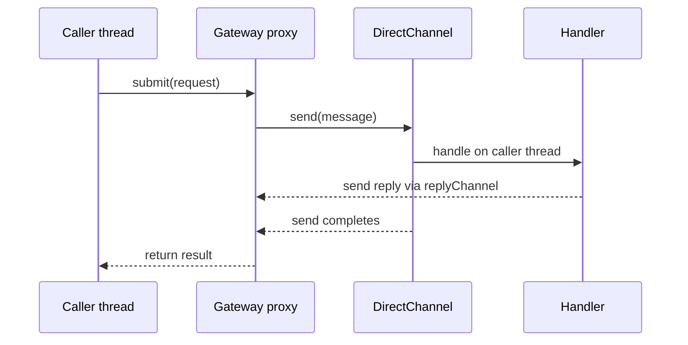
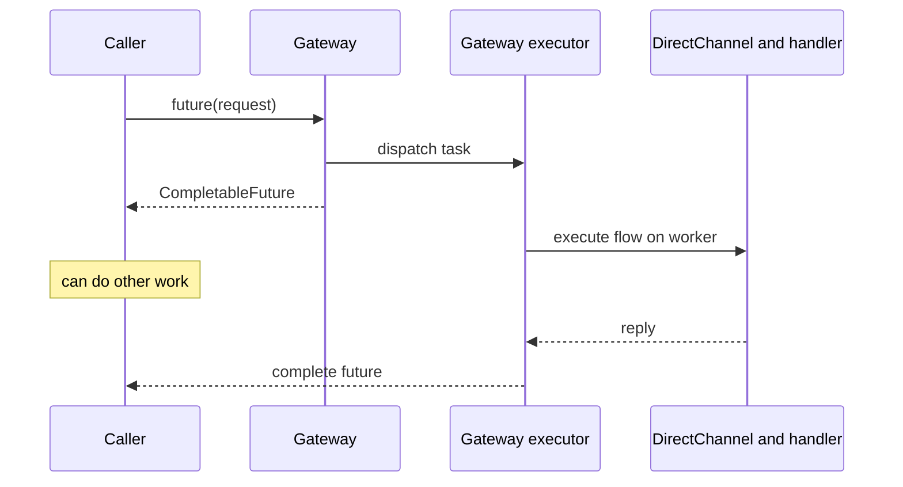

# Gateway and Caller Thread

## 1. Objectives and Scope

In the **Messaging gateway** chapter of the **SPRING_INTEGRATION_CORE** module, this lesson explains which thread executes each segment of an integration flow and when the thread calling the gateway is allowed to continue. This knowledge is essential to design message flows using Message, MessageChannel, endpoints, and Java DSL, as well as to handle errors and test execution behavior accurately.

After this lesson, you can:

- Distinguish a caller executing business work from a caller waiting for a reply.
- Explain why having workers does not equate to releasing the caller.
- Choose synchronous, one-way, or future contracts according to result-consumption requirements.
- Set timeouts on the right phase and identify work still running after timeout.
- Check how thread switches affect transactions, context, and errors.

The examples use Java 17 and Spring Integration 6.5.x. Dependencies must be aligned per project, for example via a Spring Boot BOM. The lesson configures timeouts and executors explicitly so it does not rely on version-specific defaults.

## 2. Two Questions That Must Be Separated

The **caller thread** is the thread currently invoking a method on the gateway proxy. It may be an HTTP thread, a scheduler, a worker from another executor, or the `main` thread.

```java
String reply = orderGateway.submit("ORDER-42");
```

At the moment this statement executes, the current thread is the gateway's caller. Two separate questions must be answered:

| Question | Determining factor |
|---|---|
| Who executes the next handler? | Channels, executors, pollers, and execution boundaries |
| When does the caller continue? | Return type, gateway configuration, and how the result is used |

A handler may run on a worker while the `String submit(...)` method still blocks the caller waiting for a reply. A method returning `CompletableFuture<String>` with an appropriate executor can hand the future to the caller before business work completes.

Having a Message or multiple endpoints does not imply a new thread exists. Look for the mechanism that actually hands off execution.

### 2.1. The Gateway Turns the Call into a Message

Consider the gateway:

```java
@MessagingGateway(defaultRequestChannel = "orders")
public interface OrderGateway {
    String submit(String orderId);
}
```

The call is processed in conceptual steps:

1. Map arguments into the request payload and headers.
2. Prepare the reply-receiving path.
3. Send the request into `orders`.
4. Execute the flow per each channel and endpoint configuration.
5. Receive the reply and convert its payload into the return value.

A gateway method can take a payload or `Message<?>`; parameters with `@Header` map to headers. Callers using a payload return type do not interact directly with messages. See [Javadoc @Gateway 6.5.0](https://docs.spring.io/spring-integration/docs/6.5.0/api/org/springframework/integration/annotation/Gateway.html).

In standard request–reply, the gateway creates a temporary reply channel and puts it in the `replyChannel` header. There is no need to declare a named reply channel just to offload work to a worker. If you manually construct a new message and drop the reply routing info, the caller may never receive a result. See Setting the Default Reply Channel in [Messaging Gateways 6.5](https://docs.spring.io/spring-integration/reference/6.5/gateway.html).

**The reply channel determines where the result returns; execution channels and executors determine who runs the business logic.**

## 3. DirectChannel: The Caller Traverses the Flow Itself

`DirectChannel` invokes the registered handler directly on the message-sending thread. If a synchronous gateway enters a chain of synchronous endpoints, the caller runs through that chain itself. See DirectChannel characteristics in [Message Channel Implementations](https://docs.spring.io/spring-integration/reference/channel/implementations.html).



Columns represent logical components; the entire interaction above can use **one thread**.

```text
caller → gateway → DirectChannel → transformer → router
                                                ↓
                                         service activator
                                                ↓
                                              reply
```

Transformers and routers do not automatically spawn workers. If the selected branch remains synchronous, the final handler still uses the caller.

Consequences:

- Slow I/O inside a handler holds the caller directly in the processing call stack.
- Until the handler finishes, the caller does not return to the gateway.
- The number of endpoints does not dictate the number of threads.
- A thread dump of the caller can show the call stack traversing synchronous endpoints.

In a typical servlet application, the caller may be a request thread. The handler holds that thread while calling external services, so request-handling thread resources must be factored in when choosing concurrency levels.

## 4. Setting Handoff Boundaries

### 4.1. ExecutorChannel

```text
caller → gateway → ExecutorChannel → worker → handler → reply
            └──────── waits for reply if method returns String ───┘
```

`ExecutorChannel` delegates dispatching to an executor. When the executor runs asynchronously, a worker executes the business logic while the caller of a `String`-returning gateway still waits for the reply.

You cannot infer “always switches threads” from the channel name alone: a synchronous executor or a `CallerRunsPolicy` overload policy when the pool is saturated can run work on the sending thread. Inspect the actual executor configuration. See [Javadoc ExecutorChannel 6.5.0](https://docs.spring.io/spring-integration/docs/6.5.0/api/org/springframework/integration/channel/ExecutorChannel.html).

### 4.2. QueueChannel

A queue holds messages for consumers to retrieve later. An endpoint after a pollable channel in an integration flow typically needs a poller:

```java
@Bean
QueueChannel queuedRequests() {
    return new QueueChannel(100);
}

@Bean
IntegrationFlow queuedFlow() {
    return IntegrationFlow.from("queuedRequests")
            .handle(String.class,
                    (payload, headers) -> "ACK:" + payload,
                    endpoint -> endpoint.poller(
                            Pollers.fixedDelay(50)
                                    .maxMessagesPerPoll(10)))
            .get();
}
```

The configuration snippet above requires additional imports:

```java
import org.springframework.integration.channel.QueueChannel;
import org.springframework.integration.dsl.Pollers;
```

A gateway pointing to `queuedRequests` can send to the queue and then wait for a reply. A full queue can also make the send phase wait for space. The queue is a buffer; the consumer and poller perform the processing. An in-memory queue does not automatically preserve work across process shutdown.

### 4.3. Thread-Switch Points Can Sit Mid-Flow

```text
T0: gateway → DirectChannel → transformer → router
                                             ↓
                                   ExecutorChannel
                                             ↓
T1:                            service activator → reply
```

Everything before `ExecutorChannel` still runs on `T0`. When evaluating caller latency, include transformers, routers, and I/O located before the handoff point.

A filter dropping a message without throwing an error or returning an alternative reply can make the gateway wait until timeout. Likewise, an aggregator only emits a result once its release conditions are met. Having workers does not guarantee every request receives a reply.

## 5. Complete Java DSL Example

The example uses plain Spring with `spring-integration-core` and compatible Spring dependencies. A Spring Boot project can use `spring-boot-starter-integration` per its BOM.

When practicing, place the three public types below into three separate Java files under package `demo.gateway`. File names simply describe the example code.

### 5.1. ThreadGateway.java

```java
package demo.gateway;

import java.util.concurrent.CompletableFuture;

import org.springframework.integration.annotation.Gateway;
import org.springframework.integration.annotation.MessagingGateway;

@MessagingGateway(
        defaultRequestTimeout = "500",
        defaultReplyTimeout = "3000",
        asyncExecutor = "gatewayExecutor")
public interface ThreadGateway {

    @Gateway(requestChannel = "directRequests")
    String direct(String value);

    @Gateway(requestChannel = "workerRequests")
    String viaWorker(String value);

    @Gateway(requestChannel = "directRequests")
    CompletableFuture<String> future(String value);

    @Gateway(requestChannel = "directRequests")
    void oneWay(String value);
}
```

`asyncExecutor` only applies to asynchronous methods with supported return types; it does not convert `String`-returning methods into future contracts. `@IntegrationComponentScan` registers the gateway interface; standard component scanning does not register this interface. See [Javadoc @MessagingGateway 6.5.0](https://docs.spring.io/spring-integration/docs/6.5.0/api/org/springframework/integration/annotation/MessagingGateway.html).

### 5.2. ThreadFlowConfig.java

```java
package demo.gateway;

import java.util.concurrent.ThreadPoolExecutor;

import org.springframework.beans.factory.annotation.Qualifier;
import org.springframework.context.annotation.Bean;
import org.springframework.context.annotation.Configuration;
import org.springframework.integration.annotation.IntegrationComponentScan;
import org.springframework.integration.channel.DirectChannel;
import org.springframework.integration.channel.ExecutorChannel;
import org.springframework.integration.config.EnableIntegration;
import org.springframework.integration.dsl.IntegrationFlow;
import org.springframework.scheduling.concurrent.ThreadPoolTaskExecutor;

@Configuration
@EnableIntegration
@IntegrationComponentScan(basePackageClasses = ThreadGateway.class)
public class ThreadFlowConfig {

    @Bean
    DirectChannel directRequests() {
        return new DirectChannel();
    }

    @Bean
    ThreadPoolTaskExecutor gatewayExecutor() {
        return pool("gateway-", 2, 20);
    }

    @Bean
    ThreadPoolTaskExecutor processingExecutor() {
        return pool("processing-", 2, 20);
    }

    @Bean
    ExecutorChannel workerRequests(
            @Qualifier("processingExecutor")
            ThreadPoolTaskExecutor executor) {
        return new ExecutorChannel(executor);
    }

    @Bean
    IntegrationFlow directFlow() {
        return IntegrationFlow.from("directRequests")
                .<String, String>transform(String::trim)
                .handle(String.class,
                        (payload, headers) -> process(payload))
                .get();
    }

    @Bean
    IntegrationFlow workerFlow() {
        return IntegrationFlow.from("workerRequests")
                .<String, String>transform(String::trim)
                .handle(String.class,
                        (payload, headers) -> process(payload))
                .get();
    }

    private static ThreadPoolTaskExecutor pool(
            String prefix, int size, int capacity) {
        ThreadPoolTaskExecutor executor =
                new ThreadPoolTaskExecutor();
        executor.setCorePoolSize(size);
        executor.setMaxPoolSize(size);
        executor.setQueueCapacity(capacity);
        executor.setThreadNamePrefix(prefix);
        executor.setRejectedExecutionHandler(
                new ThreadPoolExecutor.AbortPolicy());
        return executor;
    }

    private static String process(String value) {
        String thread = Thread.currentThread().getName();
        System.out.printf("handler value=%s thread=%s%n",
                value, thread);
        try {
            // Only to observe wait behavior in the demo.
            Thread.sleep(600);
        }
        catch (InterruptedException ex) {
            Thread.currentThread().interrupt();
            throw new IllegalStateException(
                    "Interrupted while simulating processing", ex);
        }
        return "ACK:" + value + "@" + thread;
    }
}
```

The two executors are separated so roles can be observed and to avoid accidentally having a worker wait for work inside its own pool. For Spring-managed beans, there is no need to manually call `initialize()` inside the `ThreadPoolTaskExecutor` factory method.

`AbortPolicy` surfaces pool-and-queue saturation explicitly by rejecting work rather than silently running handlers on the caller thread. Size pools and queues based on real workload. See [Spring Framework — Task Execution and Scheduling](https://docs.spring.io/spring-framework/reference/integration/scheduling.html).

### 5.3. GatewayThreadDemo.java

```java
package demo.gateway;

import java.util.concurrent.CompletableFuture;
import java.util.concurrent.TimeUnit;

import org.springframework.context.annotation.AnnotationConfigApplicationContext;

public class GatewayThreadDemo {

    public static void main(String[] args) throws Exception {
        try (var context = new AnnotationConfigApplicationContext(
                ThreadFlowConfig.class)) {
            ThreadGateway gateway =
                    context.getBean(ThreadGateway.class);

            System.out.println("caller="
                    + Thread.currentThread().getName());

            System.out.println("before direct");
            System.out.println(gateway.direct(" A "));
            System.out.println("after direct");

            System.out.println("before viaWorker");
            System.out.println(gateway.viaWorker(" B "));
            System.out.println("after viaWorker");

            CompletableFuture<String> result =
                    gateway.future(" C ");
            System.out.println("future received; caller continues");
            System.out.println(result.get(5, TimeUnit.SECONDS));

            System.out.println("before oneWay");
            gateway.oneWay(" D ");
            System.out.println("after oneWay");
        }
    }
}
```

When executors are unsaturated, expected behavior:

| Call | Thread running handler | When does the statement after the gateway call run? |
|---|---|---|
| `direct` | `main` | After the handler finishes and a reply is returned |
| `viaWorker` | `processing-` prefix | After the caller finishes waiting for the reply |
| `future` | `gateway-` prefix | When the proxy hands back the future, possibly before the handler finishes |
| `oneWay` | `main` | After the synchronous send completes the handler, with no separate reply wait |

Worker index numbers may vary. In the future case, the handler log line and the “future received” line may swap order depending on scheduling; do not use log ordering as sole proof.

The demo explicitly calls `get(...)` to print the result before closing the context. Placing `get()` right after a future call inside a request handler makes that request thread wait again.

## 6. Future and void: Reading the Contract Accurately

### 6.1. Where Does Future Offload Execution?

With the `future` method in Section 5, the gateway dispatches the task to `gatewayExecutor`. A worker sends to `DirectChannel` and executes the flow. The original caller receives the future.



`DirectChannel` uses the thread sending into it **at the time of execution**. In `direct`, that is the original caller; in `future`, that is a worker from the gateway executor.

Another mode exists: `asyncExecutor = AnnotationConstants.NULL` lets the flow itself return a future as the payload. In that case, the part invoking the flow to obtain the future may run on the caller. Merely seeing the `CompletableFuture` return type does not prove the entire call was offloaded to a worker. See the CompletableFuture section in [Messaging Gateways](https://docs.spring.io/spring-integration/reference/gateway.html).

Consuming the result afterward:

```java
CompletableFuture<String> result = gateway.future("ORDER-42");

result.thenAccept(value ->
        System.out.println("Result: " + value));
```

Callbacks without the `Async` suffix may run on the thread completing the future; if the future is already complete, the callback may execute immediately upon registration. To specify an executor for continuation work:

```java
result.thenApplyAsync(
        value -> value.toUpperCase(java.util.Locale.ROOT),
        continuationExecutor);
```

`continuationExecutor` is an application-provided executor. `get(timeout, unit)` bounds the caller's wait; it does not automatically cancel downstream I/O. Completion and callback rules are documented in [Java 17 Javadoc CompletableFuture](https://docs.oracle.com/en/java/javase/17/docs/api/java.base/java/util/concurrent/CompletableFuture.html).

### 6.2. Void Does Not Guarantee Early Return

```java
@Gateway(requestChannel = "notifications")
void notify(String value);
```

`void` indicates the caller receives no reply value. If the request channel is a `DirectChannel`, the caller still executes the handler while sending the message.

Separate these two notions:

- **Not waiting for a reply:** there is no result-retrieval step under a request–reply contract.
- **Not waiting for business completion:** requires an execution handoff mechanism so work continues after the send operation.

For a one-way call needing to return early, use `ExecutorChannel` or a queue with a consumer. Errors occurring after the call returns must be observed via an error flow. In Spring Integration 6.5, regular `void` gateways use `nullChannel` for replies unless another reply path is specified, so an accidental reply from a handler does not turn the contract into request–reply. See [Messaging Gateways 6.5](https://docs.spring.io/spring-integration/reference/6.5/gateway.html).

## 7. Timeout Is Not a Mechanism to Forcibly Stop Handlers

### 7.1. Distinguishing the Phases

| Setting / operation | What it bounds | What it does NOT guarantee |
|---|---|---|
| `requestTimeout` | Waiting to send when the channel supports timed sends and can block | Handler execution time |
| `replyTimeout` | Waiting for a reply after the send step returns control to the gateway | Total duration of the entire call |
| `future.get(2, SECONDS)` | Caller waits on the future for at most two seconds | Execution work stopping automatically |

A bounded `QueueChannel` that is full is a classic example for request timeout. A saturated executor can reject per its rejection policy; do not treat request timeout as a universal task-acceptance wait time for all executors. See [Javadoc @MessagingGateway — timeout](https://docs.spring.io/spring-integration/docs/current/api/org/springframework/integration/annotation/MessagingGateway.html).

### 7.2. Fully Synchronous Flow

Suppose `replyTimeout = 100` ms and the handler takes 600 ms before returning a result:

```text
t=0 ms      caller enters gateway and enters handler
t=100 ms    caller is still running inside handler
t≈600 ms    handler sends reply, send() finishes
            gateway retrieves the already-ready reply and returns result
```

Reply timeout does not interrupt the handler. The call can last around 600 ms and still return successfully. This limitation is analyzed under Gateway Behavior When No Response Arrives in [Messaging Gateways 7.0](https://docs.spring.io/spring-integration/reference/7.0/gateway.html).

### 7.3. Flow Handing Off to a Worker

If the executor accepts work quickly:

```text
t≈0 ms      request is handed to executor, send() returns
t≈0 ms      caller begins waiting for reply
t≈100 ms    wait time expires, worker has no result yet
t≈600 ms    worker may still complete the business operation
```

These timestamps illustrate the mechanism, not a guarantee of scheduler precision. Synchronous processing prior to the handoff point still contributes to total call time.

When timeout error reporting is not enabled, the gateway can return `null` upon reply wait expiration. Since Spring Integration 6.2, you can use:

```java
@MessagingGateway(
        defaultRequestChannel = "workerRequests",
        defaultReplyTimeout = "100",
        errorOnTimeout = true)
public interface StrictGateway {
    String submit(String value);
}
```

`errorOnTimeout = true` requests throwing `MessageTimeoutException` instead of returning `null` when reply waiting expires. A dedicated error channel on the gateway can also participate in handling that error. See [Javadoc @MessagingGateway — errorOnTimeout](https://docs.spring.io/spring-integration/docs/6.5.0/api/org/springframework/integration/annotation/MessagingGateway.html#errorOnTimeout()).

### 7.4. Timeouts and Side Effects

If a worker has already sent a debit command yet the caller times out before receiving a reply, you cannot conclude the debit failed.

The design needs a request ID for lookup, duplicate-processing protection on resend, real timeouts on HTTP/JDBC clients, and a policy for late replies. Canceling work requires support from the executing side; local timeouts do not replace cancellation protocols.

This is a design consequence of caller and worker having separate lifecycles, not a guarantee that every task will continue or can be canceled in the same way.

## 8. Errors, Transactions, and Context

### 8.1. Errors Do Not Automatically Jump Across Call Stacks

In a synchronous flow, an error inside a handler can unwind back up the call stack to the gateway and then to the caller. The framework may wrap exceptions, so do not assume every error keeps its exact original type.

With workers, exceptions do not automatically jump onto the waiting caller's stack. Spring Integration uses `ErrorMessage` and error routing; the `errorChannel` header takes priority, and if absent, the asynchronous error-handling mechanism can use the global `errorChannel`.

A request–reply gateway with a proper error path can bring errors back to the caller. A future can complete exceptionally; a one-way call that already returned requires observing an error flow. See [Spring Integration — Error Handling](https://docs.spring.io/spring-integration/reference/error-handling.html).

If an error flow merely logs and ends without producing a reply or error matching the contract, the caller may wait until timeout. Decide explicitly whether the gateway boundary terminates via exception, fallback reply, or a bounded wait.

A filter dropping a message, a router matching no branch, a handler returning no result, and an aggregator not yet releasing all require answering the same question: **along which path does the call terminate?**

### 8.2. A Waiting Caller Does Not Propagate Transactions to a Worker

```text
T0: transaction → gateway → DirectChannel → DB update
```

On the same thread, an endpoint can participate in the current transaction according to the transaction manager and propagation settings. Gateways and channels themselves do not create transactions.

```text
T0: transaction → gateway → dispatch work → wait for reply
T1:                              DB update
```

A local transaction bound to `T0` does not automatically propagate to `T1`. The caller still waiting does not make the two threads share a transaction. If the worker opens its own transaction, its commit is not automatically rolled back by a rollback on the caller side. See [Spring Integration — Transaction Support](https://docs.spring.io/spring-integration/reference/6.5/transactions.html).

Verify how the worker reads data the caller has not yet committed, whether it might block on locks held by the caller, and how compensation works if a worker step already committed.

Work that must run after commit or requires durable handoff may need after-commit hooks, an outbox, or a broker matching business requirements.

### 8.3. Headers Differ from ThreadLocal

MDC, security context, or custom `ThreadLocal` values do not automatically carry over to workers. Data such as `orderId`, `tenantId`, and `correlationId` in message headers continue traveling with the message as long as endpoints preserve them.

Spring provides `TaskDecorator`; `ContextPropagatingTaskDecorator` helps restore logging/observation context when suitable dependencies and accessors are present. It does not copy arbitrary `ThreadLocal` values and does not propagate JDBC transactions across threads. See [Javadoc ContextPropagatingTaskDecorator](https://docs.spring.io/spring-framework/docs/current/javadoc-api/org/springframework/core/task/support/ContextPropagatingTaskDecorator.html).

Also avoid mutating a mutable payload after handoff. Multiple threads may still reference the same Java object; wrapping in a message does not automatically make the payload object graph immutable.

## 9. Pools, Load, and Mutual Waiting

### 9.1. Workers Do Not Make Callers Disappear

If 80 synchronous calls enter an 8-worker pool, perhaps only 8 handlers are running, while many callers still hold resources waiting for replies. Observe both sides together:

| Metric | Meaning |
|---|---|
| Waiting callers | Resources held on the calling side |
| Active workers | Processing concurrency |
| Queue depth | Accepted work not yet executing |
| Reply wait time | Latency observed by callers |
| Handler duration | Intrinsic business processing cost |
| Timeouts/rejections | Signs of overload or missing replies |

Estimation example: steady input of 40 requests/second with 0.5-second call duration gives an average of roughly `40 × 0.5 = 20` calls in flight inside the system. This estimate requires steady-state conditions and does not replace real load testing.

### 9.2. Waiting on the Same Pool Running Yourself

```text
sharedExecutor has 1 worker

gateway returns Future
  → task G runs on sharedExecutor
  → sends through ExecutorChannel also using sharedExecutor
  → task H sits in the queue
  → G waits for reply from H
  → H has no free worker to run
```

With finite wait times, G may time out before a worker frees up; waiting indefinitely can deadlock the system. This follows from the wait dependency in the configuration above. Larger pools can also run into this issue when all workers become occupied by waiting tasks.

You can separate pools, remove redundant executor boundaries, or change the contract so workers are not held waiting for tasks in the same pool. Increasing timeouts does not create more workers.

### 9.3. Choosing Based on Requirements

| Requirement | Design to consider |
|---|---|
| Short processing, immediate result | Synchronous gateway, synchronous flow |
| Isolate processing resources while still needing immediate result | Synchronous gateway to worker, accounting for waiting callers |
| Caller proceeds and receives result later | Future with executor and appropriate continuation handling |
| No immediate result needed | One-way, explicit execution boundary and error path |
| Preserve work across restarts | Durable channel/broker or persistent message store |

Splitting threads is an execution decision. Result-delivery contracts and persistence guarantees must be designed alongside it.

## 10. Verifying Through Experiments

### 10.1. Testing Threads in the Example

Returning thread names from the handler is strictly for hands-on practice; production code should use telemetry instead of embedding such details into business payloads. JUnit 5 example:

```java
package demo.gateway;

import java.util.concurrent.TimeUnit;

import org.junit.jupiter.api.Test;
import org.springframework.context.annotation.AnnotationConfigApplicationContext;

import static org.junit.jupiter.api.Assertions.assertEquals;
import static org.junit.jupiter.api.Assertions.assertTrue;

class GatewayThreadTest {

    @Test
    void observesThreadsForEachContract() throws Exception {
        try (var context = new AnnotationConfigApplicationContext(
                ThreadFlowConfig.class)) {
            ThreadGateway gateway =
                    context.getBean(ThreadGateway.class);
            String caller = Thread.currentThread().getName();

            assertEquals("ACK:A@" + caller,
                    gateway.direct(" A "));

            assertTrue(gateway.viaWorker(" B ")
                    .startsWith("ACK:B@processing-"));

            assertTrue(gateway.future(" C ")
                    .get(5, TimeUnit.SECONDS)
                    .startsWith("ACK:C@gateway-"));
        }
    }
}
```

This test verifies threads in this specific configuration. It does not yet prove the caller receives the future before the handler finishes.

### 10.2. Using Latches to Test Wait Relationships

For reliable tests, replace sleeps with an experimental handler having:

- `entered`: a latch signaling the handler has started.
- `release`: a latch holding the handler until the test allows returning a result.
- `handlerThread`: where the executing thread is recorded.

Procedure:

1. Call the gateway from a dedicated test caller executor.
2. Await `entered` with a finite timeout to confirm the handler reached the hold point.
3. For `String viaWorker(...)`, verify the gateway-calling task has not finished yet.
4. For `CompletableFuture<String> future(...)`, verify the task **obtaining the future from the gateway** has finished while the result future has not yet completed.
5. Open `release` and verify the result.
6. Always release latches in `finally` and shut down executors/contexts.

The fixture timeout should exceed the observation wait. This test verifies the “entered handler but not yet permitted to return” relationship, without depending on a call finishing faster than a few milliseconds across all machines.

### 10.3. Practice Matrix

| Change | What to observe |
|---|---|
| `DirectChannel` throughout | Handler and caller share the same thread |
| Request channel is `ExecutorChannel` | Handler switches thread; `String`-returning gateway still waits |
| `future` method with executor | Caller receives future before handler is released |
| `void` with `DirectChannel` | Caller still completes synchronous processing |
| Reply timeout 100 ms, synchronous handler 600 ms | Call can succeed after ~600 ms |
| Reply timeout 100 ms, worker handler 600 ms | Caller can time out while worker continues running |
| Filter drops request without throwing | Inspect termination path and reply wait duration |
| Single-worker shared pool across two wait layers | Observe worker starvation, timeouts, or deadlock |

These test snippets are hands-on practice material, not test results from the reader's current environment.

## 11. Checklist for Reading a Gateway Configuration

1. **Where does the caller come from?** HTTP, scheduler, or executor.
2. **What does the method return?** Synchronous payload, `void`, or future.
3. **Which executor is used?** Does the return type actually use the gateway's executor?
4. **Where is the first thread boundary?** Trace through channels and router branches.
5. **What runs before the boundary?** Include transformers, filters, and I/O.
6. **Is the caller running or waiting?** Having workers does not prove the caller is released.
7. **How does the call terminate?** Reply, exception, timeout, or one-way.
8. **What keeps running after timeout?** Side effects, late replies, and resend risks.
9. **Which thread holds transactions/context?** Uncommitted data, locks, and tracing.
10. **Who waits for whom in pools?** Sketch wait dependencies to spot worker exhaustion.

Seeing each thread's execution path and the reply/error return path lets you design gateways aligned with your system's time budgets and service capacity.