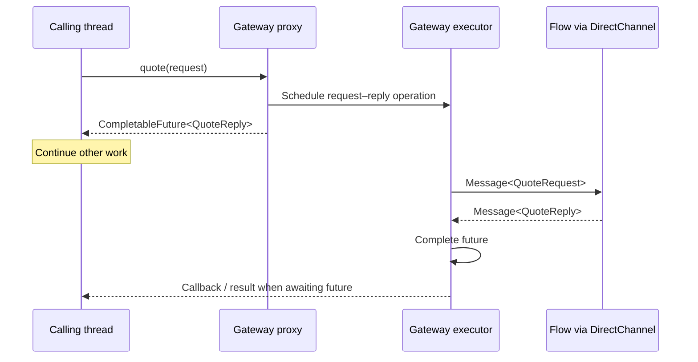

# Gateway with Asynchronous Flow

## 1. Objectives and Scope

In the `SPRING_INTEGRATION_CORE` module, a messaging gateway is the entry point where business code invokes a Java interface, and Spring Integration translates the call into a `Message` exchange over `MessageChannel` and endpoints. When processing takes time, gateway design must answer two questions: **which thread executes the work** and **how the caller receives the result**.

This lesson uses a quote-generation scenario to practice asynchronous gateways, Java DSL, reply paths, timeouts, errors, and testing. After studying it, you can:

- Distinguish a gateway with an asynchronous contract from a flow that contains a thread-handoff point.
- Configure `CompletableFuture<T>` with a bounded executor.
- Preserve the reply path and error path when adding transformers, filters, routers, or aggregators.
- Choose how to handle missing replies, overload, or callers that stop waiting.
- Prove asynchronous behavior with tests coordinated across threads.

The main examples use Java 17+, Spring Integration 6.5.x, and plain Java configuration. The `errorOnTimeout` attribute on `@MessagingGateway` has been available since Spring Integration 6.2. Select library versions using an appropriate application BOM; pool and timeout numbers in the lesson are illustrative configurations only. See attribute semantics in [`@MessagingGateway` API](https://docs.spring.io/spring-integration/api/org/springframework/integration/annotation/MessagingGateway.html).

## 2. Two Different Meanings of “Asynchronous”

### 2.1. Asynchronous at the Gateway Contract

```java
public interface QuoteGateway {
    CompletableFuture<QuoteReply> quote(QuoteRequest request);
}
```

With the gateway's executor enabled, Spring Integration executes the flow invocation inside the executor and returns a future for the caller to track the result. Downstream handlers can return a normal `QuoteReply`. This mechanism is described in [Messaging Gateways — CompletableFuture](https://docs.spring.io/spring-integration/reference/6.5/gateway.html#_completablefuture).

### 2.2. Asynchronous at Message Transport

A flow can offload work to an executor via `ExecutorChannel`, or place messages into a `QueueChannel` for a consumer to receive later. However, if the gateway declares return type `QuoteReply`, the caller still waits for the request–reply result. `DirectChannel` executes handlers on the sending thread; `ExecutorChannel` dispatches work to an executor. With `CallerRunsPolicy`, under overload the handler can run directly on the sending thread. See [MessageChannel Implementations](https://docs.spring.io/spring-integration/reference/channel/implementations.html).

| Gateway contract | Flow entry point | Does caller wait for business result? | Where the handler executes |
| --- | --- | --- | --- |
| `QuoteReply` | `DirectChannel` | Yes | Thread calling the gateway |
| `QuoteReply` | `ExecutorChannel` | Yes, even though processing switches threads | Channel's executor, depending on rejection policy |
| `CompletableFuture<QuoteReply>` with gateway executor | `DirectChannel` | Receives future then can continue | Gateway's executor |
| `CompletableFuture<QuoteReply>` with gateway executor | `ExecutorChannel` | Receives future then can continue | Gateway executor handing off to channel executor |

In this lesson, “returning a future early” means not waiting for the business result. Request creation, scheduling, and configuration checks still have cost, and task submission can still fail.

## 3. Lifecycle of an Asynchronous Call



The diagram shows the relationship between steps; a very fast handler can finish before the caller even starts using the future.

The gateway maps between Java calls and messages. The business result is the reply payload; the future is the caller-side object used to observe completion. There is no need to turn the request payload into a future.

To receive replies, the gateway can use a temporary reply channel placed in the `replyChannel` header. When no separate output channel is configured, reply-producing endpoints can rely on this header to send results back. See [`MessagingGatewaySupport` API](https://docs.spring.io/spring-integration/api/org/springframework/integration/gateway/MessagingGatewaySupport.html) and [Service Activator](https://docs.spring.io/spring-integration/reference/service-activator.html).

From that mechanism, preserve these conditions when extending the flow:

- A transformer returning a new `Message<?>` must preserve required infrastructure headers, especially `replyChannel` and `errorChannel`.
- Every router branch serving request–reply must produce a meaningful result or error.
- Filters dropping requests must be intentional: return a rejection reply on an appropriate branch, or throw an error; silently dropping leaves callers seeing only timeouts.
- Aggregators need group-release conditions and a policy for incomplete groups so requests are not left waiting forever.

These conditions are design decisions for the quote contract. Offloading to an executor does not automatically add a reply to a branch that produces none.

## 4. Main Example: CompletableFuture and a Gateway Executor

### 4.1. Setup

The application requires `spring-integration-core`. The dependency snippet below assumes versions are managed by a BOM; if no dependency management is present, declare a compatible version before use.

```xml
<dependency>
    <groupId>org.springframework.integration</groupId>
    <artifactId>spring-integration-core</artifactId>
</dependency>
```

Java types in the main example live in package `vn.example.gateway`, each `public` type in its own file. Variants in later sections are presented as intentional replacements or extensions, not to be copied all into the same configuration.

### 4.2. Request and Reply

```java
package vn.example.gateway;

public record QuoteRequest(String productCode, int quantity) {
}
```

```java
package vn.example.gateway;

import java.math.BigDecimal;

public record QuoteReply(
        String productCode,
        BigDecimal total,
        String workerThread) {
}
```

`workerThread` only aids observation in the example. Real business contracts usually do not need to expose thread names.

### 4.3. Gateway Interface

```java
package vn.example.gateway;

import java.util.concurrent.CompletableFuture;
import org.springframework.integration.annotation.MessagingGateway;

@MessagingGateway(
        name = "quoteGateway",
        defaultRequestChannel = "quote.requests",
        asyncExecutor = "quoteGatewayExecutor",
        defaultRequestTimeout = "100",
        defaultReplyTimeout = "1500",
        errorOnTimeout = true)
public interface QuoteGateway {

    CompletableFuture<QuoteReply> quote(QuoteRequest request);
}
```

`asyncExecutor` is the executor bean name, while the two timeouts are in milliseconds. `errorOnTimeout = true` requests throwing an error instead of returning `null` when reply wait time expires; if an error flow exists, the error can be handled there. See [annotation contract](https://docs.spring.io/spring-integration/api/org/springframework/integration/annotation/MessagingGateway.html).

### 4.4. Synchronous Business Logic Inside

```java
package vn.example.gateway;

import java.math.BigDecimal;

public class QuoteService {

    public QuoteReply calculate(QuoteRequest request) {
        if (request.productCode() == null
                || request.productCode().isBlank()) {
            throw new IllegalArgumentException("Missing product code");
        }
        if (request.quantity() <= 0) {
            throw new IllegalArgumentException("Quantity must be greater than 0");
        }

        BigDecimal unitPrice = new BigDecimal("125000");
        BigDecimal total = unitPrice.multiply(
                BigDecimal.valueOf(request.quantity()));

        return new QuoteReply(
                request.productCode(),
                total,
                Thread.currentThread().getName());
    }
}
```

The service remains an ordinary business object. To observe slow processing in practice, replace the calculation with a client calling a pricing system; that client needs its own connect and read timeouts.

### 4.5. Configuring Executor, Channel, and Java DSL

```java
package vn.example.gateway;

import java.util.concurrent.ThreadPoolExecutor;
import org.springframework.context.annotation.Bean;
import org.springframework.context.annotation.Configuration;
import org.springframework.integration.channel.DirectChannel;
import org.springframework.integration.config.EnableIntegration;
import org.springframework.integration.config.IntegrationComponentScan;
import org.springframework.integration.dsl.IntegrationFlow;
import org.springframework.scheduling.concurrent.ThreadPoolTaskExecutor;

@Configuration
@EnableIntegration
@IntegrationComponentScan(basePackageClasses = QuoteGateway.class)
public class QuoteIntegrationConfig {

    @Bean
    public ThreadPoolTaskExecutor quoteGatewayExecutor() {
        ThreadPoolTaskExecutor executor = new ThreadPoolTaskExecutor();
        executor.setCorePoolSize(4);
        executor.setMaxPoolSize(8);
        executor.setQueueCapacity(32);
        executor.setThreadNamePrefix("quote-gateway-");
        executor.setRejectedExecutionHandler(
                new ThreadPoolExecutor.AbortPolicy());
        return executor;
    }

    @Bean(name = "quote.requests")
    public DirectChannel quoteRequests() {
        return new DirectChannel();
    }

    @Bean
    public QuoteService quoteService() {
        return new QuoteService();
    }

    @Bean
    public IntegrationFlow quoteFlow(QuoteService quoteService) {
        return IntegrationFlow.from("quote.requests")
                .handle(quoteService, "calculate",
                        endpoint -> endpoint.requiresReply(true))
                .get();
    }
}
```

Spring manages initialization and lifecycle of `ThreadPoolTaskExecutor` when it is a bean. Pool, queue, and thread-prefix settings are described in [`ThreadPoolTaskExecutor` API](https://docs.spring.io/spring-framework/docs/6.2.x/javadoc-api/org/springframework/scheduling/concurrent/ThreadPoolTaskExecutor.html). The `@MessagingGateway` interface requires a gateway registration mechanism—here `@IntegrationComponentScan`; standard component scanning is insufficient to discover this interface. See [Annotation Support](https://docs.spring.io/spring-integration/reference/configuration/annotations.html).

In the configuration above, the gateway executor creates the sole thread boundary. The handler runs on a `quote-gateway-*` thread, even though the flow's channel is a `DirectChannel`. `requiresReply(true)` expresses the contract that the endpoint must produce a reply: if the service returns `null`, the endpoint reports an error instead of silently terminating. This is a property of [Service Activator](https://docs.spring.io/spring-integration/reference/service-activator.html).

### 4.6. Running the Example with a Plain Spring Context

```java
package vn.example.gateway;

import java.util.concurrent.CompletableFuture;
import java.util.concurrent.TimeUnit;
import org.springframework.context.annotation.AnnotationConfigApplicationContext;

public class QuoteDemo {

    public static void main(String[] args) throws Exception {
        try (var context = new AnnotationConfigApplicationContext(
                QuoteIntegrationConfig.class)) {
            QuoteGateway gateway = context.getBean(QuoteGateway.class);

            CompletableFuture<QuoteReply> future = gateway.quote(
                    new QuoteRequest("BOOK-01", 2));

            System.out.println("Received future on "
                    + Thread.currentThread().getName());

            QuoteReply reply = future.get(3, TimeUnit.SECONDS);
            System.out.println(reply.total());
            System.out.println(reply.workerThread());
        }
    }
}
```

Expected business output is total `250000`, and a worker thread name starting with `quote-gateway-`. Log line ordering across threads is not strong proof of asynchronicity; the testing section will explicitly control when the handler is allowed to finish.

In a command-line program, `get` keeps the context open while waiting for the example to finish. On a processing path that needs to return control early, chain onto the future instead of waiting right there.

## 5. Using the Future on the Caller Side

### 5.1. Composing Computation Steps

The following example uses `gateway` injected or retrieved from the context:

```java
CompletableFuture<BigDecimal> totalFuture = gateway
        .quote(new QuoteRequest("BOOK-01", 2))
        .thenApply(QuoteReply::total);

CompletableFuture<BigDecimal> observed = totalFuture.whenComplete(
        (total, failure) -> {
            if (failure != null) {
                System.err.println("Quote calculation failed: " + failure);
            } else {
                System.out.println("Total amount: " + total);
            }
        });
```

Keep or return `observed` to the upper layer if that layer needs to know when the entire chain completes. Callbacks should perform short work and have a way to observe their own errors.

`thenApply` does not guarantee creating a new thread; the callback may run on the thread completing the future or a thread participating in completion. When you need to choose an executor for the next step, use `thenApplyAsync(function, executor)`. The `Async` overload without an executor typically uses the JDK common pool. See [`CompletableFuture` execution rules](https://docs.oracle.com/en/java/javase/21/docs/api/java.base/java/util/concurrent/CompletableFuture.html).

Two independent calls can be combined:

```java
CompletableFuture<QuoteReply> first = gateway.quote(
        new QuoteRequest("BOOK-01", 2));
CompletableFuture<QuoteReply> second = gateway.quote(
        new QuoteRequest("PEN-02", 3));

CompletableFuture<BigDecimal> combined = first.thenCombine(
        second,
        (left, right) -> left.total().add(right.total()));
```

In bundle quoting, `combined` expresses requiring both results. If the next step also returns a future, use `thenCompose` to chain it rather than creating `CompletableFuture<CompletableFuture<T>>`. These combinators belong to the [`CompletionStage` contract](https://docs.oracle.com/en/java/javase/17/docs/api/java.base/java/util/concurrent/CompletionStage.html).

### 5.2. Waiting for the Result Is the Caller's Decision

`get()` and `join()` can block the calling thread until a result is available. `get(timeout, unit)` bounds the wait time for that call. Thus, `gateway.quote(request).join()` may still fit at a synchronous processing boundary, though it does not allow that boundary to return control early. See [`Future` API](https://docs.oracle.com/en/java/javase/17/docs/api/java.base/java/util/concurrent/Future.html).

## 6. Variants with Java DSL and ExecutorChannel

### 6.1. Registering a Gateway Directly from IntegrationFlow

You can use a plain interface without `@MessagingGateway`:

```java
public interface DslQuoteGateway {
    CompletableFuture<QuoteReply> quote(QuoteRequest request);
}
```

The bean below is an alternative to the annotated interface and `quoteFlow` pair in the main example. Imports use the same library group as Section 4, adding `Qualifier` and `Executor`:

```java
@Bean
public IntegrationFlow dslQuoteFlow(
        QuoteService quoteService,
        @Qualifier("quoteGatewayExecutor") Executor gatewayExecutor) {
    return IntegrationFlow.from(DslQuoteGateway.class,
                    gateway -> gateway
                            .beanName("dslQuoteGateway")
                            .asyncExecutor(gatewayExecutor)
                            .replyTimeout(1500L))
            .handle(quoteService, "calculate",
                    endpoint -> endpoint.requiresReply(true))
            .get();
}
```

The DSL creates the proxy and input channel for the flow. Do not also register another proxy for the same interface via scanning. When using `IntegrationFlow.from(Interface.class)`, the DSL manages the request channel wired to the next endpoint; any request channel declared on annotations, if present, is not used to override this link. See [IntegrationFlow as a Gateway](https://docs.spring.io/spring-integration/reference/dsl/integration-flow-as-gateway.html).

This DSL example only sets `replyTimeout`; it does not configure the timeout error policy like the annotation in the main example. When reply waiting expires, expect a `null` result. `GatewayProxySpec` provides methods such as `asyncExecutor`, `replyTimeout`, `requestTimeout`, and `beanName`; do not infer DSL method names solely from annotation attribute names. See [`GatewayProxySpec` API](https://docs.spring.io/spring-integration/api/org/springframework/integration/dsl/GatewayProxySpec.html).

### 6.2. Flow Switches Threads While Gateway Remains Synchronous

To observe this case separately, use another plain interface:

```java
public interface SyncQuoteGateway {
    QuoteReply quote(QuoteRequest request);
}
```

```java
@Bean
public IntegrationFlow syncGatewayWithAsyncFlow(
        QuoteService quoteService,
        @Qualifier("quoteWorkerExecutor") Executor workerExecutor) {
    return IntegrationFlow.from(SyncQuoteGateway.class,
                    gateway -> gateway
                            .beanName("syncQuoteGateway")
                            .replyTimeout(1500L))
            .channel(new ExecutorChannel(workerExecutor))
            .handle(quoteService, "calculate",
                    endpoint -> endpoint.requiresReply(true))
            .get();
}
```

This variant requires importing `org.springframework.integration.channel.ExecutorChannel` and a `quoteWorkerExecutor` bean, which can be configured the same way as the executor in Section 4 but using thread name prefix `quote-worker-`.

The thread calling the gateway sends the message into the flow and then waits for a reply. A worker executes the service; the returning result wakes the waiting thread. When the worker takes longer than the reply wait limit, the gateway can return `null` under this configuration. You can verify this by thread names and when the method returns: a thread-switching handler does not mean the gateway method has a future-returning contract.

### 6.3. Combining Both Executors

A future-returning gateway can still invoke a flow containing an `ExecutorChannel`. Then a task on the gateway executor may have to wait for a task on the channel executor to reply. Only add the second boundary when there is a clear purpose, such as isolating resources for slow work or throttling load on a specific stage.

A concrete design bug is sharing the same fixed two-thread pool: two gateway tasks occupy both threads and wait; the two handler tasks needed to produce replies sit in that very pool's queue. The flow makes no progress until waiting expires. The fix is to remove redundant thread switches, separate pools appropriately, or change coordination so tasks do not occupy workers just to wait for work in the same pool.

## 7. Timeouts: Identify Exactly What Is Being Bounded

| Limit | What it affects | Example | What is NOT guaranteed |
| --- | --- | --- | --- |
| Request timeout | Send operation into a potentially blocking channel | Sending to a full bounded `QueueChannel` | Does not bound total service execution time |
| Reply timeout | Time waiting for a reply after sending | Waiting for an `ExecutorChannel` worker to respond | Does not automatically interrupt handlers or I/O |
| Future wait timeout | Thread calling `get` | `future.get(1, SECONDS)` | Does not automatically cancel downstream work |
| Future observation deadline | Completion state of the future | `future.orTimeout(2, SECONDS)` | Does not automatically stop external calls |
| Client timeout | Specific resource operation | HTTP client connect/read timeout | Does not automatically cover gateway queueing time |

Request timeout is only useful when sending can block; do not treat it as the maximum runtime of a handler. Reply timeout is the limit on waiting for a reply. See [gateway timeout options in Java DSL](https://docs.spring.io/spring-integration/api/org/springframework/integration/dsl/GatewayProxySpec.html).

### 7.1. Why Can a 5-Second Handler Still Exceed a 1.5-Second replyTimeout?

In the main example, the gateway executor task calls the handler through a `DirectChannel`. If the handler takes 5 seconds, the send operation has not yet returned control to the gateway for the reply-wait step to apply its timeout. Once the handler answers, the reply may already be ready immediately.

If the flow switches to an `ExecutorChannel`, the send step can finish before the worker produces a reply; the gateway task can then genuinely wait and hit the reply timeout. This limit follows the flow structure, as explained in [Gateway Behavior When No Response Arrives](https://docs.spring.io/spring-integration/reference/6.5/gateway.html#_gateway_behavior_when_no_response_arrives).

From that situation, a business time budget must account for:

```text
Duration observed by caller
  = scheduling wait time
  + send / queueing time inside flow
  + processing and I/O duration
  + result delivery and related callbacks
```

This is a breakdown of latency components, not a formula to sum every configured timeout: some phases may overlap or be governed by a shared deadline.

### 7.2. Distinguishing Timed get from orTimeout

```java
CompletableFuture<QuoteReply> future = gateway.quote(
        new QuoteRequest("BOOK-01", 2));

// Only this wait has a one-second limit.
QuoteReply reply = future.get(1, TimeUnit.SECONDS);
```

If this wait expires, `get` throws `TimeoutException`; the future may still complete afterward. Handling should return a timeout error to the calling layer while retaining observability of in-flight work. See [Future.get with timeout](https://docs.oracle.com/en/java/javase/17/docs/api/java.base/java/util/concurrent/Future.html#get(long,java.util.concurrent.TimeUnit)).

```java
CompletableFuture<QuoteReply> deadlineView = gateway
        .quote(new QuoteRequest("BOOK-01", 2))
        .orTimeout(2, TimeUnit.SECONDS);
```

`orTimeout` causes that future itself to complete exceptionally if it expires before a result arrives. It does not return an independent wrapper. Canceling a `CompletableFuture`, even with `cancel(true)`, does not guarantee interrupting a running computation either. See [`CompletableFuture` API](https://docs.oracle.com/en/java/javase/21/docs/api/java.base/java/util/concurrent/CompletableFuture.html).

For data-writing operations, the caller timing out is not enough to conclude the operation failed. For example, if an inventory reservation flow already persisted the write but the reply arrived late, retrying without an idempotency key can create duplicate side effects. The contract must define how to look up outcomes and recognize already-executed requests.

## 8. Error Handling in an Asynchronous Contract

### 8.1. Observing Errors from the Future

When the handler in the main example throws an error, the gateway task can complete the future exceptionally. The call that created the future may have already finished, so a `try/catch` wrapping only `gateway.quote(...)` is not enough to observe errors occurring later.

With `get`, computation errors are wrapped in `ExecutionException`; with `join`, usually `CompletionException`. When diagnosing, inspect the cause chain rather than assuming the outermost exception is the business exception. Wrapper rules belong to [`CompletableFuture` API](https://docs.oracle.com/en/java/javase/21/docs/api/java.base/java/util/concurrent/CompletableFuture.html).

On the application side, choose a clear policy for each error group:

| Error group | Quote example | Suggested handling for this scenario |
| --- | --- | --- |
| Invalid input | Quantity is 0 | Report validation error; request corrected input |
| Infrastructure overload | Executor rejects task | Report busy or apply load shedding |
| Dependent system unresponsive | Pricing service times out | Return lookupable/retryable error per contract |
| Configuration error | No consumer for channel | Fix configuration and catch early with tests |

Do not turn every error into a quote of `0`: in a sales example, that amount could be mistaken for a valid quote. If the business permits using cached prices, represent the price source, fallback status, and data freshness in an appropriate result type.

### 8.2. Error Path After Switching Threads

At an executor or poller boundary, exceptions cannot simply unwind back up the sending thread's stack. Spring Integration uses `ErrorMessage`; the error-handling mechanism prioritizes the `errorChannel` header, falling back to the global error channel when applicable. See [Error Handling](https://docs.spring.io/spring-integration/reference/error-handling.html).

Therefore, when adding custom endpoints, do not strip error headers or catch and swallow exceptions without making a decision for the waiting request. A log line in a standalone consumer does not automatically complete the gateway's future.

If a dedicated `errorChannel` is configured on the gateway, the error flow can convert the error into a contract-compatible reply or continue propagating the error. A flow that merely logs and terminates produces no business reply; the request may continue waiting until timeout. Error routing semantics are described in [`MessagingGatewaySupport` API](https://docs.spring.io/spring-integration/api/org/springframework/integration/gateway/MessagingGatewaySupport.html).

### 8.3. Task Submission Failures Must Also Be Accounted For

A task may be rejected right when submitted to the executor, before the caller receives a future. If the application layer wants to uniformly represent submission rejections as failed futures, normalize at the call boundary:

```java
public static CompletableFuture<QuoteReply> submitQuote(
        QuoteGateway gateway, QuoteRequest request) {
    try {
        return gateway.quote(request);
    } catch (RejectedExecutionException rejected) {
        return CompletableFuture.failedFuture(rejected);
    }
}
```

This snippet requires importing `RejectedExecutionException`. It normalizes synchronous rejection errors; errors occurring after task acceptance are still observed on the returned future. `ThreadPoolTaskExecutor` uses Spring's `TaskExecutor` exception contract, including `TaskRejectedException`. See [Spring executor API](https://docs.spring.io/spring-framework/docs/6.2.x/javadoc-api/org/springframework/scheduling/concurrent/ThreadPoolTaskExecutor.html).

## 9. When Downstream Itself Returns CompletableFuture

There are two places that can own the future:

| Mode | What the endpoint returns | Component owning future completion |
| --- | --- | --- |
| Gateway uses an executor as in the main example | `QuoteReply` | Gateway wrapping the request–reply operation |
| Gateway disables executor, downstream returns async payload | `CompletableFuture<QuoteReply>` as reply payload | Downstream client/service |

In the second mode, the annotation can be declared as:

```java
import org.springframework.integration.annotation.AnnotationConstants;
import org.springframework.integration.annotation.MessagingGateway;

@MessagingGateway(
        defaultRequestChannel = "native.quote.requests",
        asyncExecutor = AnnotationConstants.NULL)
public interface NativeQuoteGateway {
    CompletableFuture<QuoteReply> quote(QuoteRequest request);
}
```

When the executor is disabled, calling the flow up to receiving the async payload runs on the calling thread. Downstream must return a future per the contract; if downstream performs blocking work before creating the future, the gateway method can still return slowly. See [GatewayProxyFactoryBean.setAsyncExecutor](https://docs.spring.io/spring-integration/api/org/springframework/integration/gateway/GatewayProxyFactoryBean.html#setAsyncExecutor(java.util.concurrent.Executor)). `AnnotationConstants.NULL` is the constant representing `null` in annotations, per [`AnnotationConstants` API](https://docs.spring.io/spring-integration/api/org/springframework/integration/annotation/AnnotationConstants.html).

An additional decision is needed at the endpoint: with a standard service activator and imperative channels, a future can be kept as the payload; enabling `async` makes the endpoint wait for completion via callbacks and then send the completed value as the reply. In that case, downstream is returning **the value after the future completes**, rather than forwarding the future itself through the gateway. Do not mix the two modes without clearly defining the reply type. See [Asynchronous Service Activator](https://docs.spring.io/spring-integration/reference/service-activator.html#_asynchronous_service_activator).

## 10. Gateway Returning Reactor Mono

If the calling layer uses Reactor, a variant can be declared as:

```java
import org.springframework.integration.annotation.MessagingGateway;
import reactor.core.publisher.Mono;

@MessagingGateway(
        defaultRequestChannel = "quote.requests",
        defaultReplyTimeout = "1500",
        errorOnTimeout = true)
public interface ReactiveQuoteGateway {
    Mono<QuoteReply> quote(QuoteRequest request);
}
```

In the mode where the gateway creates a `Mono` for the message exchange, the flow starts upon subscription. Merely calling the method and discarding the `Mono` does not start this flow. This behavior is described in [Reactive Streams Support — Messaging Gateway](https://docs.spring.io/spring-integration/reference/6.5/reactive-streams.html#_messaging_gateway).

If an imperative flow with blocking operations sits behind it, select an appropriate scheduler at the call boundary:

```java
Mono<QuoteReply> result = reactiveGateway
        .quote(new QuoteRequest("BOOK-01", 2))
        .subscribeOn(Schedulers.boundedElastic())
        .timeout(Duration.ofSeconds(2));
```

The snippet above requires `reactor.core.scheduler.Schedulers` and `java.time.Duration`. `boundedElastic` is Reactor's recommended choice for synchronous blocking sources; it shifts execution so resource waits do not occupy non-blocking event-loop threads. See [Reactor — wrapping a blocking call](https://projectreactor.io/docs/core/release/reference/faq.html#faq.wrap-blocking).

The application layer should return `result` to a subscription-managing component, or subscribe at a boundary that manages lifecycle and errors. Do not sprinkle `subscribe()` across every service layer just to make the flow run.

A `Mono` can complete empty or emit an error; calling `block()` blocks the waiting thread again. With an unshared cold source, repeated subscriptions can re-execute the work. When requests have side effects, account for multiple subscribers subscribing to one result. See [`Mono` API](https://projectreactor.io/docs/core/release/api/reactor/core/publisher/Mono.html).

Returning `Mono` does not automatically turn a synchronous HTTP client into a non-blocking client. To design end-to-end reactivity, examine the actual endpoints, channels, adapters, and dependent systems; [Reactive Streams Support](https://docs.spring.io/spring-integration/reference/6.5/reactive-streams.html) covers those integration points.

## 11. void and Completion Signals

A `void send(...)` method expresses a contract that receives no business reply. The `void` type does not automatically create a thread-switch point: with a `DirectChannel` path, work can still run directly on the calling thread. If there is a handoff point to a worker, the method returning only indicates the handoff portion finished according to the flow structure.

Since Spring Integration 6.0, `Future<Void>` or `Mono<Void>` can be used to observe completion or failure of a send operation without a return value. Distinguish that signal from business processing results occurring after a handoff point. See [Asynchronous void Return Type](https://docs.spring.io/spring-integration/reference/gateway.html#_asynchronous_void_return_type).

For example, successfully sending a request to a `QueueChannel` does not prove a consumer wrote the data to a database. If the application needs confirmation that “the quote was saved”, design a reply corresponding to that milestone rather than inferring it from a successful send.

## 12. Managing Executors and Application State

### 12.1. Bounding Resources to Real Workload

With a `core = 4`, `max = 8`, `queue = 32` pool in the main example, once core workers are busy, subsequent tasks are normally queued; the pool grows beyond core only when the queue is full and max has not been reached. When both pool and queue cannot accept more, `AbortPolicy` rejects tasks. These rules belong to [`ThreadPoolExecutor`](https://docs.oracle.com/en/java/javase/17/docs/api/java.base/java/util/concurrent/ThreadPoolExecutor.html).

Hence, do not infer “max = 8 means 8 requests always run concurrently”. When measuring the quoting application, monitor active task counts, queue depth, pre-execution wait time, processing duration, rejection counts, and timeout counts.

Suppose a worker averages 0.2 seconds per request and steady load arrives at 20 requests/second; average in-flight work is roughly 4 requests. This is only an initial estimate for that steady scenario; tail latency, connection pool limits, CPU, and burst traffic still determine proper sizing. Increasing queue size can retain more tasks, yet also lengthens how long requests wait for a turn.

For a quoting endpoint, a complete policy may specify: on overload, return a busy error while clients retry with bounded backoff; on deadline expiration, still record late results for investigation or lookup. Do not use a silent task-discard policy for requests where callers expect a reply.

### 12.2. Which Assumptions Change When Switching Threads?

For the quote example, check specifically:

- **Shared state:** `QuoteService` does not store totals in fields that concurrent requests could mutate. Request and reply use records to limit structural mutation during transit.
- **Transactions:** do not assume a transaction bound to the calling thread crosses an executor boundary automatically. Place transactions where data operations actually happen and explicitly define when a reply confirms completion.
- **Thread-bound context:** request IDs, security info, or logging context need an explicit propagation mechanism. Necessary business data can be placed in message headers, with context restoration controlled on the worker.
- **Ordering:** two independent requests can finish out of order. If updating the same entity, apply ordering rules or versioning in business logic.
- **Lifecycle:** on application shutdown, have a policy for queued and running tasks; do not close the context while expecting futures to keep completing normally.

These are application design decisions, not extra guarantees provided by the `CompletableFuture` return type.

## 13. Testing Asynchronous Behavior with CountDownLatch

### 13.1. What Needs to Be Proven

A useful test for this contract should prove three milestones:

1. The handler has started and is held at a controlled point.
2. The gateway method already returned the future while the handler was not yet allowed to finish.
3. Upon releasing the handler, the future completes with the right result; error paths are also observable through the future.

Do not merely measure “method returns under 50 ms”, because the test machine may be busy. The example below uses latches for coordination and timeouts to bound waits. It is a standalone fixture to verify gateway mechanics; it does not replace integration tests for each business branch of the application.

The test requires JUnit Jupiter, `spring-test`, and `spring-integration-core` at compatible versions. You can use BOM-managed test dependencies:

```xml
<dependency>
    <groupId>org.springframework</groupId>
    <artifactId>spring-test</artifactId>
    <scope>test</scope>
</dependency>
<dependency>
    <groupId>org.junit.jupiter</groupId>
    <artifactId>junit-jupiter</artifactId>
    <scope>test</scope>
</dependency>
```

### 13.2. Fixture and Two Test Scenarios

```java
package vn.example.gateway;

import java.util.concurrent.CompletableFuture;
import java.util.concurrent.CountDownLatch;
import java.util.concurrent.ExecutionException;
import java.util.concurrent.Executor;
import java.util.concurrent.ExecutorService;
import java.util.concurrent.Executors;
import java.util.concurrent.Future;
import org.junit.jupiter.api.Test;
import org.springframework.beans.factory.annotation.Autowired;
import org.springframework.beans.factory.annotation.Qualifier;
import org.springframework.context.annotation.Bean;
import org.springframework.context.annotation.Configuration;
import org.springframework.integration.config.EnableIntegration;
import org.springframework.integration.dsl.IntegrationFlow;
import org.springframework.scheduling.concurrent.ThreadPoolTaskExecutor;
import org.springframework.test.context.junit.jupiter.SpringJUnitConfig;

import static java.util.concurrent.TimeUnit.SECONDS;
import static org.junit.jupiter.api.Assertions.*;

@SpringJUnitConfig(AsyncGatewayTest.Config.class)
public class AsyncGatewayTest {

    public interface TestGateway {
        CompletableFuture<String> uppercase(String value);
    }

    @Autowired
    TestGateway gateway;

    @Autowired
    Gate gate;

    @Test
    void returnsFutureBeforeHandlerFinishes() throws Exception {
        ExecutorService caller = Executors.newSingleThreadExecutor();
        try {
            Future<CompletableFuture<String>> invocation = caller.submit(
                    () -> gateway.uppercase("hello"));

            CompletableFuture<String> result = invocation.get(2, SECONDS);
            assertTrue(gate.entered.await(2, SECONDS));
            assertFalse(result.isDone());

            gate.release.countDown();

            assertEquals("HELLO", result.get(2, SECONDS));
            assertTrue(gate.workerThread.startsWith("test-gateway-"));
        } finally {
            gate.release.countDown();
            caller.shutdownNow();
        }
    }

    @Test
    void exposesHandlerFailureThroughFuture() {
        CompletableFuture<String> result = gateway.uppercase("FAIL");

        ExecutionException failure = assertThrows(
                ExecutionException.class,
                () -> result.get(2, SECONDS));

        assertInstanceOf(IllegalArgumentException.class, rootCause(failure));
    }

    private static Throwable rootCause(Throwable failure) {
        Throwable current = failure;
        while (current.getCause() != null) {
            current = current.getCause();
        }
        return current;
    }

    public static class Gate {
        final CountDownLatch entered = new CountDownLatch(1);
        final CountDownLatch release = new CountDownLatch(1);
        volatile String workerThread;

        public String process(String value) {
            if ("FAIL".equals(value)) {
                throw new IllegalArgumentException("Invalid value");
            }

            workerThread = Thread.currentThread().getName();
            entered.countDown();
            try {
                if (!release.await(10, SECONDS)) {
                    throw new IllegalStateException("Test did not open latch");
                }
            } catch (InterruptedException interrupted) {
                Thread.currentThread().interrupt();
                throw new IllegalStateException(interrupted);
            }
            return value.toUpperCase(java.util.Locale.ROOT);
        }
    }

    @Configuration
    @EnableIntegration
    public static class Config {

        @Bean
        public Gate gate() {
            return new Gate();
        }

        @Bean
        public ThreadPoolTaskExecutor testGatewayExecutor() {
            ThreadPoolTaskExecutor executor = new ThreadPoolTaskExecutor();
            executor.setCorePoolSize(1);
            executor.setMaxPoolSize(1);
            executor.setQueueCapacity(4);
            executor.setThreadNamePrefix("test-gateway-");
            return executor;
        }

        @Bean
        public IntegrationFlow testFlow(
                Gate gate,
                @Qualifier("testGatewayExecutor") Executor executor) {
            return IntegrationFlow.from(TestGateway.class,
                            gateway -> gateway
                                    .beanName("testGateway")
                                    .asyncExecutor(executor)
                                    .replyTimeout(1000L))
                    .handle(gate, "process",
                            endpoint -> endpoint.requiresReply(true))
                    .get();
        }
    }
}
```

The outermost future in the first test only serves to observe that **the gateway method returned**; the inner future is the result actually returned by the gateway. If the gateway held the calling thread until the handler finished, `invocation.get(...)` would fail before the test opened the latch. `finally` releases the handler so resources are reclaimed even if an assertion fails.

The two tests can run independently in any order: the `FAIL` branch throws before touching the latch, while the success branch uses the latch once. The fixture uses the Java DSL gateway mechanism; the business example in Section 4 needs separate tests if you want to verify the scanner, channel names, and annotation configuration of the application itself.

### 13.3. Scenarios to Add in the Application

| Scenario | How to set up | What to observe |
| --- | --- | --- |
| No reply | Have a filter actively stop the request in a dedicated fixture | Gateway expires reply timeout per configured policy |
| Caller stops waiting early | Hold handler with latch, call `get` with short timeout | Wait fails yet work can still finish later |
| Executor overload | Occupy all workers and fill queue with controlled tasks | Rejection error received; requests do not vanish silently |
| Error after thread switch | Add `ExecutorChannel`, have handler throw | Error returns to the right call via expected error path |
| Reply arrives after timeout | Hold worker past reply deadline before releasing | Policy exists to observe late replies and side effects |
| Aggregator branch missing data | Send only part of a group in fixture | Decision exists for group timeout, partial reply, or error |
| Mono subscription | Create Mono, verify unprocessed, then subscribe | Flow start time matches Reactor contract |

For timeout tests, choose wait bounds suitable for CI environments and coordinate state with latches or equivalent tools; avoid relying on a fixed `sleep` duration as sole proof of event ordering.

## 14. Practice Designing a Quote Flow

Apply the lesson's content to a flow containing: normalizing product codes with a transformer, validating data with a filter, routing by item group with a router, and generating quotes in a service activator. If quoting needs multiple price sources, add an aggregator with a clearly defined group policy.

Proceed in sequence:

1. Start with the single gateway-executor example. Verify the return type is `CompletableFuture<QuoteReply>` and the service returns `QuoteReply`.
2. Add a transformer and verify replies still return to the right requests under concurrent calls.
3. For rejected data, choose a dedicated business reply or an exception; document what the caller must receive instead of letting requests be unintentionally dropped.
4. Add a router and verify every valid branch reaches a reply-producing target; unroutable requests must have an explicit termination path.
5. If adding an aggregator, define expected part counts, correlation keys, group retention time, and how missing parts are reported.
6. Create a slow request, test both future wait timeout and reply timeout, and check whether work continues running after the caller expires.
7. Add a second executor only when you have identified a stage needing resource isolation; re-check full-pool behavior and mutual waiting between two executors.

The practice artifact should explicitly state the call's completion contract: whether the reply confirms price calculation, quote persistence, or merely task acceptance. Only from that milestone should you select the matching return type, error path, and timeout policy.