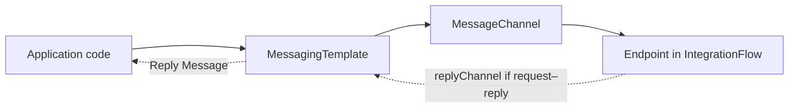
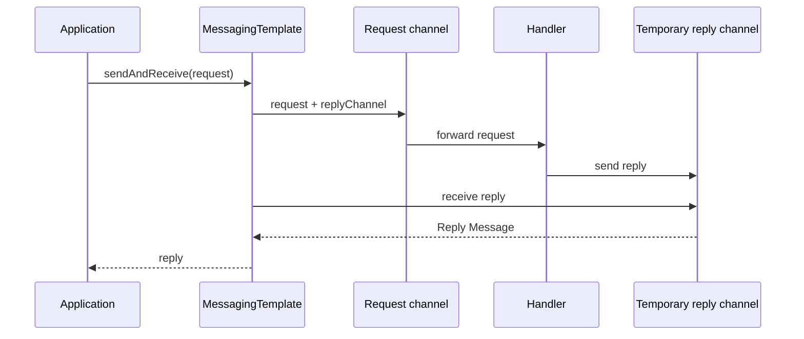

# MessagingTemplate

## 1. Purpose and Position in Spring Integration Core

In the `SPRING_INTEGRATION_CORE` module, `MessagingTemplate` is the tool for Java code to proactively interact with a message flow: sending a `Message`, polling a message from a queue, or sending a request and waiting for a reply. It bridges application calls with the model built around `Message`, `MessageChannel`, endpoints, and the Java DSL.

For example, an order service needs to query a pricing flow to calculate the total amount. The service builds a message containing the product code, quantity, and request ID; the template sends it to the input channel; an endpoint computes the price; and the result returns to the caller. A transformer, router, filter, or aggregator can sit in between while the caller continues interacting through the agreed channel.

After this lesson, learners can:

- Choose a send, receive, or request–reply operation according to the communication contract.
- Configure default channels, timeouts, and use bean names when needed.
- Explain the role of `replyChannel` and the difference between synchronous and asynchronous processing.
- Distinguish between no reply, send failures, processing failures, and error replies represented as messages.
- Connect the template with the Java DSL, practice testing, and decide when to use a messaging gateway.

The examples use Java 17 and APIs from the Spring Integration 6.x line, with `IntegrationFlow.from(...)`. This is an illustrative API baseline, not an assertion about an existing project's version. With Spring Boot, obtain the compatible Spring version set from Boot's dependency management. This lesson does not require external protocols or a message broker.

## 2. Nature of MessagingTemplate

The class used in this lesson is:

```java
import org.springframework.integration.core.MessagingTemplate;
```

`MessagingTemplate` extends Spring Messaging's `GenericMessagingTemplate` and adds integration with Spring Integration infrastructure. It provides an API for interacting with channels; endpoints perform transformations, routing, or business invocations. See [MessagingTemplate API](https://docs.spring.io/spring-integration/docs/current/api/org/springframework/integration/core/MessagingTemplate.html).



The template does not automatically create a consumer for the input channel. If you send to a `DirectChannel` that has no subscribers, sending can fail immediately. If you send to a `QueueChannel` with no consumer, the message can be stored without being processed. Template configuration must therefore go hand in hand with flow design and endpoint lifecycle.

Distinguish three similarly named classes:

| Class | Common Scope |
| --- | --- |
| `org.springframework.integration.core.MessagingTemplate` | Interacting with Spring Integration channels and flows |
| `org.springframework.messaging.core.GenericMessagingTemplate` | General-purpose template for working with `MessageChannel` in Spring Messaging |
| `org.springframework.messaging.simp.SimpMessagingTemplate` | SIMP infrastructure, commonly encountered in WebSocket/STOMP |

The examples in this lesson only use the class in the first row.

## 3. Three Exchange Styles to Distinguish

### 3.1. One-Way Send

```java
Message<String> command = MessageBuilder
        .withPayload("rebuild-product-index")
        .setHeader("requestId", "REQ-101")
        .build();

template.send(commandChannel, command);
```

Here, `template` is a `MessagingTemplate`, and `commandChannel` is a `MessageChannel`; the imports for the message include:

```java
import org.springframework.messaging.Message;
import org.springframework.messaging.support.MessageBuilder;
```

The template's `send(...)` returns `void`. Do not write `boolean sent = template.send(...)`. The direct `MessageChannel.send(...)` API returns `boolean`, whereas the template converts a `false` channel return into a `MessageDeliveryException`. This mechanism is in the [GenericMessagingTemplate source code](https://raw.githubusercontent.com/spring-projects/spring-framework/v6.2.12/spring-messaging/src/main/java/org/springframework/messaging/core/GenericMessagingTemplate.java).

A successful send must be interpreted according to the channel type. With a queue, it usually only proves the message entered the queue. The application needs a separate business reply if it wants confirmation that an order was approved, data was updated, or work completed.

A one-way flow should terminate at an endpoint that consumes the message without producing a result to return, or have an explicit output channel. If a handler returns data without an `outputChannel` or `replyChannel`, the flow may fail because the destination for the result is undefined.

### 3.2. Receiving from a Pollable Channel

```java
Message<?> next = template.receive(workQueue, 0);
if (next != null) {
    System.out.println(next.getPayload());
}
```

`workQueue` must be a channel implementing `PollableChannel`, such as `QueueChannel`. `receive(..., 0)` checks immediately and returns `null` if no message is present. `DirectChannel` dispatches messages to subscribers and has no buffer to pull from via `receive()`.

A single `receive()` call typically retrieves one message. It does not register a continuously running consumer. If you need an endpoint to pull data periodically on its own, configure a polling endpoint; if a poller is already reading the same queue, manual receive calls can become competing consumers.

### 3.3. Request–Reply

```java
Message<?> reply = template.sendAndReceive(requestChannel, request);
if (reply == null) {
    throw new IllegalStateException("No reply received within the wait timeout");
}
```

`sendAndReceive()` creates a temporary reply destination for the call. The caller does not need to create a reply queue manually for the common case. The flow must route the result back to the reply address that the template attaches to the message. The [MessagingTemplate](https://docs.spring.io/spring-integration/reference/7.0/channel/template.html) documentation introduces this usage.

| Need | Operation | Result to Handle |
| --- | --- | --- |
| Send a command or event | `send(channel, message)` | No return value; failures are represented as exceptions |
| Send a payload via converter | `convertAndSend(channel, payload)` | Does not wait for a business reply |
| Pull a message from a queue | `receive(channel)` | `Message<?>` or `null` |
| Receive with a specific timeout | `receive(channel, timeout)` | `Message<?>` or `null` |
| Pull a payload as a requested type | `receiveAndConvert(channel, Target.class)` | Converted payload or `null` when no message is available |
| Exchange both payload and headers | `sendAndReceive(channel, message)` | Reply `Message<?>` or `null` |
| Send a payload and receive an object | `convertSendAndReceive(channel, payload, Target.class)` | Result object or `null` when there is no reply |

Overloads taking a `MessageChannel` fit when the channel is already injected. Overloads taking a `String` are useful when resolving channel names; section 5 covers the conditions for using them.

## 4. Complete Example: Calling a Pricing Flow via Java DSL

### 4.1. Scenario and Prerequisites

The application sends a request to purchase two `BOOK` items. The illustrative unit price is `120000`, so the expected reply has a total of `240000`. The `requestId` header helps correlate the call with its result.

The classpath needs `spring-integration-core` along with compatible Spring dependencies. In a Boot application that already has dependency management, add the following starter to the dependencies section of the existing build:

```xml
<dependency>
    <groupId>org.springframework.boot</groupId>
    <artifactId>spring-boot-starter-integration</artifactId>
</dependency>
```

This XML snippet is not a full `pom.xml`. The program below creates a context directly to clearly show the channel, template, and flow; it does not need to start a web server.

### 4.2. Demonstration Program

If extracting the example to run it, save the class in `MessagingTemplateDemo.java`:

```java
import java.math.BigDecimal;

import org.springframework.beans.factory.annotation.Qualifier;
import org.springframework.context.annotation.Bean;
import org.springframework.context.annotation.Configuration;
import org.springframework.context.annotation.AnnotationConfigApplicationContext;
import org.springframework.integration.annotation.EnableIntegration;
import org.springframework.integration.channel.DirectChannel;
import org.springframework.integration.core.MessagingTemplate;
import org.springframework.integration.dsl.IntegrationFlow;
import org.springframework.messaging.Message;
import org.springframework.messaging.MessageChannel;
import org.springframework.messaging.support.MessageBuilder;

public class MessagingTemplateDemo {

    public record PriceRequest(String productCode, int quantity) {
    }

    public record PriceReply(String requestId, BigDecimal total) {
    }

    @Configuration
    @EnableIntegration
    public static class PricingConfiguration {

        @Bean
        public DirectChannel priceRequests() {
            return new DirectChannel();
        }

        @Bean
        public IntegrationFlow priceFlow(
                @Qualifier("priceRequests") DirectChannel input) {

            return IntegrationFlow.from(input)
                    .handle(PriceRequest.class, (request, headers) -> {
                        if (request.quantity() <= 0) {
                            throw new IllegalArgumentException(
                                    "Quantity must be greater than 0");
                        }

                        BigDecimal unitPrice = switch (request.productCode()) {
                            case "BOOK" -> new BigDecimal("120000");
                            case "PEN" -> new BigDecimal("10000");
                            default -> throw new IllegalArgumentException(
                                    "Product code does not exist");
                        };

                        BigDecimal total = unitPrice.multiply(
                                BigDecimal.valueOf(request.quantity()));

                        return new PriceReply(
                                (String) headers.get("requestId"), total);
                    })
                    .get();
        }

        @Bean
        public MessagingTemplate messagingTemplate(
                @Qualifier("priceRequests") MessageChannel input) {

            MessagingTemplate template = new MessagingTemplate(input);
            template.setSendTimeout(500);
            template.setReceiveTimeout(2000);
            template.setThrowExceptionOnLateReply(true);
            return template;
        }
    }

    public static void main(String[] args) {
        try (AnnotationConfigApplicationContext context =
                     new AnnotationConfigApplicationContext(
                             PricingConfiguration.class)) {

            MessagingTemplate template = context.getBean(MessagingTemplate.class);

            Message<PriceRequest> request = MessageBuilder
                    .withPayload(new PriceRequest("BOOK", 2))
                    .setHeader("requestId", "REQ-001")
                    .build();

            Message<?> reply = template.sendAndReceive(request);
            if (reply == null) {
                throw new IllegalStateException("Timed out waiting for price quote");
            }
            if (!(reply.getPayload() instanceof PriceReply price)) {
                throw new IllegalStateException(
                        "Reply payload does not match the quote contract");
            }

            System.out.println(price.requestId());
            System.out.println(price.total().toPlainString());
        }
    }
}
```

Expected business output, excluding framework log lines:

```text
REQ-001
240000
```

### 4.3. Reading the Configuration by Responsibility

`priceRequests` defines the request intake point. `priceFlow` creates an endpoint that reads `PriceRequest` and returns `PriceReply`. `messagingTemplate` is the API for the caller to enter the flow. Passing the channel to the constructor lets `template.sendAndReceive(request)` use that default channel.

The final endpoint returns an object without declaring a fixed output channel. In this flow, the result is routed back to the request's `replyChannel`. Because it uses a `DirectChannel`, the computation runs on the calling thread; section 7 explains why timeouts do not turn the pricing logic into a task with a deadline.

`@EnableIntegration` activates the required infrastructure when using plain Spring. The Java DSL still creates real Spring Integration channels and endpoints; `IntegrationFlow` must be registered as a bean for the infrastructure to process it. See [Java DSL](https://docs.spring.io/spring-integration/reference/6.5/dsl.html).

## 5. Default Channel and Name Resolution

You can configure a default destination:

```java
MessagingTemplate template = new MessagingTemplate(priceRequests);
// Equivalent: template.setDefaultChannel(priceRequests);

template.sendAndReceive(request);
```

Or pass the channel explicitly on each call:

```java
template.sendAndReceive(priceRequests, request);
```

The destination passed to the call is used for that call. If no destination is passed and no default channel is configured, the template lacks sufficient information to perform the operation.

A template declared as a Spring bean can also use a channel name:

```java
Message<?> reply = template.sendAndReceive("priceRequests", request);
```

That name is the channel bean name in the context. It is not a RabbitMQ queue name, Kafka topic, or HTTP address. When communicating with external systems, endpoints or adapters behind the channel perform that work.

When Spring manages the template bean, the `BeanFactoryAware` callback allows it to use Spring Integration's channel resolver. If you simply instantiate `new MessagingTemplate()` outside the context, do not assume channel names will be resolved automatically. Pass the channel object directly or configure an appropriate resolver. See [MessagingTemplate 6.5.3 source](https://raw.githubusercontent.com/spring-projects/spring-integration/v6.5.3/spring-integration-core/src/main/java/org/springframework/integration/core/MessagingTemplate.java).

When multiple `MessageChannel` beans exist, use `@Qualifier` to clarify which channel is injected. Choose channels by dynamic name when required by design; fixed business APIs are usually easier to follow when they depend on fixed channels.

## 6. How Request–Reply Works

### 6.1. Role of replyChannel

Conceptually, a single `sendAndReceive()` call consists of these steps:

1. The template prepares a temporary reply channel dedicated to that call.
2. The template puts that address in the `replyChannel` header of the outgoing request.
3. The request enters the channel and passes through the endpoints.
4. An endpoint sends the result back to the reply address.
5. The template receives the result and returns `Message<?>` to the caller, or returns `null` when the receive timeout expires without a reply.



With a synchronous flow, the handler can send the reply before the template reaches the receive step; the temporary channel retains that reply. The diagram does not imply that the steps always execute on different threads.

In the implementation under discussion, the template also sets `errorChannel` to the temporary channel when sending the request. Therefore, setting `errorChannel` yourself before `sendAndReceive()` does not guarantee asynchronous errors go to the channel you attached. See [doSendAndReceive in GenericMessagingTemplate](https://raw.githubusercontent.com/spring-projects/spring-framework/v6.2.12/spring-messaging/src/main/java/org/springframework/messaging/core/GenericMessagingTemplate.java).

### 6.2. Flows Must Preserve the Reply Path

If a handler only returns a payload, the framework's reply-producing endpoint can create the reply message and preserve the necessary headers. When creating a brand-new `Message` manually inside a custom handler, you must decide explicitly how to preserve control headers and business headers.

For example, when converting a payload to text manually:

```java
Message<String> output = MessageBuilder
        .withPayload(resultText)
        .copyHeaders(input.getHeaders())
        .build();
```

This snippet assumes `input` is the incoming message and `resultText` is the computed result. It illustrates preserving headers, not a requirement to copy every header across every system boundary. `copyHeaders()` does not overwrite `id` and `timestamp`; see [MessageBuilder](https://docs.spring.io/spring-framework/docs/6.2.12/javadoc-api/org/springframework/messaging/support/MessageBuilder.html).

An `outputChannel` configured directly on an endpoint can route the result down a different path instead of back to the caller. If a flow ends at a fixed output queue, you must design how results get back from there to the matching request; `sendAndReceive()` does not automatically bridge every output channel.

The temporary reply channel is a local object inside the Java process. Do not send that raw reference over a broker or network expecting another process to use it. Request–reply across process boundaries requires appropriate adapters/gateways, correlation, and reply mechanisms.

### 6.3. One Call Waits for One Reply

Do not fan out a request to multiple branches and let every branch reply into the temporary channel expecting a list of results. A single template call retrieves only one reply. If you need quotes from multiple suppliers, gather them with an aggregator or the scatter–gather pattern, then return a single aggregated result.

`requestId` in the example is a business correlation identifier. It does not automatically become the aggregator's grouping key. When adding an aggregator, configure appropriate correlation and release conditions; if a group is never released, the caller can time out even though every branch finished processing.

## 7. Timeouts: Bounding the Right Phase

### 7.1. Send Timeout and Receive Timeout

```java
template.setSendTimeout(500);
template.setReceiveTimeout(2000);
```

The unit is milliseconds. `sendTimeout` applies to sending into a channel; `receiveTimeout` applies when receiving or waiting for a reply in request–reply. The API allows per-request timeout overrides. See [GenericMessagingTemplate](https://docs.spring.io/spring-framework/docs/6.2.12/javadoc-api/org/springframework/messaging/core/GenericMessagingTemplate.html).

| Value | Meaning for the Corresponding Wait Operation |
| --- | --- |
| `0` | Do not wait; try immediately |
| Positive | Wait up to the configured number of milliseconds for that phase |
| Negative, typically `-1` | Use the non-timed variant; may wait indefinitely |

In the referenced Framework source code, both timeouts default to `-1`. The examples always set finite values so wait behavior is explicit. Even so, that does not create a deadline for the entire flow.

With a bounded `QueueChannel`, send timeout is useful when the queue is full. With an empty queue, receive timeout determines how long to wait for data. `receiveTimeout = 0` in an asynchronous flow easily causes the caller to get `null` before a worker has time to produce a reply.

### 7.2. DirectChannel Is Not Interrupted by receiveTimeout

Suppose a synchronous handler takes five seconds, while the template has `receiveTimeout = 100`. When sending through a `DirectChannel`, the caller thread executes the handler during the send call. Only after the handler returns does the template proceed to the reply-receiving phase.

The call can therefore still take around five seconds and receive the result. `receiveTimeout` does not interrupt the handler after 100 ms. Nor is `sendTimeout` a timer that enforces execution duration on business methods over `DirectChannel`.

To bound calls to an HTTP service or database, configure timeouts on that client or I/O operation. If you switch to asynchronous execution so the caller can stop waiting, you still need a separate design for task cancellation and handling late results.

The difference between executing on the caller thread with `DirectChannel` and handing work off to an executor with `ExecutorChannel` is described in [MessageChannel Implementations](https://docs.spring.io/spring-integration/reference/6.5/channel/implementations.html).

### 7.3. QueueChannel and ExecutorChannel

When a flow has a queue or executor that genuinely decouples threads, the caller can reach the reply-waiting step while the worker is still processing. Once `receiveTimeout` expires, the template returns `null` if no reply has arrived. The worker may continue running.

The input queue must have a consumer. The following example is an **independent alternative flow**, not appended to the pricing flow in section 4:

```java
@Bean
public QueueChannel queuedPriceRequests() {
    return new QueueChannel(100);
}

@Bean
public IntegrationFlow queuedPriceFlow(
        @Qualifier("queuedPriceRequests") QueueChannel input) {

    return IntegrationFlow.from(input)
            .handle(MessagingTemplateDemo.PriceRequest.class,
                    (request, headers) -> {
                        if (request.quantity() <= 0) {
                            throw new IllegalArgumentException(
                                    "Quantity must be greater than 0");
                        }
                        if (!"BOOK".equals(request.productCode())) {
                            throw new IllegalArgumentException(
                                    "Demo flow only supports BOOK");
                        }
                        return new MessagingTemplateDemo.PriceReply(
                                (String) headers.get("requestId"),
                                new BigDecimal("120000").multiply(
                                        BigDecimal.valueOf(request.quantity())));
                    }, endpoint -> endpoint.poller(Pollers.fixedDelay(100)))
            .get();
}
```

In addition to the imports from the main example, this configuration needs:

```java
import org.springframework.integration.channel.QueueChannel;
import org.springframework.integration.dsl.Pollers;
```

Place both beans in a `@Configuration` class with `@EnableIntegration`. The template calls this variant with `sendAndReceive(queuedPriceRequests, request)` using the injected channel bean. The 100 ms polling interval is the data-fetch cadence, not a request processing deadline. The queue is bounded at 100 messages to clearly show send-waiting behavior when full.

With `ExecutorChannel`, return timing and saturation behavior also depend on the executor and its rejection policy. Inspect the executor configuration; do not infer that every call switches threads from the channel name alone.

### 7.4. Per-Request Timeouts

Do not mutate `receiveTimeout` on a singleton template before each call: concurrent requests can overwrite each other's settings. You can use the dedicated timeout headers:

```java
import org.springframework.messaging.core.GenericMessagingTemplate;

Message<?> requestWithTimeout = MessageBuilder
        .fromMessage(request)
        .setHeader(GenericMessagingTemplate.DEFAULT_SEND_TIMEOUT_HEADER, 100L)
        .setHeader(GenericMessagingTemplate.DEFAULT_RECEIVE_TIMEOUT_HEADER, 800L)
        .build();

Message<?> reply = template.sendAndReceive(priceRequests, requestWithTimeout);
```

The default header names are `sendTimeout` and `receiveTimeout`; the template strips these headers before sending the message into the flow. Overriding receive timeout via header applies to `sendAndReceive()`, because there is a request to carry the headers. For plain `receive()`, use the overload taking a timeout. See [Timeout header API](https://docs.spring.io/spring-framework/docs/6.2.12/javadoc-api/org/springframework/messaging/core/GenericMessagingTemplate.html).

The numbers above are illustrative configuration. In production, choose wait intervals based on business requirements, measured latency, queue wait time, and timeouts of downstream calls.

## 8. Late Replies and the Business Meaning of Timeouts

Once the caller's receive timeout expires, an asynchronous worker may still update data and send a reply. The caller stopping its wait neither proves the worker failed nor automatically rolls back the worker's transaction.

You can configure:

```java
template.setThrowExceptionOnLateReply(true);
```

This option causes the reply-sending side to encounter a `MessageDeliveryException` when there is no longer a valid receiver, such as when the caller has timed out or already received a reply. It does not throw an exception on the caller that has already returned. See [setThrowExceptionOnLateReply](https://docs.spring.io/spring-framework/docs/6.2.12/javadoc-api/org/springframework/messaging/core/GenericMessagingTemplate.html).

The example sets the option explicitly: Spring Integration's class can obtain the policy from integration properties when not set directly. See [MessagingTemplate 6.5.3](https://raw.githubusercontent.com/spring-projects/spring-integration/v6.5.3/spring-integration-core/src/main/java/org/springframework/integration/core/MessagingTemplate.java).

For requests with side effects, such as deducting inventory, treat a timeout as an unknown outcome state. A practical design can:

- Assign an idempotency key to the business operation and preserve the key when retrying the same request.
- Persist results by request ID so the caller can query them after a timeout.
- Distinguish the deadline by which work may still begin from how long the caller waits for a result.
- Monitor late replies and queue depth to detect bottlenecks.

`requestId` is merely an identifier unless there is a mechanism to store and check for duplicates. Adding a header does not make a flow idempotent by itself.

## 9. Payload Conversion and Header Preservation

### 9.1. Working Directly with Objects

If you only need the payload, you can call the flow from section 4 like this:

```java
MessagingTemplateDemo.PriceReply price = template.convertSendAndReceive(
        priceRequests,
        new MessagingTemplateDemo.PriceRequest("BOOK", 2),
        MessagingTemplateDemo.PriceReply.class);

if (price == null) {
    throw new IllegalStateException("No price quote received");
}
```

This call does not add `requestId` automatically, so that field in the example's reply will be `null`. You can use overloads supporting headers or a `MessagePostProcessor` when needed, or use `MessageBuilder` with `sendAndReceive()` to keep the header contract explicit.

The `convert...` name does not mean the template automatically understands every data format. `SimpleMessageConverter` mainly wraps payloads into messages and extracts payloads when the target type is compatible; it does not parse JSON into a DTO automatically. If the request is a JSON string while the handler expects `PriceRequest`, an appropriately configured converter or transformer is required. See [SimpleMessageConverter](https://docs.spring.io/spring-framework/docs/6.2.12/javadoc-api/org/springframework/messaging/converter/SimpleMessageConverter.html).

### 9.2. Choosing the API by Data Contract

Use `sendAndReceive()` when you need to read both the reply payload and headers, or distinguish message types such as `ErrorMessage`. Use `convertSendAndReceive()` when the payload contract is straightforward and conversion is properly configured.

A conversion error differs from a timeout: a message arrived, but could not be converted to the target type, which can lead to `MessageConversionException`. Do not lump both together into a “no data” conclusion.

Business headers should have clear names, such as `requestId`, `tenantId`, or `sourceSystem`. Do not use control header names like `replyChannel`, `errorChannel`, `sendTimeout`, or `receiveTimeout` to hold business data.

## 10. Error Handling: Exceptions and ErrorMessage

### 10.1. Errors on the Same Thread

In the `DirectChannel` flow from section 4, a negative quantity causes the handler to throw an exception. The error propagates back through the Java call to the caller; the framework exception typically wraps the business cause inside.

```java
import org.springframework.messaging.MessagingException;

try {
    Message<?> reply = template.sendAndReceive(priceRequests, request);
    // Check for null and validate the payload against the contract before using.
} catch (MessagingException ex) {
    Throwable cause = ex.getCause();
    System.err.println(cause != null ? cause.getMessage() : ex.getMessage());
}
```

Creating a global `errorChannel` bean does not automatically convert every synchronous template error into a message. When caller and handler run on the same thread, exception propagation remains the primary path to account for. See [Error Handling](https://docs.spring.io/spring-integration/reference/error-handling.html).

The example only shows where to catch errors. In a real application, the boundary layer must translate errors into meaningful results for HTTP APIs, background jobs, or user interfaces while preserving the root cause for observability.

### 10.2. Errors Across an Asynchronous Boundary

When a handler runs inside a Spring Integration task, such as a poller or executor, the infrastructure can wrap the error into an `ErrorMessage` and send it to the request's `errorChannel` or the global error channel. See [asynchronous error mechanism](https://docs.spring.io/spring-integration/reference/error-handling.html).

For a template's request–reply, the temporary error channel mentioned in section 6 means published errors can arrive as the reply. When you need to distinguish this reply type, use the API returning `Message<?>`:

```java
import org.springframework.messaging.support.ErrorMessage;

Message<?> reply = template.sendAndReceive(queuedPriceRequests, request);
if (reply == null) {
    throw new IllegalStateException("No price quote result received yet");
}
if (reply instanceof ErrorMessage error) {
    throw new IllegalStateException("Price quote flow processing failed",
            error.getPayload());
}
if (!(reply.getPayload() instanceof MessagingTemplateDemo.PriceReply price)) {
    throw new IllegalStateException("Invalid price quote result type");
}

System.out.println(price.total());
```

Do not assume the template turns every `Throwable` payload into a business exception identically across all gateway types. Behavior must be understood according to the specific flow and API in use. If a custom task outside Spring Integration infrastructure does not publish errors to the reply path, the caller may only observe a timeout.

### 10.3. Classifying Outcomes at the Caller

| Symptom | What to Check | Boundary Handling |
| --- | --- | --- |
| `send()` throws `MessageDeliveryException` | Channel refused the send under current conditions | Check capacity, timeout, and consumers; retry only when semantics allow |
| Dispatch failure on `DirectChannel` | No subscribers or unable to dispatch | Check endpoint configuration and lifecycle |
| `sendAndReceive()` returns `null` | No reply arrived before the receive timeout ended | Return an appropriate status; consider looking up by request ID |
| `MessageHandlingException` or processing exception thrown | Error in the synchronous call path | Inspect the cause and map to a business error |
| Reply is `ErrorMessage` | Error was returned via messaging | Handle the error payload before reading the result DTO |
| `MessageConversionException` | Unable to convert data to the requested type | Fix the contract or converter |
| Worker encounters a late reply | Caller can no longer receive that reply | Track business outcome and idempotency policy |

Retrying is a business and delivery-guarantee decision. Merely observing that the caller did not receive a reply is not enough to conclude a side-effecting command can be safely resent.

## 11. Introducing Transformers, Filters, Routers, and Aggregators into a Flow

The template remains the caller side; request–reply correctness also depends on each endpoint:

| Endpoint or Construct | Contract to Uphold for the Caller |
| --- | --- |
| Transformer | Transformed payload has the expected type; reply path is preserved |
| Filter | Dropping a request without producing a reply or error can make the caller wait until timeout |
| Router | Each selected branch has a clear termination path; branches with no reply are designed intentionally |
| Aggregator | Has a grouping key and release condition; aggregated output routes back to the right caller |
| Multi-branch fan-out | Gather multiple results before returning a single reply if the caller expects an aggregated result |
| Side-effect-only endpoint | Do not use a DTO-waiting contract if the endpoint produces no reply |

For the pricing flow, instead of silently discarding negative-quantity requests with a filter, you can design an explicit rejection result or throw a validation error on the synchronous path. The choice must align with the caller; never leave the caller guessing whether `null` means rejected, unprocessed, or misconfigured.

If a router sends some requests into a long-running branch, you may need to separate the “accept job” API from the “query result” API. The initial reply can be a job ID; the caller uses that ID to track status rather than holding a thread for the entire processing duration.

## 12. MessagingTemplate or Messaging Gateway?

Both bring calls from application code into messaging, but they shape the boundary API differently. A gateway can hide `Message` and `MessageChannel` behind a business interface. See [Messaging Gateways](https://docs.spring.io/spring-integration/reference/6.5/gateway.html).

| Scenario | Suitable Choice |
| --- | --- |
| Tests needing to send messages and inspect headers | `MessagingTemplate` |
| Infrastructure components needing to select channels or perform direct send/receive | `MessagingTemplate` |
| Business services only needing to call `quote(request)` and receive `PriceReply` | Messaging gateway |
| Multiple callers sharing the same business contract | A gateway interface helps centralize configuration |
| Event-driven flows where the caller does not wait for a result | One-way send or a gateway with a one-way contract |

Illustrative interface, **not registered automatically into the program in section 4**:

```java
import org.springframework.integration.annotation.MessagingGateway;

@MessagingGateway(
        defaultRequestChannel = "priceRequests",
        defaultRequestTimeout = "500",
        defaultReplyTimeout = "2000")
public interface PricingGateway {
    MessagingTemplateDemo.PriceReply quote(
            MessagingTemplateDemo.PriceRequest request);
}
```

To use the interface, the gateway infrastructure must discover and register it, such as via `@IntegrationComponentScan` in an appropriate configuration. Callers then inject `PricingGateway`. The illustrative interface does not pass `requestId`; header mappings can be added when the contract requires a request ID.

A gateway does not automatically make a synchronous flow asynchronous, nor does it impose a deadline on handlers. Template versus gateway is a choice of API surface and communication policy; channel types and endpoints still govern execution behavior.

## 13. Test Code for Practice

The following snippets are JUnit 5 examples for learners, not executed as part of authoring this lesson. They focus on message contracts and channel behavior without requiring an external broker. If added to a project, a JUnit Jupiter dependency is required; with Boot, you can use the compatible test starter.

### 13.1. Pricing Flow Returns the Right Payload and Header

Place the test in the same package as `MessagingTemplateDemo` if you added a package for the example:

```java
import java.math.BigDecimal;

import org.junit.jupiter.api.Test;
import org.springframework.context.annotation.AnnotationConfigApplicationContext;
import org.springframework.integration.core.MessagingTemplate;
import org.springframework.messaging.Message;
import org.springframework.messaging.support.MessageBuilder;

import static org.junit.jupiter.api.Assertions.*;

class PricingTemplateTest {

    @Test
    void returnsQuoteForTheGivenRequest() {
        try (AnnotationConfigApplicationContext context =
                     new AnnotationConfigApplicationContext(
                             MessagingTemplateDemo.PricingConfiguration.class)) {

            MessagingTemplate template = context.getBean(MessagingTemplate.class);
            Message<?> request = MessageBuilder
                    .withPayload(new MessagingTemplateDemo.PriceRequest("BOOK", 2))
                    .setHeader("requestId", "REQ-TEST-01")
                    .build();

            Message<?> reply = template.sendAndReceive(request);

            assertNotNull(reply);
            var result = assertInstanceOf(
                    MessagingTemplateDemo.PriceReply.class, reply.getPayload());
            assertEquals("REQ-TEST-01", result.requestId());
            assertEquals(0, new BigDecimal("240000").compareTo(result.total()));
            assertEquals("REQ-TEST-01", reply.getHeaders().get("requestId"));
        }
    }
}
```

`BigDecimal` is compared with `compareTo` because the test checks monetary value rather than scale. The test verifies both the business payload and the header agreed upon with the caller.

### 13.2. Empty Queue, Full Queue, and Request Without a Consumer

```java
import org.junit.jupiter.api.Test;
import org.springframework.integration.channel.QueueChannel;
import org.springframework.integration.core.MessagingTemplate;
import org.springframework.messaging.MessageDeliveryException;
import org.springframework.messaging.support.GenericMessage;

import static org.junit.jupiter.api.Assertions.*;

class TemplateChannelBehaviorTest {

    @Test
    void returnsNullWhenPollingAnEmptyQueueWithoutWaiting() {
        MessagingTemplate template = new MessagingTemplate();
        QueueChannel queue = new QueueChannel(1);

        assertNull(template.receive(queue, 0));
    }

    @Test
    void rejectsSendWhenBoundedQueueIsFullAndWaitingIsDisabled() {
        MessagingTemplate template = new MessagingTemplate();
        template.setSendTimeout(0);
        QueueChannel queue = new QueueChannel(1);

        template.send(queue, new GenericMessage<>("first"));

        assertThrows(MessageDeliveryException.class,
                () -> template.send(queue, new GenericMessage<>("second")));
    }

    @Test
    void waitingForReplyDoesNotCreateAQueueConsumer() {
        MessagingTemplate template = new MessagingTemplate();
        template.setSendTimeout(0);
        template.setReceiveTimeout(0);
        template.setThrowExceptionOnLateReply(true);
        QueueChannel requests = new QueueChannel(1);

        assertNull(template.sendAndReceive(
                requests, new GenericMessage<>("no-consumer")));

        assertEquals(1, requests.getQueueSize());
    }
}
```

The last test intentionally has no consumer: the request remains in the queue even though the caller received `null`. This is easily observable evidence that “no reply” differs from “request was not sent”. The tests do not measure exact milliseconds and do not use `Thread.sleep()` to determine pass or fail.

When adding asynchronous tests, use latches, barriers, or bounded waiting utilities to control when the worker runs. Verify that the worker can complete after the caller times out, along with the system's late-reply handling path.

## 14. Quick Diagnostics and Operational Notes

| Symptom | What to Check First |
| --- | --- |
| Error requiring `PollableChannel` | Are you calling `receive()` on a `DirectChannel`? |
| `sendAndReceive()` frequently returns `null` | Have endpoints started; does the queue have a consumer; which branch does not return a reply? |
| Long wait despite a small `receiveTimeout` | Is a handler running synchronously in the send phase via `DirectChannel`? |
| Queue grows continuously | Consumer throughput, I/O latency, capacity, and work intake strategy |
| Cannot resolve channel name | Is the bean name correct; does the template have an appropriate context or resolver? |
| Cannot parse payload into DTO | Do the converter/transformer match the actual format? |
| `errorChannel` created, yet caller still gets exceptions | Is the error path on the same calling thread? |
| Worker completes, yet caller reports timeout | Queue delay, poller cadence, processing time, and late-reply policy |

Points to include in operational design:

- Configure the template once and reuse it via dependency injection. Under concurrent usage, attached converters and custom components must also support concurrent use.
- Use finite timeouts at appropriate boundaries and on I/O calls; track send time, queue wait time, and execution time separately where possible.
- Size queue capacity to match consumption throughput. Timeouts only stop the caller from waiting; they do not clear backlogs.
- Retain correlation IDs in logs and metrics; avoid logging full payloads when sensitive data is present.
- Do not call a blocking/waiting template directly on a reactive application's event loop; design an integration path suited to the execution model.
- For long-running work or important side effects, expose queryable business status instead of inferring outcomes from timeouts.

## 15. Key Takeaways

`MessagingTemplate` fits when a component proactively sends or receives via a Spring Integration channel. Choose the operation by contract—one-way, polling, or request–reply; choose the channel by execution model and buffering needs; and preserve the reply path as requests traverse endpoints.

`sendAndReceive()` requires a flow capable of producing an appropriate reply. `null` indicates no reply was received within the wait window, not confirmation that work was canceled. `sendTimeout` and `receiveTimeout` bound their respective wait operations, while processing duration and business outcomes must be controlled at the components performing the work.

When an application API represents a stable business operation, a messaging gateway lets callers work through an interface. When you need direct manipulation of messages, headers, or multiple exchange patterns, the template gives clearer control.
