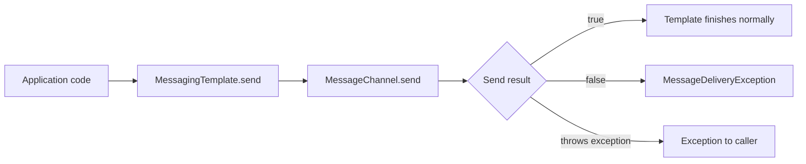
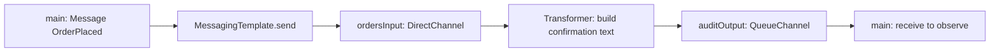

# Sending Messages with MessagingTemplate.send

In the **SPRING_INTEGRATION_CORE** module, `MessagingTemplate` is the connection point when application code needs to proactively push a `Message` into a Spring Integration flow. This lesson belongs to the **MessagingTemplate** chapter and focuses on the **send** operation: choosing the destination channel, building the message, configuring wait timeouts, and understanding what happens when a send succeeds or fails.

The running scenario is accepting an order and sending it into a processing flow. After this lesson, you should be able to distinguish three events: the send call has returned, the channel has accepted the message, and the business operation has completed. These milestones may coincide in a simple example, yet often separate when the flow introduces queues or executors.

## 1. Role and Contract of send

The fully qualified name of `MessagingTemplate` is:

```java
import org.springframework.integration.core.MessagingTemplate;
```

This class inherits Spring Framework's messaging infrastructure. The primary call forms for this lesson are:

```java
void send(Message<?> message);
void send(MessageChannel destination, Message<?> message);
void send(String destinationName, Message<?> message);
```

| Call Form | How Destination Is Determined | Condition for Use |
| --- | --- | --- |
| `template.send(message)` | Template's default channel | A default destination is configured |
| `template.send(channel, message)` | `MessageChannel` instance passed directly | A valid channel reference is available |
| `template.send("ordersInput", message)` | Resolves name to channel | Template has an appropriate destination resolver |

The first two methods are inherited from `AbstractMessageSendingTemplate`; the name-based form comes from `AbstractDestinationResolvingMessagingTemplate`. All of them return `void`. Writing `boolean sent = template.send(...)` will not compile. See [Send methods Javadoc](https://docs.spring.io/spring-framework/docs/6.2.15/javadoc-api/org/springframework/messaging/core/AbstractMessageSendingTemplate.html) and [Destination resolution API](https://docs.spring.io/spring-framework/docs/current/javadoc-api/org/springframework/messaging/core/AbstractDestinationResolvingMessagingTemplate.html).

`send` accepts an already-constructed message. It does not wait for a business reply on its own. If you need a result to decide the immediate next step, consider `sendAndReceive` or a messaging gateway with an appropriate return type.

### 1.1. Distinguishing from MessageChannel.send

`MessageChannel` provides a lower-level contract:

```java
boolean send(Message<?> message);
boolean send(Message<?> message, long timeout);
```

When calling a channel directly, application code can receive `false` if delivery fails for a reason the channel expresses via its return value. A channel can also throw an exception. `MessagingTemplate` converts a `false` result from the channel into a `MessageDeliveryException`, so template callers handle failures with exceptions rather than checking a boolean. See the [MessageChannel contract](https://docs.spring.io/spring-framework/docs/current/javadoc-api/org/springframework/messaging/MessageChannel.html) and [GenericMessagingTemplate implementation](https://raw.githubusercontent.com/spring-projects/spring-framework/v6.2.15/spring-messaging/src/main/java/org/springframework/messaging/core/GenericMessagingTemplate.java).



In the diagram, “finishes normally” describes only the send call under the behavior of the current channel and flow. For instance, a message sitting in a queue does not prove that an invoice has been created.

## 2. Minimal Example: Sending to a QueueChannel

The following example uses `spring-integration-core` with compatible Spring dependencies. No Spring ApplicationContext needs to be started because the channel is passed directly and there are no container-managed endpoints yet.

```java
import org.springframework.integration.channel.QueueChannel;
import org.springframework.integration.core.MessagingTemplate;
import org.springframework.messaging.Message;
import org.springframework.messaging.support.MessageBuilder;

public class SendToQueueDemo {

    public static void main(String[] args) {
        QueueChannel ordersInput = new QueueChannel(10);

        MessagingTemplate template = new MessagingTemplate();
        template.setSendTimeout(200L);

        Message<String> order = MessageBuilder
                .withPayload("ORDER-1001")
                .setHeader("eventType", "OrderPlaced")
                .setHeader("orderId", "ORDER-1001")
                .build();

        template.send(ordersInput, order);

        Message<?> accepted = ordersInput.receive(0);
        if (accepted == null) {
            throw new IllegalStateException("Order not found in queue");
        }

        System.out.println(accepted.getPayload());
        System.out.println(accepted.getHeaders().get("eventType"));
    }
}
```

Expected output:

```text
ORDER-1001
OrderPlaced
```

Sequence of events in the example:

1. `MessageBuilder` creates a `Message<String>` with a payload and application-defined headers.
2. The template sends the message into a queue that has available capacity.
3. The `send` call completes once the queue accepts the message.
4. `receive(0)` pulls the message out immediately if present, without waiting further.

`QueueChannel(10)` caps how many messages can sit in the queue at once. This channel does not create a consumer on its own. In a real application, receiving code or an endpoint with a poller is needed to pull and process messages. Having no consumer yet does not cause the first send to fail as long as the queue has space. See [QueueChannel](https://docs.spring.io/spring-integration/api/org/springframework/integration/channel/QueueChannel.html).

`MessageBuilder.withPayload` and `setHeader` express input data clearly. When the payload is a business object, prefer immutable data or tightly manage mutation rights, especially across threads. Sending a message does not automatically deep-copy the payload object. See [MessageBuilder](https://docs.spring.io/spring-framework/docs/current/javadoc-api/org/springframework/messaging/support/MessageBuilder.html).

## 3. Choosing the Destination Channel

### 3.1. Passing the Channel Directly

```java
QueueChannel input = new QueueChannel(20);
MessagingTemplate template = new MessagingTemplate();
template.setSendTimeout(100L);

Message<String> message = MessageBuilder
        .withPayload("ORDER-1002")
        .build();

template.send(input, message);
```

This is convenient during experiments or when the producer class is injected with a specific channel. The code needs no name resolution, while still depending on Spring's `MessageChannel` abstraction.

### 3.2. Using a Default Channel

```java
QueueChannel input = new QueueChannel(20);
MessagingTemplate template = new MessagingTemplate(input);
template.setSendTimeout(100L);

template.send(MessageBuilder.withPayload("ORDER-1003").build());
```

It can also be configured via `setDefaultDestination(input)`. `setDefaultChannel(input)` is the compatible alias provided by `MessagingTemplate`. The default channel is used only for call forms that omit a destination; calls passing an explicit channel use the passed destination. Calling `send(message)` without configuring a default causes a configuration error. See [MessagingTemplate API](https://docs.spring.io/spring-integration/api/org/springframework/integration/core/MessagingTemplate.html).

### 3.3. Using a Bean Name

A Spring-managed template receives `BeanFactory` through a lifecycle callback. `MessagingTemplate` uses Spring Integration's channel resolution mechanism to support name-based operations.

```java
import org.springframework.context.annotation.Bean;
import org.springframework.context.annotation.Configuration;
import org.springframework.integration.channel.QueueChannel;
import org.springframework.integration.config.EnableIntegration;
import org.springframework.integration.core.MessagingTemplate;

@Configuration
@EnableIntegration
public class NamedChannelConfiguration {

    @Bean
    public QueueChannel ordersInput() {
        return new QueueChannel(100);
    }

    @Bean
    public MessagingTemplate messagingTemplate() {
        MessagingTemplate template = new MessagingTemplate();
        template.setSendTimeout(200L);
        return template;
    }
}
```

After retrieving the template from the context:

```java
template.send(
        "ordersInput",
        MessageBuilder.withPayload("ORDER-1004").build());
```

Here `"ordersInput"` is the channel bean name in the context, not a RabbitMQ queue name or a Kafka topic. Connecting to a broker is the responsibility of the corresponding adapter or channel configuration.

If you instantiate the template with `new` outside the container and want to send by name, you must supply a resolver. For example, with `context` as an already-initialized `ApplicationContext`:

```java
import org.springframework.messaging.core.BeanFactoryMessageChannelDestinationResolver;

MessagingTemplate template = new MessagingTemplate();
template.setDestinationResolver(
        new BeanFactoryMessageChannelDestinationResolver(context));
template.setSendTimeout(200L);

template.send(
        "ordersInput",
        MessageBuilder.withPayload("ORDER-1005").build());
```

`BeanFactoryMessageChannelDestinationResolver` looks up a `MessageChannel` bean by name in the supplied `BeanFactory`. A misspelled name or wrong bean type is a destination-resolution error; increasing the timeout will not fix it. See [Resolver Javadoc](https://docs.spring.io/spring-framework/docs/current/javadoc-api/org/springframework/messaging/core/BeanFactoryMessageChannelDestinationResolver.html).

## 4. What Does the send Timeout Actually Bound?

### 4.1. Configuring on the Template

```java
template.setSendTimeout(250L);
```

The unit is milliseconds. When a channel has a mechanism to wait for acceptance, this setting behaves as follows:

| Value | Expected Behavior with QueueChannel |
| --- | --- |
| Less than `0` | No wait limit; a full queue can block the sender indefinitely |
| Equal to `0` | Try inserting immediately; if the queue is full, do not wait for space |
| Greater than `0` | Wait up to this duration for space in the queue |

In the referenced `GenericMessagingTemplate` implementation, the default timeout is `-1`. Always configure an explicit wait time matching the intake point's requirements. When the channel returns `false` because the wait timed out, the template throws an exception. This is the timeout for handing the message to the channel, not a deadline for the entire business workflow. See [timeout handling source](https://raw.githubusercontent.com/spring-projects/spring-framework/v6.2.15/spring-messaging/src/main/java/org/springframework/messaging/core/GenericMessagingTemplate.java).

### 4.2. Overriding Per Message

`GenericMessagingTemplate` supports a timeout header per send call. The default send header name is `sendTimeout`; you can use the constant to avoid typos:

```java
import org.springframework.messaging.core.GenericMessagingTemplate;

Message<String> urgentOrder = MessageBuilder
        .withPayload("ORDER-URGENT")
        .setHeader(
                GenericMessagingTemplate.DEFAULT_SEND_TIMEOUT_HEADER,
                0L)
        .build();

template.send(ordersInput, urgentOrder);
```

This message opts to attempt an immediate send, overriding the template's default setting for that call. The template-control timeout header is removed from the message before forwarding it to the channel; do not use it as a business header expected to travel across the system. See [GenericMessagingTemplate API](https://docs.spring.io/spring-framework/docs/6.2.15/javadoc-api/org/springframework/messaging/core/GenericMessagingTemplate.html).

For a shared template, configure its properties at initialization and keep them stable. If individual requests have distinct timeout requirements, headers express the requirement per message without mutating shared configuration right before a send.

### 4.3. Timeout Does Not Interrupt a Synchronous Handler

`DirectChannel` invokes the handler on the sender's thread. Suppose the handler makes an HTTP call taking three seconds; `template.setSendTimeout(50L)` does not start a timer to interrupt the handler after 50 milliseconds. The thread can remain blocked until the handler finishes or throws an error.

```mermaid
sequenceDiagram
    participant A as Application thread
    participant T as MessagingTemplate
    participant C as DirectChannel
    participant H as Handler
    A->>T: send(message)
    T->>C: send(message, timeout)
    C->>H: handleMessage(message)
    Note over A,H: Same thread; handler time stays inside the call
    H-->>C: finish
    C-->>T: true
    T-->>A: return void
```

Therefore, timeouts for HTTP, JDBC, or I/O operations must be configured on the component performing the I/O. Business deadlines must also be designed separately if required. `DirectChannel`'s same-thread mechanism is described in the [DirectChannel Javadoc](https://docs.spring.io/spring-integration/api/org/springframework/integration/channel/DirectChannel.html).

A multi-endpoint flow also performs multiple internal sends. The template timeout at the head of the flow does not automatically become a shared budget across downstream sends.

## 5. Channel Type Determines What a Successful Send Means

| Channel | When the Send Is Accepted | What the Caller Must Understand |
| --- | --- | --- |
| `DirectChannel` | Dispatched synchronously to a handler and the processing call returned normally | Caller waits for processing on the same thread; the flow can still switch to async at a later step |
| `QueueChannel` | Message was placed in the queue | Consumer may not have pulled it, processed it, or may be stopped |
| `ExecutorChannel` | Dispatch was handed off to the configured executor | Handler usually runs on another thread; later processing errors do not return to the finished call |
| `PublishSubscribeChannel` | Satisfied the channel configuration's dispatch and subscriber rules | Cannot assume by default that all side effects have finished |

`QueueChannel` stores messages in memory by default. When data must survive process restarts, design durable persistence or use an appropriate broker infrastructure. Message buffering, thread-handoff boundaries, and durability are separate architectural choices. See [MessageChannel Implementations](https://docs.spring.io/spring-integration/reference/channel/implementations.html).

`ExecutorChannel` typically introduces a thread boundary, so transactions bound to the sender's thread do not automatically span to the handler. The specific executor and its task rejection policy can alter dispatch behavior; inspect the actual configuration before assuming behavior. See [ExecutorChannel](https://docs.spring.io/spring-integration/api/org/springframework/integration/channel/ExecutorChannel.html).

For orders, milestones should have clear names:

- **Accepted:** the system received the command or event at the defined boundary.
- **Processed:** the consumer completed the business rules.
- **Durably recorded:** data or events were committed to storage with appropriate guarantees.

When designing an intake API, only return an “order completed” status if you actually have evidence for that milestone. A `send` into a queue only provides evidence for the queue-acceptance step.

## 6. Sending into a Java DSL Flow

This example combines a producer, message, channel, and transformer endpoint in one program. Use Java 17 or higher with a compatible Spring Integration version; Spring dependencies should be managed consistently via the project's BOM.



```java
import org.springframework.beans.factory.annotation.Qualifier;
import org.springframework.context.annotation.AnnotationConfigApplicationContext;
import org.springframework.context.annotation.Bean;
import org.springframework.context.annotation.Configuration;
import org.springframework.integration.channel.DirectChannel;
import org.springframework.integration.channel.QueueChannel;
import org.springframework.integration.config.EnableIntegration;
import org.springframework.integration.core.MessagingTemplate;
import org.springframework.integration.dsl.IntegrationFlow;
import org.springframework.messaging.Message;
import org.springframework.messaging.MessageChannel;
import org.springframework.messaging.support.MessageBuilder;

@Configuration
@EnableIntegration
public class SendFlowDemo {

    public record OrderPlaced(String orderId, int quantity) {
    }

    @Bean
    public DirectChannel ordersInput() {
        return new DirectChannel();
    }

    @Bean
    public QueueChannel auditOutput() {
        // Queue for observing results in this small example.
        return new QueueChannel();
    }

    @Bean
    public MessagingTemplate ordersTemplate(
            @Qualifier("ordersInput") MessageChannel input) {
        MessagingTemplate template = new MessagingTemplate(input);
        template.setSendTimeout(200L);
        return template;
    }

    @Bean
    public IntegrationFlow ordersFlow(
            @Qualifier("ordersInput") MessageChannel input,
            @Qualifier("auditOutput") MessageChannel output) {
        return IntegrationFlow.from(input)
                .transform(
                        OrderPlaced.class,
                        order -> "ACCEPTED:" + order.orderId()
                                + ":quantity=" + order.quantity())
                .channel(output)
                .get();
    }

    public static void main(String[] args) {
        try (var context =
                     new AnnotationConfigApplicationContext(SendFlowDemo.class)) {
            MessagingTemplate template = context.getBean(
                    "ordersTemplate", MessagingTemplate.class);

            Message<OrderPlaced> message = MessageBuilder
                    .withPayload(new OrderPlaced("ORDER-2001", 3))
                    .setHeader("source", "checkout")
                    .build();

            template.send(message);

            QueueChannel output = context.getBean(
                    "auditOutput", QueueChannel.class);
            Message<?> result = output.receive(0);
            if (result == null) {
                throw new IllegalStateException("Flow has not produced a result yet");
            }

            System.out.println(result.getPayload());
        }
    }
}
```

Expected output:

```text
ACCEPTED:ORDER-2001:quantity=3
```

`IntegrationFlow` is registered as a bean; the container creates and manages the flow's endpoints. The producer only needs to know the input channel. The transformer turns the `OrderPlaced` payload into a string and sends it to the output channel. See [Java DSL](https://docs.spring.io/spring-integration/reference/dsl.html).

In the example, the transformer runs synchronously through `DirectChannel`. `receive(0)` is used to observe the generated output; it is a separate operation, not a return value from `send`. If you switch the input to a `QueueChannel`, you need to add a poller to the endpoint and change how you wait to observe the result.

`auditOutput` uses an unbounded queue purely for the small example. When applying this model in a long-lived application, choose an appropriate capacity, consumer, and wait policy. If the output is bounded and becomes full, sending from the endpoint to the output has its own timeout configuration; the producer's `200L` does not automatically become that endpoint's timeout.

## 7. Handling Errors at the Right Boundary

### 7.1. Failures During Message Delivery

Example of a queue holding only one element where the next send does not wait:

```java
import org.springframework.messaging.MessageDeliveryException;

QueueChannel input = new QueueChannel(1);
MessagingTemplate template = new MessagingTemplate(input);
template.setSendTimeout(0L);

template.send(MessageBuilder.withPayload("ORDER-A").build());

try {
    template.send(MessageBuilder.withPayload("ORDER-B").build());
} catch (MessageDeliveryException ex) {
    System.out.println("Could not deliver ORDER-B to the queue");
    // Choose an overload response, persist the command, or retry with bounds.
}
```

`ORDER-A` remains in the queue; `ORDER-B` has not entered this queue. For a straightforward full-queue situation, the caller can handle overload right at the intake boundary.

Do not interpret every `MessageDeliveryException` as “nothing happened”. In a complex synchronous flow, an error can occur after downstream side effects have already taken place. When deciding whether to retry, know the failure point and whether the business operation can safely repeat.

### 7.2. Errors from a Synchronous Handler

```java
import org.springframework.integration.channel.DirectChannel;
import org.springframework.messaging.MessagingException;

DirectChannel input = new DirectChannel();
input.subscribe(message -> {
    throw new IllegalArgumentException("Invalid order");
});

MessagingTemplate template = new MessagingTemplate(input);

try {
    template.send(MessageBuilder.withPayload("INVALID-ORDER").build());
} catch (MessagingException ex) {
    System.out.println("Error in synchronous flow: " + ex.getMessage());
}
```

With a synchronous channel and handler, errors propagate back up the call stack to the caller; Spring may wrap the business exception inside a `MessagingException`. When diagnosing issues, inspect the cause rather than reading only the outermost exception class.

### 7.3. Errors After a Thread Handoff

If the sender has pushed into a queue and returned, an error occurring later when the consumer processes the message cannot unwind into the already-finished `try/catch` block. For asynchronous tasks managed by Spring Integration, error handling can publish an `ErrorMessage` to the channel specified by the `errorChannel` header or to the global error channel. See [Error Handling](https://docs.spring.io/spring-integration/reference/error-handling.html).

Merely adding an `errorChannel` header does not turn `MessagingTemplate.send` on a synchronous flow into a failure-swallowing operation. Nor should you expect a custom consumer loop written outside Spring Integration infrastructure to automatically have the framework's full error-publishing mechanism.

Order processing design should separate two responsibilities: returning intake errors immediately to the caller and tracking processing errors at the consumer. A failure event can carry `orderId`, error category, and tracing details for reconciliation.

## 8. Testing Send Behavior

The following tests use JUnit Jupiter. They verify observable behavior at the channel and error boundaries rather than merely asserting that code invoked a mock.

```java
import org.junit.jupiter.api.Test;
import org.springframework.integration.channel.DirectChannel;
import org.springframework.integration.channel.QueueChannel;
import org.springframework.integration.core.MessagingTemplate;
import org.springframework.messaging.Message;
import org.springframework.messaging.MessageDeliveryException;
import org.springframework.messaging.MessagingException;
import org.springframework.messaging.core.GenericMessagingTemplate;
import org.springframework.messaging.support.MessageBuilder;

import static org.junit.jupiter.api.Assertions.assertEquals;
import static org.junit.jupiter.api.Assertions.assertFalse;
import static org.junit.jupiter.api.Assertions.assertNotNull;
import static org.junit.jupiter.api.Assertions.assertNull;
import static org.junit.jupiter.api.Assertions.assertThrows;

class MessagingTemplateSendTest {

    @Test
    void sendsPayloadAndBusinessHeaderToDefaultChannel() {
        QueueChannel input = new QueueChannel(1);
        MessagingTemplate template = new MessagingTemplate(input);
        template.setSendTimeout(0L);

        Message<String> request = MessageBuilder
                .withPayload("ORDER-3001")
                .setHeader("orderId", "ORDER-3001")
                .build();

        template.send(request);

        Message<?> actual = input.receive(0);
        assertNotNull(actual);
        assertEquals("ORDER-3001", actual.getPayload());
        assertEquals("ORDER-3001", actual.getHeaders().get("orderId"));
        assertNull(input.receive(0));
    }

    @Test
    void reportsFailureWithoutReplacingTheQueuedMessage() {
        QueueChannel input = new QueueChannel(1);
        MessagingTemplate template = new MessagingTemplate(input);
        template.setSendTimeout(0L);

        template.send(MessageBuilder.withPayload("FIRST").build());

        assertThrows(
                MessageDeliveryException.class,
                () -> template.send(
                        MessageBuilder.withPayload("SECOND").build()));

        Message<?> remaining = input.receive(0);
        assertNotNull(remaining);
        assertEquals("FIRST", remaining.getPayload());
        assertNull(input.receive(0));
    }

    @Test
    void consumesThePerMessageSendTimeoutHeader() {
        QueueChannel input = new QueueChannel(1);
        MessagingTemplate template = new MessagingTemplate(input);
        template.setSendTimeout(100L);

        Message<String> request = MessageBuilder
                .withPayload("ORDER-3002")
                .setHeader(
                        GenericMessagingTemplate.DEFAULT_SEND_TIMEOUT_HEADER,
                        0L)
                .setHeader("source", "checkout")
                .build();

        template.send(request);

        Message<?> actual = input.receive(0);
        assertNotNull(actual);
        assertFalse(actual.getHeaders().containsKey(
                GenericMessagingTemplate.DEFAULT_SEND_TIMEOUT_HEADER));
        assertEquals("checkout", actual.getHeaders().get("source"));
    }

    @Test
    void propagatesFailureFromASynchronousHandler() {
        DirectChannel input = new DirectChannel();
        input.subscribe(message -> {
            throw new IllegalArgumentException("Invalid order data");
        });
        MessagingTemplate template = new MessagingTemplate(input);

        assertThrows(
                MessagingException.class,
                () -> template.send(
                        MessageBuilder.withPayload("INVALID").build()));
    }
}
```

The receives use `receive(0)` and the overload test uses timeout `0` so tests do not rely on `Thread.sleep`. With genuinely asynchronous flows, wait for results using a bounded mechanism and inspect errors on the appropriate channel.

If you need to prove that the header overrides the timeout, you can add a test channel that records the timeout argument passed to it. Do not try to prove it by measuring a few milliseconds of delay on a CI machine, because thread scheduling can make such tests flaky.

## 9. Common Misconceptions

| Misconception or Symptom | Explanation and Resolution |
| --- | --- |
| Assigning `template.send` result to a boolean | The template returns `void`; handle exceptions on failure |
| Calling `send(message)` without a default destination | Configure a default channel or pass the destination explicitly |
| Instantiating template with `new` and failing to send by name | Supply a resolver or use a Spring-managed template bean |
| Queue accepted the message but business logic does not run | Check consumers, pollers, and endpoint lifecycle |
| Small send timeout set yet handler still runs for a long time | Intake timeout does not interrupt synchronous processing; check I/O timeouts |
| Added `errorChannel` yet caller still receives exceptions | Identify the synchronous boundary and where the framework performs error handling |
| Adding subscribers to `DirectChannel` to broadcast | `DirectChannel` has point-to-point semantics; choose a channel suited to the purpose |
| Process shuts down after send, losing queued data | In-memory queues do not provide durability across restarts |
| Retries trigger side effects multiple times | Add a business key or idempotency mechanism at the point of execution |

One case to watch out for during diagnostics is a channel interceptor. `preSend` can modify a message or prevent sending by returning `null`. Therefore, when a message does not reach its destination, inspect interceptors and filter rules as well instead of looking solely at queue state. See [Channel Interceptors](https://docs.spring.io/spring-integration/reference/channel/interceptors.html).

## 10. Designing the Send Point in an Application

For an order-intake producer, you can follow this design sequence:

1. Define the business meaning of the message: a command requesting work or an event that has occurred.
2. Choose the channel based on requirements for same-thread execution, buffering, thread handoff, or multi-subscriber delivery.
3. Build payloads and meaningful headers, such as `orderId`, `eventType`, and a trace ID.
4. Configure the intake timeout and overload behavior.
5. Decide who handles intake failures, who handles consumer failures, and who reconciles outcomes.
6. Test both the accepted and rejected paths.

`MessagingTemplate` fits when the producer class needs direct control over `Message` and `MessageChannel`. If you want the business layer to call an interface such as `placeOrder(OrderPlaced order)` without constructing messages directly, a messaging gateway may be a cleaner boundary. Choosing a gateway still does not change the durability or thread boundaries of the underlying channels.

For flows containing transformers, routers, filters, or aggregators, a `send` call remains an entry point for feeding messages into the system. Routing, filtering, or aggregation rules belong to their respective endpoints; the producer must align with that flow's input contract. For instance, an accepted message may be dropped by a filter or held by an aggregator while waiting to complete a group.

Do not infer “exactly-once processing” simply because a `send` did not throw an error. For orders involving payment or invoicing, design stable business keys and duplicate-handling logic appropriate to where the side effects occur.

## 11. Practice Exercises

1. Create a `QueueChannel(2)`, use a template with timeout `0`, and send three consecutive orders while there is no consumer. Observe the two queued messages and the exception on the third send.
2. Receive one message, then resend the third order. Explain why this send can succeed.
3. Replace explicit channel passing with a default channel, then with a bean name in an `ApplicationContext`. Keep the payload unchanged to focus on how destinations are resolved.
4. Use the Java DSL example to produce the confirmation string. Identify which endpoint produces the result and which operation retrieves it.
5. Make a `DirectChannel` handler throw an error. Then design a variant using a queue and a Spring Integration-managed consumer; identify whether the error surfaces at the caller or on the error channel.

The outcome should be explainable in terms of the contract: **`send` delivers a message to a channel according to how that channel operates; business completion must be confirmed at the appropriate boundary of the flow.**
