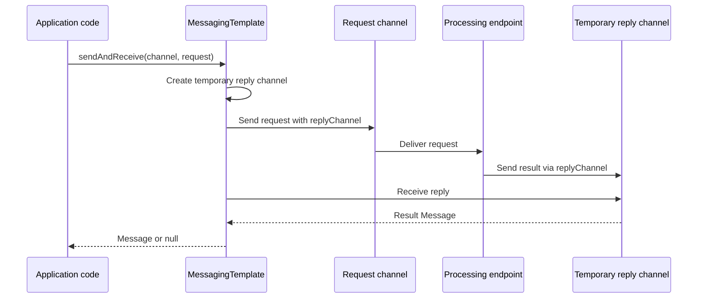

# sendAndReceive with MessagingTemplate

## 1. Goal and Problem Statement

In Spring Integration, an application can send a `Message` into a processing flow and wait for the outcome of that exact call. `MessagingTemplate.sendAndReceive` provides a request–reply entry point: send a request to a `MessageChannel`, wait for a reply, and return either a `Message<?>` or `null`.

For example, a point-of-sale screen needs to calculate a price quote before confirming an order. The flow may validate data, normalize the product code, call a pricing service, and return the quote. The caller only needs to know the request contract, reply contract, and input channel. The template fits when application code needs to work directly with messages and headers. This usage is described in the [MessagingTemplate documentation](https://docs.spring.io/spring-integration/reference/channel/template.html).

After this lesson, you will be able to:

- Build a request, call `sendAndReceive`, and handle all possible outcomes.
- Explain the role of the temporary `replyChannel` and how endpoints reply.
- Distinguish send duration, reply wait duration, and business execution duration.
- Design a Java DSL flow with explicit replies, including when input is rejected.
- Recognize the difference between synchronous exceptions and asynchronous error messages.
- Write tests for the request–reply contract.

This lesson is scoped to **Spring Integration Core**. The examples use the Java DSL API with `IntegrationFlow.from(...)` and Java 17 syntax such as `record` and pattern matching for `instanceof`. Choose a JDK matching your project's Spring version; Java 17 is the syntax baseline for the examples, not a guarantee of the minimum JDK across every Spring Integration release.

## 2. Call Contract

### 2.1. Basic API

Import the Spring Integration template:

```java
import org.springframework.integration.core.MessagingTemplate;
import org.springframework.messaging.Message;
import org.springframework.messaging.MessageChannel;
import org.springframework.messaging.support.MessageBuilder;
```

A typical invocation:

```java
MessagingTemplate template = new MessagingTemplate();
template.setSendTimeout(200);
template.setReceiveTimeout(1_500);

Message<String> request = MessageBuilder.withPayload("SKU-101")
        .setHeader("requestId", "quote-2026-001")
        .build();

Message<?> reply = template.sendAndReceive(requestChannel, request);
```

Here, `requestChannel` is a configured `MessageChannel` with an appropriate consumer. Timeout values are in milliseconds.

Key signature:

```java
Message<?> sendAndReceive(
        MessageChannel destination,
        Message<?> requestMessage);
```

The return value may be `null`; timing out is the common case, though an interrupted wait can also return without a reply. Never call `getPayload()` without checking first. The return type also does not guarantee that the payload belongs to the business class you expect. Details on signatures and inheritance live in the [MessagingTemplate Javadoc](https://docs.spring.io/spring-integration/docs/current/api/org/springframework/integration/core/MessagingTemplate.html).

### 2.2. Four Outcomes to Distinguish

| Observed Outcome | Meaning on the Caller Side | Handling in the Quote Example |
| --- | --- | --- |
| Message containing a valid `QuoteReply` | Received a result matching the contract | Display the quote or rejection reason |
| `null` | No reply received during this wait | Report no result yet; log the request for investigation |
| Exception thrown during the call | Send failed or error on synchronous processing path | Classify the error and translate to an application error |
| Message containing error information | A processing path returned an error as message data | Check for errors before casting to the business payload |

This table represents the application contract you should design. `null` does not prove the request was never processed, and an arbitrary message does not prove business success.

### 2.3. Configuring the Destination

You can pass the channel directly on each call, or configure a default channel:

```java
template.setDefaultChannel(requestChannel);
Message<?> reply = template.sendAndReceive(request);
```

In a Spring application, a bean-managed template can also resolve channel names:

```java
Message<?> reply = template.sendAndReceive("quoteRequests", request);
```

The channel-name form requires a properly configured destination resolver. Calling `new MessagingTemplate()` outside Spring and passing a bean name is not enough for the template to locate the application context on its own. Passing the channel object directly keeps examples independent of name resolution.

## 3. How Requests Are Linked to Replies

### 3.1. Per-Call Temporary Reply Channel

During request–reply, the template creates an internal temporary channel and puts it in the `replyChannel` header of the outgoing message.



The sequence above illustrates synchronous processing: the endpoint can send the reply before the template starts its receive step. When an executor or queue is involved, the template typically begins waiting while the worker is still processing.

The request channel can be a `DirectChannel`; it does not need to be a `PollableChannel`. It is the internal temporary channel where the template receives the reply. This separation explains why `sendAndReceive(directChannel, request)` is valid even though `receive(directChannel)` is not. The temporary channel mechanism is introduced in the [MessagingTemplate documentation](https://docs.spring.io/spring-integration/reference/channel/template.html).

### 3.2. The Endpoint Must Produce Output

A service activator at the end of a flow can return a payload. If no output channel is specified, the endpoint uses the incoming message's `replyChannel` to send the result. See [service activator reply rules](https://docs.spring.io/spring-integration/reference/service-activator.html).

```java
return IntegrationFlow.from(quoteRequests)
        .<String, String>transform(String::trim)
        .handle(String.class, (sku, headers) -> "QUOTE:" + sku)
        .get();
```

In this snippet, the return value of `handle` becomes the reply data. If you replace the handler with a consumer that only logs and produces no output, the caller will not receive a quote.

Similarly, if you append `.channel("auditOnly")` at the end, the result goes to that channel. A consumer must still route the result back along the reply path; a queue that merely stores the message will not automatically move it into the temporary channel.

### 3.3. Routing Headers and Business Headers

| Header | Role |
| --- | --- |
| `MessageHeaders.REPLY_CHANNEL` | Address where the replying component sends the result |
| `MessageHeaders.ERROR_CHANNEL` | Address used by error handling when publishing an error message |
| `requestId` in this lesson | Application-defined tracking identifier |
| `IntegrationMessageHeaderAccessor.CORRELATION_ID` | Standard header commonly used for grouping in an aggregator |

You do not need to set `correlationId` yourself just so a normal `sendAndReceive` returns to the right caller. The per-call temporary channel already provides the reply route. However, a business request ID remains useful for log lookup, deduplication, and result reconciliation.

In `GenericMessagingTemplate`'s implementation, the request is sent with both `replyChannel` and `errorChannel` pointing to the temporary channel. When a reply arrives, the template restores those two headers to their pre-call values. Therefore, do not assume an `errorChannel` attached to the request is always preserved inside the exchange. Details can be inspected in the [GenericMessagingTemplate source code](https://github.com/spring-projects/spring-framework/blob/main/spring-messaging/src/main/java/org/springframework/messaging/core/GenericMessagingTemplate.java).

When writing custom endpoints, avoid constructing brand-new messages that drop headers needed for replying. Standard endpoints generally propagate headers; custom message-building code or converters still need to be checked against the specific contract.

## 4. Timeouts and Execution Boundaries

### 4.1. Two Timeouts Have Two Scopes

| Property | Controls | Does Not Guarantee |
| --- | --- | --- |
| `sendTimeout` | Wait time for the send operation when the channel supports waiting, such as a full bounded queue | Interrupting a handler running on the caller thread |
| `receiveTimeout` | Wait time on the temporary reply channel after the send completes | Bounding total business duration or canceling processing |

Channel APIs distinguish sending and receiving; see [MessageChannel](https://docs.spring.io/spring-framework/docs/current/javadoc-api/org/springframework/messaging/MessageChannel.html) and [PollableChannel](https://docs.spring.io/spring-framework/docs/current/javadoc-api/org/springframework/messaging/PollableChannel.html).

In these operations, a negative value denotes unlimited waiting, `0` denotes no waiting, and a positive value sets a wait bound. The examples always use finite timeouts to avoid holding callers indefinitely. With `receiveTimeout = 0`, a synchronous reply already produced during the send step can still be retrieved immediately.

### 4.2. DirectChannel Does Not Turn a Timeout into a Deadline

Suppose an endpoint calls a pricing service that takes three seconds:

```text
caller thread:
  send to DirectChannel
    -> handler runs for three seconds
    -> handler returns reply
  send operation completes
  template receives already-available reply
```

Setting `receiveTimeout = 100` does not force the call to finish after 100 ms. The caller is directly executing the handler and only enters the reply wait after the send returns. Setting `sendTimeout = 100` does not provide a mechanism to interrupt that Java method either.

This is the boundary to understand when applying timeouts: it depends on where threads switch. The [gateway timeout documentation](https://docs.spring.io/spring-integration/reference/gateway.html#gateway-timeouts) also explains that the reply clock starts when the thread returns to the call site.

### 4.3. QueueChannel and ExecutorChannel

- With `QueueChannel`, a successful send usually only means the message entered the queue. There must be a consumer—typically an endpoint with a poller—to pull the request.
- With `ExecutorChannel`, an executor can run the handler on a worker thread. The caller can wait for the reply concurrently with that work.
- Consider the executor policy: a direct-running executor or caller-runs rejection policy can shift the thread boundary.

Send, receive, and thread-handoff characteristics are documented in [message channel implementations](https://docs.spring.io/spring-integration/reference/channel/implementations.html).

With truly asynchronous processing, the approximate timing model is:

```text
Total caller duration
  ≈ send execution time
    + reply wait time
    + orchestration overhead
```

This is not a hard SLA: the OS, executor, send operation, and synchronous work inside the flow all affect observed latency.

### 4.4. Overriding Timeouts for a Single Request

Do not mutate a shared bean's configuration just to serve one call. Use the timeout headers supported by the template:

```java
Message<String> urgentRequest = MessageBuilder.withPayload("SKU-101")
        .setHeader(MessagingTemplate.DEFAULT_SEND_TIMEOUT_HEADER, 50L)
        .setHeader(MessagingTemplate.DEFAULT_RECEIVE_TIMEOUT_HEADER, 300L)
        .setHeader("requestId", "quote-urgent-001")
        .build();

Message<?> reply = template.sendAndReceive(requestChannel, urgentRequest);
```

By default, the two header names are `sendTimeout` and `receiveTimeout`. The template extracts these values for the exchange and removes them from the downstream message; they are not deadlines automatically propagated across all steps. Header names can also be reconfigured on the template. See the [timeout headers Javadoc](https://docs.spring.io/spring-framework/docs/current/javadoc-api/org/springframework/messaging/core/GenericMessagingTemplate.html).

### 4.5. Timeouts Do Not Cancel Work

If the caller times out while a worker is calling an external system, the worker may continue and produce side effects. For inventory deduction or payment operations, design idempotency keys, queryable processing status, and dedicated timeouts on HTTP clients or JDBC where appropriate.

Do not automatically retry a side-effecting request simply because `null` was returned. First determine whether the prior attempt never ran, already ran, or is still running. For read-only quote lookups, retries are easier to manage, though extra load still needs to be accounted for.

## 5. Complete Example: Calculating Quotes with Java DSL

### 5.1. Dependencies and Organization

The example requires `org.springframework.integration:spring-integration-core`. If the project already uses Spring Boot with matching dependency management, you can declare:

```xml
<dependency>
    <groupId>org.springframework.integration</groupId>
    <artifactId>spring-integration-core</artifactId>
</dependency>
```

Without a BOM or parent managing versions, specify a version compatible with the project's Spring Framework. The dependency snippet above is not a complete Maven file.

Save the following code in `QuoteRequestReplyDemo.java` inside your study project. The example uses a standalone application context without needing a web server or message broker.

### 5.2. Flow Configuration and Application Call

```java
import java.math.BigDecimal;
import java.util.Locale;

import org.springframework.context.annotation.AnnotationConfigApplicationContext;
import org.springframework.context.annotation.Bean;
import org.springframework.context.annotation.Configuration;
import org.springframework.integration.channel.DirectChannel;
import org.springframework.integration.config.EnableIntegration;
import org.springframework.integration.core.MessagingTemplate;
import org.springframework.integration.dsl.IntegrationFlow;
import org.springframework.messaging.Message;
import org.springframework.messaging.MessageChannel;
import org.springframework.messaging.MessagingException;
import org.springframework.messaging.support.ErrorMessage;
import org.springframework.messaging.support.MessageBuilder;

public class QuoteRequestReplyDemo {

    public record QuoteRequest(String sku, int quantity) {
    }

    public record QuoteReply(
            String requestId,
            String sku,
            int quantity,
            boolean accepted,
            BigDecimal total,
            String reason) {
    }

    @Configuration
    @EnableIntegration
    public static class QuoteConfiguration {

        @Bean
        public DirectChannel quoteRequests() {
            return new DirectChannel();
        }

        @Bean
        public MessagingTemplate quoteTemplate() {
            MessagingTemplate template = new MessagingTemplate();
            template.setSendTimeout(200);
            template.setReceiveTimeout(1_000);
            template.setThrowExceptionOnLateReply(true);
            return template;
        }

        @Bean
        public IntegrationFlow quoteFlow(DirectChannel quoteRequests) {
            return IntegrationFlow.from(quoteRequests)
                    .<QuoteRequest, QuoteRequest>transform(request ->
                            new QuoteRequest(
                                    request.sku().trim()
                                            .toUpperCase(Locale.ROOT),
                                    request.quantity()))
                    .handle(
                            QuoteRequest.class,
                            (request, headers) -> createQuote(
                                    request,
                                    (String) headers.get("requestId")),
                            endpoint -> endpoint.requiresReply(true))
                    .get();
        }

        private QuoteReply createQuote(
                QuoteRequest request, String requestId) {

            if (request.quantity() <= 0) {
                return new QuoteReply(
                        requestId, request.sku(), request.quantity(),
                        false, BigDecimal.ZERO,
                        "QUANTITY_MUST_BE_POSITIVE");
            }

            if (!"SKU-101".equals(request.sku())) {
                return new QuoteReply(
                        requestId, request.sku(), request.quantity(),
                        false, BigDecimal.ZERO,
                        "UNKNOWN_SKU");
            }

            BigDecimal total = new BigDecimal("125000")
                    .multiply(BigDecimal.valueOf(request.quantity()));

            return new QuoteReply(
                    requestId, request.sku(), request.quantity(),
                    true, total, "OK");
        }
    }

    public static QuoteReply askForQuote(
            MessagingTemplate template,
            MessageChannel channel,
            QuoteRequest payload,
            String requestId) {

        if (payload == null
                || payload.sku() == null
                || payload.sku().isBlank()) {
            throw new IllegalArgumentException("Product SKU is required");
        }
        if (requestId == null || requestId.isBlank()) {
            throw new IllegalArgumentException("requestId is required");
        }

        Message<QuoteRequest> request = MessageBuilder
                .withPayload(payload)
                .setHeader("requestId", requestId)
                .build();

        Message<?> reply;
        try {
            reply = template.sendAndReceive(channel, request);
        }
        catch (MessagingException ex) {
            throw new IllegalStateException(
                    "Could not execute request " + requestId, ex);
        }

        if (reply == null) {
            throw new IllegalStateException(
                    "No quote received yet for " + requestId);
        }

        if (reply instanceof ErrorMessage error) {
            throw new IllegalStateException(
                    "Processing flow reported an error for " + requestId,
                    error.getPayload());
        }

        if (!(reply.getPayload() instanceof QuoteReply result)) {
            throw new IllegalStateException(
                    "Unexpected reply type for " + requestId + ": "
                            + reply.getPayload().getClass().getName());
        }

        if (!requestId.equals(result.requestId())) {
            throw new IllegalStateException(
                    "Reply does not match request " + requestId);
        }

        return result;
    }

    public static void main(String[] args) {
        try (var context = new AnnotationConfigApplicationContext(
                QuoteConfiguration.class)) {

            MessagingTemplate template = context.getBean(
                    "quoteTemplate", MessagingTemplate.class);
            MessageChannel channel = context.getBean(
                    "quoteRequests", MessageChannel.class);

            QuoteReply quote = askForQuote(
                    template, channel,
                    new QuoteRequest(" sku-101 ", 2),
                    "quote-001");

            System.out.println(quote.requestId()); // quote-001
            System.out.println(quote.sku());       // SKU-101
            System.out.println(quote.accepted());  // true
            System.out.println(quote.total());     // 250000

            QuoteReply rejected = askForQuote(
                    template, channel,
                    new QuoteRequest("SKU-101", 0),
                    "quote-002");

            System.out.println(rejected.accepted()); // false
            System.out.println(rejected.reason());
            // QUANTITY_MUST_BE_POSITIVE
        }
    }
}
```

### 5.3. Why Can This Flow Reply?

`@EnableIntegration` enables Spring Integration infrastructure. The `IntegrationFlow` bean describes endpoints and connections between them; the flow must be registered in the context rather than merely constructed as a standalone Java object. The DSL's configuration role is presented in the [Java DSL documentation](https://docs.spring.io/spring-integration/reference/dsl.html).

In the example:

1. The caller builds `Message<QuoteRequest>` and adds `requestId`.
2. The template attaches the reply route and sends to `quoteRequests`.
3. The transformer normalizes the SKU while standard endpoints manage header propagation.
4. The service activator computes the price and always returns `QuoteReply`.
5. The final endpoint specifies no output channel, so it sends the result along the reply route.
6. The caller validates the reply and returns the business result.

`requiresReply(true)` catches cases where that handler unexpectedly returns `null`. It does not force every router, filter, or other endpoint across the entire flow to produce a reply.

Business rejections such as invalid quantity are represented via `QuoteReply.accepted = false`. This lets the UI distinguish “product not sold” from “no reply received yet”. `BigDecimal.ZERO` is the example's convention when no quote is produced; a production contract might choose a separate result type.

`requestId` is also placed into the reply payload to illustrate contract verification. Headers can be used for infrastructure tracing, though you should never turn a reply channel address into a business identifier.

## 6. Preserving the Request–Reply Contract Across EIP Patterns

A long flow still needs to return one final result per request. The template's presence alone does not automatically turn every branch into request–reply.

### 6.1. Transformer

Transformers fit normalization, data conversion, or output formatting steps. When using a lambda over the payload, declare input and output types explicitly when needed:

```java
.<QuoteRequest, QuoteRequest>transform(request ->
        new QuoteRequest(
                request.sku().trim().toUpperCase(Locale.ROOT),
                request.quantity()))
```

If you want to read the entire message, use the overload supporting `Message.class`; do not assume a payload-transforming lambda parameter is a `Message`. [DSL Basics](https://docs.spring.io/spring-integration/reference/dsl/java-basics.html) explains this distinction.

### 6.2. Filter

A filter rejecting a request can terminate the branch without producing a reply. Two common designs:

- Treat invalid input as an error and enable `throwExceptionOnRejection(true)`.
- Send rejected requests to a discard flow that builds a business rejection reply.

Illustrative configuration snippet, replacing the quantity check inside the handler:

```java
return IntegrationFlow.from(quoteRequests)
        .filter(
                QuoteRequest.class,
                request -> request.quantity() > 0,
                endpoint -> endpoint.throwExceptionOnRejection(true))
        .handle(
                QuoteRequest.class,
                (request, headers) -> createQuote(
                        request, (String) headers.get("requestId")))
        .get();
```

This snippet lives in the configuration class that already defines `createQuote`. The rejection branch now throws an error instead of returning `QuoteReply.accepted = false`. Choose one consistent contract. If a discard flow only logs, the caller still receives no reply. Rejection options are described in the [Filter documentation](https://docs.spring.io/spring-integration/reference/filter.html).

### 6.3. Router

With a router, map out the branches clearly: domestic goods, imported goods, unsupported. Each branch must return a final result, route to a shared reply branch, or raise an intentional error.

Do not send an “unsupported” branch to `nullChannel` and expect the caller to receive a rejection notice. Discarding a message and producing a rejection reply are two distinct actions.

### 6.4. Splitter and Aggregator

If you need to query three suppliers to return one combined quote, the structure can be:

```text
quote request
  -> split into supplier requests
  -> call each supplier
  -> gather results in the same group
  -> select or aggregate quotes
  -> one final reply
```

An aggregator holds group state, using correlation to group messages and a release strategy to decide when to emit output. Defaults involve `correlationId` and sequence information; see the [Aggregator documentation](https://docs.spring.io/spring-integration/reference/aggregator.html).

When introducing an aggregator into request–reply, also design:

- Group timeout and policy when a supplier is missing.
- How to keep the reply route consistent for the group.
- Alignment between group completion time and how long the caller waits.
- How to handle results arriving after the caller has left.

Do not use the template's temporary channel as a place to collect multiple replies. The call contract is a single final reply; aggregation is the flow's responsibility.

## 7. Synchronous vs. Asynchronous Errors

### 7.1. Exceptions on the Caller Thread

For a processing chain running through `DirectChannel`, endpoint errors typically unwind up the call stack to `sendAndReceive`. Business errors may be wrapped by Spring in a `MessagingException`, such as `MessageHandlingException`.

Therefore, check the error type and cause instead of relying on only one fixed subclass:

```java
try {
    Message<?> reply = template.sendAndReceive(channel, request);
    // Check for null, error message, and payload type here.
}
catch (MessagingException ex) {
    Throwable cause = ex.getCause();
    // Log requestId, error type, and relevant cause.
    throw new IllegalStateException("Integration flow failed", ex);
}
```

If the channel refuses the send, the template can throw `MessageDeliveryException`. That differs from a successful send with no reply.

### 7.2. Errors on a Worker Thread

After a thread handoff, an exception cannot automatically unwind up a call stack belonging to another thread. Spring Integration's asynchronous components can publish errors as an `ErrorMessage` with the `Throwable` as its payload. The destination is determined by `errorChannel` and error-handling configuration. See the [Error Handling documentation](https://docs.spring.io/spring-integration/reference/error-handling.html).

Within a template exchange, the temporary error route can deliver an `ErrorMessage` to the same reply-receiving point. `MessagingTemplate.sendAndReceive` itself does not apply all messaging-gateway error-conversion rules to automatically rethrow error payloads. The caller should check:

```java
if (reply instanceof ErrorMessage error) {
    throw new IllegalStateException(
            "Asynchronous processing failed",
            error.getPayload());
}
```

This check also appears in the complete example. With custom contracts that allow messages carrying a `Throwable` without using `ErrorMessage`, handle that case explicitly as well.

Not every hand-crafted Java task has its exceptions automatically converted to messages by Spring. If you call `executor.submit(...)` directly outside framework endpoints, you must wire results and errors back into the appropriate flow yourself.

### 7.3. Avoiding Misconceptions About errorChannel

Merely attaching an `errorChannel` to a request does not guarantee every error reaches that monitoring channel:

- Errors on the caller thread can still be thrown directly.
- The template installs a temporary error route for the current exchange.
- Custom error handlers or advice can alter routing or turn errors into results.
- If an error flow only logs and terminates, the caller may wait until timeout.

If you need both monitoring and replying, design the error path to perform both duties. Business error notices should be structured data; infrastructure exceptions should preserve root causes for diagnostics.

## 8. Late Replies and Multiple Replies

Suppose the caller waits 300 ms while the worker takes 800 ms. By the time the worker sends the reply, the caller may already have returned `null`. A late reply does not revive the finished call.

You can set an explicit policy:

```java
template.setThrowExceptionOnLateReply(true);
```

When enabled, sending to a temporary channel that is no longer awaited can throw `MessageDeliveryException` on the **reply-sending thread**. The already-finished caller does not receive that exception retroactively. When disabled, a warning is logged instead of throwing another error. Late-reply cases are demonstrated in [Spring Framework's GenericMessagingTemplateTests](https://github.com/spring-projects/spring-framework/blob/main/spring-messaging/src/test/java/org/springframework/messaging/core/GenericMessagingTemplateTests.java).

Spring Integration's global configuration also provides the property `spring.integration.messagingTemplate.throwExceptionOnLateReply`; the [Global Properties documentation](https://docs.spring.io/spring-integration/reference/configuration/global-properties.html) lists the default as `false`. The example calls the setter explicitly so learners do not have to rely on external configuration.

The temporary channel serves one reply per call, not a stream. Having multiple branches send replies concurrently has no reliable selection or ordering contract; if multiple results are needed, aggregate them into one payload or choose a streaming API.

For long-running work where results must be received after the caller leaves, design a request ID, status persistence, and a dedicated result channel. The internal temporary channel is not a durable mailbox.

## 9. Testing the Request–Reply Contract

The following tests use JUnit Jupiter and reside in the same package as `QuoteRequestReplyDemo`. They require `org.junit.jupiter:junit-jupiter` in test scope and JUnit 5 runner configuration in the project.

Assert observable outcomes rather than asserting that a call always takes an exact number of milliseconds. The no-consumer cases below use timeout `0` so they do not depend on OS scheduling.

```java
import java.math.BigDecimal;

import org.junit.jupiter.api.Test;
import org.springframework.context.annotation.AnnotationConfigApplicationContext;
import org.springframework.integration.channel.DirectChannel;
import org.springframework.integration.channel.QueueChannel;
import org.springframework.integration.core.MessagingTemplate;
import org.springframework.messaging.Message;
import org.springframework.messaging.MessageChannel;
import org.springframework.messaging.MessageDeliveryException;
import org.springframework.messaging.MessageHandlingException;
import org.springframework.messaging.support.ErrorMessage;
import org.springframework.messaging.support.GenericMessage;

import static org.junit.jupiter.api.Assertions.*;

class MessagingTemplateRequestReplyTest {

    @Test
    void returnsQuoteAndBusinessRejection() {
        try (var context = new AnnotationConfigApplicationContext(
                QuoteRequestReplyDemo.QuoteConfiguration.class)) {

            MessagingTemplate template = context.getBean(
                    "quoteTemplate", MessagingTemplate.class);
            MessageChannel channel = context.getBean(
                    "quoteRequests", MessageChannel.class);

            var accepted = QuoteRequestReplyDemo.askForQuote(
                    template, channel,
                    new QuoteRequestReplyDemo.QuoteRequest(
                            " sku-101 ", 2),
                    "test-001");

            assertEquals("test-001", accepted.requestId());
            assertEquals("SKU-101", accepted.sku());
            assertTrue(accepted.accepted());
            assertEquals(
                    0,
                    new BigDecimal("250000")
                            .compareTo(accepted.total()));

            var rejected = QuoteRequestReplyDemo.askForQuote(
                    template, channel,
                    new QuoteRequestReplyDemo.QuoteRequest(
                            "SKU-101", 0),
                    "test-002");

            assertFalse(rejected.accepted());
            assertEquals(
                    "QUANTITY_MUST_BE_POSITIVE",
                    rejected.reason());
        }
    }

    @Test
    void returnsNullWhenRequestIsQueuedButNoReplyExists() {
        QueueChannel requests = new QueueChannel(1);
        MessagingTemplate template = new MessagingTemplate();
        template.setSendTimeout(0);
        template.setReceiveTimeout(0);

        Message<?> reply = template.sendAndReceive(
                requests, new GenericMessage<>("request"));

        assertNull(reply);
        assertNotNull(requests.receive(0));
    }

    @Test
    void throwsWhenBoundedQueueCannotAcceptRequest() {
        QueueChannel requests = new QueueChannel(1);
        assertTrue(requests.send(
                new GenericMessage<>("already-full"), 0));

        MessagingTemplate template = new MessagingTemplate();
        template.setSendTimeout(0);
        template.setReceiveTimeout(0);

        assertThrows(
                MessageDeliveryException.class,
                () -> template.sendAndReceive(
                        requests, new GenericMessage<>("request")));
    }

    @Test
    void propagatesSynchronousEndpointFailure() {
        DirectChannel requests = new DirectChannel();
        requests.subscribe(message -> {
            throw new MessageHandlingException(
                    message,
                    new IllegalStateException("PRICE_SERVICE_FAILED"));
        });

        MessagingTemplate template = new MessagingTemplate();
        template.setReceiveTimeout(100);

        MessageHandlingException error = assertThrows(
                MessageHandlingException.class,
                () -> template.sendAndReceive(
                        requests, new GenericMessage<>("request")));

        assertEquals(
                "PRICE_SERVICE_FAILED",
                error.getCause().getMessage());
    }

    @Test
    void exposesErrorMessageSentToTemporaryErrorChannel() {
        DirectChannel requests = new DirectChannel();
        requests.subscribe(message -> {
            MessageChannel errorChannel = (MessageChannel)
                    message.getHeaders().getErrorChannel();

            errorChannel.send(new ErrorMessage(
                    new IllegalStateException("WORKER_FAILURE")));
        });

        MessagingTemplate template = new MessagingTemplate();
        template.setReceiveTimeout(100);

        Message<?> reply = template.sendAndReceive(
                requests, new GenericMessage<>("request"));

        ErrorMessage error = assertInstanceOf(
                ErrorMessage.class, reply);
        assertEquals(
                "WORKER_FAILURE",
                error.getPayload().getMessage());
    }
}
```

The last test explicitly sends an error message to the temporary error route to verify what the caller receives. It does not test how a real executor or poller publishes errors.

The queue-without-consumer test highlights an important point: the caller receives no reply, yet the request is still in the queue. You cannot infer “message was never sent” from `null`.

When testing asynchronous variants in a real application, use a latch or bounded coordination mechanism to control when the worker executes. Shut down executors after the test. You can add checks verifying that callers receive replies matching the right `requestId` under concurrent requests, and verify the late-reply policy on the reply-sending thread.

## 10. Choosing sendAndReceive, a Gateway, or Another Operation

| Need | Suitable Tool | What to Define |
| --- | --- | --- |
| Send a message without waiting for a result in the call | `send` or `convertAndSend` | Send success differs from business completion |
| Proactively pull a message from a pollable channel | `receive` or `receiveAndConvert` | Receiving channel must support polling |
| Send a message and receive a reply message | `sendAndReceive` | Null handling, errors, and returned payload type |
| Send a payload and receive a payload via converter | `convertSendAndReceive` | Converter and expected result type |
| Put a business interface in front of an integration flow | Messaging gateway | Method, header, timeout, and error mappings |
| Long-running task returning results later | Asynchronous flow plus status-tracking mechanism | Result destination, persistence, and request lifecycle |

Payload conversion example:

```java
String result = template.convertSendAndReceive(
        textRequests, "  hello  ", String.class);
```

`textRequests` must point to a flow that actually returns data compatible with `String`. The converter does not create processing endpoints, and converting payloads does not remove the need to define an error contract.

If most business code just needs a method like `QuoteReply quote(QuoteRequest request)`, a gateway can hide message details from callers. The template helps when callers need direct control over messages, headers, or channels. You can see how gateways map interfaces in the [Messaging Gateways documentation](https://docs.spring.io/spring-integration/reference/gateway.html).

Do not use `send` followed by `receive` on a shared reply queue as an ad-hoc substitute for `sendAndReceive`. With multiple callers, you would have to build your own correlation and coordination so callers do not pull each other's results.

## 11. Diagnosing Missing Replies

| Symptom | Hypothesis to Check | Concrete Action |
| --- | --- | --- |
| `MessageDeliveryException` on send | Queue full or channel unable to dispatch | Check consumers, queue capacity, and exception cause |
| Request sits in queue while caller gets `null` | No poller or consumer has not started | Verify the endpoint and its lifecycle |
| Only invalid inputs time out | Filter or rejection branch produces no reply | Build a rejection reply or configure error throwing |
| Final message sits in an output queue | Output was routed off the reply path | Check downstream consumers and final output channel |
| Error routing the reply | Required header was lost or unresolvable | Compare headers before and after custom endpoints |
| Low receive timeout yet call still takes long | Logic is running on the caller thread | Identify thread boundaries and I/O timeouts |
| Caller cast fails | Received an error message or off-contract payload | Inspect message class and payload type before casting |
| Late-reply warnings appear | Worker finished after the caller left | Correlate request ID, system load, and per-step timing |
| Fails only on nested calls | A step overwrote or dropped the reply route | Inspect headers before and after the nested call |

For observability, log the request ID, flow or endpoint name, request timestamp, completion timestamp, and outcome category. Never use `replyChannel.toString()` as a durable business key.

Under concurrent requests, keep template configuration immutable after initialization and place per-request timeouts on messages when needed. Having a separate temporary channel per call does not make downstream services, caches, or shared resources thread-safe on their own.

If switching from `DirectChannel` to `ExecutorChannel`, revisit transactions. A transaction bound to the caller thread does not automatically become shared with a handler running on another thread. The [ExecutorChannel Javadoc](https://docs.spring.io/spring-integration/docs/current/api/org/springframework/integration/channel/ExecutorChannel.html) states this boundary clearly.

## 12. Design Principles to Keep

- Every request must have a path to either a final reply or a defined error outcome.
- Check separately for `null`, error messages, and the business payload type.
- Set finite timeouts and understand whether they apply to sending or receiving.
- Handle late replies on the worker side and never treat a timeout as a cancellation command.
- Preserve routing headers across custom endpoints; use a request ID for business tracking.
- When adding filters, routers, or aggregators, audit all branches that might not reply.
- For side-effecting tasks, base retry decisions on state and idempotency.
- Use a gateway when a business interface simplifies callers; use the template when direct message manipulation is needed.

The core lesson is designing an exchange with an explicit contract: the template handles sending and waiting, while the flow guarantees how results are produced, preserves the reply route, and handles every termination case.
