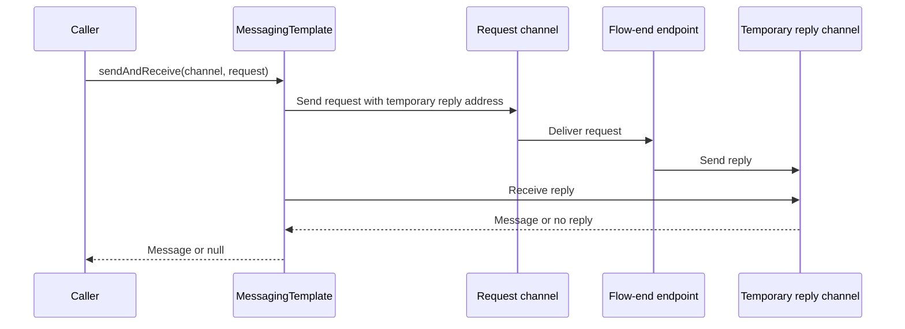

# sendAndReceiveMessage

## 1. Goal and API Name to Use

In an order-processing application, a component may need to send a price lookup request into a Spring Integration flow and receive the result back to continue computing the total. This requirement fits the **request–reply** pattern: the caller sends a message and then waits for the reply message for that call.

This lesson belongs to the **MessagingTemplate** chapter of **SPRING_INTEGRATION_CORE**. The focus is on how the application proactively enters the integration flow, coordinates `Message`, `MessageChannel`, endpoints, and the Java DSL, and handles outcomes or errors at the call boundary.

**Note on the lesson title:** `sendAndReceiveMessage` describes the operation of sending and receiving a message. On `org.springframework.integration.core.MessagingTemplate` in Spring Integration 6.x, the public API used in this lesson is **`sendAndReceive(...)`**, which returns `Message<?>`. There is no public `template.sendAndReceiveMessage(...)` method on this class. [MessagingTemplate 6.5.0 Javadoc](https://docs.spring.io/spring-integration/docs/6.5.0/api/org/springframework/integration/core/MessagingTemplate.html).

After this lesson, learners should be able to:

- Send a request with payload and headers and receive the full reply.
- Explain the role of the temporary reply channel.
- Configure wait timeouts without mistaking them for processing cancellation deadlines.
- Distinguish between no reply received, send failures, and processing failures.
- Design the reply path across endpoints and write tests for that contract.

The examples use Java 17 and Spring Integration 6.x APIs, aligned with the 6.5 documentation branch. Dependency versions should follow the version set managed by your project.

## 2. Contract for Sending a Request and Receiving a Message

Two common call forms:

```java
Message<?> reply = template.sendAndReceive(requestChannel, request);
Message<?> replyFromDefault = template.sendAndReceive(request);
```

The second form requires a default destination configured, such as via `new MessagingTemplate(requestChannel)`. When passing a `MessageChannel` object, the caller does not need bean-name resolution to locate the destination.

The result may be a `Message<?>` or `null` when no reply is received, for example due to a timeout. The call can also throw an exception. Therefore, the method returning normally cannot be treated as proof of business success. [MessageRequestReplyOperations contract](https://docs.spring.io/spring-framework/docs/6.2.0/javadoc-api/org/springframework/messaging/core/MessageRequestReplyOperations.html).

Minimal example at a call site where the channel and template are already available:

```java
Message<QuoteRequest> request = MessageBuilder
        .withPayload(new QuoteRequest("SKU-01", 2))
        .setHeader("requestId", "quote-2026-001")
        .build();

Message<?> reply = template.sendAndReceive(requestChannel, request);

if (reply == null) {
    throw new IllegalStateException("No quote reply received");
}
```

This snippet makes no assumption yet about the reply's payload type. Type checking and error-message handling will be added in the complete example.

### Choosing the Appropriate Level of Abstraction

| Call Style | Data at the Call Boundary | When It Fits |
| --- | --- | --- |
| `sendAndReceive(channel, message)` | Both request and reply are `Message` | Need to read headers, check message types, or keep the messaging contract explicit |
| `convertSendAndReceive(channel, payload, Target.class)` | Input payload and result object | Want to use the template's converter mechanism and care mainly about the data |
| Interface using `@MessagingGateway` | Business method signature | Want services to call via an interface and reduce direct coupling to messaging APIs |

`convertSendAndReceive` relies on the configured `MessageConverter`; passing `Target.class` does not automatically provide the ability to convert arbitrary JSON strings into arbitrary DTOs. [Request–reply conversion API](https://docs.spring.io/spring-framework/docs/6.2.0/javadoc-api/org/springframework/messaging/core/MessageRequestReplyOperations.html).

A gateway fits when multiple places need the same business API, such as `QuoteReply quote(QuoteRequest request)`. A template fits an adapter layer that needs direct control over `Message` and headers. [Messaging Gateways](https://docs.spring.io/spring-integration/reference/6.5/gateway.html).

## 3. How Does the Reply Return to the Caller?

The template creates a temporary reply channel for the exchange and attaches it to the outgoing request. The endpoint at the end of the flow can use this reply address to send the result. The caller does not have to create a shared queue and pull replies from it manually. [MessagingTemplate in the Reference Guide](https://docs.spring.io/spring-integration/reference/6.5/channel/template.html).



With synchronous flows, the endpoint can send the reply before the template begins the receive step. The diagram shows the exchange relationship; it does not require each arrow to run on a separate thread.

In `GenericMessagingTemplate`'s implementation, which `MessagingTemplate` extends, the outgoing request has both `replyChannel` and `errorChannel` pointing to the temporary channel. When returning the reply to the caller, the template restores those two headers to the values from the original request. This is an important detail when observing headers in nested flows. [GenericMessagingTemplate source, doSendAndReceive](https://raw.githubusercontent.com/spring-projects/spring-framework/v6.2.0/spring-messaging/src/main/java/org/springframework/messaging/core/GenericMessagingTemplate.java).

### Rules for Designing the Return Path

Each request in the example must lead to either a quote result or a failure recognizable by the caller. When designing the flow, identify which endpoint is responsible for fulfilling this contract.

For example, if one branch processes valid orders while another branch only writes a log, requests taking the logging branch will produce no quote result. Having a log proves the request passed through a component; it does not prove the reply path completed.

Do not use `MessageHeaders.ID` as an immutable business request ID. Set a dedicated header such as `requestId` to correlate logs and results, or use `correlationId` when designing message groups. In this model, a single call's return path is handled by the temporary channel; an arbitrary correlation header does not automatically become a reply-matching mechanism.

## 4. Complete Example: Quote Lookup Flow

The example consists of two Java classes in the `example.integration` package:

- `QuoteConfig`: declares the channel, template, and flow.
- `QuoteApplication`: creates the context, sends the request, and inspects the reply.

The project needs the `org.springframework.integration:spring-integration-core` dependency, with its version managed consistently alongside the Spring libraries. The Java DSL is included in the core module; no extra DSL dependency is needed.

The constructed flow:

```text
QuoteRequest
    → DirectChannel quoteRequests
    → transformer normalizing SKU
    → add quoteSource header
    → service activator calculating price
    → temporary reply channel
    → Message<QuoteReply> at caller
```

### 4.1. Configuring the Channel, Endpoint, and Template

Contents of `QuoteConfig`:

```java
package example.integration;

import java.math.BigDecimal;
import java.util.Locale;

import org.springframework.context.annotation.Bean;
import org.springframework.context.annotation.Configuration;
import org.springframework.integration.channel.DirectChannel;
import org.springframework.integration.config.EnableIntegration;
import org.springframework.integration.core.MessagingTemplate;
import org.springframework.integration.dsl.IntegrationFlow;

@Configuration
@EnableIntegration
public class QuoteConfig {

    public record QuoteRequest(String sku, int quantity) {
        public QuoteRequest {
            if (sku == null || sku.isBlank()) {
                throw new IllegalArgumentException("SKU must not be blank");
            }
            if (quantity <= 0) {
                throw new IllegalArgumentException("Quantity must be greater than 0");
            }
        }
    }

    public record QuoteReply(
            String sku,
            int quantity,
            BigDecimal total,
            String currency) {
    }

    @Bean
    public DirectChannel quoteRequests() {
        return new DirectChannel();
    }

    @Bean
    public MessagingTemplate quoteTemplate(DirectChannel quoteRequests) {
        MessagingTemplate template = new MessagingTemplate(quoteRequests);
        template.setSendTimeout(200);
        template.setReceiveTimeout(1_500);
        template.setThrowExceptionOnLateReply(true);
        return template;
    }

    @Bean
    public IntegrationFlow quoteFlow(DirectChannel quoteRequests) {
        return IntegrationFlow.from(quoteRequests)
                .transform(QuoteRequest.class, request ->
                        new QuoteRequest(
                                request.sku().strip().toUpperCase(Locale.ROOT),
                                request.quantity()))
                .enrichHeaders(headers ->
                        headers.header("quoteSource", "demo-catalog"))
                .handle(QuoteRequest.class, (request, headers) -> {
                    if (!"SKU-01".equals(request.sku())) {
                        throw new IllegalArgumentException(
                                "No price available for SKU: " + request.sku());
                    }

                    BigDecimal unitPrice = new BigDecimal("125000.00");
                    BigDecimal total = unitPrice.multiply(
                            BigDecimal.valueOf(request.quantity()));

                    return new QuoteReply(
                            request.sku(),
                            request.quantity(),
                            total,
                            "VND");
                }, endpoint -> endpoint.requiresReply(true))
                .get();
    }
}
```

`@EnableIntegration` activates Integration infrastructure in a plain Java context. The flow is a Spring bean so the framework registers the channels and endpoints described by the DSL. Merely creating an `IntegrationFlow` object outside the context does not create a running integration application. [Java DSL](https://docs.spring.io/spring-integration/reference/6.5/dsl.html).

In the example, the transformer normalizes `" sku-01 "` to `"SKU-01"`. The service activator returns a `QuoteReply` payload; the endpoint is responsible for constructing the result message. Because no final output channel is configured, the endpoint can use the request's `replyChannel` header. `requiresReply(true)` requires the handler to produce a non-`null` result. [Service Activator](https://docs.spring.io/spring-integration/reference/6.5/service-activator.html).

### 4.2. Sending the Request and Reading Both Payload and Headers

Contents of `QuoteApplication`:

```java
package example.integration;

import java.util.UUID;

import org.springframework.context.annotation.AnnotationConfigApplicationContext;
import org.springframework.integration.core.MessagingTemplate;
import org.springframework.messaging.Message;
import org.springframework.messaging.support.ErrorMessage;
import org.springframework.messaging.support.MessageBuilder;

import example.integration.QuoteConfig.QuoteReply;
import example.integration.QuoteConfig.QuoteRequest;

public class QuoteApplication {

    public static void main(String[] args) {
        try (var context =
                     new AnnotationConfigApplicationContext(QuoteConfig.class)) {

            MessagingTemplate template =
                    context.getBean("quoteTemplate", MessagingTemplate.class);

            String requestId = UUID.randomUUID().toString();

            Message<QuoteRequest> request = MessageBuilder
                    .withPayload(new QuoteRequest(" sku-01 ", 2))
                    .setHeader("requestId", requestId)
                    .build();

            Message<?> reply = template.sendAndReceive(request);

            if (reply == null) {
                throw new IllegalStateException(
                        "No quote received, requestId=" + requestId);
            }

            if (reply instanceof ErrorMessage error) {
                throw new IllegalStateException(
                        "Quote flow failed, requestId=" + requestId,
                        error.getPayload());
            }

            if (!(reply.getPayload() instanceof QuoteReply quote)) {
                throw new IllegalStateException(
                        "Unexpected reply type: "
                                + reply.getPayload().getClass().getName());
            }

            System.out.println(quote);
            System.out.println("requestId="
                    + reply.getHeaders().get("requestId"));
            System.out.println("quoteSource="
                    + reply.getHeaders().get("quoteSource"));
        }
    }
}
```

With valid data, expected payload output:

```text
QuoteReply[sku=SKU-01, quantity=2, total=250000.00, currency=VND]
```

The `quoteSource` header has value `demo-catalog`; the `requestId` header helps correlate with the request. The code does not cast directly to `Message<QuoteReply>`, because the template's public return type is `Message<?>`.

The `ErrorMessage` branch prepares for variants with asynchronous processing. With `DirectChannel` in the current configuration, an exception thrown by the handler normally propagates immediately during the call; it can surface before `reply` is assigned.

## 5. Timeouts: Which Step Is Waiting?

The two timeouts on the template measure two different phases, in milliseconds:

| Setting | Phase Applied | Example |
| --- | --- | --- |
| `sendTimeout` | Sending the request to the channel, depending on the channel's wait capability | Waiting for space in a bounded `QueueChannel` |
| `receiveTimeout` | Waiting for a result on the temporary reply channel after the send step | Waiting for a worker to finish processing and send a reply |

A negative value represents unlimited waiting for that operation; `0` represents no waiting. In the referenced template implementation, both initial values are `-1`. The examples explicitly configure finite durations. [GenericMessagingTemplate API](https://docs.spring.io/spring-framework/docs/6.2.0/javadoc-api/org/springframework/messaging/core/GenericMessagingTemplate.html), [timeout initialization and usage in source](https://raw.githubusercontent.com/spring-projects/spring-framework/v6.2.0/spring-messaging/src/main/java/org/springframework/messaging/core/GenericMessagingTemplate.java).

### 5.1. DirectChannel Does Not Create a Handler Interruption Deadline

`DirectChannel` invokes the handler on the sending thread. For a handler taking five seconds, `sendAndReceive` can take at least roughly five seconds even if `receiveTimeout` is set to 100 ms. That work executes during the send phase; when the receive phase begins, the reply is already ready. [DirectChannel and other channels](https://docs.spring.io/spring-integration/reference/6.5/channel/implementations.html).

Therefore, the following configuration cannot be used as a cancel-everything timer after 100 ms:

```java
template.setReceiveTimeout(100);
```

If an endpoint calls HTTP, queries a database, or waits on a lock, configure bounds on that resource itself. When budgeting latency for a quote request, include connection wait, I/O operations, retries, and result-delivery time.

### 5.2. Even with an Async Boundary, Check Total Latency

With `ExecutorChannel`, work can be handed off to another thread. With `QueueChannel`, a consumer or polling endpoint is needed to pull and process requests. A queue on its own only holds messages.

Latency observed at the caller can include send time, reply wait time, and overhead. Do not assume total latency is always capped at exactly `receiveTimeout`, nor assume every channel enforces `sendTimeout` the same way.

Do not confuse the template's defaults with `spring.integration.endpoints.defaultTimeout`. That is an endpoint configuration and not a way to directly set the two template timeout properties above. [Global Properties](https://docs.spring.io/spring-integration/reference/6.5/configuration/global-properties.html).

### 5.3. Per-Request Timeout

When sharing a single template, set timeouts on the request instead of mutating the bean configuration for each call:

```java
Message<QuoteRequest> request = MessageBuilder
        .withPayload(new QuoteRequest("SKU-01", 2))
        .setHeader("requestId", "quote-short-budget")
        .setHeader(
                org.springframework.messaging.core.GenericMessagingTemplate
                        .DEFAULT_SEND_TIMEOUT_HEADER,
                100L)
        .setHeader(
                org.springframework.messaging.core.GenericMessagingTemplate
                        .DEFAULT_RECEIVE_TIMEOUT_HEADER,
                500L)
        .build();

Message<?> reply = template.sendAndReceive(requestChannel, request);
```

The default header names are `sendTimeout` and `receiveTimeout`. The template uses those values for the exchange and removes the timeout-control headers from the request sent down the flow. Do not define business conventions using these same two header names. [GenericMessagingTemplate API](https://docs.spring.io/spring-framework/docs/6.2.0/javadoc-api/org/springframework/messaging/core/GenericMessagingTemplate.html).

Suppose two requests share a template: request A has a 500 ms budget while request B has a 2,000 ms budget. If both call `template.setReceiveTimeout(...)` right before sending, the shared setting can be overwritten in between by the other request. Placing headers on each request avoids that race.

## 6. Distinguishing No Reply from Errors

An adapter calling a pricing flow should define separate handling for each outcome below:

| Outcome | Meaning to Consider | Action at the Application Boundary |
| --- | --- | --- |
| Received `Message` with valid `QuoteReply` | Result matches the contract | Inspect the result and continue business logic |
| Received `null` | Could not obtain a reply during the receive wait | Report no result received; query status if needed |
| Error sending the request | Request was rejected or send did not complete | Log the send error; consider controlled retry |
| Exception from synchronous flow | Processing component failed on the call path | Map to a technical or business error |
| Received `ErrorMessage` | An error-handling mechanism converted the error into a reply message | Read the error payload and map according to contract |
| Received unexpected payload type | Contract mismatch between caller and flow | Report a contract error; store trace details |

`null` does not prove the request went unprocessed. For example, a worker might have updated data without sending the result before the caller stopped waiting. For read-only quotes, retrying may be considered; for creating orders or charging payments, operation IDs and duplicate-prevention logic are required.

### Synchronous Errors

With `DirectChannel`, errors can propagate back up the call stack to the sender. You can catch `MessagingException` at the application boundary and inspect the cause to identify the root reason.

Setting an `errorChannel` header does not automatically turn every synchronous error into a message on that channel. The current flow can still throw exceptions directly. [Error Handling](https://docs.spring.io/spring-integration/reference/6.5/error-handling.html).

### Asynchronous Errors

An error on a worker cannot automatically unwind up the caller thread's call stack. An error-publishing mechanism is needed, such as the error handler of an executor channel or poller.

When this mechanism uses the request's `errorChannel`, which the template pointed to its temporary channel, the error can return as an `ErrorMessage`. The `sendAndReceive` API returns a message; do not assume it automatically converts every error payload into a business exception. If errors are merely logged on a separate branch, the caller may simply observe no reply. [Error Handling](https://docs.spring.io/spring-integration/reference/6.5/error-handling.html).

Therefore, the contract must specify how failures are represented. For instance, “no price for SKU” can be designed as an explicit business result instead of an exception. That choice must remain consistent across caller, flow, and tests.

## 7. Which Endpoint Actually Sends the Reply?

A handler returning data is not enough to ensure the data reaches the caller. The endpoint's output path must also be right.

For a reply-producing service activator, an explicitly configured output channel takes precedence over the reply address in headers. If the final output is an archiving queue with no forwarding path, the result may sit in that queue while the template keeps waiting on the temporary channel. [Rules for choosing reply destination](https://docs.spring.io/spring-integration/reference/6.5/service-activator.html).

Cases to audit when designing a flow:

| Component or Branch | Question About the Request–Reply Contract |
| --- | --- |
| Transformer | Does the transformed data still satisfy the type the next endpoint expects? |
| Filter | Will a rejected request receive a rejection reply or terminate silently? |
| Router | Does every branch a request can enter produce a final result? |
| Aggregator | Does the group meet its release condition and return a single aggregated result on time? |
| Handler returning `void` or `null` | Is producing no reply intentional under the contract? |
| Output to an archive channel or `nullChannel` | Does the caller still have a path to receive the result? |

`requiresReply(true)` constrains only the result of the configured handler. It does not validate the whole router, force an aggregator to release groups, or recover requests dropped by a filter.

When building or forwarding messages via custom code outside standard endpoints, preserve the headers needed for the return path. Never assume a `requestId` header can substitute for `replyChannel`. Across a broker or process boundary, use an appropriate gateway/adapter and correlation strategy; an in-memory temporary channel object does not automatically serve as a reply address for remote systems.

## 8. Late Replies and Multiple Results

One template call has a contract for one logical result. If you need to collect results from multiple branches, design an aggregation step—such as an aggregator—and return a single reply containing the combined result.

`setThrowExceptionOnLateReply(true)` requests an error on the reply-sending side when the receiver has timed out or is no longer accepting replies under the exchange state. This exception can occur on a worker thread after the caller has already returned. [GenericMessagingTemplate API](https://docs.spring.io/spring-framework/docs/6.2.0/javadoc-api/org/springframework/messaging/core/GenericMessagingTemplate.html).

In the example, this flag is set explicitly so abnormal replies are easily spotted when changing the flow. Spring Integration also provides the global property `spring.integration.messagingTemplate.throwExceptionOnLateReply`, defaulting to `false` in the referenced configuration. [Global Properties](https://docs.spring.io/spring-integration/reference/6.5/configuration/global-properties.html).

This setting does not cancel the worker, undo business side effects, or throw a new exception back to a caller that has already exited the call.

To investigate late replies on an order-creation request, correlate the same operation ID across request intake, processing start, update completion, and reply dispatch timestamps. Only then can you distinguish a slow operation from a lost reply or a duplicate-causing retry.

## 9. Contract Test Examples

The snippets below are illustrative test code for a study project. They do not use `Thread.sleep`; the two queue scenarios use timeout `0` to establish deterministic states.

The test project requires JUnit Jupiter. The class reuses `QuoteConfig` from section 4:

```java
package example.integration;

import static org.junit.jupiter.api.Assertions.assertEquals;
import static org.junit.jupiter.api.Assertions.assertInstanceOf;
import static org.junit.jupiter.api.Assertions.assertNotNull;
import static org.junit.jupiter.api.Assertions.assertNull;
import static org.junit.jupiter.api.Assertions.assertThrows;

import java.math.BigDecimal;

import org.junit.jupiter.api.Test;
import org.springframework.context.annotation.AnnotationConfigApplicationContext;
import org.springframework.integration.channel.QueueChannel;
import org.springframework.integration.core.MessagingTemplate;
import org.springframework.messaging.Message;
import org.springframework.messaging.MessageDeliveryException;
import org.springframework.messaging.MessageHandlingException;
import org.springframework.messaging.support.GenericMessage;
import org.springframework.messaging.support.MessageBuilder;

import example.integration.QuoteConfig.QuoteReply;
import example.integration.QuoteConfig.QuoteRequest;

class QuoteRequestReplyTest {

    @Test
    void returnsQuoteAndBusinessHeaders() {
        try (var context =
                     new AnnotationConfigApplicationContext(QuoteConfig.class)) {

            MessagingTemplate template =
                    context.getBean("quoteTemplate", MessagingTemplate.class);

            Message<?> request = MessageBuilder
                    .withPayload(new QuoteRequest(" sku-01 ", 2))
                    .setHeader("requestId", "req-001")
                    .build();

            Message<?> reply = template.sendAndReceive(request);

            assertNotNull(reply);
            QuoteReply quote =
                    assertInstanceOf(QuoteReply.class, reply.getPayload());

            assertEquals("SKU-01", quote.sku());
            assertEquals(2, quote.quantity());
            assertEquals(new BigDecimal("250000.00"), quote.total());
            assertEquals("VND", quote.currency());
            assertEquals("req-001", reply.getHeaders().get("requestId"));
            assertEquals("demo-catalog",
                    reply.getHeaders().get("quoteSource"));
        }
    }

    @Test
    void propagatesFailureFromSynchronousHandler() {
        try (var context =
                     new AnnotationConfigApplicationContext(QuoteConfig.class)) {

            MessagingTemplate template =
                    context.getBean("quoteTemplate", MessagingTemplate.class);

            Message<?> request = new GenericMessage<>(
                    new QuoteRequest("UNKNOWN", 1));

            MessageHandlingException failure = assertThrows(
                    MessageHandlingException.class,
                    () -> template.sendAndReceive(request));

            assertInstanceOf(IllegalArgumentException.class, failure.getCause());
        }
    }

    @Test
    void noReplyDoesNotRemoveTheAcceptedRequest() {
        QueueChannel requests = new QueueChannel(1);
        MessagingTemplate template = immediateTemplate(requests);

        Message<?> reply = template.sendAndReceive(
                new GenericMessage<>("lookup-price"));

        assertNull(reply);

        Message<?> acceptedRequest = requests.receive(0);
        assertNotNull(acceptedRequest);
        assertEquals("lookup-price", acceptedRequest.getPayload());
    }

    @Test
    void rejectsSendWhenRequestQueueIsFull() {
        QueueChannel requests = new QueueChannel(1);
        requests.send(new GenericMessage<>("occupy-slot"), 0);

        MessagingTemplate template = immediateTemplate(requests);

        assertThrows(
                MessageDeliveryException.class,
                () -> template.sendAndReceive(
                        new GenericMessage<>("lookup-price")));
    }

    private MessagingTemplate immediateTemplate(QueueChannel requests) {
        MessagingTemplate template = new MessagingTemplate(requests);
        template.setSendTimeout(0);
        template.setReceiveTimeout(0);
        template.setThrowExceptionOnLateReply(true);
        return template;
    }
}
```

The four test cases verify different properties:

1. The flow transforms the request and returns the expected payload and business headers.
2. Handler errors in a synchronous flow reach the caller.
3. Receiving no reply does not mean the request vanished from the queue.
4. A full queue triggers a send error, unlike a successful send that produces no result.

The third test has no worker. It checks the case of not waiting for a reply while the request remains in the queue; it does not demonstrate how a real worker reacts to a late reply.

If the application uses an executor or poller, add tests for that configuration's error publishing and late-reply behavior. You can use `CountDownLatch` or a coordination queue to control execution order, with wait bounds and executor cleanup after the test.

## 10. Diagnosing When the Caller Receives No Result

Start by identifying whether the call is in the send phase or the receive phase. An unfinished synchronous handler and a queued request with no consumer are two distinct issues, even though users see a waiting screen in both cases.

| Symptom | What to Check First |
| --- | --- |
| Immediate failure when sending to `DirectChannel` | Is the endpoint registered, started, and subscribed? |
| Send to queue succeeds yet no reply arrives | Is a consumer/poller actively running? |
| Handler runs and returns data yet caller keeps waiting | Where does the final output go; is there a path back to the temporary channel? |
| Some requests get replies while others do not | Filter/router branches or aggregator release conditions |
| Caller stopped waiting yet data still changed | Work continued after the result-wait timeout expired |
| Reply arrived yet casting fails | Is it an `ErrorMessage`, another result type, or a changed contract? |

In the quote example, logging `requestId` at entry and exit helps determine whether the SKU was normalized, whether the handler produced a `QuoteReply`, and whether the result returned to the caller. Avoid logging entire payloads if real data contains sensitive information.

Do not retry automatically just because `reply == null`. Base retry decisions on the nature of the operation: reading a price differs completely from recording a payment. For side-effecting operations, the same request ID needs a lookup or duplicate-execution guard.

## 11. Applying to Flow Design

When using `sendAndReceive` to connect a service to a flow, state the contract in one concrete sentence, for example: “Every valid quote request returns one `QuoteReply`; missing SKUs are reported as an identifiable failure; the caller has a finite wait timeout.”

From that contract, choose where to transform data, where to route, and where to produce the final result. Across multiple processing steps, preserve the reply path end to end; across multiple result branches, decide how to aggregate before returning to the caller.

At the call boundary, three checks belong in code: handling no reply, handling errors, and validating the payload type. At resource boundaries, bound operation durations. For side-effecting business operations, decide explicitly how to handle cases where the outcome is unknown yet the request may already have executed.

## 12. References

- [MessagingTemplate 6.5.0 — API and inherited methods](https://docs.spring.io/spring-integration/docs/6.5.0/api/org/springframework/integration/core/MessagingTemplate.html).
- [MessageRequestReplyOperations — sendAndReceive and convertSendAndReceive contracts](https://docs.spring.io/spring-framework/docs/6.2.0/javadoc-api/org/springframework/messaging/core/MessageRequestReplyOperations.html).
- [GenericMessagingTemplate — timeouts and late replies](https://docs.spring.io/spring-framework/docs/6.2.0/javadoc-api/org/springframework/messaging/core/GenericMessagingTemplate.html).
- [GenericMessagingTemplate 6.2.0 source — temporary channel and send/receive phases](https://raw.githubusercontent.com/spring-projects/spring-framework/v6.2.0/spring-messaging/src/main/java/org/springframework/messaging/core/GenericMessagingTemplate.java).
- [Java DSL — registering flows via Java configuration](https://docs.spring.io/spring-integration/reference/6.5/dsl.html).
- [Message Channel Implementations — DirectChannel, QueueChannel, and ExecutorChannel](https://docs.spring.io/spring-integration/reference/6.5/channel/implementations.html).
- [Service Activator — reply destination and requiresReply](https://docs.spring.io/spring-integration/reference/6.5/service-activator.html).
- [Error Handling — difference between synchronous and asynchronous errors](https://docs.spring.io/spring-integration/reference/6.5/error-handling.html).
- [Global Properties — relevant global configuration](https://docs.spring.io/spring-integration/reference/6.5/configuration/global-properties.html).
