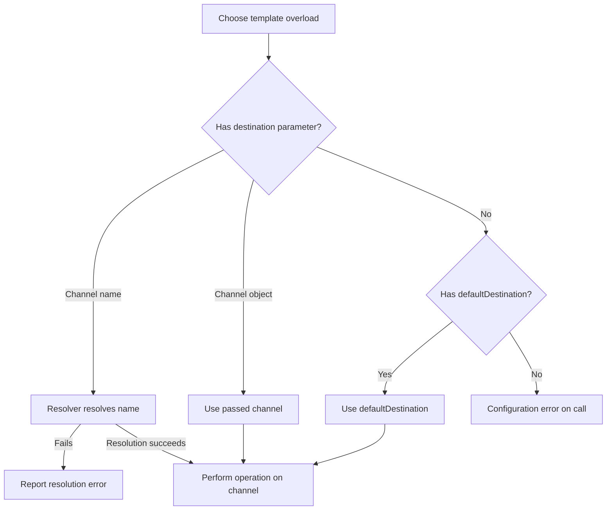
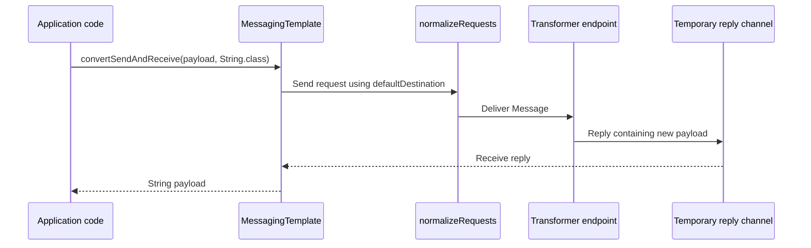

# DefaultDestination

In the **MessagingTemplate** chapter of the **SPRING_INTEGRATION_CORE** module, `defaultDestination` is the channel used by the template when a call omits a destination. This setting lets calling code focus on the message being exchanged while Spring manages the channel entering the integration flow.

This lesson situates `defaultDestination` in relation to `Message`, `MessageChannel`, endpoints, gateways, and the Java DSL. The goal is to set the flow's entry point properly, distinguish the request channel from the reply path, and verify behavior both with and without a default destination.

## 1. Problem: One Entry Point Called Repeatedly

Suppose an application has a product-code normalization flow:

```text
Product code → normalizeRequests channel → transformer → normalized result
```

If every call site writes `template.sendAndReceive(normalizeRequests, request)`, application code must hold both the template and a reference to the channel. When a template serves only this normalization flow, you can configure the entry point once and use `template.sendAndReceive(request)`.

A practical mental model is: **the template has a ready-made address for calls that omit an address**. This property belongs to each template instance; it does not set a global default channel for the whole application.

According to the [AbstractMessageSendingTemplate API](https://docs.spring.io/spring-framework/docs/current/javadoc-api/org/springframework/messaging/core/AbstractMessageSendingTemplate.html), send methods that do not take a destination use the one configured via `setDefaultDestination(...)`.

## 2. What Type Is DefaultDestination?

For the class studied here:

```java
import org.springframework.integration.core.MessagingTemplate;
```

the destination is an `org.springframework.messaging.MessageChannel` instance. `MessagingTemplate` inherits send, receive, and request–reply mechanisms from Spring Messaging's template hierarchy. The chapter title uses capitalized `DefaultDestination`; the Java property name is `defaultDestination`.

These three approaches configure the same property:

| Configuration Way | Example | How to Read It |
| --- | --- | --- |
| Constructor | `new MessagingTemplate(channel)` | Initialize the template with its default channel |
| Inherited setter | `template.setDefaultDestination(channel)` | Set the default destination via the general API |
| Compatibility setter | `template.setDefaultChannel(channel)` | Set the same property via Spring Integration's API name |

`setDefaultChannel(...)` delegates to `setDefaultDestination(...)`; there are not two independent defaults. The no-arg constructor creates a template without a default channel. See [MessagingTemplate API](https://docs.spring.io/spring-integration/docs/current/api/org/springframework/integration/core/MessagingTemplate.html).

Short example without needing a Spring ApplicationContext:

```java
import org.springframework.integration.channel.QueueChannel;
import org.springframework.integration.core.MessagingTemplate;
import org.springframework.messaging.Message;
import org.springframework.messaging.support.MessageBuilder;

QueueChannel pendingOrders = new QueueChannel(20);
MessagingTemplate orderTemplate = new MessagingTemplate();
orderTemplate.setDefaultDestination(pendingOrders);
orderTemplate.setSendTimeout(500);

Message<String> order = MessageBuilder.withPayload("ORDER-101")
        .setHeader("source", "checkout")
        .build();

orderTemplate.send(order);
Message<?> queued = pendingOrders.receive(0);

if (queued == null) {
    throw new IllegalStateException("Newly sent order not found");
}
System.out.println(queued.getPayload()); // ORDER-101
```

The snippet is a method body. The queue has an explicit capacity; `receive(0)` pulls the available message and returns immediately. The `pendingOrders` reference is set as the default, so sending requires no bean lookup by name.

## 3. Destination-Selection Rules for Each Call

Identify which overload is called before analyzing the flow:

| Call | Destination Used for the Operation |
| --- | --- |
| `send(message)` | `defaultDestination` |
| `convertAndSend(payload)` | `defaultDestination` |
| `sendAndReceive(request)` | Sends request to `defaultDestination` |
| `convertSendAndReceive(payload, String.class)` | Sends request to `defaultDestination`, converts reply payload to the requested type |
| `receive()` | Receives from `defaultDestination`, requires a pollable channel |
| `receiveAndConvert(String.class)` | Receives from default then converts payload |
| `send(otherChannel, message)` | The `otherChannel` object itself |
| `send("otherChannel", message)` | Channel resolved from the name `otherChannel` by the resolver |

These receive and request–reply APIs are documented in [AbstractMessageReceivingTemplate](https://docs.spring.io/spring-framework/docs/current/javadoc-api/org/springframework/messaging/core/AbstractMessageReceivingTemplate.html) and [AbstractMessagingTemplate](https://docs.spring.io/spring-framework/docs/6.2.0/javadoc-api/org/springframework/messaging/core/AbstractMessagingTemplate.html), respectively.



A directly passed destination governs only the current call. If that channel rejects the message or the channel name cannot be resolved, the template reports the corresponding error. It does not fall back to sending that message to the default channel.

Example illustrating two order flows:

```java
QueueChannel regularOrders = new QueueChannel(10);
QueueChannel priorityOrders = new QueueChannel(10);
MessagingTemplate template = new MessagingTemplate(regularOrders);
template.setSendTimeout(500);

template.convertAndSend("ORDER-201");
template.convertAndSend(priorityOrders, "ORDER-202");
template.convertAndSend("ORDER-203");
```

After the three calls, `regularOrders` contains `ORDER-201` and `ORDER-203`; `priorityOrders` contains `ORDER-202`. `template.getDefaultDestination()` still returns `regularOrders`.

This is a verifiable consequence of the public API: calls specifying a destination do not mutate the template's configuration. It allows an intentional exception without altering subsequent calls.

## 4. Distinguishing Channel Objects, Channel Names, and String Payloads

The following statements differ in meaning:

```java
template.setDefaultDestination(regularOrders); // MessageChannel reference.
template.convertAndSend("ORDER-301");          // A String payload, using default.
template.convertAndSend("priorityOrders", "ORDER-302"); // Destination name + payload.
```

`convertAndSend("priorityOrders")` has only one argument: that string is the payload. It neither sets a default nor asks to send to a bean named `priorityOrders`.

With the `org.springframework.integration.core.MessagingTemplate` API, do not write:

```java
// Wrong argument type: setter requires MessageChannel, not String.
// template.setDefaultDestination("regularOrders");
```

Nor should you infer a `setDefaultDestinationName(...)` setter from other templates such as JMS. Each template type has its own destination contract.

Overloads accepting names are provided by `AbstractDestinationResolvingMessagingTemplate`. When managed as a Spring bean, Spring Integration's `MessagingTemplate` receives a `BeanFactory` and sets up channel resolution. If instantiated with `new` outside the container, pass channel objects directly or configure a suitable resolver; merely setting a default destination does not teach the template how to look up arbitrary bean names. See the [Destination resolution API](https://docs.spring.io/spring-framework/docs/current/javadoc-api/org/springframework/messaging/core/AbstractDestinationResolvingMessagingTemplate.html).

Optional example, if you truly need name-based calls without a container:

```java
MessagingTemplate localTemplate = new MessagingTemplate(regularOrders);
localTemplate.setDestinationResolver(name -> {
    if ("priorityOrders".equals(name)) {
        return priorityOrders;
    }
    throw new IllegalArgumentException("Unsupported channel: " + name);
});
localTemplate.convertAndSend("priorityOrders", "ORDER-303");
```

This is a minimal application-defined resolver with an explicit set of supported names. In standard Spring configurations, rely on the container's resolver mechanism rather than maintaining a manual lookup table.

## 5. Default Channel and Receiving Capability

A `defaultDestination` serves calls that omit a destination, yet each operation still imposes its own requirements on the channel type:

| Channel | Sending a Message | Calling `template.receive()` When Default |
| --- | --- | --- |
| `DirectChannel` | Dispatches to a registered handler | Polling is not supported |
| `QueueChannel` | Enqueues the message | Can receive from the queue |

`DirectChannel` executes the handler on the sending thread when no asynchronous component intervenes. `QueueChannel` holds messages for a consumer to pull later. Choosing the channel determines the execution model; the default property only determines the address. See [Message Channel Implementations](https://docs.spring.io/spring-integration/reference/7.0/channel/implementations.html).

With a queue, the same template can be used for both send and receive operations:

```java
QueueChannel inbox = new QueueChannel(10);
MessagingTemplate inboxTemplate = new MessagingTemplate(inbox);
inboxTemplate.setSendTimeout(500);
inboxTemplate.setReceiveTimeout(0);

inboxTemplate.convertAndSend("EVENT-401");
String event = inboxTemplate.receiveAndConvert(String.class);
String absent = inboxTemplate.receiveAndConvert(String.class);

System.out.println(event);  // EVENT-401
System.out.println(absent); // null
```

The second receive finds no message and returns immediately because the timeout is `0`. Never set a `DirectChannel` as the default and then call `receive()` to wait for a reply. Request–reply has its own operations and can use a `DirectChannel` as the request channel.

Choosing a queue as the default does not automatically spawn a consumer either. When an endpoint's input is a `QueueChannel`, configure an appropriate poller or an active consumer calling receive. Default queues store messages in memory; durability needs require configuring a message store or appropriate transport. See [Configuring Message Channels](https://docs.spring.io/spring-integration/reference/channel/configuration.html).

## 6. DefaultDestination in Request–Reply

In `sendAndReceive(request)`, the default determines **the channel for sending the request**. The template creates a temporary reply channel for that exchange; the replying endpoint sends the result along that reply path. The pattern is described in the [MessagingTemplate reference](https://docs.spring.io/spring-integration/reference/channel/template.html).



Three addresses to distinguish when reading configuration:

| Component | Role |
| --- | --- |
| `template.defaultDestination` | Entry point used when a call omits the destination |
| Request's `replyChannel` header | Return path for a single message exchange |
| Endpoint's output channel | Output destination configured on an endpoint to continue the flow |

In the next example, the transformer at the end of the flow has no fixed output channel, so it can return the result via `replyChannel`. If you wire the output into another queue without a path forwarding back to the reply channel, the caller will not automatically receive replies from that queue.

`convertSendAndReceive(...)` uses the template's converter to build the request and extract the reply payload. The default `SimpleMessageConverter` mainly wraps payloads or extracts compatible types; do not assume it decodes JSON into DTOs automatically. When real data conversion is needed, configure an appropriate converter or transformation endpoint. See [SimpleMessageConverter API](https://docs.spring.io/spring-framework/docs/current/javadoc-api/org/springframework/messaging/converter/SimpleMessageConverter.html).

## 7. Complete Example: Spring Configuration and Java DSL

The example uses Java 17+, Spring Integration 6.4 APIs, and JUnit Jupiter in the test section. The project needs `org.springframework.integration:spring-integration-core` with compatible Spring dependencies; tests need JUnit Jupiter. If the project uses Spring Boot, use the project's dependency management to keep versions aligned.

The demo class can be placed in `DefaultDestinationFlowDemo.java` of your practice project:

```java
import java.util.Locale;

import org.springframework.beans.factory.annotation.Qualifier;
import org.springframework.context.annotation.Bean;
import org.springframework.context.annotation.Configuration;
import org.springframework.context.annotation.AnnotationConfigApplicationContext;
import org.springframework.integration.annotation.IntegrationComponentScan;
import org.springframework.integration.channel.DirectChannel;
import org.springframework.integration.config.EnableIntegration;
import org.springframework.integration.core.MessagingTemplate;
import org.springframework.integration.dsl.IntegrationFlow;
import org.springframework.messaging.MessageChannel;

public class DefaultDestinationFlowDemo {

    @Configuration
    @EnableIntegration
    public static class FlowConfig {

        @Bean
        public MessageChannel normalizeRequests() {
            return new DirectChannel();
        }

        @Bean
        public MessagingTemplate normalizationTemplate(
                @Qualifier("normalizeRequests") MessageChannel requests) {
            MessagingTemplate template = new MessagingTemplate(requests);
            template.setSendTimeout(500);
            template.setReceiveTimeout(1000);
            return template;
        }

        @Bean
        public IntegrationFlow normalizationFlow(
                @Qualifier("normalizeRequests") MessageChannel requests) {
            return IntegrationFlow.from(requests)
                    .<String, String>transform(
                            value -> value.trim().toUpperCase(Locale.ROOT))
                    .get();
        }
    }

    public static void main(String[] args) {
        try (AnnotationConfigApplicationContext context =
                new AnnotationConfigApplicationContext(FlowConfig.class)) {
            MessagingTemplate template = context.getBean(
                    "normalizationTemplate", MessagingTemplate.class);

            String result = template.convertSendAndReceive(
                    "  sku-501  ", String.class);
            if (result == null) {
                throw new IllegalStateException("No normalization result received yet");
            }
            System.out.println(result); // SKU-501
        }
    }
}
```

The `IntegrationComponentScan` import is only needed when extending to the scanned gateway in the next section; the current configuration does not require that annotation.

The components are wired together as follows:

1. The `normalizeRequests` bean is the sole entry point of the demo flow.
2. The `normalizationTemplate` bean holds a reference to that channel as its default.
3. `IntegrationFlow` registers a transformer endpoint accepting string payloads.
4. `convertSendAndReceive(...)` sends the request and waits for the transformer's reply.
5. The transformer trims whitespace, uppercases the text, and returns the resulting payload.

`@EnableIntegration` activates Spring Integration infrastructure in the example's plain Spring `ApplicationContext`. The Java DSL describes and registers flow components; it does not automatically set defaults on existing templates. See [Java DSL reference](https://docs.spring.io/spring-integration/reference/6.4/dsl.html).

`@Qualifier` clarifies which channel bean to inject. When an application has multiple channels or templates, name beans by responsibility and use qualifiers at injection points to keep configuration relationships clear.

## 8. When to Use a Gateway Instead of a Template?

Inside business logic classes, a contract like `String normalize(String value)` can be easier to use than calling messaging APIs directly. A Spring Integration gateway creates a proxy for an interface and wires calls to the declared channel. See [Messaging Gateways](https://docs.spring.io/spring-integration/reference/6.4/gateway.html).

Extension example on the same channel from section 7:

```java
import org.springframework.integration.annotation.MessagingGateway;

@MessagingGateway(
        defaultRequestChannel = "normalizeRequests",
        defaultReplyTimeout = "1000")
public interface NormalizationGateway {
    String normalize(String value);
}
```

Place the interface in a scanned package, then add `@IntegrationComponentScan(basePackageClasses = NormalizationGateway.class)` to `FlowConfig`. Then you can inject `NormalizationGateway` and call `gateway.normalize("  sku-502  ")`.

`defaultRequestChannel` is a gateway setting; it does not modify `defaultDestination` on any template bean already created. Choose a template for integration code that needs direct manipulation of `Message` and channels, or a gateway for call sites needing a strongly typed Java method contract. This is a design choice based on how much coupling the caller should have.

## 9. Timeouts, Errors, and Limits of Default Configuration

Handle three stages separately: destination selection, request sending, and reply receiving.

| Symptom | Interpretation | What to Check |
| --- | --- | --- |
| Calling `send(message)` without a default set | Missing configuration for the overload used | Constructor, setter, or explicit destination |
| Sending by name fails to find the channel | Destination resolution failed | Bean name, resolver, and container managing the template |
| `receive()` on `DirectChannel` | Channel does not support polling receives | Use `QueueChannel` or an appropriate request–reply operation |
| Sending to a full queue exceeds wait timeout | Could not deliver the message to the channel | Capacity, consumer speed, and send timeout |
| `sendAndReceive(...)` returns `null` | No reply received within the wait window | Consumers, filter/router branches, reply path |
| Reply exists yet type conversion fails | Converter or payload type mismatch | Reply type and configured converter |

In Spring Framework 6.2, a missing default causes `getRequiredDefaultDestination()` to throw `IllegalStateException`; that is a configuration error, not a timeout outcome. Refer to [AbstractMessageSendingTemplate 6.2.0 source](https://github.com/spring-projects/spring-framework/blob/v6.2.0/spring-messaging/src/main/java/org/springframework/messaging/core/AbstractMessageSendingTemplate.java).

`sendTimeout` and `receiveTimeout` are in milliseconds. For channels that support waiting, `0` asks to return immediately, while negative values indicate unlimited waiting. When a channel returns `false` due to send failure, the template throws `MessageDeliveryException`; when a receive times out with no message, the result may be `null`.

Notably, `sendTimeout` does not interrupt a long-running handler on `DirectChannel`. Nor does `receiveTimeout` turn the entire synchronous call into a deadline: the handler can consume time right inside the send step before the template begins waiting for a reply. This behavior is reflected in the [GenericMessagingTemplate API](https://docs.spring.io/spring-framework/docs/current/javadoc-api/org/springframework/messaging/core/GenericMessagingTemplate.html) and [6.2.0 implementation source](https://github.com/spring-projects/spring-framework/blob/v6.2.0/spring-messaging/src/main/java/org/springframework/messaging/core/GenericMessagingTemplate.java).

The default channel does not configure retries or error flows. For synchronous flows, processing errors can propagate back to the caller; for asynchronous flows, design error reporting according to the endpoints and execution infrastructure. Define the flow's reply contract explicitly—for example, whether a filter dropping a request returns a rejection result, routes to another branch, or lets the caller time out. Setting a default destination does not decide that business behavior.

## 10. Testing Destination Selection Behavior

The following tests are JUnit Jupiter practice code. They do not need a Spring context because the goal is to verify the relationship between the template and in-memory queues.

```java
import org.junit.jupiter.api.Test;
import org.springframework.integration.channel.DirectChannel;
import org.springframework.integration.channel.QueueChannel;
import org.springframework.integration.core.MessagingTemplate;
import org.springframework.messaging.Message;
import org.springframework.messaging.MessageDeliveryException;
import org.springframework.messaging.support.MessageBuilder;

import static org.junit.jupiter.api.Assertions.*;

class DefaultDestinationTest {

    @Test
    void sendsToDefaultAndReceivesFromDefault() {
        QueueChannel inbox = new QueueChannel(2);
        MessagingTemplate template = new MessagingTemplate(inbox);
        template.setSendTimeout(0);
        template.setReceiveTimeout(0);

        template.convertAndSend("ORDER-601");

        assertEquals("ORDER-601", template.receiveAndConvert(String.class));
        assertNull(template.receive());
    }

    @Test
    void explicitDestinationDoesNotChangeDefault() {
        QueueChannel regular = new QueueChannel(2);
        QueueChannel priority = new QueueChannel(2);
        MessagingTemplate template = new MessagingTemplate(regular);
        template.setSendTimeout(0);

        template.convertAndSend(priority, "ORDER-602");
        template.convertAndSend("ORDER-603");

        Message<?> priorityMessage = priority.receive(0);
        Message<?> regularMessage = regular.receive(0);
        assertNotNull(priorityMessage);
        assertNotNull(regularMessage);
        assertEquals("ORDER-602", priorityMessage.getPayload());
        assertEquals("ORDER-603", regularMessage.getPayload());
        assertSame(regular, template.getDefaultDestination());
        assertNull(priority.receive(0));
        assertNull(regular.receive(0));
    }

    @Test
    void missingDefaultFailsWhenDefaultOperationIsUsed() {
        MessagingTemplate template = new MessagingTemplate();
        Message<String> request = MessageBuilder.withPayload("ORDER-604").build();

        assertThrows(IllegalStateException.class, () -> template.send(request));
    }

    @Test
    void explicitDestinationWorksWithoutDefault() {
        MessagingTemplate template = new MessagingTemplate();
        template.setSendTimeout(0);
        QueueChannel target = new QueueChannel(1);

        template.convertAndSend(target, "ORDER-605");

        Message<?> actual = target.receive(0);
        assertNotNull(actual);
        assertEquals("ORDER-605", actual.getPayload());
        assertNull(template.getDefaultDestination());
    }

    @Test
    void cannotPollADirectChannel() {
        MessagingTemplate template = new MessagingTemplate(new DirectChannel());
        template.setReceiveTimeout(0);

        assertThrows(IllegalStateException.class, () -> template.receive());
    }

    @Test
    void failedExplicitSendDoesNotFallBackToDefault() {
        QueueChannel regular = new QueueChannel(1);
        QueueChannel fullPriority = new QueueChannel(1);
        assertTrue(fullPriority.send(
                MessageBuilder.withPayload("ALREADY-QUEUED").build(), 0));
        MessagingTemplate template = new MessagingTemplate(regular);
        template.setSendTimeout(0);

        assertThrows(MessageDeliveryException.class,
                () -> template.convertAndSend(fullPriority, "ORDER-606"));

        assertNull(regular.receive(0));
        assertSame(regular, template.getDefaultDestination());
    }
}
```

The receives use timeout `0`, letting negative results return immediately. The last test verifies something easy to overlook in operational design: a failed send to an explicit destination does not cause the message to appear in the default queue.

To also verify Java DSL endpoint registration, add a test using the full configuration from section 7:

```java
import org.junit.jupiter.api.Test;
import org.springframework.context.annotation.AnnotationConfigApplicationContext;
import org.springframework.integration.core.MessagingTemplate;

import static org.junit.jupiter.api.Assertions.assertEquals;

class DefaultDestinationFlowTest {

    @Test
    void requestReplyUsesConfiguredFlowEntry() {
        try (AnnotationConfigApplicationContext context =
                new AnnotationConfigApplicationContext(
                        DefaultDestinationFlowDemo.FlowConfig.class)) {
            MessagingTemplate template = context.getBean(
                    "normalizationTemplate", MessagingTemplate.class);

            String result = template.convertSendAndReceive(
                    "  sku-607  ", String.class);

            assertEquals("SKU-607", result);
        }
    }
}
```

Place the demo class and test class in the same practice package, or add the appropriate imports. The test snippets are provided for learners to run in a project with suitable dependencies; this article does not claim they were executed in the current workspace.

## 11. Choosing Stable Defaults for Multi-Flow Applications

You can define two beans, such as `orderTemplate` pointing to the order flow and `notificationTemplate` pointing to the notification flow. The bean names clarify intent; each caller receives only the template it needs. Thus, changing an input channel can stay centralized in configuration rather than scattered across call sites.

Do not mutate the default of a singleton template per request:

```java
// Avoid using shared configuration as per-request routing state.
// sharedTemplate.setDefaultDestination(channelForCurrentRequest);
// sharedTemplate.send(message);
```

Two threads can interleave setting and sending, causing a call to read the configuration just changed by the other thread. For dynamic destinations, pass the channel directly in the call; for branching rules belonging to the integration flow, place a router after a stable entry channel. This design recommendation follows from setters mutating state on a shared instance.

`defaultDestination` also does not replace a router's default output channel. One property picks the entry point from calling code, while the other resolves the output of a routing endpoint. Always identify which component owns a configuration before using the word “default”.

In flows with filters, routers, or aggregators, the entry point can remain unchanged. What still needs design is whether each branch replies and when enough results exist to send a reply. For example, an aggregator waiting to complete a group affects the caller's wait time; changing the default channel does not make a message group finish sooner.

## 12. Consolidation Practice

Extend the example while keeping one clear entry point:

1. Create `QueueChannel regularOrders` and `QueueChannel priorityOrders`, setting `regularOrders` as the default; send alternating messages using both overloads and inspect each queue.
2. Use the minimal resolver from section 4 to send by name; try an unsupported name and observe the error instead of expecting a fallback.
3. Run the Java DSL normalization flow; verify an input payload with whitespace produces an uppercase result.
4. Add a filter dropping blank strings after normalization; define the rejection contract before choosing how replies and timeouts are handled.

The outcome you should be able to explain is **where the message enters, which component processes it, and which path returns the reply to the caller**. Once these three points are clear, `defaultDestination` becomes a simple, verifiable setting across the entire integration flow.
