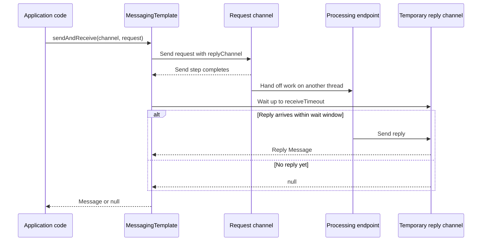

# Receive Timeout in MessagingTemplate

In the **SPRING_INTEGRATION_CORE** module, `MessagingTemplate` is one way for application code to interact directly with a message flow. After sending a request or when proactively pulling a message from a channel, the application must decide how long to wait. The `receiveTimeout` setting expresses that decision.

For example, an inventory-check API may tolerate waiting 750 ms for a reply. Once the wait expires without a reply, the calling layer must handle it explicitly: return an undetermined status, query status later, or apply a business-appropriate fallback.

This lesson focuses on the receive wait duration of `org.springframework.integration.core.MessagingTemplate`, connecting the concept to `Message`, `MessageChannel`, endpoints, gateways, and the Java DSL. Examples use APIs from the Spring Integration 6.5 and Spring Framework 6.2 lines with Java 17 or higher. Spring dependencies should be managed consistently via a BOM or your project's dependency management.

## 1. Objectives and Prerequisites

After this lesson, you will be able to:

- Distinguish waiting to pull a message from a channel from waiting for a reply to a request.
- Explain negative, zero, and positive receive timeout values.
- Configure a default timeout and override it for a single interaction.
- Identify why a timeout does not bound the execution duration of a synchronous handler.
- Handle `null` and late replies, and write tests for those scenarios.

You should know that `Message<T>` consists of payload and headers, `MessageChannel` is used for sending messages, and `PollableChannel` adds active receive operations. The test examples at the end use JUnit Jupiter.

## 2. Where Does Receive Timeout Apply?

There are two main scenarios:

| Operation | Channel Awaited for Receive | Meaning |
| --- | --- | --- |
| `template.receive(channel)` | Channel passed by the application | Wait to pull a message from the channel |
| `template.sendAndReceive(channel, request)` | Temporary reply channel created by the template | Send the request, then wait for that call's reply |
| `template.receiveAndConvert(...)` | Corresponding receive channel | Wait to receive, then convert payload if a message arrives |
| `template.send(...)` | No receive step | Receive timeout does not add any reply-waiting step |

For direct receive operations, the channel must implement `PollableChannel`, such as `QueueChannel`. `DirectChannel` is a subscriber-dispatched channel and does not support `receive()`. Passing a `DirectChannel` into `template.receive(...)` throws `IllegalStateException`. The `MessagingTemplate` API can still accept a `MessageChannel` parameter; this condition is checked at runtime. [MessagingTemplate API](https://docs.spring.io/spring-integration/docs/6.5.0/api/org/springframework/integration/core/MessagingTemplate.html), [PollableChannel API](https://docs.spring.io/spring-framework/docs/6.2.15/javadoc-api/org/springframework/messaging/PollableChannel.html).

Conversely, the request channel in `sendAndReceive(...)` can be a `DirectChannel` or `ExecutorChannel`. The template receives from the temporary reply channel rather than calling `receive()` on the request channel.

### 2.1. Units and Values

Timeout is expressed as a `long` in **milliseconds**.

| Value | Behavior When Receiving from a Standard QueueChannel |
| --- | --- |
| `timeout > 0` | Wait up to the specified duration if no message is present yet |
| `timeout == 0` | Check immediately; do not wait for a future message |
| `timeout < 0` | Wait indefinitely if needed; `-1L` is commonly used |

If a message is already present, the operation can return immediately even when the timeout is large. Thus, `750L` does not mean it must sleep for 750 ms. When the wait expires with no message received, the normal result is `null`. Thread interruption can also cause a receive operation to return `null`. [QueueChannel behavior](https://docs.spring.io/spring-integration/reference/6.5/channel/implementations.html#queuechannel), [PollableChannel contract](https://docs.spring.io/spring-framework/docs/6.2.15/javadoc-api/org/springframework/messaging/PollableChannel.html).

In the implementation referenced here, `new MessagingTemplate()` inherits `receiveTimeout = -1` from `GenericMessagingTemplate`. Configure it explicitly whenever the application needs finite waits. Defaults on an outer gateway or endpoint can differ from a directly instantiated template's defaults. [GenericMessagingTemplate 6.2.0 source](https://github.com/spring-projects/spring-framework/blob/v6.2.0/spring-messaging/src/main/java/org/springframework/messaging/core/GenericMessagingTemplate.java).

## 3. Receiving Messages from a QueueChannel

The following example receives an already-queued message, then attempts another receive when the queue is empty:

```java
import org.springframework.integration.channel.QueueChannel;
import org.springframework.integration.core.MessagingTemplate;
import org.springframework.messaging.Message;
import org.springframework.messaging.support.MessageBuilder;

public class ReceiveTimeoutDemo {

    public static void main(String[] args) {
        QueueChannel results = new QueueChannel(10);

        MessagingTemplate template = new MessagingTemplate();
        template.setReceiveTimeout(250L);

        results.send(
                MessageBuilder.withPayload("ORDER-42:READY").build(),
                0L
        );

        Message<?> first = template.receive(results);
        if (first != null) {
            System.out.println(first.getPayload());
        }

        Message<?> second = template.receive(results);
        if (second == null) {
            System.out.println("No result available within the wait timeout.");
        }
    }
}
```

Expected business output:

```text
ORDER-42:READY
No result available within the wait timeout.
```

The first receive normally returns right away because the queue holds data. The second receive waits around 250 ms and returns `null` if no producer adds another message. Thread scheduling can make measured elapsed time slightly longer than configured; this is not a hard real-time guarantee.

`receive()` removes the message from the queue. If multiple consumers read from the same `QueueChannel`, each message is delivered to one consumer; this channel does not broadcast the same message to all consumers. In an order-status checking app, reading from a shared queue also requires proper distribution or correlation design, since the next message might belong to a different order. [QueueChannel API](https://docs.spring.io/spring-integration/docs/6.5.0/api/org/springframework/integration/channel/QueueChannel.html), [QueueChannel implementation](https://docs.spring.io/spring-integration/reference/6.5/channel/implementations.html#queuechannel).

### 3.1. Per-Call Receive Timeout

`MessagingTemplate` provides the `receive(MessageChannel, long)` overload:

```java
MessagingTemplate template = new MessagingTemplate();
template.setReceiveTimeout(2_000L);

Message<?> immediate = template.receive(results, 0L);
Message<?> shortWait = template.receive(results, 100L);

// Still uses 2,000 ms, because the two calls above do not modify the default configuration.
Message<?> normalWait = template.receive(results);
```

Above, `results` is a `QueueChannel` already in scope. When multiple threads share a template, passing the timeout per call avoids flipping settings back and forth on a shared bean. [MessagingTemplate overloads](https://docs.spring.io/spring-integration/docs/6.5.0/api/org/springframework/integration/core/MessagingTemplate.html).

A tight loop calling `receive(results, 0L)` continuously can burn CPU when the queue is empty. If the application needs a continuously running consumer, consider a managed polling endpoint or a blocking wait strategy.

## 4. Waiting for a Reply in Request–Reply

When calling `sendAndReceive(...)`, the template places a temporary reply channel in the request's headers. The reply-producing endpoint can use that header to send the result back to the caller.



The diagram shows the case with an asynchronous boundary. The worker may start running either before or after the send step finishes.

The template uses a temporary reply channel for the interaction, writes it onto the request, and waits to receive after the send step. This is why the request channel does not have to be pollable. [MessagingTemplate reference](https://docs.spring.io/spring-integration/reference/7.0/channel/template.html).

### 4.1. Default Configuration on the Template

```java
MessagingTemplate template = new MessagingTemplate();
template.setSendTimeout(100L);
template.setReceiveTimeout(750L);

Message<?> reply = template.sendAndReceive(
        requestChannel,
        MessageBuilder.withPayload("ORDER-42").build()
);

if (reply == null) {
    // No reply yet; application layer decides how to handle it.
}
```

`requestChannel` is the configured input channel for the flow. The two properties serve different purposes:

| Setting | Step Affected | Example |
| --- | --- | --- |
| `sendTimeout` | Sending the request into a channel that supports wait-on-send | Waiting for space in a bounded `QueueChannel` |
| `receiveTimeout` | Receiving the reply after the send step completes | Waiting for the result of an endpoint running on another thread |
| Timeouts on HTTP client, JDBC, or external service | I/O operations inside the handler | Bounding connection or read duration |

Whether send timeout takes effect depends on the channel type. A timeout on the send operation does not interrupt business work already executing inside a handler.

### 4.2. Overriding via Header for a Single Request

With `sendAndReceive(...)`, you can set the default header named `receiveTimeout` on the request:

```java
import org.springframework.messaging.core.GenericMessagingTemplate;
import org.springframework.messaging.support.MessageBuilder;

// template already has a default receive timeout, e.g. 750 ms.
Message<?> request = MessageBuilder.withPayload("ORDER-42")
        .setHeader(
                GenericMessagingTemplate.DEFAULT_RECEIVE_TIMEOUT_HEADER,
                300L
        )
        .build();

Message<?> reply = template.sendAndReceive(requestChannel, request);
```

This call uses 300 ms to wait for the reply; the template's default remains unchanged. Use a `long` value in milliseconds and the header constant to avoid typos. You can customize the header name via `setReceiveTimeoutHeader(...)` when a custom convention is needed. The timeout header is consumed and stripped from the request by the template before forwarding, so it is not a TTL automatically propagated across all endpoints. [Header configuration on GenericMessagingTemplate](https://docs.spring.io/spring-framework/docs/6.2.15/javadoc-api/org/springframework/messaging/core/GenericMessagingTemplate.html).

Selection rules to keep in mind:

| Call Form | Source of Receive Timeout |
| --- | --- |
| `receive(channel)` | `receiveTimeout` property on the template |
| `receive(channel, timeout)` | `timeout` argument of that call |
| `sendAndReceive(channel, request)` with valid timeout header | Value in the request header |
| `sendAndReceive(channel, request)` without timeout header | `receiveTimeout` property on the template |

A header placed on a message already sitting in a queue does not control the wait duration of `receive(queue)`: the template must wait to receive the message before it can read its headers.

Do not mutate `setReceiveTimeout(...)` before each request on a singleton and reset it afterward. Two threads can interleave and read the value meant for the other request. Configure the bean once, then use per-operation overrides.

## 5. Why DirectChannel Can Make Calls Exceed the Timeout

Consider a completely synchronous chain:

```text
Caller thread
  -> template.sendAndReceive(...)
      -> DirectChannel.send(...)
          -> handler executes for 2 seconds
          -> handler sends reply
      -> send step completes
      -> template receives already-present reply
  -> return result
```

Even with `receiveTimeout = 100` ms, the call above can still take roughly 2 seconds and return a successful reply. The handler runs inside `send()`, on the caller's thread. The receive step begins only after the send step finishes. [DirectChannel and thread context](https://docs.spring.io/spring-integration/reference/6.5/channel/implementations.html#directchannel).

Design consequence: receive timeout bounds **the wait in the receive step**, and does not guarantee total `sendAndReceive(...)` duration stays below the setting.

Conceptually:

```text
Call duration ≈ send step time + receive step time + overhead
```

In a synchronous flow, send step time includes the work of handlers running sequentially on the caller thread. In an asynchronous flow, processing can proceed concurrently with the remainder of the send step and the receive wait.

For the caller to stop waiting while a worker is still busy, you need an execution boundary on another thread, such as an `ExecutorChannel` backed by a thread pool or a `QueueChannel` with an independent consumer. At the same time, still configure I/O timeouts and worker load-control strategies.

`ExecutorChannel` delegates to an `Executor`; actual behavior depends on that executor. A synchronous executor or caller-runs rejection policy can pull work back onto the caller thread. Do not assume every `ExecutorChannel` creates an asynchronous boundary under all conditions. [ExecutorChannel API](https://docs.spring.io/spring-integration/docs/6.5.0/api/org/springframework/integration/channel/ExecutorChannel.html).

## 6. Complete Example with Java DSL

The example below simulates an order-approval flow. `ExecutorChannel` hands work off to a thread pool; the transformer produces the reply and lets Spring Integration send it back to the request's reply channel.

The project requires the `org.springframework.integration:spring-integration-core` dependency. The example uses classes from `spring-context` and `spring-messaging` within the corresponding Spring dependency set, with no HTTP server or Spring Boot needed to run this program.

```java
import org.springframework.beans.factory.annotation.Qualifier;
import org.springframework.context.annotation.AnnotationConfigApplicationContext;
import org.springframework.context.annotation.Bean;
import org.springframework.context.annotation.Configuration;
import org.springframework.integration.channel.ExecutorChannel;
import org.springframework.integration.config.EnableIntegration;
import org.springframework.integration.core.MessagingTemplate;
import org.springframework.integration.dsl.IntegrationFlow;
import org.springframework.messaging.Message;
import org.springframework.messaging.MessageChannel;
import org.springframework.messaging.core.GenericMessagingTemplate;
import org.springframework.messaging.support.ErrorMessage;
import org.springframework.messaging.support.MessageBuilder;
import org.springframework.scheduling.concurrent.ThreadPoolTaskExecutor;

public class ReceiveTimeoutFlowDemo {

    @Configuration
    @EnableIntegration
    public static class FlowConfig {

        @Bean
        public ThreadPoolTaskExecutor orderExecutor() {
            ThreadPoolTaskExecutor executor = new ThreadPoolTaskExecutor();
            executor.setCorePoolSize(2);
            executor.setMaxPoolSize(2);
            executor.setQueueCapacity(20);
            executor.setThreadNamePrefix("order-worker-");
            return executor;
        }

        @Bean
        public MessageChannel orderRequests(
                @Qualifier("orderExecutor")
                ThreadPoolTaskExecutor executor) {

            return new ExecutorChannel(executor);
        }

        @Bean
        public IntegrationFlow orderFlow(
                @Qualifier("orderRequests")
                MessageChannel requests) {

            return IntegrationFlow.from(requests)
                    .<String, String>transform(
                            orderId -> "APPROVED:" + orderId)
                    .get();
        }

        @Bean
        public MessagingTemplate orderTemplate(
                @Qualifier("orderRequests")
                MessageChannel requests) {

            MessagingTemplate template = new MessagingTemplate(requests);
            template.setSendTimeout(100L);
            template.setReceiveTimeout(750L);
            template.setThrowExceptionOnLateReply(true);
            return template;
        }
    }

    public static void main(String[] args) {
        try (AnnotationConfigApplicationContext context =
                     new AnnotationConfigApplicationContext(FlowConfig.class)) {

            MessagingTemplate template =
                    context.getBean("orderTemplate", MessagingTemplate.class);

            Message<?> request = MessageBuilder.withPayload("ORDER-42")
                    .setHeader(
                            GenericMessagingTemplate.DEFAULT_RECEIVE_TIMEOUT_HEADER,
                            500L)
                    .build();

            Message<?> reply = template.sendAndReceive(request);

            if (reply == null) {
                System.out.println(
                        "No reply received yet; check order status.");
                return;
            }

            if (reply instanceof ErrorMessage error) {
                throw new IllegalStateException(
                        "Order processing flow reported an error", error.getPayload());
            }

            System.out.println(reply.getPayload());
        }
    }
}
```

When processing finishes within the wait window, the program prints:

```text
APPROVED:ORDER-42
```

These components combine to produce that behavior:

- `@EnableIntegration` activates Spring Integration infrastructure for Java configuration.
- The `IntegrationFlow` bean registers a transformer endpoint on the input channel.
- The transformer returns a new payload instead of merely logging and finishing without a reply.
- `MessagingTemplate` has a default channel, so `sendAndReceive(request)` uses `orderRequests`.
- Spring manages the executor's lifecycle; closing the application context releases the corresponding resources.

The Java DSL is a way to declare flow channels and endpoints; it does not alter the meaning of receive timeout. [Java DSL reference](https://docs.spring.io/spring-integration/reference/6.5/dsl.html), [IntegrationFlow API](https://docs.spring.io/spring-integration/docs/6.5.0/api/org/springframework/integration/dsl/IntegrationFlow.html), [ThreadPoolTaskExecutor API](https://docs.spring.io/spring-framework/docs/6.2.15/javadoc-api/org/springframework/scheduling/concurrent/ThreadPoolTaskExecutor.html).

In the example, 500 ms on the request overrides the 750 ms default. The executor's queue limit is 20 tasks. If executor capacity saturates and rejects tasks, the application must handle the send failure; `sendTimeout = 100` does not turn executor submission into a 100 ms wait for queue space.

## 7. What Does Timing Out Mean?

### 7.1. Null Indicates No Reply Was Received Yet

With a typical `MessagingTemplate.sendAndReceive(...)` call, receiving no reply within the wait window produces `null`. The application must define the business meaning of this state.

Example:

```java
Message<?> reply = template.sendAndReceive(requestChannel, request);

if (reply == null) {
    if (Thread.currentThread().isInterrupted()) {
        throw new IllegalStateException("Calling task was interrupted");
    }

    throw new IllegalStateException(
            "No reply received within the allowed time");
}
```

This is an application-created exception. Do not assume the template always throws a dedicated exception when receive timeout expires.

`null` is also not enough to conclude the worker hung. A filter may have dropped the request, a router may have sent the message to a no-reply branch, or an endpoint may not produce output. Trace the message path against the request–reply contract.

### 7.2. Processing Failures Differ from Missing Replies

| Situation | What to Check |
| --- | --- |
| Receive wait expires | Result may be `null` |
| Sending to the channel fails | Can raise `MessageDeliveryException` or a related send error |
| Synchronous handler throws an exception | Exception can propagate to the caller via the call stack |
| Asynchronous handler fails | Check `ErrorMessage` and `errorChannel` mechanisms |
| Reply exists yet payload conversion fails | This is a conversion error, not a missing reply |

Spring Integration routes asynchronous errors based on `errorChannel` in headers when present, falling back to the global error channel under the corresponding error-handling mechanism. A template receiving `Message<?>` can also receive an `ErrorMessage` as the interaction's result; never assume every returned message carries a success payload. A receive timeout expiring does not automatically emit an `ErrorMessage` to the global error channel. [Error Handling](https://docs.spring.io/spring-integration/reference/6.5/error-handling.html).

### 7.3. The Worker May Keep Running

Suppose the caller waits 500 ms while the worker takes 2 seconds to update an external system:

```text
t =    0 ms: send request
t ≈  500 ms: caller receives null, stops waiting
t ≈ 2000 ms: worker finishes and attempts to send reply
```

Receive timeout is not a task-cancellation command. It does not remove the request from a queue, interrupt the worker, revert updates already made, or roll back the worker's independent transaction.

Therefore, retrying immediately after a timeout can execute the same business action twice. For payments, order placement, or critical writes, use a business key to detect duplicate requests and design idempotency or status queries. That is an application decision grounded in the processing contract, not a built-in feature of receive timeout.

## 8. Late Replies

A reply arriving after the wait window has closed is called a late reply.

With a temporary reply channel, the old caller has already stopped receiving. The template does not deliver that reply to a subsequent `sendAndReceive(...)` call. An application-managed result queue is different: a late message may still sit in that queue to be read later, depending on storage and consumer configuration.

You can enable:

```java
template.setThrowExceptionOnLateReply(true);
```

Once the temporary reply channel has recorded a timeout, sending a late reply can trigger `MessageDeliveryException` on the **reply-sending thread**. This does not retroactively send a different exception to a caller that already received `null`. This setting also applies to other cases where a reply is no longer expected, such as when a reply was already received or the earlier request send failed. [GenericMessagingTemplate API](https://docs.spring.io/spring-framework/docs/6.2.15/javadoc-api/org/springframework/messaging/core/GenericMessagingTemplate.html#setThrowExceptionOnLateReply(boolean)).

In the Spring Integration line used in this lesson, the global property `spring.integration.messagingTemplate.throwExceptionOnLateReply` defaults to `false`; the template can pick up the global setting if not set directly. Setting the value explicitly on the template clarifies the example's intent. [Global Properties](https://docs.spring.io/spring-integration/reference/6.5/configuration/global-properties.html), [MessagingTemplate 6.5.0 source](https://github.com/spring-projects/spring-integration/blob/v6.5.0/spring-integration-core/src/main/java/org/springframework/integration/core/MessagingTemplate.java).

When enabling late-reply exceptions in an asynchronous flow, design observability or error handling on the worker side. Disabling the exception does not turn a late reply into something the caller continues waiting to receive either.

## 9. Relationship to Gateways, Filters, and Aggregators

Receive timeout must be considered within the full flow contract:

| Component | Relationship to Waiting for a Reply |
| --- | --- |
| Messaging gateway | Gateway has its own request/reply timeout settings for interface calls |
| Transformer | Returns output so the chain can continue and produce a reply |
| Filter | Dropping a request without an adequate reply path can leave the caller waiting until timeout |
| Router | Every branch needs termination behavior compatible with the caller's contract |
| Aggregator | May not emit a result yet if its release condition is unsatisfied |
| Error flow | Must define whether errors return as a result, throw an exception, or are only logged |

The caller's timeout and an aggregator's group timeout are two separate clocks. Increasing receive timeout does not make an incomplete message group finish by itself. When a design aggregates multiple responses, align when the caller stops waiting with when complete results, partial results, or failure notices are emitted.

For gateways, property names and defaults belong to the gateway or endpoint itself. For example, 6.5 documentation notes a 30-second default reply timeout for messaging gateways, whereas a directly instantiated template in this lesson inherits a negative receive timeout. Never copy defaults across the two abstractions. [Messaging Gateways](https://docs.spring.io/spring-integration/reference/6.5/gateway.html), [endpoint timeout properties](https://docs.spring.io/spring-integration/reference/6.5/configuration/global-properties.html).

## 10. Test Code for Key Scenarios

The following tests use `spring-integration-core` and JUnit Jupiter. They drive channel state directly rather than using `Thread.sleep(...)` to guess thread ordering.

```java
import org.junit.jupiter.api.Test;
import org.springframework.integration.channel.DirectChannel;
import org.springframework.integration.channel.QueueChannel;
import org.springframework.integration.core.MessagingTemplate;
import org.springframework.messaging.Message;
import org.springframework.messaging.MessageChannel;
import org.springframework.messaging.MessageDeliveryException;
import org.springframework.messaging.core.GenericMessagingTemplate;
import org.springframework.messaging.support.MessageBuilder;

import static org.junit.jupiter.api.Assertions.*;

class ReceiveTimeoutTest {

    @Test
    void zeroTimeoutReturnsNullWhenQueueIsEmpty() {
        MessagingTemplate template = new MessagingTemplate();
        template.setReceiveTimeout(0L);

        assertNull(template.receive(new QueueChannel()));
    }

    @Test
    void zeroTimeoutStillReceivesAvailableMessage() {
        QueueChannel channel = new QueueChannel();
        channel.send(MessageBuilder.withPayload("ready").build(), 0L);

        MessagingTemplate template = new MessagingTemplate();
        template.setReceiveTimeout(0L);

        Message<?> received = template.receive(channel);

        assertNotNull(received);
        assertEquals("ready", received.getPayload());
    }

    @Test
    void positiveTimeoutReturnsNullWhenNoMessageArrives() {
        MessagingTemplate template = new MessagingTemplate();
        template.setReceiveTimeout(40L);

        assertNull(template.receive(new QueueChannel()));
    }

    @Test
    void explicitReceiveTimeoutDoesNotChangeDefault() {
        MessagingTemplate template = new MessagingTemplate();
        template.setReceiveTimeout(5_000L);

        assertNull(template.receive(new QueueChannel(), 0L));
        assertEquals(5_000L, template.getReceiveTimeout());
    }

    @Test
    void requestHeaderOverridesReplyWaitWithoutChangingDefault() {
        QueueChannel requests = new QueueChannel();
        MessagingTemplate template = new MessagingTemplate();
        template.setReceiveTimeout(5_000L);

        Message<?> request = MessageBuilder.withPayload("ORDER-42")
                .setHeader(
                        GenericMessagingTemplate.DEFAULT_RECEIVE_TIMEOUT_HEADER,
                        0L)
                .build();

        // No worker: request is placed in the queue without a reply yet.
        assertNull(template.sendAndReceive(requests, request));

        Message<?> queued = requests.receive(0L);
        assertNotNull(queued);
        assertNotNull(queued.getHeaders().getReplyChannel());
        assertFalse(queued.getHeaders().containsKey(
                GenericMessagingTemplate.DEFAULT_RECEIVE_TIMEOUT_HEADER));
        assertEquals(5_000L, template.getReceiveTimeout());
    }

    @Test
    void directChannelCanReplyBeforeReceiveStepBegins() {
        DirectChannel requests = new DirectChannel();
        Thread caller = Thread.currentThread();

        requests.subscribe(request -> {
            assertSame(caller, Thread.currentThread());

            MessageChannel replyChannel =
                    (MessageChannel) request.getHeaders().getReplyChannel();

            assertNotNull(replyChannel);
            replyChannel.send(
                    MessageBuilder.withPayload("APPROVED").build());
        });

        MessagingTemplate template = new MessagingTemplate();
        template.setReceiveTimeout(0L);

        Message<?> reply = template.sendAndReceive(
                requests,
                MessageBuilder.withPayload("ORDER-42").build());

        assertNotNull(reply);
        assertEquals("APPROVED", reply.getPayload());
    }

    @Test
    void lateReplyCanFailOnThreadSendingThatReply() {
        QueueChannel requests = new QueueChannel();
        MessagingTemplate template = new MessagingTemplate();
        template.setReceiveTimeout(0L);
        template.setThrowExceptionOnLateReply(true);

        assertNull(template.sendAndReceive(
                requests,
                MessageBuilder.withPayload("ORDER-42").build()));

        // Caller stopped waiting before simulating the worker sending a reply.
        Message<?> queued = requests.receive(0L);
        assertNotNull(queued);

        MessageChannel replyChannel =
                (MessageChannel) queued.getHeaders().getReplyChannel();
        assertNotNull(replyChannel);

        assertThrows(MessageDeliveryException.class,
                () -> replyChannel.send(
                        MessageBuilder.withPayload("LATE").build()));
    }

    @Test
    void receivingFromDirectChannelIsInvalid() {
        MessagingTemplate template = new MessagingTemplate();
        template.setReceiveTimeout(0L);

        assertThrows(IllegalStateException.class,
                () -> template.receive(new DirectChannel()));
    }
}
```

The positive-timeout test verifies the outcome when no producer exists. It does not assert that execution takes exactly 40 ms. The `DirectChannel` test proves a reply can arrive during the send step, prior to the receive step, even when receive timeout is zero.

For tests involving a real worker, use a latch or barrier to control when the worker starts and sends its reply; place a time bound on the test's own completion wait. Avoid letting a negative-timeout case block the test suite indefinitely.

## 11. Choosing Timeouts and Operational Observability

Timeout values should come from the caller's acceptable latency budget and the flow's actual latency.

For instance, an API with a 1-second budget might allocate part of it to input handling and response serialization, part to request sending, and the remainder to waiting for a reply. This is a budgeting exercise, not a guarantee that setting send timeout plus receive timeout equal to 1 second caps the entire call.

Factors to account for include queue residence time, endpoint execution time, external I/O, and variance under overload. Also align on how to handle results arriving after the caller stops waiting.

At a minimum, observe:

| Metric / Data | Purpose |
| --- | --- |
| Overall call latency and handler latency | Separate queue/wait overhead from processing time |
| Count of missing replies | Measure how often the wait budget is exceeded |
| Queue depth and active worker count | Identify backlogs or resource starvation |
| Count of rejected tasks | Distinguish overload errors from receive timeouts |
| Count of late replies and async errors | Spot work completing after callers have left |

Log entries should include a business key or correlation ID, flow name, effective timeout, and interaction outcome. When aggregating metrics, avoid using every individual order ID as a separate label since cardinality can explode.

## 12. Common Pitfalls

| Symptom | Cause to Examine | Direction to Fix |
| --- | --- | --- |
| Call takes several seconds despite small receive timeout | Handler runs synchronously during the send step | Inspect thread boundaries and I/O timeouts |
| Returns `null` immediately when queue is empty | Timeout is zero or overridden to zero | Check template property and request headers |
| Waits forever | Negative timeout and flow produces no reply | Use finite wait bounds and verify the reply path |
| Cannot receive from `DirectChannel` | Channel does not implement `PollableChannel` | Register an endpoint or pick a channel supporting receives |
| Unpredictably uses short or long timeouts | Multiple threads mutating shared template configuration | Configure statically and override per operation |
| Data still updates after timeout | Worker keeps running after caller stopped waiting | Design business state and duplicate-request handling |
| Worker reports error sending late result | Temporary reply channel expired and late-reply exception is enabled | Observe worker errors and revisit latency budgets |
| Increasing timeout still yields no reply | Filter, router, aggregator, or endpoint breaks the contract | Inspect routing paths and reply-creation conditions |

When applying this to a real flow, distinguish three moments clearly: request accepted, business processing completed, and caller received the result. Receive timeout controls the receive wait window; the relationship among those three moments still depends on channels, endpoints, and application error handling.
