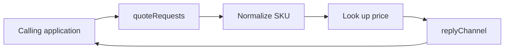

# Reply Channel Header

In the **MessagingTemplate** chapter of **SPRING_INTEGRATION_CORE**, `replyChannel` is the address where an endpoint sends a result back to the requester. Understanding this header helps wire the message return path cleanly across transformers, service activators, routers, and aggregators, while distinguishing a successful send from receiving a reply.

This lesson focuses on request–reply in Spring Integration Core: creating a `Message`, choosing a `MessageChannel`, invoking `MessagingTemplate`, configuring endpoints with the Java DSL, and inspecting the outcome. The running business example is looking up a price by SKU.

## 1. Learning Objectives

After this lesson, you will be able to:

- Read and set `MessageHeaders.REPLY_CHANNEL` with the proper type.
- Explain how `sendAndReceive()` uses a temporary per-call channel.
- Distinguish a message's reply address from an endpoint's `outputChannel`.
- Organize send and receive manually when using an application-managed reply channel.
- Identify reasons why a caller times out even though business logic ran.
- Write tests proving replies go to the intended place and headers are preserved.

Examples use `spring-integration-core`, Spring Context, and the Java DSL. Tests require JUnit Jupiter. Use a compatible dependency version set managed by your project's BOM. Alternative configurations in this lesson are standalone options; do not register multiple flows simultaneously consuming `quoteRequests` when testing each option.

## 2. What Does This Header Represent?

`replyChannel` has the standard header name `MessageHeaders.REPLY_CHANNEL`. It indicates where to send the result; the payload still holds the business data.

Two common representations:

| Value | Example | How It Is Used |
| --- | --- | --- |
| `MessageChannel` instance | A specific `QueueChannel` | The endpoint sends directly to that object |
| Channel name string | `"namedReplies"` | A resolver looks up the channel in the application context |

For a standard service activator, an unresolvable name causes `DestinationResolutionException`. This header implements the **Return Address** pattern. [Service Activator documentation](https://docs.spring.io/spring-integration/reference/service-activator.html)

Example of a price-lookup request:

```text
payload: "sku-007"
headers:
  replyChannel: <channel receiving quote result>
  requestId: "quote-42"
```

Here `requestId` is a custom business header for correlation. The address and the identifier are two distinct pieces of information: knowing where to send a reply is not enough to match concurrent requests sharing one queue.

Use the builder to create the message:

```java
QueueChannel replies = new QueueChannel(1);

Message<String> request = MessageBuilder.withPayload("sku-007")
        .setReplyChannel(replies)
        .setHeader("requestId", "quote-42")
        .build();

Object returnAddress =
        request.getHeaders().get(MessageHeaders.REPLY_CHANNEL);
```

Corresponding imports:

```java
import org.springframework.integration.channel.QueueChannel;
import org.springframework.messaging.Message;
import org.springframework.messaging.MessageHeaders;
import org.springframework.messaging.support.MessageBuilder;
```

`MessageHeaders` is immutable under the normal API. Do not call `request.getHeaders().put(...)`; build a new message whenever headers must change. [MessageHeaders API](https://docs.spring.io/spring-framework/docs/current/javadoc-api/org/springframework/messaging/MessageHeaders.html)

## 3. In What Order Does an Endpoint Choose Where to Send Results?

For a reply-producing service activator without a routing slip or special routing strategy, the order is:

1. Use the endpoint's `outputChannel` if configured.
2. Otherwise, look for `replyChannel` on the request.
3. If the request lacks that header and the result is a `Message`, check `replyChannel` on the result.

Setting a header on the reply does not override an address already present on the request under those rules. [Service Activator reply rules](https://docs.spring.io/spring-integration/reference/service-activator.html)

| Endpoint Situation | Next Destination |
| --- | --- |
| Has `outputChannel = nextStep` and request has `replyChannel = caller` | `nextStep` |
| No output channel, request has `replyChannel = caller` | `caller` |
| Request has no address, reply is a message with an address | Address on the reply |
| Result produced yet no destination can be found | Destination resolution error |
| Handler produces no result | No reply to send |

In a pricing pipeline, intermediate endpoints must forward to the next step. Only the endpoint finishing the work sends the final result back to the caller. Thus the header can travel across multiple steps before being used as the destination.



Do not infer that every `MessageHandler` handles this header automatically. An application-written handler must either include reply-sending logic or be wrapped in an endpoint that supports producing replies.

## 4. MessagingTemplate.sendAndReceive() Manages the Return Path

Applications commonly call:

```java
Message<?> reply = template.sendAndReceive(
        requests,
        MessageBuilder.withPayload("sku-007").build());
```

There is no need to pre-populate `replyChannel`: the template creates a temporary channel for that exchange. [MessagingTemplate introduction](https://docs.spring.io/spring-integration/reference/7.0/channel/template.html)

Think of the temporary channel as a private mailbox for the current quote lookup. A second call gets its own mailbox, so two callers never compete to read from one shared reply queue.

In implementation, `GenericMessagingTemplate` saves the original reply/error headers, places the temporary channel into both headers of the outgoing request, and receives the result from that channel. On the message returned to the caller, those headers are restored to their original values; if an original value did not exist, the corresponding header is removed. [GenericMessagingTemplate source](https://github.com/spring-projects/spring-framework/blob/main/spring-messaging/src/main/java/org/springframework/messaging/core/GenericMessagingTemplate.java)

This creates two easy points of confusion:

- The caller did not set `replyChannel`, yet the endpoint still receives the header added by the template.
- The caller inspects the reply and does not see the temporary channel header, even though the return path worked properly.

### 4.1. What Does Setting a QueueChannel Before Calling sendAndReceive() Do?

Suppose you create a request with `replyChannel = applicationReplies`, then call `sendAndReceive()`. The template still uses its temporary channel during that exchange. The returned reply may carry the restored `applicationReplies` header, yet that does not mean the reply was sent into that queue.

Distinguish the two:

```text
Header on returned message:
    restored address information

Message present in a QueueChannel:
    result of a send operation into that queue
```

If the application wants to read `applicationReplies` itself, organize separate `send()` and `receive()` calls as in section 6.

## 5. Complete Example Using Java DSL

The example below normalizes an SKU, generates a mock price result, and returns it to the caller. It is a standalone configuration class requiring no broker or database.

```java
import java.util.Locale;

import org.springframework.context.annotation.AnnotationConfigApplicationContext;
import org.springframework.context.annotation.Bean;
import org.springframework.context.annotation.Configuration;
import org.springframework.integration.channel.DirectChannel;
import org.springframework.integration.config.EnableIntegration;
import org.springframework.integration.core.MessagingTemplate;
import org.springframework.integration.dsl.IntegrationFlow;
import org.springframework.messaging.Message;
import org.springframework.messaging.support.MessageBuilder;

@Configuration
@EnableIntegration
public class ReplyChannelLab {

    @Bean
    public DirectChannel quoteRequests() {
        return new DirectChannel();
    }

    @Bean
    public IntegrationFlow quoteFlow(DirectChannel quoteRequests) {
        return IntegrationFlow.from(quoteRequests)
                .transform(String.class,
                        sku -> sku.trim().toUpperCase(Locale.ROOT))
                .handle(String.class,
                        (sku, headers) -> "PRICE[" + sku + "]=125000",
                        endpoint -> endpoint.requiresReply(true))
                .get();
    }

    @Bean
    public MessagingTemplate messagingTemplate() {
        MessagingTemplate template = new MessagingTemplate();
        template.setSendTimeout(1_000);
        template.setReceiveTimeout(1_000);
        template.setThrowExceptionOnLateReply(true);
        return template;
    }

    public static void main(String[] args) {
        try (var context =
                new AnnotationConfigApplicationContext(ReplyChannelLab.class)) {

            MessagingTemplate template =
                    context.getBean(MessagingTemplate.class);
            DirectChannel requests =
                    context.getBean("quoteRequests", DirectChannel.class);

            Message<?> reply = template.sendAndReceive(
                    requests,
                    MessageBuilder.withPayload(" sku-007 ").build());

            if (reply == null) {
                throw new IllegalStateException("No quote result received");
            }

            System.out.println(reply.getPayload());
        }
    }
}
```

Expected output:

```text
PRICE[SKU-007]=125000
```

Tracing this exact example:

1. The caller builds a request with payload `" sku-007 "`.
2. The template supplies a temporary return path.
3. The transformer produces `"SKU-007"`.
4. The service activator produces the price result string.
5. The final endpoint declares no separate output channel, so it replies to the request's address.
6. The caller receives `Message<?>`, checks that a result arrived, and then reads the payload.

Do not append `.channel("replyChannel")` at the end of the flow. The string `"replyChannel"` in that call would be interpreted as the name of a specific configured channel bean, whereas the header is a per-message attribute.

## 6. Managing a Reply Channel Yourself with send() and receive()

When you want control over where results are stored, the application can create a dedicated queue and set it as the reply address. With the context from section 5 running:

```java
QueueChannel replies = new QueueChannel(1);

Message<String> request = MessageBuilder.withPayload(" sku-007 ")
        .setReplyChannel(replies)
        .setHeader("requestId", "quote-42")
        .build();

template.send(requests, request);

Message<?> reply = replies.receive(1_000);
if (reply == null) {
    throw new IllegalStateException("Timed out waiting for price");
}

System.out.println(reply.getPayload());
```

Here the application performs two separate operations. `send()` does not set up reply waiting like `sendAndReceive()`. The address is the `replies` instance supplied on the request.

`QueueChannel(1)` can hold one message, so the example still works when the handler finishes inside `send()`: the result sits in the queue before the caller begins receiving. `receive(1_000)` waits up to 1,000 ms if the queue is empty. [QueueChannel and channel types](https://docs.spring.io/spring-integration/reference/channel/implementations.html)

### 6.1. Using a Bean Name

If the application has registered:

```java
@Bean
public QueueChannel namedReplies() {
    return new QueueChannel(10);
}
```

Then the request can use:

```java
Message<String> request = MessageBuilder.withPayload("sku-007")
        .setReplyChannelName("namedReplies")
        .build();
```

The endpoint must run in a context with a resolver capable of resolving that name. A channel-name string is not a URL, Kafka topic name, or default JMS queue name.

### 6.2. Be Careful with Shared Queues

A shared queue receives results in arrival order. For example, A requests a phone price and B requests a keyboard price; if B's result arrives first, A could read the wrong message if it merely takes the head of the queue.

To design this model yourself, you need a mechanism matching `requestId` to the waiting receiver, managing expirations, and discarding late results. Adding a correlation header without a component performing matching will not prevent misreads. For simple in-application exchanges, `sendAndReceive()` cuts out much of that overhead.

## 7. outputChannel Diverts Replies to Another Branch

Consider a variant of the pricing flow:

```java
@Bean
public QueueChannel fixedReplies() {
    return new QueueChannel(10);
}

@Bean
public IntegrationFlow redirectedQuoteFlow(
        DirectChannel quoteRequests, QueueChannel fixedReplies) {

    return IntegrationFlow.from(quoteRequests)
            .handle(String.class,
                    (sku, headers) -> "PRICE[" + sku + "]=125000")
            .channel(fixedReplies)
            .get();
}
```

Use this flow **instead of** `quoteFlow` in section 5. The handler sends the result to `fixedReplies`; a caller using `sendAndReceive()` is still waiting on its temporary return path. Without a forwarding step, the caller times out even though `fixedReplies` already holds the result.

If that queue is intentionally an intermediate step, you can add a downstream consumer:

```java
import org.springframework.integration.dsl.Pollers;

@Bean
public IntegrationFlow forwardFixedReplies(QueueChannel fixedReplies) {
    return IntegrationFlow
            .from(fixedReplies,
                    endpoint -> endpoint.poller(Pollers.fixedDelay(50)))
            .bridge()
            .get();
}
```

The bridge at the end forwards each message according to the reply address still present on it. The input queue needs a poller so a consumer pulls messages out.

In a simple pricing design, this intermediate queue is unnecessary. It only fits when you want a buffer point and have clearly defined who continues processing. Storing a result in a queue does not fulfill the obligation to reply to the caller.

## 8. Preserving Headers When Transforming Messages

For a transformer returning only a payload, the framework can construct the result message from the new data plus the request's headers. When a transformer returns a full `Message`, you must pay attention to the headers on that message yourself. [Transformers in Spring Integration](https://docs.spring.io/spring-integration/reference/transformer.html)

Example method constructing the result manually:

```java
public Message<String> normalize(Message<String> input) {
    return MessageBuilder
            .withPayload(input.getPayload().trim().toUpperCase(Locale.ROOT))
            .copyHeaders(input.getHeaders())
            .build();
}
```

Conversely, a message created solely from a payload:

```java
public Message<String> normalizeWithoutHeaders(Message<String> input) {
    return new GenericMessage<>(
            input.getPayload().trim().toUpperCase(Locale.ROOT));
}
```

does not carry the input's `replyChannel`, `errorChannel`, or `requestId`. Using this method as an intermediate transformer can give the downstream pricing step valid data while losing the return path. The import for the second example's class is `org.springframework.messaging.support.GenericMessage`.

Also consider endpoint position: the transformer itself can still find the address on its incoming request when sending output, yet the newly created message arriving at the next endpoint may lack headers. Seeing the right payload at the end of a pipeline therefore does not prove the return path stayed intact.

If only modifying headers while keeping the payload, use:

```java
Message<?> enriched = MessageBuilder.fromMessage(input)
        .setHeader("validated", true)
        .build();
```

### 8.1. Overwriting the Address Inside a Flow

The Java DSL allows:

```java
.enrichHeaders(headers -> headers.replyChannel("manualReplies", true))
```

The `true` argument requests overwriting an existing value; overloads without the overwrite flag normally retain an already-present header. [HeaderEnricherSpec API](https://docs.spring.io/spring-integration/docs/current/api/org/springframework/integration/dsl/HeaderEnricherSpec.html)

If the request belongs to a `sendAndReceive()` call, overwriting it this way can divert the reply away from the channel the caller is awaiting. In the pricing example, only change the address when business requirements genuinely transfer result ownership to another component and the design provides a termination path for the original caller.

## 9. Channel Types, Timeouts, and Late Replies

### 9.1. Request Channel and Reply Channel Have Different Roles

`DirectChannel` dispatches to a handler directly on the sending thread; it is not a `PollableChannel` for callers to read with `receive()`. A `QueueChannel` can be polled to receive messages. [Channel APIs and implementations](https://docs.spring.io/spring-integration/reference/channel/implementations.html)

Section 5's example uses:

| Position | Choice | Reason |
| --- | --- | --- |
| Request | `DirectChannel` | Run a simple pipeline on the caller thread |
| Template return path | Temporary channel managed by the template | Caller receives the outcome of the current call |
| Self-managed return path | Dedicated `QueueChannel(1)` | Allows holding one result before the caller reads |

If switching requests to `QueueChannel`, add a consumer and poller. If switching to `ExecutorChannel`, configure an appropriate executor and error handling across the thread handoff. Changing channel types does not conjure up the missing processing components.

### 9.2. receiveTimeout Is Not a Whole-Business Deadline

In the template's implementation, sending the request happens before receiving the result. Therefore, if the flow runs synchronously and the pricing handler blocks for 5 seconds, `receiveTimeout = 1,000 ms` does not interrupt the handler after one second. [Send/receive sequence in GenericMessagingTemplate](https://github.com/spring-projects/spring-framework/blob/main/spring-messaging/src/main/java/org/springframework/messaging/core/GenericMessagingTemplate.java)

Distinguish three bounds:

| Bound | What It Controls |
| --- | --- |
| `sendTimeout` | Send operation when the channel type supports waiting |
| `receiveTimeout` | Waiting for the result at the template's receive step |
| HTTP/DB or business timeout | Actual execution duration inside the handler |

For example, a pricing service calling HTTP must have its own HTTP timeout. Even when the caller stops waiting, that does not roll back data mutations already executed downstream.

### 9.3. Results Arriving After the Caller Stops Waiting

The template supports `setThrowExceptionOnLateReply(true)` to raise an error when sending a reply while the waiting side can no longer receive it, such as after timing out or already receiving a result. The exception occurs on the reply-sending thread; it does not make an already-returned caller resume waiting. [GenericMessagingTemplate API](https://docs.spring.io/spring-framework/docs/current/javadoc-api/org/springframework/messaging/core/GenericMessagingTemplate.html)

The pricing contract should produce one final result per request. If a request fans out into multiple branches, gather them before the return path rather than letting every branch reply directly into the temporary channel.

## 10. replyChannel and errorChannel

The two headers serve different purposes:

| Header | Meaning |
| --- | --- |
| `replyChannel` | Destination for processing results |
| `errorChannel` | Destination for `ErrorMessage` when error handling publishes errors as messages |

In a synchronous flow on the caller thread, errors can be thrown directly from the template call. Across an asynchronous boundary, the framework can represent errors as an `ErrorMessage`; error-channel lookup prioritizes the request's `errorChannel` header before falling back to the global error channel. [Error Handling](https://docs.spring.io/spring-integration/reference/error-handling.html)

With `sendAndReceive()`, the temporary channel mechanism in section 4 also applies to the error header. Do not assume every non-`null` result is successful pricing data. If an async component sent back an `ErrorMessage`, the application must recognize it:

```java
import org.springframework.messaging.support.ErrorMessage;

Message<?> reply = template.sendAndReceive(requests, request);

if (reply == null) {
    throw new IllegalStateException("No result within the wait timeout");
}
if (reply instanceof ErrorMessage error) {
    throw new IllegalStateException("Quote lookup failed", error.getPayload());
}

Object quote = reply.getPayload();
```

This checks the received result and does not replace catching exceptions from synchronous calls. Nor should you apply a gateway's automatic error-unwrapping assumption to every `MessagingTemplate` call: the two APIs have different contracts.

## 11. Where Can Routers, Filters, and Aggregators Break the Return Path?

In a real pricing system, having intact headers is not enough to guarantee an answer.

| Component | Business Example | Question to Resolve |
| --- | --- | --- |
| Router | Choose retail or wholesale price list | Which branch produces the final result? |
| Filter | Reject invalid SKUs | Will the caller get an error, a rejection result, or just a timeout? |
| Aggregator | Combine prices from multiple suppliers | When does the group meet its completion condition? |

A filter that drops requests and only logs can leave the pricing caller waiting until timeout. A clearer design has the rejection branch produce a business result, such as `REJECTED`, or throw an error per the chosen policy.

With an aggregator, a group can stay incomplete because one supplier failed to respond. Define correlation, release condition, group timeout handling, and headers of the aggregated message. A dedicated `requestId` per quote lookup helps prevent mixing results from two callers just because they queried the same SKU.

These scenarios must be tested along the actual execution path. Do not tweak timeouts before verifying whether the flow actually produces a reply.

If a service activator must return a result, `requiresReply(true)` catches `null` returns with `ReplyRequiredException`. It does not inject results for a discarded filter branch or auto-complete a waiting aggregator group. [ReplyRequiredException API](https://docs.spring.io/spring-integration/docs/current/api/org/springframework/integration/handler/ReplyRequiredException.html)

## 12. Nested Flows and Out-of-Process Boundaries

### 12.1. Use gateway() When One Flow Calls Another

Suppose a sales flow calls a pricing flow and then continues calculating totals. The Java DSL provides `gateway()` to send to another flow's input, wait for its reply, and continue the current flow. [The gateway() operator](https://docs.spring.io/spring-integration/reference/dsl/java-gateway.html)

By design, the subflow only needs to return its result to its immediate caller. Avoid hardcoding a global channel name and forcing every subflow to send there; that ties reuse to a specific caller.

At the application boundary, a messaging gateway can also expose a business interface, hiding message APIs from callers. Gateways have their own reply settings and internal bridging when using a declared reply channel. Do not treat that configuration as identical to pre-setting a header on a `MessagingTemplate.sendAndReceive()` call. [Messaging Gateways](https://docs.spring.io/spring-integration/reference/gateway.html)

### 12.2. Do Not Send Java Channel References Across the Network

A channel object in a header belongs to the running runtime. Persisting messages to a store or sending them over a transport requires considering how headers are stored and mapped.

Spring Integration supports the Header Channel Registry to turn reply/error channel references into strings that can be resolved back later. Mappings expire, so size the retention window appropriately. [Header Channel Registry](https://docs.spring.io/spring-integration/reference/content-enrichment.html#header-channel-registry)

Illustrative DSL snippet placed before a boundary where messages are persisted or transported:

```java
.enrichHeaders(headers -> headers.headerChannelsToString())
```

It follows from the registry's role that a token is only useful where its mapping exists. It does not magically create a reply address usable across arbitrary JVMs. For broker-based systems, design transport reply destinations and correlation, then route replies back to the waiting runtime. [Header channel-to-string API](https://docs.spring.io/spring-integration/docs/current/api/org/springframework/integration/dsl/HeaderEnricherSpec.html)

## 13. Tests Illustrating the Reply Contract

The class below uses `ReplyChannelLab` from section 5. Each test creates its own context so messages do not interfere across tests.

```java
import org.junit.jupiter.api.AfterEach;
import org.junit.jupiter.api.BeforeEach;
import org.junit.jupiter.api.Test;
import org.springframework.context.annotation.AnnotationConfigApplicationContext;
import org.springframework.integration.channel.DirectChannel;
import org.springframework.integration.channel.QueueChannel;
import org.springframework.integration.core.MessagingTemplate;
import org.springframework.messaging.Message;
import org.springframework.messaging.support.MessageBuilder;

import static org.junit.jupiter.api.Assertions.*;

class ReplyChannelLabTest {

    private AnnotationConfigApplicationContext context;
    private MessagingTemplate template;
    private DirectChannel requests;

    @BeforeEach
    void openContext() {
        context = new AnnotationConfigApplicationContext(ReplyChannelLab.class);
        template = context.getBean(MessagingTemplate.class);
        requests = context.getBean("quoteRequests", DirectChannel.class);
    }

    @AfterEach
    void closeContext() {
        context.close();
    }

    @Test
    void receivesReplyWithoutAnExplicitReturnAddress() {
        Message<?> reply = template.sendAndReceive(
                requests,
                MessageBuilder.withPayload(" sku-007 ").build());

        assertNotNull(reply);
        assertEquals("PRICE[SKU-007]=125000", reply.getPayload());
        assertNull(reply.getHeaders().getReplyChannel());
    }

    @Test
    void sendsReplyToTheApplicationQueueWhenUsingSend() {
        QueueChannel replies = new QueueChannel(1);
        Message<String> request = MessageBuilder.withPayload("sku-007")
                .setReplyChannel(replies)
                .setHeader("requestId", "quote-42")
                .build();

        template.send(requests, request);

        Message<?> reply = replies.receive(1_000);
        assertNotNull(reply);
        assertEquals("PRICE[SKU-007]=125000", reply.getPayload());
        assertEquals("quote-42", reply.getHeaders().get("requestId"));
        assertNull(replies.receive(0));
    }

    @Test
    void restoresTheOriginalHeaderWithoutEnqueuingTheReplyThere() {
        QueueChannel originalReplies = new QueueChannel(1);
        Message<String> request = MessageBuilder.withPayload("sku-007")
                .setReplyChannel(originalReplies)
                .build();

        Message<?> reply = template.sendAndReceive(requests, request);

        assertNotNull(reply);
        assertEquals("PRICE[SKU-007]=125000", reply.getPayload());
        assertSame(originalReplies, reply.getHeaders().getReplyChannel());
        assertSame(originalReplies, request.getHeaders().getReplyChannel());
        assertNull(originalReplies.receive(0));
    }
}
```

The three tests verify three distinct behaviors:

- A request without an explicit return address still receives a result thanks to the template.
- `send()` honors the application-supplied address in the tested flow.
- Having the original header restored on the reply does not prove the original queue received the message.

When extending this lab, add scenarios that divert output to a separate queue, drop headers between two endpoints, and handle rejected requests. For asynchronous processing, coordinate threads with latches or condition-waiting utilities; avoid using fixed sleeps as proof that a reply definitely has not arrived yet.

These test snippets are illustrative practice code in the documentation; run them in a Java project with the dependencies listed at the start of the lesson.

## 14. Diagnosing When the Caller Receives No Result

Follow the path of a `requestId` from input to result creation and final send destination:

| Symptom | What to Check |
| --- | --- |
| Handler finished, caller returned `null` | Did a dedicated output channel or mutated header divert the reply off the awaited path? |
| Result sits in a separate queue | Is that queue the final destination or is a forwarding consumer missing? |
| No handler runs at all | Does the channel have an appropriate subscriber, poller, or executor? |
| `requestId` and address vanish after transformer | Did custom code construct a new message solely from the payload? |
| Certain SKUs always time out | Did a router/filter branch skip producing a reply? |
| Returned result has an exception payload | Did an `ErrorMessage` arrive across an async boundary? |
| Call duration exceeds `receiveTimeout` | Did a synchronous handler block right inside the send phase? |
| Late-reply warnings appear | Did the caller time out or did multiple replies arrive for one request? |

When inspecting headers, note whether the value is a channel object or a name string. Do not look solely for a bean named `replyChannel`: the return path may be the template's anonymous channel.

## 15. Key Takeaways

- `replyChannel` attaches a return address to each message.
- Intermediate pipeline endpoints normally pass along via output; only the final step replies to the caller.
- `sendAndReceive()` manages a temporary channel and result waiting for that call.
- To read from a chosen queue yourself, organize `send()` and `receive()` along with request matching where needed.
- Preserve headers when building new messages and define explicit return paths across every business branch.
- Distinguish missing replies, error replies, and successful replies.