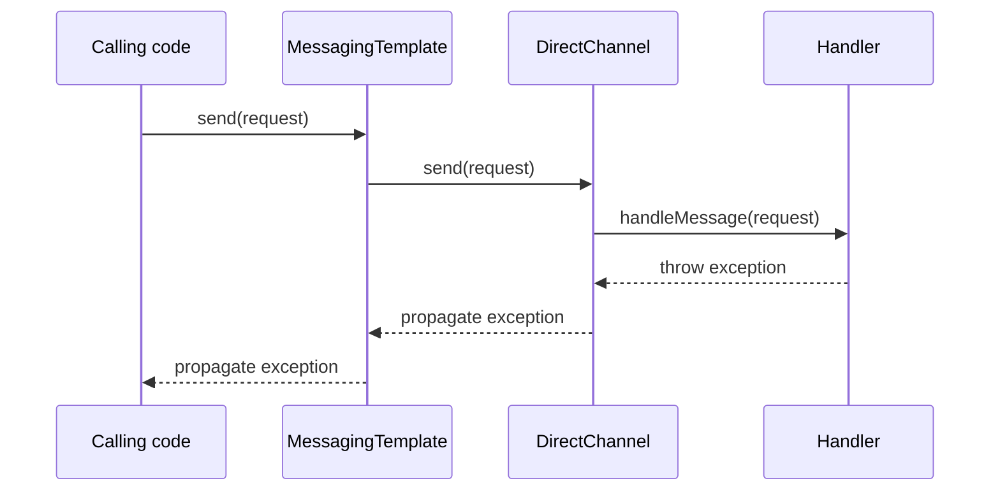
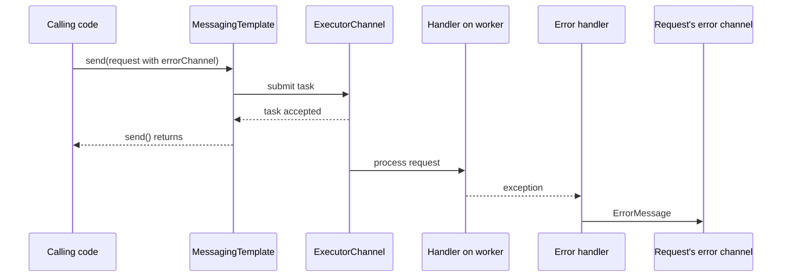

# Error Channel in MessagingTemplate

In the `SPRING_INTEGRATION_CORE` module, `MessagingTemplate` serves as the bridge for Java code to proactively send or receive a `Message` through a `MessageChannel`. When adding error handling, you must determine which execution thread errors occur on and whether the application is using `send()` or `sendAndReceive()`. Those two choices govern whether the caller gets an exception, an `ErrorMessage`, or no reply at all.

This lesson focuses on the error contract at the template boundary, how to set the `errorChannel` header, how to inspect error messages, and how to test the behavior. Examples use Java 17+, Spring Integration 6.5 APIs, and Spring Framework 6.2; actual dependency versions should be managed consistently across the application.

## 1. Learning Outcomes

After this lesson, you will be able to:

- Distinguish synchronous exceptions from errors published as messages on asynchronous processing paths.
- Choose an error channel for a request sent with `MessagingTemplate.send()`.
- Explain why `sendAndReceive()` may not use the error channel you set on the input message.
- Read an `ErrorMessage`, the failed message, and the root cause without mistaking them for a successful reply.
- Design an error-handling path with appropriate correlation, timeouts, and tests.

Prerequisites: familiarity with `Message` payloads and headers, the differences among `DirectChannel`, `ExecutorChannel`, and `QueueChannel`, and declaring an `IntegrationFlow` with the Java DSL.

## 2. First, Identify Where the Exception Surfaces

### 2.1. Synchronous Processing Flow

With `DirectChannel`, the handler runs on the sender's thread. If the handler throws an exception, it propagates back up the call stack to the template call. Merely setting the `errorChannel` header does not create an automatic error-catching mechanism here. That is the default behavior unless advice or another component actively converts errors into messages. [Error Handling documentation](https://docs.spring.io/spring-integration/reference/6.5/error-handling.html).



In this design, a `try/catch` around the template operation is meaningful: it wraps both sending and synchronous handler execution.

### 2.2. Asynchronous Processing Flow

With a Spring-managed `ExecutorChannel` backed by a thread pool, the handler executes via the executor. The channel integrates an error-handling mechanism for the task; exceptions raised inside the handler can be turned into an `ErrorMessage`. A `try/catch` around `send()` does not wrap work running later on a worker thread. [ExecutorChannel source](https://github.com/spring-projects/spring-integration/blob/v6.5.0/spring-integration-core/src/main/java/org/springframework/integration/channel/ExecutorChannel.java).



The diagram shows one possible ordering. A worker can execute very quickly, even before `send()` returns; what matters is still the thread boundary, not the order observed in logs.

### 2.3. Decision Table at the Template Boundary

| Default Scenario | What Does the Caller Observe? | Design Direction |
| --- | --- | --- |
| `send()` over `DirectChannel`, handler fails | Exception from the call | Catch at caller or add a handling policy at the endpoint |
| `send()` over `ExecutorChannel`, handler fails after task handoff | The send call may already have finished; errors go through task error handling | Set a per-request error channel and arrange an error consumer |
| `send()` into `QueueChannel`, consumer uses a Spring Integration poller | Enqueuing and business processing are two separate stages | Configure the poller and an appropriate error policy |
| `sendAndReceive()` across an async flow | Caller waits for a result message, which may be an `ErrorMessage` | Classify the result before reading the business payload |

`QueueChannel` on its own only stores messages. If you call `receive()` manually and invoke a service yourself, any exception from that service stays in code you control; the queue does not turn that exception into an `ErrorMessage`. [QueueChannel semantics](https://docs.spring.io/spring-integration/reference/6.5/channel/implementations.html).

## 3. Understanding the `errorChannel` Header Properly

These three concepts share the words “error channel” yet play different roles:

| Concept | Location | Role |
| --- | --- | --- |
| `errorChannel` header | On the request message | Specifies the error destination for that request when error handling inspects headers |
| Bean named `errorChannel` | In the Spring application context | Global error channel used under default mechanics when no per-message destination exists |
| `ErrorMessage` | Message published during error handling | Carries a `Throwable` as its payload |

For the default `MessagePublishingErrorHandler`, the error header on the failed message takes precedence; if absent, it uses the default channel, typically the `errorChannel` bean. The header value can be a `MessageChannel` object or a channel name looked up by a resolver. A misspelled name or invalid type is a configuration error, not a trigger to fall back quietly to the global channel. [Error handler source](https://github.com/spring-projects/spring-integration/blob/v6.5.0/spring-integration-core/src/main/java/org/springframework/integration/channel/MessagePublishingErrorHandler.java).

```java
Message<String> request = MessageBuilder.withPayload("BAD-42")
        .setHeader("orderId", "BAD-42")
        .setErrorChannel(orderErrors)
        .setReplyChannelName("nullChannel")
        .build();

template.send(asyncInput, request);
```

Here:

- `orderErrors` is a dedicated channel for observing errors from this request group.
- `orderId` is a business identifier for correlation, independent of the message `id`.
- `replyChannel = nullChannel` expresses the intent to discard normal replies in a one-way send example. It does not mean discarding errors.

This snippet uses variables declared in the configuration in the next section.

## 4. Shared Java DSL Configuration for Practice

Scenario: a service receives order codes. Codes starting with `BAD-` trigger a validation error; other codes produce the reply `ACCEPTED:<orderId>`.

Declare the following class in `TemplateErrorConfig.java`. The application needs `spring-integration-core`; the test section below needs JUnit Jupiter. If using Spring Boot, use Boot's dependency management to select compatible versions.

```java
import org.springframework.context.annotation.Bean;
import org.springframework.context.annotation.Configuration;
import org.springframework.integration.channel.DirectChannel;
import org.springframework.integration.channel.ExecutorChannel;
import org.springframework.integration.channel.QueueChannel;
import org.springframework.integration.config.EnableIntegration;
import org.springframework.integration.core.MessagingTemplate;
import org.springframework.integration.dsl.IntegrationFlow;
import org.springframework.scheduling.concurrent.ThreadPoolTaskExecutor;

@Configuration
@EnableIntegration
public class TemplateErrorConfig {

    @Bean
    public MessagingTemplate messagingTemplate() {
        MessagingTemplate template = new MessagingTemplate();
        template.setSendTimeout(1_000);
        template.setReceiveTimeout(2_000);
        template.setThrowExceptionOnLateReply(true);
        return template;
    }

    @Bean
    public DirectChannel directInput() {
        return new DirectChannel();
    }

    @Bean
    public ThreadPoolTaskExecutor integrationExecutor() {
        ThreadPoolTaskExecutor executor = new ThreadPoolTaskExecutor();
        executor.setCorePoolSize(1);
        executor.setMaxPoolSize(1);
        executor.setQueueCapacity(10);
        executor.setThreadNamePrefix("orders-");
        return executor;
    }

    @Bean
    public ExecutorChannel asyncInput(
            ThreadPoolTaskExecutor integrationExecutor) {
        return new ExecutorChannel(integrationExecutor);
    }

    @Bean
    public QueueChannel orderErrors() {
        return new QueueChannel(10);
    }

    @Bean
    public IntegrationFlow directOrders(DirectChannel directInput) {
        return IntegrationFlow.from(directInput)
                .handle(String.class,
                        (orderId, headers) -> validateOrder(orderId))
                .get();
    }

    @Bean
    public IntegrationFlow asyncOrders(ExecutorChannel asyncInput) {
        return IntegrationFlow.from(asyncInput)
                .handle(String.class,
                        (orderId, headers) -> validateOrder(orderId))
                .get();
    }

    private static String validateOrder(String orderId) {
        if (orderId.startsWith("BAD-")) {
            throw new IllegalArgumentException(
                    "Invalid order code: " + orderId);
        }
        return "ACCEPTED:" + orderId;
    }
}
```

`@EnableIntegration` initializes the integration infrastructure. Declaring `ExecutorChannel` and the executor as beans lets Spring initialize them, manage their lifecycle, and attach the channel's error handling. There is no need to manually call `initialize()` on the executor in this example's `@Bean` method.

`orderErrors` uses a small queue so learners can actively pull error messages. That serves as an observation point for practice; a continuously running application needs a proper consumer or error store.

## 5. `send()`: Separating Send Failures from Processing Failures

### 5.1. Synchronous Errors Still Reach the Caller

The snippet below assumes `template`, `directInput`, and `orderErrors` have been retrieved from the application context:

```java
Message<String> request = MessageBuilder.withPayload("BAD-42")
        .setHeader("orderId", "BAD-42")
        .setErrorChannel(orderErrors)
        .setReplyChannelName("nullChannel")
        .build();

try {
    template.send(directInput, request);
} catch (MessagingException exception) {
    Message<?> failed = exception.getFailedMessage();
    // Log the order ID, cause, and handle the decision in the caller.
}
```

This example's handler throws an error while `send()` is executing. The `errorChannel` header may still exist on the request, yet there is no automatic forwarding of errors into `orderErrors` at this boundary. The framework-wrapped exception generally retains the business exception in its cause chain.

### 5.2. Asynchronous Errors Arrive on the Dedicated Channel

```java
template.send(asyncInput, request);

Message<?> received = orderErrors.receive(2_000);
if (received == null) {
    throw new IllegalStateException("No error message received yet");
}
if (!(received instanceof ErrorMessage error)) {
    throw new IllegalStateException("Error channel received unexpected message type");
}

Throwable failure = error.getPayload();
```

For `request` with payload `BAD-42`, the expected outcome is an `ErrorMessage` in the queue. `receive(2_000)` only waits up to two seconds to retrieve an error message; it does not create a business error itself if the timeout expires.

`MessagingTemplate.send(...)` returns `void`. If sending fails because the channel returns `false`, the template turns that failure into a `MessageDeliveryException`; do not write `boolean sent = template.send(...)`. This difference appears in the `doSend` implementation. [GenericMessagingTemplate source](https://github.com/spring-projects/spring-framework/blob/v6.2.7/spring-messaging/src/main/java/org/springframework/messaging/core/GenericMessagingTemplate.java).

Keep two handling paths distinct in your design:

- Errors before or during message handoff: the caller may need to handle them immediately, such as task rejection.
- Business errors inside a worker after task handoff: the consumer on the error channel is responsible.

A `send()` call returning normally carries meaning only according to the channel and boundary in use. With an asynchronous flow, it does not prove the order was processed successfully.

## 6. `sendAndReceive()`: Temporary Channel Affects Both Replies and Errors

### 6.1. Why Does the Dedicated Error Channel Receive Nothing?

`MessagingTemplate` inherits `GenericMessagingTemplate`'s request–reply mechanism. When sending a request, that mechanism replaces both `replyChannel` and `errorChannel` with the same temporary channel. On the returned reply, it restores the original header values. [Request–reply mechanism in GenericMessagingTemplate](https://github.com/spring-projects/spring-framework/blob/v6.2.7/spring-messaging/src/main/java/org/springframework/messaging/core/GenericMessagingTemplate.java).

Consequently, with this lesson's default setup:

```text
original request:
  errorChannel = orderErrors

request actually sent by sendAndReceive():
  replyChannel = temporary channel
  errorChannel = temporary channel

async handler throws exception:
  ErrorMessage is routed to temporary channel
  caller receives that message from sendAndReceive()
```

This is why you cannot take `send()` behavior and extrapolate it directly to `sendAndReceive()`. Error emission can also change if an intermediate component modifies headers, uses a custom error handler, or has recovery advice.

### 6.2. Classify the Result Before Using the Payload

With Spring Integration's `MessagingTemplate`, receiving an `ErrorMessage` over the temporary channel does not automatically convert the error payload into an exception at the caller. The template's `sendAndReceive()` override delegates to the superclass without messaging-gateway error-unwrapping logic. [MessagingTemplate source](https://github.com/spring-projects/spring-integration/blob/v6.5.0/spring-integration-core/src/main/java/org/springframework/integration/core/MessagingTemplate.java).

```java
Message<?> reply = template.sendAndReceive(asyncInput, request);

if (reply == null) {
    throw new IllegalStateException("No reply within the wait timeout");
}
if (reply instanceof ErrorMessage error) {
    throw new IllegalStateException(
            "Order processing flow failed", error.getPayload());
}
if (!(reply.getPayload() instanceof String result)) {
    throw new IllegalStateException("Reply does not match the contract");
}

// Use result only after classifying timeout and ErrorMessage.
```

The example's reply contract permits only a result string or an `ErrorMessage`. If an application specifies that regular messages can also carry a `Throwable` payload, add a handling branch for that contract. Avoid payload-converting APIs upfront if they prevent the caller from recognizing error messages.

The `DirectChannel` case remains different: synchronous exceptions can escape `sendAndReceive()` right in the send phase, before reply waiting ever begins.

### 6.3. Timeout Is Not Proof That Business Processing Failed

`receiveTimeout` limits how long to wait for a reply; `sendTimeout` applies to sending depending on the channel's wait support. Neither cancels a running handler. In particular, `sendTimeout` does not interrupt a long synchronous handler call over `DirectChannel`. [GenericMessagingTemplate API](https://docs.spring.io/spring-framework/docs/6.2.7/javadoc-api/org/springframework/messaging/core/GenericMessagingTemplate.html).

For example, the caller times out after two seconds while the worker completes writing the order in the third second. If the caller resends without an idempotency key, the order can be processed twice. The business contract should allow status lookup by `orderId` or a stable request identifier.

When `setThrowExceptionOnLateReply(true)` is enabled, sending a late reply can raise an exception on the reply-sending side. It does not bring the timed-out caller thread back to receive the result. This setting helps surface timeout violations; it does not replace job-state management.

## 7. Reading `ErrorMessage` Without Losing Context

`ErrorMessage` carries a `Throwable` payload, not the failing order itself. The `originalMessage` property is optional; never assume it is always populated. [ErrorMessage type](https://github.com/spring-projects/spring-framework/blob/v6.2.7/spring-messaging/src/main/java/org/springframework/messaging/support/ErrorMessage.java).

To obtain the message at the point of failure, check whether the payload is a `MessagingException`, then call `getFailedMessage()`. This value can also be `null`. [MessagingException type](https://github.com/spring-projects/spring-framework/blob/v6.2.7/spring-messaging/src/main/java/org/springframework/messaging/MessagingException.java).

```java
Throwable failure = error.getPayload();
Message<?> failed = null;
if (failure instanceof MessagingException messagingException) {
    failed = messagingException.getFailedMessage();
}

Message<?> context = failed != null ? failed : error.getOriginalMessage();
Object orderId = context != null
        ? context.getHeaders().get("orderId")
        : null;

Throwable root = failure;
while (root.getCause() != null && root.getCause() != root) {
    root = root.getCause();
}
```

`failedMessage` may carry a payload already altered by transformers. Therefore, actively preserve business keys across transformation steps; do not rely on the error payload always matching the initial input payload.

In a multi-step pipeline, an error record should include details useful for remediation decisions:

| Information | Example | Purpose |
| --- | --- | --- |
| Business key | `orderId = BAD-42` | Correlate request and outcome |
| Failing step | `validateOrder` | Identify where to fix or resubmit |
| Error category | `INVALID_ORDER` | Decide whether to reject, fix data, or retry |
| Attempt count | `attempt = 1` | Bound retry loops |
| Trace ID | Value per application contract | Link logs across components |

If you need to keep the initial message separate from the message at the point of failure, design an `ErrorMessageStrategy` and corresponding context. `DefaultErrorMessageStrategy` only attaches the original message when the context provides an input message; not every error-publishing path supplies that context. [DefaultErrorMessageStrategy](https://github.com/spring-projects/spring-integration/blob/v6.5.0/spring-integration-core/src/main/java/org/springframework/integration/support/DefaultErrorMessageStrategy.java).

## 8. Designing Application Error Paths

### 8.1. Assigning Responsibility to the Error Channel

For an order-intake system, responsibilities can be divided as follows:

| Error Group | Illustrative Action | What to Maintain in the Contract |
| --- | --- | --- |
| Invalid order code | Record rejection outcome, notify via the defined business channel | Tie to the exact `orderId` |
| Downstream dependency temporarily unavailable | Bounded retry if the operation allows | Cap retry count, duration, and enforce idempotency |
| Unclassified processing error | Persist for investigation and manual handling | Keep enough context to reproduce |
| Unable to deliver error message | Detect via logs/metrics and fallback operational path | Never assume the error was recorded successfully |

This is a proposed design for the order scenario, not a rule set executed automatically by the template. An error channel is a transport route for failure notices; retries, durable persistence, and recovery must be configured separately. Spring Integration provides `RequestHandlerRetryAdvice` and recovery mechanisms for building such policies. [Retry Advice](https://docs.spring.io/spring-integration/reference/6.5/handler-advice/classes.html#retry-advice).

### 8.2. Dedicated Channel vs. Global Channel

The default global error channel is a `PublishSubscribeChannel` with a subscriber logging at `ERROR` level. It helps with general observability, yet tracking individual order status still requires application logic. [Default error channel](https://docs.spring.io/spring-integration/reference/6.5/error-handling.html).

In this lab, `orderErrors` is a `QueueChannel`, so something must call `receive()` or use a polling endpoint to drain errors. Adding a real consumer to the same queue while running tests can let that consumer steal messages the test expects. Each message on a queue goes to only one consumer. [QueueChannel consumer semantics](https://docs.spring.io/spring-integration/reference/6.5/channel/implementations.html).

When moving the example to a production application:

- Choose error storage based on crash-recovery requirements; in-memory queues do not provide durable persistence.
- Set capacity limits and monitor error backlogs.
- Log only necessary fields; consider sensitive data in payloads and headers.
- If the error-handling path itself can fail, provide an independent observation sink to avoid self-feeding error loops.

### 8.3. When to Consider a Messaging Gateway?

If you want business code to call an interface and rely on a policy that routes exceptions through an error flow to produce a fallback reply, a messaging gateway offers an `errorChannel` setting for that purpose. Gateways have their own rules for interpreting errors and returned `Throwable`s; do not apply those rules verbatim to `MessagingTemplate`. [Error handling at Messaging Gateway](https://docs.spring.io/spring-integration/reference/6.5/gateway.html#error-handling).

Choose the template when the caller needs direct manipulation of messages, channels, and exchange outcomes. Choose a gateway when the call contract is cleaner as a Java method and reply policies belong at that boundary.

## 9. Test Code Demonstrating Three Error Contracts

The test class below uses `AnnotationConfigApplicationContext`, the configuration from section 4, and JUnit Jupiter directly. Each test opens its own context so queues and tasks are not shared across tests. These snippets are practice code to run in a project with compatible dependencies.

```java
import org.junit.jupiter.api.Test;
import org.springframework.context.annotation.AnnotationConfigApplicationContext;
import org.springframework.integration.channel.DirectChannel;
import org.springframework.integration.channel.ExecutorChannel;
import org.springframework.integration.channel.QueueChannel;
import org.springframework.integration.core.MessagingTemplate;
import org.springframework.messaging.Message;
import org.springframework.messaging.MessagingException;
import org.springframework.messaging.support.ErrorMessage;
import org.springframework.messaging.support.MessageBuilder;

import static org.junit.jupiter.api.Assertions.*;

class TemplateErrorContractTest {

    @Test
    void directSendPropagatesExceptionToCaller() {
        try (var context = new AnnotationConfigApplicationContext(
                TemplateErrorConfig.class)) {
            var template = context.getBean(MessagingTemplate.class);
            var input = context.getBean("directInput", DirectChannel.class);
            var errors = context.getBean("orderErrors", QueueChannel.class);

            MessagingException exception = assertThrows(
                    MessagingException.class,
                    () -> template.send(input, badRequest(errors)));

            assertInstanceOf(IllegalArgumentException.class, root(exception));
            assertNotNull(exception.getFailedMessage());
            assertEquals("BAD-42",
                    exception.getFailedMessage().getPayload());
            assertNull(errors.receive(0));
        }
    }

    @Test
    void asyncSendPublishesErrorToRequestErrorChannel() {
        try (var context = new AnnotationConfigApplicationContext(
                TemplateErrorConfig.class)) {
            var template = context.getBean(MessagingTemplate.class);
            var input = context.getBean("asyncInput", ExecutorChannel.class);
            var errors = context.getBean("orderErrors", QueueChannel.class);

            assertDoesNotThrow(() -> template.send(input, badRequest(errors)));

            ErrorMessage error = assertInstanceOf(
                    ErrorMessage.class, errors.receive(2_000));
            MessagingException failure = assertInstanceOf(
                    MessagingException.class, error.getPayload());

            assertInstanceOf(IllegalArgumentException.class, root(failure));
            Message<?> failed = failure.getFailedMessage();
            assertNotNull(failed);
            assertEquals("BAD-42", failed.getHeaders().get("orderId"));
        }
    }

    @Test
    void asyncRequestReplyReceivesErrorOnTemporaryChannel() {
        try (var context = new AnnotationConfigApplicationContext(
                TemplateErrorConfig.class)) {
            var template = context.getBean(MessagingTemplate.class);
            var input = context.getBean("asyncInput", ExecutorChannel.class);
            var errors = context.getBean("orderErrors", QueueChannel.class);

            Message<?> reply = template.sendAndReceive(input, badRequest(errors));

            ErrorMessage error = assertInstanceOf(ErrorMessage.class, reply);
            assertInstanceOf(IllegalArgumentException.class,
                    root(error.getPayload()));
            assertNull(errors.receive(0));
        }
    }

    @Test
    void asyncRequestReplyReceivesBusinessResultOnSuccess() {
        try (var context = new AnnotationConfigApplicationContext(
                TemplateErrorConfig.class)) {
            var template = context.getBean(MessagingTemplate.class);
            var input = context.getBean("asyncInput", ExecutorChannel.class);
            Message<String> request = MessageBuilder.withPayload("OK-42")
                    .setHeader("orderId", "OK-42")
                    .build();

            Message<?> reply = template.sendAndReceive(input, request);

            assertNotNull(reply);
            assertFalse(reply instanceof ErrorMessage);
            assertEquals("ACCEPTED:OK-42", reply.getPayload());
        }
    }

    private static Message<String> badRequest(QueueChannel errors) {
        return MessageBuilder.withPayload("BAD-42")
                .setHeader("orderId", "BAD-42")
                .setErrorChannel(errors)
                .setReplyChannelName("nullChannel")
                .build();
    }

    private static Throwable root(Throwable throwable) {
        Throwable current = throwable;
        while (current.getCause() != null
                && current.getCause() != current) {
            current = current.getCause();
        }
        return current;
    }
}
```

Meaning of the assertions:

| Test | What Is Verified |
| --- | --- |
| `directSendPropagatesExceptionToCaller` | Error header does not suppress synchronous exceptions |
| `asyncSendPublishesErrorToRequestErrorChannel` | Async flow uses the request's error channel and retains order ID in failed message |
| `asyncRequestReplyReceivesErrorOnTemporaryChannel` | Request–reply returns `ErrorMessage` over the temporary channel; original error queue stays empty |
| `asyncRequestReplyReceivesBusinessResultOnSuccess` | Same configuration still returns successful business outcomes |

Async tests wait via `receive(timeout)` rather than guessing completion timing with `Thread.sleep()`. Two seconds is an example bound; slower environments may need another value. When larger flows require replacing endpoints or mocking components, `spring-integration-test` utilities can help. [Testing support](https://docs.spring.io/spring-integration/reference/6.5/testing.html).

## 10. Diagnosing Confusing Symptoms

| Symptom | Cause to Check | Resolution |
| --- | --- | --- |
| `errorChannel` is set yet caller still receives an exception | Handler runs synchronously through `DirectChannel` | Catch at the caller or design an endpoint policy |
| `orderErrors` is empty when calling `sendAndReceive()` | Template used its temporary channel for errors | Check whether the reply object is an `ErrorMessage` |
| `send()` returns normally yet order did not succeed | Work was only handed off to another thread | Track business outcomes and error paths by `orderId` |
| Request–reply returns no reply | Handler has not finished, returned no result, or message was dropped | Inspect flow path and timeout contract |
| Error payload is an exception without order ID on outer headers | Business key may live on the failed message | Check `MessagingException.getFailedMessage()` |
| Test receives the error intermittently | Another consumer is reading the same queue or tests lack isolation | Isolate contexts and clarify message ownership |
| Error message backlog grows | Missing consumer or insufficient error-processing throughput | Inspect pollers, processing capacity, and storage |

With downstream transformers, filters, routers, or aggregators, keep tracing threads, control headers, and reply contracts. For example, a filter dropping a message without throwing can cause the caller to time out even though no exception ever enters the error channel.

## 11. Practice Exercises

1. Run the four tests with compatible dependencies, logging the handler's thread in both flows.
2. In `asyncSendPublishesErrorToRequestErrorChannel`, switch the header to a bean name via `setErrorChannelName("orderErrors")` and observe the result.
3. Remove the error header from the request used with `send()`. Attach a consumer to the global error channel to confirm where errors arrive; avoid letting that consumer compete with the test on `orderErrors`.
4. Add a filter dropping codes `SKIP-42` without throwing an exception. Use a finite timeout to observe the difference between no reply and receiving an `ErrorMessage`.
5. Design an error record containing `orderId`, error category, and attempt count; describe how to prevent duplicate execution when the caller resends after a timeout.

Upon completion, you should be able to explain why the exact same `errorChannel` header leads to different outcomes across synchronous send, asynchronous send, and request–reply. That forms the foundation for connecting the template with more complex endpoints and integration patterns while keeping an explicit error contract.
