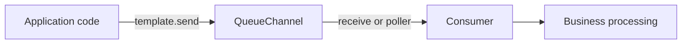
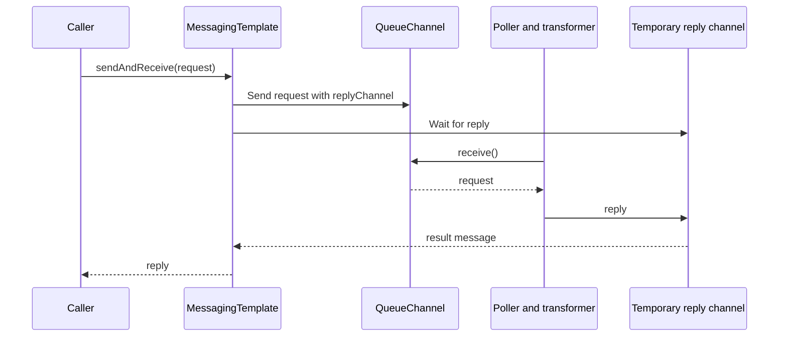

# MessagingTemplate with QueueChannel

In the `SPRING_INTEGRATION_CORE` module, `MessagingTemplate` is the bridge from application code to a message flow. When paired with `QueueChannel`, the application can send a `Message` into a buffer or actively pull messages out for processing. This lesson belongs to the **MessagingTemplate** chapter and focuses on the boundary between send/receive operations and endpoint execution.

The goal is to read a queue-backed flow, choose appropriate timeouts, configure a consumer with the Java DSL, and distinguish message-delivery failures from business processing failures.

## 1. Example Context and Prerequisites

The examples use Java 17 or higher and Spring Integration 6.5 APIs. Your practice project requires `org.springframework.integration:spring-integration-core`; configuration examples also use Spring Context classes, and test examples use JUnit Jupiter. Manage Spring versions via a BOM or synchronized project dependency configuration rather than mixing arbitrary Spring Framework and Spring Integration versions.

The Java classes with `main` below are standalone examples; place each `public` class in a file of the same name when practicing. The remaining short snippets illustrate individual operations and do not all need to be combined into one application.

| Component | Role in This Lesson |
| --- | --- |
| `Message<T>` | Carries payload and headers such as `jobId` and `replyChannel` |
| `QueueChannel` | Holds messages until a consumer pulls them |
| `MessagingTemplate` | Provides send, receive, and request–reply APIs from Java code |
| Polling consumer | Pulls messages from the channel and invokes a handler or transformer |
| `IntegrationFlow` | Describes how channels and endpoints connect together |

The `MessagingTemplate` used here is `org.springframework.integration.core.MessagingTemplate`. It extends Spring Messaging's `GenericMessagingTemplate` and adds support for a default channel. See [MessagingTemplate 6.5.0 Javadoc](https://docs.spring.io/spring-integration/docs/6.5.0/api/org/springframework/integration/core/MessagingTemplate.html).

## 2. Operating Model: A Queue Separates Send Time from Processing Time



Consider a service accepting report-export requests. Success at the queue-insertion step indicates the request was accepted at the channel; the report-generation result must be observed at another step.

With a default `QueueChannel`, messages are retrieved in FIFO order and each message is handed to one consumer. When multiple consumers read the same channel, they compete for work rather than each receiving a copy of every message. The channel does not spawn worker threads on its own; the consumer or poller determines where execution takes place. See [MessageChannel Implementations](https://docs.spring.io/spring-integration/reference/6.5/channel/implementations.html).

Distinguish three milestones in design:

1. **Enqueued:** the send operation succeeded.
2. **Dequeued:** a consumer pulled the message.
3. **Business-completed:** the handler produced the intended outcome.

Do not use the first milestone to assert the third. If an intake API must return status to a user, it can return a job ID and provide a status-lookup mechanism.

## 3. Sending and Receiving Messages with the Template

### 3.1. Standalone Example Without a Spring ApplicationContext

```java
import org.springframework.integration.channel.QueueChannel;
import org.springframework.integration.core.MessagingTemplate;
import org.springframework.messaging.Message;
import org.springframework.messaging.support.MessageBuilder;

public class QueueTemplateBasics {

    public static void main(String[] args) {
        QueueChannel jobs = new QueueChannel(10);

        MessagingTemplate template = new MessagingTemplate(jobs);
        template.setSendTimeout(200);
        template.setReceiveTimeout(500);

        Message<String> request = MessageBuilder
                .withPayload("export-report")
                .setHeader("jobId", "job-1001")
                .build();

        // Use default channel passed to the constructor.
        template.send(request);

        Message<?> received = template.receive();
        if (received == null) {
            throw new IllegalStateException("No job received");
        }

        System.out.println(received.getPayload());
        System.out.println(received.getHeaders().get("jobId"));

        // Queue is now empty; timeout 0 requests an immediate check.
        Message<?> next = template.receive(jobs, 0);
        System.out.println(next == null);
    }
}
```

Application output printed:

```text
export-report
job-1001
true
```

This example intentionally sends and receives on the same thread to isolate learning the API. There is no report-generation step and no background processing yet. When moving to a real application, hand receiving over to a lifecycle-managed consumer.

### 3.2. Default Channel vs. Explicit Channel

You can pass the channel on each operation:

```java
MessagingTemplate template = new MessagingTemplate();
template.setSendTimeout(100);
template.setReceiveTimeout(300);

template.send(jobs, request);
Message<?> received = template.receive(jobs);
```

The two destination-selection forms differ in calling style, not in queue semantics. Use a default channel when one template serves one primary destination; pass the channel directly when you want the destination explicit at the call site. Overloads that omit a destination require a configured default destination.

### 3.3. Do Not Confuse the Return Type of `send`

| Call | Normal Outcome |
| --- | --- |
| `jobs.send(message, timeout)` | `boolean` indicating whether the channel accepted the message |
| `template.send(jobs, message)` | `void`; no success flag is returned |
| `template.receive(jobs)` | `Message<?>`, or `null` when the wait expires with no message |
| `template.sendAndReceive(jobs, message)` | A reply, or `null` when no reply arrives within the wait timeout |

Do not write `boolean sent = template.send(jobs, message);`. The `send` signature in the API used here returns `void`; see [MessageSendingOperations](https://docs.spring.io/spring-framework/docs/6.2.7/javadoc-api/org/springframework/messaging/core/MessageSendingOperations.html).

`receive` requires a channel supporting active polling, namely `PollableChannel`. `QueueChannel` satisfies that requirement. Calling `receive` on a `DirectChannel` is a wrong channel type, not an empty-queue scenario. See [GenericMessagingTemplate](https://docs.spring.io/spring-framework/docs/6.2.7/javadoc-api/org/springframework/messaging/core/GenericMessagingTemplate.html).

## 4. Timeout and Capacity of QueueChannel

### 4.1. Where Do Timeouts Apply?

| Setting | Wait Point in the QueueChannel Example |
| --- | --- |
| `setSendTimeout(200)` | Wait up to 200 ms for space to insert the message into the queue |
| `setReceiveTimeout(500)` | Wait up to 500 ms to pull a message; in request–reply, wait for a reply |
| `receive(channel, 0)` | Try receiving immediately without waiting for new messages in the queue |

With `QueueChannel`: `0` means try immediately, positive means milliseconds to wait, and negative means wait indefinitely. The referenced template defaults both timeouts to `-1`; configure them explicitly. See [GenericMessagingTemplate source](https://raw.githubusercontent.com/spring-projects/spring-framework/v6.2.7/spring-messaging/src/main/java/org/springframework/messaging/core/GenericMessagingTemplate.java).

`sendTimeout` is not a handler execution deadline. A report export taking 30 seconds can still be enqueued in a few milliseconds. Likewise, timing out while waiting for a result does not cancel an already-running job.

### 4.2. Full Queue and Send Failure

```java
import org.springframework.integration.channel.QueueChannel;
import org.springframework.integration.core.MessagingTemplate;
import org.springframework.messaging.MessageDeliveryException;
import org.springframework.messaging.support.GenericMessage;

public class FullQueueExample {

    public static void main(String[] args) {
        QueueChannel jobs = new QueueChannel(1);
        MessagingTemplate template = new MessagingTemplate(jobs);
        template.setSendTimeout(0);

        template.send(new GenericMessage<>("job-1"));

        try {
            template.send(new GenericMessage<>("job-2"));
            throw new IllegalStateException("Queue must reject job-2");
        }
        catch (MessageDeliveryException ex) {
            System.out.println("Queue is full; apply overload policy");
        }

        System.out.println(template.receive(jobs, 0).getPayload());
    }
}
```

`job-1` remains in the queue. The template turns a `false` send return into `MessageDeliveryException` instead of returning a `boolean` flag. See [GenericMessagingTemplate doSend](https://raw.githubusercontent.com/spring-projects/spring-framework/v6.2.7/spring-messaging/src/main/java/org/springframework/messaging/core/GenericMessagingTemplate.java).

In an application, the `catch` block must tie to a concrete decision: reject the new request, signal overload, or route work to storage with suitable guarantees. Never default to unbounded retries right on the request-intake thread.

### 4.3. Sizing Capacity Using Load Assumptions

Back-of-the-envelope example: a producer generates 120 requests/second during a 5-second burst while a consumer processes 80 requests/second. The added backlog is approximately:

```text
(120 - 80) × 5 = 200 messages
```

A capacity of 100 cannot absorb this burst without another load-shedding mechanism. A capacity of 250 leaves extra headroom, though initial backlog, payload sizes, and processing-time variance still matter. This is an estimation model for the stated scenario, not a universal guarantee formula.

If sustained load stays at 120 requests/second while capacity remains 80, increasing queue size only delays when it fills up. You must change processing capacity or intake rate.

The no-arg constructor creates a queue with a very large bound; choosing a finite capacity makes memory budgets explicit. `QueueChannel(int capacity)` requires a positive number; unbuffered handoff belongs to `RendezvousChannel`. See [QueueChannel Javadoc](https://docs.spring.io/spring-integration/docs/6.5.0/api/org/springframework/integration/channel/QueueChannel.html).

## 5. Consumer: Active Receive or Poller

Distinguish two usage patterns:

| How Messages Are Pulled | Who Triggers the Receive? |
| --- | --- |
| Java code calling `template.receive(queue)` | Application code itself |
| Endpoint reading from a `QueueChannel` | Poller attached to the endpoint |

With the first approach, no poller needs to be declared for a `receive` call to work. If you build custom workers, the application must manage worker startup, shutdown, interruption, and error handling.

With the second approach, a polling consumer connects the channel to a handler. A poller must be configured on the endpoint or supplied via an appropriate default poller. That is an endpoint responsibility, not an auto-running feature of the queue itself. See [Message Endpoints](https://docs.spring.io/spring-integration/reference/6.5/endpoint.html).

A common design mistake is using the same thread to call `sendAndReceive` while intending to pull and process the request on the next statement. The thread is already blocked waiting for a reply, so it cannot run the reply-producing code. An independent consumer must already be ready before waiting starts.

## 6. Java DSL: QueueChannel → Transformer → Reply

The example below simulates order-code normalization. The caller sends a string into a queue; a poller pulls it, a transformer normalizes it, and the result returns to the caller.

```java
import java.time.Duration;
import java.util.Locale;

import org.springframework.context.annotation.AnnotationConfigApplicationContext;
import org.springframework.context.annotation.Bean;
import org.springframework.context.annotation.Configuration;
import org.springframework.integration.channel.QueueChannel;
import org.springframework.integration.config.EnableIntegration;
import org.springframework.integration.core.MessagingTemplate;
import org.springframework.integration.dsl.IntegrationFlow;
import org.springframework.integration.dsl.Pollers;
import org.springframework.messaging.Message;
import org.springframework.messaging.support.ErrorMessage;
import org.springframework.messaging.support.GenericMessage;

public class QueueDslExample {

    @Configuration
    @EnableIntegration
    public static class FlowConfig {

        @Bean
        public QueueChannel workRequests() {
            return new QueueChannel(100);
        }

        @Bean
        public MessagingTemplate workTemplate(QueueChannel workRequests) {
            MessagingTemplate template = new MessagingTemplate(workRequests);
            template.setSendTimeout(200);
            template.setReceiveTimeout(2_000);
            template.setThrowExceptionOnLateReply(true);
            return template;
        }

        @Bean
        public IntegrationFlow normalizeFlow(QueueChannel workRequests) {
            return IntegrationFlow.from(workRequests)
                    .transform(
                            String.class,
                            text -> text.strip().toUpperCase(Locale.ROOT),
                            endpoint -> endpoint.poller(
                                    Pollers.fixedDelay(Duration.ofMillis(100))
                                            .receiveTimeout(0)
                                            .maxMessagesPerPoll(5)))
                    .get();
        }
    }

    public static void main(String[] args) {
        try (AnnotationConfigApplicationContext context =
                     new AnnotationConfigApplicationContext(FlowConfig.class)) {

            MessagingTemplate template =
                    context.getBean("workTemplate", MessagingTemplate.class);

            Message<?> reply = template.sendAndReceive(
                    new GenericMessage<>("  order-42  "));

            if (reply == null) {
                throw new IllegalStateException("Timed out waiting for normalization");
            }
            if (reply instanceof ErrorMessage error) {
                throw new IllegalStateException("Processing flow failed",
                        error.getPayload());
            }

            System.out.println(reply.getPayload());
        }
    }
}
```

When processing succeeds within the wait window, the application prints `ORDER-42`. The `ApplicationContext` manages the integration components and closes after the example finishes.

The `.transform(...)` configuration creates the payload-processing endpoint; the last argument configures the endpoint reading the queue. Refer to the overloads in [BaseIntegrationFlowDefinition](https://docs.spring.io/spring-integration/docs/6.5.0/api/org/springframework/integration/dsl/BaseIntegrationFlowDefinition.html).

Read the poller configuration in three parts:

- `fixedDelay(100 ms)` sets the pause between executions of the polling task under fixed-delay scheduling.
- `receiveTimeout(0)` makes each poller pull return immediately without waiting for more data in the queue.
- `maxMessagesPerPoll(5)` limits how many messages are processed per poll execution; it does not spawn five concurrent workers.

The configuration API is documented in [Pollers](https://docs.spring.io/spring-integration/docs/6.5.0/api/org/springframework/integration/dsl/Pollers.html) and [PollerSpec](https://docs.spring.io/spring-integration/docs/6.5.0/api/org/springframework/integration/dsl/PollerSpec.html). You can define a [default poller with the DSL](https://docs.spring.io/spring-integration/reference/6.5/dsl/java-pollers.html), though this example configures it directly on the endpoint so readers clearly see where messages are pulled.

Note that the **poller**'s `receiveTimeout(0)` differs from the **template**'s `setReceiveTimeout(2_000)`. The first applies when the poller pulls requests; the second applies when the caller waits for a reply.

## 7. Request–Reply Across a Queue

### 7.1. Where Does the Reply Go?



`sendAndReceive` creates a temporary reply channel and places it in the `replyChannel` header. For a reply-producing endpoint, when no other output channel is specified, this header tells it where to send the result. The request channel does not automatically become the reply channel. The temporary channel mechanism is introduced in the [MessagingTemplate documentation](https://docs.spring.io/spring-integration/reference/7.0/channel/template.html).

The Java DSL example relies on the transformer returning a value and the reply routing header staying intact. If you switch the handler to a no-return operation, update the caller contract to a one-way send or build an explicit reply-producing path.

If you append `.channel("results")` after the transformer to route results to a separate queue, you must design a consumer for that queue or a forwarding path back to the reply destination. Putting results into `results` does not make the caller automatically look for messages there.

### 7.2. Why Does `send(queue)` Followed by `receive(queue)` Not Replace Request–Reply?

Consider this sequence:

```text
caller sends request into workRequests
caller receives immediately from workRequests
```

The caller may pull right back the exact request it just sent. If another consumer reads the same queue, the caller even competes with that consumer for the job. Nothing in that sequence guarantees the received message is the outcome of the original request.

If an application needs to manage separate request and reply queues itself, the contract must specify how requests and replies are correlated, how expired replies are handled, and how replies reach the right caller. With multiple callers reading one reply queue, merely adding a request-ID header is not enough to prevent one caller from pulling another caller's reply.

### 7.3. Timing Out Does Not Cancel the Request

Hypothetical timeline:

```text
t =   0 ms: request is enqueued
t = 100 ms: caller times out and receives null
t = 300 ms: consumer finally pulls the request
t = 500 ms: business processing finishes
```

The caller knows it did not receive a reply on time, yet cannot conclude business processing failed. Retrying immediately can create duplicate work.

For side-effecting tasks, maintain a stable business request ID, idempotent processing, and queryable status. For instance, `jobId` can serve as a business key if the system enforces uniqueness and records outcomes against that key.

In the example, `setThrowExceptionOnLateReply(true)` flags errors on the reply-sending side when the caller is no longer receiving. This is a diagnostic signal, not a rollback or task-cancellation mechanism. See [the late-reply option](https://docs.spring.io/spring-framework/docs/6.2.7/javadoc-api/org/springframework/messaging/core/GenericMessagingTemplate.html#setThrowExceptionOnLateReply(boolean)).

## 8. Sending Payloads with convertAndSend

When you do not need to build a `Message` manually, you can send payloads and headers via the conversion API:

```java
import java.util.Map;

import org.springframework.integration.channel.QueueChannel;
import org.springframework.integration.core.MessagingTemplate;
import org.springframework.messaging.converter.SimpleMessageConverter;

QueueChannel jobs = new QueueChannel(10);
MessagingTemplate template = new MessagingTemplate(jobs);
template.setSendTimeout(100);
template.setReceiveTimeout(100);
template.setMessageConverter(new SimpleMessageConverter());

template.convertAndSend(
        "report-2026-11",
        Map.of("jobId", "job-1002"));

String payload = template.receiveAndConvert(jobs, String.class);
System.out.println(payload);
```

The example prints `report-2026-11` if received successfully. If the wait expires with no message, the result is `null`; application code must check that case before using it.

`SimpleMessageConverter` in the example only wraps/unwraps payloads of compatible types. Do not infer that arbitrary POJOs are automatically serialized to JSON or JSON strings are parsed into DTOs. Real format conversion requires configuring an appropriate converter. See [SimpleMessageConverter](https://docs.spring.io/spring-framework/docs/6.2.7/javadoc-api/org/springframework/messaging/converter/SimpleMessageConverter.html).

If you need to inspect `jobId`, `replyChannel`, or error information, use `receive` to retain the full envelope instead of extracting only the payload.

## 9. Message Delivery Failures vs. Processing Failures

| Situation | What Calling Code Must Distinguish |
| --- | --- |
| Queue full, send timeout expires | The request was not accepted by the channel on that send attempt |
| Queue empty, receive timeout expires | No message arrived; the result can be `null` |
| Request enqueued, handler later errors | Failure belongs to the consumer's processing step |
| Caller timed out, consumer still running | Business status remains undetermined from the caller's perspective |

With a consumer driven by a Spring Integration poller, errors in the polling task are handled via the error-message mechanism. The request's `errorChannel` header takes priority when routing errors; if absent, default handling uses the channel named `errorChannel`. Custom hand-written workers must handle their own errors. See [Error Handling](https://docs.spring.io/spring-integration/reference/6.5/error-handling.html).

In request–reply, the template also binds the temporary channel to `errorChannel`. The message-receiving API can return an `ErrorMessage`; that is why the Java DSL example checks for errors before reading the payload. See [doSendAndReceive](https://raw.githubusercontent.com/spring-projects/spring-framework/v6.2.7/spring-messaging/src/main/java/org/springframework/messaging/core/GenericMessagingTemplate.java).

A `try/catch` around `template.send(request)` only observes exceptions occurring during that send call. If the consumer processes the message after the send call returns, that `catch` block cannot catch exceptions thrown on the consumer thread via normal exception propagation.

In a report-export design, you can track states `ACCEPTED`, `RUNNING`, `SUCCEEDED`, and `FAILED` by `jobId`. This state tracking is an application contract and must be designed alongside result storage and retry policies.

## 10. Tests Illustrating Behavior

The tests below focus on observable contracts: pulling messages from a queue, failing when no space remains, and reply timeouts not removing requests. They use timeout `0` in immediate checks so `Thread.sleep` is unnecessary.

```java
import org.junit.jupiter.api.Test;
import org.springframework.integration.channel.QueueChannel;
import org.springframework.integration.core.MessagingTemplate;
import org.springframework.messaging.Message;
import org.springframework.messaging.MessageDeliveryException;
import org.springframework.messaging.support.GenericMessage;

import static org.junit.jupiter.api.Assertions.*;

class QueueTemplateTest {

    @Test
    void receiveRemovesMessagesInFifoOrder() {
        QueueChannel queue = new QueueChannel(2);
        MessagingTemplate template = new MessagingTemplate(queue);
        template.setSendTimeout(0);
        template.setReceiveTimeout(0);

        template.send(new GenericMessage<>("A"));
        template.send(new GenericMessage<>("B"));

        Message<?> first = template.receive();
        Message<?> second = template.receive();

        assertNotNull(first);
        assertNotNull(second);
        assertEquals("A", first.getPayload());
        assertEquals("B", second.getPayload());
        assertNull(template.receive());
    }

    @Test
    void fullQueueRaisesDeliveryExceptionWithoutReplacingOldMessage() {
        QueueChannel queue = new QueueChannel(1);
        MessagingTemplate template = new MessagingTemplate(queue);
        template.setSendTimeout(0);
        template.setReceiveTimeout(0);

        template.send(new GenericMessage<>("A"));

        assertThrows(MessageDeliveryException.class,
                () -> template.send(new GenericMessage<>("B")));

        Message<?> remaining = template.receive();
        assertNotNull(remaining);
        assertEquals("A", remaining.getPayload());
        assertNull(template.receive());
    }

    @Test
    void replyTimeoutDoesNotRemoveRequestFromQueue() {
        QueueChannel queue = new QueueChannel(1);
        MessagingTemplate template = new MessagingTemplate(queue);
        template.setSendTimeout(0);
        template.setReceiveTimeout(0);
        template.setThrowExceptionOnLateReply(true);

        // No consumer; nobody produces a reply.
        Message<?> reply = template.sendAndReceive(
                new GenericMessage<>("job-7"));

        assertNull(reply);

        Message<?> queued = template.receive(queue, 0);
        assertNotNull(queued);
        assertEquals("job-7", queued.getPayload());
    }
}
```

To test the Java DSL flow from section 6, you can use the following test class together with `QueueDslExample.FlowConfig`:

```java
import org.junit.jupiter.api.Test;
import org.springframework.context.annotation.AnnotationConfigApplicationContext;
import org.springframework.integration.core.MessagingTemplate;
import org.springframework.messaging.Message;
import org.springframework.messaging.support.ErrorMessage;
import org.springframework.messaging.support.GenericMessage;

import static org.junit.jupiter.api.Assertions.*;

class QueueDslTest {

    @Test
    void pollingTransformerRepliesToCaller() {
        try (AnnotationConfigApplicationContext context =
                     new AnnotationConfigApplicationContext(
                             QueueDslExample.FlowConfig.class)) {

            MessagingTemplate template =
                    context.getBean("workTemplate", MessagingTemplate.class);

            Message<?> reply = template.sendAndReceive(
                    new GenericMessage<>("  order-42  "));

            assertNotNull(reply);
            assertFalse(reply instanceof ErrorMessage);
            assertEquals("ORDER-42", reply.getPayload());
        }
    }
}
```

This test confirms a request passes through a polling endpoint and returns to the caller. It does not measure throughput, prove load capacity, or guarantee every reply completes within two seconds in all environments.

## 11. Application Usage Boundaries

### 11.1. In-Process Buffer vs. Durability

`new QueueChannel(capacity)` in this lesson is an in-memory queue. Successfully enqueuing a message does not write work to durable storage. When business requirements demand surviving process restarts, design persistent storage or use appropriate messaging infrastructure.

Spring Integration supports message-store-backed queues; that is a separate option with its own configuration and transaction requirements. Never infer durability from the name `QueueChannel` alone. See [Channel configuration and message stores](https://docs.spring.io/spring-integration/reference/6.5/channel/configuration.html).

### 11.2. Successful Receive Is Not a Business Acknowledgment

In the example's in-memory queue, once `receive` returns a message, that message has been removed. If a subsequent processing step fails, there is no guarantee it will automatically return to the queue. Retries, dead-letter persistence, and crash recovery must be designed explicitly.

Avoid labeling a flow “exactly once” merely because it uses a queue. A task can complete side effects and fail right before recording completion; retries then require business-level deduplication.

### 11.3. Completion Order and Shared Data

FIFO describes dequeue order on a default queue. If multiple workers process different messages, a job pulled later can finish before one pulled earlier.

For example, worker A receives a large report while worker B receives a small report. Even though the large report was pulled first, the small report can finish exporting sooner. If per-customer or per-order ordering is needed, encode that requirement into consumer design and work partitioning.

Do not mutate a shared payload object after sending and expect the consumer to always see the old value. In the examples, strings are immutable and avoid this issue; for mutable DTOs, clarify ownership or create independent copies before sending.

### 11.4. Load Observability and Lifecycle

Useful metrics for the report-export service example include pending job count, age of the oldest job, send failure count, processing latency, and failed-job rate.

`getQueueSize()` is useful for point-in-time observation, yet never use a “check space then send” pattern as a concurrency guarantee. Queue state can change between checking and sending; the outcome of the send operation itself determines whether that attempt succeeded.

For application-created custom workers, establish a stop policy and handling for in-flight work. In Spring examples, closing the `ApplicationContext` releases context-managed lifecycle components; if you need to drain in-flight jobs before stopping, design a shutdown policy accordingly.

## 12. Quick Diagnostics

| Symptom | What to Check |
| --- | --- |
| Send succeeds yet no processing happens | Has the consumer started; does the endpoint have a poller or default poller? |
| Producer waits for a long time | Is the queue full; what is the send timeout set to? |
| `receive` returns `null` | Is the queue empty, or did another consumer pull the message? |
| Compile error assigning `template.send` to boolean | Check API signature; template `send` returns `void` |
| `sendAndReceive` times out | Does an endpoint produce a reply; where does the reply go; do queue wait plus processing exceed the budget? |
| Caller receives `ErrorMessage` | Inspect error payload and failing request details |
| Late-reply error appears | Caller stopped waiting while processing tried to return a result |
| Retries produce duplicate reports | Check business request IDs and idempotency mechanisms |
| Switched to `DirectChannel` and `receive` fails | `receive` requires a `PollableChannel` |

When implementing a use case, start with an explicit contract: one-way or reply required, acceptable wait duration, response when the queue is full, who handles errors, and where business outcomes are stored. Only then pick capacity, pollers, and how `MessagingTemplate` is used.
