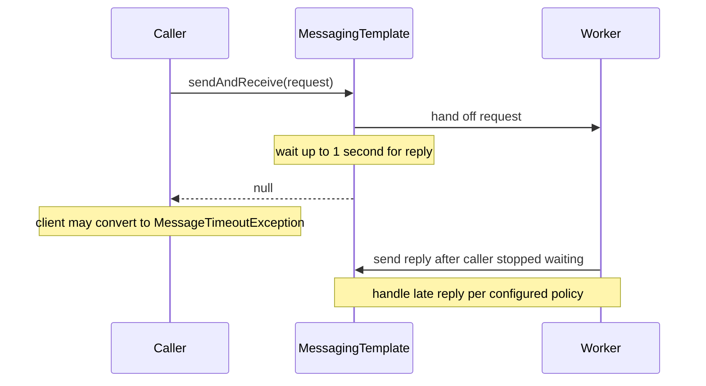

# Handling MessageTimeoutException

## 1. Objectives and Scope

In the **MessagingTemplate** chapter of the **SPRING_INTEGRATION_CORE** module, this lesson explains how to identify and handle cases where a message exchange does not finish within the wait timeout. The focus is on the relationship among `Message`, `MessageChannel`, endpoints, gateways, and Java DSL flows—and from there designing appropriate replies, error handling, and tests.

After this lesson, you will be able to:

- Distinguish send failures, missing message receives, and missing replies.
- Know when `MessageTimeoutException` occurs versus when only `null` or `MessageDeliveryException` occurs.
- Enforce a required-reply policy at the application boundary.
- Handle late replies, retries, and undetermined business outcomes.
- Write tests reproducing these scenarios without relying on `Thread.sleep()`.

Examples use Java 17+, Spring Integration 6.3.x, and JUnit Jupiter. Version-specific details are verified against Spring Integration 6.3.2 and Spring Framework 6.1.11 APIs. This is a behavioral reference baseline, not a requirement to change the version of the application you are studying.

## 2. Understanding the Exception Hierarchy

The class to use resides in the Spring Integration package:

```java
import org.springframework.integration.MessageTimeoutException;
```

Relevant inheritance hierarchy:

```text
RuntimeException
└── ...
    └── org.springframework.messaging.MessagingException
        └── org.springframework.messaging.MessageDeliveryException
            └── org.springframework.integration.MessageTimeoutException
```

`MessageTimeoutException` is an unchecked exception that does not require a `throws` declaration. It offers constructors accepting the failed message, a description, and a cause. `getFailedMessage()` helps trace context back, though it can return `null` if the exception was constructed with only a description. [MessageTimeoutException 6.3.2 API](https://docs.spring.io/spring-integration/docs/6.3.2/api/org/springframework/integration/MessageTimeoutException.html).

Because of this inheritance relationship, if you need dedicated handling, place `catch (MessageTimeoutException ...)` before `catch (MessageDeliveryException ...)`. The exception class reflects the layer that detected the issue; determining the root cause still requires inspecting the channel, processing phase, and `cause` chain.

## 3. Timing Out Does Not Always Throw MessageTimeoutException

`org.springframework.integration.core.MessagingTemplate` extends `GenericMessagingTemplate`. Under the base mechanism in the referenced versions, distinguish the following outcomes. [MessagingTemplate 6.3.2 source](https://github.com/spring-projects/spring-integration/blob/v6.3.2/spring-integration-core/src/main/java/org/springframework/integration/core/MessagingTemplate.java).

| Operation | Situation | Outcome on the Base Template |
|---|---|---|
| `send(channel, message)` | Channel returns `false` on send | Throws `MessageDeliveryException` |
| `receive(pollableChannel)` | Receive timeout expires with no message | Returns `null` |
| `sendAndReceive(channel, request)` | Send completes yet no reply arrives before receive timeout expires | Returns `null` |
| Send to synchronous flow | Handler throws an exception | Exception propagates to caller; errors are not automatically turned into timeouts |

Both the `false` and `null` branches appear directly in the [GenericMessagingTemplate 6.1.11 source](https://github.com/spring-projects/spring-framework/blob/v6.1.11/spring-messaging/src/main/java/org/springframework/messaging/core/GenericMessagingTemplate.java).

Therefore, merely writing `try/catch (MessageTimeoutException ...)` around `template.sendAndReceive(...)` does not guarantee handling a missing reply. The application must check `null`, or use a gateway with a policy that raises an error on timeout.

For example, for a price-quote lookup, the application might tolerate a missing result by falling back to a default price. For an order-confirmation operation, a missing reply may need to become an error with an explicit message and trace ID. This policy belongs at the business boundary.

## 4. Separating Send Time, Receive Time, and Processing Time

### 4.1. Two Different Configurations

```java
import org.springframework.integration.core.MessagingTemplate;

MessagingTemplate template = new MessagingTemplate();
template.setSendTimeout(200L);
template.setReceiveTimeout(1_000L);
template.setThrowExceptionOnLateReply(true);
```

`sendTimeout` applies to sending when the channel has a wait mechanism, such as waiting for space in a queue. `receiveTimeout` applies to receiving or waiting for a reply. Values are in milliseconds; for the corresponding wait mechanism, `0` tries immediately, positive waits finitely, and negative waits indefinitely. Blocking behavior also depends on the channel type. [Message Channel Implementations](https://docs.spring.io/spring-integration/reference/channel/implementations.html).

Do not repeatedly call `setReceiveTimeout()` on a singleton template per request: concurrent callers will share mutating configuration. Keep configuration stable, use separate templates for distinct policies, or use per-request headers:

```java
import org.springframework.messaging.Message;
import org.springframework.messaging.core.GenericMessagingTemplate;
import org.springframework.messaging.support.MessageBuilder;

Message<String> request = MessageBuilder.withPayload("SKU-42")
        .setHeader("operationId", "quote-1001")
        .setHeader(GenericMessagingTemplate.DEFAULT_SEND_TIMEOUT_HEADER, 100L)
        .setHeader(GenericMessagingTemplate.DEFAULT_RECEIVE_TIMEOUT_HEADER, 800L)
        .build();
```

With `sendAndReceive`, the template's timeout headers can override settings for that call and are stripped before forwarding down the flow. They are not deadlines automatically propagated through every endpoint. [GenericMessagingTemplate 6.1.11 API](https://docs.spring.io/spring-framework/docs/6.1.11/javadoc-api/org/springframework/messaging/core/GenericMessagingTemplate.html).

### 4.2. DirectChannel Provides No Handler Interruption via receiveTimeout

Suppose a handler runs directly on the caller's thread and takes three seconds. `receiveTimeout = 100` does not interrupt the handler after 100 ms. The caller is still executing the send step and running the handler; reply waiting begins only after the send step returns control.

Once the synchronous flow has produced a reply, that reply can be ready immediately at receive time. Only when the flow hands off to another thread does the caller wait for the result within the configured timeout. This point is also explained in [Messaging Gateways — timeouts and sync/async flows](https://docs.spring.io/spring-integration/reference/gateway.html).

Design example:

```text
Synchronous flow:
caller ── send/handler: 3 seconds ── receive: reply already present ── return result

Thread-handoff flow:
caller ── hand off work ── wait up to 1 second for reply ── return null
worker                  └── may still be processing
```

Accordingly, time bounds for HTTP calls, database queries, or I/O operations must be configured on the client/component executing them. To budget an entire operation, also factor in pre-handoff time, queue residence time, and result-mapping time.

## 5. Enforcing a Required-Reply Contract

One way to use the template is wrapping it in a client with an explicit policy: if the call finishes without receiving a reply, throw `MessageTimeoutException` tied to the original request. The example below also reserves `Throwable` payloads for propagating downstream errors.

```java
import org.springframework.integration.MessageTimeoutException;
import org.springframework.integration.core.MessagingTemplate;
import org.springframework.messaging.Message;
import org.springframework.messaging.MessageChannel;
import org.springframework.messaging.MessagingException;

public final class RequiredReplyClient {

    private final MessageChannel requestChannel;
    private final MessagingTemplate template;

    public RequiredReplyClient(MessageChannel requestChannel,
                               long sendTimeoutMs,
                               long receiveTimeoutMs) {
        if (sendTimeoutMs < 0 || receiveTimeoutMs < 0) {
            throw new IllegalArgumentException("Finite timeouts are required");
        }
        this.requestChannel = requestChannel;
        this.template = new MessagingTemplate();
        this.template.setSendTimeout(sendTimeoutMs);
        this.template.setReceiveTimeout(receiveTimeoutMs);
        this.template.setThrowExceptionOnLateReply(true);
    }

    public Message<?> exchange(Message<?> request) {
        Message<?> reply = this.template.sendAndReceive(
                this.requestChannel, request);

        if (reply == null) {
            if (Thread.currentThread().isInterrupted()) {
                throw new MessagingException(request,
                        "Thread interrupted while waiting for reply");
            }
            throw new MessageTimeoutException(request,
                    "No reply received within the wait timeout");
        }

        if (reply.getPayload() instanceof Throwable failure) {
            if (failure instanceof Error fatal) {
                throw fatal;
            }
            if (failure instanceof RuntimeException runtime) {
                throw runtime;
            }
            throw new MessagingException(request,
                    "Downstream returned an error via reply", failure);
        }

        return reply;
    }
}
```

This is a policy added by the application, not the default behavior of every `MessagingTemplate`. Checking the interrupt state avoids misclassifying every `null` result as a timeout; the temporary reply channel implementation includes a branch that restores the interrupt flag when waiting is interrupted. [GenericMessagingTemplate — TemporaryReplyChannel](https://github.com/spring-projects/spring-framework/blob/v6.1.11/spring-messaging/src/main/java/org/springframework/messaging/core/GenericMessagingTemplate.java#L254-L339).

The client does not catch and convert every `MessagingException` into a timeout. For example, payload conversion failures, handler business errors, or missing-subscriber errors must preserve their original meaning so callers can react appropriately.

Timeout headers can change the effective wait time per request. So if you enrich logs, log the effective value rather than always claiming the call waited for the constructor's default duration.

## 6. Connecting to a Java DSL Flow

Example configuring a pricing flow with a thread handoff before the processing step. Place this class in the same package as `RequiredReplyClient` above.

```java
import org.springframework.context.annotation.Bean;
import org.springframework.context.annotation.Configuration;
import org.springframework.integration.channel.DirectChannel;
import org.springframework.integration.config.EnableIntegration;
import org.springframework.integration.dsl.IntegrationFlow;
import org.springframework.scheduling.concurrent.ThreadPoolTaskExecutor;

@Configuration
@EnableIntegration
public class QuoteFlowConfiguration {

    @Bean
    public DirectChannel quoteRequests() {
        return new DirectChannel();
    }

    @Bean
    public ThreadPoolTaskExecutor quoteExecutor() {
        ThreadPoolTaskExecutor executor = new ThreadPoolTaskExecutor();
        executor.setCorePoolSize(4);
        executor.setMaxPoolSize(4);
        executor.setQueueCapacity(16);
        executor.setThreadNamePrefix("quote-");
        return executor;
    }

    @Bean
    public IntegrationFlow quoteFlow(DirectChannel quoteRequests,
                                     ThreadPoolTaskExecutor quoteExecutor) {
        return IntegrationFlow.from(quoteRequests)
                .channel(channels -> channels.executor(quoteExecutor))
                .handle(String.class,
                        (sku, headers) -> "QUOTE:" + sku)
                .get();
    }

    @Bean
    public RequiredReplyClient quoteClient(DirectChannel quoteRequests) {
        return new RequiredReplyClient(quoteRequests, 200L, 1_000L);
    }
}
```

The Java DSL supports executor channels to hand messages off to an `Executor`. Spring manages the executor bean's lifecycle in this example. [MessageChannels 6.3.2 API](https://docs.spring.io/spring-integration/docs/6.3.2/api/org/springframework/integration/dsl/MessageChannels.html).

Application call:

```java
Message<?> reply = quoteClient.exchange(request);
String quote = (String) reply.getPayload();
```

Here `request` is the string-payload message built in section 4. In a real application, replace the string concatenation with a pricing service and configure that service's I/O timeouts.

Key points to understand when changing configuration:

- Succeeding at executor handoff does not mean the pricing step has finished.
- `sendTimeout = 200` does not turn task submission into an exact 200 ms wait when the executor is full. The executor has its own rejection policy; overload failures must be classified by the actual exception.
- Switching to a caller-runs rejection policy under overload can make processing run synchronously again. Re-evaluate return-time expectations when doing so.
- The caller's `receiveTimeout` neither removes tasks from the queue nor cancels running tasks.

## 7. Send Failure Because a Queue Is Full

`QueueChannel` can be created with a bounded capacity. When the queue is full, sending can wait for space according to the timeout; distinguish the channel's return value from the template API wrapping it. [QueueChannel 6.3.2 API](https://docs.spring.io/spring-integration/docs/6.3.2/api/org/springframework/integration/channel/QueueChannel.html).

```java
import org.springframework.integration.channel.QueueChannel;
import org.springframework.integration.core.MessagingTemplate;
import org.springframework.messaging.MessageDeliveryException;
import org.springframework.messaging.support.GenericMessage;

QueueChannel queue = new QueueChannel(1);
boolean firstAccepted = queue.send(new GenericMessage<>("first"), 0L);
if (!firstAccepted) {
    throw new IllegalStateException("Failed to set up demo data");
}

MessagingTemplate template = new MessagingTemplate();
template.setSendTimeout(0L);

try {
    template.send(queue, new GenericMessage<>("second"));
} catch (MessageDeliveryException deliveryFailure) {
    // In this example the queue is full and no consumer is pulling messages.
    // Caller can reject the request or route to a bounded retry mechanism.
    throw deliveryFailure;
}
```

The example uses `0` to fail immediately when unable to send. Changing it to a positive number allows waiting up to that limit if the channel supports it. Never inspect exception types by searching for the substring `timeout` in error messages: message wording can change, and many delivery failures are not timeouts.

An unaccepted message in this queue example has a different state from a message accepted downstream where the caller simply has not received a result yet. Retries must account for that difference.

## 8. Using a Gateway to Raise Errors on Missing Replies

If the application prefers calling a business interface rather than manipulating `Message` directly, a gateway can be used. Starting in Spring Integration 6.2, `@MessagingGateway` provides the `errorOnTimeout` attribute. Enabling it causes a missing reply to produce a `MessageTimeoutException` or an error message sent to an error channel. [MessagingGateway API — errorOnTimeout](https://docs.spring.io/spring-integration/docs/6.3.2/api/org/springframework/integration/annotation/MessagingGateway.html#errorOnTimeout()).

```java
import org.springframework.integration.annotation.MessagingGateway;

@MessagingGateway(
        defaultRequestChannel = "quoteRequests",
        defaultRequestTimeout = "200",
        defaultReplyTimeout = "1000",
        errorOnTimeout = true
)
public interface QuoteGateway {

    String quote(String sku);
}
```

With this setup, no separate error channel is declared; timeout errors propagate back to the caller. If `errorChannel` is declared, the error-handling flow can return a fallback result matching the gateway's return type. [MessagingGatewaySupport 6.3.2 source](https://github.com/spring-projects/spring-integration/blob/v6.3.2/spring-integration-core/src/main/java/org/springframework/integration/gateway/MessagingGatewaySupport.java).

Gateway interfaces must be discovered by `@IntegrationComponentScan` in an appropriate configuration; plain `@ComponentScan` does not register them automatically. [MessagingGateway API — interface registration](https://docs.spring.io/spring-integration/docs/6.3.2/api/org/springframework/integration/annotation/MessagingGateway.html).

The two choices are interchangeable boundaries: use `RequiredReplyClient` when you want direct control over messages/headers, or use a gateway when you want an interface contract. Never call `setErrorOnTimeout(true)` on `MessagingTemplate`: that is not a template property.

## 9. Synchronous Errors, ErrorMessage, and errorChannel

For a flow running on the caller thread, handler exceptions unwind down the call stack. A `try/catch` at the caller can handle them. Past a thread handoff, errors must route through the endpoint/executor error-handling mechanism; a `try/catch` around the send step does not automatically catch everything happening afterward. Spring Integration uses `ErrorMessage` and prioritizes the `errorChannel` header when publishing error messages through supported mechanisms. [Error Handling](https://docs.spring.io/spring-integration/reference/error-handling.html).

With request–reply, the template uses a temporary reply channel for the exchange. When designing an error branch, decide explicitly:

| Error Branch Contract | Required Behavior |
|---|---|
| Caller needs to receive an error | Error routes back to the waiting boundary; client/gateway must interpret it |
| Caller needs a fallback value | Return a payload matching the business contract |
| Log only and terminate | Accept that the caller may keep waiting and then time out |
| Independent background processing | Provide an operation ID and result lookup after the caller leaves |

In `RequiredReplyClient`, a `Throwable` payload is interpreted as an error under the chosen contract. This avoids returning an error message as if it were a successful price quote. If a business domain genuinely needs to pass `Throwable` as ordinary data, change that convention.

Do not assume every error reaches the global `errorChannel`, or that attaching a header named `errorChannel` automatically builds full error-publishing support for any custom `Executor`. Identify which component catches exceptions, which emits `ErrorMessage`, and who produces the final reply.

## 10. Late Replies

Consider this sequence:



`setThrowExceptionOnLateReply(true)` causes the reply-sending side to receive `MessageDeliveryException` when sending to a temporary reply channel that has timed out. This setting also covers duplicate replies or exchanges that failed during sending. It does not make the old caller resume waiting or receive a new exception after returning. [GenericMessagingTemplate API — late reply](https://docs.spring.io/spring-framework/docs/6.1.11/javadoc-api/org/springframework/messaging/core/GenericMessagingTemplate.html#setThrowExceptionOnLateReply(boolean)).

In the example, this property is set explicitly so the policy is visible. If the reply-send failure is wrapped by an endpoint, inspect `cause` too rather than checking only the outermost class name.

Late-reply handling depends on the business domain:

- A price quote for single-screen display can be discarded, with metrics flagging system slowdown.
- Order-creation results should be persisted by `operationId` for later status queries.
- Long-running tasks should use an accept-and-poll contract instead of holding a thread for too long.

Do not use a temporary `replyChannel` as a durable storage address. If a request crosses a broker or external system, use transport-appropriate reply address mapping and correlation.

## 11. Avoiding Timeouts Caused by Flows Missing a Return Path

Timeouts can originate from flow structure even when every service runs quickly. For request–reply flows, treat every branch as a contract that must end with a reply, an error, or an agreed asynchronous state.

| Component | Case to Check | Design Direction |
|---|---|---|
| Transformer | Replaces the message and drops headers needed for returning | Preserve reply context when building a new message |
| Filter | Drops a request and ends the branch while caller waits | Return a rejection status, raise an error, or explicitly specify no reply |
| Router | One branch goes to an event-only sink | Identify which branch returns results or change the interaction contract |
| Service activator | Returns `null` even though the caller expects a result | Consider `requiresReply` to surface contract violations early |
| Aggregator | Group has not met its release condition | Define incomplete-group handling, group timeout, and final output |
| Polling endpoint | Poll interval is too long or consumer is stopped | Align polling schedule with caller wait time |

For example, an aggregator waiting on two sources where the second never arrives leaves the group incomplete. Increasing `receiveTimeout` only makes the caller wait longer. Decide what to return when a source is missing: partial reply, error, or in-progress status.

An aggregator's group timeout and the reply wait timeout are two distinct policies. If the group releases after the caller has stopped waiting, the result can still become a late reply. Also factor queue wait time and reply creation into latency budgets.

## 12. Retries and Undetermined Business Outcomes

Missing a reply on time only tells you the caller has not observed the outcome yet. For state-mutating operations, downstream work may already have completed before the reply slowed down or failed to return.

For instance, when creating an order, assign an `operationId` before the first send, record it on the processing side, and reuse the same identifier when retrying that same operation. `MessageHeaders.ID` is a per-message identifier and does not automatically serve as a business deduplication key.

| Identified Situation | Applicable Policy |
|---|---|
| Queue refused message in section 7's example | Bounded retry if the cause is transient and budget remains |
| Idempotent data read | Safe to retry, with attempt count and time limits |
| Order creation accepted yet no result returned | Query by `operationId`; resend only if deduplication is in place |
| Invalid payload or channel configuration | Fix the root cause; repeating the same data rarely helps |
| Caller thread interrupted | Honor the interrupt signal and application shutdown policy |

Place retries at the right layer. Retry advice on a handler does not retry the caller waiting and getting `null`; that is a different phase. Conversely, handler retries can push total processing time past how long the caller waits.

A hypothetical 2-second design budget might allocate 200 ms for intake, 1,200 ms for processing, and the rest for queuing, result mapping, or returning the reply. That is only a discussion breakdown; measure in practice and apply deadlines/timeouts on each appropriate component instead of assuming two template properties enforce a system-wide deadline.

## 13. Testing Key Branches

The tests below are JUnit Jupiter examples placed in the same package as `RequiredReplyClient`. They require no Spring context. Zero timeouts are chosen to test contracts deterministically without depending on machine speed; load and real-time tests should be organized separately.

```java
import java.util.concurrent.atomic.AtomicReference;

import org.junit.jupiter.api.Test;
import org.springframework.integration.MessageTimeoutException;
import org.springframework.integration.channel.DirectChannel;
import org.springframework.integration.channel.QueueChannel;
import org.springframework.integration.core.MessagingTemplate;
import org.springframework.messaging.MessageChannel;
import org.springframework.messaging.MessageDeliveryException;
import org.springframework.messaging.support.GenericMessage;

import static org.junit.jupiter.api.Assertions.assertEquals;
import static org.junit.jupiter.api.Assertions.assertNotNull;
import static org.junit.jupiter.api.Assertions.assertNull;
import static org.junit.jupiter.api.Assertions.assertSame;
import static org.junit.jupiter.api.Assertions.assertThrows;
import static org.junit.jupiter.api.Assertions.assertTrue;

class MessagingTimeoutTest {

    @Test
    void fullQueueProducesDeliveryException() {
        QueueChannel queue = new QueueChannel(1);
        assertTrue(queue.send(new GenericMessage<>("first"), 0L));

        MessagingTemplate template = new MessagingTemplate();
        template.setSendTimeout(0L);

        MessageDeliveryException failure = assertThrows(
                MessageDeliveryException.class,
                () -> template.send(queue, new GenericMessage<>("second")));

        assertEquals(MessageDeliveryException.class, failure.getClass());
    }

    @Test
    void emptyPollableChannelReturnsNull() {
        MessagingTemplate template = new MessagingTemplate();

        assertNull(template.receive(new QueueChannel(), 0L));
    }

    @Test
    void noReplyReturnsNullWithPlainTemplate() {
        DirectChannel input = new DirectChannel();
        input.subscribe(message -> { /* receive request without sending reply */ });

        MessagingTemplate template = new MessagingTemplate();
        template.setReceiveTimeout(0L);
        template.setThrowExceptionOnLateReply(true);

        assertNull(template.sendAndReceive(input,
                new GenericMessage<>("SKU-42")));
    }

    @Test
    void requiredReplyClientAddsTimeoutPolicy() {
        DirectChannel input = new DirectChannel();
        input.subscribe(message -> { /* no reply */ });

        RequiredReplyClient client = new RequiredReplyClient(input, 0L, 0L);
        GenericMessage<String> request = new GenericMessage<>("SKU-42");

        MessageTimeoutException failure = assertThrows(
                MessageTimeoutException.class, () -> client.exchange(request));

        assertSame(request, failure.getFailedMessage());
    }

    @Test
    void lateReplyFailsOnTheReplySender() {
        DirectChannel input = new DirectChannel();
        AtomicReference<MessageChannel> replyAddress = new AtomicReference<>();
        input.subscribe(message -> replyAddress.set(
                (MessageChannel) message.getHeaders().getReplyChannel()));

        MessagingTemplate template = new MessagingTemplate();
        template.setReceiveTimeout(0L);
        template.setThrowExceptionOnLateReply(true);

        assertNull(template.sendAndReceive(input,
                new GenericMessage<>("SKU-42")));
        MessageChannel temporaryReplyChannel = replyAddress.get();
        assertNotNull(temporaryReplyChannel);

        assertThrows(MessageDeliveryException.class,
                () -> temporaryReplyChannel.send(new GenericMessage<>("late")));
    }
}
```

The late-reply test deliberately captures the reply address, lets the initial call finish, and only then sends a reply. This establishes the required ordering without guessing a sleep duration.

When testing a flow with a real executor, use a latch or barrier to hold the worker at a known point and release it in `finally`. Beyond the timeout branch, verify the success path, business errors, executor overload, and whether state-mutating tasks execute twice after a retry. A contract test with timeout `0` does not prove the system meets latency targets under load.

## 14. Diagnostics and Operational Observability

When encountering an error or `null`, locate the interrupted stage before tuning timeouts:

1. Identify whether the caller uses the template directly, a wrapper client, or a gateway; record the effective timeout configuration.
2. Check whether the channel accepted the request, whether the queue is full, and whether the executor rejected tasks.
3. Determine whether the flow runs on the same thread or switched threads; check whether a handler is blocked on I/O.
4. Trace `operationId` through filters, routers, aggregators, and error branches to see where replies stop being produced.
5. Check the reply address, modified headers, and late-reply logs on the worker side.
6. Verify business state before resending side-effecting operations.

Useful telemetry includes flow/channel name, operation type, send vs. reply-wait phase, effective timeout, elapsed duration, and exception type. Use `System.nanoTime()` when measuring durations yourself inside the same JVM.

For metrics, choose labels with bounded cardinality, such as flow name, phase, and outcome. Keep `operationId` in logs/traces instead of creating a metric label per request. Avoid logging full payloads when only an operation identifier is needed.

Timeout handling is thoroughly designed when callers have a clear contract for missing replies, downstream calls have appropriate I/O timeouts, late replies are handled, and retries do not trigger unintended duplicate business execution. Validate those decisions against real flows; increasing a timeout number only changes how long you wait.
