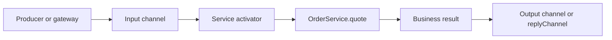

# What Is a Service Activator?

A service activator is a message endpoint used to connect a message flow to a handler method on a Spring-managed object. When a message arrives on the input channel, the endpoint extracts the input data, invokes the business method, and handles the return value according to the flow's contract.

In the **SPRING_INTEGRATION_CORE** module, this is the component that brings Java services into a flow consisting of `Message`, `MessageChannel`, gateways, and other processing steps. For example, an application receives a quote request as a message; the service activator invokes `OrderService.quote(...)`; the result is forwarded to the next step or returned to the requester. This approach corresponds to the Service Activator pattern in Enterprise Integration Patterns. [See the Service Activator pattern definition](https://www.enterpriseintegrationpatterns.com/patterns/messaging/MessagingAdapter.html).

## 1. Objectives and Prerequisites

After this lesson, you will be able to:

- Explain the role of a service activator in a message flow.
- Identify the relationship between the input channel, the endpoint, and the business service.
- Write configurations using `@ServiceActivator` and Java DSL `.handle(...)`.
- Choose parameter types and return types that fit the message contract.
- Trace the path of replies and exceptions in a basic example.
- Distinguish a service activator from a transformer, filter, router, aggregator, and gateway.
- Design tests that prove messages have been processed correctly.

You should know how to declare Spring beans and understand two components:

| Component | Role in this lesson |
| --- | --- |
| `Message<T>` | Carries the business payload along with headers such as `tenantId` or `replyChannel` |
| `MessageChannel` | Serves as the send/receive point for connecting processing steps |

The examples use Java 17 or later because of `record`. Configuration syntax is presented according to the Spring Integration 6.x API; use the compatible Spring versions managed by your project.

## 2. The Problem: Bringing a Java Service into a Message Flow

Suppose a system has a service that calculates quotes:

```java
public OrderQuote quote(OrderRequest request) {
    BigDecimal total = request.unitPrice()
            .multiply(BigDecimal.valueOf(request.quantity()));
    return new OrderQuote(request.orderId(), total);
}
```

A controller or another service could call this method directly. Once the application has an integration flow, you also want quote requests to pass through validation, transformation, or routing steps before invoking the business logic.

The service activator provides that connection point:



The boundaries of responsibility are laid out as follows:

- The producer sends a message according to an agreed contract.
- The channel determines how the message is delivered.
- The endpoint connects message reception to the handler.
- The service executes the business rules.
- The result continues through the flow according to the reply configuration.

For example, the producer knows the name `quoteRequests` and the type `OrderRequest`, while which bean calculates the quote resides in the endpoint configuration. Because of this, you can swap the business implementation or insert additional processing steps without forcing the producer to call the target bean directly.

This separation is useful when the business logic truly lives inside a multi-step flow. For a simple internal call, weigh the configuration overhead and flow observability before introducing messaging.

## 3. What Parts Make Up a Service Activator?

When reading the configuration, distinguish three layers:

| Layer | Example | Responsibility |
| --- | --- | --- |
| Business service | `OrderService` | Performs the quote calculation |
| Message handler | `ServiceActivatingHandler` when invoking a POJO | Maps the message to a method invocation and handles the result |
| Consumer endpoint | `EventDrivenConsumer` or `PollingConsumer` | Connects the handler to the channel and manages how messages are received |

For a subscribable input channel, the endpoint uses an event-driven mechanism. For a pollable input channel, the endpoint requires a locally configured poller or the default poller. This is how Spring Integration organizes consumer endpoints. [See Message Endpoints](https://docs.spring.io/spring-integration/reference/endpoint.html).

```text
Message<OrderRequest>
        |
        v
Consumer endpoint
        |
        v
Handler maps payload/headers
        |
        v
orderService.quote(request)
        |
        v
OrderQuote -> reply message -> reply destination
```

A bean annotated with `@Service` only becomes a Spring bean through component scanning. For the bean to participate in a message flow, you also need an endpoint configuration, such as `@ServiceActivator` or a `.handle(...)` step in Java DSL.

Similarly, a service activator can invoke a Java method within the same JVM. Reaching HTTP, Kafka, JMS, or another system depends on the adapters, gateways, and infrastructure wired into the flow.

## 4. Complete Example Using Annotations

### 4.1. Preparing Dependencies

If the project already has Spring Boot dependency management, you can declare the following starter without specifying a separate version:

```xml
<dependency>
    <groupId>org.springframework.boot</groupId>
    <artifactId>spring-boot-starter-integration</artifactId>
</dependency>
```

For a plain Spring application, the core dependency is `org.springframework.integration:spring-integration-core`. In that case, the project must manage compatible versions and related dependencies. Java DSL is included in core in the versions demonstrated here.

The following example initializes `AnnotationConfigApplicationContext` directly so you can clearly see the required beans.

### 4.2. Message Contract and Configuration

Place the following code in `example/ServiceActivatorDemo.java` of a project with the dependencies configured:

```java
package example;

import java.math.BigDecimal;

import org.springframework.context.annotation.AnnotationConfigApplicationContext;
import org.springframework.context.annotation.Bean;
import org.springframework.context.annotation.Configuration;
import org.springframework.integration.annotation.ServiceActivator;
import org.springframework.integration.channel.DirectChannel;
import org.springframework.integration.channel.QueueChannel;
import org.springframework.integration.config.EnableIntegration;
import org.springframework.messaging.Message;
import org.springframework.messaging.MessageChannel;
import org.springframework.messaging.handler.annotation.Header;
import org.springframework.messaging.support.MessageBuilder;

public class ServiceActivatorDemo {

    public record OrderRequest(
            String orderId,
            int quantity,
            BigDecimal unitPrice) {
    }

    public record OrderQuote(String orderId, BigDecimal total) {
    }

    public static class OrderService {

        public OrderQuote quote(OrderRequest request) {
            if (request.quantity() <= 0) {
                throw new IllegalArgumentException("quantity must be positive");
            }
            if (request.unitPrice() == null
                    || request.unitPrice().signum() < 0) {
                throw new IllegalArgumentException(
                        "unitPrice must be non-negative");
            }

            BigDecimal total = request.unitPrice()
                    .multiply(BigDecimal.valueOf(request.quantity()));

            return new OrderQuote(request.orderId(), total);
        }
    }

    public static class QuoteEndpoint {

        private final OrderService orderService;

        public QuoteEndpoint(OrderService orderService) {
            this.orderService = orderService;
        }

        @ServiceActivator(
                inputChannel = "quoteRequests",
                outputChannel = "quoteResults",
                requiresReply = "true")
        public OrderQuote onQuote(
                OrderRequest request,
                @Header("tenantId") String tenantId) {

            if (tenantId.isBlank()) {
                throw new IllegalArgumentException("tenantId must not be blank");
            }

            return orderService.quote(request);
        }
    }

    @Configuration
    @EnableIntegration
    public static class Config {

        @Bean
        public MessageChannel quoteRequests() {
            return new DirectChannel();
        }

        @Bean
        public QueueChannel quoteResults() {
            return new QueueChannel(10);
        }

        @Bean
        public OrderService orderService() {
            return new OrderService();
        }

        @Bean
        public QuoteEndpoint quoteEndpoint(OrderService orderService) {
            return new QuoteEndpoint(orderService);
        }
    }

    public static void main(String[] args) {
        try (var context =
                     new AnnotationConfigApplicationContext(Config.class)) {

            MessageChannel requests = context.getBean(
                    "quoteRequests", MessageChannel.class);
            QueueChannel results = context.getBean(
                    "quoteResults", QueueChannel.class);

            Message<OrderRequest> request = MessageBuilder
                    .withPayload(new OrderRequest(
                            "ORD-101", 3, new BigDecimal("125000.00")))
                    .setHeader("tenantId", "shop-a")
                    .setHeader("source", "web-demo")
                    .build();

            if (!requests.send(request, 1000)) {
                throw new IllegalStateException("Request was not accepted");
            }

            Message<?> reply = results.receive(1000);
            if (reply == null) {
                throw new IllegalStateException("No quote received");
            }

            OrderQuote quote = (OrderQuote) reply.getPayload();
            System.out.println(
                    quote.orderId() + " -> " + quote.total().toPlainString());
        }
    }
}
```

Expected business output:

```text
ORD-101 -> 375000.00
```

The beans are declared directly with `@Bean`, so the example does not need component scanning to discover `QuoteEndpoint`. `@EnableIntegration` registers the Spring Integration infrastructure for this plain Spring application context.

### 4.3. Tracing a Message

For the request in the example, you can trace six steps:

1. `requests.send(...)` sends `Message<OrderRequest>` to `quoteRequests`.
2. `DirectChannel` dispatches the message to the handler registered by the endpoint.
3. The framework maps the payload to `request` and the `tenantId` header to the parameter of the same name.
4. `QuoteEndpoint` validates the tenant and then invokes `OrderService.quote(...)`.
5. The service returns an `OrderQuote` with a total of `375000.00`.
6. The endpoint sends the reply to `quoteResults`; the program retrieves it via `receive(1000)`.

`quoteResults` is chosen as a queue so the program can actively read and observe the result. In this example, the service is invoked on the sending thread because the input is a `DirectChannel`. Placing a queue on the output does not move the quote calculation step onto a background thread.

You can observe this yourself by printing `Thread.currentThread().getName()` before `send(...)` and inside `onQuote(...)`.

## 5. Parameter Mapping: Payload, Header, or Full Message?

A handler method can accept the payload, specific headers, a header map, or the entire `Message`. Annotation configuration supports all of these mapping styles. [See Annotation Support](https://docs.spring.io/spring-integration/reference/configuration/annotations.html).

### 5.1. Receiving Only the Payload

```java
public OrderQuote quote(OrderRequest request) {
    // Compute based solely on business data.
    return orderService.quote(request);
}
```

This is the easiest option to test for domain business logic. `OrderService` in the complete example depends only on `OrderRequest` and `OrderQuote`.

### 5.2. Receiving the Payload Along with a Header

```java
public OrderQuote quote(
        OrderRequest request,
        @Header("tenantId") String tenantId) {

    return orderService.quote(request);
}
```

`@Header` requires the header to be present by default. In the main example, omitting `tenantId` causes a mapping error before the method body runs. The `isBlank()` check only handles the case where the header is present but empty or contains only whitespace.

If a header only carries supplemental information, you can allow it to be absent:

```java
public OrderQuote quote(
        OrderRequest request,
        @Header(value = "traceId", required = false) String traceId) {

    return orderService.quote(request);
}
```

In a multi-tenant system, the tenant value must come from a trusted source and have access permissions verified at the appropriate boundary. The example here only illustrates passing metadata into an endpoint; the quote calculation does not yet have per-tenant rules.

### 5.3. Receiving the Entire Message

```java
import org.springframework.messaging.Message;

public OrderQuote quote(Message<OrderRequest> message) {
    OrderRequest request = message.getPayload();
    Object source = message.getHeaders().get("source");

    return orderService.quote(request);
}
```

This approach fits when the integration layer needs access to multiple headers or control over metadata. You can place it in a thin endpoint layer and delegate to a service that accepts only business data.

A handler method does not need to accept both the payload and `Message`. Choose the most readable parameter contract for your actual needs. If you need multiple headers while keeping the payload separate, you can use `@Headers Map<String, Object>`.

### 5.4. Data Types Must Have a Clear Contract

If you send a `String` where an `OrderRequest` is expected, you are relying on built-in type conversion or a registered converter. Matching field names between JSON and a record is not enough on its own to establish a conversion contract.

For JSON input, an easy-to-follow layout is:

```text
JSON text
   -> transformer deserializes to OrderRequest
   -> service activator invokes OrderService
   -> OrderQuote
```

This clarifies which step is responsible for reading data and which step is responsible for business logic.

## 6. Return Value Contract

A service activator supports both one-way processing and request-reply processing. Therefore, the return type is part of the flow design.

| Method result | Meaning |
| --- | --- |
| A non-`null` object | Used as the payload of the reply |
| A `Message<?>` | Allows the integration layer to return a payload with explicit headers |
| `void` | Completes processing without producing a reply |
| `null` with `requiresReply=false` | Ends the current branch without producing a reply |
| `null` with `requiresReply=true` | Throws `ReplyRequiredException` |

`requiresReply` on a service activator defaults to `false`. In the annotation, this setting accepts a string, so use `requiresReply = "true"`. [See ServiceActivator API](https://docs.spring.io/spring-integration/docs/6.5.0/api/org/springframework/integration/annotation/ServiceActivator.html).

### 6.1. One-Way Case

An event-recording endpoint can have the following contract:

```java
@ServiceActivator(inputChannel = "auditRequests")
public void recordAudit(AuditEvent event) {
    auditService.append(event);
}
```

This is a standalone illustrative snippet assuming `AuditEvent`, `auditService`, and the corresponding channel already exist.

The method finishes after calling `append(...)`. If a downstream step is waiting for a subsequent message, you must clearly design what will produce that message. Simply appending another `.handle(...)` step after a `void` method will not cause the request to continue automatically.

### 6.2. Required Result

In the quote example, every valid request must produce a quote, so `requiresReply = "true"` accurately expresses the contract.

This setting detects when the method returns `null`. It does not replace timeouts for external service calls, message send timeouts, or the availability of the next consumer. A valid reply can still encounter a delivery error after the business calculation completes.

### 6.3. Returning a Message and Headers

An endpoint that needs to add headers can build a reply as follows:

```java
import org.springframework.messaging.Message;
import org.springframework.messaging.support.MessageBuilder;

public Message<OrderQuote> quoteWithMetadata(
        Message<OrderRequest> request) {

    OrderQuote result = orderService.quote(request.getPayload());

    return MessageBuilder.withPayload(result)
            .copyHeaders(request.getHeaders())
            .setHeader("quoteStatus", "READY")
            .build();
}
```

Use `MessageBuilder` to create messages and modify headers instead of mutating the request's header map directly. When sending across system boundaries, explicitly choose which headers are allowed to pass through; local channel references only make sense within the scope that supports them.

In this lesson, returning a POJO is sufficient because there is no need to set custom output headers. Standard request metadata is propagated by the framework's reply-creation mechanism; you can verify `tenantId` and `source` in the test example.

## 7. Where Are Replies Sent?

For a non-`null` result, the order of selecting the reply destination is:

1. The `outputChannel` configured on the endpoint.
2. The request's `replyChannel` header if the endpoint has no output channel.
3. The result message's `replyChannel` header if the request does not provide this address.

The destination in the header can be a `MessageChannel` or a channel name to be resolved. Having a result without being able to find a suitable reply destination causes a destination resolution error. If you want to intentionally discard the result, you can configure the output as `nullChannel`. [See Service Activator reply rules](https://docs.spring.io/spring-integration/reference/service-activator.html).

### 7.1. Explicit Output Channel

The main example declares:

```java
@ServiceActivator(
        inputChannel = "quoteRequests",
        outputChannel = "quoteResults",
        requiresReply = "true")
```

Thus, replies go to `quoteResults`. A producer could add `replyChannel` to the request, but this endpoint still prioritizes the declared output.

This is the right choice when the next step in the pipeline is fixed and known.

### 7.2. Reply Address in the Request

If you want the caller to supply the destination for the result, you can use another endpoint without declaring an output:

```java
@ServiceActivator(
        inputChannel = "dynamicQuoteRequests",
        requiresReply = "true")
public OrderQuote quote(OrderRequest request) {
    return orderService.quote(request);
}
```

The sender creates a dedicated reply queue:

```java
QueueChannel replies = new QueueChannel(1);

Message<OrderRequest> request = MessageBuilder
        .withPayload(new OrderRequest(
                "ORD-102", 2, new BigDecimal("50000.00")))
        .setReplyChannel(replies)
        .build();

boolean accepted = dynamicQuoteRequests.send(request, 1000);
Message<?> reply = accepted ? replies.receive(1000) : null;
```

This send snippet assumes `dynamicQuoteRequests` is the channel connected to the endpoint just defined. With a `DirectChannel` in the same JVM, a queue reference can be used as the return address.

If there are many concurrent requests, a separate queue per call makes receiving the reply straightforward. When using a shared queue, a correlation mechanism is needed so each result reaches the right waiter.

### 7.3. Intentionally Discarded Results

A method might always return a value even though a specific flow only needs its side effect. In that case, configuring `outputChannel = "nullChannel"` explicitly states the intent to terminate by discarding the reply.

If the method already returns `void` or `null` under a contract that permits it, the endpoint does not create a reply to send to `nullChannel`.

## 8. Using Java DSL to Keep Business Logic as a POJO

Java DSL expresses service invocations with `.handle(...)`. You can specify the target object and method name, or use a lambda receiving the payload and headers. [See Service Activators and the .handle() method](https://docs.spring.io/spring-integration/reference/dsl/java-handle.html).

### 8.1. Invoking a Business Method

Reusing `OrderService` and the records from the main example:

```java
import org.springframework.context.annotation.Bean;
import org.springframework.integration.dsl.IntegrationFlow;

@Bean
public IntegrationFlow quoteFlow(OrderService orderService) {
    return IntegrationFlow.from("quoteRequests")
            .handle(orderService, "quote",
                    endpoint -> endpoint.requiresReply(true))
            .channel("quoteResults")
            .get();
}
```

This is an **alternative** to the `QuoteEndpoint` bean. If you want to run the DSL version, keep the channel and service beans, replace the endpoint bean with the flow bean above, and keep `@EnableIntegration`.

This DSL version calls `OrderService.quote(...)` directly, so it does not perform `QuoteEndpoint`'s `tenantId` check yet. To retain the tenant requirement, add a validation step or invoke a method whose contract accepts the corresponding header.

In the flow:

- `from("quoteRequests")` selects the receiving channel.
- `handle(orderService, "quote", ...)` connects to the quote calculation logic.
- `requiresReply(true)` requires a non-`null` result.
- `channel("quoteResults")` selects the delivery destination for the result.

Register only one of the two alternatives for the same example. Two handlers subscribed to the same `DirectChannel` create competing consumers for messages; each message is dispatched to one handler according to the dispatcher's behavior, causing the execution flow to diverge from the "one configuration, one processing step" intent.

### 8.2. Using a Lambda with an Explicit Payload Type

```java
@Bean
public IntegrationFlow quoteFlow(OrderService orderService) {
    return IntegrationFlow.from("quoteRequests")
            .handle(OrderRequest.class,
                    (request, headers) -> orderService.quote(request),
                    endpoint -> endpoint.requiresReply(true))
            .channel("quoteResults")
            .get();
}
```

The first parameter of the lambda is the payload, and the second parameter is the headers. Specifying `OrderRequest.class` makes the type contract explicit at the processing step.

Keeping long business logic in a dedicated service allows the flow to retain its role of describing the message path. Short lambdas are well-suited for delegation or simple handling.

## 9. How Do Gateways and Service Activators Work Together?

A gateway provides a Java interface for the caller; a service activator invokes business logic on the processing side.

```text
caller
  -> gateway proxy
  -> request channel
  -> service activator
  -> OrderService
  -> replyChannel
  -> gateway returns OrderQuote
```

For a request-reply gateway, the framework typically creates a temporary reply channel and sets it on the request. This enables the endpoint at the end of the flow to return a result without knowing about each individual caller in advance. [See Messaging Gateways](https://docs.spring.io/spring-integration/reference/gateway.html).

An illustrative interface:

```java
import org.springframework.integration.annotation.MessagingGateway;

@MessagingGateway(
        defaultRequestChannel = "gatewayQuoteRequests",
        defaultReplyTimeout = "1000")
public interface QuoteGateway {
    OrderQuote quote(OrderRequest request);
}
```

Corresponding target endpoint:

```java
@ServiceActivator(
        inputChannel = "gatewayQuoteRequests",
        requiresReply = "true")
public OrderQuote quoteFromGateway(OrderRequest request) {
    return orderService.quote(request);
}
```

This is a standalone extension separate from the initial configuration. To run it, the gateway interface must be registered via a mechanism such as `@IntegrationComponentScan` on the appropriate package; the endpoint and service must also be beans. The target endpoint does not declare an output so that the result is sent via the `replyChannel` provided by the gateway.

A common pitfall is using a gateway expecting an `OrderQuote` while connecting it to an endpoint that has `outputChannel = "quoteResults"`. The quote may have already entered that queue while the gateway remains waiting on its own reply address. When assembling configuration snippets, clearly trace the final path back to the caller.

In addition, `defaultReplyTimeout` limits the gateway's phase of waiting for a reply. If the entire flow runs synchronously over a `DirectChannel`, the service method execution time may occur before that wait phase. Configure timeouts for HTTP clients, databases, or genuinely blocking resources at the responsible layer.

## 10. Synchronicity, Polling, and the Meaning of `send`

The input channel type affects when the handler runs:

| Input channel | Delivery mechanism | What to observe |
| --- | --- | --- |
| `DirectChannel` | Invokes a subscriber on the sending thread | Service execution time is included in `send(...)` |
| `QueueChannel` | Holds messages waiting for a consumer to retrieve them | The endpoint needs a poller; sending to the queue can complete before business execution |
| `ExecutorChannel` | Hands off work via a configured executor | Monitor thread pools, asynchronous errors, and concurrency |

`QueueChannel` stores messages in memory by default; `DirectChannel` uses a point-to-point mechanism. Choosing a queue does not automatically provide durable persistence. [See Message Channel Implementations](https://docs.spring.io/spring-integration/reference/channel/implementations.html).

If you change the example's input to a queue, you can attach a poller to the endpoint:

```java
import org.springframework.integration.annotation.Poller;

@ServiceActivator(
        inputChannel = "queuedQuoteRequests",
        outputChannel = "quoteResults",
        requiresReply = "true",
        poller = @Poller(
                fixedDelay = "100",
                maxMessagesPerPoll = "10"))
public OrderQuote quoteFromQueue(OrderRequest request) {
    return orderService.quote(request);
}
```

This snippet assumes `queuedQuoteRequests` is a `QueueChannel` bean and the class containing the method is a bean. `fixedDelay` here is in milliseconds. You can configure a global poller instead of a per-endpoint configuration if appropriate for your application.

Interpret `send(...)` according to the channel type and delivery contract:

- With a queue, `true` indicates that the message was accepted into the queue; the business result may not exist yet.
- With the `DirectChannel` in the example, `send(...)` only returns after the synchronous call, yet the caller still receives a boolean, not `OrderQuote`.
- To retrieve the result, the caller uses a reply channel, a gateway, or a separate receive mechanism.

Under concurrent processing, a singleton service may be invoked by multiple threads. Per-message state should reside in local variables; shared data needs an appropriate synchronization or storage mechanism.

## 11. When the Service Throws an Exception

The business example intentionally rejects `quantity <= 0`. How the caller observes the error depends on the message's path.

### 11.1. Synchronous Path

With `DirectChannel` in the main example, processing errors propagate back through the `send(...)` call, typically wrapped in a Spring Messaging exception containing the root cause:

```java
import org.springframework.messaging.MessagingException;

try {
    requests.send(invalidRequest, 1000);
} catch (MessagingException ex) {
    Throwable root = ex;
    while (root.getCause() != null) {
        root = root.getCause();
    }
    System.err.println(root.getMessage());
}
```

Here `invalidRequest` is a `Message<OrderRequest>` with `quantity = 0` and a still-valid `tenantId`.

An `errorChannel` header on a message does not automatically turn every synchronous exception into an error message. When sending directly to a `DirectChannel`, you still need to handle exceptions at the caller or via an appropriately configured advice/gateway mechanism.

### 11.2. Asynchronous Path

When processing runs inside a Spring Integration task or a scheduled poller, errors can be published as an `ErrorMessage`. The default error-handling mechanism checks `errorChannel` on the request and falls back to the global error channel when needed. This is how errors cross thread boundaries. [See Error Handling](https://docs.spring.io/spring-integration/reference/error-handling.html).

A logging endpoint can receive the error payload:

```java
@ServiceActivator(inputChannel = "quoteErrors")
public void onQuoteError(Throwable failure) {
    System.err.println("Quote flow failed: " + failure.getMessage());
}
```

The snippet above only takes effect when `quoteErrors` is declared and the error-handling path actually routes there. If you also want the metadata from the error message, you can accept `ErrorMessage` instead of `Throwable` alone.

### 11.3. Side Effects and Retries

Suppose a service saves an order and then hits an error while sending the result. A retry may invoke the service again. Therefore, for business logic with side effects, define:

- Which identifier is used to recognize the same request.
- Whether re-invoking is allowed to create extra records or send extra notifications.
- Which operations are covered by a transaction.
- Where the failed outcome is persisted or routed after retries are exhausted.

The service activator is the point where the service is invoked; retry policies, idempotency, and transactions must be designed around actual side effects. A pure calculation quote example lets you learn endpoint mechanics before adding these concerns.

## 12. Choosing the Right Component for Each Job

Endpoints can all invoke a Java method, but they should be chosen based on what the step means in the flow:

| Component | Question it answers | Example |
| --- | --- | --- |
| Service activator | What business operation needs to run? | Calculate quote, reserve inventory, record request |
| Transformer | How does the data representation need to change? | JSON to `OrderRequest` |
| Filter | Should the message proceed? | Discard requests missing required info |
| Router | Which branch should the message go to? | Select standard-order or priority-order flow |
| Aggregator | When is enough data collected to form a group result? | Combine quotes from multiple suppliers |
| Gateway | Through what interface does the caller interact with messaging? | `QuoteGateway.quote(request)` |
| Channel adapter | From or to which resource does data enter or leave? | Read input files, write results to an external system |

Example of a general flow:

```text
Input JSON
   -> transformer: creates OrderRequest
   -> filter: checks acceptance criteria
   -> router: selects business branch
   -> service activator: invokes branch service
   -> aggregator: combines results if the problem requires multiple branches
   -> final step returns reply
```

An aggregator is only needed when the problem requires grouping, along with suitable correlation and release rules. A single quote calculation like the main example can return its result immediately.

A service activator can return an object of a different type than its input, but if the primary purpose is data transformation, a transformer expresses the intent more clearly. A transformer has a contract to produce a result and does not allow terminating with `null` like a service activator does by default. [See Transformer](https://docs.spring.io/spring-integration/reference/transformer.html).

Similarly, when you want to drop messages based on a condition, a filter makes the decision explicit. When you want to choose a channel based on data, a router lets readers see the processing branches directly in the configuration.

## 13. Testing the Example in Two Layers

There are two distinct things to prove:

1. **Correct business logic:** `OrderService` computes totals accurately and rejects invalid inputs.
2. **Correct flow wiring:** messages enter the right endpoint, headers are mapped, and replies arrive at the right destination.

Unit tests for the service do not replace tests for the endpoint configuration. Conversely, an overly large flow test can make root causes hard to pinpoint. Keep each group of tests focused on a specific goal.

### 13.1. Testing the Happy Path and Synchronous Errors

The following JUnit 5 example uses the annotation configuration from section 4 verbatim. The project needs a testing dependency that provides JUnit Jupiter, such as `spring-boot-starter-test` if using Spring Boot dependency management.

```java
package example;

import java.math.BigDecimal;

import org.junit.jupiter.api.Test;
import org.springframework.context.annotation.AnnotationConfigApplicationContext;
import org.springframework.integration.channel.QueueChannel;
import org.springframework.messaging.Message;
import org.springframework.messaging.MessageChannel;
import org.springframework.messaging.MessagingException;
import org.springframework.messaging.support.MessageBuilder;

import static org.junit.jupiter.api.Assertions.*;

class ServiceActivatorDemoTest {

    @Test
    void shouldCreateQuoteAndPreserveBusinessHeaders() {
        try (var context = new AnnotationConfigApplicationContext(
                ServiceActivatorDemo.Config.class)) {

            MessageChannel requests = context.getBean(
                    "quoteRequests", MessageChannel.class);
            QueueChannel results = context.getBean(
                    "quoteResults", QueueChannel.class);

            var order = new ServiceActivatorDemo.OrderRequest(
                    "ORD-101", 3, new BigDecimal("125000.00"));

            Message<?> request = MessageBuilder.withPayload(order)
                    .setHeader("tenantId", "shop-a")
                    .setHeader("source", "test")
                    .build();

            assertTrue(requests.send(request, 1000));

            Message<?> reply = results.receive(1000);
            assertNotNull(reply);

            var quote = assertInstanceOf(
                    ServiceActivatorDemo.OrderQuote.class,
                    reply.getPayload());

            assertEquals("ORD-101", quote.orderId());
            assertEquals(new BigDecimal("375000.00"), quote.total());
            assertEquals("shop-a", reply.getHeaders().get("tenantId"));
            assertEquals("test", reply.getHeaders().get("source"));
            assertNull(results.receive(0));
        }
    }

    @Test
    void shouldPropagateInvalidQuantityAndProduceNoQuote() {
        try (var context = new AnnotationConfigApplicationContext(
                ServiceActivatorDemo.Config.class)) {

            MessageChannel requests = context.getBean(
                    "quoteRequests", MessageChannel.class);
            QueueChannel results = context.getBean(
                    "quoteResults", QueueChannel.class);

            var invalidOrder = new ServiceActivatorDemo.OrderRequest(
                    "ORD-BAD", 0, new BigDecimal("125000.00"));

            Message<?> request = MessageBuilder.withPayload(invalidOrder)
                    .setHeader("tenantId", "shop-a")
                    .build();

            MessagingException failure = assertThrows(
                    MessagingException.class,
                    () -> requests.send(request, 1000));

            Throwable root = failure;
            while (root.getCause() != null) {
                root = root.getCause();
            }

            assertInstanceOf(IllegalArgumentException.class, root);
            assertEquals("quantity must be positive", root.getMessage());
            assertNull(results.receive(0));
        }
    }
}
```

Each test creates its own context, preventing queues and beans from leaking state into other tests. `receive(1000)` waits with a bound so tests do not hang indefinitely. `receive(0)` immediately checks that no extra reply is present at the moment of inspection.

For this synchronous example, checking the queue right after `send(...)` throws is appropriate. For asynchronous flows, wait for a completion condition with an appropriate timeout rather than assuming "the queue is currently empty" means all processing has finished.

### 13.2. Contracts Worth Expanding Tests For

When modifying the example, you can add the following scenarios:

| Change | What to prove |
| --- | --- |
| Omit `tenantId` | Endpoint reports a mapping error; service is not called |
| Have the service return `null` and enable `requiresReply` | `ReplyRequiredException` is received on the appropriate handling path |
| Omit output channel and supply `replyChannel` | Quote arrives at the address specified on the request |
| Set both output channel and `replyChannel` | Reply follows the configured output |
| Replace input with a queue and poller | Success is verified via reply; failure is verified via the error flow |
| Add retry to a service with side effects | Same request does not cause unintended side effects |

These are flow contract tests. They reveal what behavior callers will observe when configuration changes.

## 14. Common Misconceptions

| Symptom | Cause to check | How to address |
| --- | --- | --- |
| Message is sent but does not reach the service | Endpoint bean not registered, wrong channel, or endpoint not running | Check application context and input channel name |
| Queue has messages but service has not run | Input is a pollable channel with no active consumer/poller | Declare a poller and observe the polling schedule |
| Service finishes but reply is missing | Method returns `void`/`null` or result went to another destination | Review return contract and entire reply path |
| Destination resolution exception occurs | Result exists but output/reply address is missing or invalid | Declare a valid channel or explicitly use `nullChannel` |
| Gateway keeps waiting even though calculation finished | Fixed output routes result away from gateway's return path | Trace `replyChannel` through to the final step |
| Header fails to map | Required header missing or wrong data type | Verify message contract before the endpoint |
| Logic runs in only one of two handlers | Multiple competing subscribers on a `DirectChannel` | Keep only one configuration or intentionally design competing consumers |
| Caller cannot catch background processing errors | Handler runs across a thread boundary | Monitor `ErrorMessage` and the error channel path |
| Increasing timeout still leaves service hanging | Timeout configured on reply wait or channel send | Place limits on blocking I/O operations or resources |

When debugging, start with a concrete message: what type is the payload, which headers accompany it, what kind of channel is the input, which endpoint receives it, what does the service return, and where does the reply need to go. Tracing this path usually pinpoints where the configuration diverges from the contract.

## 15. Applying This to Flow Design

For a new problem, you can determine these aspects in order:

1. **Input:** payload type, required fields, and metadata to pass.
2. **Business logic:** what operation the service method performs and whether it has side effects.
3. **Reply:** one-way, required result, or conditional termination.
4. **Result destination:** fixed next step or caller-provided address.
5. **Execution model:** runs on the sending thread, via a queue, or via an executor.
6. **Errors:** whether the caller receives exceptions directly or another flow receives error messages.
7. **Testing:** proving data, results, and errors reach the right places.

Applying this to the quote example:

| Decision | Choice |
| --- | --- |
| Payload | `OrderRequest` |
| Required header in annotation version | `tenantId` |
| Business logic | Multiply unit price by valid quantity |
| Result | Required `OrderQuote` |
| Input | `DirectChannel` to observe synchronous invocation |
| Output | `QueueChannel` to observe replies |
| Errors | Propagated back to the `send(...)` call |
| Key tests | Correct total, preserved headers, invalid input produces no quote |

When extending to inventory reservation or order persistence, keep endpoints readable and put business rules into the appropriate services. When you need format conversion, branching, or combining multiple results, compose endpoints that match those responsibilities.

A clearly configured service activator tells the reader three things: which messages trigger the business logic, which method is invoked, and which path results or errors take.

## 16. References

- [Enterprise Integration Patterns — Service Activator](https://www.enterpriseintegrationpatterns.com/patterns/messaging/MessagingAdapter.html): architectural pattern for connecting a service to messaging.
- [Spring Integration — Service Activator](https://docs.spring.io/spring-integration/reference/service-activator.html): endpoint configuration and reply rules.
- [Spring Integration — Annotation Support](https://docs.spring.io/spring-integration/reference/configuration/annotations.html): payload/header mapping and endpoint declarations.
- [Spring Integration — ServiceActivator API 6.5.0](https://docs.spring.io/spring-integration/docs/6.5.0/api/org/springframework/integration/annotation/ServiceActivator.html): annotation attributes.
- [Spring Integration — Service Activators and the .handle() method](https://docs.spring.io/spring-integration/reference/dsl/java-handle.html): Java DSL configuration.
- [Spring Integration — Message Endpoints](https://docs.spring.io/spring-integration/reference/endpoint.html): handlers and the two consumer mechanisms.
- [Spring Integration — Message Channel Implementations](https://docs.spring.io/spring-integration/reference/channel/implementations.html): semantics of each channel type.
- [Spring Integration — Messaging Gateways](https://docs.spring.io/spring-integration/reference/gateway.html): caller interfaces and reply channels.
- [Spring Integration — Error Handling](https://docs.spring.io/spring-integration/reference/error-handling.html): distinguishing synchronous and asynchronous errors.
- [Spring Integration — Transformer](https://docs.spring.io/spring-integration/reference/transformer.html): message transformation contract.
