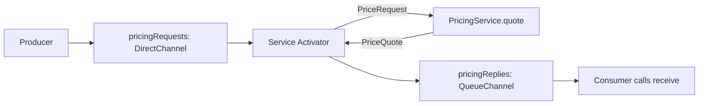

# Invoking a POJO Method from a Message

Chapter **Service activator** · Module **SPRING_INTEGRATION_CORE**

An application already has a `PricingService.quote(PriceRequest)` method for calculating quotes. When a request arrives as a `Message<PriceRequest>`, you need a component that receives the message, extracts the data to invoke the method, and puts the result back into the flow. A **Service Activator** connects the service to the messaging system, while the business logic can remain plain Java code. [Spring Integration endpoint model](https://docs.spring.io/spring-integration/reference/overview.html).

Within Spring Integration Core, this lesson guides you through connecting `Message`, `MessageChannel`, and an endpoint using Java DSL or annotations; defining parameters, replies, and errors; and testing the business invocation. This forms the foundation for bringing services into larger flows containing gateways, transformers, routers, filters, or aggregators.

## 1. Objectives and Prerequisites

After this lesson, you will be able to:

- Connect a Spring bean to an input channel and specify the method to invoke.
- Design method signatures accepting the payload, headers, or the entire message.
- Distinguish returning an object, `Message<?>`, `null`, and `void`.
- Trace replies and exceptions in a synchronous flow.
- Test POJO business logic and integration configuration separately.

You should know Java methods, generics, Spring beans, `Message<T>`, and `MessageChannel`. The examples use Java 17 or later, `record`, Spring Context, and Spring Integration Core with the `IntegrationFlow.from(...)` API. Manage library versions via your project's BOM or dependency configuration. The testing section uses JUnit Jupiter.

The examples run inside `AnnotationConfigApplicationContext`, without needing Spring Boot, a broker, or an external server. The 10% surcharge rule is simply illustrative data for the quote calculation.

## 2. From Message to Java Invocation



| Component | Responsibility in the example |
| --- | --- |
| Producer | Creates the message containing the quote request |
| Input channel | Delivers the message to the endpoint |
| Endpoint and handler | Prepares arguments and invokes the service |
| POJO | Applies the quote calculation rules |
| Output channel | Forwards or stores the reply for the next step |

With a standard POJO invocation, `ServiceActivatingHandler` is the handler behind the endpoint. The business class does not have to implement `MessageHandler`. As a result, the same service can be used both in a flow and in direct Java calls. [ServiceActivatingHandler API](https://docs.spring.io/spring-integration/api/org/springframework/integration/handler/ServiceActivatingHandler.html).

`input.send(message)` returns a `boolean` per the channel's send contract. That value is not the `PriceQuote` business result. To read the quote, you must retrieve the reply from the configured reply path.

## 3. Complete Example Using Java DSL

The example consists of three classes in the same `example.integration` package.

### 3.1. Plain Java Business Class

`PricingService.java`:

```java
package example.integration;

import java.math.BigDecimal;
import java.math.RoundingMode;
import java.util.Objects;

public class PricingService {

    public record PriceRequest(String orderId, BigDecimal subtotal) {
    }

    public record PriceQuote(
            String orderId,
            BigDecimal total,
            String currency) {
    }

    public PriceQuote quote(PriceRequest request) {
        Objects.requireNonNull(request, "request must not be null");

        if (request.orderId() == null || request.orderId().isBlank()) {
            throw new IllegalArgumentException("orderId must not be blank");
        }
        if (request.subtotal() == null || request.subtotal().signum() < 0) {
            throw new IllegalArgumentException("subtotal must be non-negative");
        }

        BigDecimal total = request.subtotal()
                .multiply(new BigDecimal("1.10"))
                .setScale(2, RoundingMode.HALF_UP);

        return new PriceQuote(request.orderId(), total, "USD");
    }
}
```

This class does not import Spring and does not send messages itself. You can call `new PricingService().quote(request)` directly in unit tests. The `PriceRequest` input and `PriceQuote` output express the business contract independently of channels.

### 3.2. Beans, Channels, and Flow

`PricingFlowConfiguration.java`:

```java
package example.integration;

import org.springframework.context.annotation.Bean;
import org.springframework.context.annotation.Configuration;
import org.springframework.integration.channel.DirectChannel;
import org.springframework.integration.channel.QueueChannel;
import org.springframework.integration.config.EnableIntegration;
import org.springframework.integration.dsl.IntegrationFlow;
import org.springframework.messaging.MessageChannel;

@Configuration
@EnableIntegration
public class PricingFlowConfiguration {

    @Bean
    public PricingService pricingService() {
        return new PricingService();
    }

    @Bean
    public MessageChannel pricingRequests() {
        return new DirectChannel();
    }

    @Bean
    public QueueChannel pricingReplies() {
        return new QueueChannel(10);
    }

    @Bean
    public IntegrationFlow pricingFlow(PricingService pricingService) {
        return IntegrationFlow.from("pricingRequests")
                .handle(pricingService, "quote", endpoint -> endpoint
                        .id("priceQuoteEndpoint")
                        .requiresReply(true)
                        .sendTimeout(1000))
                .channel("pricingReplies")
                .get();
    }
}
```

The connection point is `.handle(pricingService, "quote", ...)`: the flow invokes the `quote` method on the passed-in bean. The POJO does not need additional endpoint annotations once wired with DSL. `.handle()` supports invoking methods on POJOs as well as handling via lambdas or `MessageHandler`. [Java DSL: the .handle() method](https://docs.spring.io/spring-integration/reference/dsl/java-handle.html).

The options clarify the contract:

- `id("priceQuoteEndpoint")` names the endpoint.
- `requiresReply(true)` requires a non-`null` result.
- `sendTimeout(1000)` configures the wait timeout for sending the reply if the target channel must wait.
- `.channel("pricingReplies")` sets the output path for the result.

Endpoint options do not by themselves bound the execution time of `quote`. [GenericEndpointSpec API](https://docs.spring.io/spring-integration/api/org/springframework/integration/dsl/GenericEndpointSpec.html).

In this manual Spring configuration, `@EnableIntegration` enables the integration infrastructure. Merely registering the service as a bean does not connect it to a channel; a flow or endpoint annotation is still required. [Configuring Spring Integration infrastructure](https://docs.spring.io/spring-integration/reference/overview.html).

### 3.3. Sending Requests and Receiving Replies

`PricingDemo.java`:

```java
package example.integration;

import java.math.BigDecimal;

import org.springframework.context.annotation.AnnotationConfigApplicationContext;
import org.springframework.integration.channel.QueueChannel;
import org.springframework.messaging.Message;
import org.springframework.messaging.MessageChannel;
import org.springframework.messaging.support.MessageBuilder;

import example.integration.PricingService.PriceRequest;

public class PricingDemo {

    public static void main(String[] args) {
        try (var context = new AnnotationConfigApplicationContext(
                PricingFlowConfiguration.class)) {

            MessageChannel input = context.getBean(
                    "pricingRequests", MessageChannel.class);
            QueueChannel output = context.getBean(
                    "pricingReplies", QueueChannel.class);

            Message<PriceRequest> request = MessageBuilder
                    .withPayload(new PriceRequest(
                            "ORDER-101", new BigDecimal("100.00")))
                    .setHeader("traceId", "trace-101")
                    .build();

            if (!input.send(request, 1000)) {
                throw new IllegalStateException("Request was not accepted");
            }

            Message<?> reply = output.receive(1000);
            if (reply == null) {
                throw new IllegalStateException("No pricing reply received");
            }

            System.out.println(reply.getPayload());
            System.out.println(reply.getHeaders().get("traceId"));
        }
    }
}
```

Expected output:

```text
PriceQuote[orderId=ORDER-101, total=110.00, currency=USD]
trace-101
```

With a `DirectChannel`, the handler runs on the sending thread. The output `QueueChannel` merely stores the reply for the demo code calling `receive`; it does not automatically move the preceding business call to another thread. If you replace the **input** with a `QueueChannel`, the endpoint needs a poller to fetch messages. An output queue does not need a poller when the caller actively calls `receive`. [MessageChannel implementations](https://docs.spring.io/spring-integration/reference/channel/implementations.html).

## 4. Equivalent Annotation Approach

To use annotations, **replace** the `pricingFlow` bean in section 3 with the bean below and add the nested `PricingEndpoint` class to `PricingFlowConfiguration`. Keep the service bean, the two channel beans, and `@EnableIntegration`.

Add imports:

```java
import org.springframework.integration.annotation.ServiceActivator;
import example.integration.PricingService.PriceRequest;
import example.integration.PricingService.PriceQuote;
```

Replacement section in the configuration class:

```java
@Bean
public PricingEndpoint pricingEndpoint(PricingService pricingService) {
    return new PricingEndpoint(pricingService);
}

public static class PricingEndpoint {

    private final PricingService pricingService;

    public PricingEndpoint(PricingService pricingService) {
        this.pricingService = pricingService;
    }

    @ServiceActivator(
            inputChannel = "pricingRequests",
            outputChannel = "pricingReplies",
            requiresReply = "true",
            sendTimeout = "1000")
    public PriceQuote quote(PriceRequest request) {
        return pricingService.quote(request);
    }
}
```

`PricingEndpoint` is a Spring bean thanks to the `@Bean` method. The infrastructure processes the annotation on `quote` to create the endpoint and handler; there is no need to add `@Component` to the same object. [Annotation Support](https://docs.spring.io/spring-integration/reference/configuration/annotations.html).

Choose either DSL or annotations for the invocation path you are studying. Keeping both registers two consumers on the same input. With `DirectChannel`, consumers may compete for different messages, causing observed results to no longer reflect a single processing path.

Distinguish between:

| Annotation placement | Meaning |
| --- | --- |
| `@ServiceActivator` on a bean method | That method processes messages |
| `@Bean` combined with `@ServiceActivator` on a factory returning `MessageHandler` | The factory creates the handler; the factory does not run again as business logic per message |

The two forms serve different roles even though they use the same annotation. [Endpoints and factory methods](https://docs.spring.io/spring-integration/reference/overview.html).

## 5. Mapping Messages to Parameters

### 5.1. Selecting the Data Needed

| Need | Illustrative signature |
| --- | --- |
| Payload only | `PriceQuote quote(PriceRequest request)` |
| Explicit payload parameter | `PriceQuote quote(@Payload PriceRequest request)` |
| Payload and one header | `quote(PriceRequest request, @Header("tenantId") String tenantId)` |
| Payload and header map | `audit(PriceRequest request, @Headers Map<String, Object> headers)` |
| Entire envelope | `quote(Message<PriceRequest> message)` |

A regular POJO argument is mapped from the payload. When metadata is needed, use `@Header`, `@Headers`, or accept the entire message. [Parameter mapping with annotations](https://docs.spring.io/spring-integration/reference/configuration/annotations.html).

Parameter annotations reside in the following package:

```java
import org.springframework.messaging.handler.annotation.Payload;
import org.springframework.messaging.handler.annotation.Header;
import org.springframework.messaging.handler.annotation.Headers;
```

`@Payload` explicitly identifies the parameter bound to the payload. When both the payload and headers could be a `Map`, use `@Payload` and `@Headers` to express the data sources instead of relying on signature inference. Java variable names like `payload` or `headers` do not replace the annotation contract. [@Payload API](https://docs.spring.io/spring-framework/docs/current/javadoc-api/org/springframework/messaging/handler/annotation/Payload.html).

### 5.2. Required and Optional Headers

Inside an adapter that has a `pricingService` field, you can write:

```java
public record TenantQuote(
        String tenantId,
        String traceId,
        PriceQuote quote) {
}

public TenantQuote quoteForTenant(
        @Payload PriceRequest request,
        @Header("tenantId") String tenantId,
        @Header(value = "traceId", required = false) String traceId) {

    return new TenantQuote(tenantId, traceId, pricingService.quote(request));
}
```

This is a declaration placed inside the adapter, using the DTOs and imports above. Register the adapter as a bean and connect it with `.handle(adapterBean, "quoteForTenant")`, or declare an annotated endpoint as in section 4.

`tenantId` is required by default; a missing header causes argument preparation to fail before the method body runs. `traceId` is optional, so it can receive `null`. For optional numeric headers, use wrapper types such as `Integer` if you need to represent a missing value. Specifying the name in `@Header("tenantId")` keeps the contract independent of the Java parameter name. [@Header API](https://docs.spring.io/spring-framework/docs/current/javadoc-api/org/springframework/messaging/handler/annotation/Header.html).

Do not write `quote(PriceRequest request, String tenantId)` and expect the framework to guess that the string comes from a header.

The example only places the tenant into the result DTO. If the tenant changes the calculation rules, include it in the business contract and actually use it when computing the quote; receiving a header does not automatically alter the formula.

### 5.3. Receiving a Map of Headers

```java
public void audit(
        @Payload PriceRequest request,
        @Headers java.util.Map<String, Object> headers) {

    System.out.println("orderId=" + request.orderId()
            + ", traceId=" + headers.get("traceId"));
}
```

A `@Headers` parameter must be compatible with `Map<String, Object>`. If you only need a few known headers, individual `@Header` parameters are usually easier to control than manually looking up and casting multiple values from a map. [@Headers API](https://docs.spring.io/spring-framework/docs/current/javadoc-api/org/springframework/messaging/handler/annotation/Headers.html).

`MessageHeaders` is normally immutable; calling `put` on the received headers can throw `UnsupportedOperationException`. When you need to modify metadata, build a new message using `MessageBuilder`. [MessageHeaders API](https://docs.spring.io/spring-framework/docs/current/javadoc-api/org/springframework/messaging/MessageHeaders.html).

### 5.4. Receiving the Entire Message

Inside an adapter that has a `pricingService` field:

```java
public Message<PriceQuote> quoteWithMetadata(Message<PriceRequest> request) {
    PriceQuote result = pricingService.quote(request.getPayload());

    return MessageBuilder.withPayload(result)
            .copyHeaders(request.getHeaders())
            .setHeader("pricingRule", "SURCHARGE_10")
            .build();
}
```

Use this signature when the adapter needs to work directly with the envelope. The trade-off is that the adapter depends on Spring Messaging. Keeping the formula in `PricingService.quote(PriceRequest)` ensures the business logic remains testable with plain Java.

`Message<PriceRequest>` is not an instruction to automatically deserialize JSON. If the actual payload is a JSON string, perform an appropriate conversion before the business call or configure a supported converter. Do not cast a string to a DTO and expect generics to handle it.

## 6. Method Selection and Type Conversion

### 6.1. Specifying the Method Name

`.handle(pricingService, "quote")` specifies the method name, but does not eliminate complexity if there are multiple overloads with the same name. `MethodInvokingMessageProcessor` supports dynamic resolution when one name has multiple candidate methods. [MethodInvokingMessageProcessor API](https://docs.spring.io/spring-integration/api/org/springframework/integration/handler/MethodInvokingMessageProcessor.html).

For a quote contract, prefer a single `public` method with a clear name and types. Illustrative signatures like those below make the contract harder to follow:

```text
Object process(Object value)
PriceQuote process(String value)
PriceQuote process(Map<String, Object> value)
```

If an input carries multiple distinct kinds of business requests, consider a router or separate flows. Maintainers should see the routing decision in configuration rather than having to guess from a set of overloads.

When only a trigger signal is needed, a Service Activator also supports parameterless methods, such as `void refresh()`. In that case, the message content is not used as an argument. [Service Activator](https://docs.spring.io/spring-integration/reference/service-activator.html).

### 6.2. Bounded Type Conversion

The infrastructure supports converting a payload to the argument type when a matching conversion mechanism is available. This does not guarantee that arbitrary JSON strings, maps, or binary data will automatically turn into the desired DTO. [@ServiceActivator API](https://docs.spring.io/spring-integration/api/org/springframework/integration/annotation/ServiceActivator.html).

The convention of this example is that **the payload must be a `PriceRequest` when it reaches the endpoint**. If the source supplies JSON, place an explicit transformation step beforehand. That way, format errors can be distinguished from business errors such as a negative subtotal.

### 6.3. Lambda with Payload Type

You can use the following snippet in a flow builder chain:

```java
.handle(PriceRequest.class,
        (payload, headers) -> pricingService.quote(payload))
```

The lambda receives the payload and headers; `PriceRequest.class` provides type information to the lambda handling infrastructure. This is not a standalone statement. If you want to keep the endpoint options from section 3, use the overload that accepts an endpoint customizer. [Java DSL and lambda handlers](https://docs.spring.io/spring-integration/reference/dsl/java-handle.html).

## 7. What Does the Return Value Become?

| Method result | Expected behavior |
| --- | --- |
| Non-`null` `PriceQuote` | Creates a reply message containing the quote |
| `Message<PriceQuote>` | Returns the result as a message |
| `null` or `void`, reply not required | Completes without emitting a reply |
| `null`, `requiresReply=true` | Throws `ReplyRequiredException` |
| Exception | Handed off to the error handling path |

The `@ServiceActivator` API describes wrapping the returned object and requiring a non-`null` result. Do not pair a service that only performs a `void` task with a contract that requires a reply. [@ServiceActivator API](https://docs.spring.io/spring-integration/api/org/springframework/integration/annotation/ServiceActivator.html).

In this lesson, a successful quote needs a result, so `requiresReply(true)` is enabled. For an endpoint that only writes audit logs, `void` can be appropriate. Do not return `null` for every error: callers easily see only a missing response and lose the business reason.

The `requiresReply` flag checks result creation; it does not prove that the final consumer processed the result successfully. These are two responsibilities that must be tested separately. [AbstractReplyProducingMessageHandler API](https://docs.spring.io/spring-integration/api/org/springframework/integration/handler/AbstractReplyProducingMessageHandler.html).

### Reply Headers

A Service Activator may copy headers from the request when they are not already present in the result message. Therefore, manually building a `Message<?>` and omitting a header does not guarantee that header is removed from the reply. If removal is needed, add an explicit header-filtering step. [Service Activator and return types](https://docs.spring.io/spring-integration/reference/service-activator.html).

In the example, use `traceId` or `orderId` to correlate processing. Do not assume that request and reply `id` headers must be equal as a business correlation rule.

## 8. Where Is the Reply Sent?

In the main flow, `.channel("pricingReplies")` sets the output channel. If you want the caller to choose where to receive the result, you can let the terminal endpoint use `replyChannel`.

| Case | Reply destination |
| --- | --- |
| Output channel present | Configured output |
| No output, request has `replyChannel` | Address in the request |
| No destination yet, result is `Message<?>` with `replyChannel` | Address in the result may be used |
| Result present but no destination found | Reply destination resolution error |

This mechanism is described in the [Service Activator documentation](https://docs.spring.io/spring-integration/reference/service-activator.html).

### Trying Request–Reply with MessagingTemplate

**Replace** the current `pricingFlow` bean with the following version to test dynamic reply routing:

```java
@Bean
public IntegrationFlow pricingFlow(PricingService pricingService) {
    return IntegrationFlow.from("pricingRequests")
            .handle(pricingService, "quote",
                    endpoint -> endpoint.requiresReply(true))
            .get();
}
```

In a context running the replaced configuration, use `input` and `request` as in the demo:

```java
var template = new org.springframework.integration.core.MessagingTemplate();
template.setReceiveTimeout(1000);

Message<?> reply = template.sendAndReceive(input, request);
if (reply == null) {
    throw new IllegalStateException("No reply received");
}
System.out.println(reply.getPayload());
```

`MessagingTemplate` provides send-and-receive reply operations; the request–reply operation sets up a temporary reply path. If you keep the fixed output from the earlier flow, expect the result to go to that output instead of the temporary reply path. [MessagingTemplate API](https://docs.spring.io/spring-integration/api/org/springframework/integration/core/MessagingTemplate.html).

`setReceiveTimeout(1000)` bounds waiting to receive the reply; it does not interrupt the `quote` method after one second. With a `DirectChannel`, the synchronous invocation still executes during the send operation. [GenericMessagingTemplate API](https://docs.spring.io/spring-framework/docs/current/javadoc-api/org/springframework/messaging/core/GenericMessagingTemplate.html).

When using a messaging gateway, the caller sees a Java method instead of manipulating messages directly. The Service Activator still sits at the business-processing end of that request–reply path.

## 9. Exceptions When Invoking a POJO

### 9.1. Synchronous Flow

A negative subtotal causes `PricingService.quote` to throw `IllegalArgumentException`. With a `DirectChannel`, the error can propagate back to the `send` caller; the infrastructure typically wraps the cause in a messaging exception. Inspect the `cause` chain when diagnosing.

Simply adding an `errorChannel` header does not automatically divert every exception from a synchronous `send` to an error flow. Handling behavior also depends on the executing components and thread boundaries. [Error Handling](https://docs.spring.io/spring-integration/reference/error-handling.html).

In the context from section 3:

```java
Message<PriceRequest> invalid = MessageBuilder.withPayload(
        new PriceRequest("ORDER-NEG", new BigDecimal("-1.00")))
        .build();

try {
    input.send(invalid);
} catch (org.springframework.messaging.MessagingException exception) {
    Throwable cause = exception;
    while (cause.getCause() != null) {
        cause = cause.getCause();
    }
    System.out.println(cause.getMessage());
}
```

The expected business cause is `subtotal must be non-negative`. This request does not produce a successful quote.

### 9.2. When There Is an Asynchronous Boundary

With an endpoint driven by a poller or an appropriate asynchronous mechanism, errors cannot unwind back to the producer's already-completed call stack in the same way. The infrastructure can publish an `ErrorMessage` to an error channel. You must determine which component is responsible for catching and publishing errors when changing channel types. [Error Handling and processing threads](https://docs.spring.io/spring-integration/reference/error-handling.html).

For this example's design, retrying with the same negative subtotal will not fix invalid data. If you replace quoting with a service that has side effects, decide how to prevent duplicate processing upon retries or redeliveries, such as by using a business identifier. Wiring a POJO to an endpoint does not establish that policy automatically.

## 10. Testing Business Logic and Integration Configuration

A POJO computing correctly does not prove the channels are wired properly. Receiving a reply also does not prove the formula handles edge cases. Testing the two layers of responsibility separately helps pinpoint where a failure lies.

Use the DSL configuration **with the `pricingReplies` output from section 3** for this test class. If you tried the version in section 8, restore the flow bean with the output first.

```java
package example.integration;

import java.math.BigDecimal;

import org.junit.jupiter.api.Test;
import org.springframework.context.annotation.AnnotationConfigApplicationContext;
import org.springframework.integration.channel.QueueChannel;
import org.springframework.messaging.Message;
import org.springframework.messaging.MessageChannel;
import org.springframework.messaging.support.MessageBuilder;

import example.integration.PricingService.PriceRequest;
import example.integration.PricingService.PriceQuote;

import static org.junit.jupiter.api.Assertions.*;

class PricingFlowTest {

    @Test
    void pojoCalculatesQuoteWithoutSpring() {
        PriceQuote result = new PricingService().quote(
                new PriceRequest("ORDER-101", new BigDecimal("100.00")));

        assertEquals("ORDER-101", result.orderId());
        assertEquals(new BigDecimal("110.00"), result.total());
        assertEquals("USD", result.currency());
    }

    @Test
    void pojoRejectsNegativeSubtotal() {
        var service = new PricingService();

        assertThrows(IllegalArgumentException.class, () -> service.quote(
                new PriceRequest("ORDER-NEG", new BigDecimal("-1.00"))));
    }

    @Test
    void flowInvokesPojoAndProducesReply() {
        try (var context = new AnnotationConfigApplicationContext(
                PricingFlowConfiguration.class)) {

            MessageChannel input = context.getBean(
                    "pricingRequests", MessageChannel.class);
            QueueChannel output = context.getBean(
                    "pricingReplies", QueueChannel.class);

            Message<PriceRequest> request = MessageBuilder.withPayload(
                    new PriceRequest("ORDER-101", new BigDecimal("100.00")))
                    .setHeader("traceId", "trace-101")
                    .build();

            assertTrue(input.send(request, 1000));
            Message<?> reply = output.receive(1000);

            assertNotNull(reply);
            PriceQuote result = assertInstanceOf(
                    PriceQuote.class, reply.getPayload());
            assertEquals(new BigDecimal("110.00"), result.total());
            assertEquals("trace-101", reply.getHeaders().get("traceId"));
            assertNull(output.receive(0));
        }
    }
}
```

| Check | Evidence obtained |
| --- | --- |
| POJO calculates quote | Formula is correct for sample input |
| Rejects negative subtotal | Business error contract is enforced |
| Flow produces `PriceQuote` | Channels connect to the service and output |
| Reply keeps `traceId` | Sample metadata passes through the processing step |
| Queue has no second reply | No extra reply at the moment of synchronous check |

`receive(1000)` bounds the wait when configuration is wrong. `receive(0)` checks the queue at the moment of the call; it does not prove an asynchronous flow will never emit another message later.

When using an adapter that reads headers, add scenarios for a missing required header, a missing optional header, and a wrong-type header. When configuring `requiresReply`, add a case where the service returns `null`. There is no need to include channel details in unit tests of the calculation formula.

## 11. Common Mistakes and How to Check Them

| Symptom | What to check |
| --- | --- |
| Bean exists but messages do not reach the service | Flow, endpoint annotation, and lifecycle |
| Fails before entering the method body | Payload type, required headers, and converters |
| `send` succeeds but no quote is seen | Whether the caller is reading the right output or reply channel |
| Waiting for reply yields no result | `null`/`void`, reply destination, and timeout |
| Modifying headers throws an exception | Mutating received headers instead of building a new message |
| JSON does not become a DTO | Missing an explicit transformation step |
| Unclear which overload runs | Overly broad signatures or multiple candidates |
| Unpredictable results after config changes | Whether both DSL and annotations were unintentionally registered |

For services using Spring-managed transactions, caching, or advice, pass the injected bean into the flow to preserve the call path through the container-configured proxy. Avoid instantiating another object inline with `.handle(new PricingService(), "quote")` when bean-bound behavior is expected. Unit tests of the formula can still use `new` because the goal is solely the business logic.

Keep per-request data in parameters and local variables. Do not store `currentOrderId` in a mutable field on a shared service and then use it to build a reply. Input and output DTOs keep the data path clear when multiple requests are processed concurrently.

## 12. Practice on the Sample Flow

Make one change at a time to observe a single behavior:

1. Change the subtotal to `250.00`; expect the total to be `275.00`.
2. Replace the DSL with the annotation version from section 4, keep the producer unchanged, and observe the equivalent result.
3. Connect the `quoteForTenant` adapter, send with and then without the `tenantId` header to observe binding.
4. Replace the fixed output with the `MessagingTemplate` branch from section 8.
5. Send a negative subtotal, inspect the root cause, and verify no successful quote is produced.

Once you can explain these changes, you have traced the path from a message through the endpoint to a POJO method, and from a return value or exception to the downstream handling path. That knowledge applies directly when integrating business services into more complex Enterprise Integration Patterns.
