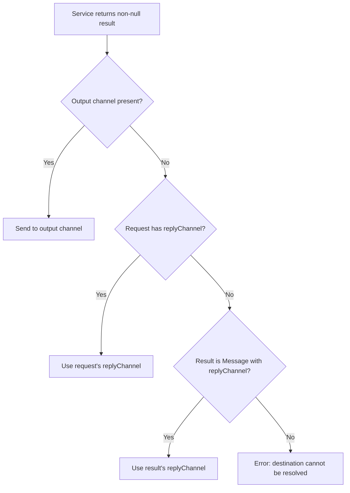

# Output Channel of a Service Activator

In the **SPRING_INTEGRATION_CORE** module, a service activator connects business processing to a message flow. After the business method completes, the endpoint must also decide where to send the result. That decision directly affects connecting processing steps, replying to gateways, and catching configuration errors.

This lesson belongs to the **Service activator** chapter and focuses on the output channel. The running example is an order pricing service: receiving a request, calculating the total price, and forwarding the quote to whoever needs it. From this example, you will distinguish the Java method's return value, the output message, and the destination channel receiving the message.

## 1. Where Does the Output Channel Sit in the Flow?

Consider a pricing step:

```text
Message<OrderRequest>
        |
        v
priceRequests --> Service Activator --> pricedOrders
                       |
                       v
                PricingService.quote(...)
                       |
                       v
                   OrderQuote
```

There are three distinct responsibilities:

| Component | Responsibility in the example |
| --- | --- |
| `quote` method | Calculates and returns `OrderQuote` |
| Service activator | Invokes the method and handles the result as a message |
| Output channel `pricedOrders` | Receives the message so another party can process or read it |

If the method returns a domain object, the framework creates a reply message with that object as the payload. The method can also return **Message<?>** when it needs to set headers explicitly. This contract is described in the [ServiceActivator API](https://docs.spring.io/spring-integration/api/org/springframework/integration/annotation/ServiceActivator.html).

The name "output channel" describes a role in the endpoint configuration. A **QueueChannel** can be the output of the pricing step and simultaneously the input of the quote-persistence step. There is no requirement to create a special channel class named `OutputChannel`.

With this design, `PricingService` only needs to know about orders and quotes. Deciding whether the quote goes on to storage, credit-limit checks, or back to the caller lives in the flow configuration.

## 2. Order of Resolving the Result Destination Channel

For a non-null result, the service activator looks up the destination in this order:

1. The output channel configured on the endpoint.
2. The request's **replyChannel** header.
3. The result's **replyChannel** header, if the result is a `Message` and the request does not have this header.

The header can hold a `MessageChannel` instance or a `String` channel name; a name must be resolvable. This is Spring Integration's Return Address mechanism. See [reply channel selection rules](https://docs.spring.io/spring-integration/reference/7.0/service-activator.html).



Note carefully: the order above picks one destination, rather than creating a fallback list of channels. If the chosen destination fails to resolve or send fails, the endpoint does not automatically fall back to a lower-priority header. When no destination is available, the handler throws **DestinationResolutionException**. You can cross-check this in the [AbstractMessageProducingHandler source](https://raw.githubusercontent.com/spring-projects/spring-integration/v7.0.0/spring-integration-core/src/main/java/org/springframework/integration/handler/AbstractMessageProducingHandler.java).

For example, suppose a request has a `replyChannel` pointing to `callerReplies`, while the endpoint sets its output channel to `pricedOrders`. The quote is sent to `pricedOrders`. To eventually reply to `callerReplies`, a downstream step must consume the quote and produce a reply according to the flow's contract.

## 3. Java DSL Example with Two Ways of Returning Results

### 3.1. Setup

The example uses Java 17 or later and the **IntegrationFlow.from(...)**, **@EnableIntegration**, **DirectChannel**, and **QueueChannel** APIs.

The application requires the **org.springframework.integration:spring-integration-core** dependency. The test section below requires JUnit Jupiter. Align Spring dependencies using your project's BOM; if using Spring Boot, you can use **spring-boot-starter-integration** and the Boot-managed test dependencies.

Both illustrative Java files are placed in the **example.integration** package. No database, broker, or network connection is needed to understand this flow.

### 3.2. Complete Configuration

```java
package example.integration;

import java.math.BigDecimal;
import java.math.RoundingMode;

import org.springframework.context.annotation.Bean;
import org.springframework.context.annotation.Configuration;
import org.springframework.integration.channel.DirectChannel;
import org.springframework.integration.channel.QueueChannel;
import org.springframework.integration.config.EnableIntegration;
import org.springframework.integration.dsl.IntegrationFlow;

@Configuration
@EnableIntegration
public class OrderOutputConfig {

    public record OrderRequest(String orderId, BigDecimal subtotal) {
    }

    public record OrderQuote(String orderId, BigDecimal total) {
    }

    public static class PricingService {

        public OrderQuote quote(OrderRequest request) {
            if (request.subtotal().signum() < 0) {
                throw new IllegalArgumentException(
                        "Subtotal must not be negative");
            }

            BigDecimal total = request.subtotal()
                    .multiply(new BigDecimal("1.10"))
                    .setScale(2, RoundingMode.HALF_UP);

            return new OrderQuote(request.orderId(), total);
        }
    }

    @Bean
    public PricingService pricingService() {
        return new PricingService();
    }

    @Bean
    public DirectChannel priceRequests() {
        return new DirectChannel();
    }

    @Bean
    public DirectChannel replyRequests() {
        return new DirectChannel();
    }

    @Bean
    public QueueChannel pricedOrders() {
        return new QueueChannel(10);
    }

    @Bean
    public IntegrationFlow explicitOutputFlow(
            PricingService pricingService) {

        return IntegrationFlow.from("priceRequests")
                .handle(pricingService, "quote",
                        endpoint -> endpoint
                                .requiresReply(true)
                                .sendTimeout(1_000))
                .channel("pricedOrders")
                .get();
    }

    @Bean
    public IntegrationFlow returnAddressFlow(
            PricingService pricingService) {

        return IntegrationFlow.from("replyRequests")
                .handle(pricingService, "quote",
                        endpoint -> endpoint.requiresReply(true))
                .get();
    }
}
```

The `1.10` factor is merely an illustrative calculation rule and does not represent real tax regulations.

In `explicitOutputFlow`, calling **.channel("pricedOrders")** after **.handle(...)** connects the handler's output to this channel. In `returnAddressFlow`, the terminal handler has no configured output channel, so the request must supply a reply address.

In Java DSL, **.handle(...)** can invoke a POJO method or a lambda `GenericHandler`. See [service activators and the handle method](https://docs.spring.io/spring-integration/reference/dsl/java-handle.html). How **.channel(...)** connects endpoints and creates intermediate channels is described in [Message Channels in Java DSL](https://docs.spring.io/spring-integration/reference/dsl/java-channels.html).

Both flows share the service because the pricing logic is identical. Endpoint configuration determines who receives the result:

| Send request to | Where does the result go? |
| --- | --- |
| `priceRequests` | `pricedOrders`, even if the request has a `replyChannel` |
| `replyRequests` with a valid `replyChannel` | The channel specified by the request |
| `replyRequests` without a `replyChannel` | Missing-destination error because `quote` returns a POJO |

**requiresReply(true)** and **sendTimeout(1_000)** are endpoint options, not business parameters of `quote`. The corresponding API is in [ConsumerEndpointSpec](https://docs.spring.io/spring-integration/api/org/springframework/integration/dsl/ConsumerEndpointSpec.html).

### 3.3. Why Choose QueueChannel as the Illustrative Output?

`pricedOrders` holds quotes so tests can read them with **receive(...)**. There is no downstream consumer yet, so a queue lets us observe results directly.

If replaced with a `DirectChannel`, a handler must be subscribed to receive messages before sending. `DirectChannel` invokes a subscriber on the sending thread itself; it does not provide a queue to read back results. See [DirectChannel API](https://docs.spring.io/spring-integration/api/org/springframework/integration/channel/DirectChannel.html).

In a real application, name channels after the business contract, such as `pricedOrders`, rather than generic names like `out`. Meaningful names make the expected payload clear when connecting multiple flows.

## 4. Testing the Message Path

Testing **pricingService.quote(...)** directly does not verify the output channel. You must send requests through the input channel and observe the destination channel.

The following class uses a plain Spring context and JUnit 5. Each test creates its own context so leftover messages in queues are not shared.

```java
package example.integration;

import java.math.BigDecimal;

import org.junit.jupiter.api.Test;
import org.springframework.context.annotation.AnnotationConfigApplicationContext;
import org.springframework.integration.channel.QueueChannel;
import org.springframework.messaging.Message;
import org.springframework.messaging.MessageChannel;
import org.springframework.messaging.MessagingException;
import org.springframework.messaging.support.MessageBuilder;

import static org.junit.jupiter.api.Assertions.*;

class OrderOutputChannelTest {

    @Test
    void explicitOutputTakesPriorityOverRequestReplyChannel() {
        try (var context =
                new AnnotationConfigApplicationContext(OrderOutputConfig.class)) {

            MessageChannel input =
                    context.getBean("priceRequests", MessageChannel.class);
            QueueChannel output =
                    context.getBean("pricedOrders", QueueChannel.class);
            QueueChannel callerReplies = new QueueChannel(1);

            Message<?> request = MessageBuilder.withPayload(
                    new OrderOutputConfig.OrderRequest(
                            "ORD-101", new BigDecimal("100.00")))
                    .setReplyChannel(callerReplies)
                    .build();

            assertTrue(input.send(request, 1_000));

            Message<?> reply = output.receive(1_000);
            assertNotNull(reply);
            var quote = assertInstanceOf(
                    OrderOutputConfig.OrderQuote.class, reply.getPayload());

            assertEquals("ORD-101", quote.orderId());
            assertEquals(new BigDecimal("110.00"), quote.total());
            assertNull(callerReplies.receive(0));
        }
    }

    @Test
    void requestReplyChannelIsUsedWhenOutputIsNotConfigured() {
        try (var context =
                new AnnotationConfigApplicationContext(OrderOutputConfig.class)) {

            MessageChannel input =
                    context.getBean("replyRequests", MessageChannel.class);
            QueueChannel callerReplies = new QueueChannel(1);

            Message<?> request = MessageBuilder.withPayload(
                    new OrderOutputConfig.OrderRequest(
                            "ORD-102", new BigDecimal("200.00")))
                    .setReplyChannel(callerReplies)
                    .build();

            assertTrue(input.send(request, 1_000));

            Message<?> reply = callerReplies.receive(1_000);
            assertNotNull(reply);
            var quote = assertInstanceOf(
                    OrderOutputConfig.OrderQuote.class, reply.getPayload());

            assertEquals("ORD-102", quote.orderId());
            assertEquals(new BigDecimal("220.00"), quote.total());
            assertNull(context.getBean(
                    "pricedOrders", QueueChannel.class).receive(0));
        }
    }

    @Test
    void aProducedResultNeedsADestination() {
        try (var context =
                new AnnotationConfigApplicationContext(OrderOutputConfig.class)) {

            MessageChannel input =
                    context.getBean("replyRequests", MessageChannel.class);

            Message<?> request = MessageBuilder.withPayload(
                    new OrderOutputConfig.OrderRequest(
                            "ORD-103", new BigDecimal("300.00")))
                    .build();

            assertThrows(MessagingException.class,
                    () -> input.send(request, 1_000));
        }
    }
}
```

Expected observations:

- The first test receives the quote in `pricedOrders`, while `callerReplies` stays empty.
- The second test receives the quote in `callerReplies`, while `pricedOrders` stays empty.
- The third test fails during sending because a result is produced without a receiving address.

The third test checks the messaging exception group; during actual debugging, read the entire cause chain to see the specific destination resolution error.

Do not use **Thread.sleep(...)** in these tests. **receive(1_000)** establishes a clear wait bound; **receive(0)** immediately checks a queue where the synchronous flow has already finished at that point. The tests are illustrative code to run in a project with the matching dependencies, not reported execution results for this article.

## 5. Equivalent Annotation Configuration

Instead of registering **.handle(...)**, you can declare a method on a Spring bean:

```java
import org.springframework.integration.annotation.ServiceActivator;

// Placed inside a Spring bean; OrderRequest, OrderQuote, and pricingService
// correspond to the types and service in the example above.
@ServiceActivator(
        inputChannel = "priceRequests",
        outputChannel = "pricedOrders",
        requiresReply = "true",
        sendTimeout = "1000")
public OrderOutputConfig.OrderQuote quoteOrder(
        OrderOutputConfig.OrderRequest request) {

    return pricingService.quote(request);
}
```

This is an alternative to the `explicitOutputFlow` endpoint; register only one configuration approach for the same business step. If you simultaneously add an annotation endpoint and a DSL endpoint both listening on `priceRequests`, you have created multiple consumers on that channel.

The **outputChannel**, **requiresReply**, and **sendTimeout** attributes of the annotation take strings. That is why the example uses `"true"` and `"1000"`. See [ServiceActivator annotation API](https://docs.spring.io/spring-integration/api/org/springframework/integration/annotation/ServiceActivator.html).

Avoid calling **pricedOrders.send(...)** inside the service while also returning the quote from a service activator with an output. That creates two send paths for the same result and couples business logic to messaging configuration.

## 6. Output Channel, `null`, `void`, and `requiresReply`

An output channel only receives a message when the handler actually produces output. Configuring a channel name does not turn a `void` method into a reply-producing step.

| Method result | `requiresReply` | Behavior |
| --- | --- | --- |
| Non-null object | `false` or `true` | Creates reply and resolves destination |
| `null` | `false` | Ends the step, sends no reply |
| `null` | `true` | Throws `ReplyRequiredException` |
| `void` | `false` | Performs the action only, sends no reply |

By default `requiresReply` is `false`. Enable it when the contract requires every request to produce a result; do not use a `void` method for such a contract. Cross-check at [reply-producing handler API](https://docs.spring.io/spring-integration/api/org/springframework/integration/handler/AbstractReplyProducingMessageHandler.html) and [requiresReply attribute](https://docs.spring.io/spring-integration/api/org/springframework/integration/annotation/ServiceActivator.html).

An easy-to-confuse case:

```java
public void saveQuote(OrderOutputConfig.OrderQuote quote) {
    repository.save(quote);
}
```

If this save step sits at the end of a flow replying to a gateway, the gateway will not receive a business reply merely because saving succeeded. When the contract requires confirmation, return a type like `QuoteSaved`, or return the quote itself after saving succeeds.

Conversely, if you only need to perform the action and finish, a `void` method clearly expresses intent. Do not fabricate dummy data just to send to an output channel.

## 7. Explicitly Ending a Flow with `nullChannel`

Sometimes a method returns a value that the current flow does not need to use. You can send the result to the special **nullChannel** bean:

```java
@Bean
public IntegrationFlow discardQuoteFlow(
        OrderOutputConfig.PricingService pricingService) {

    return IntegrationFlow.from("discardQuoteRequests")
            .handle(pricingService, "quote")
            .channel("nullChannel")
            .get();
}
```

For a regular quote payload, `nullChannel` accepts the message and discards the result. This differs from omitting output channel configuration: omitting configuration still lets the framework look for `replyChannel`. See [NullChannel API](https://docs.spring.io/spring-integration/api/org/springframework/integration/channel/NullChannel.html).

Use case: a service performs a calculation while also recording metrics; this flow only needs the recording side effect, and the return value is not part of its contract.

Before choosing this approach, verify whether the caller is waiting for a quote. If so, discarding the quote will prevent the caller from receiving the expected result.

## 8. Relationship with Gateways and Intermediate Steps

A gateway creates a temporary reply address and puts it in the `replyChannel` header. When the terminal endpoint does not set its own output channel, the result can return to this address. See [gateway reply channel mechanism](https://docs.spring.io/spring-integration/reference/gateway.html).

A sound pipeline might look like:

```text
Gateway
   |
   v
priceRequests
   |
   v
Calculate price --output--> Save quote --output--> Create confirmation
                                                      |
                                                      v
                                          replyChannel in header
                                                      |
                                                      v
                                                   Gateway
```

This is an illustrative design: intermediate steps produce output for the next step; the final step produces `QuoteAccepted` and then uses the request's reply address.

A seemingly small change can break this contract: adding **.channel("pricedOrders")** at the end of a flow that was returning directly to a gateway, when no consumer is reading from that queue and forwarding the result. The quote still exists, but it is sitting in the queue instead of reaching where the gateway is waiting.

When customizing headers, treat `replyChannel` as an address belonging to the current invocation. Do not arbitrarily overwrite it with a shared channel to "standardize configuration".

With multiple concurrent requests, a shared queue does not automatically match quotes to the right callers. If you build your own request–reply mechanism, you must define how results are correlated and distributed; for typical application calls, let a gateway manage this exchange.

## 9. Choosing Output Channel Type by Consumption Pattern

| Channel type | Result delivery | Design question |
| --- | --- | --- |
| `DirectChannel` | Invokes one subscriber on the sending thread | Can the next step finish within the same call? |
| `QueueChannel` | Stores messages, consumer pulls later | Who consumes, what capacity is needed, and is durability required? |
| `ExecutorChannel` | Hands dispatch off to an executor | How are pool, overload, and cross-thread errors configured? |
| `PublishSubscribeChannel` | Broadcasts messages to subscribers | Which parties all need to receive the event? |

`QueueChannel` stores messages in memory by default, not in a durable broker. A Spring Integration endpoint consuming a queue needs a poller. With publish–subscribe, whether an executor is used determines whether threads are separated. See [MessageChannel implementations](https://docs.spring.io/spring-integration/reference/channel/implementations.html). `ExecutorChannel` typically hands processing off to an executor and does not share thread-bound transactions with the sender; see [ExecutorChannel API](https://docs.spring.io/spring-integration/api/org/springframework/integration/channel/ExecutorChannel.html).

In the example, **new QueueChannel(10)** is enough to observe a few quotes. If you implement an automated consumption step, you can use a separate flow:

```java
// Illustrates an addition wired into the application configuration.
// quoteStore is a Spring bean with a void save(OrderQuote) method.
@Bean
public IntegrationFlow storeQuotedOrders() {
    return IntegrationFlow.from("pricedOrders")
            .handle("quoteStore", "save",
                    endpoint -> endpoint.poller(
                            org.springframework.integration.dsl.Pollers
                                    .fixedDelay(200)))
            .get();
}
```

When adding this consuming flow, do not keep a test that expects to read quotes directly from `pricedOrders`: the poller and the test will compete for messages. Instead, observe the effect on `quoteStore` or place another appropriate test probe.

## 10. Send Timeouts and End-to-End Replies

Three wait durations serve different purposes:

| Config / call | What is it bounding? |
| --- | --- |
| `endpoint.sendTimeout(1_000)` | Sending the reply to the output channel when the channel supports send timeouts |
| `queue.receive(1_000)` | How long a consumer waits to retrieve a message |
| Gateway reply timeout | How long the gateway waits for a response per gateway mechanics |

`sendTimeout` is useful when the output is a bounded queue that is currently full. It does not bound the execution time of the business method or all downstream steps behind a `DirectChannel`. This attribute is described in [ServiceActivator.sendTimeout API](https://docs.spring.io/spring-integration/api/org/springframework/integration/annotation/ServiceActivator.html).

In the example, **input.send(request, 1_000)** is a send call to a `DirectChannel`. That number does not turn **quote(...)** into a task cancelled after one second. **sendTimeout(1_000)** on the endpoint is what governs sending the quote into the output queue, subject to channel capabilities.

Similarly, a timeout on waiting for a reply is not a mechanism to cancel business work. When designing end-to-end deadlines, account for time spent in queues, processing time, and how late results are handled.

## 11. Distinguishing Successful Output from Error Paths

The service activator's output channel is the path for successful processing results. If **quote(...)** throws an exception, the endpoint does not treat that exception as a quote.

With synchronous calls over `DirectChannel`, errors can propagate back to the sender. When using asynchronous tasks or Spring Integration pollers, the `ErrorMessage` publishing mechanism can send errors to the `errorChannel` header or the default error channel. Merely setting the `errorChannel` header does not automatically turn every synchronous error into a message. See [Error Handling](https://docs.spring.io/spring-integration/reference/error-handling.html).

Applied to the example:

- `subtotal = 100.00`: creates a quote and sends it according to the output rules.
- `subtotal = -1.00`: service throws `IllegalArgumentException`; no output quote is produced.
- Output queue is full and send times out: pricing may have completed, yet forwarding the result fails.

The last case is especially important if the service also updates data or calls external systems. When adding retries, consider that business side effects may have already occurred before the forwarding error. Have an order ID or business key to handle redeliveries cleanly.

## 12. Quick Symptom-Based Diagnosis

| Symptom | What to check |
| --- | --- |
| Result appears in logs but gateway does not receive it | Output channel on the terminal step and any consumer forwarding the reply |
| Header points to the right channel but result arrives at another | Output channel configured on the endpoint has higher priority |
| Destination resolution error | No usable output channel or `replyChannel` |
| Reply channel name fails to resolve | Bean name, context scope, and header value |
| `DirectChannel` reports no subscribers | Whether the receiving endpoint is registered and running |
| Queue has messages but they are not processed | Consumer, poller, and endpoint lifecycle |
| No message after a `void` method | Whether the method contract actually produces a reply |
| Send blocks for a long time | Full queue, send timeout, or synchronous downstream processing |
| Result is processed twice | Did the service send a message itself outside the endpoint's return mechanism? |

When reading a configuration, follow a concrete request: what is the incoming payload, what type does the service return, where is the destination chosen from, and which component consumes that message. For a request–reply contract, keep tracing the path until where the caller receives the result. This check helps catch flows that compute correctly yet have an incomplete reply path.
