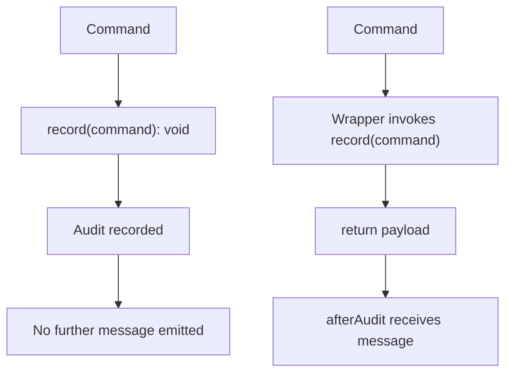

# Methods Returning `void`

In the **Service activator** chapter of the **SPRING_INTEGRATION_CORE** module, a method returning `void` represents a message-handling contract that does not produce a reply from a return value. This is a common choice when writing audit logs, updating data, or invoking a service solely for its side effect.

This lesson focuses on how that contract affects `Message`, `MessageChannel`, endpoints, gateways, and Java DSL. After this lesson, you will be able to place a `void` handler appropriately, know when you need to forward the payload instead, and test both the side effect and the error path.

## 1. Contract of a `void` Service Activator

Consider an order-auditing service:

```java
public void record(AuditCommand command) {
    auditRepository.save(command);
}
```

The service activator receives an input message and invokes `record(...)` with the matching payload. With a standard configuration that allows no reply, once the method finishes normally, the endpoint ends that processing pass without emitting an output message. It does not re-send the input message, does not create a message with a `null` payload, and does not generate a success acknowledgement message. This behavior is described in the [Service Activator documentation](https://docs.spring.io/spring-integration/reference/service-activator.html).


Separate two things:

- **End of the message branch:** no reply comes from the endpoint to move to a subsequent step.
- **End of the business task:** depends on the work the method actually completed, transactions, and any tasks it may have handed off elsewhere.

If `record(...)` merely puts data onto another internal queue, the method returning does not prove that the final destination has finished saving the data.

### `void`, `null`, and a Regular Return Value

| Declaration or result | Design meaning | Behavior when no reply is allowed |
| --- | --- | --- |
| `void record(Command c)` | Method provides no return value | Does not produce a reply from the method result |
| `Receipt record(Command c)` returning `null` | Has a result type, yet this call supplies no result | Does not produce a reply |
| `Receipt record(Command c)` returning a `Receipt` | Produces output data | Endpoint can create a reply and send it to the reply destination |
| `Command record(Command c)` returning `c` | Intentionally continues processing the same data | Endpoint can forward it via a reply |

`void` is a Java return-type keyword; `Void` is a Java class. Changing lowercase to uppercase does not create a processing acknowledgement mechanism. Similarly, returning `null` is not a way to represent a message with an empty payload to send onward.

## 2. Example Using Annotations

The example uses Java 17 or later, Spring Integration Core, and Java configuration. The Java DSL sections later use `IntegrationFlow.from(...)` from Spring Integration 6 or later. Choose dependency versions matching your application's Spring baseline; the example does not require Spring Boot.

Place the following code in `VoidActivatorConfig.java` in package `example.integration`:

```java
package example.integration;

import java.util.List;
import java.util.concurrent.CopyOnWriteArrayList;

import org.springframework.context.annotation.Bean;
import org.springframework.context.annotation.Configuration;
import org.springframework.integration.annotation.ServiceActivator;
import org.springframework.integration.channel.DirectChannel;
import org.springframework.integration.config.EnableIntegration;
import org.springframework.messaging.handler.annotation.Header;

@Configuration
@EnableIntegration
public class VoidActivatorConfig {

    public record AuditCommand(String orderId, String action) {
    }

    public static final class AuditStore {

        private final List<AuditCommand> entries =
                new CopyOnWriteArrayList<>();

        public void append(AuditCommand command) {
            entries.add(command);
        }

        public List<AuditCommand> snapshot() {
            return List.copyOf(entries);
        }
    }

    public static class AuditHandler {

        private final AuditStore store;

        public AuditHandler(AuditStore store) {
            this.store = store;
        }

        @ServiceActivator(
                inputChannel = "auditInput",
                requiresReply = "false")
        public void record(
                AuditCommand command,
                @Header(value = "traceId", required = false)
                String traceId) {

            if (command.orderId() == null
                    || command.orderId().isBlank()) {
                throw new IllegalArgumentException(
                        "orderId must not be blank");
            }

            // traceId can be used for logging; it does not drive the business outcome.
            store.append(command);
        }
    }

    @Bean
    public DirectChannel auditInput() {
        return new DirectChannel();
    }

    @Bean
    public AuditStore auditStore() {
        return new AuditStore();
    }

    @Bean
    public AuditHandler auditHandler(AuditStore store) {
        return new AuditHandler(store);
    }
}
```

`AuditStore` is an in-memory store for observing behavior, not a durable repository. `CopyOnWriteArrayList` keeps the example from relying on a mutable list that is unsafe under concurrent access; it does not replace persistence design for a real system.

In the configuration above:

1. `@EnableIntegration` enables the Spring Integration infrastructure.
2. `auditInput` is the channel delivering messages to the endpoint.
3. `@ServiceActivator` on the `AuditHandler` bean registers the message-handling method.
4. `AuditCommand` is extracted from the payload; `traceId` is mapped from the header and is allowed to be absent.
5. `record(...)` writes to the store and completes without returning a result.

`requiresReply = "false"` is written explicitly so readers recognize the contract. This is also the default behavioral value of a service activator. The annotation API defines `outputChannel` as the reply destination and `requiresReply` to control requiring a non-`null` result; see [@ServiceActivator API](https://docs.spring.io/spring-integration/docs/current/api/org/springframework/integration/annotation/ServiceActivator.html).

You can send a message in a Java method as follows:

```java
try (var context =
        new org.springframework.context.annotation.AnnotationConfigApplicationContext(
                VoidActivatorConfig.class)) {

    var input = context.getBean(
            "auditInput",
            org.springframework.messaging.MessageChannel.class);

    var command = new VoidActivatorConfig.AuditCommand(
            "ORD-1001", "CREATED");

    var message = org.springframework.messaging.support.MessageBuilder
            .withPayload(command)
            .setHeader("traceId", "trace-1001")
            .build();

    boolean delivered = input.send(message);

    var store = context.getBean(VoidActivatorConfig.AuditStore.class);
    System.out.println(delivered);         // true
    System.out.println(store.snapshot());  // Contains the command just recorded
}
```

There is no dedicated executor, poller, or asynchronous flow in this example. With `DirectChannel` and this single handler, `send(...)` runs the processing on the calling thread; it returns after the handler completes normally. The `boolean` value is the result of the channel send operation, not a business reply produced by `record(...)`. Channel behavior is presented in [Message Channel Implementations](https://docs.spring.io/spring-integration/reference/channel/implementations.html).

## 3. Having `outputChannel` Still Does Not Automatically Emit an Output Message

Suppose you change the example's annotation to:

```java
@ServiceActivator(
        inputChannel = "auditInput",
        outputChannel = "afterAudit",
        requiresReply = "false")
public void record(AuditCommand command) {
    store.append(command);
}
```

This is a standalone illustrative snippet; `afterAudit` must be a configured channel if used in an application.

`outputChannel` only specifies where to send **the result when the endpoint produces one**. It does not turn a `void` method into a pass-through forwarding operation. Therefore, placing a transformer, router, or aggregator behind `afterAudit` will not cause them to receive a message from this call.

At the implementation level, the handler sends non-`null` results via the output branch; if there is no result, it enforces the reply requirement or finishes. You can cross-check the [AbstractReplyProducingMessageHandler source](https://github.com/spring-projects/spring-integration/blob/main/spring-integration-core/src/main/java/org/springframework/integration/handler/AbstractReplyProducingMessageHandler.java).

Another common pitfall is mutating the payload object inside the method:

```java
public void markHandled(MutableOrder order) {
    order.setHandled(true);
}
```

If the sender still holds the same `order` reference, it may see that change. However, mutating the object does not produce a reply and does not pass a message to the next endpoint. For integration flows, use explicit output data instead of relying on mutations visible through shared references.

## 4. Three Ways to Express This in Java DSL

The options below **replace** the annotated endpoint in section 2: remove `@ServiceActivator` from `record(...)` and register only the desired flow. Keep the `AuditHandler` bean and business logic. Do not enable both the annotated endpoint and a DSL flow on `auditInput` just to express the same work; with `DirectChannel`, those subscribers become competing consumers.

The configuration snippets use `IntegrationFlow`, `AuditHandler`, and `AuditCommand`; the latter two are inside `VoidActivatorConfig`. The main DSL import is:

```java
import org.springframework.integration.dsl.IntegrationFlow;
```

### 4.1. Invoking a Bean's `void` Method

```java
@Bean
public IntegrationFlow auditFlow(AuditHandler auditHandler) {
    return IntegrationFlow.from("auditInput")
            .handle(auditHandler, "record")
            .get();
}
```

This keeps the service as a POJO and moves flow configuration outside. The endpoint invokes `record(...)` and ends the branch because the method provides no result.

### 4.2. Using `GenericHandler` and Explicitly Returning `null`

```java
@Bean
public IntegrationFlow auditFlow(AuditHandler auditHandler) {
    return IntegrationFlow.from("auditInput")
            .handle(AuditCommand.class, (payload, headers) -> {
                auditHandler.record(
                        payload, (String) headers.get("traceId"));
                return null;
            })
            .get();
}
```

The two-argument lambda receives the payload and headers. Here the lambda requires a return value; `return null` expresses the choice not to create a reply. The `auditHandler.record(...)` call inside is still a `void` Java method.

Specifying `AuditCommand.class` makes explicit the payload type the lambda handles. Using lambdas and payload types is explained in [Service Activators and the .handle() method](https://docs.spring.io/spring-integration/reference/dsl/java-handle.html).

### 4.3. Using `MessageHandler` to Receive the Full `Message`

```java
@Bean
public IntegrationFlow auditFlow(AuditHandler auditHandler) {
    org.springframework.messaging.MessageHandler sink = message -> {
        var command = (AuditCommand) message.getPayload();
        var traceId = (String) message.getHeaders().get("traceId");
        auditHandler.record(command, traceId);
    };

    return IntegrationFlow.from("auditInput")
            .handle(sink)
            .get();
}
```

`MessageHandler.handleMessage(...)` returns `void` and receives the full message. In the example, the payload is cast directly, so senders must adhere to the `AuditCommand` contract.

This is a flow-terminating handler. A plain `MessageHandler` has no mechanism to emit output merely because you write another step after it; the DSL may reject chaining output onto a handler that does not support producing messages. The overloads of `handle(...)` are distinguished in [BaseIntegrationFlowDefinition API](https://docs.spring.io/spring-integration/docs/current/api/org/springframework/integration/dsl/BaseIntegrationFlowDefinition.html).

## 5. If You Want to Continue the Flow, Produce an Output

Suppose a business requirement changes: after writing the audit entry, the command must be forwarded to a classification step. Auditing is now an intermediate step rather than a terminal sink.

A clear approach is to wrap the `void` call in a handler that returns the payload:

```java
@Bean
public org.springframework.integration.channel.QueueChannel afterAudit() {
    return new org.springframework.integration.channel.QueueChannel(10);
}

@Bean
public IntegrationFlow auditThenContinueFlow(AuditHandler auditHandler) {
    return IntegrationFlow.from("auditInput")
            .handle(AuditCommand.class, (payload, headers) -> {
                auditHandler.record(
                        payload, (String) headers.get("traceId"));
                return payload;
            })
            .channel("afterAudit")
            .get();
}
```

This option also replaces the endpoint in earlier examples. The difference is the `return payload` line: the wrapper produces an output result so the service activator forwards it to `afterAudit`. With the service activator's normal reply creation, application headers from the request are carried over to the reply according to header copying rules; the reply message does not necessarily keep the original message's `id` and `timestamp`.

`QueueChannel` here allows observing data after the audit step via `receive(...)`. If you attach an endpoint consuming from this channel to continue automatically, configure a polling consumer and an appropriate poller.

You can compare the two flows:



### Returning a Meaningful Confirmation

When the caller needs to know that the audit step completed, model the outcome instead of returning an arbitrary string like `"OK"`.

For example, add the following result record to `VoidActivatorConfig`:

```java
public record AuditReceipt(String orderId, String status) {
}
```

Then add a method to `AuditHandler`:

```java
public AuditReceipt recordAndConfirm(AuditCommand command) {
    record(command, null);
    return new AuditReceipt(command.orderId(), "RECORDED");
}
```

Configure the endpoint to call `recordAndConfirm` instead of `record`. In the in-memory store example, `RECORDED` only states that the command was added to the store. With a database, clearly define which operation the result describes and where the transaction commits; do not assign it the meaning of "committed" or "delivered to another system" unless the architecture guarantees it.

If the goal is to log for observability while letting the message continue, consider `log(...)` or a `wireTap(...)` branch instead of inserting a flow-terminating handler. An observation branch must still be designed for threading, load, and error handling; the name "tap" does not automatically make that branch asynchronous or error-isolated.

## 6. `requiresReply` Does Not Turn `void` into a Success Confirmation

`requiresReply` is a constraint on the handler's result.

| Desired contract | Appropriate expression |
| --- | --- |
| Perform only a side effect at the end of a branch | `void` method, reply not required |
| Always require a result for the next step | Value-returning method, reply requirement enabled where appropriate |
| Perform a side effect and continue with the original data | Wrapper invoking the `void` method and returning the payload |
| Discard a result that was already produced | Send the result to `nullChannel` |

Under normal synchronous processing, when a handler requires a reply but the result is `null`, `ReplyRequiredException` signals a contract violation. Method selection configuration can also exclude `void` methods when a reply is required, so do not design an example assuming a `void` method is guaranteed to run first and then throw an exception.

The practical rules are:

- Do not pair `void` with `requiresReply=true` expecting the framework to generate an acknowledgement.
- If a result is needed, change the method contract or add a wrapper that produces a result.
- Use the reply requirement to catch an unexpected missing result in a step designed to produce output.

`requiresReply=false` only **permits** the absence of a result. For a method with a return type, a non-`null` result can still be sent out. If you want to intentionally discard that result, `nullChannel` is the sink for discarding results; it is not the same as a method producing no result in the first place.

## 7. Gateways Must Match the Flow's Contract

A gateway with a `void` method expresses a one-way send contract in the caller API. Example standalone interface in the same package:

```java
package example.integration;

import org.springframework.integration.annotation.MessagingGateway;

@MessagingGateway(defaultRequestChannel = "auditInput")
public interface AuditGateway {

    void record(VoidActivatorConfig.AuditCommand command);
}
```

For the framework to discover this interface, add gateway scanning configuration to the configuration class, such as:

```java
@org.springframework.integration.annotation.IntegrationComponentScan(
        basePackageClasses = AuditGateway.class)
```

Place this annotation alongside `@Configuration` and `@EnableIntegration` on `VoidActivatorConfig`. Then the application can inject `AuditGateway` and call `record(command)` instead of manually building a `Message`.

Read these three properties together:

1. A `void` gateway does not wait for a business reply to return to the caller.
2. With a synchronous flow over `DirectChannel`, the call still executes the handler on the caller's thread; the gateway method can still take time or throw errors.
3. A one-way send API is not implicitly a background API.

Conversely, if a gateway declares returning `AuditReceipt` while the terminal processing branch only calls a `void` method, the flow provides no receipt. The gateway may wait until its reply timeout, return `null`, or fail depending on configuration. If infinite waiting is allowed, the call may never finish. Setting a finite timeout bounds the reply wait, yet it neither creates the missing result nor cancels a slow synchronous method.

These scenarios are explained in [Messaging Gateways](https://docs.spring.io/spring-integration/reference/gateway.html). When designing an API, pick one of two clear contracts: `void` for operations needing no return data, or a result type paired with a reply path that actually produces that type.

## 8. `void` Does Not Determine Threading, Transactions, or Delivery Semantics

The return type answers "what data does the method provide?". The channel and execution configuration answer "who runs the method and when?".

| Input configuration | Handler execution | What the sender can infer on a successful send |
| --- | --- | --- |
| `DirectChannel` in a simple synchronous setup | Thread calling `send` | Handler completed normally before `send` returned |
| `QueueChannel` with a polling consumer | Poller execution thread | Message entered the queue; handler may not have run yet |
| `ExecutorChannel` with an executor running on workers | Thread scheduled by the executor | Work was handed off per executor mechanics; business completion is not yet guaranteed |

An executor can have different execution or rejection policies; read the actual configuration rather than inferring from the channel name alone. Standard `QueueChannel` is also in-memory by default, so "entered the queue" does not equal "durably persisted".

In a synchronous flow, if a `void` method spawns its own background task and returns immediately, the framework calling the method only sees that the call finished. Failures occurring later in the background task require a separate observation mechanism. Therefore, clearly decide the completion point the API is meant to advertise.

### Side Effects and Retries

Suppose a handler called a notification service successfully, and then an error occurred before the system recorded completion. If the message is redelivered or retried, the notification could be sent again. `void` does not add deduplication.

For operations that may run again, establish a suitable business key, such as `orderId + action + eventVersion`, and design writes or service calls to be idempotent. Do not automatically use `MessageHeaders.ID` as a business key across message recreations.

Similarly, `void` does not automatically open a transaction or commit multiple systems together. If transactions are used, identify which resources actually participate and where commit boundaries lie. Success of a single Java call is not enough to conclude the entire integration process has finished.

## 9. Error Handling for `void` Methods

A `void` method can still throw exceptions. Having no return value does not mean having no error signal.

In the section 2 example, a blank `orderId` causes `record(...)` to throw `IllegalArgumentException` before writing. When invoked through an endpoint, the caller typically sees a messaging infrastructure exception wrapping the business cause.

With a synchronous flow over `DirectChannel`, errors unwind up the call stack to the sender unless a component is configured to handle or redirect them. Simply adding an `errorChannel` header to a directly sent message does not automatically turn every synchronous exception into an error message.

For asynchronous tasks managed by Spring Integration infrastructure, the error-handling mechanism can publish an `ErrorMessage` to the channel in the `errorChannel` header, or to the default `errorChannel` if no such header is present. Pollers, executors, advice, and gateways can affect the exact error path. Refer to [Error Handling](https://docs.spring.io/spring-integration/reference/error-handling.html).

A common design mistake is catching an exception and only logging it:

```java
public void record(AuditCommand command) {
    try {
        auditRepository.save(command);
    }
    catch (RuntimeException ex) {
        logger.error("Cannot record audit", ex);
        // Method finishes normally from the caller's perspective.
    }
}
```

This snippet illustrates a situation to watch out for, with `auditRepository` and `logger` as application dependencies. Without compensation or another error path, the infrastructure may treat the execution as completed normally. Exception-based retry advice also will not see an exception that has been swallowed.

If the requirement is to signal failure to the caller or to an endpoint retry mechanism, let the exception propagate, or catch to add context and rethrow. If the intent is to treat a failure as a business outcome, model that outcome and where it is consumed.

## 10. Testing Side Effects and the Absence of Replies

For a `void` method, merely verifying "no exception thrown" is insufficient: the handler may be misconfigured or may not have performed the expected side effect.

The two tests below use the original annotation configuration from section 2. Place them in package `example.integration`. The test classpath needs Spring Integration Core and JUnit Jupiter, along with your build tool's JUnit Jupiter runner setup.

```java
package example.integration;

import java.util.List;

import org.junit.jupiter.api.Test;
import org.springframework.context.annotation.AnnotationConfigApplicationContext;
import org.springframework.integration.channel.QueueChannel;
import org.springframework.messaging.MessageChannel;
import org.springframework.messaging.MessagingException;
import org.springframework.messaging.support.MessageBuilder;

import example.integration.VoidActivatorConfig.AuditCommand;
import example.integration.VoidActivatorConfig.AuditStore;

import static org.junit.jupiter.api.Assertions.assertEquals;
import static org.junit.jupiter.api.Assertions.assertInstanceOf;
import static org.junit.jupiter.api.Assertions.assertNull;
import static org.junit.jupiter.api.Assertions.assertThrows;
import static org.junit.jupiter.api.Assertions.assertTrue;

class VoidActivatorTest {

    @Test
    void recordsSideEffectWithoutSendingReply() {
        try (var context = new AnnotationConfigApplicationContext(
                VoidActivatorConfig.class)) {

            MessageChannel input =
                    context.getBean("auditInput", MessageChannel.class);
            AuditStore store = context.getBean(AuditStore.class);
            QueueChannel replies = new QueueChannel(1);

            AuditCommand command =
                    new AuditCommand("ORD-1001", "CREATED");

            var message = MessageBuilder.withPayload(command)
                    .setHeader("traceId", "trace-test-1")
                    .setReplyChannel(replies)
                    .build();

            assertTrue(input.send(message));
            assertEquals(List.of(command), store.snapshot());
            assertNull(replies.receive(0));
        }
    }

    @Test
    void propagatesFailureWithoutWritingAudit() {
        try (var context = new AnnotationConfigApplicationContext(
                VoidActivatorConfig.class)) {

            MessageChannel input =
                    context.getBean("auditInput", MessageChannel.class);
            AuditStore store = context.getBean(AuditStore.class);

            var message = MessageBuilder.withPayload(
                    new AuditCommand(" ", "CREATED")).build();

            MessagingException error = assertThrows(
                    MessagingException.class,
                    () -> input.send(message));

            Throwable root = rootCause(error);
            assertInstanceOf(IllegalArgumentException.class, root);
            assertEquals("orderId must not be blank", root.getMessage());
            assertTrue(store.snapshot().isEmpty());
        }
    }

    private static Throwable rootCause(Throwable error) {
        Throwable current = error;
        while (current.getCause() != null) {
            current = current.getCause();
        }
        return current;
    }
}
```

The first test observes both sides of the contract:

- The command was properly recorded in the store.
- Even though the request had a valid `replyChannel`, no reply was produced by the `void` method.

`receive(0)` inspects the queue immediately. This is justified because the flow is running synchronously over `DirectChannel` and the handler has already completed before `send(...)` returns. If switched to asynchronous processing, checking for an empty queue right after `send(...)` can run before the handler; in that case, "no reply yet" does not prove the handler will not produce a reply later.

The second test confirms that invalid input propagates the error to the sender and leaves the store unmodified. It does not assert that a database rolled back; the example has not configured a database or transaction.

If the real system writes to a DB, sends HTTP requests, or publishes messages to a broker, replace the illustrative store with appropriate observations: persisted records, dependency interactions, or output events. With asynchronous processing, use a bounded wait mechanism such as a latch or observable condition; do not use a fixed `sleep` duration to infer task completion.

## 11. Diagnosing Common Misunderstandings

| Symptom | What to check | How to adjust |
| --- | --- | --- |
| Audit finishes but downstream endpoint receives nothing | Does the method or lambda produce an output value? | Return the payload or a business result if you want to continue |
| `outputChannel` is declared yet the channel stays empty | Does the method return `void` or `null`? | Output destination does not substitute for producing a result |
| Gateway waits a long time after the side effect occurred | Does the gateway require a result while the flow ends with no reply? | Align both sides of the contract; configure a finite timeout |
| Caller does not receive errors when running on a worker | Which thread did the error occur on, and where is it routed? | Design and observe the appropriate `ErrorMessage` path |
| Retry does not trigger despite dependency failure | Did the method catch and swallow the exception? | Let the error reach the chosen handling mechanism |
| Notification is sent twice after a retry | Is the side effect deduplicated by business key? | Define idempotency and completion boundaries |
| Annotation and DSL examples behave unpredictably | Are multiple consumers registered on the same `DirectChannel`? | Keep only the endpoint needed for the chosen approach |

When choosing `void`, clearly state three things in the endpoint's contract: the side effect to complete, where the message branch terminates, and how errors are observed. If a downstream step or a gateway needs data, produce explicit output using an appropriate payload or result type.
