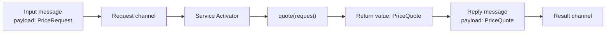

# Methods Returning a Payload

## 1. Objectives and Context

In the **Service activator** chapter of the **SPRING_INTEGRATION_CORE** module, this lesson explains how the return value of a business method becomes data for the next step in a message flow. The focus is on the contract between the method, `Message`, `MessageChannel`, and the endpoint; from there, you can apply it using annotations or Java DSL and verify the result at the messaging boundary.

After this lesson, you will be able to:

- Write a method that accepts one payload type and returns a different payload type.
- Distinguish a Java return value from the reply message emitted by the endpoint.
- Determine the destination channel for the result and recognize when a result has no destination.
- Deliberately handle `null`, `void`, collections, and errors instead of guessing from method names.
- Verify output data, propagated headers, and message counts simultaneously.

The examples use Java 17 or later, `spring-integration-core`, and the Java DSL API in the style of Spring Integration 6.x or later. The illustrative tests use JUnit Jupiter. Library versions should follow your application's dependency management configuration; this lesson does not tie the module to one specific version.

## 2. Where Does the Return Value Go in the Output Message?

Suppose the system receives a pricing request:

```java
public PriceQuote quote(PriceRequest request) {
    // Business calculation...
    return new PriceQuote(request.orderId(), total, "VND");
}
```

The method does not have to build a `Message<PriceQuote>` itself or call `send()` to pass the result to the next step. When invoked via a service activator, the returned `PriceQuote` object is what the endpoint uses as the reply payload. If you call `quoteService.quote(request)` directly in Java, you only get a Java object; messaging behavior comes from the endpoint wrapping that call. This is the return value contract described in the [`@ServiceActivator` Javadoc](https://docs.spring.io/spring-integration/api/org/springframework/integration/annotation/ServiceActivator.html).



Distinguish three objects when reading code:

| Object | Role in the example |
| --- | --- |
| `Message<PriceRequest>` | Envelope containing the request and headers such as `traceId` |
| `PriceQuote` | Business result of the method |
| `Message<PriceQuote>` | Envelope carrying the result to the rest of the flow |

The input and output types do not have to match. What matters for the contract is that the next consumer understands `PriceQuote`. A flow starting up cleanly does not mean every runtime payload type sent into it will be compatible.

## 3. Writing Methods with a Clear Output Contract

The business example has two data types:

```java
public record PriceRequest(
        String orderId,
        BigDecimal unitPrice,
        int quantity) {
}

public record PriceQuote(
        String orderId,
        BigDecimal total,
        String currency) {
}
```

For an order with unit price `125000` and quantity `2`, the expected result is a `PriceQuote` with total `250000` and currency code `VND`. The records preserve the request–result link via `orderId`; there is no need to treat the message ID as the order ID.

Prefer specific signatures like `PriceQuote quote(PriceRequest request)` over `Object process(Object value)`. Specific signatures make the contract readable, simplify unit testing, and catch downstream-impacting data changes early.

If the method only needs the payload, let it accept the business type. If it also needs headers, an adapter can accept specific headers:

```java
import org.springframework.messaging.handler.annotation.Header;

public PriceQuote quoteForTenant(
        PriceRequest request,
        @Header("tenantId") String tenantId) {
    return tenantPricingService.quote(tenantId, request);
}
```

This snippet illustrates an adapter signature when the application already has `tenantPricingService`; it is not an extra bean for the complete example below. With `@Header("tenantId")`, the header is required by default. Agree on its provider rather than letting a missing-metadata error be mistaken for a pricing error.

You do not need to add a `Message<?>` parameter just to return a payload. Nor do you need to change the method to return `Message<?>` just because the reply type differs from the request type.

## 4. Complete Example Using Java DSL

The example below does not depend on Spring Boot. Save the declarations in the same `QuoteFlowConfig.java` file in package `example.integration` when practicing. The domain types and service are nested inside the configuration so the example can be read in one code block; in a larger application, split them into separate files.

```java
package example.integration;

import java.math.BigDecimal;
import java.util.Objects;

import org.springframework.context.annotation.Bean;
import org.springframework.context.annotation.Configuration;
import org.springframework.integration.channel.DirectChannel;
import org.springframework.integration.channel.QueueChannel;
import org.springframework.integration.config.EnableIntegration;
import org.springframework.integration.dsl.IntegrationFlow;
import org.springframework.messaging.MessageChannel;

@Configuration
@EnableIntegration
public class QuoteFlowConfig {

    public record PriceRequest(
            String orderId,
            BigDecimal unitPrice,
            int quantity) {
    }

    public record PriceQuote(
            String orderId,
            BigDecimal total,
            String currency) {
    }

    public static class QuoteService {

        public PriceQuote quote(PriceRequest request) {
            Objects.requireNonNull(request, "request");
            Objects.requireNonNull(request.unitPrice(), "unitPrice");

            if (request.unitPrice().signum() < 0) {
                throw new IllegalArgumentException(
                        "Unit price must not be negative");
            }
            if (request.quantity() <= 0) {
                throw new IllegalArgumentException(
                        "Quantity must be greater than 0");
            }

            BigDecimal total = request.unitPrice()
                    .multiply(BigDecimal.valueOf(request.quantity()));

            return new PriceQuote(request.orderId(), total, "VND");
        }
    }

    @Bean
    public MessageChannel quoteRequests() {
        return new DirectChannel();
    }

    @Bean
    public QueueChannel quoteResults() {
        return new QueueChannel(10);
    }

    @Bean
    public QuoteService quoteService() {
        return new QuoteService();
    }

    @Bean
    public IntegrationFlow quoteFlow(QuoteService quoteService) {
        return IntegrationFlow.from("quoteRequests")
                .handle(quoteService, "quote",
                        endpoint -> endpoint.requiresReply(true))
                .channel("quoteResults")
                .get();
    }
}
```

In this flow:

1. `quoteRequests` receives messages with a `PriceRequest` payload.
2. `.handle(quoteService, "quote", ...)` creates a service activator step invoking the specified method.
3. The method returns a `PriceQuote`; processing continues with the new payload.
4. `.channel("quoteResults")` sets the output destination for the immediately preceding `.handle()` step.
5. `QueueChannel` holds the result so the practice program or test can actively read it.

`requiresReply(true)` expresses the contract: every valid request must produce a non-`null` result. It does not guarantee that sending the result always succeeds, nor does it set a reply timeout for a gateway.

`DirectChannel` at the input invokes the subscriber on the sending thread. `QueueChannel` at the output only stores messages; in this example no endpoint is polling the queue, so no poller needs to be configured for the caller to retrieve the result via `receive()`.

### Sending Requests and Reading Results

The following snippet assumes the application has an `ApplicationContext` named `context` created from `QuoteFlowConfig`:

```java
import java.math.BigDecimal;

import org.springframework.integration.channel.QueueChannel;
import org.springframework.messaging.Message;
import org.springframework.messaging.MessageChannel;
import org.springframework.messaging.support.MessageBuilder;

MessageChannel input = context.getBean(
        "quoteRequests", MessageChannel.class);
QueueChannel output = context.getBean(
        "quoteResults", QueueChannel.class);

Message<QuoteFlowConfig.PriceRequest> request = MessageBuilder
        .withPayload(new QuoteFlowConfig.PriceRequest(
                "ORD-006", new BigDecimal("125000"), 2))
        .setHeader("traceId", "trace-006")
        .build();

boolean accepted = input.send(request);
Message<?> reply = output.receive(1000);

if (!accepted || reply == null) {
    throw new IllegalStateException("No quote received");
}

QuoteFlowConfig.PriceQuote quote =
        (QuoteFlowConfig.PriceQuote) reply.getPayload();

System.out.println(quote.orderId());       // ORD-006
System.out.println(quote.total());         // 250000
System.out.println(quote.currency());      // VND
System.out.println(reply.getHeaders()
        .get("traceId"));                  // trace-006
```

The return value of `input.send(request)` is a `boolean` about the send operation, not a `PriceQuote`. The business object is retrieved from `reply.getPayload()`. The `1000` duration in `receive(1000)` is the wait timeout for reading the message in milliseconds; it does not cancel a long-running business method.

In this example using `DirectChannel`, `send()` can also throw an exception if synchronous processing encounters an error. Therefore, you cannot use the `accepted` variable alone as your entire error-handling policy.

## 5. Same Contract with Annotations

If you want to register the endpoint using annotations, replace the `quoteFlow` bean with the adapter bean below. Keep the channel beans and `QuoteService` from the example above:

```java
import org.springframework.integration.annotation.ServiceActivator;

public class QuoteEndpoint {

    private final QuoteFlowConfig.QuoteService quoteService;

    public QuoteEndpoint(QuoteFlowConfig.QuoteService quoteService) {
        this.quoteService = quoteService;
    }

    @ServiceActivator(
            inputChannel = "quoteRequests",
            outputChannel = "quoteResults",
            requiresReply = "true")
    public QuoteFlowConfig.PriceQuote handle(
            QuoteFlowConfig.PriceRequest request) {
        return quoteService.quote(request);
    }
}
```

Register the adapter in the configuration that has `@EnableIntegration` enabled:

```java
@Bean
public QuoteEndpoint quoteEndpoint(QuoteService quoteService) {
    return new QuoteEndpoint(quoteService);
}
```

`QuoteService` in the bean method above is the nested type inside `QuoteFlowConfig`, since the bean is placed inside that same configuration. `requiresReply` in the annotation takes the string `"true"`; the DSL takes the boolean `true`.

These are two mutually alternative configuration approaches. Choose one endpoint for the pricing flow being demonstrated. If you keep both the DSL and the adapter subscribed to the same `DirectChannel`, there will be multiple competing consumers; a request is not automatically routed through both.

## 6. Where Is the Result Sent?

For the regular payload case in this lesson without a routing slip, the destination is determined in this order:

1. The output channel configured on the endpoint, if present.
2. The request message's `replyChannel` header, if no output channel is configured.
3. If no valid destination exists, sending the reply fails.

`replyChannel` can be a `MessageChannel` instance or a resolvable channel name. This mechanism and the case of returning a full `Message<?>` are described in the [Service Activator guide](https://docs.spring.io/spring-integration/reference/service-activator.html).

The main example has a fixed destination `quoteResults`, so the result goes there even if the request also has a `replyChannel`. An output channel does not mean sending a copy to every reply address appearing in headers.

### Request–Reply Variant

If the sender needs to specify where to receive the result per request, create an alternative flow without attaching `quoteResults`:

```java
@Bean
public IntegrationFlow onDemandQuoteFlow(QuoteService quoteService) {
    return IntegrationFlow.from("onDemandQuotes")
            .handle(quoteService, "quote",
                    endpoint -> endpoint.requiresReply(true))
            .get();
}
```

Place this bean inside `QuoteFlowConfig` if practicing this variant. The DSL creates an input channel named `onDemandQuotes` on demand. The caller can supply the reply address via header:

```java
QueueChannel temporaryReplies = new QueueChannel(1);

Message<QuoteFlowConfig.PriceRequest> request = MessageBuilder
        .withPayload(new QuoteFlowConfig.PriceRequest(
                "ORD-007", new BigDecimal("50000"), 3))
        .setReplyChannel(temporaryReplies)
        .build();

context.getBean("onDemandQuotes", MessageChannel.class)
        .send(request);

Message<?> reply = temporaryReplies.receive(1000);
```

The temporary reply channel in the example does not need a bean name because the header holds the channel object directly. Messaging gateways typically prepare a reply address for request–reply calls; the business method still only needs to return `PriceQuote`.

If you attach a fixed output queue to the terminal step and then invoke it via a gateway waiting on its own reply address, you must design the segment that bridges the result back to the gateway. Merely adding `return` in the service will not fix a misconfigured reply route.

## 7. Which Headers Accompany the New Payload?

A `Message` has a payload and headers; the headers structure does not allow direct modification via `put()`. Having a POJO payload does not make the POJO itself immutable either. These properties are explained in the [Message documentation](https://docs.spring.io/spring-integration/reference/message.html).

In the example's default configuration, application headers such as `traceId` are propagated from request to reply. Meanwhile, `id` and `timestamp` are framework-managed message metadata; do not use them to assume the reply is the exact original request message. When an endpoint builds a new message from a new payload, check `orderId` or a business correlation header rather than requiring the message ID to remain identical.

Header propagation can be customized or filtered within a flow. For instance, a system may want to keep `traceId` internally while stripping an authentication header before sending to an external system. That is the responsibility of a header-management step or corresponding propagation configuration.

An important limitation when comparing return types: even when a service activator returns an explicit `Message<?>`, missing request headers may still be copied onto the reply. Thus, manually creating a message with fewer headers is not a reliable way to remove headers from a flow. This lesson chooses returning a payload to keep the business contract concise; when metadata needs changing, design a dedicated header step. This copying rule is described in [Service Activator and Method Return Type](https://docs.spring.io/spring-integration/reference/service-activator.html).

## 8. No Result: `null`, `void`, and Empty Values

A method with return type `PriceQuote` can still return `null` at runtime. Therefore, the Java return type declaration and the endpoint's requirement for a reply are two separate constraints.

| Method result | Meaning in a typical service activator |
| --- | --- |
| `new PriceQuote(...)` | Business result available to send onward |
| `null`, `requiresReply` defaults to `false` | No reply is created for that invocation |
| `null`, `requiresReply(true)` | Contract violation; throws `ReplyRequiredException` |
| `void` method with a one-way endpoint | Executes work and finishes, with no reply payload |
| Empty string `""` or empty list | Still a non-`null` object; must be interpreted by business logic |

The semantics and default value of `requiresReply` are specified in the [`@ServiceActivator.requiresReply` Javadoc](https://docs.spring.io/spring-integration/api/org/springframework/integration/annotation/ServiceActivator.html#requiresReply()).

### Not Finding Data Can Still Be a Result

Suppose a product lookup finds no matching SKU. Returning `null` can cause a request–reply caller to wait until timeout even though the service finished running. If the caller needs to distinguish "not found" from "no reply yet", introduce a business result type, such as:

```java
public enum LookupStatus {
    FOUND, NOT_FOUND
}

public record ProductLookupResult(
        String productCode,
        LookupStatus status) {
}

public ProductLookupResult notFound(String code) {
    return new ProductLookupResult(code, LookupStatus.NOT_FOUND);
}
```

A `NOT_FOUND` object is still a valid payload. A downstream router or consumer can inspect the status to decide the next step. `requiresReply(true)` only detects `null`; it does not inspect `productCode` or the meaning of `status`.

For operations that only write audit logs or send one-way notifications, `void` can be appropriate. In that case, the caller's contract must also indicate it does not wait for a result. Do not design a `void` endpoint for a required request–reply flow expecting the framework to invent a business confirmation message.

## 9. Is a Collection One Payload or Many Messages?

Consider the business method:

```java
public List<String> availableWarehouses(String productCode) {
    return List.of("HN", "HCM", "DN");
}
```

In a regular service activator returning `List<String>`, the list is the payload of **one** message. Do not infer message count from element count. If the downstream contract is to process each warehouse separately, add a splitter to express the message-splitting decision.

```java
@Bean
public IntegrationFlow warehouseFlow(WarehouseService warehouseService) {
    return IntegrationFlow.from("warehouseRequests")
            .handle(warehouseService, "availableWarehouses")
            .split()
            .channel("singleWarehouseRequests")
            .get();
}
```

This is an illustrative variant assuming the application already has a `WarehouseService` bean with the method shown above and a configured consumer for `singleWarehouseRequests`. After the `.handle()` step, the payload is a list; after `.split()`, each warehouse code is sent as an individual message. Splitting mechanics and related metadata are presented in the [Splitter documentation](https://docs.spring.io/spring-integration/reference/splitter.html).

Points to align on when choosing the contract:

- `List<Warehouse>` fits when the consumer needs to evaluate the entire set of warehouses together.
- `Warehouse` after a splitter fits when each warehouse is an independent unit of work.
- An empty list from a service activator can still be forwarded as a result; after a splitter, there are no elements to emit downstream. This affects callers waiting for a final reply.

Do not use returning a collection as an implicit broadcast mechanism. Fan-out, per-item processing, and result aggregation should be expressed in the appropriate endpoints.

## 10. `.handle()` Lambdas Must Also Return a Result

For short logic, Java DSL allows a handler taking payload and headers and returning a value:

```java
@Bean
public IntegrationFlow normalizeCodeFlow() {
    return IntegrationFlow.from("rawProductCodes")
            .handle(String.class, (payload, headers) ->
                    payload.strip().toUpperCase(java.util.Locale.ROOT))
            .channel("normalizedProductCodes")
            .get();
}
```

The `String.class` argument states the expected payload type for the handler. The two-parameter lambda here is a `GenericHandler`, whose return value continues the flow. Usage and generic inference limits for lambdas are explained in the [Java DSL `.handle()` guide](https://docs.spring.io/spring-integration/reference/dsl/java-handle.html).

Be careful with block lambdas that only have side effects:

```java
.handle(String.class, (payload, headers) -> {
    auditService.record(payload);
    return null;
})
```

This expresses "no reply", not "forward the old payload". If you want to continue after auditing, return the payload according to the chosen contract:

```java
.handle(String.class, (payload, headers) -> {
    auditService.record(payload);
    return payload;
})
```

Both audit snippets assume `auditService` exists in the application. Also, `MessageHandler` is an interface with `void handleMessage(Message<?>)`. When passing a `MessageHandler` directly to the corresponding `.handle()` overload, do not assume it is a reply-producing lambda like the two-parameter `GenericHandler` example. Choose the right overload before investigating why the flow stops advancing.

## 11. Exceptions Are Not Ordinary Reply Payloads

The pricing method rejects negative quantities by throwing an exception because the request is invalid. Do not catch every exception and return the string `"ERROR"` if the next consumer is designed to receive `PriceQuote`; changing data types per branch pushes the error into the next step.

Choose a clear contract:

| Situation | How to express it |
| --- | --- |
| Quote available | Return `PriceQuote` |
| Business outcome requiring branching, such as product not found | Return a business result type carrying status |
| Cannot execute due to technical error or contract-invalid data | Throw an exception and handle it at the appropriate error boundary |

With `DirectChannel` as in the main example, synchronous errors unwind to the send call, typically as a messaging exception wrapping the underlying cause. An `errorChannel` header does not automatically turn every synchronous error into an error message. With pollers or framework-managed asynchronous flows, `ErrorMessage` publishing depends on the execution configuration. This is a core distinction in the [Error Handling documentation](https://docs.spring.io/spring-integration/reference/error-handling.html).

Likewise, producing a business result does not guarantee delivering it: the output queue may be full, a channel misspelled, or a reply destination missing. When handling failures, distinguish calculation errors from result-delivery errors. Resending a request that already had side effects also requires an appropriate idempotency policy.

## 12. Testing the Contract at the Messaging Boundary

Plain Java unit tests are useful for pricing formulas, yet they do not verify that the endpoint used the return value as the payload or preserved required headers. Add tests that send a message to a channel and read the output message to verify the wiring between business logic and flow.

Place the illustrative class below in the same package as `QuoteFlowConfig`. It uses the initial DSL configuration, without replacing it with annotations and without needing the variant flows.

```java
package example.integration;

import java.math.BigDecimal;

import org.junit.jupiter.api.Test;
import org.springframework.context.annotation.AnnotationConfigApplicationContext;
import org.springframework.context.annotation.Bean;
import org.springframework.context.annotation.Configuration;
import org.springframework.integration.channel.QueueChannel;
import org.springframework.integration.config.EnableIntegration;
import org.springframework.integration.dsl.IntegrationFlow;
import org.springframework.integration.handler.ReplyRequiredException;
import org.springframework.messaging.Message;
import org.springframework.messaging.MessageChannel;
import org.springframework.messaging.MessagingException;
import org.springframework.messaging.support.MessageBuilder;

import static org.junit.jupiter.api.Assertions.*;

class QuoteFlowTest {

    @Test
    void returnsQuotePayloadAndPreservesTraceHeader() {
        try (var context = new AnnotationConfigApplicationContext(
                QuoteFlowConfig.class)) {

            MessageChannel input = context.getBean(
                    "quoteRequests", MessageChannel.class);
            QueueChannel output = context.getBean(
                    "quoteResults", QueueChannel.class);

            Message<QuoteFlowConfig.PriceRequest> request = MessageBuilder
                    .withPayload(new QuoteFlowConfig.PriceRequest(
                            "ORD-006", new BigDecimal("125000"), 2))
                    .setHeader("traceId", "trace-006")
                    .build();

            assertTrue(input.send(request));
            Message<?> reply = output.receive(1000);

            assertNotNull(reply);
            QuoteFlowConfig.PriceQuote quote = assertInstanceOf(
                    QuoteFlowConfig.PriceQuote.class, reply.getPayload());

            assertEquals("ORD-006", quote.orderId());
            assertEquals(0,
                    new BigDecimal("250000").compareTo(quote.total()));
            assertEquals("VND", quote.currency());
            assertEquals("trace-006", reply.getHeaders().get("traceId"));
            assertNotEquals(request.getHeaders().getId(),
                    reply.getHeaders().getId());
            assertNull(output.receive(0));
        }
    }

    @Test
    void rejectsInvalidQuantityWithoutProducingQuote() {
        try (var context = new AnnotationConfigApplicationContext(
                QuoteFlowConfig.class)) {

            MessageChannel input = context.getBean(
                    "quoteRequests", MessageChannel.class);
            QueueChannel output = context.getBean(
                    "quoteResults", QueueChannel.class);

            Message<QuoteFlowConfig.PriceRequest> request = MessageBuilder
                    .withPayload(new QuoteFlowConfig.PriceRequest(
                            "ORD-BAD", new BigDecimal("125000"), -1))
                    .build();

            assertThrows(MessagingException.class,
                    () -> input.send(request));
            assertNull(output.receive(0));
        }
    }

    @Test
    void requiresReplyRejectsNullResult() {
        try (var context = new AnnotationConfigApplicationContext(
                MissingReplyConfig.class)) {

            MessageChannel input = context.getBean(
                    "missingReplyRequests", MessageChannel.class);

            assertThrows(ReplyRequiredException.class,
                    () -> input.send(MessageBuilder
                            .withPayload("request-without-result")
                            .build()));
        }
    }

    @Configuration
    @EnableIntegration
    static class MissingReplyConfig {

        @Bean
        IntegrationFlow missingReplyFlow() {
            return IntegrationFlow.from("missingReplyRequests")
                    .handle(String.class, (payload, headers) -> null,
                            endpoint -> endpoint.requiresReply(true))
                    .channel("nullChannel")
                    .get();
        }
    }
}
```

The first test verifies the complete happy-path contract: right payload type, right data, `traceId` preserved, new message created, and only one result emitted in this synchronous flow. Comparing monetary amounts with `compareTo()` prevents tests from failing solely due to `BigDecimal` scale differences.

The second test verifies invalid input is not turned into a valid quote. The third test uses a handler intentionally returning `null`; the output is `nullChannel` so a valid destination already exists, keeping the scenario focused on the `requiresReply` contract.

For further practice, you can test two reply-routing scenarios: fixed output taking precedence over headers, and a flow without output using `replyChannel`. For asynchronous flows, you need a completion-waiting strategy before asserting message counts; `receive(0)` is only sufficient for immediate checks in the synchronous example above.

These test snippets are illustrative code for learners to run in a project with matching dependencies, not a claim that tests were executed while authoring this lesson.

## 13. Common Mistakes When a Method Already Has `return`

| Symptom | Cause to check | How to address |
| --- | --- | --- |
| Method finishes yet no reply arrives | Branch returns `null` or method is `void` | Revisit contract; enable `requiresReply` if a result is mandatory |
| Result object exists yet sending fails | Missing output or valid reply address | Check endpoint destination and `replyChannel` header |
| Gateway waits even though result appeared in a queue | Flow sends to a fixed output instead of gateway's reply path | Redesign reply routing or wire output back to the reply address |
| Next step receives wrong type | Consumer still expects old request payload | Update downstream contract to match the result type |
| Expected three messages but only saw one | Service returned a `List` as the payload | Add a splitter if business logic needs one message per item |
| Processing stops after an audit step | Audit handler returns `null` | Return the payload to forward or place auditing on an appropriate branch |
| Headers thought to be removed still appear | Built a message with fewer headers in service activator, yet request headers still propagated | Use an explicit header-filtering step |
| Error returns to caller despite `errorChannel` header | Running synchronously over `DirectChannel` | Handle at synchronous boundary or configure an appropriate error mechanism |

When debugging, inspect payload and headers at both endpoint input and output, along with the root exception. A lone log line saying "service ran" does not prove the reply message reached the consumer.

## 14. Boundaries of the Payload-Return Contract

Choose a service activator when a flow step needs to invoke business logic, such as calculating quotes, checking inventory, or saving data and returning a result. If the step's sole goal is changing data representation, a transformer expresses the intent more clearly. Having the same Java return type does not give two endpoints the same semantics regarding headers and reply requirements.

With routers and filters, do not misuse a service activator's return value as control directives: returning a channel-name string in `.handle()` is still a data string; returning `false` can still be a boolean payload. When you want to route or drop messages, express it with the corresponding router or filter endpoint.

With `CompletableFuture`, reactive publishers, or async configurations, read the specific contract of those return types and endpoints. Do not mechanically extrapolate from the synchronous `PriceQuote` example to assume the framework always awaits or unwraps every wrapper automatically. Those belong to asynchronous handling, outside the ordinary payload-returning POJO contract practiced here.

The takeaway when designing flows is: the method produces a meaningful business result; the service activator connects that result to the messaging system; and the channels and subsequent endpoints determine where the result travels and how it is processed.
