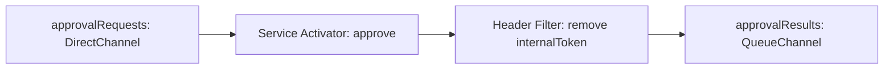

# Methods Returning `Message` in a Service Activator

In the **SPRING_INTEGRATION_CORE** module, a service activator connects a business handler method to a message flow. This lesson focuses on the case where the method returns `Message<T>` to express both the reply data and metadata for downstream steps.

The running example is approving an order request: the reply payload holds the decision, while the `decision` header lets downstream flow steps choose how to handle it. This design pattern lays the groundwork for composing service activators with routers, filters, gateways, or aggregators while keeping each component's responsibilities clear.

After this lesson, you will be able to:

- Distinguish returning a payload from returning an entire `Message`.
- Build strongly typed replies with `MessageBuilder`.
- Predict which headers are preserved, overridden, or need removal.
- Connect the method to an endpoint using annotations or Java DSL.
- Test both the method's output and the actual output after passing through the endpoint.

## 1. How Is the Return Value Interpreted?

A method can receive a payload, the entire message, or extra headers via parameters. Input types and return types are two independent choices. The `@ServiceActivator` annotation supports `Message` or payload parameter types; non-message return values are used as the reply payload. [ServiceActivator Javadoc](https://docs.spring.io/spring-integration/api/org/springframework/integration/annotation/ServiceActivator.html)

| Illustrative signature | What the method decides |
| --- | --- |
| `OrderDecision approve(OrderRequest request)` | Business data of the reply |
| `Message<OrderDecision> approve(OrderRequest request)` | Reply payload and headers set by the method |
| `Message<OrderDecision> approve(Message<OrderRequest> request)` | Reply built after reading both input payload and headers |
| `Message<OrderDecision> approve(OrderRequest request, @Header("tenantId") String tenantId)` | Reply needs one specific header without needing the full input message |

When returning `Message<OrderDecision>`, the reply payload is still `OrderDecision`. Do not wrap it in an extra `Message` layer:

```java
// Correct: the reply message contains the business result.
return MessageBuilder.withPayload(decision).build();

// Wrong for the contract under consideration: the payload becomes another Message.
return MessageBuilder
        .withPayload(MessageBuilder.withPayload(decision).build())
        .build();
```

In this lesson, "the message returned by the method" and "the message emitted by the endpoint" are referred to separately for clarity of observation. They can differ in headers once the framework finishes processing.

## 2. Building Replies with `MessageBuilder`

The examples use the following imports:

```java
import org.springframework.messaging.Message;
import org.springframework.messaging.support.MessageBuilder;
```

Example of a method that only needs the payload:

```java
public Message<OrderDecision> approve(OrderRequest request) {
    OrderDecision decision =
            new OrderDecision(request.orderId(), true, "APPROVED");

    return MessageBuilder.withPayload(decision)
            .setHeader("decision", "APPROVED")
            .setHeader("handledBy", "approval-service")
            .build();
}
```

`OrderRequest` and `OrderDecision` will be defined completely in the Java DSL example below.

If only one header is needed, you can change the parameters to:

```java
import org.springframework.messaging.handler.annotation.Header;

public Message<OrderDecision> approve(
        OrderRequest request,
        @Header("tenantId") String tenantId) {

    OrderDecision decision =
            new OrderDecision(request.orderId(), true, "APPROVED");

    return MessageBuilder.withPayload(decision)
            .setHeader("tenantId", tenantId)
            .setHeader("decision", "APPROVED")
            .build();
}
```

`@Header` binds a parameter to the header of the corresponding name. By default the header is required; use `required = false` when the contract permits absence and the method handles `null` values. [Header Javadoc](https://docs.spring.io/spring-framework/docs/current/javadoc-api/org/springframework/messaging/handler/annotation/Header.html)

### 2.1. Choosing Builder Operations by Intent

| Operation | When to use |
| --- | --- |
| `withPayload(newPayload)` | Build a reply with new data |
| `fromMessage(request)` | Keep the existing payload and start from the request's headers |
| `copyHeaders(headers)` | Copy headers, potentially overwriting values already set |
| `copyHeadersIfAbsent(headers)` | Copy headers while keeping values already set in the builder |
| `setHeader(name, value)` | Set or replace a header value |
| `removeHeader(name)` | Remove a header from the message being built |

`fromMessage` is not an operation for replacing the payload. When the payload changes from `OrderRequest` to `OrderDecision`, start with `withPayload(decision)`. [MessageBuilder Javadoc](https://docs.spring.io/spring-framework/docs/current/javadoc-api/org/springframework/messaging/support/MessageBuilder.html)

Example when explicit copying is needed while prioritizing the new decision:

```java
return MessageBuilder.withPayload(decision)
        .setHeader("decision", "APPROVED")
        .copyHeadersIfAbsent(request.getHeaders())
        .build();
```

This is one option for the method's contract. In the main example, the method does not copy all headers so you can clearly see what the framework adds.

### 2.2. Do Not Mutate `MessageHeaders` Directly

`MessageHeaders` implements the `Map` interface but forbids mutating operations like `put`. Create the reply message through the builder instead. [MessageHeaders Javadoc](https://docs.spring.io/spring-framework/docs/current/javadoc-api/org/springframework/messaging/MessageHeaders.html)

```java
// Do not use: can throw UnsupportedOperationException.
request.getHeaders().put("decision", "APPROVED");

// Use the builder.
Message<OrderRequest> marked = MessageBuilder.fromMessage(request)
        .setHeader("decision", "APPROVED")
        .build();
```

Immutability of the message envelope does not make every object inside immutable. For the order example, using a `record` composed of `String`, `int`, and `boolean` avoids sharing a mutable DTO across processing steps.

## 3. Do Input Headers Remain on the Reply?

With a standard service activator, headers from the request are added to the reply whenever the reply does not already have a header of the same name. Therefore, a method returning a full `Message` does not mean every omitted header is deleted. This differs from a transformer returning a full message. [Service Activator — Method Return Type](https://docs.spring.io/spring-integration/reference/service-activator.html#service-activator-method-return-type)

Suppose the request has:

```text
payload: OrderRequest("ORD-17", 3)
headers:
  requestId: REQ-17
  tenantId: tenant-a
  decision: PENDING
  internalToken: demo-token
```

The method returns a message containing only these application headers:

```text
payload: OrderDecision("ORD-17", true, "APPROVED")
headers:
  decision: APPROVED
  handledBy: approval-service
```

With default configuration, after the service activator you can observe:

| Header | Value | Explanation in the example |
| --- | --- | --- |
| `decision` | `APPROVED` | Method supplied the new decision |
| `handledBy` | `approval-service` | Method added processing info |
| `requestId` | `REQ-17` | Present in request, absent in reply |
| `tenantId` | `tenant-a` | Present in request, absent in reply |
| `internalToken` | `demo-token` | Omitting it in the builder did not exclude it from output |

System headers such as `id` and `timestamp` are omitted from the table to focus on the application contract.

### 3.1. Removing a Header in the Method Is Not Enough to Remove It from the Flow

The snippet below removes `internalToken` from the message built by the method:

```java
return MessageBuilder.withPayload(decision)
        .copyHeaders(request.getHeaders())
        .removeHeader("internalToken")
        .build();
```

However, the step that copies missing headers from the request can put `internalToken` right back. If flow policy requires deleting a header before sending outward, place a `headerFilter` after the service activator:

```java
.handle(approvalService, "approve")
.headerFilter("internalToken")
```

`HeaderFilter` is a transformer specialized for removing headers. Placing it near the boundary that needs sanitizing also helps flow readers spot this policy. [HeaderFilter Javadoc](https://docs.spring.io/spring-integration/api/org/springframework/integration/transformer/HeaderFilter.html)

### 3.2. Blocking Header Copying at the Endpoint

Java DSL has the option:

```java
.handle(approvalService, "approve",
        endpoint -> endpoint
                .requiresReply(true)
                .notPropagatedHeaders("internalToken"))
```

`notPropagatedHeaders` controls copying from the input message. It does not remove a header that the method itself explicitly set on the returned message. [ConsumerEndpointSpec Javadoc](https://docs.spring.io/spring-integration/api/org/springframework/integration/dsl/ConsumerEndpointSpec.html)

In the main example, the method does not copy `internalToken` and the flow uses `headerFilter` after processing. The two snippets above illustrate two alternatives; you do not need both to satisfy the same requirement.

When using `notPropagatedHeaders("*")`, the framework does not propagate input headers. The reply contract must then account for `replyChannel`, `errorChannel`, and headers used for aggregation. [Message — Header Propagation](https://docs.spring.io/spring-integration/reference/message.html#message-header-propagation)

### 3.3. Message Identity and Business Identity

For new messages, do not use `MessageHeaders.ID` as an order ID or request ID. This header identifies a message instance and is managed by message construction. [Message — Pre-defined Headers](https://docs.spring.io/spring-integration/reference/message.html)

In the ordering design:

- `orderId` in the payload identifies the order.
- `requestId` is set by the application to trace a single request.
- `correlationId` should only be used when there is a convention for grouping related messages, such as aggregating replies by group.

If adding an aggregator, define the correlation key and release condition separately. Do not assume returning a `Message` automatically forms a valid aggregation group.

## 4. Complete Example Using Java DSL

The example uses Java 17 syntax and Spring Integration Java DSL APIs available in the 6.x line. When running, use a JDK and Spring Framework/Spring Integration set compatible with your project's versions. `spring-integration-core`, Spring Context, and JUnit Jupiter for tests are required; the example does not depend on Spring Boot or an external broker.

Processing flow:



Valid requests have `units > 0`. Approved when `units <= 10`; larger quantities yield a business rejection result.

### 4.1. Model, Service, and Configuration

The entire snippet below belongs to one illustrative Java file:

```java
package example.integration;

import org.springframework.context.annotation.Bean;
import org.springframework.context.annotation.Configuration;
import org.springframework.integration.annotation.IntegrationComponentScan;
import org.springframework.integration.channel.DirectChannel;
import org.springframework.integration.channel.QueueChannel;
import org.springframework.integration.config.EnableIntegration;
import org.springframework.integration.dsl.IntegrationFlow;
import org.springframework.messaging.Message;
import org.springframework.messaging.MessageChannel;
import org.springframework.messaging.support.MessageBuilder;

@Configuration
@EnableIntegration
public class ApprovalFlowConfiguration {

    public record OrderRequest(String orderId, int units) {
    }

    public record OrderDecision(
            String orderId,
            boolean accepted,
            String reason) {
    }

    public static class ApprovalService {

        public Message<OrderDecision> approve(
                Message<OrderRequest> request) {

            OrderRequest order = request.getPayload();

            if (order.units() <= 0) {
                throw new IllegalArgumentException(
                        "units must be greater than zero");
            }

            boolean accepted = order.units() <= 10;
            String decisionCode =
                    accepted ? "APPROVED" : "REJECTED";

            OrderDecision decision = new OrderDecision(
                    order.orderId(),
                    accepted,
                    accepted ? "APPROVED" : "CAPACITY_EXCEEDED");

            return MessageBuilder.withPayload(decision)
                    .setHeader("decision", decisionCode)
                    .setHeader("handledBy", "approval-service")
                    .build();
        }
    }

    @Bean
    public MessageChannel approvalRequests() {
        return new DirectChannel();
    }

    @Bean
    public QueueChannel approvalResults() {
        return new QueueChannel(10);
    }

    @Bean
    public ApprovalService approvalService() {
        return new ApprovalService();
    }

    @Bean
    public IntegrationFlow approvalFlow(
            ApprovalService approvalService) {

        return IntegrationFlow.from("approvalRequests")
                .handle(approvalService, "approve",
                        endpoint -> endpoint.requiresReply(true))
                .headerFilter("internalToken")
                .channel("approvalResults")
                .get();
    }
}
```

The `IntegrationComponentScan` import above is only needed when using the gateway option in section 6; if only running the basic flow, you can omit that import.

`.handle(approvalService, "approve", ...)` registers the method-invocation step using Java DSL's service activator mechanism. [Service Activators and the .handle() Method](https://docs.spring.io/spring-integration/reference/dsl/java-handle.html)

In this configuration:

1. `approvalRequests` receives `Message<OrderRequest>`.
2. `approve` returns `Message<OrderDecision>` with two application headers.
3. The endpoint finalizes the reply, including inherited headers.
4. `headerFilter` removes `internalToken`.
5. The message is placed into `approvalResults` for the receiver to consume.

`QueueChannel` at the end is used to collect illustrative results. There is no consumer reading from the queue in this configuration, so no poller is needed merely to write results into the queue.

### 4.2. Sending Requests and Reading Replies

The following snippet can be placed in a test or demo method, with data types imported from `ApprovalFlowConfiguration`:

```java
import example.integration.ApprovalFlowConfiguration;
import example.integration.ApprovalFlowConfiguration.OrderRequest;
import org.springframework.context.annotation.AnnotationConfigApplicationContext;
import org.springframework.integration.channel.QueueChannel;
import org.springframework.messaging.Message;
import org.springframework.messaging.MessageChannel;
import org.springframework.messaging.support.MessageBuilder;

// Inside a method:
try (var context = new AnnotationConfigApplicationContext(
        ApprovalFlowConfiguration.class)) {

    MessageChannel input =
            context.getBean("approvalRequests", MessageChannel.class);
    QueueChannel output =
            context.getBean("approvalResults", QueueChannel.class);

    Message<OrderRequest> request =
            MessageBuilder.withPayload(new OrderRequest("ORD-17", 3))
                    .setHeader("requestId", "REQ-17")
                    .setHeader("tenantId", "tenant-a")
                    .setHeader("decision", "PENDING")
                    .setHeader("internalToken", "demo-token")
                    .build();

    input.send(request);
    Message<?> reply = output.receive(1_000);

    if (reply == null) {
        throw new IllegalStateException("No reply received");
    }

    System.out.println(reply.getPayload());
    System.out.println(reply.getHeaders().get("decision"));
    System.out.println(reply.getHeaders().get("requestId"));
    System.out.println(
            reply.getHeaders().containsKey("internalToken"));
}
```

Expected business output:

```text
OrderDecision[orderId=ORD-17, accepted=true, reason=APPROVED]
APPROVED
REQ-17
false
```

Do not use the full `toString()` string of a message as a fixed comparison target: it also contains per-message-creation metadata.

## 5. Configuration with Annotations

If you choose annotations instead of the `.handle(...)` step above, register a bean with a method as follows:

```java
import org.springframework.integration.annotation.ServiceActivator;
import org.springframework.messaging.Message;

public static class AnnotatedApprovalEndpoint {

    private final ApprovalService service;

    public AnnotatedApprovalEndpoint(ApprovalService service) {
        this.service = service;
    }

    @ServiceActivator(
            inputChannel = "approvalRequests",
            outputChannel = "approvalRawReplies",
            requiresReply = "true")
    public Message<OrderDecision> approve(
            Message<OrderRequest> request) {

        return service.approve(request);
    }
}
```

`ApprovalService` and the records are reused from the previous example. `AnnotatedApprovalEndpoint` must be registered as a bean, such as with `@Bean` inside a configuration having `@EnableIntegration`.

To keep the header sanitization step, use a follow-up flow:

```java
@Bean
public IntegrationFlow cleanApprovalReplies() {
    return IntegrationFlow.from("approvalRawReplies")
            .headerFilter("internalToken")
            .channel("approvalResults")
            .get();
}
```

This is an alternative approach: remove the old `approvalFlow` before registering the annotated endpoint on the same `approvalRequests`. Registering both creates two different consumers, so the example no longer represents a single processing path.

Also distinguish a business method returning `Message` from `MessageHandler.handleMessage(Message<?>)`. The `MessageHandler` interface has a `void` method; you cannot change that signature to `Message<OrderDecision>`. Let the endpoint invoke a POJO using the patterns demonstrated.

## 6. Where Will the Reply Be Sent?

The decision can be split into two questions:

1. What data and headers does the method return?
2. Where is the endpoint configured to send the reply?

A configured `outputChannel` is the endpoint's send destination. When there is no output channel, the service activator can use the request's `replyChannel`. Returning a `Message` by itself does not create a reply destination. [Service Activator](https://docs.spring.io/spring-integration/reference/service-activator.html)

The main example has a fixed final destination `approvalResults`. It fits the exercise of sending and then receiving from a queue.

### 6.1. Gateway Variant

If you want callers to invoke an interface and receive the reply directly, you can use a gateway:

```java
package example.integration;

import example.integration.ApprovalFlowConfiguration.OrderDecision;
import example.integration.ApprovalFlowConfiguration.OrderRequest;
import org.springframework.integration.annotation.MessagingGateway;
import org.springframework.messaging.Message;

@MessagingGateway(defaultRequestChannel = "approvalRequests")
public interface ApprovalGateway {

    Message<OrderDecision> approve(OrderRequest request);
}
```

Add `@IntegrationComponentScan(basePackageClasses = ApprovalGateway.class)` to the configuration so the gateway interface is discovered.

With this option, replace the old flow with a flow that has no fixed output queue:

```java
@Bean
public IntegrationFlow approvalFlow(
        ApprovalService approvalService) {

    return IntegrationFlow.from("approvalRequests")
            .handle(approvalService, "approve",
                    endpoint -> endpoint.requiresReply(true))
            .headerFilter("internalToken")
            .get();
}
```

The gateway creates a temporary reply channel and attaches it to the request. The final step uses that reply path to return the result to the caller. Choose return type `Message<OrderDecision>` when the caller needs to read headers; choose `OrderDecision` when the caller only needs the payload. [Messaging Gateways](https://docs.spring.io/spring-integration/reference/gateway.html)

Do not attach the queue-based configuration unchanged to a gateway and expect the gateway to automatically read `approvalResults`. If you want a topology with a fixed reply channel, design the gateway configuration and bridge accordingly.

## 7. `Null`, `requiresReply`, and Execution Errors

Declaring a return type of `Message<OrderDecision>` still lets Java code return `null`. `requiresReply` does not require a reply by default; set it to `true` if every successfully processed request must produce a non-`null` result. [ServiceActivator.requiresReply Javadoc](https://docs.spring.io/spring-integration/api/org/springframework/integration/annotation/ServiceActivator.html#requiresReply())

| Scenario | Meaning for the ordering problem |
| --- | --- |
| Returns `Message<OrderDecision>` with `accepted = true` | Request approved |
| Returns `Message<OrderDecision>` with `accepted = false` | Business rejection reply produced |
| Returns `null`, reply not required | No reply emitted from that step |
| Returns `null`, `requiresReply(true)` | Violation of the required-reply contract |
| Throws an exception | Method did not complete normally |

When a reply is required but the handler produces none, the framework uses `ReplyRequiredException`. [ReplyRequiredException Javadoc](https://docs.spring.io/spring-integration/api/org/springframework/integration/handler/ReplyRequiredException.html)

In the example:

- `units = 11` produces a `REJECTED` and `CAPACITY_EXCEEDED` result.
- `units = 0` throws `IllegalArgumentException` per input validation.
- The method does not use `null` to represent rejection.

With a flow running on `DirectChannel`, processing errors follow the call stack and can be caught by the caller as a messaging exception wrapping the business cause. Having an `errorChannel` header does not automatically convert every synchronous error into an error message. When adding an executor or poller, configure error-handling mechanisms appropriate for asynchronous execution paths. [Error Handling](https://docs.spring.io/spring-integration/reference/error-handling.html)

`requiresReply(true)` checks reply production; it does not confirm that an external system received or successfully processed the result. In a real application, distinguish errors invoking business logic from errors sending replies to avoid repeating side effects on retry.

## 8. Testing at the Method and Endpoint Boundaries

Testing the method directly answers "what message did the service construct?". Testing through the channel answers "what message did the flow actually emit?". The two results can differ because of header inheritance and `headerFilter`.

The following test class uses JUnit Jupiter in the same package as the configuration. Each test opens its own context so the queue does not retain data from previous tests.

```java
package example.integration;

import example.integration.ApprovalFlowConfiguration.ApprovalService;
import example.integration.ApprovalFlowConfiguration.OrderDecision;
import example.integration.ApprovalFlowConfiguration.OrderRequest;
import org.junit.jupiter.api.Test;
import org.springframework.context.annotation.AnnotationConfigApplicationContext;
import org.springframework.integration.channel.QueueChannel;
import org.springframework.messaging.Message;
import org.springframework.messaging.MessageChannel;
import org.springframework.messaging.support.MessageBuilder;

import static org.junit.jupiter.api.Assertions.*;

class ApprovalFlowTest {

    @Test
    void methodCreatesDecisionWithoutCopyingRequestHeaders() {
        ApprovalService service = new ApprovalService();
        Message<OrderRequest> request = request(3);

        Message<OrderDecision> reply = service.approve(request);

        assertEquals(
                new OrderDecision("ORD-17", true, "APPROVED"),
                reply.getPayload());
        assertEquals("APPROVED",
                reply.getHeaders().get("decision"));
        assertEquals("approval-service",
                reply.getHeaders().get("handledBy"));

        // Calling the method directly without going through the endpoint.
        assertNull(reply.getHeaders().get("requestId"));
        assertNull(reply.getHeaders().get("internalToken"));
    }

    @Test
    void flowPropagatesHeadersOverridesDecisionAndRemovesToken() {
        try (var context = new AnnotationConfigApplicationContext(
                ApprovalFlowConfiguration.class)) {

            MessageChannel input = context.getBean(
                    "approvalRequests", MessageChannel.class);
            QueueChannel output = context.getBean(
                    "approvalResults", QueueChannel.class);
            Message<OrderRequest> request = request(3);

            assertTrue(input.send(request, 1_000));
            Message<?> reply = output.receive(1_000);

            assertNotNull(reply);
            assertInstanceOf(OrderDecision.class, reply.getPayload());
            assertEquals(
                    new OrderDecision("ORD-17", true, "APPROVED"),
                    reply.getPayload());

            assertEquals("REQ-17",
                    reply.getHeaders().get("requestId"));
            assertEquals("tenant-a",
                    reply.getHeaders().get("tenantId"));
            assertEquals("APPROVED",
                    reply.getHeaders().get("decision"));
            assertFalse(
                    reply.getHeaders().containsKey("internalToken"));

            // The flow creates a reply without modifying the original request.
            assertEquals("PENDING",
                    request.getHeaders().get("decision"));
            assertEquals("demo-token",
                    request.getHeaders().get("internalToken"));
        }
    }

    @Test
    void businessRejectionStillProducesReply() {
        try (var context = new AnnotationConfigApplicationContext(
                ApprovalFlowConfiguration.class)) {

            MessageChannel input = context.getBean(
                    "approvalRequests", MessageChannel.class);
            QueueChannel output = context.getBean(
                    "approvalResults", QueueChannel.class);

            assertTrue(input.send(request(11), 1_000));
            Message<?> reply = output.receive(1_000);

            assertNotNull(reply);
            assertEquals(
                    new OrderDecision(
                            "ORD-17", false, "CAPACITY_EXCEEDED"),
                    reply.getPayload());
            assertEquals("REJECTED",
                    reply.getHeaders().get("decision"));
        }
    }

    private static Message<OrderRequest> request(int units) {
        return MessageBuilder.withPayload(
                        new OrderRequest("ORD-17", units))
                .setHeader("requestId", "REQ-17")
                .setHeader("tenantId", "tenant-a")
                .setHeader("decision", "PENDING")
                .setHeader("internalToken", "demo-token")
                .build();
    }
}
```

These three tests check distinct contracts: decisions created by the method, metadata after the endpoint, and replies for rejection cases. They do not require a database connection or external services.

When extending the example, add a test for `requiresReply(true)` using a stub service intentionally returning `null`; verify that the required-reply exception occurs and no result message is emitted. For the gateway variant, also verify that the caller receives the reply so missing reply routes are caught.

## 9. Common Mistakes When Applying This

| Symptom | What to check | How to fix |
| --- | --- | --- |
| Output payload is another `Message` | Was a `Message` passed into `withPayload` again? | Return `Message<OrderDecision>` directly |
| Header removed in the method still appears | Did the endpoint copy it back from the request? | Place `headerFilter` after the service activator or control propagation |
| Result header gets overwritten with old value inside method | Was `copyHeaders` called after setting the new header? | Copy first then set new values, or use `copyHeadersIfAbsent` |
| Unit test lacks `requestId` while flow test has it | Are two different processing boundaries being compared? | Separate the method contract from the endpoint contract |
| Gateway receives no reply | Is there a fixed queue destination or was `replyChannel` lost? | Inspect the entire reply-return path |
| No result when method returns `null` | Is a reply required? | Return an explicit rejection result or enable `requiresReply` |
| Router picks the wrong branch | Do payload and `decision` header reflect the same decision? | Define one contract and test both |
| Aggregator groups incorrectly | Are correlation headers preserved per the grouping model? | Verify correlation key and release condition |

For flows with routers or filters, decide how business state is represented before choosing routing conditions. For flows with aggregators, identify correlation metadata before enabling propagation blocking. That way, a method returning `Message` provides an intentional output contract, while the flow configuration clearly shows how that contract is routed and handled.
