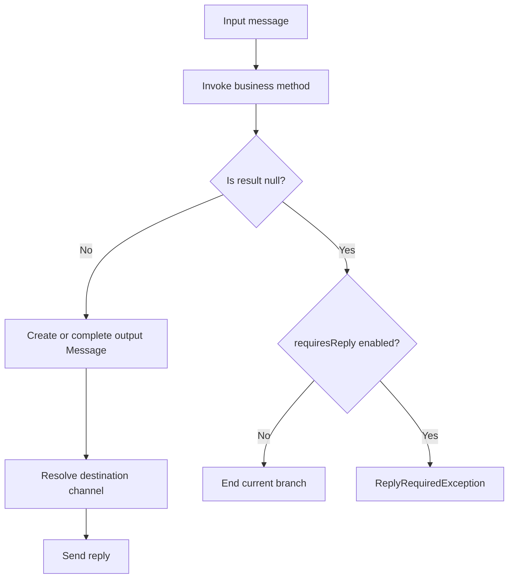

# Method Return Value Handling — Handling Service Activator Return Values

## 1. Objectives and Context

In the `SPRING_INTEGRATION_CORE` module, a Service Activator connects a business method to a message flow. The method may calculate a price, record a transaction, or call an external system. The Java value the method returns determines what data continues through `MessageChannel`.

This lesson belongs to the **Service activator** chapter and focuses on the output contract: distinguishing payloads from `Message`, determining where replies go, and handling cases where a method produces no result. These decisions directly affect gateways, downstream transformer/router/filter/aggregator steps, and how integration flows are tested.

After this lesson, you will be able to:

- Choose the right return type among a business object, `Message<T>`, `void`, and an asynchronous result.
- Explain why a method runs successfully yet a gateway still receives no response.
- Configure `requiresReply`, `outputChannel`, and `replyChannel` appropriately.
- Test payloads, headers, destination channels, and no-reply branches.

The examples use Java 17 and the Spring Integration 6.5 API. This is an API baseline for interpreting the examples, not a requirement to change your module version. `spring-integration-core` is required; the test section uses JUnit Jupiter. Snippets explicitly marked as variants are used in place of the corresponding step in the main example.

## 2. From Java Return Value to Output Message

Consider the business method:

```java
public PriceQuote quote(PriceRequest request) {
    return new PriceQuote(request.sku(), request.quantity(), total);
}
```

The method knows only about requests and quotes. The Service Activator is responsible for invoking the method, turning the result into a message, and sending the message to the configured destination or the destination specified in headers.



The diagram depicts the standard synchronous case, without result-altering advice, Routing Slip, or reactive processing.

| Actual returned value | Output behavior in the standard case |
|---|---|
| A `PriceQuote`, `String`, number, or other DTO | Result becomes the reply payload |
| `Message<PriceQuote>` | Framework uses that message's payload and headers to produce output |
| `null` | No reply; checks the `requiresReply` policy |
| `void` method | Produces no result to continue the branch |
| `Boolean.FALSE`, `0`, empty string | Still non-`null` data, so a reply can still be produced |

`false` does not mean dropping the message in a Service Activator. That intent should be expressed via a filter or an explicit routing decision. Similarly, a method returning an `Exception` object normally produces a payload containing that object; to signal failure via exception handling, you must `throw` it.

Method invocation lives in `ServiceActivatingHandler`; the superclass handles results and the reply-required policy. [ServiceActivatingHandler source](https://github.com/spring-projects/spring-integration/blob/v6.5.0/spring-integration-core/src/main/java/org/springframework/integration/handler/ServiceActivatingHandler.java), [AbstractReplyProducingMessageHandler source](https://github.com/spring-projects/spring-integration/blob/v6.5.0/spring-integration-core/src/main/java/org/springframework/integration/handler/AbstractReplyProducingMessageHandler.java).

## 3. Returning a Payload vs. Returning a Message

### 3.1. Returning a Business Object

This is usually the most maintainable choice when the service only needs to compute a result:

```java
public BigDecimal calculateTotal(PriceRequest request) {
    return new BigDecimal("125000")
            .multiply(BigDecimal.valueOf(request.quantity()));
}
```

Downstream receives a `Message<BigDecimal>`, even though the method does not call `MessageBuilder` itself. A unit test can also call `calculateTotal()` directly without spinning up messaging infrastructure.

Under this handler's default header propagation, input headers can be added to the reply if the reply does not already have them, except headers excluded by the propagation policy. Thus, `tenantId` or `requestId` can continue traveling with the new payload.

Do not use `MessageHeaders.ID` as a business transaction ID. When a new message is created, the system identifier header can change. Put tracking IDs in a dedicated application header or a DTO property.

### 3.2. Returning a `Message` When Header Control Is Needed

Use `Message<T>` when the result needs additional metadata, such as pricing status or data source:

```java
public Message<PriceQuote> quoteWithHeaders(Message<PriceRequest> request) {
    PriceQuote quote = quote(request.getPayload());
    if (quote == null) {
        return null;
    }
    return MessageBuilder.withPayload(quote)
            .setHeader("pricingStatus", "READY")
            .setHeader("priceSource", "catalog")
            .build();
}
```

This snippet is an alternative method inside `PricingService` in the main example; it requires importing `org.springframework.messaging.Message` and `org.springframework.messaging.support.MessageBuilder`.

With default configuration, input headers not yet present on the reply are added via copy-if-absent. If the request has `priceSource=cache`, the output still keeps `priceSource=catalog` because the method explicitly set that value. You do not need to manually copy all headers just to keep `tenantId`.

Two practical notes:

- Returning `Message<T>` does not make that message's `replyChannel` header the highest-priority destination. Channel selection still depends on endpoint configuration and request headers.
- Removing a header from the manually built message may not exclude it from the output: header propagation can re-add the value from the request. When removal is needed, configure `notPropagatedHeaders` or an explicit header-handling step after the endpoint.

Variant example of the `.handle()` step:

```java
.handle(service, "quoteWithHeaders",
        endpoint -> endpoint.requiresReply(true)
                .notPropagatedHeaders("internalToken"))
```

`notPropagatedHeaders` controls copying from the request; it does not remove a header that the method itself placed on the reply. Message construction and header-completion rules are implemented in `createOutputMessage()`. [AbstractMessageProducingHandler source](https://github.com/spring-projects/spring-integration/blob/v6.5.0/spring-integration-core/src/main/java/org/springframework/integration/handler/AbstractMessageProducingHandler.java).

A `Message` treats its header structure as immutable; to modify headers, build a message via builder rather than calling `put()` on `getHeaders()`. That does not automatically make the inner payload object immutable. [Message documentation](https://docs.spring.io/spring-integration/reference/message.html).

## 4. Where Are Replies Sent?

In a standard flow without a Routing Slip, destination selection order is:

1. `outputChannel` configured on the Service Activator.
2. The **request**'s `replyChannel` header, when the endpoint has no output channel.
3. The **returned Message**'s `replyChannel` header, when the request also lacks this header.

The header can contain a `MessageChannel` instance or a channel name as a `String`. A channel name must be resolvable in the Spring context. Having no destination, or an unresolvable destination name, leads to a destination resolution error; the reply is not automatically routed to `errorChannel` as a normal outcome. [Service Activator documentation](https://docs.spring.io/spring-integration/reference/6.5/service-activator.html).

Example:

```text
Endpoint outputChannel = priceResults
Request replyChannel   = temporaryGatewayReply
Returned replyChannel  = alternateResults

Reply destination at this endpoint: priceResults
```

The endpoint selects one destination according to the rule rather than duplicating the reply to all three channels. If multiple branches are needed, design publish-subscribe or the appropriate distribution pattern.

### 4.1. Connection to Gateways

A request–reply gateway normally puts a reply address into a header on the request. The terminal endpoint of the flow can return the result via this address when no explicit output channel is configured.

If you add `outputChannel=priceResults`, replies go there. A gateway only receives the result if the flow design includes a path that brings the reply back to the address it is waiting on. Placing a message into a `QueueChannel` with no forwarding consumer does not complete the gateway call.

Do not assume the gateway's `replyTimeout` acts as a hard cutoff interrupting a running synchronous method. Waiting behavior for replies and method execution time on the caller thread are two distinct concerns.

### 4.2. Having an Output Channel Does Not Guarantee Successful Delivery

Having a destination channel is different from having a consumer able to process the message. For example, a `DirectChannel` with no subscribers can cause sending to fail; a bounded queue can cause sending to block or fail on timeout.

Therefore, observe three separate milestones: the method produced a result, the endpoint sent the result, and downstream completed processing. They are not synonymous.

## 5. `null`, `void`, and `requiresReply`

### 5.1. `null` Terminates the Current Processing Branch

A method might return `null` because data was not found:

```java
public PriceQuote findQuote(PriceRequest request) {
    if (!"BOOK-01".equals(request.sku())) {
        return null;
    }
    return quote(request);
}
```

When a reply is not required, the branch passing through the endpoint stops here. The framework does not create a message with a `null` payload, nor does it forward the original request as-is. If the caller is waiting for a result, explicitly design behavior for when no reply arrives.

For a query API where "not found" is a normal outcome, a DTO such as `LookupResult(found, value)` gives the caller a clear status. Choose `null` only when emitting no output is an intentional part of the flow contract.

### 5.2. `requiresReply` Protects Synchronous Contracts

With Java DSL:

```java
.handle(service, "quote", endpoint -> endpoint.requiresReply(true))
```

With annotations on a Spring-registered service bean:

```java
@ServiceActivator(
        inputChannel = "priceRequests",
        outputChannel = "priceResults",
        requiresReply = "true")
public PriceQuote quote(PriceRequest request) {
    // Calculate and return the quote.
}
```

The annotation snippet is an alternative configuration approach; do not register it alongside the main DSL example on the same input channel. Import the annotation from `org.springframework.integration.annotation.ServiceActivator`.

In this synchronous configuration, `requiresReply=true` causes a `null` result to raise `ReplyRequiredException`, instead of silently stopping the branch. A Service Activator's default is not to require a reply. [ConsumerEndpointSpec.requiresReply API](https://docs.spring.io/spring-integration/docs/6.5.0/api/org/springframework/integration/dsl/ConsumerEndpointSpec.html#requiresReply(boolean)).

This flag does not synthesize fallback data, validate business correctness of DTOs, ensure the target channel has a consumer, or guarantee downstream success. For `void` methods, design a one-way endpoint; do not enable reply requirements on a method that has no result.

### 5.3. `void` Fits One-Way Tasks

Business audit logging example:

```java
public void recordAudit(PriceRequest request) {
    auditRepository.save(request);
}
```

This illustrative snippet needs an `auditRepository` provided by the application. After a `void` call, there is no payload for subsequent steps on the same branch to continue processing.

If you need both to record and to keep data for downstream steps, you can explicitly return the request:

```java
public PriceRequest recordAndContinue(PriceRequest request) {
    auditRepository.save(request);
    return request;
}
```

If the requirement is merely to observe the flow, a wire tap branch is also a suitable design choice. `send()` returning `true` at the input only indicates the send operation was accepted per the channel's contract, not a business quote.

## 6. Java DSL Example: Creating Quotes

### 6.1. Complete Configuration

Place the following class in `PriceFlowConfig.java`. Two channels are declared explicitly for observability: requests pass through a `DirectChannel`, and results are held in a `QueueChannel` for reading and testing.

```java
package vn.example.integration;

import java.math.BigDecimal;

import org.springframework.context.annotation.Bean;
import org.springframework.context.annotation.Configuration;
import org.springframework.integration.channel.DirectChannel;
import org.springframework.integration.channel.QueueChannel;
import org.springframework.integration.config.EnableIntegration;
import org.springframework.integration.dsl.IntegrationFlow;

@Configuration(proxyBeanMethods = false)
@EnableIntegration
public class PriceFlowConfig {

    public record PriceRequest(String sku, int quantity) {
    }

    public record PriceQuote(String sku, int quantity, BigDecimal total) {
    }

    public static class PricingService {

        public PriceQuote quote(PriceRequest request) {
            if (request.quantity() <= 0) {
                throw new IllegalArgumentException("quantity must be positive");
            }
            if (!"BOOK-01".equals(request.sku())) {
                return null;
            }
            BigDecimal total = new BigDecimal("125000")
                    .multiply(BigDecimal.valueOf(request.quantity()));
            return new PriceQuote(request.sku(), request.quantity(), total);
        }
    }

    @Bean
    public DirectChannel priceRequests() {
        return new DirectChannel();
    }

    @Bean
    public QueueChannel priceResults() {
        return new QueueChannel();
    }

    @Bean
    public PricingService pricingService() {
        return new PricingService();
    }

    @Bean
    public IntegrationFlow priceFlow(
            DirectChannel priceRequests,
            QueueChannel priceResults,
            PricingService pricingService) {

        return IntegrationFlow.from(priceRequests)
                .handle(pricingService, "quote",
                        endpoint -> endpoint.requiresReply(true))
                .channel(priceResults)
                .get();
    }
}
```

`.handle(pricingService, "quote", ...)` creates the Service Activator step. `.channel(priceResults)` connects that step's output to the results channel. There is no need to also place `@ServiceActivator` on `quote()` in this configuration. Java DSL also supports lambdas of type `GenericHandler<P>` taking payload and headers and returning a result. [.handle() method documentation](https://docs.spring.io/spring-integration/reference/dsl/java-handle.html).

### 6.2. Data Flowing Through

With request:

```text
payload = PriceRequest("BOOK-01", 2)
headers = {tenantId: "shop-hcm", requestId: "REQ-1001", ...}
```

Expected result at `priceResults`:

```text
payload = PriceQuote("BOOK-01", 2, 250000)
headers include tenantId="shop-hcm", requestId="REQ-1001"
```

`quote()` returns a DTO; the framework creates a message containing that DTO. Application headers are preserved under the default policy. For `UNKNOWN`, the method returns `null` and the required-reply contract raises an error directly in the synchronous flow.

The example intentionally uses a small price table to focus on the output contract. In a real application, replace the price calculation with a service or repository call while keeping the tests for payload, headers, and destination channel.

## 7. Intentionally Discarding Results with `nullChannel`

Some libraries require returning an object even when the application only wants the side effect. If you still use such a method without using its result, configure the destination to discard messages:

```java
@Bean
public IntegrationFlow ignoredQuoteFlow(PricingService service) {
    return IntegrationFlow.from("ignoredPriceRequests")
            .handle(service, "quote")
            .channel("nullChannel")
            .get();
}
```

This is a variant using `PricingService` from the main example. Spring Integration provides the `nullChannel` channel to accept and discard messages.

| Scenario | Meaning |
|---|---|
| Method returns `null`, reply not required | No reply to send |
| Method returns a quote, output is `nullChannel` | Result exists, then the result is intentionally discarded |
| Method returns a quote, no output or reply address | Missing address to send result; fix flow contract |

Do not use `nullChannel` for a call where the caller still expects a quote. Nor treat discarding the result as proof that the business operation rolled back: the method may have already executed side effects before producing its reply.

## 8. Collections: One Payload or Many Messages?

With the Spring Integration 6.5 base handler, distinguish two cases:

```java
public List<String> labels(PriceRequest request) {
    return List.of("priced", "ready");
}
```

This data list becomes **one payload**. Downstream receives a single message containing `List<String>`, not two `String` messages by default.

Meanwhile, an `Iterable` containing `Message` elements or integration message builders can be split by the base handler into multiple outputs. The following example returns two separate messages:

```java
public List<Message<String>> notifications(PriceRequest request) {
    return List.of(
            MessageBuilder.withPayload("price-ready").build(),
            MessageBuilder.withPayload("stock-check-required").build());
}
```

These two illustrative methods require importing `java.util.List`, `org.springframework.messaging.Message`, `org.springframework.messaging.support.MessageBuilder`, and the `PriceRequest` type from the main configuration.

If you want to ensure a list of messages is **one payload**, wrap that list in a `Message<List<Message<String>>>`. Then the outermost return value is a single `Message`.

When the goal is splitting business data into messages carrying sequence information for later reassembly, use an explicit splitter. Returning a list of messages from a service does not on its own express a full splitter–aggregator contract. Iterable splitting behavior is governed by `sendOutputs()` and `shouldSplitOutput()` in the base class. [Output handling source](https://github.com/spring-projects/spring-integration/blob/v6.5.0/spring-integration-core/src/main/java/org/springframework/integration/handler/AbstractMessageProducingHandler.java).

## 9. `CompletableFuture` and Asynchronous Replies

A `CompletableFuture<PriceQuote>` result has two layers of meaning: the future object is returned immediately, and the quote exists only when the future completes.

With a regular channel, when async handling is not enabled on the Service Activator, the future itself can become the output payload. To have the endpoint handle the completed result, configure it explicitly:

```java
.handle(service, "quoteAsync", endpoint -> endpoint.async(true))
```

To illustrate the return type, you can add this method to `PricingService` and import `java.util.concurrent.CompletableFuture`:

```java
public CompletableFuture<PriceQuote> quoteAsync(PriceRequest request) {
    return CompletableFuture.completedFuture(quote(request));
}
```

`completedFuture()` completes immediately here, so it does not offload work to a background thread. It only illustrates the future contract. With a real service, the method must return a future produced by an asynchronous API or an appropriate executor. Enabling `async(true)` does not turn blocking computation into a background task on its own.

In Spring Integration 6.5, do not rely on `requiresReply(true)` as a guarantee that the future will complete with a non-`null` value. Synchronous reply checking and future callbacks have separate handling paths. If `null` is a business error, check inside the future chain and complete exceptionally on contract violations. For `CompletableFuture<Void>`, design with one-way semantics.

In addition, callbacks may execute on the thread that completes the future, or immediately upon callback registration if the future is already complete. Consider transaction and tracing context across this boundary. The async section in the docs and callback code are the authoritative reference for version-specific behavior. [Asynchronous Service Activator](https://docs.spring.io/spring-integration/reference/6.5/service-activator.html#async-service-activator).

## 10. Business Errors, Reply Errors, and Transaction Boundaries

Three error categories commonly appear around return values:

| Category | Example | What to inspect |
|---|---|---|
| Method failure | `IllegalArgumentException` for negative quantity | Input data and cause of the messaging exception |
| Result contract violation | `null` in a synchronous reply-requiring endpoint | `ReplyRequiredException` and the `null`-returning branch |
| Failed to send reply | Missing destination or channel cannot accept message | Output channel, reply header, subscribers, and send timeout |

With `DirectChannel`, normal processing runs on the sending thread, so exceptions can propagate back to the caller. When processing through pollers or framework-managed executors, errors typically need to be published as an `ErrorMessage` to an appropriate error channel. Setting an `errorChannel` header alone does not automatically turn every exception on a synchronous flow into an error message. [Error Handling documentation](https://docs.spring.io/spring-integration/reference/error-handling.html).

Do not catch every exception and return `null` to hide errors: on endpoints that do not require a reply, that makes the branch vanish; on reply-requiring endpoints, the new exception obscures the business cause.

For example, a method persists an order successfully and then sending the reply fails. The caller may receive an error even though the order was saved. If a retry mechanism invokes the method again, the order could be recorded a second time. Whether rollback happens depends on transaction boundaries and participating resources; a return value does not automatically provide transactional guarantees. For operations with side effects, use an appropriate idempotency key and test failure points after result creation.

## 11. Testing the Output Contract

Testing `PricingService.quote()` in isolation verifies the calculation, yet does not verify headers or reply addresses. The class below tests the real flow of `PriceFlowConfig` using a Spring context, without running Spring Boot or a broker.

Place it in `PriceFlowConfigTest.java`, in the same package as the configuration:

```java
package vn.example.integration;

import java.math.BigDecimal;

import org.junit.jupiter.api.AfterEach;
import org.junit.jupiter.api.BeforeEach;
import org.junit.jupiter.api.Test;
import org.springframework.context.annotation.AnnotationConfigApplicationContext;
import org.springframework.integration.channel.DirectChannel;
import org.springframework.integration.channel.QueueChannel;
import org.springframework.integration.handler.ReplyRequiredException;
import org.springframework.messaging.Message;
import org.springframework.messaging.support.MessageBuilder;

import vn.example.integration.PriceFlowConfig.PriceQuote;
import vn.example.integration.PriceFlowConfig.PriceRequest;

import static org.junit.jupiter.api.Assertions.*;

class PriceFlowConfigTest {

    private AnnotationConfigApplicationContext context;
    private DirectChannel requests;
    private QueueChannel results;

    @BeforeEach
    void openContext() {
        context = new AnnotationConfigApplicationContext(PriceFlowConfig.class);
        requests = context.getBean("priceRequests", DirectChannel.class);
        results = context.getBean("priceResults", QueueChannel.class);
    }

    @AfterEach
    void closeContext() {
        context.close();
    }

    @Test
    void wrapsReturnedDtoAndPropagatesApplicationHeaders() {
        Message<PriceRequest> request = MessageBuilder
                .withPayload(new PriceRequest("BOOK-01", 2))
                .setHeader("tenantId", "shop-hcm")
                .setHeader("requestId", "REQ-1001")
                .build();

        assertTrue(requests.send(request));

        Message<?> reply = results.receive(1000);
        assertNotNull(reply);
        PriceQuote quote = assertInstanceOf(PriceQuote.class, reply.getPayload());
        assertEquals("BOOK-01", quote.sku());
        assertEquals(2, quote.quantity());
        assertEquals(0, new BigDecimal("250000").compareTo(quote.total()));
        assertEquals("shop-hcm", reply.getHeaders().get("tenantId"));
        assertEquals("REQ-1001", reply.getHeaders().get("requestId"));
        assertNull(results.receive(0));
    }

    @Test
    void failsWhenSynchronousHandlerRequiresReplyButReturnsNull() {
        Message<PriceRequest> request = MessageBuilder
                .withPayload(new PriceRequest("UNKNOWN", 1))
                .build();

        assertThrows(ReplyRequiredException.class, () -> requests.send(request));
        assertNull(results.receive(0));
    }

    @Test
    void explicitOutputChannelHasPriorityOverRequestReplyChannel() {
        QueueChannel alternateReply = new QueueChannel();
        Message<PriceRequest> request = MessageBuilder
                .withPayload(new PriceRequest("BOOK-01", 1))
                .setReplyChannel(alternateReply)
                .build();

        assertTrue(requests.send(request));

        assertNotNull(results.receive(1000));
        assertNull(alternateReply.receive(0));
    }
}
```

The `receive(0)` calls check immediately because the example uses `DirectChannel`: when `send()` returns normally, both the pricing step and sending to the output queue have finished. If replaced with an asynchronous boundary, synchronize the test or wait with a bound; do not use an immediate empty read to conclude no message will arrive later.

Variants worth adding when changing the contract:

| Change | Outcome to verify |
|---|---|
| Switch method to `quoteWithHeaders()` | Headers set by the reply override same-named values from the request |
| Remove `requiresReply(true)` and send unknown SKU | No message in queue; synchronous flow throws no missing-reply error |
| Omit output channel but set request `replyChannel` | Reply appears on the channel in the header |
| Omit both output and reply address while method still returns a DTO | Destination resolution error occurs |
| Return `List<String>` then `List<Message<String>>` | Message counts and payload types match the chosen contract |
| Future completes exceptionally | Async error flow receives the appropriate cause |

These are illustrative test snippets to run in a project with matching dependencies; presenting them in this lesson does not imply the tests were executed in the learner's environment.

## 12. Diagnosing Unexpected Outputs

| Symptom | Root cause to isolate | How to address |
|---|---|---|
| Next step does not run | Method returned `null` or `void` | Clarify whether branch is one-way; return data if continuation is needed |
| Downstream receives `false` | Service returned `Boolean` expecting filter behavior | Use a filter or router to express decisions |
| Gateway waits while queue receives the quote | Explicit output channel captured the reply | Design a path returning results to the caller |
| DTO produced yet destination-not-found error | Missing output channel or reply address | Configure an appropriate destination instead of just disabling `requiresReply` |
| Internal header still appears | Header was propagated back from the request | Check propagation policy and service-set headers |
| Downstream receives a future object | Async contract not properly configured | Check `async(true)`, return type, and API version |
| Retries produce duplicate side effects | Business logic ran before reply-send failure | Define transaction boundaries and idempotency mechanisms |

When designing a Service Activator, clearly document four things in the step's contract: the return data type, the meaning of no result, the header propagation policy, and the reply destination. Then test the contract at the message flow level, especially when changing gateways or adding output channels.
