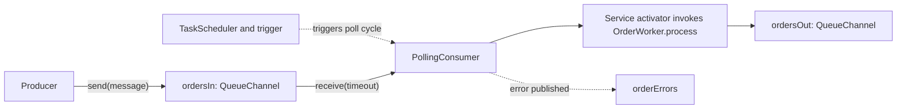

# Service Activator with a Poller

A service activator connects a message to a business handler method. When the input is a queued channel, an active message-pulling mechanism is needed: **the poller controls when work is pulled; the service activator executes that work**.

In the `SPRING_INTEGRATION_CORE` module, this lesson brings together `Message`, `MessageChannel`, endpoints, and Java DSL to build a buffered processing flow. The running example receives order requests into a queue, confirms each request, and routes results or errors to separate channels.

After this lesson, you will be able to:

- Recognize when a service activator needs a poller.
- Configure polling cadence, receive timeout, and per-poll message limits.
- Write the same flow using annotations or Java DSL.
- Explain the impact of schedulers, executors, errors, and transactions.
- Write bounded-wait tests for asynchronous processing flows.

The examples use Java 17 or later and the Spring Integration 6.5 API. The application requires `spring-integration-core`; the test section uses JUnit Jupiter. If using Spring Boot, obtain library versions from your application's dependency management. Extended configuration snippets below are alternatives to the corresponding parts in the main example.

## 1. From Channel to Consumer Type

A service activator has a handler to invoke a business method; the endpoint is responsible for connecting the handler to the input channel. In standard configurations, the channel type determines how the endpoint receives messages:

| Input channel | Receiving mechanism | Corresponding endpoint | Needs a poller? |
| --- | --- | --- | --- |
| `DirectChannel` | Channel invokes handler on `send()` | `EventDrivenConsumer` | No |
| `ExecutorChannel` | Channel delegates handler invocation to an executor | `EventDrivenConsumer` | No |
| `QueueChannel` | Consumer actively calls `receive()` | `PollingConsumer` | Yes |

The general distinction is `SubscribableChannel` for subscribing consumers and `PollableChannel` for polling consumers. Adding a poller does not turn a `DirectChannel` into a queue. [Spring Integration: Message Endpoints](https://docs.spring.io/spring-integration/reference/6.5/endpoint.html)



In the example, the producer only needs to put requests into `ordersIn`. The poller then pulls requests for the handler to process. Returning `true` from `ordersIn.send(...)` confirms the queue accepted the message; to learn the order outcome, the caller must observe the business result.

If an API only needs to return "accepted", this model fits. If an API must return "order confirmed", you must also design a result-retrieval mechanism, such as a request–reply gateway or status lookup by order ID.

## 2. Two Places with Pollers but Different Responsibilities

Consider a flow reading data from outside the system:

```text
Data source
  -> inbound polling adapter
  -> QueueChannel
  -> service activator with poller
  -> business processing
```

The two pollers in this flow do two independent jobs:

| Component | What is polled | Result of one poll |
| --- | --- | --- |
| `SourcePollingChannelAdapter` | `MessageSource`, e.g., a record reader | New messages sent to a channel |
| Service activator's `PollingConsumer` | `PollableChannel`, e.g., `QueueChannel` | Queued messages delivered to the handler |

An inbound adapter can send data into a `DirectChannel`; then the downstream service activator receives directly and needs no extra poller. If you intentionally place a `QueueChannel` in between, configure a consumer to drain messages from that queue. [Spring Integration: Channel Adapter](https://docs.spring.io/spring-integration/reference/6.5/channel-adapter.html)

For instance, the source might be polled every 10 seconds while the business queue is checked every 500 ms. Shortening the consumer's interval only reduces wait time in the queue; to detect source data sooner, inspect the inbound adapter configuration.

## 3. What Does One Poll Cycle Do?

You can picture the mechanism in the synchronous case without recovery advice using the following pseudocode:

```text
when trigger allows a poll cycle to run:
    processed = 0

    while message limit not reached:
        message = inputChannel.receive(receiveTimeout)

        if no message:
            end cycle

        handler.handleMessage(message)
        processed += 1

    wait for trigger for next cycle
```

This is an explanatory model, not source code to copy into an application. If the handler throws an error without local recovery advice, execution exits the current cycle; do not assume remaining messages up to the limit still run immediately.

Three points to distinguish:

1. **One cycle can process multiple messages.** If the limit is 5, the handler still receives each message individually.
2. **The limit is not a business batch size.** The handler does not automatically receive `List<OrderCommand>`. Grouping messages requires a grouping mechanism such as an aggregator.
3. **One slow message lengthens the current cycle.** In a sequential setup, the next message must wait for the previous message's handler to finish.

Suppose the queue holds 12 requests, `maxMessagesPerPoll = 5`, `receiveTimeout = 0`, no errors occur, and no new requests arrive:

```text
Cycle 1: processes up to 5 requests
Cycle 2: processes up to 5 requests
Cycle 3: processes 2 requests, next receive has no data
```

Completion time also depends on the trigger cadence, processing duration, and resource availability.

## 4. Parameters to Configure Deliberately

| Parameter | Meaning | Value in the example |
| --- | --- | --- |
| `fixedDelay` | Pause after a scheduled task finishes | `500` ms |
| `fixedRate` | Cadence on periodic timestamps | Not used together with `fixedDelay` |
| `cron` | Schedule via a cron expression | Used instead of interval schedules |
| `maxMessagesPerPoll` | Maximum messages per poll cycle | `5` |
| `receiveTimeout` | Wait time for a receive attempt when empty | `0` ms |
| `taskExecutor` | Executor running the polling work | Not configured in basic example |
| `errorChannel` | Default error channel on the poller's error handler | `orderErrors` |

With `@Poller`, numeric values for `fixedDelay`, `fixedRate`, and `receiveTimeout` in this lesson are interpreted in milliseconds. The default of `maxMessagesPerPoll` depends on endpoint kind: `-1` for a polling consumer and `1` for an inbound polling adapter; `receiveTimeout` for a polling consumer defaults to `1000` ms. [`@Poller` source, Spring Integration 6.5.0](https://raw.githubusercontent.com/spring-projects/spring-integration/v6.5.0/spring-integration-core/src/main/java/org/springframework/integration/annotation/Poller.java)

### 4.1. Per-Poll Limit

With a positive value such as `5`, the poll cycle stops when the limit is reached or when no message is received. With `-1`, the cycle continues until a receive returns nothing. If the queue is continuously replenished, a cycle can run for a very long time. In the 6.5 line, `0` skips fetching messages on the poll cycle; if you want to stop an endpoint in operations, distinguish that from lifecycle `stop()`. [AbstractPollingEndpoint source](https://raw.githubusercontent.com/spring-projects/spring-integration/v6.5.0/spring-integration-core/src/main/java/org/springframework/integration/endpoint/AbstractPollingEndpoint.java)

When first rolling out, setting a positive limit makes cycle duration easier to observe. Increase it only after measuring processing time and queue backlog.

### 4.2. Delay and Receive Timeout

`receiveTimeout = 0` causes a receive attempt to finish immediately if the queue is empty. A larger value lets the thread wait for a message to arrive. This wait time applies to **each receive call**, not to total handler execution time.

If a cycle just finished processing the last available message without hitting the limit yet, the next receive call may wait for the full timeout. Therefore, when observing a long cycle, separate time spent waiting for data from time spent executing business logic.

`fixedDelay = 500` does not promise that each message waits at most 500 ms either. Suppose there is no separate executor, each request takes 200 ms, and one cycle processes all 5 requests:

```text
Processing time for one cycle ≈ 5 × 200 ms = 1000 ms
Interval from start of one cycle to start of next ≈ 1000 + 500 = 1500 ms
Estimated throughput when work is always available ≈ 5 / 1.5 = 3.33 requests/second
```

This is an estimate under the stated assumptions, excluding framework overhead, I/O variance, retries, or resource contention. If steady input is 10 requests/second, the queue will keep growing even though the producer's sends succeed.

## 5. Complete Example Using Annotations

Create `PollingOrderConfig.java` in your practice application:

```java
import org.springframework.context.annotation.Bean;
import org.springframework.context.annotation.Configuration;
import org.springframework.integration.annotation.EndpointId;
import org.springframework.integration.annotation.Poller;
import org.springframework.integration.annotation.ServiceActivator;
import org.springframework.integration.channel.QueueChannel;
import org.springframework.integration.config.EnableIntegration;
import org.springframework.messaging.handler.annotation.Header;

@Configuration
@EnableIntegration
public class PollingOrderConfig {

    @Bean
    public QueueChannel ordersIn() {
        return new QueueChannel(100);
    }

    @Bean
    public QueueChannel ordersOut() {
        return new QueueChannel(100);
    }

    @Bean
    public QueueChannel orderErrors() {
        return new QueueChannel(100);
    }

    @Bean
    public OrderWorker orderWorker() {
        return new OrderWorker();
    }

    public record OrderCommand(String orderId, int quantity) {
    }

    public record OrderReceipt(
            String orderId,
            String status,
            int acceptedQuantity,
            String traceId) {
    }

    public static class OrderWorker {

        @EndpointId("orderPollingEndpoint")
        @ServiceActivator(
            inputChannel = "ordersIn",
            outputChannel = "ordersOut",
            poller = @Poller(
                fixedDelay = "500",
                maxMessagesPerPoll = "5",
                receiveTimeout = "0",
                errorChannel = "orderErrors"
            )
        )
        public OrderReceipt process(
                OrderCommand command,
                @Header(value = "traceId", required = false)
                String traceId) {

            if (command.quantity() <= 0) {
                throw new IllegalArgumentException(
                    "quantity must be greater than zero"
                );
            }

            System.out.printf(
                "Processing order %s on thread %s%n",
                command.orderId(),
                Thread.currentThread().getName()
            );

            return new OrderReceipt(
                command.orderId(),
                "ACCEPTED",
                command.quantity(),
                traceId
            );
        }
    }
}
```

`@EnableIntegration` registers the required infrastructure in this plain Spring example. `OrderWorker` is a Spring bean, so the `@ServiceActivator`-annotated method is discovered. `@EndpointId` assigns a stable name to the endpoint, convenient for observation and lifecycle control. The annotation maps the payload via the `OrderCommand` parameter and extracts the header via `@Header`. [Spring Integration: Annotation Support](https://docs.spring.io/spring-integration/reference/6.5/configuration/annotations.html)

The example only simulates order acceptance without writing to a database. In a real application, the method might call a dedicated business service; idempotency keys and transactions must match that service's actual side effects.

### 5.1. Sending a Message

The following snippet runs inside code that already has `ApplicationContext context`:

```java
import org.springframework.integration.channel.QueueChannel;
import org.springframework.messaging.Message;
import org.springframework.messaging.support.MessageBuilder;

QueueChannel input =
    context.getBean("ordersIn", QueueChannel.class);
QueueChannel output =
    context.getBean("ordersOut", QueueChannel.class);

Message<PollingOrderConfig.OrderCommand> request =
    MessageBuilder.withPayload(
        new PollingOrderConfig.OrderCommand("ORD-101", 2)
    )
    .setHeader("traceId", "trace-101")
    .build();

boolean accepted = input.send(request, 100);

if (!accepted) {
    throw new IllegalStateException("ordersIn is full");
}

Message<?> reply = output.receive(3000);

if (reply == null) {
    throw new IllegalStateException(
        "No result within the observation timeout"
    );
}

System.out.println(reply.getPayload());
```

The `100` ms timeout bounds waiting to **put the message into the queue**. The `3000` ms timeout bounds waiting to **observe the result**. Timing out while waiting for the result does not automatically cancel an in-flight request.

`QueueChannel(100)` caps the number of waiting messages. When full, sending can block; the `send(message, timeout)` overload lets you set a bound. The queue stores messages in memory by default, so queued data does not survive process restarts. [Spring Integration: Message Channel Implementations](https://docs.spring.io/spring-integration/reference/6.5/channel/implementations.html)

### 5.2. Where Does the Service Activator's Result Go?

The method returns `OrderReceipt`, so the handler builds a reply and sends it to `ordersOut`. If `outputChannel` is omitted, the service activator can use the `replyChannel` header to find the reply destination.

A `void` method fits when only performing a business side effect and finishing. If the method returns `null` under a configuration that does not require a reply, no output message is produced. When the contract requires a result, configure `requiresReply` appropriately and test the missing-reply case. [Spring Integration: Service Activator](https://docs.spring.io/spring-integration/reference/6.5/service-activator.html)

The two queues `ordersOut` and `orderErrors` in the example are read by callers or tests. In a long-running flow, consumers must keep draining them. If the output fills up, the handler can block while sending the reply, reducing its ability to drain the input.

## 6. Writing the Same Flow Using Java DSL

Keep the channel beans and data types above. **Remove `@ServiceActivator` and `@EndpointId` from `OrderWorker.process()`**, then add the following bean to the configuration. The business method and `@Header` stay unchanged.

```java
import java.time.Duration;

import org.springframework.beans.factory.annotation.Qualifier;
import org.springframework.context.annotation.Bean;
import org.springframework.integration.channel.QueueChannel;
import org.springframework.integration.dsl.IntegrationFlow;
import org.springframework.integration.dsl.Pollers;

@Bean
public IntegrationFlow orderFlow(
        @Qualifier("ordersIn") QueueChannel input,
        @Qualifier("ordersOut") QueueChannel output,
        PollingOrderConfig.OrderWorker worker) {

    return IntegrationFlow
        .from(input)
        .handle(
            worker,
            "process",
            endpoint -> endpoint
                .id("orderPollingEndpoint")
                .poller(
                    Pollers.fixedDelay(Duration.ofMillis(500))
                        .maxMessagesPerPoll(5)
                        .receiveTimeout(0)
                        .errorChannel("orderErrors")
                )
        )
        .channel(output)
        .get();
}
```

`.from(input)` specifies the input channel. `.handle(worker, "process", ...)` creates the service activator, and `.poller(...)` configures how that endpoint pulls messages from the channel. `Pollers` is a builder producing `PollerMetadata` specifications. [Spring Integration: Pollers in Java DSL](https://docs.spring.io/spring-integration/reference/6.5/dsl/java-pollers.html)

Pick only one of the two ways to register the endpoint for the same processing step. If you keep the annotation and also add the DSL, you may hit bean name conflicts or create another consumer pulling work from the same queue.

In a multi-step flow, the poller must be attached to the endpoint that directly consumes the `PollableChannel`. For example:

```text
QueueChannel
  -> transformer with poller
  -> DirectChannel
  -> service activator
```

In this diagram, the transformer pulls messages from the queue; the downstream service activator receives via `DirectChannel` subscription.

## 7. Reusing Poller Configurations

When multiple endpoints share the same polling rules, you can declare a named poller. Add the corresponding `PollerSpec`, `Pollers`, and `Duration` imports, then place the following bean in the configuration class:

```java
@Bean
public PollerSpec orderPoller() {
    return Pollers.fixedDelay(Duration.ofMillis(500))
        .maxMessagesPerPoll(5)
        .receiveTimeout(0)
        .errorChannel("orderErrors");
}
```

In the annotation version, replace the `poller` declaration with:

```java
@ServiceActivator(
    inputChannel = "ordersIn",
    outputChannel = "ordersOut",
    poller = @Poller("orderPoller")
)
```

When referencing a `PollerMetadata` bean with `@Poller("orderPoller")`, other attributes on `@Poller` must not be declared at the same time; put them inside the referenced bean.

If you want a default configuration, name the bean using the `PollerMetadata.DEFAULT_POLLER` constant. Endpoints consuming from a pollable channel can use that default configuration when no dedicated poller is declared. Do not confuse this mechanism with assuming every application always comes with a poller meeting your requirements; verify which infrastructure or application configuration provides it. [Spring Integration: Using the @Poller Annotation](https://docs.spring.io/spring-integration/reference/6.5/configuration/annotations.html#annotations-poller)

For a bean returning `PollerSpec`, return the builder directly as in the example; do not call `getObject()` inside the `@Bean` method. Spring handles the `FactoryBean` to initialize the metadata. Reusing metadata also does not mean endpoints share a single queue or a single poll loop. [Spring Integration: declaring PollerSpec](https://docs.spring.io/spring-integration/reference/6.5/dsl/java-pollers.html)

## 8. Schedulers, Executors, and Concurrency

In the basic configuration, the handler runs on the thread executing the scheduled polling task. If the business logic calls a slow service, that thread can be occupied for a long time. With multiple endpoints, long waits or processing times can delay other scheduled tasks from running.

If you need to offload polling work to a dedicated executor, you can add a bean:

```java
import org.springframework.scheduling.concurrent.ThreadPoolTaskExecutor;

@Bean
public ThreadPoolTaskExecutor orderPollExecutor() {
    ThreadPoolTaskExecutor executor = new ThreadPoolTaskExecutor();
    executor.setCorePoolSize(4);
    executor.setMaxPoolSize(4);
    executor.setQueueCapacity(20);
    executor.setThreadNamePrefix("order-poll-");
    return executor;
}
```

Inject `@Qualifier("orderPollExecutor") ThreadPoolTaskExecutor executor` into `orderFlow`, then replace the endpoint's poller specification with:

```java
Pollers.fixedDelay(Duration.ofMillis(500))
    .maxMessagesPerPoll(5)
    .receiveTimeout(0)
    .errorChannel("orderErrors")
    .taskExecutor(executor)
```

Spring manages the lifecycle of the executor bean. In this configuration:

- The scheduler decides when to submit a polling task.
- The executor decides when a task gets a thread to run.
- A single polling task still processes messages sequentially up to its limit.
- Multiple tasks can coexist or execute concurrently when the schedule and executor allow.

`maxMessagesPerPoll = 5` does not create five threads. A four-thread pool does not guarantee four messages are always processed concurrently either. Actual concurrency depends on how many tasks are ready and how long they hold resources. [Spring Integration: PollerSpec.taskExecutor](https://docs.spring.io/spring-integration/api/org/springframework/integration/dsl/PollerSpec.html#taskExecutor(java.util.concurrent.Executor))

In particular, with an asynchronous executor, task completion from the scheduler's perspective may merely mean work has been handed off. Do not use `fixedDelay` to infer a guaranteed pause between **business completions**. Monitor both the messages in the channel and the tasks queued in the executor. [Spring Integration: Asynchronous Polling](https://docs.spring.io/spring-integration/reference/6.5/endpoint.html#async-polling)

Before increasing concurrency, determine:

| Design question | Consequence to handle |
| --- | --- |
| Does the handler use shared mutable state? | Ensure safety under concurrent thread access |
| May two requests for the same order ID run concurrently? | Need per-key serialization rules or conflict control |
| How many concurrent calls can downstream systems withstand? | Bound pool size to downstream capacity |
| How are tasks rejected when pool and queue are full handled? | Monitor rejections and design an appropriate policy |
| Must results preserve input order? | Do not infer completion order from queue dequeue order |

For example, order A is dequeued first but its API call takes 2 seconds; order B is dequeued later on another thread and takes only 100 ms. Result B can appear before A.

## 9. Where Are Handler Errors Observed?

In the example, a request with `quantity <= 0` makes `OrderWorker.process()` throw `IllegalArgumentException`. The producer may have already finished sending earlier; an exception raised on the polling thread cannot unwind back onto the original `send()` call stack.

With Spring Integration's error handler mechanism, polling task errors are published as an `ErrorMessage`. The error handler prioritizes the destination in the message's `errorChannel` header when present; otherwise, it uses the configured default destination, such as `orderErrors` in the example. When no poller-specific default is set, the framework has a global `errorChannel`. [Spring Integration: Error Handling](https://docs.spring.io/spring-integration/reference/6.5/error-handling.html)

Error observation example, still using `ApplicationContext context` from the annotation configuration:

```java
import org.springframework.integration.channel.QueueChannel;
import org.springframework.messaging.Message;
import org.springframework.messaging.MessagingException;
import org.springframework.messaging.support.ErrorMessage;
import org.springframework.messaging.support.GenericMessage;

QueueChannel input =
    context.getBean("ordersIn", QueueChannel.class);
QueueChannel errors =
    context.getBean("orderErrors", QueueChannel.class);

boolean accepted = input.send(
    new GenericMessage<>(
        new PollingOrderConfig.OrderCommand("ORD-BAD", 0)
    ),
    100
);

if (!accepted) {
    throw new IllegalStateException("ordersIn is full");
}

Message<?> received = errors.receive(3000);

if (received instanceof ErrorMessage error) {
    Throwable failure = error.getPayload();

    if (failure instanceof MessagingException exception) {
        Message<?> failedMessage = exception.getFailedMessage();
        System.out.println("Failed request: " + failedMessage);
    }

    System.out.println("Failure: " + failure);
}
else {
    throw new IllegalStateException(
        "No error message within the observation timeout"
    );
}
```

For errors occurring inside the handler, the exception usually carries the failed message. Errors at another stage, such as before a message is retrieved, may not have a `failedMessage`; general error-handling code should account for this case.

### 9.1. Re-Polling and Retry Are Two Different Decisions

Once a message has been removed from an in-memory `QueueChannel`, the next poll fetches the next message. A failed message does not automatically reappear simply because the polling schedule continues.

If you want to re-invoke the handler on transient errors, you can use `RequestHandlerRetryAdvice` at the handler step. Retries need a maximum count, backoff, and exhaustion action. This advice is placed on the handler configuration, such as `endpoint.advice(retryAdvice)` in DSL, and must be distinguished from advice wrapping the poll operation itself. [Spring Integration: Retry Advice](https://docs.spring.io/spring-integration/reference/6.5/handler-advice/classes.html#retry-advice)

For instance, an API may have already recorded the order while the response timed out. Re-invoking risks duplicate side effects. Therefore, before enabling retries:

1. Identify which error types are retryable.
2. Choose an idempotency key, such as a stable business request ID.
3. Bound the number of attempts and wait times.
4. Choose where to store requests that exhaust retries for follow-up handling.

`maxMessagesPerPoll` bounds how many messages are pulled per cycle; it does not replace a per-message retry policy. Do not immediately push failed messages back onto the same queue in an unbounded loop.

## 10. Transactions: Which Scope Is Protected?

There are two common needs:

| Need | Where to place the transaction |
| --- | --- |
| Protect a service's database update operation | Transaction on the business service |
| Encompass receiving from a transactional resource and subsequent handling | Poller's transaction advice |

A poller transaction can wrap receiving and processing on the same thread. It can only roll back resources that actually participate in that transaction. Handing off to another thread creates a boundary that requires separate design. [Spring Integration: Transaction Support](https://docs.spring.io/spring-integration/reference/6.5/transactions.html)

The following poller spec example assumes the application already has a `PlatformTransactionManager transactionManager` matching the real resources:

```java
Pollers.fixedDelay(Duration.ofMillis(500))
    .maxMessagesPerPoll(1)
    .receiveTimeout(0)
    .errorChannel("orderErrors")
    .transactional(transactionManager)
```

This is a replacement for the poller spec in DSL, not a complete transaction manager configuration. `maxMessagesPerPoll(1)` is chosen in the example so each request is easy to observe individually; do not infer from this limit alone that all messages in a poll cycle always share one transaction. [Spring Integration: PollerSpec.transactional](https://docs.spring.io/spring-integration/api/org/springframework/integration/dsl/PollerSpec.html)

Consider the scenario with an in-memory `QueueChannel`:

```text
1. Poller takes request from ordersIn.
2. Service starts updating database.
3. Update fails.
4. Database transaction rolls back.
5. Request already removed from queue is not automatically restored.
```

Database rollback and message recovery are capabilities of two different resources. If a request must survive crashes and be redelivered on rollback, choose a queue or message store supporting the appropriate transactional mechanism, and verify behavior with the transaction manager in use.

An outbound HTTP call is not automatically undone by a database transaction either. For workflows with multiple business side effects, define how to detect already-completed operations and how to resume or compensate on failure.

## 11. Testing Polling Flows Without Guessing Time via `sleep`

Testing the service by calling `worker.process(...)` directly only proves the method's logic. To verify this lesson's wiring, send messages to the real channel and observe the result or error channel.

The two tests below use the annotation configuration from section 5. Each test creates its own context so queued data is not shared across tests:

```java
import org.junit.jupiter.api.Test;
import org.springframework.context.annotation.AnnotationConfigApplicationContext;
import org.springframework.integration.channel.QueueChannel;
import org.springframework.integration.endpoint.PollingConsumer;
import org.springframework.messaging.Message;
import org.springframework.messaging.MessagingException;
import org.springframework.messaging.support.ErrorMessage;
import org.springframework.messaging.support.MessageBuilder;

import static org.junit.jupiter.api.Assertions.*;

class PollingOrderFlowTest {

    @Test
    void shouldProcessMessageFromQueue() {
        try (var context =
                new AnnotationConfigApplicationContext(
                    PollingOrderConfig.class
                )) {

            assertInstanceOf(
                PollingConsumer.class,
                context.getBean("orderPollingEndpoint")
            );

            QueueChannel input =
                context.getBean("ordersIn", QueueChannel.class);
            QueueChannel output =
                context.getBean("ordersOut", QueueChannel.class);

            var request = MessageBuilder.withPayload(
                new PollingOrderConfig.OrderCommand("ORD-201", 3)
            )
            .setHeader("traceId", "trace-201")
            .build();

            assertTrue(input.send(request, 100));

            Message<?> received = output.receive(3000);
            assertNotNull(received, "Expected a receipt");

            var receipt = assertInstanceOf(
                PollingOrderConfig.OrderReceipt.class,
                received.getPayload()
            );

            assertEquals("ORD-201", receipt.orderId());
            assertEquals("ACCEPTED", receipt.status());
            assertEquals(3, receipt.acceptedQuantity());
            assertEquals("trace-201", receipt.traceId());
        }
    }

    @Test
    void shouldPublishHandlerFailureToErrorChannel() {
        try (var context =
                new AnnotationConfigApplicationContext(
                    PollingOrderConfig.class
                )) {

            QueueChannel input =
                context.getBean("ordersIn", QueueChannel.class);
            QueueChannel output =
                context.getBean("ordersOut", QueueChannel.class);
            QueueChannel errors =
                context.getBean("orderErrors", QueueChannel.class);

            var command =
                new PollingOrderConfig.OrderCommand("ORD-INVALID", 0);

            assertTrue(
                input.send(
                    MessageBuilder.withPayload(command).build(),
                    100
                )
            );

            Message<?> received = errors.receive(3000);
            assertNotNull(received, "Expected an error message");

            ErrorMessage error = assertInstanceOf(
                ErrorMessage.class,
                received
            );

            MessagingException failure = assertInstanceOf(
                MessagingException.class,
                error.getPayload()
            );

            assertNotNull(failure.getFailedMessage());
            assertEquals(
                command,
                failure.getFailedMessage().getPayload()
            );

            assertNull(output.receive(0));
        }
    }
}
```

`receive(3000)` waits conditionally and returns as soon as data arrives. It avoids always sleeping for a fixed duration before asserting. This is a test wait budget, not a production latency guarantee.

These two tests verify the success path and error path; they do not prove throughput, exact per-cycle message counts, or shutdown behavior. When tight schedule control is needed, Spring Integration Test supports preventing endpoint auto-startup via `@SpringIntegrationTest(noAutoStartup = ...)` and swapping triggers via `MockIntegrationContext`; a one-shot trigger can be used to observe a single poll cycle. [Spring Integration: Testing Support](https://docs.spring.io/spring-integration/reference/6.5/testing.html)

For a production-bound flow, add tests matching specific requirements:

| Scenario | What to observe |
| --- | --- |
| Input queue full | `send(..., timeout)` fails per acceptance contract |
| Cycle with message limit | Number of requests pulled when triggering one controlled cycle |
| Slow handler with executor | Concurrency level and completion order |
| Retries on transient error | Call count and prevention of duplicate side effects |
| Transaction failure | Database state and message state in the right queue type |

## 12. Diagnosis and Choosing an Initial Configuration

| Symptom | What to check |
| --- | --- |
| Queue has messages yet handler does not run | Whether endpoint started; whether dedicated or default poller exists |
| Application startup fails when adding poller | Whether input channel is actually a `PollableChannel` |
| Only one consumer receives each message | Check point-to-point design and endpoints sharing the queue |
| Results arrive slowly despite short poll interval | Handler duration, retries, receive timeout, and scheduler saturation |
| Producer blocks long on send | Queue capacity and send timeout |
| Input queue grows when downstream is slow | Processing throughput, pools, connections, and blocked tasks |
| Errors do not appear in try–catch around send | Observe the asynchronous branch's error channel |
| Results arrive out of order | Concurrent tasks and per-task execution duration |
| Database rolled back yet message did not return | Queue type, transactional support, and transaction manager |

For the ordering example, an easy-to-understand initial setup is a bounded queue, explicit `fixedDelay`, positive `maxMessagesPerPoll`, `receiveTimeout = 0`, and a single consumer. Only after measuring should you decide to raise the per-poll limit, adjust cadence, or add an executor.

Metrics to observe together are queue depth, pre-processing wait time, business execution time, error rate, retry count, and executor utilization. An empty queue with many tasks queued in the executor can still signal that the system is slowing down.

When designing a service activator with a poller, clearly answer four questions: **where messages sit before processing, who decides when to pull, who executes the business logic, and how failed requests are retained or handled onward**. Those decisions guide selecting a poller that matches your ingestion contract and message flow reliability goals.
