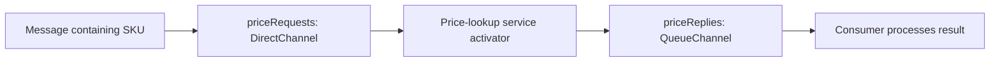

# Service Activator with an Advice Chain

## 1. Objectives and Context

In the **SPRING_INTEGRATION_CORE** module, a service activator connects a business method to a message flow. When the method calls an external service, you often need to retry transient failures, measure duration, or open a transaction. An **advice chain** lets you place those behaviors at the endpoint's processing boundary so the business method stays focused on its work.

After this lesson, you will be able to:

- Attach advice using `@ServiceActivator` and Java DSL.
- Identify which handler is wrapped and which parts of the flow lie outside the advice scope.
- Predict execution counts when combining multiple advices.
- Configure bounded retries, error classification, and recovery.
- Design tests for success after retry, permanent errors, and downstream errors.

The examples use **Java 17+, Spring Integration 6.5.x, and Spring Retry 2.x**. This is the lesson's API baseline; when using Spring Boot, manage versions via the appropriate BOM. Specifically, the retry configuration uses `org.springframework.retry.support.RetryTemplate` and `RequestHandlerRetryAdvice.setRetryTemplate(...)`, per the [Spring Integration 6.5 API](https://docs.spring.io/spring-integration/docs/6.5.0/api/org/springframework/integration/handler/advice/RequestHandlerRetryAdvice.html).

Prerequisites: `Message` contains a payload and headers, `DirectChannel` dispatches messages synchronously to a subscriber, `QueueChannel` buffers messages for later retrieval, and a service activator can return a result as a reply.

## 2. Where Does the Advice Chain Sit?

Suppose a price-lookup flow has three steps:



Attaching retry to the service activator aims to retry only the price lookup operation. Doing so avoids re-running earlier business steps just because price lookup failed. Spring Integration supports endpoint-level advice specifically to scope behavior to the needed processing point. See [Adding Behavior to Endpoints](https://docs.spring.io/spring-integration/reference/6.5/handler-advice.html).

A typical chain looks like:

```text
Message arrives at handler
  -> Advice A: before
     -> Advice B: before
        -> business method
     <- Advice B: after or error handling
  <- Advice A: after or error handling
Reply is forwarded to outputChannel
```

An advice can return the result unchanged, return an alternative value, or throw an exception. If it swallows an exception and returns a normal value, outer advices observe a normally completed call.

### Scope of Request-Handler Advice

For a reply-producing service activator based on `AbstractReplyProducingMessageHandler`, request-handler advice wraps the `handleRequestMessage()` step. Sending the reply and processing in the next endpoint happen after this step. Even when downstream uses a `DirectChannel` on the same thread, downstream errors stay outside the earlier handler's retry scope. It is a wrapped-method boundary, not just a thread boundary.

`HandleMessageAdvice` is a mechanism with a different scope: it wraps `handleMessage()`. For reply-producing handlers, the framework separates this kind from the request-handler chain, so you cannot infer a single combined ordering solely from list position. This lesson uses advices extending `AbstractRequestHandlerAdvice`. See [Handling Message Advice](https://docs.spring.io/spring-integration/reference/6.5/handler-advice/handle-message.html).

### Distinguishing Extension Points

| Mechanism | What it observes or controls | Example in the price-lookup problem |
| --- | --- | --- |
| Request-handler advice | Execution at the selected handler | Retrying the pricing service call |
| `ChannelInterceptor` | Send/receive operations on a channel | Checking headers before sending to a channel |
| Poller advice | Polling task within the poller's scope | Controlling a transaction when pulling messages from a queue |
| AOP on business bean | Calls passing through the bean's proxy | Shared transaction across callers of a service |
| Downstream endpoint | A subsequent step in the flow | Persisting the price or emitting an event after lookup |

Do not attach retries on the poller, the endpoint, and the HTTP client without calculating total actual invocations. Each retry layer can multiply the number of times the underlying operation executes.

## 3. Advice Order Determines Behavior

For standard request-handler advices in the same chain, the first element wraps the outermost layer; the last element sits closest to the handler. See [Ordering Advices within Advice Chain](https://docs.spring.io/spring-integration/reference/6.5/handler-advice/order.html).

Consider the configuration:

```text
[totalTimingAdvice, pricingRetryAdvice, attemptTimingAdvice]
```

When the service fails twice and succeeds on the third call:

```text
totalTimingAdvice starts
  pricingRetryAdvice starts cycle
    attemptTimingAdvice -> call 1 -> fails
    wait backoff
    attemptTimingAdvice -> call 2 -> fails
    wait backoff
    attemptTimingAdvice -> call 3 -> succeeds
  pricingRetryAdvice returns result
totalTimingAdvice finishes
send one reply
```

In this design:

- The total timer runs once per message; its duration includes all attempts and backoff pauses.
- The per-attempt timer runs three times; each wraps one business call.
- Only one result is forwarded to the output channel after the retry cycle succeeds.
- Time spent sending the reply and downstream processing is excluded from the outer request-handler timer.

If you move `attemptTimingAdvice` before retry, that timer also sees only one overall cycle. Bean names do not create "total" or "per-attempt" semantics; position in the chain determines that.

## 4. Complete Example Using Annotations

### 4.1. Preparing Dependencies

In an application with compatible library versions managed, you need the following dependencies:

```text
org.springframework.integration:spring-integration-core
org.springframework.retry:spring-retry
org.junit.jupiter:junit-jupiter            # only for the test example
```

The example configures retries directly via advice and `RetryTemplate`; `@EnableRetry` is not needed to activate this chain.

### 4.2. Configuring Channels, Advice, and Service

Create `AdviceChainDemo` in your practice project:

```java
package example.integration;

import java.util.concurrent.atomic.AtomicInteger;
import java.util.concurrent.atomic.LongAdder;

import org.springframework.context.annotation.Bean;
import org.springframework.context.annotation.Configuration;
import org.springframework.integration.annotation.ServiceActivator;
import org.springframework.integration.channel.DirectChannel;
import org.springframework.integration.channel.QueueChannel;
import org.springframework.integration.config.EnableIntegration;
import org.springframework.integration.handler.advice.AbstractRequestHandlerAdvice;
import org.springframework.integration.handler.advice.RequestHandlerRetryAdvice;
import org.springframework.messaging.Message;
import org.springframework.retry.support.RetryTemplate;

@Configuration(proxyBeanMethods = false)
@EnableIntegration
public class AdviceChainDemo {

    @Bean
    public DirectChannel priceRequests() {
        return new DirectChannel();
    }

    @Bean
    public QueueChannel priceReplies() {
        return new QueueChannel();
    }

    @Bean
    public TimingAdvice totalTimingAdvice() {
        return new TimingAdvice("total");
    }

    @Bean
    public TimingAdvice attemptTimingAdvice() {
        return new TimingAdvice("attempt");
    }

    @Bean
    public RequestHandlerRetryAdvice pricingRetryAdvice() {
        RetryTemplate template = RetryTemplate.builder()
                .maxAttempts(3)
                .exponentialBackoff(100, 2.0, 1000)
                .retryOn(TemporaryPriceException.class)
                .traversingCauses()
                .build();

        RequestHandlerRetryAdvice advice = new RequestHandlerRetryAdvice();
        advice.setRetryTemplate(template);
        return advice;
    }

    @Bean
    public PricingService pricingService() {
        return new PricingService();
    }

    public static class PricingService {

        private final AtomicInteger calls = new AtomicInteger();

        @ServiceActivator(
                inputChannel = "priceRequests",
                outputChannel = "priceReplies",
                requiresReply = "true",
                adviceChain = {
                    "totalTimingAdvice",
                    "pricingRetryAdvice",
                    "attemptTimingAdvice"
                })
        public String quote(String sku) {
            int attempt = calls.incrementAndGet();

            if ("INVALID".equals(sku)) {
                throw new IllegalArgumentException("Invalid SKU");
            }

            if ("OUTAGE".equals(sku) || attempt < 3) {
                throw new TemporaryPriceException(
                        "Pricing service unavailable, attempt " + attempt);
            }

            return "PRICE:" + sku + ":125000";
        }

        public int calls() {
            return calls.get();
        }
    }

    public static class TemporaryPriceException extends RuntimeException {

        public TemporaryPriceException(String message) {
            super(message);
        }
    }

    public static class TimingAdvice extends AbstractRequestHandlerAdvice {

        private static final System.Logger LOG =
                System.getLogger(TimingAdvice.class.getName());

        private final String label;
        private final LongAdder invocations = new LongAdder();

        public TimingAdvice(String label) {
            this.label = label;
        }

        @Override
        protected Object doInvoke(
                ExecutionCallback callback,
                Object target,
                Message<?> message) throws Exception {

            long started = System.nanoTime();
            try {
                return callback.execute();
            }
            finally {
                invocations.increment();
                long elapsedMicros = (System.nanoTime() - started) / 1000;
                LOG.log(System.Logger.Level.INFO,
                        "advice={0}, durationMicros={1}",
                        label, elapsedMicros);
            }
        }

        public long invocations() {
            return invocations.sum();
        }
    }
}
```

`PricingService` is registered as a Spring bean so the annotation on its method is discovered by the Integration infrastructure. `adviceChain` contains **advice bean names**, in the exact desired order. Syntax and attribute types are described in the [ServiceActivator API](https://docs.spring.io/spring-integration/docs/6.5.0/api/org/springframework/integration/annotation/ServiceActivator.html).

The service's counter is a simulation for practice: each new application context starts at 0. The success scenario uses one message in that context. Do not use this counting logic as an error policy in a real system.

### 4.3. Reading the Retry Policy

`maxAttempts(3)` allows three total calls: the initial attempt plus up to two retries. The example's backoffs are roughly 100 ms and 200 ms; the 1000 ms cap is not reached in this cycle. Only `TemporaryPriceException` and its subclasses are selected for retry. `traversingCauses()` enables searching the exception cause chain. See [RetryTemplateBuilder API](https://docs.spring.io/spring-retry/docs/2.0.12/apidocs/org/springframework/retry/support/RetryTemplateBuilder.html).

Traversing causes matters when a business error is wrapped inside a `MessagingException`, which is also noted in the [RequestHandlerRetryAdvice API](https://docs.spring.io/spring-integration/docs/6.5.0/api/org/springframework/integration/handler/advice/RequestHandlerRetryAdvice.html).

`INVALID` represents invalid input: calling again with the same data will not fix the SKU. `OUTAGE` represents a prolonged outage: the handler still fails after three calls. A normal SKU like `BOOK-42` demonstrates a transient error followed by recovery.

### 4.4. Why Does Custom Advice Use `finally`?

Putting the counter and timing measurement in `finally` lets you observe both successful calls and throwing calls. The advice returns the exact value of `callback.execute()`, so it neither turns a failure into a reply nor drops a successful result.

`AbstractRequestHandlerAdvice` provides a callback to execute the next step in the chain. Custom advice that invokes multiple times within a single `doInvoke()` must use `cloneAndExecute()` to preserve AOP state; thus you should not hand-roll retries using a loop calling `execute()` repeatedly. See [Custom Advice Classes](https://docs.spring.io/spring-integration/reference/6.5/handler-advice/custom.html).

Advices are typically used as singletons. Keeping the start timestamp in a local variable and using a thread-safe counter avoids mixing data across messages. If adding metrics, use bounded labels like endpoint name and outcome category; do not use individual SKUs or message IDs as metric labels.

## 5. Equivalent Configuration Using Java DSL

If choosing Java DSL, remove `@ServiceActivator` from `PricingService.quote()`, keep the service, channel, and advice beans above, and add the flow bean below to the configuration class. Pick only one way to register the endpoint, because two consumers subscribed to the same `DirectChannel` alter message distribution.

```java
import org.springframework.integration.dsl.IntegrationFlow;

@Bean
public IntegrationFlow pricingFlow(
        PricingService pricingService,
        TimingAdvice totalTimingAdvice,
        RequestHandlerRetryAdvice pricingRetryAdvice,
        TimingAdvice attemptTimingAdvice) {

    return IntegrationFlow.from("priceRequests")
            .handle(pricingService, "quote",
                    endpoint -> endpoint
                            .id("priceLookupEndpoint")
                            .requiresReply(true)
                            .advice(
                                    totalTimingAdvice,
                                    pricingRetryAdvice,
                                    attemptTimingAdvice))
            .channel("priceReplies")
            .get();
}
```

In annotations, you pass bean names; in DSL, you pass advice instances. The `endpoint -> ...` lambda configures the endpoint of the `.handle(...)` step itself. `advice(Advice...)` applies the nested chain around the handler. See [ConsumerEndpointSpec API](https://docs.spring.io/spring-integration/api/org/springframework/integration/dsl/ConsumerEndpointSpec.html).

When a flow has a transformer, filter, or router downstream, calling `.advice(...)` on this step does not automatically apply the same policy to all those steps. Place advice at each operation that has its own retry or transaction requirement.

## 6. Retries Exhausted: Rethrow or Recover?

### 6.1. Leaving the Error for the Caller

The main configuration declares no recovery. With `OUTAGE`, retries exhaust all three attempts and the error escapes the handler. Because the input is a `DirectChannel`, the sender's `send()` call fails as well.

Having a bean named `errorChannel`, or setting a header of that name, does not automatically convert every error from a direct synchronous call into an `ErrorMessage`. Error catching depends on the origin: gateways have their own configuration, while pollers and asynchronous processing have corresponding error-publishing mechanisms. See [Error Handling](https://docs.spring.io/spring-integration/reference/6.5/error-handling.html).

### 6.2. Variant: Routing Final Failures to a Channel

For a flow ingesting requests for background processing, you can choose to send final failures to a dedicated failure-handling channel. Add the following bean to the configuration:

```java
@Bean
public QueueChannel pricingErrors() {
    return new QueueChannel();
}
```

Replace the retry bean with this variant:

```java
import org.springframework.integration.handler.advice.ErrorMessageSendingRecoverer;

@Bean
public RequestHandlerRetryAdvice pricingRetryAdvice(
        QueueChannel pricingErrors) {

    RetryTemplate template = RetryTemplate.builder()
            .maxAttempts(3)
            .exponentialBackoff(100, 2.0, 1000)
            .retryOn(TemporaryPriceException.class)
            .traversingCauses()
            .build();

    RequestHandlerRetryAdvice advice = new RequestHandlerRetryAdvice();
    advice.setRetryTemplate(template);
    advice.setRecoveryCallback(
            new ErrorMessageSendingRecoverer(pricingErrors));
    return advice;
}
```

`ErrorMessageSendingRecoverer` is a recovery callback that publishes the final failure as an `ErrorMessage` to the chosen channel. See [ErrorMessageSendingRecoverer API](https://docs.spring.io/spring-integration/docs/6.5.0/api/org/springframework/integration/handler/advice/ErrorMessageSendingRecoverer.html).

With this variant, change `requiresReply = "true"` to `requiresReply = "false"`, or `.requiresReply(true)` to `.requiresReply(false)` if using DSL. This recoverer does not provide a business price result; recovery returns `null`. If a reply is still required, the handler can raise `ReplyRequiredException` after recovery. The reply requirement flag is defined in the [ServiceActivator API](https://docs.spring.io/spring-integration/docs/6.5.0/api/org/springframework/integration/annotation/ServiceActivator.html).

This variant's contract is designed as follows:

```text
Success: one price message to priceReplies
Recovered failure: one ErrorMessage to pricingErrors, no price reply
```

If publishing to the error channel also fails, recovery can no longer be considered complete. You need a real consumer processing the error channel and an appropriate persistence policy; `QueueChannel` in the example only holds data in memory.

The policy "do not retry this exception type" does not mean "do not recover this exception type". When a recovery callback is present, you must also decide how input errors rejected on the very first attempt are handled. If permanent errors must always escape to the caller, the recovery logic must classify and rethrow them.

### 6.3. Contract with a Gateway

A request-reply gateway expects a result, an error, or termination after its configured timeout. A recovery that only sends the error to another channel without producing a reply can leave the caller waiting. Therefore, pick one of three clear contracts:

| Contract | Outcome the caller observes |
| --- | --- |
| Synchronous price lookup | Valid price or exception |
| Price lookup with fallback result | A result type explicitly representing success/failure |
| Accept for background processing | Acceptance confirmation; results and errors travel on separate channels |

Do not return an empty string or price `0` as "success" to mask connectivity failures. If business rules allow cached prices, the result should indicate the source and freshness of the price.

## 7. Combining Retry with Transactions and Circuit Breakers

### 7.1. Retry and Transactions

Two placements produce two models:

```text
retry -> transaction -> handler
transaction -> retry -> handler
```

The first model gives each attempt its own transaction boundary; the second wraps the entire retry cycle inside an outer transaction. See [Ordering Advices within Advice Chain](https://docs.spring.io/spring-integration/reference/6.5/handler-advice/order.html).

However, if a transaction already exists from the caller and the advice uses `PROPAGATION_REQUIRED`, attempts may join the existing transaction. To require a fresh physical transaction per attempt, configure appropriate propagation such as `REQUIRES_NEW` and verify the participating resources.

Standard transaction advice in the request-handler chain is scoped to handler processing. Spring Integration provides `TransactionHandleMessageAdvice` for `handleMessage()` scope; transactions remain bounded by threads and participating resources. See [Transaction Support](https://docs.spring.io/spring-integration/reference/6.5/handler-advice/tx-handle-message.html).

In an HTTP price-lookup problem, rolling back a database does not undo an effect that already happened on an external system. In particular, do not hold a database transaction open across multiple backoff pauses unless business requirements demand it.

### 7.2. Retry and Circuit Breakers

Retries re-attempt a failing operation; a circuit breaker stops calling when a dependency keeps failing. Spring Integration has `RequestHandlerCircuitBreakerAdvice`, with a failure threshold and a half-open wait interval before allowing a probe call. See [RequestHandlerCircuitBreakerAdvice API](https://docs.spring.io/spring-integration/docs/6.5.0/api/org/springframework/integration/handler/advice/RequestHandlerCircuitBreakerAdvice.html).

Optional bean example:

```java
import org.springframework.integration.handler.advice.RequestHandlerCircuitBreakerAdvice;

@Bean
public RequestHandlerCircuitBreakerAdvice pricingCircuitBreaker() {
    RequestHandlerCircuitBreakerAdvice advice =
            new RequestHandlerCircuitBreakerAdvice();
    advice.setThreshold(5);
    advice.setHalfOpenAfter(10_000);
    return advice;
}
```

When designing the chain, anticipate two cases:

| Order | What the circuit breaker observes |
| --- | --- |
| Circuit breaker outside retry | Final outcome of a retry cycle |
| Circuit breaker inside retry | Outcome of each attempt passing through it |

This follows from the nested structure, provided exceptions still propagate past the breaker's position. Recovery inside retry can turn a failure into a normal return value, hiding that failure from an outer breaker.

If placing the breaker inside retry, avoid retrying the exception indicating the circuit is open: waiting and re-calling an open circuit only holds the caller longer. Selecting only `TemporaryPriceException` in the example separates that case from price-lookup outages.

## 8. Retry Must Be Paired with Idempotency and Time Budgets

The price-lookup example is a read operation. If replaced with charging payment or creating a shipment, a timeout does not prove the remote operation did not occur. Retrying the same request can create a second side effect.

Designing for operations with side effects requires specifying:

1. A stable business key, such as `paymentRequestId`, kept identical across attempts.
2. How the target system detects an already-processed request.
3. How to query state when the previous outcome is unknown.
4. Retry limits across the client, the endpoint, and broker redelivery mechanisms.

A retry advice does not by itself provide an "exactly once" guarantee.

In the three-attempt example, if each call has an 800 ms timeout, the estimated budget for the handler alone is:

```text
3 × 800 ms + 100 ms + 200 ms = 2700 ms
```

This number excludes queue wait time, sending the reply, and downstream steps. If the entire request must finish within 2 seconds, this policy is already unsuitable by design. Synchronous retry backoffs hold the thread while waiting; under high load, balance thread counts against concurrent requests.

Do not treat a gateway's reply-wait timeout as a reliable mechanism to cancel an in-flight HTTP call. Configure connect/read timeouts on the client performing the call, and coordinate the end-to-end flow budget.

## 9. Testing Behavior Through Channels

Testing by calling `pricingService.quote(...)` directly bypasses the endpoint and advice chain attached by Integration. Send messages to `priceRequests` to test the actual configuration.

The two tests below target **the initial annotation configuration, without adding recovery or a circuit breaker**. Each test creates a fresh context so the service counter is not shared across scenarios.

```java
package example.integration;

import org.junit.jupiter.api.AfterEach;
import org.junit.jupiter.api.BeforeEach;
import org.junit.jupiter.api.Test;

import org.springframework.context.annotation.AnnotationConfigApplicationContext;
import org.springframework.integration.channel.DirectChannel;
import org.springframework.integration.channel.QueueChannel;
import org.springframework.messaging.Message;
import org.springframework.messaging.support.MessageBuilder;

import static org.junit.jupiter.api.Assertions.*;

class AdviceChainDemoTest {

    private AnnotationConfigApplicationContext context;
    private DirectChannel requests;
    private QueueChannel replies;

    @BeforeEach
    void openContext() {
        context = new AnnotationConfigApplicationContext(AdviceChainDemo.class);
        requests = context.getBean("priceRequests", DirectChannel.class);
        replies = context.getBean("priceReplies", QueueChannel.class);
    }

    @AfterEach
    void closeContext() {
        context.close();
    }

    @Test
    void transientFailureIsRetriedAndProducesOneReply() {
        assertTrue(requests.send(
                MessageBuilder.withPayload("BOOK-42").build()));

        Message<?> reply = replies.receive(1000);

        assertNotNull(reply);
        assertEquals("PRICE:BOOK-42:125000", reply.getPayload());
        assertNull(replies.receive(0));

        assertEquals(3,
                context.getBean(AdviceChainDemo.PricingService.class).calls());
        assertEquals(1L,
                context.getBean("totalTimingAdvice",
                        AdviceChainDemo.TimingAdvice.class).invocations());
        assertEquals(3L,
                context.getBean("attemptTimingAdvice",
                        AdviceChainDemo.TimingAdvice.class).invocations());
    }

    @Test
    void invalidSkuIsNotRetried() {
        assertThrows(RuntimeException.class,
                () -> requests.send(
                        MessageBuilder.withPayload("INVALID").build()));

        assertNull(replies.receive(0));
        assertEquals(1,
                context.getBean(AdviceChainDemo.PricingService.class).calls());
        assertEquals(1L,
                context.getBean("totalTimingAdvice",
                        AdviceChainDemo.TimingAdvice.class).invocations());
        assertEquals(1L,
                context.getBean("attemptTimingAdvice",
                        AdviceChainDemo.TimingAdvice.class).invocations());
    }
}
```

The assertion accepts `RuntimeException` because the example focuses on retry policy; a real application test suite should also verify the error type and business cause. Do not assert only "some exception was thrown", since a misconfiguration error can also make such a test pass.

Scenarios worth expanding:

| Scenario | Expected observation in a fresh context |
| --- | --- |
| `OUTAGE`, no recovery | Throws error; service called 3 times; no reply |
| `OUTAGE`, recovery to error channel | Service called 3 times; one `ErrorMessage`; no price reply |
| Move per-attempt timer outside retry | That timer counts only one cycle |
| Downstream throws error after successful lookup | Service is not re-invoked by the lookup step's retry advice |
| DSL config instead of annotations | Same results and call counts as original config |
| Multiple concurrent messages | Measurement data does not leak between messages |

To test downstream failures, replace the output queue with a `DirectChannel` and add a downstream handler that always throws. With the simulated service still failing on the first two calls, lookup calls remain **3**; downstream is invoked only **1** time. The initial send call may receive the downstream error, yet retry at the price-lookup step had already finished before that error occurred.

Do not assert execution duration against an exact millisecond value: thread scheduling and runtime environments vary. Call counts, reply counts, and error locations are far more stable evidence of advice ordering.

## 10. Diagnosing Common Failures

| Symptom | What to check |
| --- | --- |
| Advice does not run | Whether the service is a Spring bean; whether messages pass through the right endpoint; whether bean names in the annotation are exact |
| Retry misses transient errors | Selected exception type and wrapped cause; cause traversal configuration |
| Measuring "per attempt" yet getting only one count | Timing advice is placed outside retry |
| Retries exhausted yet caller thinks it succeeded | Recovery or custom advice swallowed the error; revisit result contract |
| Required-reply error occurs after recovery | Recoverer returns `null` on an endpoint with `requiresReply=true` |
| Downstream error does not trigger price-lookup retry | Check request-handler advice scope; place policy on the step that actually fails |
| Same request causes duplicate side effects | Multiple retry/redelivery layers; missing idempotency key |
| Behavior alternates unpredictably after adding DSL | Both annotations and DSL registered consumers on the input channel |

When reading an advice chain, start from the business operation to protect, identify the wrapped boundary, and walk from outer advice to inner advice. For this lesson's price-lookup flow, the three design criteria are: retry only recoverable errors, keep the reply/error contract consistent, and prove execution counts through channel-level tests.
