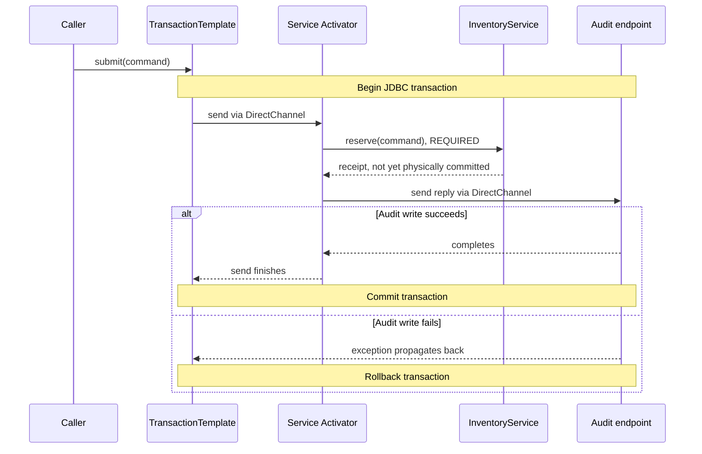
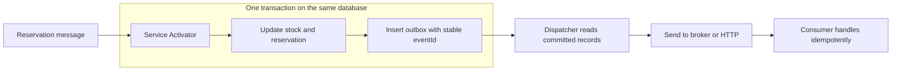

# Service Activator and Transactions

## Lesson Objectives

In the `SPRING_INTEGRATION_CORE` module, a Service Activator connects a message flow to a business method on a Spring bean. When the method updates data, you need to determine **where the transaction begins, when it ends, and which operations it encompasses**.

After this lesson, you will be able to:

- Choose between placing transactions at the service, caller, handler, or poller.
- Explain the impact of `DirectChannel`, `QueueChannel`, and `ExecutorChannel`.
- Distinguish data rollback, message recovery, and error-message handling.
- Design appropriate retries, idempotency, and verification tests for a flow with a Service Activator.

This lesson focuses on imperative transactions using JDBC and `PlatformTransactionManager`. Reactive transactions require a separate context model and must not be extrapolated from the thread-bound examples in this lesson.

## 1. A Service Activator Does Not Automatically Open a Transaction

`@ServiceActivator` and Java DSL's `.handle()` operator declare how to invoke business logic from a message. They do not implicitly create a database transaction. To have a transaction, add a mechanism such as `@Transactional`, `TransactionTemplate`, transaction advice, or a transaction-configured poller. The endpoint's role and reply creation are described in the [Service Activator documentation](https://docs.spring.io/spring-integration/reference/service-activator.html).

Separate three questions:

| Question | Deciding component |
| --- | --- |
| Which method receives the payload and produces a result? | Service Activator |
| Which execution block is wrapped in a transaction? | Transaction interceptor or transaction template |
| Which resources actually commit/roll back? | Transaction manager and participating resources |

A single message can pass through multiple endpoints within one transaction. Conversely, handling one message can open multiple independent transactions.

Inventory reservation business example:

1. Decrement available stock.
2. Record the reservation request.
3. Write an audit log entry.
4. Send a notification to an external system.

The first two operations must succeed or fail together. The third operation may need the same transaction, depending on the business contract. The fourth operation requires examining resources and communication mechanics; an HTTP request does not automatically participate in a JDBC transaction.

## 2. Three Scopes to Spot on Flow Diagrams

### 2.1. Method Invocation Scope

If the transaction is declared only on the service method, the typical scope is:

```text
Service Activator receives message
  -> invokes service proxy
       BEGIN
       run business method
       COMMIT or ROLLBACK
  -> receives return value
  -> creates and sends reply to output channel
```

When there is no outer transaction, the service commits before sending the reply. Therefore, an error at the reply-receiving endpoint cannot undo a transaction that has already committed.

If the service joins an existing transaction with propagation `REQUIRED`, exiting the method only ends the service's logical scope; the physical commit is still governed by the outer scope.

### 2.2. Handler Scope and Synchronous Downstream Segment

A transaction wrapping the entire `handleMessage()` can cover both the business call and sending replies through subsequent synchronous endpoints:

```text
BEGIN
  Service Activator
    -> service
    -> send reply
    -> next endpoint on same thread
COMMIT or ROLLBACK
```

This scope is broader than a transaction wrapping only the business method.

### 2.3. Poller Message-Receive Scope

With a polling consumer, the transaction can begin before `receive()`:

```text
BEGIN
  receive message
  -> Service Activator
  -> update data
  -> synchronous downstream
COMMIT or ROLLBACK
```

This matters for message recovery when message retrieval uses a rollback-capable resource. An in-memory queue does not gain that property merely by putting a transaction on the poller.

## 3. How Do Channels Affect Transactions?

In the standard JDBC model, transaction context is bound to the executing thread. `DirectChannel` invokes the handler on the sender's thread; `ExecutorChannel` typically hands off work to another thread; queues create a handoff point for a consumer to pull later. Headers cannot be used to transport a JDBC transaction across these handoff boundaries. See [Message Channel implementations](https://docs.spring.io/spring-integration/reference/channel/implementations.html).

| Path | Does the sender's transaction cover the business logic? |
| --- | --- |
| Caller → `DirectChannel` → Service Activator | Possibly, when the business logic participates in the same transaction and resources |
| Caller → `QueueChannel` → poller → Service Activator | Does not propagate across the queue; consumer needs its own transaction scope |
| Caller → `ExecutorChannel` → Service Activator | Must not rely on the caller's transaction |
| Transactional poller → Service Activator → `DirectChannel` → another endpoint | Can cover synchronous downstream processing |
| Service Activator → spawns a thread or calls `@Async` | Work on the new thread does not automatically join the active transaction |

Being on the same thread is an important condition, yet not sufficient by itself: you must use resources managed by the corresponding transaction manager, avoid propagation settings that split transactions, and allow errors to reach the scope that decides rollback.

Putting a message into a queue does not force the caller's transaction to commit immediately at `send()` either. The caller still ends its transaction according to its declared scope; the downstream consumer operates in a separate scope.

## 4. Example: Reserving Stock and Writing Audit History

### 4.1. Prerequisites for Building the Example

The Java snippets use Java 17 or later, Spring Integration Java DSL, and Spring JDBC. In a Spring Boot application, you can use dependencies managed by the application's BOM:

- `spring-boot-starter-integration`.
- `spring-boot-starter-jdbc`.
- H2 for practice.
- `spring-boot-starter-test` if writing tests.

Assume the application already has a `DataSource`, scans the beans in the example, and initializes the following schema. Each `public` type belongs in its corresponding Java file; alternative configuration examples are noted in each section.

```sql
create table stock (
    sku varchar(64) primary key,
    available integer not null check (available >= 0)
);

create table reservation (
    order_id varchar(64) primary key,
    sku varchar(64) not null,
    quantity integer not null check (quantity > 0)
);

create table reservation_audit (
    order_id varchar(64) primary key,
    detail varchar(255) not null
);

insert into stock(sku, available) values ('BOOK-01', 10);
```

Input payload and business result:

```java
public record ReserveCommand(String orderId, String sku, int quantity) {
}

public record ReservationReceipt(String orderId, String sku, int quantity) {
}
```

### 4.2. Base Configuration

```java
import javax.sql.DataSource;

import org.springframework.context.annotation.Bean;
import org.springframework.context.annotation.Configuration;
import org.springframework.integration.channel.DirectChannel;
import org.springframework.integration.config.EnableIntegration;
import org.springframework.jdbc.core.JdbcTemplate;
import org.springframework.jdbc.datasource.DataSourceTransactionManager;
import org.springframework.transaction.PlatformTransactionManager;
import org.springframework.transaction.annotation.EnableTransactionManagement;

@Configuration
@EnableIntegration
@EnableTransactionManagement
public class ReservationFlowConfig {

    @Bean
    public PlatformTransactionManager transactionManager(DataSource dataSource) {
        return new DataSourceTransactionManager(dataSource);
    }

    @Bean
    public JdbcTemplate jdbcTemplate(DataSource dataSource) {
        return new JdbcTemplate(dataSource);
    }

    @Bean
    public DirectChannel reserveInput() {
        return new DirectChannel();
    }

    @Bean
    public DirectChannel reservationEvents() {
        return new DirectChannel();
    }
}
```

`JdbcTemplate` and the transaction manager share the same `DataSource`. The example has only one transaction manager. When an application has multiple managers, explicitly choose which manager each scope uses.

### 4.3. Transactional Service

```java
import org.springframework.jdbc.core.JdbcTemplate;
import org.springframework.stereotype.Service;
import org.springframework.transaction.annotation.Transactional;

@Service
public class InventoryService {

    private final JdbcTemplate jdbc;

    public InventoryService(JdbcTemplate jdbc) {
        this.jdbc = jdbc;
    }

    @Transactional(transactionManager = "transactionManager")
    public ReservationReceipt reserve(ReserveCommand command) {
        if (command.quantity() <= 0) {
            throw new IllegalArgumentException("Quantity must be greater than 0");
        }

        int changed = jdbc.update(
                """
                update stock
                   set available = available - ?
                 where sku = ? and available >= ?
                """,
                command.quantity(),
                command.sku(),
                command.quantity());

        if (changed != 1) {
            throw new IllegalStateException(
                    "SKU not found or insufficient stock: " + command.sku());
        }

        jdbc.update(
                """
                insert into reservation(order_id, sku, quantity)
                values (?, ?, ?)
                """,
                command.orderId(),
                command.sku(),
                command.quantity());

        return new ReservationReceipt(
                command.orderId(), command.sku(), command.quantity());
    }
}
```

The conditional update avoids a read-then-write pattern based on potentially stale stock counts. The primary key `order_id` prevents inserting two reservations with the same key. If the insert fails, the Spring JDBC exception causes the stock decrement to roll back under default transaction settings.

The primary key only blocks duplicate inserts. It does not yet provide an idempotency contract that returns the previous result for a redelivered message.

### 4.4. Two Endpoints on a Synchronous Flow

```java
import org.springframework.integration.annotation.ServiceActivator;
import org.springframework.stereotype.Component;

@Component
public class ReservationEndpoint {

    private final InventoryService inventoryService;

    public ReservationEndpoint(InventoryService inventoryService) {
        this.inventoryService = inventoryService;
    }

    @ServiceActivator(
            inputChannel = "reserveInput",
            outputChannel = "reservationEvents")
    public ReservationReceipt reserve(ReserveCommand command) {
        return inventoryService.reserve(command);
    }
}
```

```java
import org.springframework.integration.annotation.ServiceActivator;
import org.springframework.jdbc.core.JdbcTemplate;
import org.springframework.stereotype.Component;

@Component
public class ReservationAuditEndpoint {

    private final JdbcTemplate jdbc;

    public ReservationAuditEndpoint(JdbcTemplate jdbc) {
        this.jdbc = jdbc;
    }

    @ServiceActivator(inputChannel = "reservationEvents")
    public void record(ReservationReceipt receipt) {
        jdbc.update(
                """
                insert into reservation_audit(order_id, detail)
                values (?, ?)
                """,
                receipt.orderId(),
                "Reserved " + receipt.quantity() + " units of " + receipt.sku());
    }
}
```

The first endpoint calls into a separate business bean. This clarifies invoking through the proxy carrying transaction advice. In standard proxy mode, self-invoking `this.reserve(...)` inside the same object bypasses the proxy and does not trigger new transaction annotations; beans created via `new` outside Spring do not have annotations processed automatically either. See [Using `@Transactional`](https://docs.spring.io/spring-framework/reference/data-access/transaction/declarative/annotations.html).

The audit endpoint does not open its own transaction. Without an outer transaction, it runs after `InventoryService` commits; when an outer transaction wraps it, its `JdbcTemplate` can participate in the shared transaction.

### 4.5. Sending a Message and Observing

Inside a method that has `reserveInput` injected:

```java
var command = new ReserveCommand("ORD-100", "BOOK-01", 2);
var message = org.springframework.messaging.support.MessageBuilder
        .withPayload(command)
        .build();

boolean sent = reserveInput.send(message);
if (!sent) {
    throw new IllegalStateException("Channel did not accept the message");
}
```

With the initial data, a successful outcome yields `available = 8`, a `reservation` row, and an audit row for `ORD-100`.

To see the limit of a service-only transaction, pre-insert a `reservation_audit` row with key `ORD-101`, with no `reservation` for that order yet. Then send a command to reserve 2 units for `ORD-101`.

Sequence when the caller has no transaction:

1. The service decrements stock and inserts the reservation.
2. The service's transaction commits.
3. The Service Activator sends the receipt to `reservationEvents`.
4. The audit endpoint hits a duplicate key and throws an error.
5. The caller receives the error from the synchronous call, yet the reservation has already committed.

This illustrates the state where **the call reports failure yet part of the business work succeeded**. The issue lies in the transaction scope required by the business contract.

## 5. Wrapping the Transaction from the Caller Side

If the caller owns the entire reservation-and-audit operation, it can open a transaction before `send()`:

```java
import org.springframework.beans.factory.annotation.Qualifier;
import org.springframework.messaging.MessageChannel;
import org.springframework.messaging.support.MessageBuilder;
import org.springframework.stereotype.Service;
import org.springframework.transaction.PlatformTransactionManager;
import org.springframework.transaction.support.TransactionTemplate;

@Service
public class ReservationSubmission {

    private final MessageChannel input;
    private final TransactionTemplate transactions;

    public ReservationSubmission(
            @Qualifier("reserveInput") MessageChannel input,
            PlatformTransactionManager transactionManager) {
        this.input = input;
        this.transactions = new TransactionTemplate(transactionManager);
    }

    public void submit(ReserveCommand command) {
        transactions.executeWithoutResult(status -> {
            boolean sent = input.send(
                    MessageBuilder.withPayload(command).build());
            if (!sent) {
                throw new IllegalStateException("Failed to send message");
            }
        });
    }
}
```

Here, `InventoryService.reserve()` uses default `REQUIRED` propagation and therefore joins `TransactionTemplate`'s transaction. The audit endpoint also runs synchronously against the same `DataSource`. The audit write error escapes the callback, causing both stock decrement and reservation creation to roll back.



A `@Transactional` facade called through a Spring proxy can play the same role. If using a messaging gateway, determine whether the transaction sits on the facade or in the gateway's advice; merely having a gateway does not prove the entire flow is wrapped in a transaction. How a gateway converts errors into normal return values can also affect commit decisions.

## 6. Wrapping the Entire Handler with Transaction Advice

When the endpoint is the right place to start the unit of work, use `TransactionHandleMessageAdvice` to wrap both the handler and synchronous reply delivery. `TransactionInterceptorBuilder(true)` creates this kind of advice. A regular `TransactionInterceptor` in a request-handler advice chain has a narrower scope and does not automatically wrap downstream steps. See [transaction advice for handlers](https://docs.spring.io/spring-integration/reference/handler-advice/tx-handle-message.html).

Add the following bean to the configuration:

```java
@Bean
public org.springframework.transaction.interceptor.TransactionInterceptor
        reservationFlowTx(PlatformTransactionManager transactionManager) {
    return new org.springframework.integration.transaction.TransactionInterceptorBuilder(true)
            .transactionManager(transactionManager)
            .build();
}
```

Then **replace the annotation** on `ReservationEndpoint.reserve()` with:

```java
@ServiceActivator(
        inputChannel = "reserveInput",
        outputChannel = "reservationEvents",
        adviceChain = "reservationFlowTx")
public ReservationReceipt reserve(ReserveCommand command) {
    return inventoryService.reserve(command);
}
```

Stock decrement, reservation creation, and audit logging can now share the transaction opened by the handler advice. `@Transactional` on the service remains useful if the service is called from another path; with `REQUIRED`, it joins the outer scope.

If choosing Java DSL, register an endpoint in place of `ReservationEndpoint`:

```java
@Bean
public org.springframework.integration.dsl.IntegrationFlow reserveDirectFlow(
        InventoryService inventoryService,
        @org.springframework.beans.factory.annotation.Qualifier("reservationFlowTx")
        org.springframework.transaction.interceptor.TransactionInterceptor flowTx) {

    return org.springframework.integration.dsl.IntegrationFlow
            .from("reserveInput")
            .handle(inventoryService, "reserve",
                    endpoint -> endpoint.advice(flowTx))
            .channel("reservationEvents")
            .get();
}
```

Keep the audit endpoint. Register only one consumer for `reserveInput`: either annotations or DSL. Multiple consumers on a `DirectChannel` are competing destinations, not sequential steps of the same flow.

Advice does not turn an asynchronous downstream into part of the current transaction. If you change `reservationEvents` to an in-memory queue, putting the reply onto the queue succeeds and can let the current transaction commit; an audit write error occurring later belongs to a different scope.

## 7. Service Activator Receiving Messages with a Transactional Poller

With `QueueChannel`, the Service Activator needs a polling consumer. Add the following beans to the base configuration; this path uses `reserveQueue`, separate from the synchronous `reserveInput`:

```java
@Bean
public org.springframework.integration.channel.QueueChannel reserveQueue() {
    return new org.springframework.integration.channel.QueueChannel(100);
}

@Bean
public org.springframework.integration.dsl.IntegrationFlow reservePolledFlow(
        InventoryService inventoryService,
        PlatformTransactionManager transactionManager) {

    return org.springframework.integration.dsl.IntegrationFlow
            .from("reserveQueue")
            .handle(inventoryService, "reserve",
                    endpoint -> endpoint.poller(
                            org.springframework.integration.dsl.Pollers
                                    .fixedDelay(1000)
                                    .maxMessagesPerPoll(1)
                                    .receiveTimeout(0)
                                    .transactional(transactionManager)))
            .channel("reservationEvents")
            .get();
}
```

Here:

- The poller creates a transaction for receiving and processing the message.
- `maxMessagesPerPoll(1)` keeps each message easy to observe in the example.
- `receiveTimeout(0)` avoids waiting when the queue is empty.
- The service and audit endpoint use the same JDBC resource on the same processing thread.
- Rollback-eligible exceptions escaping through the transaction advice roll back JDBC changes within this scope.

The scope wrapping a poll operation is described in [Transaction Support](https://docs.spring.io/spring-integration/reference/transactions.html); Java DSL options are in [PollerSpec API](https://docs.spring.io/spring-integration/api/org/springframework/integration/dsl/PollerSpec.html).

The sender can do:

```java
boolean queued = reserveQueue.send(
        org.springframework.messaging.support.MessageBuilder
                .withPayload(new ReserveCommand("ORD-200", "BOOK-01", 2))
                .build(),
        1000);

if (!queued) {
    throw new IllegalStateException("Queue did not accept message within timeout");
}
```

`queued == true` confirms handoff into the queue, not successful stock reservation. The sender may have already finished its work before the poller processes the message.

### 7.1. JDBC Rollback Does Not Return Messages to an In-Memory Queue

`new QueueChannel(100)` uses an in-memory queue that does not automatically participate in JDBC transactions. When the poller has removed a message and the business logic fails:

```text
Queue before receive:      [ORD-200]
After receive:             []
Business logic fails:      stock and reservation roll back
Queue after JDBC rollback: []   <- ORD-200 does not automatically return
```

An error channel can receive a failure notification, yet that notification does not automatically requeue the input message. If the problem requires not losing requests on process crash or business rollback, choose a durable store and an appropriate redelivery strategy.

### 7.2. Queues Backed by a JDBC Message Store

One option is a queue backed by `JdbcChannelMessageStore`. When message retrieval and business updates participate in one JDBC transaction on the same database, rollback can undo removing the message from the store as well.

These conditions must be designed together:

1. Initialize Spring Integration's schema matching your dependency version.
2. Configure the query provider matching your database engine.
3. Have the store and business logic use resources in the same transaction.
4. Start the transaction before the poller's receive operation.
5. Keep everything that must be atomic in the same scope, avoiding `REQUIRES_NEW`.
6. Define a retry-limit policy and quarantine persistently failing messages.

With default serialization, stored payloads and headers must satisfy serialization requirements; the two initial illustrative records do not declare `Serializable`. When moving to a persistent store, add serialization support or choose an appropriate serializer, while avoiding storing objects meaningful only in process memory.

Spring Integration distinguishes general stores from channel-optimized stores; see [JDBC Message Store](https://docs.spring.io/spring-integration/reference/jdbc/message-store.html).

A durable queue in a different database, or a message broker using its own transaction, does not automatically become atomic with business data simply because both support transactions.

## 8. Propagation, Isolation, and Timeouts

### 8.1. Propagation Determines Joining vs. Splitting Scope

| Propagation | Meaning in the reservation example |
| --- | --- |
| `REQUIRED` | Joins existing transaction; creates a new one if none exists |
| `REQUIRES_NEW` | Creates an independent physical transaction, suspending any active scope |
| `MANDATORY` | Requires caller to have an active transaction; throws if missing |
| `SUPPORTS` | Can join an existing transaction, without guaranteeing a new one |
| `NOT_SUPPORTED` | Runs outside the current transaction |
| `NESTED` | Uses savepoints when supported by the transaction manager and resource |

If the reservation service uses `REQUIRES_NEW`, it can commit before the audit endpoint fails, even when the poller or caller already opened a transaction. In that case, rolling back the outer scope cannot remove the reservation committed in its own scope.

Another scenario: a service using `REQUIRED` throws an error and marks the shared transaction rollback-only. A caller catching the error and continuing does not clear that mark. When the caller tries to commit, it may receive `UnexpectedRollbackException`.

Do not use `REQUIRES_NEW` merely to make an error disappear. It changes atomicity and may also require an extra connection while the outer transaction still holds its own connection. These behaviors are explained in [Transaction Propagation](https://docs.spring.io/spring-framework/reference/data-access/transaction/declarative/tx-propagation.html).

### 8.2. Isolation Does Not Replace Business Constraints

Isolation governs how concurrent transactions view and affect data. It does not by itself guarantee each `orderId` is processed once, does not prevent every incorrect update pattern, and does not create transactions across asynchronous channels.

In the example, two concrete business guards are the conditional update `available >= quantity` and the primary key `reservation.order_id`. When raising isolation levels, also measure lock contention, wait times, and retry rates for conflicting transactions.

### 8.3. Different Timeouts Have Different Scopes

| Configuration | What does it bound? |
| --- | --- |
| Transaction timeout | Duration for the unit of work, subject to transaction manager/resource enforcement |
| Queue send timeout | Time spent waiting for the queue to accept the message |
| Gateway reply timeout | Time the caller waits for a result |
| HTTP client timeout | Time spent waiting on HTTP communication |

A gateway timing out does not prove the consumer stopped or rolled back. A transaction timeout is not a mechanism that cancels every network call either. A subsequent call after a timeout can create a duplicate request, so a stable idempotency key is required.

## 9. Exceptions, Rollback, and Error Channels

### 9.1. Letting Errors Cross the Right Transaction Boundary

With Spring's default rollback rules, `RuntimeException` and `Error` trigger rollback; checked exceptions usually require explicit rules. You can declare them explicitly:

```java
@Transactional(
        transactionManager = "transactionManager",
        rollbackFor = java.io.IOException.class)
public void importReservation(ReserveCommand command)
        throws java.io.IOException {
    // Read data and perform JDBC updates within this business scope.
}
```

This is a rule declaration example, not a replacement for reservation logic. Applications can customize global defaults. Refer to [Rolling Back a Declarative Transaction](https://docs.spring.io/spring-framework/reference/data-access/transaction/declarative/rolling-back.html).

Consider **which exception the interceptor actually observes**. The messaging framework can wrap the root error in `MessagingException`; an interceptor on the service and an interceptor outside the handler may observe different exception classes.

If a service catches or throws a checked exception and commits under its own rules, the endpoint wrapping the error afterward cannot reverse a completed commit.

### 9.2. Catching Errors and Returning a Result Can Lead to Commit

```java
@Transactional
public ReservationReceipt reserveWithFallback(ReserveCommand command) {
    try {
        // Some JDBC statements have already executed.
        // Then a business error occurs.
        throw new IllegalStateException("Processing incomplete");
    }
    catch (IllegalStateException ex) {
        return new ReservationReceipt(
                command.orderId(), command.sku(), 0);
    }
}
```

The snippet above illustrates swallowing an error. If nothing else marked the transaction rollback-only, the interceptor sees the method return normally and can commit earlier changes.

If the business meaning is total failure, let the exception propagate or intentionally mark rollback-only. Returning a failure-indicating payload only affects the transaction if corresponding transaction-handling logic reacts to it.

`null`, `void`, `requiresReply`, and missing output are concerns of the endpoint's reply contract; they do not replace rollback rules.

### 9.3. Error Channels Serve Message-Based Error Handling

With `DirectChannel`, errors normally unwind back to the caller like a synchronous Java call. Simply adding an `errorChannel` header does not automatically switch every synchronous error to asynchronous error handling.

With a poller under normal error-handling configuration, exceptions escaping processing can be published as an `ErrorMessage`. If transaction advice already rolled back before the error reached the error publisher, the error channel's consumer is handling the aftermath of an already-ended transaction. Gateway, executor, and advice configurations can alter the exact path. See [Error Handling](https://docs.spring.io/spring-integration/reference/error-handling.html).

For the reservation flow, an error flow might record the order ID, cause, and decision to retry or quarantine. It must answer clearly:

- Is the input message in a store, broker, memory, or already removed from the source?
- Did the data transaction roll back, partially commit, or end in an unknown state?
- Who is responsible for redelivery?
- Must the error record commit independently of the failed business work?

If error logging happens after rollback, it needs its own transaction if multiple data updates must be atomic. If error logging runs inside a transaction guaranteed to roll back, the error record can vanish along with it.

## 10. Combining Retries with Transactions

Retries can live on advice, on the caller, or at the message source. Before choosing an attempt count, decide whether each attempt gets its own transaction.

```text
Model A:
Retry
  attempt 1 -> BEGIN -> business error -> ROLLBACK
  attempt 2 -> BEGIN -> business error -> ROLLBACK
  attempt 3 -> BEGIN -> success        -> COMMIT

Model B:
BEGIN
  Retry
    attempt 1 -> business error, transaction may already be rollback-only
    attempt 2 -> continues on a transaction that can no longer commit
ROLLBACK or error at completion
```

Model A generally suits transient transaction errors that can be retried with a fresh execution. It requires each attempt to genuinely cross a scope that starts a new transaction; simply ordering advice names is not enough if an outer transaction already exists and the service keeps joining via `REQUIRED`.

In a transactional poller flow, local retry at the handler may still sit inside the transaction opened by the poller. One option is letting the failed attempt roll back and relying on source redelivery to trigger a later attempt. With an in-memory queue, that redelivery must be explicitly built; it does not appear automatically.

`RequestHandlerRetryAdvice` supports handler retries; retry state and recovery callbacks must be designed accordingly. See [Provided Advice Classes](https://docs.spring.io/spring-integration/reference/handler-advice/classes.html).

Principles for the reservation problem:

- Bound retries for transient errors; permanent data errors must be classified.
- Preserve the business key across redeliveries, such as `orderId`.
- Add unique constraints to protect against two concurrent consumers.
- Define how to return the previous outcome for duplicate already-succeeded requests.
- Review recovery callbacks: if a callback returns normally, outer interceptors may treat the work as handled unless the transaction is already rollback-only.
- Monitor attempt counts, message age, and a quarantine path for persistently failing messages.

Do not catch `DuplicateKeyException` inside the same transaction and assume the transaction remains usable to read the old result. After an SQL error, whether continuation works depends on the database and transaction state; idempotency handling needs a concrete design, such as DB-supported upsert/ignore inserts or re-reading after the failed scope rolls back.

## 11. External Side Effects and the Transactional Outbox

Suppose the Service Activator makes an HTTP call to send a notification after decrementing stock. If the HTTP receiver processes it successfully and then the local database rolls back, the notification does not unsend itself.

Likewise, sending a message to a broker does not automatically commit atomically with JDBC. Broker durability and database transactions are separate properties; coordinating them requires designing appropriate resources, transaction managers, and protocols.

For reserving stock and then emitting an event, you can use a transactional outbox:



The local transaction protects writing the reservation and the intent to emit an event. The dispatcher reads only committed records, sends outward, and marks completion according to the application's strategy. If the process stops after sending but before marking as sent, the event may be re-emitted; thus consumers still need idempotency.

An `afterCommit` callback can be useful for post-commit actions, yet it does not create a durable queue on its own. A process crash right after commit or a failed outbound send inside the callback still leaves a gap to handle. Transaction callback synchronization does not turn files, HTTP, or memory into rollback-capable resources either.

## 12. Verifying via Committed State

### 12.1. A Service Rollback Test

The test below assumes a Spring Boot application has initialized the schema and registered the beans of the synchronous example. Do not place `@Transactional` on this test class or method: you need to observe the transactions opened by the application itself and the persisted data after the call finishes.

```java
import org.junit.jupiter.api.BeforeEach;
import org.junit.jupiter.api.Test;

import org.springframework.beans.factory.annotation.Autowired;
import org.springframework.beans.factory.annotation.Qualifier;
import org.springframework.boot.test.context.SpringBootTest;
import org.springframework.jdbc.core.JdbcTemplate;
import org.springframework.messaging.MessageChannel;
import org.springframework.messaging.MessagingException;
import org.springframework.messaging.support.MessageBuilder;

import static org.junit.jupiter.api.Assertions.assertEquals;
import static org.junit.jupiter.api.Assertions.assertThrows;

@SpringBootTest
class ReservationTransactionTest {

    @Autowired
    JdbcTemplate jdbc;

    @Autowired
    @Qualifier("reserveInput")
    MessageChannel input;

    @BeforeEach
    void resetDatabase() {
        jdbc.update("delete from reservation_audit");
        jdbc.update("delete from reservation");
        jdbc.update("delete from stock");
        jdbc.update(
                "insert into stock(sku, available) values (?, ?)",
                "BOOK-01", 10);
    }

    @Test
    void duplicateReservationRollsBackTheSecondStockUpdate() {
        var command = new ReserveCommand("ORD-DUP", "BOOK-01", 2);
        var message = MessageBuilder.withPayload(command).build();

        input.send(message);

        assertEquals(8, available());

        assertThrows(MessagingException.class, () -> input.send(message));

        assertEquals(8, available());
        assertEquals(1, jdbc.queryForObject(
                "select count(*) from reservation where order_id = ?",
                Integer.class, "ORD-DUP"));
        assertEquals(1, jdbc.queryForObject(
                "select count(*) from reservation_audit where order_id = ?",
                Integer.class, "ORD-DUP"));
    }

    private int available() {
        return jdbc.queryForObject(
                "select available from stock where sku = ?",
                Integer.class, "BOOK-01");
    }
}
```

The first call reserves 2 units and commits. The second decrements stock inside a transaction and then hits a duplicate key inserting the reservation. Seeing `8` remain after the failure proves the second stock decrement was not committed.

This test does not yet distinguish a service-only transaction from a transaction covering downstream steps, because the failure happened inside the service itself.

### 12.2. Distinguishing Boundaries Using a Failure at the Audit Endpoint

Each run below starts with stock `10` and a new order ID. Before sending, pre-insert an audit row with the same order ID, with no reservation yet. This intentionally causes failure after the service returns its result.

| Configuration under test | Expected business state after failure |
| --- | --- |
| Only `@Transactional` on service, caller has no transaction | Stock 8; reservation already exists |
| `ReservationSubmission` opens transaction around `send()` | Stock 10; no new reservation |
| `TransactionHandleMessageAdvice` wraps handler, downstream uses `DirectChannel` | Stock 10; no new reservation |
| Transactional poller, downstream uses `DirectChannel` | JDBC rolls back; message redelivery depends on source |
| Transaction on service, reply sent via in-memory queue | Later audit error cannot roll back service commit |
| Service switched to `REQUIRES_NEW` inside outer transaction | Reservation can commit independently before audit failure |

The audit row planted to trigger failure must still exist afterward; it was written beforehand, outside the transaction being verified.

### 12.3. Verifying Asynchronous Paths

With a poller, `send()` succeeding is not enough to assert the final outcome. Use a bounded-wait tool such as Awaitility, a confirmation channel, or a latch controlling the test endpoint. Synchronize on a concrete condition: a receipt arrived, an error was published, or data reached the expected final state.

Then verify independently:

1. Business data state after commit/rollback.
2. Whether the message remains in the source.
3. Whether the message is redelivered and causes duplicate effects.
4. Whether error details and attempt counts match.

Do not assert only that an `ErrorMessage` exists: that does not prove business data rolled back or the input message was recovered. With a durable queue, add process-restart scenarios and verify redelivery against the exact database or broker intended for production.

## 13. Common Design Mistakes

| Symptom | Cause to examine | How to fix |
| --- | --- | --- |
| Caller gets error yet reservation still exists | Service committed before sending reply | Choose a transaction scope covering everything that must be atomic |
| Data fails to roll back despite annotation | Bypassed proxy, self-invocation, or wrong manager | Check call path and actually participating resources |
| Queue is empty after business rollback | In-memory queue does not support transactional receive rollback | Choose a durable source or explicit recovery mechanism |
| Message keeps failing in a continuous loop | Unbounded redelivery or permanent data error | Classify errors, cap retries, and quarantine failing messages |
| `UnexpectedRollbackException` despite catching error | Participating scope already marked rollback-only | Handle errors outside the appropriate rollback boundary |
| Notification succeeds yet DB fails | External effect is outside the transaction | Use an outbox, idempotency, or compensating workflow |
| Tests always see rollback yet production commits | Test transaction masks application scope | Inspect data after the application transaction completes |

## 14. Choosing Scope for a Real Flow

Start from the data invariants to protect, then draw the steps that must commit together:

- If only one business operation updates multiple tables, place the transaction on the service.
- If multiple synchronous steps must succeed together, open the transaction at the facade/caller or use advice wrapping the entire handler.
- If pulling the message and updating data must roll back together, open the transaction at the poller or suitable ingress, and choose a transaction-capable source.
- If crossing threads, brokers, or external services, define local transactions and durable handoff mechanisms between them.

For each design, write down the transaction owner, the handoff channels, participating resources, rollback rules, and retry unit. Those decisions show whether a Service Activator protects the business workflow properly or only protects one small fragment of the flow.
