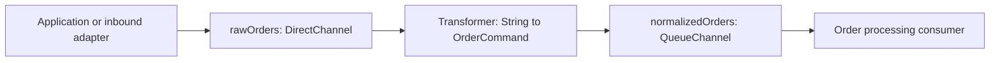

# What is a Transformer

## 1. Lesson Objectives

In the **SPRING_INTEGRATION_CORE** module, a transformer is a component that bridges systems with different data contracts. After this lesson, you will be able to explain the role of a transformer in a message flow, write a transformation step using Java DSL or `@Transformer`, determine the output payload and headers, and test behavior when transformation fails.

The running example throughout this lesson receives an order line from a partner system, normalizes it into an internal object, and sends it to the next channel. The example focuses on the core components: `Message`, `MessageChannel`, endpoints, and how to assemble them into an `IntegrationFlow`.

## 2. Concept and Problem to Solve

A **Transformer** implements the Message Translator pattern: it receives a message and converts its data into the form needed by the next step. Producers and consumers can therefore use different representations. Spring Integration allows using POJO methods as transformers; the payload does not have to be XML. [Transformer Documentation](https://docs.spring.io/spring-integration/reference/transformer.html).

Suppose a partner sends a string payload:

```text
 o-1001 | kb-01 | 2
```

While the warehouse system expects to receive:

```java
new OrderCommand("O-1001", "KB-01", 2)
```

If every consumer had to split the string, trim whitespace, and validate the quantity on its own, the transformation rules would be duplicated. Placing a transformer at the ingestion boundary lets the warehouse system work directly with `OrderCommand`.

In the design of this example, the transformer is responsible for:

1. Reading the three fields from the input format.
2. Normalizing the order ID and SKU according to the chosen convention.
3. Converting the quantity from a string to a positive integer.
4. Creating an output object that matches the internal contract.

The rule to uppercase the SKU is a decision of this example. For systems where codes are case-sensitive, the original casing must be preserved according to the actual contract.

## 3. Where Does a Transformer Fit in a Message Flow?



Each component in the diagram has its own responsibility:

| Component | Responsibility in the example |
| --- | --- |
| Producer | Creates a `Message<String>` containing the order line and source metadata. |
| Input channel | Delivers the message to the transformation endpoint. |
| Transformer endpoint | Invokes the transformation logic and emits the resulting message. |
| Output channel | Receives the `Message<OrderCommand>` for downstream steps to use. |
| Consumer | Processes the order according to the internal model. |

Under the hood, `MessageTransformingHandler` is a reply-producing handler that delegates the work to a `Transformer` and sends the result to the output channel. Declaring an endpoint allows Spring to manage wiring the handler to channels; calling a Java method directly does not form a message flow. [MessageTransformingHandler Javadoc](https://docs.spring.io/spring-integration/api/org/springframework/integration/transformer/MessageTransformingHandler.html).

A gateway can sit in front of the flow so the application calls a business method instead of manually creating and sending a `Message`. In this lesson, sending directly makes it easy to observe data passing through the transformer. For simple request/reply flows, the endpoint uses the configured `outputChannel`; if none is set, the `replyChannel` header can provide the reply destination. [Annotation Support](https://docs.spring.io/spring-integration/reference/configuration/annotations.html).

## 4. Payload Transformation vs. Full Message Transformation

A message has two parts to distinguish:

```text
Message<T>
├── payload: the data being processed
└── headers: metadata accompanying the data
```

Example input:

```text
payload = " o-1001 | kb-01 | 2 "
headers.sourceSystem = "partner-a"
headers.traceId = "trace-42"
```

There are two ways to write transformation logic:

| Input and return values | When to use |
| --- | --- |
| Receive payload, return new payload | The mapping only needs the data content. |
| Receive `Message<?>`, return new message | You need to control metadata along with the payload. |

When a transformer returns a **payload**, the framework propagates the input headers according to its configuration. When a transformer returns **a complete `Message`**, the transformation code is responsible for the headers of that message. You should not assume omitted headers will be added back automatically. [Header Propagation Rules](https://docs.spring.io/spring-integration/reference/message.html#message-header-propagation).

For the order example, returning `OrderCommand` is sufficient if you only need to preserve existing metadata. If you need to add `schemaVersion` or remove a header describing the old format, you can explicitly construct the output message.

## 5. Transformation Contract Before Writing Code

We choose the following contract for the illustrative format:

| Item | Rule |
| --- | --- |
| Input payload | A `String` with exactly three fields separated by the `|` character. |
| Field 1 | Order ID, trimmed of leading/trailing whitespace, non-empty, normalized to uppercase. |
| Field 2 | SKU, trimmed of leading/trailing whitespace, non-empty, normalized to uppercase. |
| Field 3 | Positive integer within the `int` range. |
| Output payload | `OrderCommand(orderId, sku, quantity)`. |
| Invalid data | Throws an exception describing the reason. |
| Metadata to preserve | `sourceSystem`, `traceId`, and headers required for the flow. |

This format has no escape mechanism for a `|` character inside a field. If the partner needs to represent such data, a richer format must be agreed upon or an appropriate parser chosen. Do not implicitly stretch a simple format into a full CSV standard.

The contract also needs to define whether values such as `+2` or `02` are accepted. The example uses `Integer.parseInt`, so both of these represent quantity `2`; `2.5`, empty strings, and values outside the `int` range are rejected.

## 6. Complete Example Using Java DSL

### 6.1. Prerequisites for Using the Example

The Java syntax in the example requires Java 17 or higher because it uses `record`. The project needs the `org.springframework.integration:spring-integration-core` dependency and a Spring version set compatible with the JDK in use. The test snippet below also requires JUnit Jupiter.

The classes below omit `package` declarations for readability. When placing them into a project, put them in an appropriate package. The example does not require Spring Boot or a message broker; the application context and channels all run in the same process.

### 6.2. Declaring Channels, Transformation Logic, and Flow

```java
import java.util.Locale;
import java.util.Objects;

import org.springframework.beans.factory.annotation.Qualifier;
import org.springframework.context.annotation.Bean;
import org.springframework.context.annotation.Configuration;
import org.springframework.integration.channel.DirectChannel;
import org.springframework.integration.channel.QueueChannel;
import org.springframework.integration.config.EnableIntegration;
import org.springframework.integration.dsl.IntegrationFlow;
import org.springframework.messaging.MessageChannel;
import org.springframework.messaging.PollableChannel;

@Configuration
@EnableIntegration
public class OrderTransformConfig {

    public record OrderCommand(String orderId, String sku, int quantity) {
    }

    @Bean
    public MessageChannel rawOrders() {
        return new DirectChannel();
    }

    @Bean
    public PollableChannel normalizedOrders() {
        return new QueueChannel(10);
    }

    @Bean
    public IntegrationFlow normalizeOrdersFlow(
            @Qualifier("rawOrders") MessageChannel input,
            @Qualifier("normalizedOrders") PollableChannel output) {

        return IntegrationFlow.from(input)
                .<String, OrderCommand>transform(OrderTransformConfig::parseOrder)
                .channel(output)
                .get();
    }

    public static OrderCommand parseOrder(String source) {
        Objects.requireNonNull(source, "Order line must not be null");

        String[] fields = source.split("\\|", -1);
        if (fields.length != 3) {
            throw new IllegalArgumentException(
                    "Order must have exactly 3 fields: orderId|sku|quantity");
        }

        String orderId = fields[0].strip().toUpperCase(Locale.ROOT);
        String sku = fields[1].strip().toUpperCase(Locale.ROOT);

        if (orderId.isEmpty() || sku.isEmpty()) {
            throw new IllegalArgumentException("orderId and sku must not be empty");
        }

        int quantity;
        try {
            quantity = Integer.parseInt(fields[2].strip());
        }
        catch (NumberFormatException ex) {
            throw new IllegalArgumentException(
                    "quantity must be an integer within int range", ex);
        }

        if (quantity <= 0) {
            throw new IllegalArgumentException("quantity must be greater than 0");
        }

        return new OrderCommand(orderId, sku, quantity);
    }
}
```

Significant details in the example:

- `split("\\|", -1)` splits on `|` and preserves trailing empty fields. As a result, `O-1|KB-01|` is detected as missing a quantity value.
- `Locale.ROOT` makes the uppercase rule independent of the host machine's default locale.
- `parseOrder` does not read channels or the application context, so it can be called directly when unit-testing mapping rules.
- `<String, OrderCommand>` explicitly indicates the input and output payload types of the transformation step.

In Java DSL, `.transform(...)` declares a transformer endpoint; `.get()` completes building the flow configuration. Spring creates and wires the runtime components from this configuration. Lambdas for standard EIP operations receive the payload. [DSL Basics](https://docs.spring.io/spring-integration/reference/dsl/java-basics.html).

### 6.3. Sending a Message and Observing Output

```java
import org.springframework.context.annotation.AnnotationConfigApplicationContext;
import org.springframework.messaging.Message;
import org.springframework.messaging.MessageChannel;
import org.springframework.messaging.PollableChannel;
import org.springframework.messaging.support.MessageBuilder;

public class OrderTransformDemo {

    public static void main(String[] args) {
        try (var context = new AnnotationConfigApplicationContext(
                OrderTransformConfig.class)) {

            MessageChannel input = context.getBean(
                    "rawOrders", MessageChannel.class);
            PollableChannel output = context.getBean(
                    "normalizedOrders", PollableChannel.class);

            Message<String> request = MessageBuilder
                    .withPayload(" o-1001 | kb-01 | 2 ")
                    .setHeader("sourceSystem", "partner-a")
                    .setHeader("traceId", "trace-42")
                    .build();

            input.send(request);

            Message<?> result = output.receive(1_000);
            if (result == null) {
                throw new IllegalStateException("Normalized order was not received");
            }

            System.out.println(result.getPayload());
            System.out.println(result.getHeaders().get("sourceSystem"));
            System.out.println(result.getHeaders().get("traceId"));
        }
    }
}
```

Expected output:

```text
OrderCommand[orderId=O-1001, sku=KB-01, quantity=2]
partner-a
trace-42
```

`DirectChannel` invokes the handler on the sender's thread. The output `QueueChannel` holds the result for the program to retrieve via `receive(...)`; it does not invoke a consumer on its own. The example does not need a poller because it reads the queue directly. If an endpoint needs to automatically consume from a `QueueChannel`, appropriate polling configuration must be provided. [Message Channel Implementations](https://docs.spring.io/spring-integration/reference/channel/implementations.html), [Poller with Annotations](https://docs.spring.io/spring-integration/reference/configuration/annotations.html#annotations-poller).

Do not assume that merely having a `QueueChannel` makes the entire flow run on a different thread. In the example, the transformation step has already executed before the resulting message is placed into the queue.

## 7. Writing the Same Transformation with `@Transformer`

Annotations are suitable when you want to bind message reception to a bean method. To replace the flow in section 6, **remove the `normalizeOrdersFlow` bean**, keep the two channel beans and the `parseOrder` method, and add the following to `OrderTransformConfig`:

```java
// Additional import:
// import org.springframework.integration.annotation.Transformer;

@Bean
public OrderNormalizer orderNormalizer() {
    return new OrderNormalizer();
}

public static class OrderNormalizer {

    @Transformer(inputChannel = "rawOrders", outputChannel = "normalizedOrders")
    public OrderCommand normalize(String source) {
        return OrderTransformConfig.parseOrder(source);
    }
}
```

`OrderNormalizer` is registered via `@Bean`; annotation processing is handled by the integration infrastructure. This configuration serves the same purpose as the DSL step it replaced. [Configuring Transformer with Java and Annotations](https://docs.spring.io/spring-integration/reference/transformer.html).

Choose only one of the two configurations for the same processing step. If you register both the DSL and the annotation on `rawOrders`, you have created an additional competing consumer on the same channel; that is not how you route a message sequentially through two transformations.

Distinguish the two `Transformer` types when reading imports:

| Fully qualified name | Role |
| --- | --- |
| `org.springframework.integration.annotation.Transformer` | Annotation marking a handler method. |
| `org.springframework.integration.transformer.Transformer` | Interface for a message transformation strategy. |

For most simple mappings, you can use a POJO or lambda without implementing the framework interface directly.

## 8. When You Need Explicit Header Control

Suppose the input has the header `rawFormat=pipe-v1`. Once the payload becomes `OrderCommand`, we want to remove that header and add `schemaVersion=order-command-v1`.

In the DSL bean in section 6, you can replace just the `.transform(...)` line with the snippet below. Add imports for `org.springframework.messaging.Message` and `org.springframework.messaging.support.MessageBuilder` to the configuration class:

```java
.transform(Message.class, message -> MessageBuilder
        .withPayload(parseOrder((String) message.getPayload()))
        .copyHeaders(message.getHeaders())
        .removeHeader("rawFormat")
        .setHeader("schemaVersion", "order-command-v1")
        .build())
```

This is a variant intended for inputs that already have a `String` payload contract. `Message.class` instructs the framework to pass the entire message into the lambda. Simply writing a generic parameter `Message<?>` without using the appropriate overload can cause the framework to still pass the payload, leading to a cast exception. [Lambdas and Message Arguments](https://docs.spring.io/spring-integration/reference/dsl/java-basics.html#java-dsl-lambdas).

`MessageBuilder` creates a new message; `copyHeaders` carries over the necessary metadata before your code removes or overrides individual headers. `id` and `timestamp` are read-only system headers and are not used to impose the old message's identity onto the new message. [MessageBuilder and Read-Only Headers](https://docs.spring.io/spring-integration/reference/message.html).

Following this rule, when designing the order flow you should explicitly decide:

| Header | Handling in the illustrative scenario |
| --- | --- |
| `sourceSystem` | Keep to identify the source that originated the order. |
| `traceId` | Keep to trace a request across steps. |
| `replyChannel` | Keep if downstream steps need to reply to the original sender. |
| `errorChannel` | Keep if the flow's error-handling mechanism uses this header. |
| `correlationId`, sequence info | Keep when the flow continues processing a message group. |
| `rawFormat` | Remove because it described the replaced input representation. |
| `schemaVersion` | Set according to the output payload contract. |

Do not use `MessageHeaders.id` as the order ID. Use `orderId` for the business identifier and a stable tracking value such as `traceId` when you need to correlate processing steps.

With a standard `GenericMessage`, do not mutate the headers map directly. Also, the immutability of the message wrapper does not make a `List` payload or a mutable object deeply immutable. [Message and Immutability](https://docs.spring.io/spring-integration/reference/message.html).

A helpful implementation rule is to create new output data rather than mutating the input object in place. This is especially important if the same message is also sent to another branch. `OrderCommand` in the example contains only `String` and `int`, so it does not share a mutable collection across branches.

## 9. Do Not Use a Transformer to Replace Every Endpoint

Choose an endpoint according to the purpose of the processing step:

| Need | Suitable endpoint | Example in the order system |
| --- | --- | --- |
| Change data structure or representation | Transformer | Partner string to `OrderCommand`. |
| Decide whether a message proceeds or is discarded | Filter | Drop test records based on an explicit criterion. |
| Select a destination channel | Router | Route orders to the northern or southern warehouse flow. |
| Split one message into multiple messages | Splitter | Split line items of an order. |
| Wait for and combine a group of messages | Aggregator | Combine line-item processing results. |
| Invoke a business service | Service activator | Save the order or request inventory reservation. |

A filter decides whether to pass a message onward; a service activator connects a message to a service call; an aggregator also manages message groups and release conditions. [Filter](https://docs.spring.io/spring-integration/reference/filter.html), [Service Activator](https://docs.spring.io/spring-integration/reference/service-activator.html), [Aggregator](https://docs.spring.io/spring-integration/reference/aggregator.html).

In this example, verifying that there are three fields is part of parsing the format. Deciding whether to accept an order from a temporarily suspended partner is a separate policy, which can be expressed with a filter before or after the transformation step depending on the data needed.

If a transformation produces a `List<OrderCommand>`, distinguish **a single message whose payload is a list** from **multiple separate messages**. If you want each order to traverse endpoints independently, design a corresponding splitter step.

Technically, a transformer can call an external service. However, in this order flow, it is better to keep mapping separate from writing to a database or calling an inventory reservation API. That way, data-parsing errors can be distinguished from infrastructure errors, and retrying the mapping will not accidentally repeat business side effects.

## 10. Important Rule: Never Return `null`

A successful transformation must produce a result. A transformer method that returns `null` triggers a transformation failure; a transformer does not have a `requiresReply=false` option to turn off this requirement. If the goal is to drop messages conditionally, use a filter. [Transformer Return Contract](https://docs.spring.io/spring-integration/reference/transformer.html).

The following example does not fulfill the contract properly:

```java
public OrderCommand convertOrIgnore(String source) {
    if (source.isBlank()) {
        return null; // Do not use null to represent filtering out a message.
    }
    return OrderTransformConfig.parseOrder(source);
}
```

If the source can emit blank lines as part of the protocol, you can place a filter before the transformer and configure how discarded messages are handled. If a blank line is a data error that needs tracking, routing it to an error branch is more appropriate than silently dropping it.

Do not catch all exceptions and return an empty `OrderCommand` just to let the flow continue. An apparently valid output that lacks meaningful data pushes the error downstream into order persistence, making the root cause harder to find.

## 11. Transformation Failures and Error Paths

With the `DirectChannel` in the example, an exception from the transformation step propagates back to the `send(...)` call, typically wrapped in a messaging exception. Attaching an `errorChannel` header does not automatically turn this synchronous call into an asynchronous error-sending flow. For tasks executed by a Spring Integration executor or poller, the error-handling mechanism can publish an `ErrorMessage` to the error channel resolved from the header or default configuration. [Error Handling](https://docs.spring.io/spring-integration/reference/error-handling.html).

Therefore, in the direct-send example, errors must be caught at the caller:

```java
import org.springframework.messaging.MessagingException;
import org.springframework.messaging.support.MessageBuilder;

// input is the rawOrders bean retrieved from the application context in section 6.
try {
    input.send(MessageBuilder.withPayload("O-1001|KB-01|abc").build());
}
catch (MessagingException ex) {
    // Here you can log the trace ID and inspect the cause chain.
    // Do not treat send success or failure as an OrderCommand value.
    System.err.println("Unable to transform order: " + ex.getMessage());
}
```

To design error handling for the order system, you can classify failures:

| Error category | Example | Handling approach in this scenario |
| --- | --- | --- |
| Malformed format | Missing field or `quantity=abc` | Log the failing message to inspect the sender. |
| Violates input contract | `quantity=0` | Report invalid data with a clear reason. |
| Programming or configuration error | Wrong payload type or missing output destination | Fix the inter-step contract or flow configuration. |
| Infrastructure error in a separate service step | Warehouse API temporarily unresponsive | Consider retry at the service-call step, along with idempotency rules. |

Re-running the same string `O-1001|KB-01|abc` will not make it valid. In this case, retrying does not solve the cause. Distinguish data errors from transient errors before adding a retry policy.

## 12. Testing Logic and Testing the Flow

Two groups of tests answer different questions:

- **Logic tests:** is the input string mapped to the object correctly, and are data rejection rules accurate?
- **Flow tests:** does the message traverse the endpoint, reach the right channel, preserve necessary metadata, and surface errors according to the chosen mechanism?

Below is a JUnit Jupiter test class using the DSL configuration from section 6. These examples are practice code for learners; they do not require an external server.

```java
import org.junit.jupiter.api.Test;
import org.springframework.context.annotation.AnnotationConfigApplicationContext;
import org.springframework.messaging.Message;
import org.springframework.messaging.MessageChannel;
import org.springframework.messaging.MessagingException;
import org.springframework.messaging.PollableChannel;
import org.springframework.messaging.support.MessageBuilder;

import static org.junit.jupiter.api.Assertions.*;

class OrderTransformTest {

    @Test
    void mapsFieldsAndNormalizesCodes() {
        var actual = OrderTransformConfig.parseOrder(" o-1001 | kb-01 | 2 ");

        assertEquals(
                new OrderTransformConfig.OrderCommand("O-1001", "KB-01", 2),
                actual);
    }

    @Test
    void rejectsInvalidQuantity() {
        assertThrows(IllegalArgumentException.class,
                () -> OrderTransformConfig.parseOrder("O-1001|KB-01|0"));
        assertThrows(IllegalArgumentException.class,
                () -> OrderTransformConfig.parseOrder("O-1001|KB-01|abc"));
        assertThrows(IllegalArgumentException.class,
                () -> OrderTransformConfig.parseOrder("O-1001|KB-01|"));
    }

    @Test
    void transformsMessageAndPreservesBusinessHeaders() {
        try (var context = new AnnotationConfigApplicationContext(
                OrderTransformConfig.class)) {

            var input = context.getBean("rawOrders", MessageChannel.class);
            var output = context.getBean("normalizedOrders", PollableChannel.class);

            input.send(MessageBuilder
                    .withPayload(" o-1001 | kb-01 | 2 ")
                    .setHeader("sourceSystem", "partner-a")
                    .setHeader("traceId", "trace-42")
                    .build());

            Message<?> result = output.receive(1_000);

            assertNotNull(result);
            var command = assertInstanceOf(
                    OrderTransformConfig.OrderCommand.class, result.getPayload());
            assertEquals("O-1001", command.orderId());
            assertEquals("KB-01", command.sku());
            assertEquals(2, command.quantity());
            assertEquals("partner-a", result.getHeaders().get("sourceSystem"));
            assertEquals("trace-42", result.getHeaders().get("traceId"));
            assertNull(output.receive(0));
        }
    }

    @Test
    void reportsBadInputToDirectChannelCaller() {
        try (var context = new AnnotationConfigApplicationContext(
                OrderTransformConfig.class)) {

            var input = context.getBean("rawOrders", MessageChannel.class);
            var output = context.getBean("normalizedOrders", PollableChannel.class);

            assertThrows(MessagingException.class, () -> input.send(
                    MessageBuilder.withPayload("O-1001|KB-01|abc").build()));

            assertNull(output.receive(0));
        }
    }
}
```

`receive(1_000)` sets a finite timeout for the result; `receive(0)` checks the queue immediately without waiting. Each flow test creates its own context so leftover messages do not skew other tests.

If you switch to the `Message`-returning variant in section 8, add assertions that `rawFormat` was removed, `schemaVersion` has the expected value, and the preserved headers are still present. When using a gateway, add a test verifying that the gateway call receives a reply matching its contract.

## 13. Choosing How to Implement a Transformation

| Implementation approach | Best when | Considerations |
| --- | --- | --- |
| Lambda in Java DSL | Mapping is short and readable inline at the flow definition. | Extract to a method or class as logic grows. |
| POJO method called by DSL | You want to separate mapping rules from flow configuration. | Choose clear method names and avoid confusing overloads. |
| Method with `@Transformer` | You want to declare channels directly on the bean method. | Ensure the bean is registered and annotations are processed. |
| SpEL expression | Simple field extraction or value computation. | Multi-branch logic is usually easier to maintain in Java. |
| Built-in transformer | Common format conversions supported by the framework. | Verify input/output types and corresponding dependencies. |

Java DSL provides the `org.springframework.integration.dsl.Transformers` factory class to configure built-in transformers. For example, you can choose a JSON transformer instead of writing a custom parser when the actual contract is JSON; verify the JSON library and mapper configuration compatible with your project version. [Transformers in Java DSL](https://docs.spring.io/spring-integration/reference/dsl/java-transformers.html).

For the current order problem, `parseOrder` is a readable starting point. If mapping rules expand into multiple format versions, you can move them into a dedicated mapper class and test each input contract.

## 14. Common Pitfalls When Applying Transformers

| Symptom | Cause to investigate | Fix |
| --- | --- | --- |
| `traceId` missing after transformation | Code creates a new `Message` without keeping required headers. | Check how the output message is built and add metadata tests. |
| Cast error inside a lambda expecting `Message` | The lambda is actually receiving the payload. | Use the overload taking `Message.class` or a POJO method with a matching signature. |
| Invalid order causes an error instead of being skipped | Transformer returns `null`. | Move the discard policy to a filter or report the data error explicitly. |
| Transformation finishes but result is never sent | No suitable output destination or target channel lacks the needed consumer. | Check `outputChannel`, `replyChannel`, and receiving components. |
| Calling an annotated method directly shows nothing on output | A plain Java call bypasses the endpoint reading from the channel. | Test via the channel or gateway to observe wiring. |
| Code normalization differs across machines | Relying on the default locale for case conversion. | Pick a locale per the data contract, such as `Locale.ROOT` in the example. |
| Hard to pinpoint why an order failed | Mixing data parsing, database writes, and API calls into one big step. | Separate mapping from business steps with side effects. |

## 15. Practice Exercise

Extend the example according to the following requirements:

1. Add the header `rawFormat=pipe-v1` to the input message, use the variant in section 8, and verify that this header is removed from the output.
2. Set `schemaVersion=order-command-v1` while preserving `sourceSystem` and `traceId`.
3. Add test cases for an empty SKU, missing fields, extra fields, negative quantity, and quantity exceeding `int` range.
4. Replace the Java DSL with the annotation configuration in section 7 and reuse the payload and header tests.
5. Extract blank-line removal into a filter with a clearly defined discard behavior; verify that discarded messages do not appear in `normalizedOrders`.

When explaining your results, explicitly state the payload type before and after the transformation step, which headers are preserved or changed, and where exceptions land for the flow you configured. Those are the factors that determine whether a transformer fulfills its contract in an integration system.
