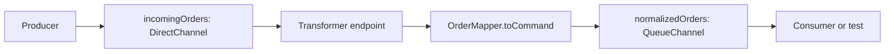

# Payload Transformer

## 1. Objectives and Problem Statement

In the **Transformer** chapter of the **SPRING_INTEGRATION_CORE** module, this lesson focuses on converting data inside the payload into the contract required by the next step. You will build a mapper, wire the mapper into an endpoint using Java DSL, track headers across the transformation, and test both successful outputs and failures.

Suppose a sales system receives orders from a partner. The partner sends the total amount as a string and the currency code in lowercase. The internal order processing service requires `BigDecimal` and `Currency`. If each consumer had to interpret the partner's format on its own, conversion rules would be duplicated. Placing a transformer at the beginning of the flow allows downstream consumers to share a single contract.

This is an application of the [Message Translator pattern in Enterprise Integration Patterns](https://www.enterpriseintegrationpatterns.com/patterns/messaging/MessageTranslator.html): converting data representations between applications that use different models.

**After this lesson, you will be able to:**

- Distinguish payload transformation from header modification, message filtering, and message splitting.
- Define the input type, output type, and failure conditions of a transformation.
- Use a POJO, a lambda, or `@Transformer` to accomplish the same task.
- Preserve necessary metadata while avoiding direct mutation of input objects.
- Unit-test a mapper in isolation and test the endpoint inside a Spring Integration flow.

The examples use **Java 17 and Spring Integration 6.4** as an API reference point; this is a choice for the lesson, not an assertion about your project's version. When applying it, use the compatible Spring version set managed by your application.

## 2. What Does a Payload Transformer Do?

The processing model can be written as:

```text
Message<S>(payload, headers)
          |
          | T transform(S payload)
          v
Message<T>(newPayload, propagatedHeaders)
```

In the common style, the transformation function takes only `S` and returns `T`. The framework handles receiving the message, invoking the function, and sending the resulting message to the output channel. `S` and `T` may be the same type, such as normalizing a `String`, or different types, such as converting `IncomingOrder` into `OrderCommand`.



Distinguish the roles in the diagram:

| Component | Responsibility in the example |
| --- | --- |
| `Message<IncomingOrder>` | Carries order data and metadata such as `traceId` |
| `DirectChannel` | Delivers messages to the registered endpoint |
| Transformer endpoint | Connects the messaging lifecycle to the mapper call |
| `OrderMapper` | Validates and converts data fields |
| `QueueChannel` | Holds resulting messages for the receiver to pull |

Naming it a "payload transformer" does not mean you must subclass a framework class. A plain Java method can serve as the transformation function; configuration determines how it is wired into the flow.

### 2.1. Choosing the Right Component

| Need | Suitable component |
| --- | --- |
| Convert a partner DTO into an internal command | Payload transformer |
| Add `sourceSystem` without changing business data | Header enricher |
| Drop messages that do not meet a condition | Message filter |
| Choose a processing branch by order type | Router |
| Split a list into individual messages | Splitter |
| Combine multiple messages by correlation key | Aggregator |
| Invoke a service to perform a business action such as saving an order | Service activator |

This table guides design: converting data representations should have a clear boundary separate from order acceptance decisions and business execution.

### 2.2. One Input, One Output Contract

On the happy path in this example, one input message produces one output message. If the mapper returns `List<OrderCommand>`, the result is still **a single message whose payload is a list**. To get separate messages, add a splitter.

A transformer method must return a valid result. Returning `null` is not a way to skip a message; Spring Integration treats that as a transformation error. Use a filter when you need to discard a message conditionally. See [transformer return rules](https://docs.spring.io/spring-integration/reference/6.4/transformer.html).

## 3. Designing the Data Contract Before Writing the Flow

To give the exercise deterministic behavior, the data contract is defined as follows:

| Field | Input `IncomingOrder` | Output `OrderCommand` |
| --- | --- | --- |
| `orderId` | Non-blank string, may have outer whitespace | String after `strip()` |
| `customerEmail` | Non-blank string, may have outer whitespace | String after `strip()`; preserve letter case |
| `total` / `amount` | Decimal string using a dot separator | Positive `BigDecimal`, scale of 2 |
| `currency` | Currency code string | `Currency`, accepting only USD or EUR in this example |

Example input:

```text
IncomingOrder(
    orderId = "  PO-1042  ",
    customerEmail = "  buyer@example.com  ",
    total = "125.50",
    currency = " usd "
)
```

Expected output:

```text
OrderCommand(
    orderId = "PO-1042",
    customerEmail = "buyer@example.com",
    amount = 125.50,
    currency = USD
)
```

Decisions belonging to the illustrative contract:

- Do not lowercase the entire email address; this lesson only trims outer whitespace and does not perform email validation.
- Do not guess separators: `"125,50"` does not match the input contract.
- Do not implicitly round `"125.501"`; without a rounding policy, raise an error.
- `"125.500"` is accepted because it can be represented exactly as `125.50`.
- Do not convert EUR to USD. Normalizing currency codes and currency exchange conversion are two separate responsibilities.
- The scale-of-2 rule is tied to USD/EUR in this exercise and is not a universal default for every currency.

`BigDecimal` lets you control scale and rounding; `RoundingMode.UNNECESSARY` requires that changing scale does not lose precision. See [Java 17 BigDecimal API](https://docs.oracle.com/en/java/javase/17/docs/api/java.base/java/math/BigDecimal.html).

## 4. Complete Example Using Java DSL

### 4.1. Prerequisites to Run the Example

The main example requires only `org.springframework.integration:spring-integration-core` along with compatible Spring dependencies. The test section additionally uses JUnit Jupiter and `spring-test`; if using Spring Boot, you can pull them from the corresponding starters and let dependency management align versions.

No broker, database, or HTTP server is required. The input here is already a Java DTO. Converting JSON off the wire into a DTO is a separate step covered later.

Save the following illustrative code as `PayloadTransformerConfig.java` in package `example.integration`: 

```java
package example.integration;

import java.math.BigDecimal;
import java.math.RoundingMode;
import java.util.Currency;
import java.util.Locale;
import java.util.Objects;
import java.util.Set;

import org.springframework.context.annotation.Bean;
import org.springframework.context.annotation.Configuration;
import org.springframework.integration.channel.DirectChannel;
import org.springframework.integration.channel.QueueChannel;
import org.springframework.integration.config.EnableIntegration;
import org.springframework.integration.dsl.IntegrationFlow;

@Configuration
@EnableIntegration
public class PayloadTransformerConfig {

    public record IncomingOrder(
            String orderId,
            String customerEmail,
            String total,
            String currency) {
    }

    public record OrderCommand(
            String orderId,
            String customerEmail,
            BigDecimal amount,
            Currency currency) {
    }

    public static final class OrderMapper {

        private static final Set<String> SUPPORTED_CURRENCIES =
                Set.of("USD", "EUR");

        public OrderCommand toCommand(IncomingOrder source) {
            Objects.requireNonNull(source, "source is required");

            String orderId = required(source.orderId(), "orderId");
            String email = required(source.customerEmail(), "customerEmail");
            String total = required(source.total(), "total");
            String code = required(source.currency(), "currency")
                    .toUpperCase(Locale.ROOT);

            if (!SUPPORTED_CURRENCIES.contains(code)) {
                throw new IllegalArgumentException("Unsupported currency");
            }

            BigDecimal amount = new BigDecimal(total)
                    .setScale(2, RoundingMode.UNNECESSARY);

            if (amount.signum() <= 0) {
                throw new IllegalArgumentException("total must be positive");
            }

            return new OrderCommand(
                    orderId, email, amount, Currency.getInstance(code));
        }

        private static String required(String value, String field) {
            if (value == null || value.isBlank()) {
                throw new IllegalArgumentException(field + " is required");
            }
            return value.strip();
        }
    }

    @Bean
    public OrderMapper orderMapper() {
        return new OrderMapper();
    }

    @Bean
    public DirectChannel incomingOrders() {
        return new DirectChannel();
    }

    @Bean
    public QueueChannel normalizedOrders() {
        return new QueueChannel();
    }

    @Bean
    public IntegrationFlow normalizeOrderFlow(OrderMapper orderMapper) {
        return IntegrationFlow.from(incomingOrders())
                .transform(IncomingOrder.class, orderMapper::toCommand)
                .channel(normalizedOrders())
                .get();
    }
}
```

### 4.2. Reading the Configuration by Responsibility

`@EnableIntegration` enables the Spring Integration infrastructure in this plain Spring configuration. `IntegrationFlow.from(incomingOrders())` starts the flow from the input channel. `.transform(IncomingOrder.class, orderMapper::toCommand)` explicitly declares the input payload type and the transformation function. The mapper does not need to know channel names or send messages itself.

`.channel(normalizedOrders())` sets an explicit output channel. The `QueueChannel` at the end of the flow lets the demo and tests read results using `receive(timeout)`. Putting the result into a queue does not turn the preceding mapper into a task running on a different thread.

In this example, the mapper is invoked immediately on the thread sending to `DirectChannel`. There is no polling consumer reading the output queue yet, so no poller is needed. If an endpoint later consumes input from a `QueueChannel`, an appropriate polling mechanism must be configured. See [MessageChannel Implementations](https://docs.spring.io/spring-integration/reference/6.4/channel/implementations.html).

Specifying `IncomingOrder.class` makes the input contract readable and assists DSL overload resolution. However, this declaration does not replace deserialization or full schema validation. The producer must still deliver valid data at the agreed boundary.

### 4.3. Sending and Receiving a Message

The following standalone snippet uses the configuration above:

```java
package example.integration;

import org.springframework.context.annotation.AnnotationConfigApplicationContext;
import org.springframework.integration.channel.DirectChannel;
import org.springframework.integration.channel.QueueChannel;
import org.springframework.messaging.Message;
import org.springframework.messaging.support.MessageBuilder;

import example.integration.PayloadTransformerConfig.IncomingOrder;

public class PayloadTransformerDemo {

    public static void main(String[] args) {
        try (var context = new AnnotationConfigApplicationContext(
                PayloadTransformerConfig.class)) {

            var input = context.getBean("incomingOrders", DirectChannel.class);
            var output = context.getBean("normalizedOrders", QueueChannel.class);

            Message<IncomingOrder> request = MessageBuilder.withPayload(
                    new IncomingOrder("  PO-1042  ",
                            "  buyer@example.com  ", "125.50", " usd "))
                    .setHeader("traceId", "trace-1042")
                    .build();

            input.send(request);
            Message<?> reply = output.receive(1_000);

            if (reply == null) {
                throw new IllegalStateException("No transformed order received");
            }

            System.out.println(reply.getPayload());
            System.out.println(reply.getHeaders().get("traceId"));
        }
    }
}
```

The resulting payload represents an `OrderCommand` with amount `125.50`, currency `USD`, and outer whitespace stripped from strings. The `traceId` header still holds `trace-1042`.

## 5. Alternative Ways to Express the Same Transformation

### 5.1. Lambdas and GenericTransformer

For small transformations, a lambda keeps the flow concise and readable. This is a replacement snippet for the `.transform(...)` step, not a complete flow:

```java
.transform(String.class, value -> value.strip())
```

If you want to name a reusable function, you can use the `GenericTransformer<S, T>` functional interface:

```java
import java.util.Locale;
import org.springframework.integration.core.GenericTransformer;

GenericTransformer<String, String> normalizeCode =
        value -> value.strip().toUpperCase(Locale.ROOT);
```

Then pass that variable into `.transform(normalizeCode)` when configuring a flow that accepts a `String` payload. The interface API defines a single method `T transform(S source)`; see [GenericTransformer API](https://docs.spring.io/spring-integration/api/org/springframework/integration/core/GenericTransformer.html).

Rule of thumb in this lesson: use a lambda for small conversions; use a named mapper once multiple fields, conditions, or independently testable policies appear.

### 5.2. Configuration with Annotations

You can replace the `IntegrationFlow` bean in the main example with an annotation-driven endpoint. Declare the following bean inside `PayloadTransformerConfig`, along with the nested endpoint class below:

```java
@Bean
public AnnotatedOrderTransformer annotatedOrderTransformer(OrderMapper mapper) {
    return new AnnotatedOrderTransformer(mapper);
}

public static final class AnnotatedOrderTransformer {

    private final OrderMapper mapper;

    public AnnotatedOrderTransformer(OrderMapper mapper) {
        this.mapper = mapper;
    }

    @org.springframework.integration.annotation.Transformer(
            inputChannel = "incomingOrders",
            outputChannel = "normalizedOrders")
    public OrderCommand transform(IncomingOrder payload) {
        return mapper.toCommand(payload);
    }
}
```

This bean must be managed by Spring so the annotation infrastructure discovers the method. When choosing this approach, remove the DSL's `normalizeOrderFlow` bean. If you keep both, you create two consumers registered on `incomingOrders`; messages may be dispatched to one or the other rather than passing through a single pipeline.

Annotations are convenient when you want the endpoint declaration right next to the method. The DSL is convenient when you want to read a chain of transformers, filters, routers, and subsequent steps in a single configuration.

## 6. Headers After Payload Transformation

### 6.1. Returning a Payload vs. Returning a Message Are Two Different Contracts

When a transformer function returns only the payload, input headers are propagated by the framework according to propagation rules. When the function returns a complete `Message`, application code is responsible for constructing that message. See [Header Propagation](https://docs.spring.io/spring-integration/reference/6.4/message.html#message-header-propagation).

| Method return type | Application code responsibility |
| --- | --- |
| `OrderCommand` | Produce the result data; let the framework handle the message and propagate headers |
| `Message<OrderCommand>` | Build both the payload and the required set of output headers |

In the sample flow, `traceId` is preserved and the system creates a new message for the new payload type. Do not use `MessageHeaders.ID` as an order ID or idempotency key: it is the message's identifier. Likewise, the message timestamp does not replace a business timestamp like `orderCreatedAt`.

For request-reply, pay attention to `replyChannel`; for error handling, pay attention to `errorChannel`; for splitter/aggregator flows, pay attention to correlation and sequence headers. Building a message with only a payload can strip context that the rest of the flow relies on.

### 6.2. When You Need to Build the Message Explicitly

Suppose the transformation must also update schema version metadata. An alternative method can be written as follows; place it in an appropriately configured transformer bean:

```java
public org.springframework.messaging.Message<OrderCommand> transformMessage(
        org.springframework.messaging.Message<IncomingOrder> input) {

    OrderCommand payload = mapper.toCommand(input.getPayload());

    return org.springframework.messaging.support.MessageBuilder
            .withPayload(payload)
            .copyHeaders(input.getHeaders())
            .removeHeaders("contentType")
            .setHeader("payloadSchemaVersion", "order-command-v1")
            .build();
}
```

This snippet assumes the bean has an `OrderMapper mapper` field injected via its constructor. The method takes the entire message instead of just the payload. If using `@Transformer`, place the annotation with the input/output channels on this method.

Removing `contentType` in the example is a boundary decision: the header describing the old JSON format no longer directly describes the current Java DTO. If a downstream consumer requires `contentType`, set a value matching its actual contract. Do not blindly copy format headers after changing representations.

`copyHeaders` helps carry over regular metadata; do not use it to force the old message's system ID and timestamp onto the new message. If you only need to add a header and the mapper still only needs the payload, a separate header enricher step usually makes the flow easier to read.

## 7. Immutability, Purity, and Concurrency

In the example, `IncomingOrder` and `OrderCommand` are records containing immutable value types. The mapper creates new objects and does not mutate the source. Because the mapper does not store per-invocation state in fields, multiple independent calls can safely share the same bean.

The fact that a message has no setter to swap its payload **does not make every object inside the payload immutable**. A mutable `Map` or `List` can still be modified through a reference. This distinction is explained in [Spring Integration's Message Model](https://docs.spring.io/spring-integration/reference/6.4/message.html).

Example prone to side effects when multiple branches read the same data:

```java
// Illustrates what to avoid if source is still shared.
sourceMap.put("currency", "USD");
return sourceMap;
```

Minimal copying approach:

```java
var target = new java.util.HashMap<String, Object>(sourceMap);
target.put("currency", "USD");
return target;
```

This is only a shallow copy: nested objects may still share references. If a payload contains a mutable list of line items, you must decide whether to copy elements or switch to an immutable model. A Java record does not automatically deep-copy a `List` passed to its constructor either.

For transformers at system boundaries, prefer:

- Same input data and same configuration produce the same result.
- Do not store the "current order" in a singleton bean field.
- Do not send emails, deduct inventory, or record payments inside a mapper.
- Use thread-safe dependencies if the mapper requires them.

Making an HTTP call to look up exchange rates makes the transformation depend on the network, timeouts, and timing. When that is needed, model a dedicated lookup/enrichment step separately, then transform the data based on the retrieved result.

## 8. Transformation Failures and Error Boundaries

### 8.1. Classifying Errors in the Example

| Input data | Expected failure point | Behavior to design |
| --- | --- | --- |
| `orderId` contains only whitespace | Required field check | Report invalid data |
| `total = "abc"` | `BigDecimal` cannot parse | Do not fabricate a fallback command with amount 0 |
| `total = "125.501"` | Scale change requires rounding | Require an explicit policy or reject |
| `total = "0"` | Positive number check | Must not enter the valid-orders channel |
| `currency = "XYZ"` | Outside USD/EUR set | Report unsupported currency code |
| Payload has unexpected type | Transformer invocation boundary | Inspect the producer and preceding decoding step |

The mapper validates what is needed to build a structurally sound command. Decisions like "whether the customer is allowed to buy on credit" belong in business logic or a subsequent filter/routing step.

Do not handle errors like this:

```java
try {
    return mapper.toCommand(source);
}
catch (RuntimeException ex) {
    return null;
}
```

That hides the original cause and still violates the transformer's return contract. Also do not return `source` on failure: downstream consumers expect `OrderCommand`, not a result whose type varies by branch.

### 8.2. DirectChannel and Asynchronous Processing

In the sample flow, failures occur on the thread of the caller invoking `incomingOrders.send(...)`. The sender may receive a `MessagingException` wrapping the root cause. Simply setting an `errorChannel` header does not automatically turn a synchronous `DirectChannel` failure into an `ErrorMessage` sent to that channel.

In asynchronous tasks or pollers equipped with a Spring Integration error handler, errors can be published as an `ErrorMessage`. The error handler uses the `errorChannel` header if present, or the global error channel. Execution boundaries must be configured properly; gateways also have their own error-handling mechanism. See [Error Handling](https://docs.spring.io/spring-integration/reference/6.4/error-handling.html).

For permanently bad data such as `"abc"`, running the same mapper again will keep failing. When designing operations, retain the error code, source, business key, and trace information to fix the data or route it to an error flow. Only retry when a transient error might resolve itself.

Do not infer from a transformer returning a result that the order has been durably persisted. The sample flow ends at an in-memory queue; persisting the order is the responsibility of the next step.

## 9. Testing the Mapper Independently

Testing the mapper verifies the data contract without starting Spring. Place the following tests in package `example.integration`:

```java
package example.integration;

import java.math.BigDecimal;
import java.util.Currency;

import org.junit.jupiter.api.Test;

import example.integration.PayloadTransformerConfig.IncomingOrder;
import example.integration.PayloadTransformerConfig.OrderMapper;

import static org.junit.jupiter.api.Assertions.*;

class OrderMapperTest {

    private final OrderMapper mapper = new OrderMapper();

    @Test
    void mapsValidOrder() {
        var source = new IncomingOrder(
                "  PO-1042  ", "  buyer@example.com  ", "125.50", " usd ");

        var result = mapper.toCommand(source);

        assertEquals("PO-1042", result.orderId());
        assertEquals("buyer@example.com", result.customerEmail());
        assertEquals(new BigDecimal("125.50"), result.amount());
        assertEquals(Currency.getInstance("USD"), result.currency());
        assertEquals("  PO-1042  ", source.orderId());
    }

    @Test
    void rejectsAmountThatNeedsRounding() {
        var source = new IncomingOrder(
                "PO-1042", "buyer@example.com", "125.501", "USD");

        assertThrows(ArithmeticException.class,
                () -> mapper.toCommand(source));
    }

    @Test
    void acceptsRedundantTrailingZero() {
        var source = new IncomingOrder(
                "PO-1042", "buyer@example.com", "125.500", "USD");

        assertEquals(new BigDecimal("125.50"),
                mapper.toCommand(source).amount());
    }
}
```

Testing scale matters because the contract requires `125.50`, not merely a numeric value close to `125.5`. Add empty fields, negative numbers, non-numeric strings, and out-of-list currencies as you expand the exercise.

## 10. Testing the Transformer in a Flow

A correct mapper alone is not enough to prove the endpoint is registered on the right channel or that headers are propagated. The test below boots the exact DSL configuration from section 4, sends real messages, and reads the output queue. Do not enable the annotation configuration from section 5 at the same time.

```java
package example.integration;

import org.junit.jupiter.api.BeforeEach;
import org.junit.jupiter.api.Test;
import org.springframework.beans.factory.annotation.Autowired;
import org.springframework.beans.factory.annotation.Qualifier;
import org.springframework.integration.channel.DirectChannel;
import org.springframework.integration.channel.QueueChannel;
import org.springframework.messaging.Message;
import org.springframework.messaging.MessagingException;
import org.springframework.messaging.support.MessageBuilder;
import org.springframework.test.context.junit.jupiter.SpringJUnitConfig;

import example.integration.PayloadTransformerConfig.IncomingOrder;
import example.integration.PayloadTransformerConfig.OrderCommand;

import static org.junit.jupiter.api.Assertions.*;

@SpringJUnitConfig(PayloadTransformerConfig.class)
class PayloadTransformerFlowTest {

    @Autowired
    @Qualifier("incomingOrders")
    DirectChannel input;

    @Autowired
    @Qualifier("normalizedOrders")
    QueueChannel output;

    @BeforeEach
    void drainOutput() {
        while (output.receive(0) != null) {
            // Drain leftover results between sequential test runs.
        }
    }

    @Test
    void transformsPayloadAndPreservesHeaders() {
        var replyChannel = new QueueChannel();
        var errorChannel = new QueueChannel();

        Message<IncomingOrder> request = MessageBuilder.withPayload(
                new IncomingOrder(" PO-1042 ",
                        " buyer@example.com ", "125.50", "usd"))
                .setHeader("traceId", "trace-1042")
                .setReplyChannel(replyChannel)
                .setErrorChannel(errorChannel)
                .build();

        assertTrue(input.send(request));
        Message<?> result = output.receive(1_000);

        assertNotNull(result);
        OrderCommand payload = assertInstanceOf(
                OrderCommand.class, result.getPayload());
        assertEquals("PO-1042", payload.orderId());
        assertEquals("trace-1042", result.getHeaders().get("traceId"));
        assertSame(replyChannel, result.getHeaders().getReplyChannel());
        assertSame(errorChannel, result.getHeaders().getErrorChannel());
        assertNotEquals(request.getHeaders().getId(), result.getHeaders().getId());
        assertNull(output.receive(0));
        assertNull(replyChannel.receive(0));
    }

    @Test
    void propagatesSynchronousFailureToSender() {
        var errors = new QueueChannel();
        var invalid = MessageBuilder.withPayload(
                new IncomingOrder("  ",
                        "buyer@example.com", "125.50", "USD"))
                .setErrorChannel(errors)
                .build();

        MessagingException failure = assertThrows(MessagingException.class,
                () -> input.send(invalid));

        assertInstanceOf(IllegalArgumentException.class,
                failure.getMostSpecificCause());
        assertNull(output.receive(0));
        assertNull(errors.receive(0));
    }
}
```

Intentional verifications:

1. The payload actually converts to `OrderCommand`, and `traceId` remains intact.
2. Request-reply and error headers are preserved; the new message has its own identifier.
3. The explicitly declared output channel receives the result; `replyChannel` does not receive an extra copy.
4. Invalid data does not enter the valid output channel and synchronous failures propagate back to the sender.

`receive(1_000)` sets a wait timeout for the test; do not use `Thread.sleep()` to guess when results arrive. The illustrative test suite assumes sequential execution because it shares channels in the Spring context. If running in parallel, isolate the context or channels per test.

Spring Integration includes additional modules for mocking endpoints and testing larger flows; this small example only needs JUnit and Spring Test. See [Testing support](https://docs.spring.io/spring-integration/reference/6.4/testing.html).

The tests above are practice code for learners to run in an environment with suitable dependencies, not a claim that the code has been executed in this repository.

## 11. Fitting a Payload Transformer into a Real Flow

### 11.1. Separating Format Decoding from Business Mapping

A JSON-receiving pipeline can be organized by responsibility:

```text
JSON String
   -> JSON-to-object transformer
IncomingOrder
   -> OrderMapper
OrderCommand
   -> filter or router based on business rules
   -> service activator persisting the order
```

Java DSL provides the `Transformers` factory; for example, `.transform(Transformers.fromJson(IncomingOrder.class))` converts JSON to an object. See [Transformers in Java DSL](https://docs.spring.io/spring-integration/reference/6.4/dsl/java-transformers.html).

If you add this step before the mapper, you need compatible JSON and object-mapper dependencies; the JSON mapper must support constructing the DTO/record in use. JSON syntax errors and business value errors are two different failure modes, so preserve enough context to diagnose the failing step.

When going back out to an external system, serializing a command into JSON is a separate step. A record's `toString()` is not a JSON contract, and Spring Integration does not require every payload to be a string.

### 11.2. Coordinating with Filters, Routers, and Aggregators

For instance, once you have a valid `OrderCommand`:

- A filter decides whether to accept orders with an amount below a minimum threshold.
- A router selects the USD or EUR flow.
- A service activator executes order persistence and produces a result.
- If an earlier step split line items, an aggregator uses appropriate correlation/sequence headers to gather results.

A transformer changes the data, but it must respect the context needed by those steps. Losing correlation headers can prevent an aggregator from grouping properly; losing the reply channel can leave a gateway waiting with no reply.

A gateway can expose a Java API to callers while the transformer continues handling normalization inside the flow. If you change the example so a gateway returns `OrderCommand`, you must design a corresponding reply path rather than only holding results in `normalizedOrders`.

## 12. Common Design Mistakes

| Symptom | Possible cause | Fix |
| --- | --- | --- |
| Consumer occasionally receives old DTO | Catching an error and returning the input | Maintain a single result type per contract and surface errors at the handling boundary |
| Gateway times out after transform step | Manually building a `Message` and dropping metadata or lacking a reply path | Verify header propagation and output/reply channels |
| Order data gets mutated in another branch | Modifying a shared mutable payload | Create new result objects and clearly define copy depth |
| Money suffers precision loss or unexpected rounding | Using `double` or implicit rounding | Parse strings with `BigDecimal` and state the scale policy explicitly |
| Output list stays a single message | Confusing transform with split | Add a splitter when you need one message per element |
| Header says JSON while payload is already a DTO | Carrying stale format metadata across a boundary | Remove or update headers to match the consumer's contract |
| Retrying the same bad message indefinitely | Failing to distinguish data errors from transient errors | Route to an error branch with enough details to fix the data |
| Two configuration styles yield unpredictable results | Registering both DSL and annotations on the same input channel | Choose a single endpoint for the intended transformation |

## 13. Extended Practice Exercises

1. Add `sourceSystem` to the header before the mapper; verify that the header remains after transformation without adding it to the DTO.
2. Extend the amount contract with an explicit rounding policy. Compare results against `UNNECESSARY` mode and update tests.
3. Add a `lineItems` list field. Verify that a transformer returning a list still produces a single message, then add a splitter to observe the difference.
4. Replace one segment of the flow with an asynchronous boundary configured with an error handler; write a test receiving `ErrorMessage` instead of catching from `send()`.
5. Introduce a second partner order format and write a separate mapper so both converge onto `OrderCommand`.

You have completed this lesson when you can explain the payload contract before and after transformation, which headers must be preserved or updated, where errors are observed, and why downstream consumers can trust the data type they receive.
