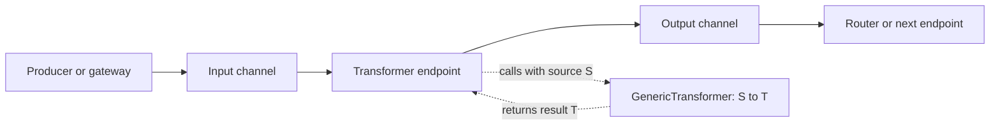

# GenericTransformer

## Objectives and Context

In the **Transformer** chapter of the **SPRING_INTEGRATION_CORE** module, `GenericTransformer<S, T>` expresses a data transformation with a clear Java contract for its input and output types. It is the bridge between application transformation logic and the transformer endpoint in Spring Integration Java DSL.

Suppose a system receives orders from a partner. The SKU has extra whitespace, and both quantity and unit price arrive as strings. Before routing to the order-processing service, the flow needs to produce a normalized internal object. `GenericTransformer` is well suited for writing this mapping and testing it independently of channels, gateways, or adapters.

After this lesson, you will be able to:

- Read the `GenericTransformer<S, T>` contract and choose appropriate source and target types.
- Write a transformer as a lambda, method reference, or dedicated class.
- Wire a transformer into an `IntegrationFlow` and distinguish transformation logic from the runtime endpoint.
- Decide when to return only the payload and when to build a complete `Message`.
- Handle invalid data, verify headers, and determine how exceptions propagate.

The complete example uses Java 17 with `record` and the Spring Integration 6.x Java DSL API. The project requires `spring-integration-core`; the test examples require JUnit Jupiter. If using Spring Boot, let Boot's dependency management select the compatible version set. The exercises operate only on in-memory objects without needing a broker or database.

## 1. The `GenericTransformer<S, T>` Contract

The interface lives in package `org.springframework.integration.core`. Its core contract is:

```java
@FunctionalInterface
public interface GenericTransformer<S, T> {
    T transform(S source);
}
```

`S` is the source type and `T` is the result type. Because the interface has a single abstract method, you can use a lambda or method reference. [GenericTransformer Javadoc](https://docs.spring.io/spring-integration/api/org/springframework/integration/core/GenericTransformer.html)

Example:

```java
import java.util.Locale;
import org.springframework.integration.core.GenericTransformer;

GenericTransformer<String, String> normalizeSku =
        text -> text.strip().toUpperCase(Locale.ROOT);

String sku = normalizeSku.transform("  book-java  ");
// sku = "BOOK-JAVA"
```

The two types do not have to differ. Here `String -> String` is still a transformation because the data's representation changes.

| Declaration | Meaning in the application |
| --- | --- |
| `GenericTransformer<String, String>` | Normalizes a text value |
| `GenericTransformer<String, OrderCommand>` | Parses a text representation into an object per application-defined rules |
| `GenericTransformer<RawOrder, OrderCommand>` | Maps an external DTO to an internal command |
| `GenericTransformer<Message<RawOrder>, Message<OrderCommand>>` | Transforms considering both payload and headers |

The interface defines only the `transform` call. It does not create channels, register endpoints, schedule polling, or configure retries. Calling `normalizeSku.transform(...)` directly executes an ordinary Java call.

A `GenericTransformer` bean alone does not form a flow either. You must wire that bean into `.transform(...)` or an appropriate endpoint configuration for Spring Integration to receive and forward messages.

### Distinguishing Similar Contracts

| Component | Core contract | When appropriate |
| --- | --- | --- |
| `GenericTransformer<S, T>` | `T transform(S source)` | Writing a typed transformation strategy for use in Java DSL |
| `Transformer` | `Message<?> transform(Message<?> message)` | Working directly with messages in the framework's transformer API |
| `Function<S, T>` | `T apply(S source)` | Writing a general Java function, connectable to DSL via method reference |
| `Converter<S, T>` | `T convert(S source)` | Participating in Spring's type conversion service once suitably registered |

`Transformer` in `org.springframework.integration.transformer` extends `GenericTransformer<Message<?>, Message<?>>`. It is a specialization that operates on the full message. [Transformer Javadoc](https://docs.spring.io/spring-integration/api/org/springframework/integration/transformer/Transformer.html)

Having a single method on two interfaces does not mean variables of the two types are directly assignable to each other. If you already have a `Function`, you can adapt it via a method reference:

```java
import java.util.function.Function;
import org.springframework.integration.core.GenericTransformer;

Function<String, Integer> lengthFunction = String::length;
GenericTransformer<String, Integer> lengthTransformer =
        lengthFunction::apply;
```

## 2. From Java Function to Endpoint in a Flow

Consider a configuration snippet inside an `IntegrationFlow` factory method:

```java
return IntegrationFlow.from("skuInput")
        .transform(String.class,
                text -> text.strip().toUpperCase(Locale.ROOT))
        .channel("skuOutput")
        .get();
```

`skuInput` and `skuOutput` are channel names in the application context. The lambda receives only the input data of the transformation; the surrounding endpoint handles receiving and sending messages.



Java DSL creates and registers integration components from `IntegrationFlow` beans. Consequently, a channel configuration error and a bug inside the transformation function belong to two separate layers of responsibility. [Java DSL](https://docs.spring.io/spring-integration/reference/dsl.html)

The `String.class` argument describes the source type expected by `.transform(...)`, not the result type. With overloads accepting `Class<P>`, the framework can attempt to convert the data to the expected type when needed. Whether conversion succeeds depends on configured converters. [BaseIntegrationFlowDefinition.transform Javadoc](https://docs.spring.io/spring-integration/docs/6.4.x/api/org/springframework/integration/dsl/BaseIntegrationFlowDefinition.html)

Do not assume `.transform(OrderCommand.class, ...)` will automatically parse any JSON string into `OrderCommand`. Parsing JSON requires a decoding step or properly configured converters. In this lesson, the input is already a `RawOrder`; Java code handles mapping it to `OrderCommand`.

### Choosing Lambda, Method Reference, or Dedicated Class

- Use a lambda for short conversions, such as trimming whitespace or extracting a field.
- Use a method reference when a method with a business-descriptive name already exists, such as `orderMapper::toCommand`.
- Use a dedicated class when the conversion involves multiple rules, dependencies, or needs reuse and independent testing.

Example method reference that could replace the lambda above:

```java
GenericTransformer<String, Integer> countCharacters = String::length;
```

Once a lambda starts accumulating multiple validation branches, `try/catch` blocks, and intermediate conversions, move the logic into a named class. That keeps the flow configuration readable in data-processing order.

## 3. Complete Example: Normalizing an Order

### Data Contract

The partner sends a `RawOrder` containing five string fields. The internal flow requires an `OrderCommand` with an `int` quantity and a `BigDecimal` total amount.

| Input field | Sample value | Example rule |
| --- | --- | --- |
| `externalId` | `" PO-17 "` | Trim leading/trailing whitespace, preserve identifier content |
| `sku` | `" book-java "` | Trim whitespace and uppercase with `Locale.ROOT` |
| `quantity` | `" 2 "` | Parse positive integer |
| `unitPrice` | `" 125000.50 "` | Parse non-negative decimal, reject thousands separators |
| `currency` | `" vnd "` | Normalize currency code, accepting only `VND` in this exercise |

The total amount equals unit price multiplied by quantity. The example intentionally preserves `BigDecimal` precision without adding rounding rules. Decimal scale, tax, and rounding rules must come from your real system's business contract.

### Configuration and Implementation

Place the following code in `OrderIntegrationConfig.java` in your practice project. The records and transformer class are nested inside the configuration so the example can be read self-contained in one file.

```java
package example.integration;

import java.math.BigDecimal;
import java.util.Locale;
import java.util.Objects;

import org.springframework.context.annotation.Bean;
import org.springframework.context.annotation.Configuration;
import org.springframework.integration.channel.DirectChannel;
import org.springframework.integration.channel.QueueChannel;
import org.springframework.integration.config.EnableIntegration;
import org.springframework.integration.core.GenericTransformer;
import org.springframework.integration.dsl.IntegrationFlow;

@Configuration
@EnableIntegration
public class OrderIntegrationConfig {

    public record RawOrder(
            String externalId,
            String sku,
            String quantity,
            String unitPrice,
            String currency) {
    }

    public record OrderCommand(
            String orderId,
            String sku,
            int quantity,
            BigDecimal totalAmount,
            String currency) {
    }

    public static final class OrderToCommandTransformer
            implements GenericTransformer<RawOrder, OrderCommand> {

        @Override
        public OrderCommand transform(RawOrder source) {
            Objects.requireNonNull(source, "source must not be null");

            String orderId = requiredText(
                    source.externalId(), "externalId");
            String sku = requiredText(source.sku(), "sku")
                    .toUpperCase(Locale.ROOT);
            String currency = requiredText(source.currency(), "currency")
                    .toUpperCase(Locale.ROOT);

            int quantity = parseQuantity(source.quantity());
            BigDecimal unitPrice = parseUnitPrice(source.unitPrice());

            if (!"VND".equals(currency)) {
                throw new IllegalArgumentException(
                        "Example only supports currency VND");
            }

            BigDecimal totalAmount = unitPrice.multiply(
                    BigDecimal.valueOf(quantity));

            return new OrderCommand(
                    orderId, sku, quantity, totalAmount, currency);
        }

        private static int parseQuantity(String value) {
            String text = requiredText(value, "quantity");
            final int quantity;
            try {
                quantity = Integer.parseInt(text);
            }
            catch (NumberFormatException ex) {
                throw new IllegalArgumentException(
                        "quantity must be an integer within int range", ex);
            }
            if (quantity <= 0) {
                throw new IllegalArgumentException(
                        "quantity must be greater than 0");
            }
            return quantity;
        }

        private static BigDecimal parseUnitPrice(String value) {
            String text = requiredText(value, "unitPrice");
            final BigDecimal unitPrice;
            try {
                unitPrice = new BigDecimal(text);
            }
            catch (NumberFormatException ex) {
                throw new IllegalArgumentException(
                        "unitPrice must be a valid decimal number", ex);
            }
            if (unitPrice.signum() < 0) {
                throw new IllegalArgumentException(
                        "unitPrice must not be negative");
            }
            return unitPrice;
        }

        private static String requiredText(String value, String field) {
            if (value == null || value.isBlank()) {
                throw new IllegalArgumentException(
                        field + " must not be empty");
            }
            return value.strip();
        }
    }

    @Bean
    public DirectChannel rawOrders() {
        return new DirectChannel();
    }

    @Bean
    public QueueChannel normalizedOrders() {
        return new QueueChannel(100);
    }

    @Bean
    public GenericTransformer<RawOrder, OrderCommand> orderTransformer() {
        return new OrderToCommandTransformer();
    }

    @Bean
    public IntegrationFlow normalizeOrderFlow(
            GenericTransformer<RawOrder, OrderCommand> orderTransformer) {
        return IntegrationFlow.from("rawOrders")
                .transform(RawOrder.class, orderTransformer,
                        endpoint -> endpoint.id("normalizeOrderEndpoint"))
                .channel("normalizedOrders")
                .get();
    }
}
```

In larger applications, DTOs and transformer classes usually live outside the configuration class. Nesting them above simply keeps the exercise independent of files not yet introduced.

Three points deserve separate attention:

1. `OrderToCommandTransformer` knows only `RawOrder` and `OrderCommand`, not channel names.
2. The `orderTransformer` bean provides the transformation strategy for the flow to use.
3. `.transform(RawOrder.class, orderTransformer, ...)` attaches that strategy to a clearly named endpoint.

The input `DirectChannel` causes this flow's transformation step to execute on the sender's thread. The `QueueChannel` at the end holds the result for a consumer or test code to receive. It does not make the preceding transformation run asynchronously on its own.

The example does not attach a consumer reading `normalizedOrders`; test code calls `receive(...)`. When adding an endpoint that consumes from a queue-backed channel, configure a suitable poller. A bounded-capacity queue also needs timeout/backpressure policies when put into production flows.

## 4. When Does a Function Receive the Payload vs. the `Message`?

### Receiving and Returning Only the Payload

In the main example:

```text
Message<RawOrder>
    -> endpoint extracts source for function
    -> GenericTransformer<RawOrder, OrderCommand>
    -> endpoint builds Message<OrderCommand>
```

The function does not have to construct `Message<OrderCommand>` itself. This is appropriate when the transformation depends solely on business data.

### Receiving the Entire Message

Sometimes the transformation decision depends on headers, or the result must include additional schema metadata. The `.transform(Message.class, ...)` overload asks the framework to pass the entire message into the function. `Message.class` is a class literal that cannot carry the payload's generic type parameter; therefore, you must check or cast the payload at this boundary.

The snippet below is an **alternative** for the `.transform(...)` step inside `normalizeOrderFlow`, without creating a second flow listening on `rawOrders`. In the configuration file, add imports for `org.springframework.messaging.Message` and `org.springframework.messaging.support.MessageBuilder`.

```java
return IntegrationFlow.from("rawOrders")
        .transform(Message.class, message -> {
            Object payload = message.getPayload();
            if (!(payload instanceof RawOrder rawOrder)) {
                throw new IllegalArgumentException(
                        "Payload must be RawOrder");
            }

            OrderCommand command = orderTransformer.transform(rawOrder);

            return MessageBuilder.withPayload(command)
                    .copyHeaders(message.getHeaders())
                    .setHeader("schemaVersion", "2")
                    .build();
        })
        .channel("normalizedOrders")
        .get();
```

The `instanceof` check ensures the error message clearly states the input contract rather than letting a cast failure occur deep inside conversion code. If you only want to add a static header without manipulating messages in the mapper, keeping the payload transformer from the main example and using a separate header enricher step is usually easier to read.

### Header Propagation Rules

Under default configuration, a transformer returning only a payload lets the framework propagate input headers to the output message. When a transformer returns a complete `Message`, application code is responsible for building the message and required headers. [Header Propagation](https://docs.spring.io/spring-integration/reference/message.html#header-propagation)

| Function return value | Responsibility for headers |
| --- | --- |
| `OrderCommand` | Framework builds the result message and performs header propagation |
| `Message<OrderCommand>` | Function must explicitly select or copy headers to retain |

In the alternative snippet, `copyHeaders(...)` keeps metadata needed by downstream steps; `setHeader(...)` comes afterward to overwrite any previous `schemaVersion` value.

Headers to consider include the application's `traceId`, correlation IDs, sequence info when the flow has splitters/aggregators, and `replyChannel` if downstream steps rely on that reply mechanism. Headers that are no longer accurate after changing payload format must also be adjusted.

For a concrete example: if a flow is invoked via a gateway, constructing a new message while dropping `replyChannel` can break the reply path at a downstream endpoint that has no explicit output channel. In the main example, the output is explicitly configured as `normalizedOrders`, which is where tests receive results.

`id` and `timestamp` are infrastructure-managed headers; do not use them as business keys expected to remain invariant across every transformation. `MessageBuilder` treats them as read-only headers. The inner payload may still be a mutable object if the application chooses such a type. [Message and MessageBuilder](https://docs.spring.io/spring-integration/reference/message.html#the-messagebuilder-helper-class)

Therefore, do not mutate the headers map directly, and create new result objects instead of modifying a source DTO that might be shared with another branch of the flow.

## 5. Empty Results, Data Errors, and Exception Paths

### Do Not Return `null` to Discard a Message

A transformer in a flow must produce a valid result for the processed message. A transformation method returning `null` causes a transformation error at the endpoint; a transformer is not a message-skipping tool. Use a filter when the intent is to decide whether to keep or discard a message. [Transformer](https://docs.spring.io/spring-integration/reference/transformer.html)

Unsuitable design example:

```java
GenericTransformer<String, String> normalize = text -> {
    if (text.isBlank()) {
        return null;
    }
    return text.strip();
};
```

If blank strings are data to discard per the flow contract, express that decision with a filter before the transformer:

```java
return IntegrationFlow.from("textInput")
        .filter(String.class, text -> !text.isBlank())
        .transform(String.class, String::strip)
        .channel("textOutput")
        .get();
```

If a blank string is an error that must be reported to the sender, throw a meaningful exception. If discarded data needs to be recorded for reconciliation, configure the filter's discard channel per application requirements.

There is a testing distinction to keep in mind: calling a `GenericTransformer` lambda directly is just plain Java; the interface itself does not forbid `null`. The requirement that a transformer produce an output is enforced when that strategy executes inside a Spring Integration endpoint.

Returning `List<OrderCommand>` also means the payload result is a single list. If each element needs to become a separate message, add a splitter; do not assume a transformer splits a list into multiple messages.

### Exceptions in Transformation

The main example throws `IllegalArgumentException` when quantity is invalid or unit price is negative. Passing through an endpoint, the exception may be wrapped in a messaging-layer exception. When diagnosing failures, inspect the cause chain and the input message attached to the error instead of only reading the outermost exception type.

The error path depends on how the endpoint executes:

| Execution style | Typical error observation |
| --- | --- |
| Synchronous flow over `DirectChannel` | Exception propagates back to the `send(...)` caller |
| Flow with a poller or asynchronous task run by Spring Integration infrastructure | Error-handling mechanism can publish an `ErrorMessage` to an error channel |
| Invocation through a gateway | Gateway configuration governs how errors are returned or routed to an error channel |

In the `ErrorMessage` publishing mechanism, the `errorChannel` header takes precedence when present; otherwise, the infrastructure uses the configured global error channel. Adding this header alone does not turn a synchronous `DirectChannel` call into asynchronous error handling. [Error Handling](https://docs.spring.io/spring-integration/reference/error-handling.html)

For data errors such as `quantity = "abc"`, retrying the same message generally does not change the outcome. A better design is returning an error response or routing the data to a reconciliation flow. Retries should target recoverable causes, such as a temporarily unavailable dependency.

The `transform` method does not declare checked exceptions via `throws`. If calling a library that throws a checked exception, the implementation must handle it or wrap it in an appropriate exception while preserving the cause for diagnostics.

## 6. Testing at Both Boundaries

The JUnit snippets below are practice code accompanying the lesson. Testing the transformation function verifies data rules; testing the flow verifies endpoint wiring, channels, and header propagation.

### Testing Transformation Logic Without Starting Spring

Place the test class in the same `example.integration` package as the configuration above:

```java
package example.integration;

import java.math.BigDecimal;

import org.junit.jupiter.api.Test;

import example.integration.OrderIntegrationConfig.OrderToCommandTransformer;
import example.integration.OrderIntegrationConfig.RawOrder;

import static org.junit.jupiter.api.Assertions.*;

class OrderToCommandTransformerTest {

    private final OrderToCommandTransformer transformer =
            new OrderToCommandTransformer();

    @Test
    void convertsValidOrder() {
        var raw = new RawOrder(
                " PO-17 ", " book-java ", " 2 ", " 125000.50 ", " vnd ");

        var command = transformer.transform(raw);

        assertEquals("PO-17", command.orderId());
        assertEquals("BOOK-JAVA", command.sku());
        assertEquals(2, command.quantity());
        assertEquals("VND", command.currency());
        assertEquals(0,
                new BigDecimal("250001.00")
                        .compareTo(command.totalAmount()));
        assertEquals(" book-java ", raw.sku());
    }

    @Test
    void rejectsNonPositiveQuantity() {
        var raw = new RawOrder("PO-17", "BOOK-JAVA", "0", "100", "VND");

        var error = assertThrows(IllegalArgumentException.class,
                () -> transformer.transform(raw));

        assertEquals("quantity must be greater than 0", error.getMessage());
    }

    @Test
    void retainsCauseWhenQuantityCannotBeParsed() {
        var raw = new RawOrder("PO-17", "BOOK-JAVA", "abc", "100", "VND");

        var error = assertThrows(IllegalArgumentException.class,
                () -> transformer.transform(raw));

        assertInstanceOf(NumberFormatException.class, error.getCause());
    }
}
```

`compareTo(...)` expresses the intent to compare monetary values without requiring both `BigDecimal` instances to have the same scale. Re-checking `raw.sku()` also confirms the mapping did not mutate the source.

Edge cases to add during practice include missing required fields, quantity overflowing `int`, unparseable unit price, negative unit price, and unsupported currencies. Select test cases from the data contract, not solely from the branches currently in the implementation.

### Testing the Flow and Headers

The following test uses the payload transformer configuration from section 3 as-is:

```java
package example.integration;

import org.junit.jupiter.api.Test;
import org.springframework.context.annotation.AnnotationConfigApplicationContext;
import org.springframework.integration.channel.QueueChannel;
import org.springframework.messaging.MessageChannel;
import org.springframework.messaging.MessagingException;
import org.springframework.messaging.support.MessageBuilder;

import example.integration.OrderIntegrationConfig.OrderCommand;
import example.integration.OrderIntegrationConfig.RawOrder;

import static org.junit.jupiter.api.Assertions.*;

class NormalizeOrderFlowTest {

    @Test
    void sendsConvertedPayloadAndPreservesTraceId() {
        try (var context = new AnnotationConfigApplicationContext(
                OrderIntegrationConfig.class)) {
            var input = context.getBean("rawOrders", MessageChannel.class);
            var output = context.getBean("normalizedOrders", QueueChannel.class);

            var request = MessageBuilder.withPayload(new RawOrder(
                            "PO-17", " book-java ", "2", "125000.50", "vnd"))
                    .setHeader("traceId", "trace-001")
                    .build();

            assertTrue(input.send(request));
            var reply = output.receive(1000);

            assertNotNull(reply);
            var command = assertInstanceOf(OrderCommand.class,
                    reply.getPayload());
            assertEquals("BOOK-JAVA", command.sku());
            assertEquals("trace-001", reply.getHeaders().get("traceId"));
        }
    }

    @Test
    void exposesInvalidInputToDirectChannelSender() {
        try (var context = new AnnotationConfigApplicationContext(
                OrderIntegrationConfig.class)) {
            var input = context.getBean("rawOrders", MessageChannel.class);
            var output = context.getBean("normalizedOrders", QueueChannel.class);
            var request = MessageBuilder.withPayload(new RawOrder(
                            "PO-17", "BOOK-JAVA", "0", "100", "VND"))
                    .build();

            assertThrows(MessagingException.class,
                    () -> input.send(request));
            assertNull(output.receive(0));
        }
    }
}
```

`receive(1000)` bounds the wait time so the test does not hang when the flow produces no output. The failure case uses the synchronous configuration from section 3, allowing the test to verify the exception right on `send(...)` and confirm the queue has no success message.

If you switch to the variant returning a full `Message`, add tests for `schemaVersion` and preserved headers. If `copyHeaders(...)` were omitted in that variant, the `traceId` test would catch the metadata contract regression.

## 7. Design Principles for Reuse

### Keep the Mapper Focused on Transformation

A reusable mapper typically accepts source data and returns a new object without sending additional messages or knowing channel names. Operations such as calling a payment API or writing an order to a database should be separated into endpoints that clearly represent business side effects.

Checking `quantity > 0` in the lesson's mapper ensures the target object is valid. A policy like accepting orders based on credit limit is a separate business step; do not hide it inside DTO conversion.

### Avoid Shared Mutable State

A transformer bean may be invoked concurrently if used by concurrent threads or channels. Its implementation must be safe for such usage. The main example uses only local variables and value objects, with no shared mutable counters or buffers.

Do not hold a `StringBuilder`, result collection, or non-thread-safe formatter in a field and reuse it across calls. If the transformer uses dependencies, concurrency safety must account for those dependencies as well.

### Document the Normalization Contract Explicitly

In the example, uppercasing the SKU is a chosen rule. Do not apply it blindly to every identifier: an external code might be case-sensitive. Similarly, parsing a string into `BigDecimal` does not automatically resolve regional formatting, currency units, or rounding rules.

For diverse input data, define each step explicitly: transport format decoding, model mapping, data validation, routing, and business execution. Breaking the flow into named steps helps pinpoint failure locations and keeps mappers small enough to test cleanly.

## 8. Common Pitfalls

| Symptom | Common cause | Fix |
| --- | --- | --- |
| `GenericTransformer` bean exists, yet data is not transformed | Bean is not wired into an endpoint | Check `.transform(...)` and the flow's input channel |
| Lambda receives an unexpected type | Wrong overload chosen or unclear source contract | Use `.transform(ExpectedType.class, ...)` and verify the preceding decoding step |
| JSON string does not become a DTO | Only declared expected class without a JSON parsing step or suitable converter | Add decoding and test the data boundary |
| `traceId` lost when returning a new `Message` | Headers were not copied or re-selected | Use `MessageBuilder` and test preserved headers |
| Error when returning `null` | Using a transformer to discard messages | Move keep/discard logic to a filter |
| Output list stays a single payload | Confusing transformation with message splitting | Use a splitter if each element needs its own message |
| No error arrives on error channel | Expecting `DirectChannel` to route synchronous exceptions to error channel automatically | Check execution model and error-handling config at the call boundary |
| Intermittent bugs under higher concurrency | Transformer holds shared mutable state | Keep implementation stateless or synchronize access by design |

## 9. Practice Exercises

1. Run the example tests in a project with suitable dependencies; verify that input `PO-17` produces `OrderCommand` and preserves `traceId`.
2. Extend the contract for `unitPrice`: accept zero, reject negative numbers and strings with thousands separators; write tests reflecting each rule.
3. Replace the transformation step with the variant taking `Message.class`; verify `schemaVersion = "2"` is set while `traceId` is preserved.
4. In that variant, intentionally omit header copying and observe the metadata test fail; restore the header policy per the chosen contract.
5. Chain a router after the normalization step to branch based on a property of `OrderCommand`. Keep conversion rules inside the mapper and routing decisions inside the router.

Your results should clearly demonstrate three boundaries: `RawOrder -> OrderCommand` in Java logic, `Message -> Message` at the endpoint, and `channel -> endpoint -> channel` in flow configuration. This is the foundation for combining transformers with gateways, filters, routers, and aggregators while keeping data types, metadata, and errors under control.
